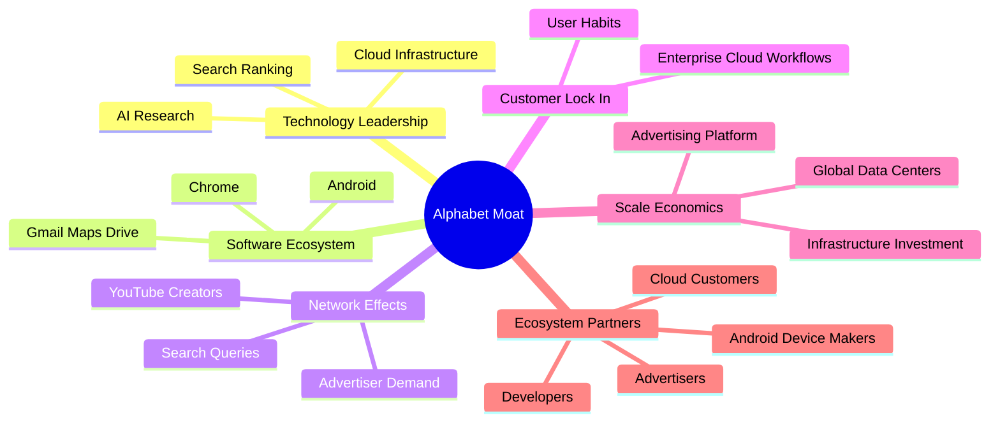
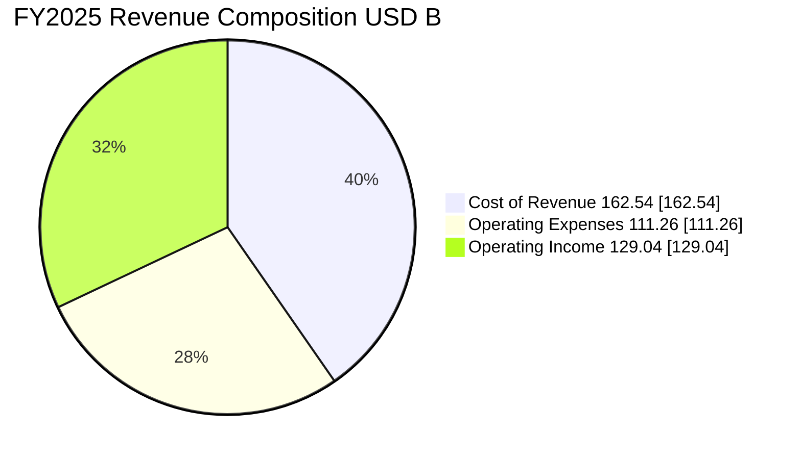
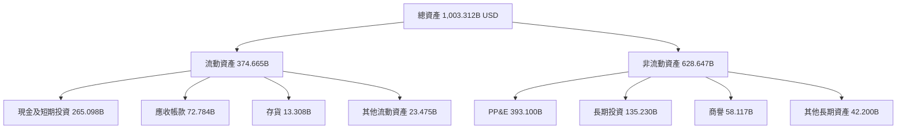
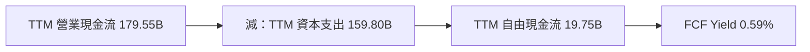
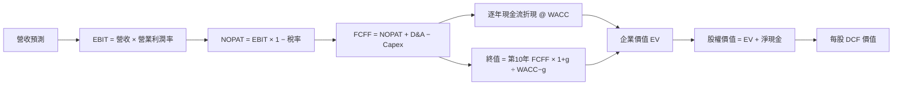
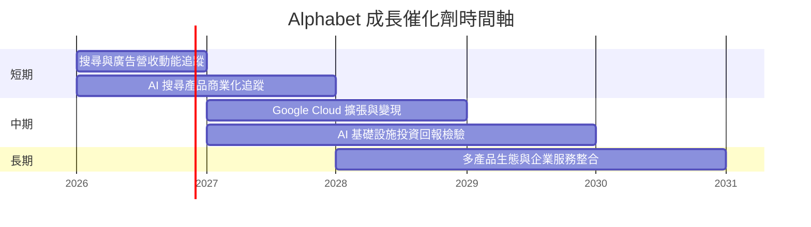
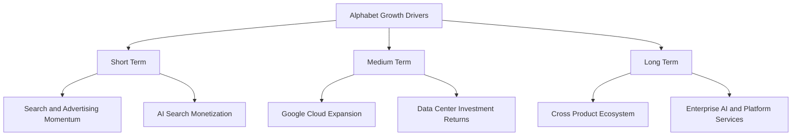
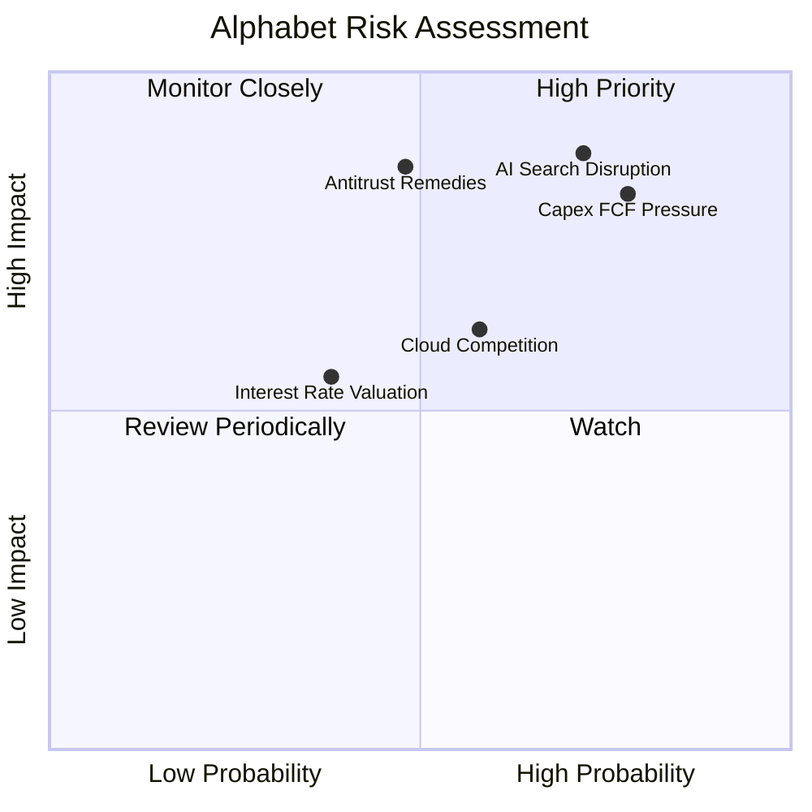
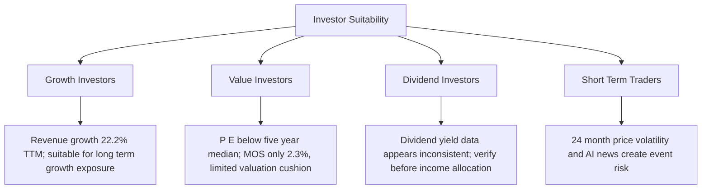

# GOOG 基本面深度分析報告
> **報告日期**：2026-11-26 ｜ **語言**：繁體中文 ｜ **數據來源**：SEC 申報資料 (XBRL)、Yahoo Finance、Finviz、StockAnalysis、Roic.ai ｜ **分析師**：CFA 級機構研究

## 目錄

| # | 章節 | 核心結論 |
|---|------|----------|
| 1 | 執行摘要 | 持有；加權合理價值 $277.39，MOS +2.3% |
| 2 | 公司概覽與商業模式 | 搜尋、廣告與平台生態具規模優勢；分部營收明細未提供 |
| 3 | 損益表深度分析 | TTM 營收 $471.10B、成長 22.2%；資本支出攀升壓低近期現金轉換 |
| 4 | 資產負債表分析 | 淨現金 $138.98B，流動性充足；營運資金天數顯示 CCC 39 天 |
| 5 | 現金流量深度分析 | TTM FCF $19.75B，FCF Yield 0.59%；再投資提高是主要壓力 |
| 6 | 獲利能力與資本效率 | ROIC 23.9% 高於 WACC 10.23%，仍創造股東價值 |
| 7 | 相對估值分析 | P/E 低於同業及自身歷史中位數；Forward P/E 並不便宜 |
| 8 | DCF 內在價值評估 | 基準 DCF $250.63；加權合理價值 $277.39，MOS 僅 +2.3% |
| 9 | 成長催化劑 | 搜尋、雲端與 AI 產品變現為主；TAM 數據未提供 |
| 10 | 風險矩陣 | AI 搜尋競爭、巨額資本支出與監管為主要風險 |
| 11 | 投資建議 | 持有；現價接近加權合理價值，監控 FCF、利潤率與資本支出 |

## 1. 執行摘要

### 1.0 一頁式投資儀表板（Portfolio Manager 30 秒速讀）

| 項目 | 內容 |
|------|------|
| **投資論點（3 句）** | ① TTM 營收 $471.10B、年增 22.2%，最新一季年增 24.7%，顯示營收動能仍在加速。② TTM ROIC 23.9% 高於 WACC 10.23%，目前仍創造經濟價值。③ TTM 資本支出 $159.80B，令 FCF 降至 $19.75B、FCF Yield 僅 0.59%，是估值與資本回報的主要制約。 |
| **綜合評分** | **7.3/10**（引用 1.1 評分卡） |
| **財務健康** | 🟢 現金及短期投資 $265.10B，淨現金 $138.98B；Piotroski F-Score 4/8，應計品質與股數測試未通過。 |
| **ROIC vs WACC** | 23.9% vs 10.23%；利差 +13.67 個百分點，仍創造價值。 |
| **FCF 趨勢** | FY2025 年度 FCF $73.27B，但最新 TTM FCF $19.75B；FCF Yield 0.59%，Capex 上升是主要原因。 |
| **估值** | Forward P/E 17.72x ｜ EV/EBITDA 17.4x ｜ FCF Yield 0.59% |
| **DCF 內在價值（基準）** | $250.63 ｜相對現價溢價 **+8.1%**（現價 ÷ DCF 價值 − 1） |
| **安全邊際（MOS）** | **+2.3%**＝($277.39 − $270.98) ÷ $277.39；🔴 <10%，無明顯下檔保護 |
| **預期報酬（基準情境 12M）** | **-7.5%**，以 DCF 基準情境 $250.63 相對現價計 |
| **關鍵風險（前二）** | AI 搜尋改變搜尋入口與廣告經濟；資本支出高增使 FCF 低於獲利增長。 |
| **評級 + 信心度** | 🟡 **持有** ｜ 信心：中 |

> **評級推導**：TTM ROIC 23.9% 高於 WACC 10.23%，TTM 營收成長 22.2%，但 TTM FCF Yield 僅 0.59%；DCF 基準價值 $250.63 低於 $270.98 現價，而加權合理價值 $277.39 對應 MOS 僅 +2.3%。依 MOS 規則，評級為**持有**；未作質化調整。

### 1.1 綜合評分卡（全報告唯一）

| 維度 | 評分（1–10） | 主要依據（引用數字與其來源章節） |
|------|--------------|----------------------------------|
| 成長性 | 8.5 | TTM 營收成長 22.2%、最新一季年增 24.7%（第 3 章） |
| 獲利能力 | 8.5 | TTM 營業利益率 33.3%、ROIC 23.9%，高於 WACC；F-Score 4/8（第 6 章） |
| 財務健康 | 9.0 | 淨現金 $138.98B、流動比率 2.786；但 CCC 39 天、應計品質測試未過（第 4 章） |
| 估值 | 5.0 | MOS +2.3%；P/E 14.1x 低於五年中位數 21.9x，但 FCF Yield 僅 0.59%（第 7–8 章） |
| 護城河 | 8.5 | 搜尋、Android、Chrome、YouTube 等生態整合；雲端與廣告規模支持商業化（第 2 章） |
| 管理層與資本配置 | 5.0 | FY2025 股權薪酬 $24.95B；最新 TTM Capex $159.80B，稀釋股數測試未通過（第 3、5 章） |
| **綜合評分** | **7.4** | 六項算術平均：(8.5+8.5+9.0+5.0+8.5+5.0) ÷ 6 = 7.4 |

### 1.2 五大投資論點 + 三大核心風險

| 類型 | 項目 | 具體依據 | 信心度 |
|------|------|----------|--------|
| 🟢 **投資論點①** | 核心業務營收仍快速成長 | TTM 營收 $471.10B、年增 22.2%；最新一季營收 $127.58B、年增 24.7%。 | 🟢 高 |
| 🟢 **投資論點②** | 高 ROIC 帶來正經濟利差 | ROIC 23.9% 對比 WACC 10.23%，利差 +13.67 個百分點。 | 🟢 高 |
| 🟢 **投資論點③** | 資產負債表有抗風險能力 | 現金及短期投資 $265.10B、總債務 $126.12B、淨現金 $138.98B。 | 🟢 高 |
| 🟢 **投資論點④** | 長期平台與產品生態有交叉銷售價值 | 搜尋、Android、Chrome、Gmail、Maps、YouTube、Google Cloud 等產品共同構成觸及與分發網絡。 | 🟡 中 |
| 🟢 **投資論點⑤** | 部分估值倍數低於自身歷史中位數 | P/E 14.1x，低於五年中位數 21.9x；EV/EBITDA 17.4x，略低於中位數 19.1x。 | 🟡 中 |
| 🟡 **風險①** | AI 搜尋改變廣告入口或使用者行為 | 若對話式搜尋減少傳統搜尋廣告展示或降低商業查詢轉換，廣告營收成長與利潤率可能下滑。 | 🟡 中 |
| 🔴 **風險②** | 高資本支出侵蝕自由現金流 | TTM Capex $159.80B，相較 OCF $179.55B，僅剩 FCF $19.75B；若投資回報延後，估值敏感度提高。 | 🔴 高 |
| 🟡 **風險③** | 監管與反壟斷救濟措施 | 可能影響預設搜尋分發、廣告技術整合或商業模式；財務衝擊數值尚無法量化。 | 🟡 中 |

### 1.3 快速統計卡片

| 指標 | 公司實際值（期間） | 同業中位數 | 狀態 |
|------|--------------------|------------|------|
| 營收成長（TTM） | **22.2%** | — | 🟢 |
| 營收成長（最新一季年增） | **24.7%** | **18.8%** | 🟢 |
| 毛利率（TTM） | **60.9%** | **67.7%** | 🟡 |
| 營業利益率（TTM） | **33.3%** | — | 🟢 |
| ROIC（TTM） | **23.9%** | — | 🟢 |
| Forward P/E | **17.72x** | **20.2x** | 🟢 |
| FCF Yield（TTM） | **0.59%** | — | 🔴 |
| Piotroski F-Score | **4 / 8** | — | 🟡 |

同業中位數按 META、MSFT、AMZN 的 Peer multiples 計算；毛利率中位數為 67.7%，最新一季營收成長中位數為 18.8%，Forward P/E 中位數為 20.2x。

### 1.4 投資結論

```text
╔══════════════════════════════════════════════════════════════════╗
║                    📊 投資結論摘要                               ║
╠══════════════════════════════════════════════════════════════════╣
║  評級：持有（依 MOS +2.3%，落在 -10% 至 +10% 區間）              ║
║  價格（2026-11-25 收盤）：$270.98                                ║
║  DCF 內在價值（基準）：$250.63（現價溢價 +8.1%）                ║
║  安全邊際 MOS：+2.3%（＝(加權合理價值−現價)÷加權合理價值）      ║
║  加權合理價值（8.8）：$277.39                                    ║
║  DCF 情境價值：                                                   ║
║    悲觀情境：$109.41（-59.6%）                                    ║
║    基準情境：$250.63（-7.5%）                                     ║
║    樂觀情境：$524.24（+93.5%）                                    ║
║  綜合評分：7.4/10（引用 1.1）                                    ║
║  適合投資人：長線成長型、可承受 AI 與資本支出波動的投資人        ║
╚══════════════════════════════════════════════════════════════════╝
```

## 2. 公司概覽與商業模式

### 2.1 業務結構與收入來源

Alphabet 經營 Google Services、Google Cloud、Other Bets 三大分部。分部營收及收入占比未提供，因此不製作帶有推估占比的結構圖；目前可確認 TTM 公司總營收為 $471.10B。

| 業務範圍 | 已知產品／服務 | 財務資料可支持的分析 |
|----------|-----------------|----------------------|
| Google Services | Search、YouTube、Android、Chrome、Gmail、Drive、Maps、Play、裝置及廣告 | 廣告與平台服務構成核心商業模式；分部營收未提供 |
| Google Cloud | 雲端基礎設施與平台服務 | 屬於另一主要分部；收入、利潤及成長數據未提供 |
| Other Bets | 多元新興業務 | 個別收入與虧損數據未提供 |

### 2.2 市場份額

市場份額數據未提供，不能以沒有來源的比例繪製市場份額圖。以公司規模衡量，Alphabet TTM 營收 $471.10B、成長 22.2%；同業 META、MSFT、AMZN 最新一季年增率分別為 26.1%、18.8%、12.1%。這表示 Alphabet 的營收成長高於其中兩家同業，但不能據此直接推導市場份額。

### 2.3 競爭護城河分析



### 2.4 護城河強度

| 護城河項目 | 強度（強／中／弱） | 證據（引用數字或事實） | 會削弱它的情況 |
|------------|--------------------|------------------------|----------------|
| 技術與資料規模 | 強 | Search、YouTube、Maps 等大規模產品與 AI 研究並存；公司 TTM 營收 $471.10B。 | 搜尋品質落後、AI 服務成本或回應品質不具競爭力。 |
| 軟體生態系統 | 強 | Android、Chrome、Gmail、Drive、Maps、Play 等多項服務覆蓋消費者日常使用。 | 監管改變預設分發、裝置或應用程式平台規則。 |
| 網路效應 | 強 | 搜尋使用者、廣告主及內容創作者互相吸引；YouTube 同時是內容與廣告平台。 | 競爭平台吸走使用者、創作者或廣告預算。 |
| 客戶鎖定 | 中 | 使用者帳號與多項服務整合；企業端雲端使用可能提高切換成本。 | 消費者服務轉換成本不高，企業雲端仍面臨多雲與自建替代。 |
| 規模效應 | 強 | TTM 營收 $471.10B、現金及短期投資 $265.10B，足以支持大規模基礎設施投資。 | Capex 長期超過變現成長，或規模帶來監管及成本負擔。 |
| 生態夥伴 | 中 | Android 裝置商、廣告主、開發者與雲端客戶形成合作網絡。 | 合作條件、預設分發或廣告技術關係遭監管改變。 |

**1.1 護城河評分 8.5/10**，主要由跨產品分發、廣告網絡與規模經濟支持；評分未更高的原因是 AI 搜尋入口與監管規則可能改變既有優勢。

## 3. 損益表深度分析

### 3.1 年度收入成長趨勢（近 4 年）

| 財年 | 營收 | YoY |
|------|------|-----|
| FY2022 | $282.84B | — |
| FY2023 | $307.39B | +8.7% |
| FY2024 | $350.02B | +13.9% |
| FY2025 | $402.84B | +15.1% |

```text
╔══════════════════════════════════════════════════════════════════╗
║             Alphabet 年度收入趨勢（FY2022–FY2025）               ║
╠══════════════════════════════════════════════════════════════════╣
║  FY2022  $282.84B  ██████████████░░░░░░░░░░░░░░  YoY: N/A       ║
║  FY2023  $307.39B  ███████████████░░░░░░░░░░░░░  YoY: +8.7%     ║
║  FY2024  $350.02B  █████████████████░░░░░░░░░░░  YoY: +13.9%    ║
║  FY2025  $402.84B  ████████████████████░░░░░░░░  YoY: +15.1%    ║
╠══════════════════════════════════════════════════════════════════╣
║  FY2022–FY2025 三年 CAGR：約 12.5%                               ║
╚══════════════════════════════════════════════════════════════════╝
```

FY2022 至 FY2025 營收 CAGR 約 12.5%，而最新 TTM 成長 22.2% 高於這段歷史年增速。差異顯示近期營收動能提升，但不能僅用單一 TTM 年增率判定長期趨勢已永久抬升。

### 3.2 季度收入趨勢分析

QoQ 按連續季度營收計算；YoY 使用同季比較。最新一季年增率以 SEC／驗證數據的 24.7% 為準。

| 季度 | 營收 | QoQ | YoY | 備註 |
|------|------|-----|-----|------|
| 2025 Q4 | $113.83B | +26.1% | +18.0% | 以 Q3 2025 $102.35B 為 QoQ 基期 |
| 2026 Q1 | $109.90B | -3.5% | +21.8% | 季節性回落，但年增加速 |
| 2026 Q2 | $119.80B | +9.0% | +24.2% | 營收延續擴張 |
| 2026 Q3 | $127.58B | +6.5% | +24.7% | 驗證值為最新一季年增率 |

2026 Q3 營收較 Q2 增加 $7.78B，QoQ 約 +6.5%；最新一季年增 24.7%，比 2025 Q3 的 15.95% 高，代表當期營收成長加快。此趨勢是否來自搜尋、YouTube 或 Cloud，分部營收資料不足以拆解。

### 3.3 利潤率演變分析

下表年度毛利率、營業利益率為年度總額相除的計算值；TTM 利潤率直接引用驗證數據。

| 利潤率指標 | FY2022 | FY2023 | FY2024 | FY2025 | 趨勢 | 評估 |
|------------|--------|--------|--------|--------|------|------|
| **毛利率** | 55.4% | 56.6% | 58.2% | 59.6% | 逐年提升 | 🟢 |
| **營業利益率** | 26.5% | 27.4% | 32.1% | 32.0% | FY2024 擴張後大致持平 | 🟢 |
| **淨利率** | 21.2% | 24.0% | 28.6% | 32.8% | FY2025 上升 | 🟡 |

年度毛利率由 FY2022 的 55.4% 提升至 FY2025 的 59.6%，可能反映收入組合、基礎設施效率與規模改善；具體分部毛利未提供，無法分離價格、流量成本或產品組合的個別貢獻。營業利益率由 FY2023 的 27.4% 升至 FY2024 的 32.1%，FY2025 約 32.0%，說明營業槓桿改善後維持高檔。

驗證數據顯示 TTM 營業利益率 33.3%，最新季度為 31.8%；季度低於 TTM，應留意最新投資與成本節奏是否造成邊際利潤率承壓。

### 3.4 費用結構分析

FY2025 可由年報損益數字推導主要構成：營收 $402.84B、毛利 $240.30B、營業利益 $129.04B。收入減毛利為營業成本 $162.54B；毛利減營業利益為營業費用 $111.26B。



```text
╔══════════════════════════════════════════════════════════════════╗
║               FY2025 營收至營業利益結構                          ║
╠══════════════════════════════════════════════════════════════════╣
║  營收                    $402.84B  ████████████████████          ║
║  營業成本                $162.54B  ████████                      ║
║  毛利                    $240.30B  ████████████                  ║
║  毛利後營業費用          $111.26B  ██████                        ║
║  營業利益                $129.04B  ██████                        ║
╚══════════════════════════════════════════════════════════════════╝
```

### 3.5 季度 EPS 趨勢與盈餘品質（Quality of Earnings）

| 季度 | EPS 實際值 | EPS 年增率 | 超預期／不及預期 |
|------|------------|------------|------------------|
| 2025 Q4 | $2.81 | +31.15% | 預期值 N/A，無法判定 |
| 2026 Q1 | $5.11 | +81.96% | 預期值 N/A，無法判定 |
| 2026 Q2 | $9.11 | +294.31% | 預期值 N/A，無法判定 |
| 2026 Q3 | $2.14 | -25.34% | 預期值 N/A，無法判定 |

EPS Est 欄位四季皆為 nan，故無法可靠判定超預期或不及預期。2026 Q2 的 EPS $9.11 與相鄰季度差異顯著，現有資料未提供足以解釋該季非經常性項目或股數的細節，不能把單季高值直接外推。

| 盈餘品質項目 | 數值／佔比 | 評估 |
|--------------|------------|------|
| 股權薪酬 SBC / 營收 | FY2025：$24.95B ÷ $402.84B = **6.2%** | 🟡 SBC 是實質股東成本；若以股票支付，會造成稀釋或回購抵銷成本。 |
| SBC / 營業現金流 | FY2025：$24.95B ÷ $164.71B = **15.1%** | 🟡 比重可觀；不可只看 GAAP 淨利而忽略股權薪酬。 |
| FCF / 淨利（現金轉換率） | TTM FCF $19.75B ÷ StockAnalysis TTM 淨利 $235.694B = **8.4%** | 🔴 現金轉換偏低，但兩資料來源對 TTM 淨利存在明顯口徑差異，應避免直接外推。 |
| 一次性／非經常性損益 | N/A（未提供可核實明細） | 黃色警示：2026 Q2 EPS 大幅高於鄰季，但無法判斷是否由一次性項目造成。 |
| 有效稅率異常 | 16.8%（最新年度有效稅率） | 🟢 未見資料顯示稅率異常；DCF 亦採 16.8%。 |
| 資本化支出 vs 費用化 | TTM Capex $159.80B；資本化政策明細未提供 | 🟡 Capex 顯著壓低現金流；無法由現有資料判斷資本化是否不當或導致費用遞延。 |

**盈餘品質結論**：GAAP 損益表不能單獨代表當期可分配現金。TTM OCF $179.55B 看似可觀，但扣除 TTM Capex $159.80B 後 FCF 僅 $19.75B。加上 SBC 約占 FY2025 營收 6.2%，股東需同時監控資本投資回報、股數變化與現金轉換；現階段不宜用單季 EPS 高點推估長期獲利。

## 4. 資產負債表分析

### 4.1 資產結構分解

以 2026-09-30 StockAnalysis 資產負債表為據：總資產 $1,003.312B、流動資產 $374.665B，非流動資產差額 $628.647B。此資產表資料與 SEC 驗證的現金、債務口徑並非完全一致，以下資產結構僅用於組成解讀，不替代驗證淨現金數字。



### 4.2 流動性與營運資金分析

| 指標 | 最新值 | 歷史／比較值 | 評估 |
|------|--------|--------------|------|
| 流動比率 | 2.786 | FY2025 年底流動資產 $206.04B、流動負債 $102.75B | 🟢 流動資產覆蓋短期負債有餘裕；日期與來源口徑不同，不直接計算同比變化。 |
| 速動比率 | 2.512 | — | 🟢 短期償債能力良好。 |
| 現金轉換週期 | 39 天 | 一年前 N/A | 🟡 缺少一年前 DIO、DPO，無法完整比較週期變化。 |

**營運資金天數（QUALITY FIGURES 原值）**

| 指標 | 最新 TTM | 一年前 TTM | 變化 | 解讀 |
|------|----------|------------|------|------|
| DSO 應收帳款天數 | 56 天 | 54 天 | +2 天 | 收款天數略增，代表應收回收較前一年稍慢；資料不足以判斷是否由客戶或收入組合所致。 |
| DIO 存貨天數 | 26 天 | N/A | N/A | 存貨天數有最新值，但前一年缺資料；不可自行補值。 |
| DPO 應付帳款天數 | 43 天 | N/A | N/A | 缺前一年資料，無法評估供應商付款條件變化。 |
| CCC 現金轉換週期 | 39 天 | N/A | N/A | CCC = 56 + 26 − 43 = 39 天；前一年 CCC 未提供。 |

### 4.3 債務結構分析

下列債務數字採 SEC 驗證口徑：現金及短期投資 $265.10B、總債務 $126.12B、淨現金 $138.98B。其他資料源列示的總債務與淨現金不同，估值及評級以驗證口徑為準。

```text
╔══════════════════════════════════════════════════════════════════╗
║                    Alphabet 債務健康診斷                         ║
╠══════════════════════════════════════════════════════════════════╣
║  總債務：        $126.12B  █████████░░░░░░░░░░░  🟢               ║
║  現金+短期投資：  $265.10B  ████████████████████  🟢               ║
║  淨現金：        $138.98B  ██████████░░░░░░░░░░  🟢               ║
║  Debt/EBITDA：   N/A（無同口徑已驗證 EBITDA 輸入）                ║
║  利息保障倍數：   N/A（利息費用金額未提供）                        ║
║  備註：其他來源債務總額不同，採驗證口徑避免混用                     ║
╚══════════════════════════════════════════════════════════════════╝
```

### 4.4 股東權益趨勢

| 財年 | 股東權益 |
|------|----------|
| FY2022 | $256.14B |
| FY2023 | $283.38B |
| FY2024 | $325.08B |
| FY2025 | $415.26B |

```text
╔══════════════════════════════════════════════════════════════════╗
║                 Alphabet 股東權益趨勢（年度）                    ║
╠══════════════════════════════════════════════════════════════════╣
║  FY2022  $256.14B  ████████████░░░░░░░░                         ║
║  FY2023  $283.38B  ██████████████░░░░░░                         ║
║  FY2024  $325.08B  ████████████████░░░░                         ║
║  FY2025  $415.26B  ████████████████████                         ║
╚══════════════════════════════════════════════════════════════════╝
```

股東權益 FY2025 增至 $415.26B；但帳面權益增加不等於股東每股價值同比增加，還需同步檢查股票薪酬、回購、股數與資本回報率。

## 5. 現金流量深度分析

### 5.1 現金流量瀑布圖

TTM 淨利口徑在資料來源間不一致，且未提供可完整銜接的 TTM 股息／回購／淨現金變化，所以不畫不完整的現金流瀑布；下圖只展示有驗證數據的核心現金流關係。



### 5.2 FCF 轉換率趨勢

| 財年 | OCF | Capex | FCF | 淨利 | FCF／淨利 |
|------|-----|-------|-----|------|-----------|
| FY2022 | $91.50B | $31.48B | $60.01B | $59.97B | 約 100.1% |
| FY2023 | $101.75B | $32.25B | $69.50B | $73.80B | 約 94.2% |
| FY2024 | $125.30B | $52.53B | $72.76B | $100.12B | 約 72.7% |
| FY2025 | $164.71B | $91.45B | $73.27B | $132.17B | 約 55.4% |

FY2022 至 FY2025，OCF 上升，但 FCF 僅由 $60.01B 增至 $73.27B；同期 Capex 由 $31.48B 增至 $91.45B。現金轉換率下滑主要是資本支出增速高於自由現金流增速，並非營業現金流萎縮。

### 5.3 自由現金流趨勢

```text
╔══════════════════════════════════════════════════════════════════╗
║                  自由現金流：年度實際與最新 TTM                  ║
╠══════════════════════════════════════════════════════════════════╣
║  FY2022  $60.01B  ████████████████░░░░  FCF Yield：N/A           ║
║  FY2023  $69.50B  ██████████████████░░  FCF Yield：N/A           ║
║  FY2024  $72.76B  ███████████████████░  FCF Yield：N/A           ║
║  FY2025  $73.27B  ████████████████████  FCF Yield：N/A           ║
║  TTM     $19.75B  █████░░░░░░░░░░░░░░░  FCF Yield：0.59%         ║
╠══════════════════════════════════════════════════════════════════╣
║  注意：TTM 期間跨越季度且 Capex 顯著增加，不與完整財年直接等同。 ║
╚══════════════════════════════════════════════════════════════════╝
```

年度 FCF 自 FY2022 起逐步增加，但 FY2025 的 $73.27B 與最新 TTM $19.75B 差距很大，主因是最新 TTM Capex 達 $159.80B。季度資料亦顯示 2026 Q3 Capex $51.35B、當季 FCF -$9.06B，投資強度使短期現金流更波動。

### 5.4 資本配置評估

FY2025 可確認股息支付 $10.05B、Capex $91.45B、SBC $24.95B；回購、留存現金的完整年度金額未提供，因此不繪製包含未知項目的比例圖。

| 項目 | FY2025／最新可得數據 | 評估 |
|------|----------------------|------|
| 資本支出 | FY2025 $91.45B；TTM $159.80B | 🔴 投資額快速增加，未來需看 AI／雲端資產的收入與現金回報。 |
| 股息 | FY2025 支付 $10.05B | 🟢 相較年度 OCF $164.71B，現金負擔可控。 |
| 股權薪酬 | FY2025 $24.95B | 🟡 對股東有稀釋成本，應與回購抵銷效果一併追蹤。 |
| 回購／留存 | N/A（分項金額未提供） | 無法作精確資本配置占比分析。 |

## 6. 獲利能力與資本效率

### 6.1 ROE / ROA / ROIC 趨勢

| 指標 | 最新數值 | 歷史資料 | 評估 |
|------|----------|----------|------|
| ROE | TTM 驗證值 34.8% | 其他市場資料來源列 44.3%，口徑不一致 | 🟢 以驗證值為準；杜邦分析採 34.8%。 |
| ROA | 12.7% | 最新品質指標顯示 ROA 為正且高於一年前 | 🟢 資產回報正向。 |
| ROIC | TTM 23.9% | 10 年歷史逐年序列未提供完整、可比口徑 | 🟢 顯著高於資本成本。 |

### 6.2 ROIC vs WACC 分析（核心價值創造判斷）

WACC、資本權重及股權成本採用資本成本資料。股權成本與債務成本採用已提供計算值，不另用不完整利息或債務數據重建。

```text
╔══════════════════════════════════════════════════════════════════╗
║                ROIC vs WACC 深度分析                            ║
╠══════════════════════════════════════════════════════════════════╣
║  WACC 輸入（資本成本資料）：                                     ║
║  ├── 無風險利率 Rf（10Y 美債）：       4.85%                     ║
║  ├── 股權風險溢酬 ERP：                5.00%                     ║
║  ├── 原始 Beta：                       1.23                      ║
║  ├── 調整後 Beta：                     1.15                      ║
║  ├── 股權成本 Ke：                     10.60%                    ║
║  ├── 稅前債務成本 Kd：                 0.58%                     ║
║  ├── E/D 權重：                         96.4% / 3.6%              ║
║  └── WACC：                            10.23%                    ║
║                                                                  ║
║  ROIC：                                     23.90%                ║
║  ROIC − WACC：                             +13.67pp               ║
║                                                                  ║
║  ROIC 23.90%  ▓▓▓▓▓▓▓▓▓▓▓▓▓▓▓▓▓▓▓▓▓▓▓▓░░░░░░  🟢              ║
║  WACC 10.23%  ▓▓▓▓▓▓▓▓▓▓░░░░░░░░░░░░░░░░░░░░  ──              ║
║                                                                  ║
║  結論：ROIC 約為 WACC 的 2.34 倍，仍在創造股東價值。             ║
╚══════════════════════════════════════════════════════════════════╝
```

**計算鏈**：ROIC − WACC = 23.90% − 10.23% = **13.67 個百分點**；ROIC ÷ WACC = 23.90% ÷ 10.23% = **2.34 倍**。但此利差是 TTM 指標，不代表新增 $159.80B TTM Capex 已產生同等回報；未來新增投資回報是資本配置的核心檢驗。

### 6.3 杜邦三因素分解

| 因素 | 數值（TTM） | 解讀 |
|------|-------------|------|
| 淨利率 | 50.0% | 利潤率對 ROE 貢獻大；注意此品質指標口徑與其他來源淨利數字存在差異。 |
| 資產週轉率 | 0.47 | 每單位資產產生約 0.47 倍營收。 |
| 權益乘數 | 1.48 | 槓桿程度不高，ROE 並非主要靠高財務槓桿撐起。 |
| **ROE** | **34.8%** | 50.0% × 0.47 × 1.48 ≈ 34.8%；原始 DuPont 數字照抄品質指標。 |

### 6.4 財務體質：Piotroski F-Score

F-Score 為 **4 / 8**；一項測試因資料不足而不計入分母。

| 測試 | 結果 | 解讀 |
|------|------|------|
| ROA > 0 | ✅ 通過 | 盈利資產回報為正。 |
| 營業現金流 > 0 | ✅ 通過 | TTM OCF $179.55B。 |
| ROA 高於一年前 | ✅ 通過 | 資產回報改善。 |
| 營業現金流 > 淨利（應計品質） | ❌ 未通過 | 現金流未高於淨利；需注意盈餘與現金轉換差距。 |
| 長期負債 ÷ 總資產低於一年前 | ❌ 未通過 | 槓桿相對變化未改善；與淨現金狀態並不矛盾，分母或負債變動仍需追蹤。 |
| 流動比率高於一年前 | ✅ 通過 | 短期流動性改善。 |
| 稀釋股數未增加 | ❌ 未通過 | 股數增加代表 SBC 等稀釋成本尚未完全抵銷。 |
| 毛利率高於一年前 | — 無法判定 | 缺少該測試所需可比資料。 |
| 資產週轉率高於一年前 | ❌ 未通過 | 資產效率未改善，可能與資產擴張快於營收有關。 |

## 7. 相對估值分析

### 7.1 同業估值比較表格

本公司倍數取已驗證估值；同業全部使用 Peer multiples。GOOG Forward P/E 為 Yahoo Finance／市場估值區塊數值，與估值方法所用 Forward EPS 口徑不同，故表內直接照列各來源指標。

| 估值指標 | **GOOG** | **META** | **MSFT** | **AMZN** | GOOG 評估 |
|----------|----------|---------|---------|---------|-----------|
| **Trailing P/E** | 14.1x | 20.8x | 25.6x | 19.8x | 🟢 低於三家同業 |
| **Forward P/E** | 17.72x | 17.1x | 20.2x | 22.4x | 🟡 接近 META、高於其倍數 |
| **P/S Ratio** | 7.1x | 6.5x | 10.5x | 3.3x | 🟡 高於 META、低於 MSFT |
| **EV/EBITDA** | 17.4x | 13.7x | 18.0x | 15.4x | 🟡 高於 META、AMZN |
| **最新一季營收年增** | 24.7% | 26.1% | 18.8% | 12.1% | 🟢 成長僅略低於 META |
| **毛利率（TTM）** | 60.9% | 81.0% | 67.7% | 51.4% | 🟡 低於 META、MSFT，高於 AMZN |

GOOG Trailing P/E 低於同業，但公司最新一季營收成長較快；EV/EBITDA 仍高於 META 與 AMZN，說明「低本益比」不能單獨代表所有估值口徑都便宜。

### 7.2 歷史估值區間分析

```text
╔══════════════════════════════════════════════════════════════════╗
║                GOOG 五年估值區間（TTM 倍數）                     ║
╠══════════════════════════════════════════════════════════════════╣
║  P/E        1.3x ─────────────● 14.1x ───────────── 29.0x        ║
║                     中位數 21.9x；目前百分位 29%                 ║
║  P/S        4.1x ────────────────● 7.1x ──────────── 9.8x        ║
║                     中位數 6.1x；目前百分位 67%                  ║
║  EV/EBITDA  13.7x ────────● 17.4x ──────────────── 25.0x        ║
║                     中位數 19.1x；目前百分位 33%                 ║
╚══════════════════════════════════════════════════════════════════╝
```

P/E 與 EV/EBITDA 目前分別處於自身五年區間的 29% 與 33% 百分位，屬於相對偏低位置；P/S 位於 67% 百分位，則高於其歷史中位數，估值訊號並非全面便宜。

### 7.3 情境價值（Bear / Base / Bull，照抄 DCF MODEL 的 Scenarios）

| 情境 | 第 1 年營收成長 | 期末營業利潤率 | WACC | 每股價值 | 相對現價 | 機率 | 會發生的條件 |
|------|----------------|----------------|------|----------|----------|------|--------------|
| 🔴 悲觀 | 11.1% | 27.2% | 11.23% | $109.41 | -59.6% | 25% | 搜尋／廣告成長明顯放慢，AI 投資增加成本但未有效變現，利潤率下滑且風險溢酬上升。 |
| 🟡 基準 | 22.2% | 32.0% | 10.23% | $250.63 | -7.5% | 50% | 近期成長逐步回落至長期趨勢，營業利潤率由 33.3% 緩降至 32.0%。 |
| 🟢 樂觀 | 33.3% | 35.2% | 9.23% | $524.24 | +93.5% | 25% | AI、Cloud 與核心廣告同時放量，規模經濟抵銷資本支出且融資風險下降。 |

情境假設是模型輸入，不是公司財測。悲觀與樂觀情境的起始成長、期末利潤率及 WACC 同時變動，因此價差反映多項假設合併變化，不能視為單一因素敏感度。

### 7.4 相對估值隱含價格區間

```text
╔══════════════════════════════════════════════════════════════════╗
║             同業／共識估值方法與股價位置                         ║
╠══════════════════════════════════════════════════════════════════╣
║  $243.37 ───── $250.63 ───── $270.98 ───── $309.60 ───── $389.00║
║  EV/EBITDA       DCF           現價          Forward P/E   共識  ║
╚══════════════════════════════════════════════════════════════════╝
```

| 方法 | 每股價值 | 依據 |
|------|----------|------|
| 同業 Forward P/E | $309.60 | META、MSFT、AMZN 同業中位數 20.2x × Forward EPS $15.29 |
| 同業 EV/EBITDA | $243.37 | 同業中位數 15.4x × TTM EBITDA，並加回淨現金 |
| 分析師共識目標價 | $389.00 | 15 位分析師平均目標價 |
| DCF 基準 | $250.63 | 10 年 FCFF、WACC 10.23%、終值成長率 3.0% |

## 8. DCF 內在價值評估（Discounted Cash Flow）

> 本章 DCF 金額以美元十億（$B）為單位，除每股價值外均如此。模型逐年數字、敏感度矩陣、情境、加權方法按程式計算結果引用；計算顯示至小數點後兩位，折現因子三位，允許四捨五入尾差。模型明確未建模營運資金變動。

### 8.0 估值推理鏈（Thinking Logic）

**Step 1 — 價值來源與主導變數**

Alphabet 的價值可拆為核心 Google Services 現金流、Google Cloud 成長，以及 Other Bets 的選擇權價值；分部營收比例未提供，不能填寫各自營收占比。模型中價值最敏感的變數為終值成長率與折現率：終值現值占企業價值 72.5%，因此長期現金流及 WACC 的微小改變會主導估值。

**Step 2 — 模型選擇**

| 決策點 | 本報告採用 | 理由 | 曾考慮但否決 | 否決理由 |
|--------|-----------|------|--------------|----------|
| 現金流定義 | FCFF | 與 WACC 折現、得企業價值的模型相容 | FCFE | 模型已固定使用 FCFF 與 WACC |
| 預測期 N | 10 年 | DCF 模型固定 10 年，能反映成長淡出過程 | 5 年 | 與既有模型期間不同，且不能自行改模型 |
| 終值方法 | Gordon Growth | DCF 模型採終值成長率 3.0% | 退出倍數 | 模型未提供退出倍數終值，不另建模型 |
| EBIT 基礎 | GAAP EBIT | TTM 營業利益率 33.3%，模型明確用 GAAP | 非 GAAP EBIT | 無法在維持程式模型輸入下調整 |
| SBC | 組合 A | GAAP EBIT 已含 SBC 費用，固定股數、不再扣 SBC | 另扣 SBC 或加稀釋 | 會改變已計算模型口徑 |

**Step 3 — 關鍵假設推導鏈**

- **營收成長路徑**：錨點＝TTM 成長 22.2% → 調整＝模型把年 1 成長依固定路徑線性降至年 10 的 3.0%，反映成長逐步成熟 → **採用年 1 22.2%、年 10 3.0%** → 曾考慮延續更高長期成長，但缺乏可驗證的分部預測與管理層長期財測，因此不採用。
- **期末營業利潤率**：錨點＝TTM 33.3%，近五財年中位數包含 TTM → 調整＝模型令利潤率逐步淡出至 32.0%，保留規模優勢但承認競爭與投資成本 → **採用 32.0%** → 曾考慮固定在 33.3%，但若新增 AI 與資料中心投資使成本上升，固定當前水準偏樂觀。
- **永續成長率 g**：錨點＝模型採 3.0%，且低於 WACC 10.23% → 調整＝不另加超過長期成熟企業可持續增長的高假設 → **採用 3.0%** → 不採用更高永續成長，避免終值長期占比再被推高。
- **預測期 N**：錨點＝模型設定 10 年 → 調整＝不改變程式預測期 → **採用 10 年** → 不採用較短期間，因會更早將尚未成熟的現金流交由終值承擔；也不自行延長至 15 年，以避免無數據支持地延長高增長。
- **Capex／營收**：錨點＝TTM Capex $159.80B ÷ TTM 營收 $471.10B ≈ 33.9% → 調整＝模型逐步降至年 10 的 6.5%，以 DCF 設定的 1.1 倍 D&A 為收斂參照 → **採用 33.9% 至 6.5%** → 不採用長期仍維持 33.9%，因會令成熟期再投資強度持續異常偏高；但下降路徑仍是模型重要樂觀來源。
- **GAAP EBIT 與 SBC**：錨點＝GAAP EBIT、SBC 已列費用 → 調整＝不再從 FCFF 扣 SBC，也不再增加股數 → **採用組合 A、年稀釋率 0%** → 否決 GAAP EBIT 再扣 SBC，避免重複計成本。
- **年稀釋率**：錨點＝組合 A 的固定股數設定 → 調整＝SBC 費用已反映於 GAAP EBIT → **採用 0% 額外年稀釋** → 不採用另加股數稀釋，以免同一 SBC 成本重複計入。
- **終值方法**：錨點＝模型提供 Gordon Growth 終值 → 調整＝WACC 大於 g，可用該方法 → **採用 Gordon Growth** → 否決未提供的退出倍數模型，避免自行加設同業退出倍數。
- **WACC**：錨點＝成本資本資料的 WACC 10.23% → 調整＝依模型直接使用，不自行替換 → **採用 10.23%** → 否決自行估算另一折現率，以確保與已計算 DCF 一致。

**Step 4 — 最脆弱環節**

最脆弱的是 Capex／營收由目前約 33.9% 降至第 10 年 6.5%；若資料中心投資長期維持高位，FCFF 與 DCF 價值會低於基準，且模型終值占 EV 72.5%，下檔可能顯著。

**Step 5 — 計算路徑**



### 8.1 模型假設總表（Model Inputs）

| 假設項目 | 採用值 | 依據／來源 | 敏感度 |
|----------|--------|-------------|--------|
| 預測期長度 N | 10 年 | DCF 模型設定 | 🟡 中 |
| 營收成長 | 年 1 22.2%，年 10 3.0% | 年 1 為 TTM vs prior TTM 成長；年 10 為模型成熟期假設 | 🔴 高 |
| 營業利潤率 | 年 1 33.3% → 年 10 32.0% | TTM 營業利益率及最近五財年中位數設定 | 🔴 高 |
| 有效稅率 | 16.8% | 最新年度有效稅率 | 🟢 低 |
| Capex／營收 | 年 1 33.9% → 年 10 6.5% | TTM Capex／營收及模型淡出路徑 | 🔴 高 |
| D&A／營收 | 5.9% | TTM 數據 | 🟢 低 |
| 營運資金變動 | 未建模 | DCF 模型明確未納入 working capital | 🟡 模型限制 |
| EBIT 基礎 | GAAP EBIT | 模型假設 | 🟡 中 |
| SBC 處理 | 不再扣減；GAAP EBIT 已含費用 | 組合 A | 🟡 中 |
| 年稀釋率 | 0% 額外稀釋 | 與組合 A 固定股數相容 | 🟡 中 |
| 永續成長率 g | 3.0% | DCF 模型設定；低於 WACC | 🔴 高 |
| 終值方法 | Gordon Growth | DCF 模型設定 | 🔴 高 |
| WACC | 10.23% | 資本成本資料與 DCF 模型 | 🔴 高 |

**FCFF 定義**：FCFF = NOPAT + D&A − Capex；營運資金變動未建模。**本模型採用 (A)：GAAP EBIT + 固定股數，故 SBC 影響已計入一次**；不另設 −SBC 列、不再計額外年稀釋率。

### 8.2 折現率推導（WACC）

調整後 Beta 按資料提供的方式由原始 Beta 調整：⅔ × 1.23 + ⅓ × 1 = 約 1.15。Rf、ERP、Beta、股權成本、債務成本、權重與 WACC 均使用資本成本資料原值；Rf 的具體觀察日期及原始利息金額未提供。

```text
╔══════════════════════════════════════════════════════════════════╗
║                    WACC 推導（折現率）                           ║
╠══════════════════════════════════════════════════════════════════╣
║  股權成本 Ke（CAPM）：                                           ║
║  ├── 無風險利率 Rf：                    4.85%                    ║
║  ├── 市場風險溢酬 ERP：                 5.00%                    ║
║  ├── 原始 Beta：                        1.23                     ║
║  ├── 調整後 Beta：                      1.15                     ║
║  └── Ke = 4.85% + 1.15 × 5.00% = 10.60%（採用原值）              ║
║                                                                  ║
║  債務成本：                                                       ║
║  ├── 稅前 Kd：                          0.58%                    ║
║  ├── 有效稅率：                         16.8%                    ║
║  └── 稅後 Kd = 0.58% × (1−16.8%) = 0.48%（四捨五入）             ║
║                                                                  ║
║  資本結構：                                                       ║
║  ├── 股權權重 E：                       96.4%                    ║
║  ├── 債務權重 D：                       3.6%                     ║
║  └── WACC：                             10.23%（採用資料原值）    ║
╚══════════════════════════════════════════════════════════════════╝
```

1. **Ke（CAPM）**：4.85% + 1.15 × 5.00% = 10.60%（資料提供 Ke 原值 10.60%）。
2. **稅前 Kd**：0.58%（資料提供）；利息費用金額及計息負債平均餘額未提供，無法獨立重建其分子、分母。
3. **稅後 Kd**：0.58% × (1 − 16.8%) = 0.483% ≈ 0.48%。
4. **權重**：股權 96.4%；債務 3.6%；合計 96.4% + 3.6% = 100.0%。市值與計息負債的完整組成未提供，故不另行反推。
5. **WACC**：採用模型輸入 **10.23%**。以表列已四捨五入成本及權重重算會產生約 10.24% 的小幅尾差；遵照優先數據原值，折現一律採 10.23%。

### 8.3 逐年自由現金流預測（基準情境）

下表逐年沿用 DCF 模型數值。工作資本未建模，因此不列 ΔWC；Capex 以正數列示扣減金額。

| 年度 | FY+1 | FY+2 | FY+3 | FY+4 | FY+5 | FY+6 | FY+7 | FY+8 | FY+9 | FY+10 |
|------|------|------|------|------|------|------|------|------|------|-------|
| 營收 | 575.74 | 691.33 | 815.37 | 944.26 | 1,073.37 | 1,197.22 | 1,309.81 | 1,405.02 | 1,477.16 | 1,521.48 |
| 營收 YoY | 22.2% | 20.1% | 17.9% | 15.8% | 13.7% | 11.5% | 9.4% | 7.3% | 5.1% | 3.0% |
| 營業利潤率 | 33.3% | 33.2% | 33.0% | 32.9% | 32.7% | 32.6% | 32.5% | 32.3% | 32.2% | 32.0% |
| EBIT（GAAP） | 191.84 | 229.37 | 269.36 | 310.58 | 351.51 | 390.36 | 425.19 | 454.09 | 475.29 | 487.37 |
| − 稅 | (32.20) | (38.50) | (45.21) | (52.13) | (58.99) | (65.51) | (71.36) | (76.21) | (79.77) | (81.80) |
| = NOPAT | 159.65 | 190.87 | 224.15 | 258.46 | 292.52 | 324.84 | 353.83 | 377.88 | 395.52 | 405.57 |
| + D&A | 34.21 | 41.08 | 48.45 | 56.11 | 63.79 | 71.14 | 77.84 | 83.49 | 87.78 | 90.41 |
| − Capex | (195.30) | (213.47) | (226.97) | (234.11) | (233.46) | (223.97) | (205.18) | (177.35) | (141.51) | (99.46) |
| **= FCFF** | **-1.44** | **18.48** | **45.64** | **80.46** | **122.84** | **172.02** | **226.48** | **284.03** | **341.80** | **396.53** |
| 折現因子 | 0.907 | 0.823 | 0.747 | 0.677 | 0.614 | 0.557 | 0.506 | 0.459 | 0.416 | 0.377 |
| **FCFF 現值 PV** | **-1.31** | **15.21** | **34.07** | **54.49** | **75.47** | **95.88** | **114.52** | **130.28** | **142.23** | **149.69** |

**預測期現值逐項加總**：  
-1.31 + 15.21 + 34.07 + 54.49 + 75.47 + 95.88 + 114.52 + 130.28 + 142.23 + 149.69 = **810.53B**

**FY+1 逐步演算**

1. 營收：$471.10B × (1 + 22.2%) ≈ **$575.74B**（模型採用未四捨五入底層值）。
2. EBIT：$575.74B × 33.3% ≈ **$191.84B**。
3. 稅：$191.84B × 16.8% ≈ **$32.20B**。
4. NOPAT：$191.84B − $32.20B = **$159.64B**；模型列值為 $159.65B，差異為中間值四捨五入尾差。
5. D&A：$575.74B × 5.9% ≈ **$34.21B**。
6. Capex：模型年 1 Capex／營收 33.9%，$575.74B × 33.9% ≈ **$195.30B**。
7. ΔWC：模型未建模，故不另扣除。
8. FCFF：$159.65B + $34.21B − $195.30B = **-$1.44B**。
9. 折現因子：1 ÷ (1 + 10.23%)¹ ≈ **0.907**；PV：-$1.44B × 0.907 ≈ **-$1.31B**。

**合理性自檢**

- 預測期 FCFF CAGR 不適合以 FY+1 負數作一般 CAGR 起點；歷史 FY2022–FY2025 FCF 由 $60.01B 增至 $73.27B，三年 CAGR 約 6.9%。DCF 後段 FCFF 快速回升，主要來自 Capex／營收由 33.9% 下滑至 6.5%，不是單純營收成長。
- FY+10 FCFF 利潤率 = $396.53B ÷ $1,521.48B = **26.1%**；目前 TTM FCF／營收 = $19.75B ÷ $471.10B = **4.2%**。同業最佳 FCFF 利潤率未提供，無法比較。
- FY+1 FCFF 為負 $1.44B，原因是模型年 1 Capex $195.30B 高於 NOPAT 與 D&A 合計；之後預期 Capex 強度下降，FCFF 轉正。

```text
╔══════════════════════════════════════════════════════════════════╗
║            自由現金流：歷史實際 vs 模型預測                      ║
╠══════════════════════════════════════════════════════════════════╣
║  FY2023(實)  $69.50B  ████░░░░░░░░░░░░░░░░░░  YoY：+15.8%       ║
║  FY2024(實)  $72.76B  ████░░░░░░░░░░░░░░░░░░  YoY：+4.7%        ║
║  FY2025(實)  $73.27B  ████░░░░░░░░░░░░░░░░░░  YoY：+0.7%        ║
║  FY+1 (預)   -$1.44B  負值：Capex 高於 NOPAT+D&A                 ║
║  FY+10(預)   $396.53B ████████████████████░  FCFF Margin：26.1%║
╠══════════════════════════════════════════════════════════════════╣
║  模型主要依賴 Capex／營收逐年下降，而非單靠歷史 FCF 增速外推。   ║
╚══════════════════════════════════════════════════════════════════╝
```

### 8.4 終值計算（Terminal Value）

適用性檢查：**WACC 10.23% vs g 3.0% → WACC > g？✅**

| 方法 | 計算式 | 終值 TV | TV 現值 | 佔總 EV 比重 |
|------|--------|---------|---------|--------------|
| Gordon Growth | $396.53 × (1 + 3.0%) ÷ (10.23% − 3.0%) | $5,647.23B | $2,131.79B | 72.5% |
| 退出倍數法 | N/A（模型未提供，不另建估值模型） | N/A | N/A | N/A |

逐步演算：

1. FY+10 FCFF = **$396.53B**。
2. 分子 = $396.53B × (1 + 3.0%) = **$408.43B**（四捨五入）。
3. 分母 = 10.23% − 3.0% = **7.23%**；TV = $408.43B ÷ 7.23% ≈ **$5,647.23B**（採模型底層精度）。
4. PV(TV) = 模型終值 $5,647.23B × 第 10 年折現因子（底層精度）= **$2,131.79B**。
5. 終值占比 = $2,131.79B ÷ $2,942.32B = **72.5%**。

> **警示**：終值現值占 EV 72.5%，本估值高度依賴終值假設，短期現金流貢獻有限。模型所列四捨五入折現因子 0.377 與終值現值的底層計算存在精度差異，總額採 DCF 模型原值。

### 8.5 企業價值 → 每股內在價值（Bridge）

```text
╔══════════════════════════════════════════════════════════════════╗
║              企業價值 → 每股內在價值 橋接表                      ║
╠══════════════════════════════════════════════════════════════════╣
║  預測期 FCF 現值合計              +$810.53B                      ║
║  終值現值 PV(TV)                  +$2,131.79B                    ║
║  = 企業價值 EV                     $2,942.32B                    ║
║  + 淨現金                         +$138.98B                      ║
║  = 股權價值                       $3,081.30B                     ║
║  每股價值：依 DCF 模型市值／股價換算                            ║
║  ★ 每股內在價值                   $250.63                        ║
║  當前股價                         $270.98                        ║
║  折溢價（現價÷DCF價值−1）         +8.1%（溢價）                 ║
╚══════════════════════════════════════════════════════════════════╝
```

逐步演算：

1. EV = $810.53B + $2,131.79B = **$2,942.32B**。
2. 股權價值 = $2,942.32B + $138.98B 淨現金 = **$3,081.30B**。
3. 每股內在價值：模型原式為「股權價值 × 股價 ÷ 市值」，DCF 輸出為 **$250.63**。股數口徑在來源中同時存在 5.58B shares outstanding 與約 12.3B 另一來源股數，故不以其中一個自行替換模型輸出。
4. 折溢價 = $270.98 ÷ $250.63 − 1 = **+8.1%**。
5. 本節不計算 MOS；MOS 只在 8.8 以加權合理價值為分母計算。

現金及債務採 2026-09-30 驗證數據：現金與短期投資 $265.10B、總債務 $126.12B，淨現金 $138.98B。DCF 模型使用提供的淨現金橋接值，不另重建股數。

### 8.6 敏感性分析（WACC × 永續成長率）

以下每股價值照錄模型矩陣；括號為相對 $270.98 現價的上行空間計算值。

| g（列）／WACC（欄） | 8.23% | 9.23% | **10.23%（基準）** | 11.23% | 12.23% |
|-----------|------|------|------------------|-------|-------|
| **2.0%** | $326.04（+20.3%） | $269.89（-0.4%） | $228.09（-15.8%） | $195.94（-27.7%） | $170.56（-37.1%） |
| **2.5%** | $348.19（+28.5%） | $284.85（+5.1%） | $238.63（-11.9%） | $203.61（-24.9%） | $176.29（-34.9%） |
| **3.0%** | $374.57（+38.2%） | $302.21（+11.5%） | **$250.63（-7.5%）** | $212.22（-21.7%） | $182.64（-32.6%） |
| **3.5%** | $406.53（+50.0%） | $322.60（+19.1%） | $264.42（-2.4%） | $221.94（-18.1%） | $189.72（-30.0%） |
| **4.0%** | $446.04（+64.6%） | $346.89（+28.0%） | $280.41（+3.5%） | $233.00（-14.0%） | $197.66（-27.1%） |

**矩陣讀法與複算限制**：以非基準格 WACC 9.23%、g 3.0% 為例，模型直接列出的每股價值為 $302.21。敏感性矩陣未提供該格對應的預測期 PV、TV 現值與橋接中間值，因此不能在不另建模型的前提下誠實重算該格的全套中間項；此處保留來源矩陣原值，不虛構中間數字。

**三情境 DCF（程式模型原值）**

| 情境 | 營收成長假設 | 期末營業利潤率 | g | WACC | 每股內在價值 | 相對現價 | 機率 |
|------|-------------|----------------|---|------|--------------|----------|------|
| 🔴 悲觀 | 年 1 11.1% | 27.2% | 未提供獨立情境值 | 11.23% | $109.41 | -59.6% | 25% |
| 🟡 基準 | 年 1 22.2% | 32.0% | 3.0% | 10.23% | $250.63 | -7.5% | 50% |
| 🟢 樂觀 | 年 1 33.3% | 35.2% | 未提供獨立情境值 | 9.23% | $524.24 | +93.5% | 25% |
| **機率加權** | — | — | — | — | **$283.73** | **+4.7%** | 100% |

**情境鏈與限制**：完整情境營收逐年路徑、FY+10 營收、FCFF、TV 等分項未提供；依規則不自建情境模型。可直接引用模型已計算結果：悲觀 $109.41、基準 $250.63、樂觀 $524.24。機率加權檢核：$109.41 × 25% + $250.63 × 50% + $524.24 × 25% = **$283.73**。

**敏感度結論**：模型矩陣顯示 g 由 2.0% 升至 4.0%，基準 WACC 10.23% 下價值由 $228.09 升至 $280.41，增加 $52.32；WACC 由 9.23% 升至 11.23%，g=3.0% 下價值由 $302.21 降至 $212.22，減少 $89.99。由於沒有完整中間模型數據，不對「利潤率每 +1pp」另行推導金額。現有矩陣顯示折現率變化影響大於上述永續成長率範圍的端點變化，與 8.0 指出終值及折現率是主導估值變數一致。

### 8.7 反推 DCF（Reverse DCF：市場在預期什麼）

| 求解的變數 | 固定輸入／方法 | 市場隱含值 | 公司基準／歷史錨點 | 判斷 |
|------------|----------------|------------|----------------------|------|
| 年 1 營收成長 | 其餘假設固定基準值；DCF = 現價 | **24.2%** | 基準 22.2% | 🟡 市場價格要求稍高於目前 TTM 成長 |
| 固定營業利潤率 | 其餘假設固定基準值；DCF = 現價 | **34.4%** | 基準路徑 33.3% → 32.0% | 🟡 市場需較高且持續的利潤率 |
| 永續成長率 g | 未計算 | 未計算 | — | N/A（模型未提供反推解） |
| 高成長持續年數 N | 未計算 | 未計算 | — | N/A（模型未提供反推解） |

反推模型提供的年 1 成長率與固定利潤率兩項解，採用其預先計算結果；試算迭代軌跡及每次試算的營收、FCFF 中間值未提供，不能補造。結論是：以基準模型其他輸入不變，現價要求年 1 成長 24.2%（高於 TTM 22.2%），或固定營業利潤率 34.4%（高於模型起點 33.3%）。這代表現價隱含的營運要求略高於基準模型，但仍須由後續營收與利潤率數據驗證。

### 8.8 估值三角驗證與安全邊際

| 估值方法 | 隱含每股價值 | 上行空間（÷現價） | 權重 | 說明 |
|----------|--------------|-------------------|------|------|
| DCF（基準） | $250.63 | -7.5% | 40% | 10 年 FCFF、WACC 10.23%、終值成長 3.0% |
| 同業 Forward P/E | $309.60 | +14.3% | 25% | 同業中位數 20.2x × Forward EPS $15.29 |
| 同業 EV/EBITDA | $243.37 | -10.2% | 25% | 同業中位數 15.4x × TTM EBITDA，加回淨現金 |
| 分析師共識目標價 | $389.00 | +43.6% | 10% | 15 位分析師平均目標價，僅作參考 |
| **加權合理價值** | **$277.39** | **+2.4%** | **100%** | 營利型公司固定權重；無方法被剔除 |

**加權計算**：$250.63 × 40% + $309.60 × 25% + $243.37 × 25% + $389.00 × 10%  
= $100.252 + $77.400 + $60.8425 + $38.900  
= $277.3945 ≈ **$277.39**。

安全邊際與上行空間分母不同：

- **MOS** = ($277.39 − $270.98) ÷ $277.39 = $6.41 ÷ $277.39 = **+2.3%**。
- **上行空間** = ($277.39 − $270.98) ÷ $270.98 = $6.41 ÷ $270.98 = **+2.4%**。
- **折溢價**（以 DCF 基準價值計）= $270.98 ÷ $250.63 − 1 = **+8.1% 溢價**。

```text
╔══════════════════════════════════════════════════════════════════╗
║                  估值區間與安全邊際                              ║
╠══════════════════════════════════════════════════════════════════╣
║  $109.41 ───── $250.63 ───── $270.98 ───── [$277.39] ── $524.24║
║  悲觀DCF       基準DCF       現價          加權合理值     樂觀DCF║
║                                                                  ║
║  MOS = (加權合理價值−現價)÷加權合理價值 = +2.3%                 ║
║  評估：🔴 <10%，安全邊際不足                                     ║
║  上行空間 = (合理價值−現價)÷現價 = +2.4%                         ║
║                                                                  ║
║  建議觀察／累積區間：低於 $249.65（MOS 至少 10%）                ║
║  合理持有區間：$249.65–$277.39                                   ║
║  高於 $524.24：可重新檢視風險報酬；非自動賣出訊號                ║
╚══════════════════════════════════════════════════════════════════╝
```

買入區間上限計算：$277.39 × (1 − 10%) = **$249.65**。目前評級為持有，故現價不屬於要求 MOS 至少 10% 的累積區間。

> 🔎 **程式複算（Python，依本節各項自動重算）**
>
> 加權合理價值 = $250.63 × 40% + $309.60 × 25% + $243.37 × 25% + $389.00 × 10% = **$277.39**（權重合計 100%）
>
> 以價格 $270.98 計：MOS = **+2.3%**，上行空間 = **+2.4%**
>
> ✅ 與本節所寫數值一致。

### 8.9 DCF 模型的局限與失效條件

- **終值依賴度**：PV(TV) 占 EV 72.5%，估值主要取決於 FY+10 後的現金流假設。
- **最脆弱假設**：Capex／營收由 33.9% 降至 6.5%，以及終值成長率 3.0%。若 Capex 無法下降，基準 DCF $250.63 可能高估；目前模型沒有提供「Capex 不下降」的對應價值，故不給虛構數字。
- **FCF 波動**：最新 TTM FCF $19.75B，遠低於 FY2025 的 $73.27B；高再投資期降低單一 DCF 估值可靠度，應輔以同業倍數與現金流趨勢。
- **估值橋接限制**：市場股數來源不一致（GOOG shares outstanding 5.58B 與另一來源約 12.3B），程式 DCF 每股值採其自身換算規則；不能以單一股數自行重算取代 $250.63。
- **第 10 章風險連結**：AI 搜尋競爭影響營收成長與營業利潤率；資料中心投資影響 Capex／營收及 FCFF；監管與利率上升影響風險溢酬、WACC 與終值。

### 8.10 複算檢核表（Audit Trail）

| # | 檢核項目 | 檢查方式 | 結果 |
|---|----------|----------|------|
| 1 | 高／中敏感度輸入有推導理由 | 對照 8.0 Step 3 與 8.1 | ✅ 已列出；模型未提供的中間試算未另造 |
| 2 | 每個假設有依據 | 檢查 8.1 依據欄 | ✅ 缺漏項目已標為未建模或未提供 |
| 3 | WACC 輸入與計算展示 | 比對原始資本成本資料 | 🟡 WACC 採用原值 10.23%；公開四捨五入組成重算約有尾差 |
| 4 | Kd 分母與權重 D 範圍一致 | 檢查利息與計息負債明細 | 🟡 來源未提供完整利息金額及計息負債組成，不能獨立驗算 |
| 5 | WACC 與第 6.2 節相同 | 比較兩節 | ✅ 10.23% |
| 6 | 逐年表格年度數等於 N | 數 FY+1 至 FY+10 | ✅ 共 10 年 |
| 7 | FY+1 代表年度算式 | 驗算 FCFF 與 PV | ✅ 依模型值計算，存在顯示精度尾差 |
| 8 | 預測期 PV 逐項加總 | 加總 10 個 PV | ✅ $810.53B |
| 9 | WACC > g | 10.23% > 3.0% | ✅ |
| 10 | 終值採 FY+N 並折現 10 期 | 對照 DCF 表 | ✅ |
| 11 | EV 橋接 | $810.53B + $2,131.79B | ✅ $2,942.32B |
| 12 | SBC 組合合法 | GAAP、無 −SBC、稀釋率 0% | ✅ 組合 A |
| 13 | 敏感性基準格等於 DCF 基準 | 比較矩陣與 8.5 | ✅ $250.63 |
| 14 | 敏感性矩陣有效格 | 檢查各格 WACC 與 g | ✅ 最低 WACC 8.23% 仍高於最高 g 4.0% |
| 15 | 情境機率合計與加權值 | 25% + 50% + 25% | ✅ 100%；加權值 $283.73 |
| 16 | 反推每次僅解一個變數 | 對照模型輸出 | 🟡 僅引用模型提供的兩項；逐次試算軌跡未提供 |
| 17 | MOS 與折溢價分母正確 | 8.8 MOS、8.5 DCF premium | ✅ MOS +2.3%；DCF 溢價 +8.1% |
| 18 | 報告完整至第 11 章 | 檢查章節 | ✅ |
| 19 | 加權合理價值等於各方法加總 | 重算四方法權重 | ✅ $277.3945 ≈ $277.39 |
| 20 | 評級符合 MOS 門檻 | MOS +2.3% | ✅ 持有 |

**已揭露限制**：WACC 詳細債務底稿、敏感度格中間值及 Reverse DCF 迭代軌跡未提供；因此保留模型輸出並清楚標示不可獨立複算部分，未自行編造數值。

## 9. 成長催化劑

### 9.1 催化劑時間軸



時間軸是研究追蹤框架，不代表公司已公布的財務指引或特定產品上市日期。

### 9.2 TAM 市場規模分析

**N/A（TAM 數據未提供）**。公司 TTM 營收 $471.10B、成長 22.2%，最新一季年增 24.7%，顯示可觸及市場仍支持高營收規模，但缺少可引用的市場規模與滲透率資料，不能填入 TAM 金額或自行推算市場占比。

### 9.3 成長驅動力結構圖



近期可驗證的財務背景是營收 TTM 成長 22.2%、最新一季成長 24.7%；但 Cloud、搜尋及 AI 的分部營收與利潤沒有提供，催化劑是否轉化為新增現金流，應以分部成長和 Capex 回報檢驗。

## 10. 風險矩陣

### 10.1 風險評分矩陣

機率與衝擊座標為研究判斷的相對排序，不是統計發生率；財務資料未提供可量化的事件機率或衝擊值。



### 10.2 風險清單詳細分析

| # | 風險項目 | 發生機率 | 財務衝擊 | 風險評分 | 緩解措施 |
|---|----------|----------|----------|----------|----------|
| 1 | 🔴 **AI 搜尋改變使用者與廣告模式** | 中高；無統計機率資料 | 高；營收與利潤率可能受影響，無可引用衝擊數字 | 🔴 高 | 逐季追蹤核心搜尋廣告收入、流量成本、查詢量及 AI 搜尋變現能力。 |
| 2 | 🔴 **Capex 高增使 FCF 長期受壓** | 高；TTM Capex 已達 $159.80B | 高；TTM FCF 僅 $19.75B、FCF Yield 0.59% | 🔴 高 | 追蹤 Capex／營收、資料中心利用率與雲端收入增速；若 FCF 持續收縮，降低估值倍數假設。 |
| 3 | 🟠 **反壟斷與平台監管** | 中；缺乏量化發生率 | 高；可能影響分發、廣告或平台商業條件 | 🟠 高 | 監控法院裁決、監管救濟條款與搜尋預設分發改變。 |
| 4 | 🟡 **雲端競爭與利潤率壓力** | 中 | 中高；若價格競爭加劇，可能削弱增長的利潤貢獻 | 🟡 中 | 追蹤 Google Cloud 分部營收、營業利潤與新客戶／續約資訊；目前分部數據未提供。 |
| 5 | 🟡 **利率上升與估值折現率上升** | 中低至中 | 中高；基準 DCF 對折現率敏感，WACC 上升會壓低現值 | 🟡 中 | 以 10.23% WACC 基準與敏感度矩陣比較；定期更新利率與風險溢酬。 |

## 11. 投資建議

### 11.1 最終評級與評分

依加權合理價值 $277.39、現價 $270.98 計算，MOS 為 +2.3%，規則 20 對應**持有**，未作質化調整。公司質量與財務健康面較佳，但估值緩衝有限；1.1 綜合評分為 **7.4/10**，六項分數依序為成長性 8.5、獲利能力 8.5、財務健康 9.0、估值 5.0、護城河 8.5、管理層與資本配置 5.0。

### 11.2 合理價值與隱含報酬率

| 估值依據 | 每股價值 | 相對現價 | 機率／權重 |
|----------|----------|----------|------------|
| 加權合理價值 | $277.39 | +2.4% | 方法權重 100% |
| 🔴 DCF 悲觀情境 | $109.41 | -59.6% | 機率 25% |
| 🟡 DCF 基準情境 | $250.63 | -7.5% | 機率 50% |
| 🟢 DCF 樂觀情境 | $524.24 | +93.5% | 機率 25% |
| DCF 機率加權（情境參考） | $283.73 | +4.7% | 情境機率 100% |

機率加權情境值為參考，8.8 加權合理價值仍按固定估值方法權重計為 $277.39，兩者不可混用作 MOS 分母。

### 11.3 買入時機與觸發因素

```text
╔══════════════════════════════════════════════════════════════════╗
║                  ✅ 買入觸發因素 Checklist                      ║
╠══════════════════════════════════════════════════════════════════╣
║  立即納入觀察：                                                   ║
║  ✅ 搜尋與整體營收年增維持約 20% 或以上                           ║
║  ✅ TTM 營業利益率維持 32% 以上                                   ║
║  ✅ 新增 Capex 有可觀察的 Cloud／AI 收入或效率回報                ║
║                                                                  ║
║  加碼觸發條件：                                                   ║
║  ☐ 股價低於 $249.65，達加權合理價值至少 10% MOS                   ║
║  ☐ TTM FCF 回升且 FCF Yield 不再低於目前 0.59%                    ║
║  ☐ 搜尋與 Cloud 成長維持，且營業利潤率沒有連續收縮                ║
║                                                                  ║
║  減碼／重新檢視條件：                                             ║
║  ☐ 連續兩季營收年增低於 10%                                      ║
║  ☐ TTM 營業利益率較 33.3% 收縮超過 3 個百分點                    ║
║  ☐ Capex 持續上升但 FCF 進一步下降或轉負                          ║
║  ☐ ROIC 跌至 10.23% WACC 以下                                    ║
╚══════════════════════════════════════════════════════════════════╝
```

上述條件是投資監控門檻，不是公司已公布財測。價格低於 $249.65 對應加權合理價值的 10% 折價；由於評級為持有，當前 $270.98 不屬於具 10% MOS 的買入區間。

### 11.4 投資人適配度分析



| 投資人類型 | 適配判斷 | 主要原因 |
|------------|----------|----------|
| 成長型 | 適合，需接受波動 | TTM 營收成長 22.2%、最新一季年增 24.7%；AI 變現與資本支出回報仍待確認。 |
| 價值型 | 中性 | P/E 14.1x 低於五年中位數 21.9x，但 MOS 只有 2.3%，安全緩衝不足。 |
| 股息型 | 資料核實後再判斷 | 分析師資料列示 Dividend Yield 32.0%，與公司其他股息數據顯著不一致，不能視為可信的當期殖利率；FY2025 股息支付 $10.05B。 |
| 短期交易者 | 風險偏高 | 近 24 個月股價波動明顯，容易受 AI、監管與資本支出消息驅動。 |

### 11.5 每季財報監控清單（Quarterly Watch List）

| 監控指標 | 最新基準 | 加碼／正向訊號 | 減碼／負向訊號 |
|----------|----------|----------------|----------------|
| 營收成長（TTM） | 22.2% | 維持 20% 以上 | 連續兩季低於 10% |
| 最新季度營收年增 | 24.7% | 維持 20% 以上 | 連續兩季低於 10% |
| TTM 營業利益率 | 33.3% | 維持 32% 以上 | 較 33.3% 收縮超過 3pp |
| 最新季度營業利益率 | 31.8% | 回升並維持 32% 以上 | 連續兩季低於 30% |
| TTM Capex | $159.80B | Capex 增長開始低於營收增長 | Capex 再升且無相應收入／現金回報 |
| TTM FCF | $19.75B | 持續回升，Yield 高於 0.59% | FCF 轉負或持續下滑 |
| SBC | FY2025 $24.95B | SBC／營收下降、股數穩定 | 稀釋股數持續增加 |
| DSO／CCC | DSO 56 天、CCC 39 天 | DSO 穩定或下降 | DSO 持續上升、CCC 擴大 |
| ROIC vs WACC | 23.9% vs 10.23% | ROIC 維持高於 WACC | ROIC 跌破 10.23% |
| EPS 超預期 | 最近四季一致預期值 N/A | 取得可核實一致預期數據後追蹤 | 不以缺失預期值判定 beat／miss |

### 11.6 反面論證：什麼會證明論點錯誤（What Would Change My Mind）

```text
╔══════════════════════════════════════════════════════════════════╗
║              ⚠️ 論點失效條件（Disconfirming Evidence）           ║
╠══════════════════════════════════════════════════════════════════╣
║  下列情況成立時，應重新檢視估值與持有論點：                       ║
║  ☐ 整體營收年增連續兩季低於 10%                                  ║
║  ☐ TTM 營業利益率較 33.3% 下滑超過 3 個百分點                    ║
║  ☐ TTM FCF 進一步下滑或轉負，且 Capex 未帶來可見回報             ║
║  ☐ ROIC 跌破 WACC 10.23%，代表資本投資開始摧毀價值               ║
║  ☐ 稀釋股數持續增加、SBC／營收未改善                              ║
║  ☐ AI 搜尋使傳統搜尋廣告成長或廣告變現能力顯著惡化                ║
╚══════════════════════════════════════════════════════════════════╝
```

> **免責聲明**：本報告為 AI 自動生成，僅供研究參考，不構成投資建議。投資有風險，入市需謹慎。

---

## 資料與來源

| 項目 | 內容 |
|------|------|
| 價格 | 270.98 USD，2026-11-25 收盤（Yahoo Finance 即時報價（該交易日已收盤）） |
| 財務報表 | SEC 10-Q filed 2026-10-29，最新季度 2026-09-30（FY2026 Q3） |
| 有回應的資料來源 | SEC 申報資料 (XBRL)、Yahoo Finance、Finviz、StockAnalysis、Roic.ai |
| 由程式計算 | TTM 數字、WACC、DCF 模型、估值方法與權重、加權合理價值、MOS、評級門檻、F-Score、杜邦分解、營運資金天數、綜合評分 |
| 撰寫模型 | openai / gpt-6-luna |

> 本區塊由產生報告的程式依實際取得的資料填寫，非模型撰寫。「由程式計算」的數字不是模型的估計；其餘判斷（評分、情境、策略）是模型的分析。
