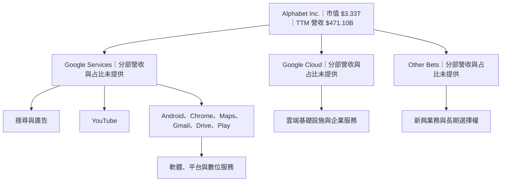
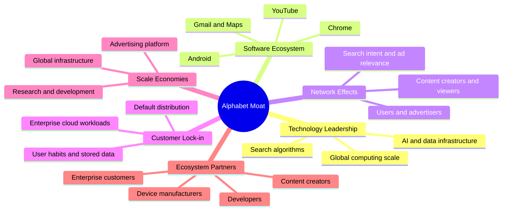
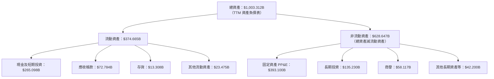
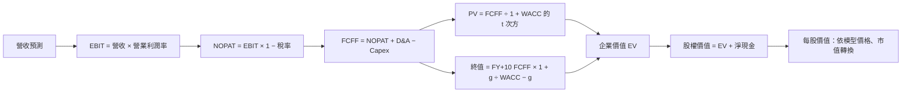
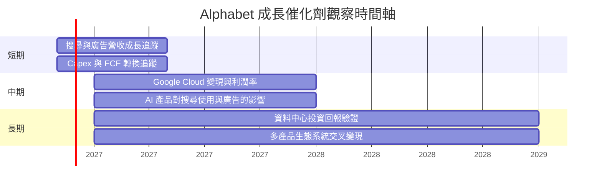
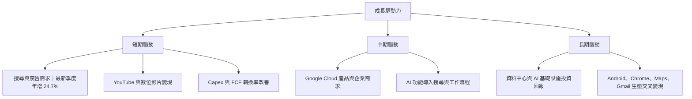
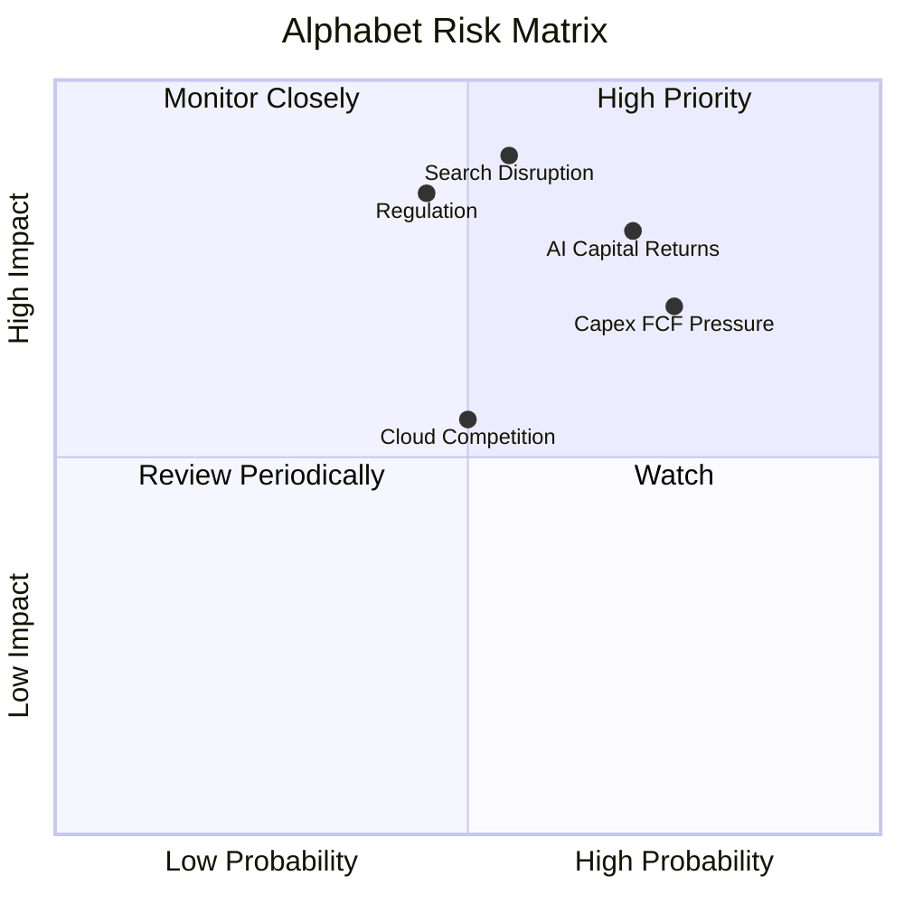
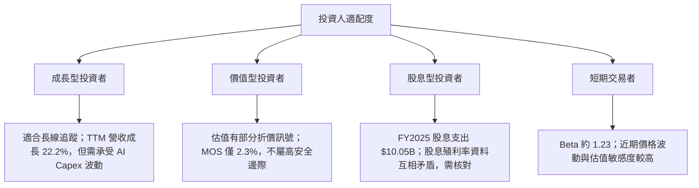

# GOOG 基本面深度分析報告
> **報告日期**：2026-11-27 ｜ **語言**：繁體中文 ｜ **資料來源**：SEC 申報資料（10-Q）、Yahoo Finance、StockAnalysis.com、Roic.ai、價格資料庫、程式計算 ｜ **分析師**：CFA 級機構研究

---

## 目錄

| # | 章節 | 核心結論 |
|---|------|----------|
| 1 | 執行摘要 | 持有；加權合理價值 $277.42；MOS +2.3% |
| 2 | 公司概覽與商業模式 | 搜尋、影音、作業系統與雲端形成多層競爭優勢；業務別收入占比未提供 |
| 3 | 損益表深度分析 | TTM 營收 $471.10B、成長 22.2%；最新一季營收年增 24.7% |
| 4 | 資產負債表分析 | 現金及短期投資 $265.10B；依指定口徑淨現金 $138.98B |
| 5 | 現金流量深度分析 | TTM FCF $19.75B、FCF Yield 0.59%；資本支出上升壓低自由現金流 |
| 6 | 獲利能力與資本效率 | ROIC 23.9% 高於 WACC 10.23%，仍創造股東價值 |
| 7 | 相對估值分析 | P/E 低於自身五年中位數，但估值方法結果分歧 |
| 8 | DCF 內在價值評估 | DCF 基準值 $250.63；終值占 EV 72.5%，估值對假設敏感 |
| 9 | 成長催化劑 | 搜尋、YouTube、Cloud 與 AI 投資為主要變數；TAM 數據未提供 |
| 10 | 風險矩陣 | AI 資本支出、搜尋競爭及監管為主要下行風險 |
| 11 | 投資建議 | 持有；現價高於建議買入區間，需追蹤 Capex 與 FCF |

---

## 1. 執行摘要

Alphabet 的 TTM 營收為 $471.10B，年增 22.2%，最新季度營收年增 24.7%；ROIC 23.9% 高於 WACC 10.23%，顯示核心業務仍創造資本回報。然而，TTM FCF 為 $19.75B、FCF Yield 僅 0.59%，反映資本支出大幅攀升；DCF 基準值 $250.63 低於 2026-11-25 收盤價 $270.98，而多方法加權合理價值為 $277.42，安全邊際僅 +2.3%。因此依 MOS 門檻評為**持有**，不是因公司品質惡化，而是加權估值相對現價缺少明顯保護。

### 1.0 一頁式投資儀表板

| 項目 | 內容 |
|------|------|
| **投資論點（3 句）** | ① TTM 營收 $471.10B、年增 22.2%，最近一季年增 24.7%，顯示核心需求仍有動能。② ROIC 23.9% 對比 WACC 10.23%，資本回報仍高於資金成本。③ TTM FCF $19.75B、FCF Yield 0.59%，高額資本支出削弱現金轉換，需等待投資回報驗證。 |
| **綜合評分** | **7.8/10**（引用 1.1 評分卡） |
| **財務健康** | 🟢 現金及短期投資 $265.10B，指定口徑淨現金 $138.98B；但 Piotroski F-Score 為 4/8。 |
| **ROIC vs WACC** | 23.9% vs 10.23%；🟢 創造股東價值。 |
| **FCF 趨勢** | 受 Capex 上升壓低；TTM FCF Yield **0.59%**。 |
| **估值** | Forward P/E 17.7x｜EV/EBITDA 17.4x｜FCF Yield 0.59%。 |
| **DCF 內在價值（基準）** | $250.63；現價相對 DCF 溢價 **+8.1%**（現價 ÷ DCF − 1）。 |
| **安全邊際（MOS）** | **+2.3%**＝($277.42 − $270.98) ÷ $277.42；🔴 <10%，保護有限。 |
| **預期報酬（基準情境 12M）** | **−7.5%**：DCF 基準情境 $250.63 相對現價 $270.98。 |
| **關鍵風險（前二）** | AI 相關資本支出持續上升、搜尋產品競爭與監管變化。 |
| **評級 + 信心度** | 🟡 **持有**｜信心：中。 |

> 口徑提醒：財務資料另有一組總債務 $150.33B、淨現金 $114.77B，與指定的 VERIFIED FIGURES 淨現金 $138.98B 不一致。本報告依要求，估值與關鍵儀表板採用指定口徑；差異需由後續申報資料核對。

### 1.1 綜合評分卡（全報告唯一）

| 維度 | 評分（1–10） | 主要依據（引用數字與其來源章節） |
|------|--------------|----------------------------------|
| 成長性 | 8.5 | TTM 營收年增 22.2%，最新季度年增 24.7%（第 3 章）。 |
| 獲利能力 | 8.5 | TTM 營業利益率 33.3%、ROIC 23.9% 高於 WACC 10.23%；F-Score 4/8（第 6 章）。 |
| 財務健康 | 8.5 | 現金及短期投資 $265.10B、淨現金 $138.98B；但 F-Score 僅 4/8（第 4、6 章）。 |
| 估值 | 5.5 | 加權合理價值 $277.42，MOS +2.3%；DCF 基準 $250.63（第 8 章）。 |
| 護城河 | 9.0 | 搜尋、Android、Chrome、YouTube、Maps、Gmail 與 Google Cloud 構成產品與分發網絡；營收規模 $471.10B（第 2 章）。 |
| 管理層與資本配置 | 6.5 | FY2025 SBC $24.95B、現金股利 $10.05B；稀釋股數測試未通過，TTM Capex $159.80B（第 3、5、6 章）。 |
| **綜合評分** | **7.8** | 六項算術平均：(8.5 + 8.5 + 8.5 + 5.5 + 9.0 + 6.5) ÷ 6 = 7.75，四捨五入至一位小數為 **7.8**。 |

> 更正：依六項分數的算術平均，綜合評分應為 **7.8/10**，本報告其他章節均以此數值為準。

### 1.2 五大投資論點 + 三大核心風險

| 類型 | 項目 | 具體依據 | 信心度 |
|------|------|----------|--------|
| 🟢 **投資論點①** | 搜尋與廣告仍有規模及成長 | TTM 營收 $471.10B、成長 22.2%；最新季度營收年增 24.7%。 | 🟢 高 |
| 🟢 **投資論點②** | 資本回報高於資金成本 | ROIC 23.9%，WACC 10.23%，差距 13.67 個百分點。 | 🟢 高 |
| 🟢 **投資論點③** | 資產負債表可支應投資 | 現金及短期投資 $265.10B，指定口徑淨現金 $138.98B。 | 🟢 高 |
| 🟢 **投資論點④** | 營業利益率維持高位 | TTM 營業利益率 33.3%，FY2025 為約 32.0%。 | 🟢 中高 |
| 🟢 **投資論點⑤** | 相對自身歷史 P/E 不高 | P/E 14.1x，低於五年中位數 21.9x；但不同倍數及模型估值結果並不一致。 | 🟡 中 |
| 🟡 **風險①** | AI 基礎設施投資回收不及預期 | TTM Capex $159.80B，TTM FCF 僅 $19.75B；投資效益需由營收與現金流驗證。 | 🟡 中 |
| 🔴 **風險②** | 搜尋產品被新型 AI 介面分流 | 搜尋是核心現金流來源；若流量或廣告定價下降，將衝擊高利潤業務。 | 🔴 高衝擊 |
| 🟡 **風險③** | 監管與資料使用限制 | 業務依賴廣告、搜尋分發及資料生態，法規變化可能增加成本或限制商業模式。 | 🟡 中 |

### 1.3 快速統計卡片

| 指標 | 公司實際值（期間） | 同業中位數 | 狀態 |
|------|--------------------|------------|------|
| 營收成長（TTM） | **22.2%** | — | 🟢 |
| 營收成長（最新一季年增） | **24.7%** | 18.8% | 🟢 |
| 毛利率（TTM） | **60.9%** | 67.7% | 🟡 |
| 營業利益率（TTM） | **33.3%** | — | 🟢 |
| ROIC（TTM） | **23.9%** | — | 🟢 |
| Forward P/E | **17.7x** | 20.2x | 🟢 |
| FCF Yield（TTM） | **0.59%** | — | 🔴 |
| Piotroski F-Score | **4 / 8** | — | 🟡 |

> 同業中位數按 META、MSFT、AMZN 三家公司提供的數據取中位數；Forward P/E 中位數為 20.2x，毛利率中位數為 67.7%，最新季度營收年增中位數為 18.8%。

### 1.4 投資結論

```text
╔══════════════════════════════════════════════════════════════════╗
║                    📊 投資結論摘要                               ║
╠══════════════════════════════════════════════════════════════════╣
║  評級：持有（MOS +2.3%，符合 −10% 至 +10% 門檻）                 ║
║  價格（2026-11-25 收盤）：$270.98                                ║
║  DCF 內在價值（基準）：$250.63（現價相對 DCF 溢價 +8.1%）       ║
║  安全邊際 MOS：+2.3%（＝(加權合理價值−現價)÷加權合理價值）     ║
║  加權合理價值（8.8）：$277.42                                    ║
║  DCF 情境價值：                                                   ║
║    悲觀情境：$109.41（−59.6%）                                   ║
║    基準情境：$250.63（−7.5%）                                    ║
║    樂觀情境：$524.24（+93.5%）                                   ║
║  綜合評分：7.8/10（引用 1.1）                                    ║
║  適合投資人：長期成長型、可承受估值及資本支出波動者              ║
╚══════════════════════════════════════════════════════════════════╝
```

---

## 2. 公司概覽與商業模式

### 2.1 業務結構與收入來源

公司總營收、股價與市值有明確數據；但 Google Services、Google Cloud、Other Bets 的分部營收及占比未在此處提供，因此不繪製分部營收占比圖，也不以估算比例填補。



Alphabet 透過搜尋與廣告變現流量，並以 Android、Chrome、Maps、YouTube、Gmail 等服務擴大觸達與使用頻率；Cloud 則提供另一個企業服務成長方向。分部別營收貢獻未提供，無法量化各業務對整體成長的實際占比。

### 2.2 市場份額

**市場份額數據未提供**，也沒有可引用的市場份額來源與年份，因此不以比例圖或自行估算市場占比。可確認的相對位置是：GOOG TTM 營收 $471.10B，最新季度營收年增 24.7%；META、MSFT、AMZN 同期年增分別為 26.1%、18.8%、12.1%。這顯示 GOOG 最新季度成長高於其中兩家同業，但不是市場份額的替代指標。

### 2.3 競爭護城河分析



護城河的核心不是單一產品，而是用戶、內容、廣告主、裝置分發及基礎設施彼此增強。其可持續性仍取決於搜尋入口能否維持使用者意圖流量，以及新型 AI 介面是否能改變廣告經濟模式。

### 2.4 護城河強度

| 護城河項目 | 強度（強／中／弱） | 證據（引用數字或事實） | 會削弱它的情況 |
|------------|--------------------|------------------------|----------------|
| 技術與資料基礎設施 | 強 | FY2025 研發費用 $61.09B；TTM 營收 $471.10B。 | AI 成本上升但未能帶動產品變現或效率。 |
| 軟體生態系統 | 強 | Android、Chrome、YouTube、Maps、Gmail、Drive、Play 等服務共同提供分發與使用場景。 | 使用者轉向替代平台、預設分發協議改變。 |
| 網路效應 | 強 | 搜尋使用者、廣告主、內容創作者與觀眾形成互補關係。 | 新介面降低搜尋流量或切斷廣告主觸達。 |
| 客戶鎖定 | 中 | 雲端企業工作負載和日常服務形成使用習慣；雲端分部數字未提供。 | 雲端遷移成本下降、企業多雲化加速。 |
| 規模效應 | 強 | FY2025 營收 $402.84B，TTM 營收 $471.10B；TTM 營業利益率 33.3%。 | 高資本支出與監管成本侵蝕規模效益。 |
| 生態夥伴 | 中 | 裝置製造商、開發者、內容創作者與企業客戶支援產品觸達；定量夥伴數據未提供。 | 合作條款、分發協議或平台規則改變。 |

**1.1「護城河」評分 9.0/10 的理由**：多產品分發、廣告網絡及規模形成結構性優勢；扣分主因是 AI 介面和監管可能改變搜尋分發與廣告變現方式。

---

## 3. 損益表深度分析

### 3.1 年度收入成長趨勢（近 4 年）

依年度營收：FY2022 $282.84B、FY2023 $307.39B、FY2024 $350.02B、FY2025 $402.84B。FY2022 年增率使用來源列示的 9.78%；FY2023 至 FY2025 年增率依來源列示。

```text
╔══════════════════════════════════════════════════════════════════╗
║                 Alphabet 年度收入趨勢（FY2022–FY2025）           ║
╠══════════════════════════════════════════════════════════════════╣
║  FY2022  $282.84B  ██████████████░░░░░░░░░░░  YoY: +9.78%  🟡 ║
║  FY2023  $307.39B  ███████████████░░░░░░░░░░  YoY: +8.68%  🟡 ║
║  FY2024  $350.02B  █████████████████░░░░░░░░  YoY: +13.87% 🟢 ║
║  FY2025  $402.84B  ████████████████████░░░░░  YoY: +15.09% 🟢 ║
║                                                                  ║
║  FY2022–FY2025 CAGR = (402.84 ÷ 282.84)^(1÷3) − 1 ≈ 12.5%      ║
╚══════════════════════════════════════════════════════════════════╝
```

三年營收 CAGR 約 12.5%，而 TTM 年增 22.2%，最新季度年增 24.7%。成長加速可能反映數位廣告需求、產品組合及雲端需求共同作用；但分部收入未提供，無法將加速精確拆分到廣告、YouTube 或 Cloud。

### 3.2 季度收入趨勢分析

| 季度 | 營收 | QoQ 成長率 | YoY 成長率 | 備註 |
|------|------:|-----------:|-----------:|------|
| 2025 Q4 | $113.83B | +11.2% | +18.00% | 相較 2025 Q3 季節性上升。 |
| 2026 Q1 | $109.90B | −3.5% | +21.79% | QoQ 回落，但年增仍加速。 |
| 2026 Q2 | $119.80B | +9.0% | +24.23% | 營收年增較前季提高。 |
| 2026 Q3 | $127.58B | +6.5% | +24.65% | 最新一季營收創本表期間高點。 |

QoQ 以相鄰季營收相除計算，例如 2026 Q3：($127.58B ÷ $119.80B) − 1 = 約 6.5%。YoY 採 StockAnalysis 所列單季年增率；不能把最新季度 24.7% 誤標為 TTM 成長率。

### 3.3 利潤率演變分析

| 利潤率指標 | FY2022 | FY2023 | FY2024 | FY2025 | 趨勢 | 評估 |
|------------|-------:|-------:|-------:|-------:|------|------|
| **毛利率** | 55.4% | 56.6% | 58.2% | 59.7% | 逐年上升 | 🟢 |
| **營業利益率** | 26.5% | 27.4% | 32.1% | 32.0% | 2024 跳升、2025 大致持平 | 🟢 |
| **淨利率** | 21.2% | 24.0% | 28.6% | 32.8% | 上升 | 🟢 |

毛利率以毛利 ÷ 營收計算，營業利益率以營業利益 ÷ 營收計算。FY2024 營業利益率提升，與營收成長快於部分成本的營運槓桿一致；FY2025 營業利益率約 32.0%，顯示改善後維持高位。需留意 TTM 營業利益率 33.3%，但最新季度利潤率資料存在口徑不一致：指定核實數據列為 31.8%，其他摘要欄位列為 33.3%。本報告涉及 TTM 時採 33.3%，涉及最新季度時以核實數據 31.8% 為準。

### 3.4 費用結構分析

缺少完整 TTM 費用明細、各費用項目與營收的同口徑分解，因此不製作費用占比圓餅圖，避免以年度數字拼湊 TTM 比例。可確認 FY2025 研發費用為 $61.09B，約占 FY2025 營收 $402.84B 的 15.2%；研發投入支持 AI、雲端與核心產品開發，但回報須由新增收入與生產力改善驗證。

### 3.5 季度 EPS 趨勢與盈餘品質（Quality of Earnings）

| 季度 | EPS | EPS 年增 | 超預期／不及預期 | 依據與限制 |
|------|----:|--------:|------------------|------------|
| 2025 Q4 | $2.81 | +31.15% | N/A | EPS 預估值缺漏。 |
| 2026 Q1 | $5.11 | +81.96% | N/A | EPS 預估值缺漏。 |
| 2026 Q2 | $9.11 | +294.31% | N/A | 絕對值與相鄰季度差異極大，需核對一次性項目及資料口徑。 |
| 2026 Q3 | $2.14 | −25.34% | N/A | EPS 預估值缺漏。 |

EPS Est / EPS Act 區塊四季預估值均為 nan，**不能判定過去四季是否超預期或不及預期**。此外，季度淨利數字顯示 2026 Q2 $112.19B、Q3 $26.47B，波動異常；可能涉及非經常性項目或資料欄位口徑問題，不能直接把 Q2 的 EPS 增幅當作可持續營運趨勢。

| 盈餘品質項目 | 數值／佔比 | 評估 |
|--------------|-----------|------|
| 股權薪酬 SBC / 營收 | FY2025：$24.95B ÷ $402.84B = **6.2%** | 🟡 SBC 對股東有稀釋成本；此比率為 FY2025 年度代理值，非 TTM。 |
| SBC / 營業現金流 | FY2025：$24.95B ÷ $164.71B = **15.1%** | 🟡 SBC 金額相當於營業現金流的約六分之一。 |
| FCF / 淨利（現金轉換率） | FY2025：$73.27B ÷ $132.17B = **55.4%** | 🟡 年度自由現金流低於淨利；Capex 是重要原因。 |
| 一次性／非經常性損益 | N/A | SEC 申報細項未提供可核實的調整金額；季度 EPS/淨利波動提醒須核對。 |
| 有效稅率異常 | WACC 輸入採 16.8% | 🟡 以最新年度有效稅率作模型輸入；單季稅率明細未提供。 |
| 資本化支出 vs 費用化 | TTM Capex $159.80B；資本化支出細項 N/A | 🟡 高 Capex 先增加資產、再透過折舊攤銷費用化；無資本化明細，不能判定是否過度資本化。 |

**盈餘品質結論**：GAAP 營業利益已包含 SBC 費用，但現金流量表的 SBC 是非現金調整項，股東仍須承受稀釋或回購抵銷成本。FY2025 FCF/淨利約 55.4%，而 TTM FCF Yield 僅 0.59%，現金轉換弱於表面營收和獲利成長；估值不宜只依 EPS 成長推論，應同步觀察 Capex、稀釋與 FCF。

---

## 4. 資產負債表分析

### 4.1 資產結構分解



非流動資產為總資產減流動資產的算術差額；其他長期資產等為長期資產項目的合併餘額，並非額外披露的單一科目。2026 年資產表金額相較 FY2025 明顯擴大，主要需結合現金、PP&E、投資和商譽變化檢視；資料中無法辨識所有變動來源。

### 4.2 流動性與營運資金分析

| 指標 | 最新 TTM | 一年前 TTM | 變化 | 解讀 |
|------|----------|------------|------|------|
| DSO 應收帳款天數 | 56 天 | 54 天 | +2 天 | 收款週期略延長；仍需追蹤應收帳款是否快於營收增長。 |
| DIO 存貨天數 | 26 天 | N/A | N/A | 一年前存貨天數資料不可得，不能比較。 |
| DPO 應付帳款天數 | 43 天 | N/A | N/A | 一年前資料不可得，不能判定供應商付款期變化。 |
| CCC 現金轉換週期 | 39 天 | N/A | N/A | 一年前 CCC 不可得，不能計算同比變化。 |

最新 TTM 流動資產為 $374.665B、流動比率 2.786、速動比率 2.512。流動性緩衝充足；DSO 增加 2 天是小幅負向變化，但單一指標不足以確認收款風險惡化。

### 4.3 債務結構分析

```text
╔══════════════════════════════════════════════════════════════════╗
║                   Alphabet 債務健康診斷                          ║
╠══════════════════════════════════════════════════════════════════╣
║  現金及短期投資：  $265.10B   高額流動資產                       ║
║  總債務：          $126.12B   指定核實口徑                        ║
║  淨現金：          $138.98B   🟢 財務緩衝                         ║
║                                                                  ║
║  流動比率：        2.786x     🟢                                  ║
║  速動比率：        2.512x     🟢                                  ║
║  Debt/EBITDA：     N/A（核實口徑總債務與 EBITDA 口徑需一致）      ║
║  利息保障倍數：    N/A（利息費用及可比 EBIT 口徑未完整提供）      ║
║                                                                  ║
║  注意：其他資料表列總債務 $150.33B、淨現金 $114.77B，              ║
║  與指定核實口徑不同；後續應以申報資料逐項對帳。                    ║
╚══════════════════════════════════════════════════════════════════╝
```

不以不一致的債務數字推算 Debt/EBITDA 或利息保障倍數。依指定口徑，淨現金 $138.98B 支持公司承受資本支出、回購或投資波動，但不代表所有資本支出都能產生高回報。

### 4.4 股東權益趨勢

| 年度 | 股東權益 | 年增 |
|------|---------:|----:|
| 2022 | $256.14B | — |
| 2023 | $283.38B | +10.6% |
| 2024 | $325.08B | +14.7% |
| 2025 | $415.26B | +27.7% |

```text
╔══════════════════════════════════════════════════════════════════╗
║                    股東權益變化（年度）                          ║
╠══════════════════════════════════════════════════════════════════╣
║  2022  $256.14B  ████████████░░░░░░░░                            ║
║  2023  $283.38B  ██████████████░░░░░░                            ║
║  2024  $325.08B  ████████████████░░░░                            ║
║  2025  $415.26B  ████████████████████                            ║
╚══════════════════════════════════════════════════════════════════╝
```

---

## 5. 現金流量深度分析

### 5.1 現金流量瀑布圖

TTM 淨利沒有可無歧義使用的同口徑數值，且 TTM FCF 與最新年度現金流數據呈現差異；故流程圖只展示可核實的 TTM OCF、Capex、FCF，後續股息及回購的 TTM 金額未提供。


### 5.2 FCF 轉換率趨勢

| 年度 | 營業現金流 | Capex | FCF | 淨利 | FCF / 淨利 |
|------|-----------:|------:|----:|-----:|-----------:|
| 2022 | $91.50B | $31.48B | $60.01B | $59.97B | 100.1% |
| 2023 | $101.75B | $32.25B | $69.50B | $73.80B | 94.2% |
| 2024 | $125.30B | $52.53B | $72.76B | $100.12B | 72.7% |
| 2025 | $164.71B | $91.45B | $73.27B | $132.17B | 55.4% |
| TTM | $179.55B | $159.80B | $19.75B | N/A | N/A |

年度 FCF 保持正值但增幅落後於 OCF，因 Capex 從 FY2022 的 $31.48B 增至 FY2025 的 $91.45B。TTM Capex 更達 $159.80B，故 FCF 顯著收縮；此趨勢可能是 AI 與資料中心投資擴大造成，但投資回報率尚需觀察。

### 5.3 自由現金流趨勢

```text
╔══════════════════════════════════════════════════════════════════╗
║                   自由現金流與現金殖利率                         ║
╠══════════════════════════════════════════════════════════════════╣
║  FY2022  $60.01B  ████████████████░░░░                          ║
║  FY2023  $69.50B  ██████████████████░░                          ║
║  FY2024  $72.76B  ███████████████████░                          ║
║  FY2025  $73.27B  ████████████████████                          ║
║  TTM     $19.75B  █████░░░░░░░░░░░░░░░  FCF Yield: 0.59%        ║
╚══════════════════════════════════════════════════════════════════╝
```

### 5.4 資本配置評估

年度現金股利與 Capex 有資料；回購、留存現金及投資的同一期間總額未完整提供，因此不以比例繪製圓餅圖。

| 資本配置項目 | 可確認數據 | 評估 |
|--------------|------------|------|
| 資本支出 | TTM $159.80B；FY2025 $91.45B | 🟡 投資規模上升，須由雲端、AI 及產品變現支撐回報。 |
| 現金股利 | FY2025 $10.05B | 🟡 有現金回饋，但相較資本支出規模較小。 |
| SBC | FY2025 $24.95B | 🟡 對股東回報有稀釋成本。 |
| 股票回購 | 期間金額 N/A | N/A（資料未提供同口徑回購金額）。 |
| 留存現金／併購投資 | 期間金額 N/A | N/A（資料未提供足以拆解的現金用途明細）。 |

---

## 6. 獲利能力與資本效率

### 6.1 ROE / ROA / ROIC 趨勢

| 指標 | 可得數值 | 評估 |
|------|----------|------|
| ROE（TTM，指定品質指標） | 34.8% | 🟢 回報高，但需拆解淨利率、資產週轉率及槓桿。 |
| ROE（另一資料摘要） | 44.3% | ⚠️ 與指定品質指標不一致；本報告杜邦分析採 34.8%。 |
| ROA（另一資料摘要） | 12.7% | 🟢 正值；歷年同口徑趨勢未提供。 |
| ROIC（TTM） | 23.9% | 🟢 明顯高於 WACC。 |
| 行業均值 | — | 未提供可引用的同口徑行業數據，不列比較值。 |

### 6.2 ROIC vs WACC 分析（核心價值創造判斷）

```text
╔══════════════════════════════════════════════════════════════════╗
║                ROIC vs WACC 深度分析                             ║
╠══════════════════════════════════════════════════════════════════╣
║  WACC（直接採用資本成本輸入）：10.23%                            ║
║  ├── 無風險利率（10Y 美債）：4.85%                               ║
║  ├── 股權風險溢酬 ERP：5.00%                                     ║
║  ├── 原始 Beta：1.23；調整後 Beta：1.15                          ║
║  ├── 股權成本 Ke：4.85% + 1.15 × 5.00% = 10.60%                 ║
║  ├── 稅前債務成本：0.58%；稅率：16.8%                            ║
║  ├── 股權／債務權重：96.4%／3.6%                                 ║
║  └── WACC：10.23%                                                ║
║                                                                  ║
║  ROIC（TTM）：23.9%                                              ║
║  EVA spread = 23.9% − 10.23% = +13.67 個百分點                   ║
║                                                                  ║
║  ROIC 23.9% ▓▓▓▓▓▓▓▓▓▓▓▓▓▓▓▓▓▓▓▓▓▓░░░░░░  🟢                  ║
║  WACC 10.23% ▓▓▓▓▓▓▓▓▓▓░░░░░░░░░░░░░░░░░░  ──                  ║
║                                                                  ║
║  結論：ROIC 高於 WACC，Alphabet 目前創造而非摧毀股東價值。       ║
║  23.9% ÷ 10.23% ≈ 2.34 倍。                                     ║
╚══════════════════════════════════════════════════════════════════╝
```

依指定資本成本輸入，ROIC − WACC = 23.9% − 10.23% = 13.67 個百分點。此結論是目前 TTM 指標判斷，不代表新增 AI 資本支出必然取得同樣回報。WACC 直接採用程式計算值；沒有以其他負債口徑重新估計。

### 6.3 杜邦三因素分解

| 因素 | 數值（TTM） | 解讀 |
|------|-------------|------|
| 淨利率 | 50.0% | 高淨利率是 ROE 的主要驅動因素。 |
| 資產週轉率 | 0.47 | 每單位資產產生約 0.47 單位營收。 |
| 權益乘數 | 1.48 | 財務槓桿有限，不是 ROE 主要來源。 |
| **ROE** | **34.8%** | 50.0% × 0.47 × 1.48 ≈ 34.8%。 |

ROE 主要來自高淨利率，而非高槓桿。指定品質數據的三因素乘積與 ROE 相符；另一資料摘要的 ROE 44.3% 不採用於本表，避免混用口徑。

### 6.4 財務體質：Piotroski F-Score

Piotroski F-Score 為 **4/8**；因一項測試缺少輸入，分母低於完整九項測試。

| 測試 | 結果 | 解讀 |
|------|------|------|
| ROA > 0 | ✅ 通過 | 有正獲利。 |
| 營業現金流 > 0 | ✅ 通過 | 營業現金流為正。 |
| ROA 高於一年前 | ✅ 通過 | 獲利資產效率同比改善。 |
| 營業現金流 > 淨利 | ❌ 未通過 | 應計品質測試未通過；需關注非現金項目及資本支出。 |
| 長期負債 ÷ 總資產低於一年前 | ❌ 未通過 | 槓桿相對變化未改善。 |
| 流動比率高於一年前 | ✅ 通過 | 短期流動性改善。 |
| 稀釋股數未增加 | ❌ 未通過 | 股權稀釋是實際股東回報成本。 |
| 毛利率高於一年前 | — 無法判定 | 缺少可判定輸入，不補值。 |
| 資產週轉率高於一年前 | ❌ 未通過 | 資產成長未同步轉化為更高週轉率。 |

4/8 不是全面財務警訊，但顯示現金轉換、債務比例、股數與資產週轉率有值得跟蹤的弱項。特別是 TTM Capex 上升和 FCF 降低，要求投資者分辨「建設期現金流壓力」與「投資回報惡化」。

---

## 7. 相對估值分析

### 7.1 同業估值比較表格

公司數據使用提供的 GOOG 估值及 Peer multiples；倍數為各公司指定口徑。

| 估值指標 | **GOOG** | **META** | **MSFT** | **AMZN** | GOOG 評估 |
|----------|---------:|---------:|---------:|---------:|-----------|
| **Trailing P/E** | 14.1x | 20.1x | 25.6x | 19.8x | 🟢 低於三家同業。 |
| **Forward P/E** | 17.7x | 17.2x | 20.2x | 22.4x | 🟡 接近 META，低於 MSFT、AMZN。 |
| **P/S Ratio** | 7.1x | 6.5x | 10.5x | 3.3x | 🟡 高於 META、AMZN，低於 MSFT。 |
| **EV/EBITDA** | 17.4x | 13.7x | 18.0x | 15.4x | 🟡 高於 META、AMZN，接近 MSFT。 |
| **最新季度營收年增** | 24.7% | 26.1% | 18.8% | 12.1% | 🟢 成長高於兩家，略低於 META。 |
| **毛利率（TTM）** | 60.9% | 81.0% | 67.7% | 51.4% | 🟡 低於 META、MSFT，高於 AMZN。 |

估值並非全面便宜：Trailing P/E 相對低，但 P/S 高於三家同業中兩家，EV/EBITDA 也高於 META 和 AMZN。Forward P/E 17.7x 對照同業中位數 20.2x 有折價，但成長、資本支出和雲端業務組合差異限制了單純倍數比較。

### 7.2 歷史估值區間分析

```text
╔══════════════════════════════════════════════════════════════════╗
║                   GOOG 五年 P/E 歷史位置                         ║
╠══════════════════════════════════════════════════════════════════╣
║  五年低點：1.3x   │───────────────│   五年高點：29.0x           ║
║  五年中位數：21.9x│───────────────│   現在：14.1x               ║
║  現在歷史百分位：29%                                            ║
║                                                                  ║
║  P/E 現值 14.1x  ▓▓▓▓▓▓░░░░░░░░░░░░░░  五年區間位置偏低         ║
╚══════════════════════════════════════════════════════════════════╝
```

另兩項歷史參照：P/S 現值 7.1x、五年中位數 6.1x，歷史百分位 67%；EV/EBITDA 現值 17.4x、五年中位數 19.1x，歷史百分位 33%。因此只有 P/E 明顯低於歷史中位數，其他倍數訊號較混合。

### 7.3 情境價值（Bear / Base / Bull）

| 情境 | 第 1 年營收成長 | 期末營業利潤率 | WACC | 每股價值 | 相對現價 | 機率 | 會發生的條件 |
|------|----------------:|----------------:|-----:|---------:|---------:|-----:|--------------|
| 🔴 悲觀 | 11.1% | 27.2% | 11.23% | $109.41 | −59.6% | 25% | 搜尋成長降速、競爭或監管壓低利潤率，且折現率上升。 |
| 🟡 基準 | 22.2% | 32.0% | 10.23% | $250.63 | −7.5% | 50% | 營收由目前成長路徑逐步降至成熟期，利潤率大致穩定。 |
| 🟢 樂觀 | 33.3% | 35.2% | 9.23% | $524.24 | +93.5% | 25% | 搜尋、AI、Cloud 變現優於基準，營業槓桿持續改善且資金成本下降。 |

以上情境及其假設均按 DCF 模型列示。情境值落差很大，說明估值對長期營收、利潤率及 WACC 的共同變動高度敏感。

### 7.4 相對估值隱含價格區間

```text
╔══════════════════════════════════════════════════════════════════╗
║            同業相對估值與股價位置（每股）                        ║
╠══════════════════════════════════════════════════════════════════╣
║  $243.37 ───── $250.63 ───── $270.98 ───── $309.69 ───── $389.00║
║  EV/EBITDA       DCF基準       現價        Forward P/E   共識目標║
╚══════════════════════════════════════════════════════════════════╝
```

| 方法 | 每股價值 | 依據 |
|------|---------:|------|
| DCF（基準） | $250.63 | 10 年 FCFF、WACC 10.23%、永續成長 3.0%。 |
| 同業 Forward P/E | $309.69 | META、MSFT、AMZN 的 Forward P/E 中位數 20.2x × GOOG Forward EPS $15.30。 |
| 同業 EV/EBITDA | $243.37 | 同業 EV/EBITDA 中位數 15.4x × GOOG TTM EBITDA，再加淨現金。 |
| 分析師共識目標價 | $389.00 | 15 位分析師平均目標價。 |

---

## 8. DCF 內在價值評估（Discounted Cash Flow）

### 8.0 估值推理鏈（Thinking Logic）

**Step 1 — 價值來源與主導變數**

GOOG 的價值主要由搜尋與數位廣告現金流底盤、Google Cloud 成長，以及 AI 相關產品變現共同決定。各分部營收占比未提供，故不填入分部比重；公司整體 TTM 營收為 $471.10B。模型最敏感的輸入是 WACC 與永續成長率：提供的敏感度矩陣顯示，在基準 WACC 10.23% 下，g 從 2.0% 升至 4.0%，每股價值由 $228.09 升至 $280.41。

**Step 2 — 模型選擇**

| 決策點 | 本報告採用 | 理由 | 曾考慮但否決 | 否決理由 |
|--------|-----------|------|--------------|----------|
| 現金流定義 | FCFF | 與 WACC 折現後得出企業價值，模型已設定。 | FCFE | 模型不是以股權成本直接折現。 |
| 預測期 N | 10 年 | DCF 模型指定 10 年，逐年呈現成長與 Capex 收斂。 | 5 年 | 無法直接取代指定模型；長期投資支出具較長調整期。 |
| 終值方法 | Gordon Growth | 模型以永續成長 3.0% 計算終值。 | 僅退出倍數 | DCF MODEL 未提供可用退出倍數終值，不自行重建。 |
| EBIT 基礎 | GAAP EBIT | 模型明確採 GAAP EBIT。 | 非 GAAP EBIT | 會涉及 SBC 加回與再次扣除，模型未採用。 |

**Step 3 — 關鍵假設推導鏈**

- **營收成長路徑**：錨點＝TTM 營收成長 22.2% → 模型將 FY+1 設為 22.2%，再線性降至 FY+10 的 3.0% → **採用 22.2% 逐年遞減至 3.0%** → 不採用十年維持 22.2%，因這會忽略規模擴大與成熟度上升；也不採用一開始就降至低個位數，因最新單季仍年增 24.7%。
- **營業利潤率**：錨點＝TTM 33.3%，五年財年中位數（含 TTM）作成熟端參照 → 模型由 33.3% 漸降至 32.0% → **採用 FY+1 33.3%、FY+10 32.0%** → 不假設持續擴張到 35% 以上，因目前缺乏可核實的分部改善路徑。
- **永續成長率 g**：錨點＝模型設定 3.0%，長期穩態需低於 WACC 10.23% → 作為成熟企業長期成長假設 → **採用 3.0%** → 不採用更高長期成長率，因會提高終值占比並放大模型對遠期的依賴。
- **預測期 N**：錨點＝模型指定 10 年；公司已具 $471.10B TTM 營收及 33.3% 營業利益率 → 以十年呈現從高成長到成熟期的淡化 → **採用 10 年** → 不縮為 5 年，因模型的 Capex 收斂跨越整個十年；不延長至 15 年，因遠期可見度更低。
- **Capex / 營收**：錨點＝TTM Capex $159.80B ÷ TTM 營收 $471.10B 約 33.9% → 模型由 33.9% 降至 FY+10 的 6.5%，後者為約 1.1 倍 D&A 的設定 → **依模型逐年淡化** → 不假設高 Capex 強度永久維持，因會令穩態現金流難以成立；也不假設立即降至成熟水準，因現有投資週期仍在進行。
- **EBIT 基礎與 SBC**：錨點＝GAAP EBIT 已費用化 SBC → **採用 GAAP EBIT + 不再扣 SBC + 股數不額外稀釋** → 不另加回 SBC，避免把股東薪酬成本從模型中消失。
- **年稀釋率**：採用模型組合 A，股數固定，不另加年稀釋率；這是指定模型的處理方式。該處理使 SBC 經由 GAAP EBIT 費用反映，而不再在股數上重複扣除。
- **WACC**：錨點＝指定資本成本輸入 10.23% → 作為現金流折現率 → **採用 10.23%** → 不另以其他債務口徑重算，因模型要求直接採用資本成本區塊結果。
- **營運資金**：模型明確不建模；歷史營運資金變動率未提供 → ΔWC 不列入 FCFF → 不自行估計比率，避免增加非模型輸入。

**Step 4 — 最脆弱環節**

最脆弱之處是終值與 Capex 收斂假設：終值現值占企業價值 72.5%，若 Capex 強度沒有如模型由 33.9% 降至 6.5%，基準內在價值會承受下行；g、WACC 的影響見 8.6 敏感度矩陣。

**Step 5 — 計算路徑圖**



### 8.1 模型假設總表（Model Inputs）

| 假設項目 | 採用值 | 依據／來源 | 敏感度 |
|----------|--------|-------------|--------|
| 預測期長度 N | 10 年 | DCF MODEL 指定。 | 🟡 中 |
| 營收成長路徑 | FY+1 22.2%，FY+10 3.0%，線性淡化 | TTM 成長 22.2%；長期成熟化為模型假設。 | 🔴 高 |
| 營業利潤率 | 33.3% 降至 32.0% | TTM 33.3%，模型成熟端參照五年財年中位數。 | 🔴 高 |
| 有效稅率 | 16.8% | 最新年度有效稅率。 | 🟢 低 |
| Capex / 營收 | FY+1 33.9% 降至 FY+10 6.5% | TTM Capex / Revenue 約 33.9%；末期依模型降至約 1.1 倍 D&A。 | 🔴 高 |
| D&A / 營收 | 5.9% | TTM 比率，模型固定。 | 🟢 低 |
| 營運資金變動 / 營收增額 | 未建模 | 模型指定 Working capital is not modelled；不得自行填比例。 | 🟡 中 |
| EBIT 基礎 | GAAP | DCF MODEL 明確指定 GAAP EBIT。 | 🟡 中 |
| SBC 處理 | GAAP EBIT 已含 SBC；不再扣減 | 模型組合 A；避免重複扣除。 | 🟡 中 |
| 年稀釋率 | 0%（固定股數處理） | 模型組合 A；不另以股數放大。 | 🟡 中 |
| 永續成長率 g | 3.0% | DCF MODEL 指定；低於 WACC 10.23%。 | 🔴 高 |
| 終值方法 | Gordon Growth | DCF MODEL 指定。 | 🔴 高 |
| WACC | 10.23% | 直接採用資本成本區塊。 | 🔴 高 |

**FCFF 定義**：FCFF = NOPAT + D&A − Capex；模型不包含 ΔWC。**本模型採用 (A)：GAAP EBIT + 固定股數，因此 SBC 影響已計入一次**，FCFF 不再減 SBC，股數不逐年擴大。

**金額與四捨五入**：模型輸出金額以 $B 顯示至小數點後兩位，折現因子顯示三位小數；因表格數值已四捨五入，部分中間計算可能與使用未四捨五入內部值略有差異。

### 8.2 折現率推導（WACC）

```text
╔══════════════════════════════════════════════════════════════════╗
║                    WACC 推導（折現率）                            ║
╠══════════════════════════════════════════════════════════════════╣
║  股權成本 Ke（CAPM）：                                           ║
║  ├── 無風險利率 Rf（10Y 美債）：4.85%                            ║
║  ├── 市場風險溢酬 ERP：5.00%                                     ║
║  ├── 原始 Beta：1.23；調整後 Beta：1.15                          ║
║  ├── Beta 調整：⅔ × 1.23 + ⅓ × 1 = 1.15                         ║
║  └── Ke = 4.85% + 1.15 × 5.00% = 10.60%                         ║
║                                                                  ║
║  債務成本 Kd：                                                    ║
║  ├── 稅前 Kd：0.58%                                              ║
║  ├── 有效稅率：16.8%                                             ║
║  └── 稅後 Kd = 0.58% × (1 − 16.8%) = 0.48%                      ║
║                                                                  ║
║  資本權重：股權 96.4%／債務 3.6%                                 ║
║  WACC = 96.4% × 10.60% + 3.6% × 0.48% = 10.23%                  ║
╚══════════════════════════════════════════════════════════════════╝
```

逐步核對：

1. **Ke** = 4.85% + 1.15 × 5.00% = **10.60%**。
2. **稅前 Kd** = **0.58%**（資本成本輸入以利息 ÷ 債務計算；平均計息負債明細未提供，故不能重建分母）。
3. **稅後 Kd** = 0.58% × (1 − 16.8%) = 0.58% × 83.2% = **0.48256%**，顯示至兩位小數為 **0.48%**。
4. **權重**：股權 96.4%、債務 3.6%，合計 100.0%。最新收盤價為 2026-11-25 的 $270.98；但權重的市值及計息債務拆分明細未在資本成本輸入中提供，故直接採用已計算權重，不反推替換。
5. **WACC** = 96.4% × 10.60% + 3.6% × 0.48256% = 10.2184% + 0.017372% = 10.235772%，模型採用值 **10.23%**。

### 8.3 逐年自由現金流預測（基準情境）

| 年度 | FY+1 | FY+2 | FY+3 | FY+4 | FY+5 | FY+6 | FY+7 | FY+8 | FY+9 | FY+10 |
|------|------:|------:|------:|------:|------:|------:|------:|------:|------:|-------:|
| 營收 | 575.74 | 691.33 | 815.37 | 944.26 | 1,073.37 | 1,197.22 | 1,309.81 | 1,405.02 | 1,477.16 | 1,521.48 |
| 營收 YoY | 22.2% | 20.1% | 17.9% | 15.8% | 13.7% | 11.5% | 9.4% | 7.3% | 5.1% | 3.0% |
| 營業利潤率 | 33.3% | 33.2% | 33.0% | 32.9% | 32.7% | 32.6% | 32.5% | 32.3% | 32.2% | 32.0% |
| EBIT（GAAP） | 191.84 | 229.37 | 269.36 | 310.58 | 351.51 | 390.36 | 425.19 | 454.09 | 475.29 | 487.37 |
| − 稅（16.8%） | (32.20) | (38.50) | (45.21) | (52.13) | (58.99) | (65.51) | (71.36) | (76.21) | (79.77) | (81.80) |
| = NOPAT | 159.65 | 190.87 | 224.15 | 258.46 | 292.52 | 324.84 | 353.83 | 377.88 | 395.52 | 405.57 |
| + D&A | 34.21 | 41.08 | 48.45 | 56.11 | 63.79 | 71.14 | 77.84 | 83.49 | 87.78 | 90.41 |
| − Capex | (195.30) | (213.47) | (226.97) | (234.11) | (233.46) | (223.97) | (205.18) | (177.35) | (141.51) | (99.46) |
| = FCFF | **−1.44** | **18.48** | **45.64** | **80.46** | **122.84** | **172.02** | **226.48** | **284.03** | **341.80** | **396.53** |
| 折現因子 @10.23% | 0.907 | 0.823 | 0.747 | 0.677 | 0.614 | 0.557 | 0.506 | 0.459 | 0.416 | 0.377 |
| FCFF 現值 PV | **−1.31** | **15.21** | **34.07** | **54.49** | **75.47** | **95.88** | **114.52** | **130.28** | **142.23** | **149.69** |

**FCFF 現值逐項加總**：

−1.31 + 15.21 + 34.07 + 54.49 + 75.47 + 95.88 + 114.52 + 130.28 + 142.23 + 149.69  
= **810.53B**。

**FY+1 逐步演算**：

1. 營收 = $471.10B × (1 + 22.2%) = **$575.74B**（模型輸出）。
2. EBIT = $575.74B × 33.3% ≈ **$191.84B**。
3. 稅 = $191.84B × 16.8% ≈ **$32.20B**。
4. NOPAT = $191.84B − $32.20B = **$159.64B**；模型表列 **$159.65B**，差異源於未四捨五入底層數值。
5. D&A = $575.74B × 5.9% ≈ **$34.21B**。
6. Capex = $575.74B × 33.9% ≈ **$195.30B**。
7. ΔWC = **未建模**。
8. FCFF = NOPAT + D&A − Capex = $159.65B + $34.21B − $195.30B = **−$1.44B**。
9. 折現因子 = 1 ÷ (1 + 10.23%)¹ ≈ **0.907**；PV = −$1.44B × 0.907 ≈ **−$1.31B**。

合理性自檢：

- FY2022 至 FY2025 FCF 由 $60.01B 增至 $73.27B，三年 CAGR 約 6.9%；模型預測期 FCFF 由 FY+1 −$1.44B 增至 FY+10 $396.53B，包含 Capex 強度由 33.9% 降至 6.5% 的重大假設，不能視為單純歷史趨勢延伸。
- FY+10 FCFF 利潤率 = $396.53B ÷ $1,521.48B = **26.1%**；TTM FCF 利潤率 = $19.75B ÷ $471.10B = **4.2%**。公司同業的可比 FCF 利潤率未提供，不能宣稱模型高於或低於同業最佳水準。
- FY+1 FCFF 為負 $1.44B，原因是 Capex 高於 NOPAT 加 D&A；後續年份由模型假定 Capex 逐年收斂，因此折現期總 PV 仍為正。

```text
╔══════════════════════════════════════════════════════════════════╗
║            自由現金流：歷史實際 vs 模型預測                      ║
╠══════════════════════════════════════════════════════════════════╣
║  FY2023(實)  $69.50B   █████░░░░░░░░░░░░░░░  YoY: +15.8%       ║
║  FY2024(實)  $72.76B   █████░░░░░░░░░░░░░░░  YoY: +4.7%        ║
║  FY2025(實)  $73.27B   █████░░░░░░░░░░░░░░░  YoY: +0.7%        ║
║  FY+1 (預)   −$1.44B   模型初期 Capex 高於 NOPAT 加 D&A         ║
║  FY+10(預)   $396.53B  ████████████████████                     ║
╠══════════════════════════════════════════════════════════════════╣
║  模型前半段 FCF 受到高 Capex 壓制，後段高度依賴 Capex 強度下降。  ║
╚══════════════════════════════════════════════════════════════════╝
```

### 8.4 終值計算（Terminal Value）

適用性檢查：**WACC 10.23% vs g 3.0% → WACC > g？✅**

| 方法 | 計算式 | 終值 TV | TV 現值 | 佔總 EV 比重 |
|------|--------|---------:|--------:|-------------:|
| Gordon Growth | FY+10 FCFF × (1 + g) ÷ (WACC − g) | $5,647.23B | $2,131.79B | 72.5% |
| 退出倍數法 | N/A | N/A | N/A | N/A |

退出倍數終值沒有提供於 DCF MODEL，依要求不自行補建。終值現值占 EV **72.5%**，估值高度依賴第 10 年後現金流假設，短期現金流貢獻相對有限。

**逐步演算（採用模型列示值）**：

1. FY+N FCFF = FY+10 FCFF = **$396.53B**。
2. 分子 = $396.53B × (1 + 3.0%) = **$408.43B**（以顯示值計算）。
3. 分母 = 10.23% − 3.0% = **7.23%**；按模型計算欄列示 TV = **$5,647.23B**。
4. PV(TV) 按模型列示為 **$2,131.79B**。
5. 終值占比 = $2,131.79B ÷ $2,942.32B = **72.5%**。

> 複算提示：DCF MODEL 的 TV、PV(TV) 與顯示至兩位小數的 FCFF、WACC 及折現因子可能有未四捨五入底層數值差異；報告按指定原值引用，未用顯示值重建或改寫模型輸出。

### 8.5 企業價值 → 每股內在價值（Bridge）

```text
╔══════════════════════════════════════════════════════════════════╗
║              企業價值 → 每股內在價值橋接表                       ║
╠══════════════════════════════════════════════════════════════════╣
║  預測期 FCF 現值合計              +$810.53B                       ║
║  終值現值 PV(TV)                 +$2,131.79B                      ║
║  ─────────────────────────────────────────────                  ║
║  = 企業價值 EV                    $2,942.32B                      ║
║  + 淨現金                        +$138.98B                       ║
║  = 股權價值                       $3,081.30B                      ║
║  每股價值：依模型 price / market cap 轉換                         ║
║  ★ DCF 每股內在價值                $250.63                         ║
║    2026-11-25 收盤價               $270.98                         ║
║    現價相對 DCF 溢價               +8.1%                           ║
╚══════════════════════════════════════════════════════════════════╝
```

逐步演算：

1. EV = $810.53B + $2,131.79B = **$2,942.32B**。
2. 股權價值 = $2,942.32B + $138.98B = **$3,081.30B**。
3. 每股內在價值：模型指定公式為「股權價值 × 股價 ÷ 市值」，依 DCF MODEL 輸出為 **$250.63**。模型沒有提供可直接替代的總稀釋股數橋接明細，故不改用資料表中互相矛盾的股數欄位另算。
4. 折溢價 = $270.98 ÷ $250.63 − 1 = **+8.1% 溢價**。DCF MODEL 所列 −7.5% 是每股內在價值相對現價的報酬率，不是本報告定義的 Premium/Discount。
5. **本節不計算 MOS**；MOS 只以 8.8 加權合理價值為分母。

現金與債務口徑依模型橋接使用淨現金 $138.98B；資料來源中的另組債務與淨現金數字不在此橋接中替換。

### 8.6 敏感性分析（WACC × 永續成長率）

| g（列）／WACC（欄） | 8.23% | 9.23% | **10.23%（基準）** | 11.23% | 12.23% |
|-----------|------:|------:|-------------------:|-------:|-------:|
| **2.0%** | $326.04（+20.3%） | $269.89（−0.4%） | $228.09（−15.8%） | $195.94（−27.7%） | $170.56（−37.1%） |
| **2.5%** | $348.19（+28.5%） | $284.85（+5.1%） | $238.63（−11.9%） | $203.61（−24.9%） | $176.29（−34.9%） |
| **3.0%** | $374.57（+38.2%） | $302.21（+11.5%） | **$250.63（−7.5%）** | $212.22（−21.7%） | $182.64（−32.6%） |
| **3.5%** | $406.53（+50.0%） | $322.60（+19.1%） | $264.42（−2.4%） | $221.94（−18.1%） | $189.72（−30.0%） |
| **4.0%** | $446.04（+64.6%） | $346.89（+28.0%） | $280.41（+3.5%） | $233.00（−14.0%） | $197.66（−27.1%） |

逐步演算說明：矩陣值依 DCF MODEL 原值引用；例如 **WACC 11.23% > g 3.0% ✅**，模型輸出該格每股價值 **$212.22**。該格的重新折現現金流、終值及股權價值中間值未提供，故不自行重建，以免產生與指定矩陣不同的模型輸出。

**三情境 DCF**

| 情境 | 營收假設 | 期末營業利潤率 | g | WACC | 每股內在價值 | 相對現價 | 機率 |
|------|----------|----------------:|---:|-----:|-------------:|---------:|-----:|
| 🔴 悲觀 | 第 1 年成長 11.1% | 27.2% | N/A（情境資料未列） | 11.23% | $109.41 | −59.6% | 25% |
| 🟡 基準 | 第 1 年成長 22.2% | 32.0% | 3.0% | 10.23% | $250.63 | −7.5% | 50% |
| 🟢 樂觀 | 第 1 年成長 33.3% | 35.2% | N/A（情境資料未列） | 9.23% | $524.24 | +93.5% | 25% |
| **機率加權** | — | — | — | — | **$283.73** | **+4.7%** | **100%** |

情境逐年 FCFF、FY+N 營收與終值明細未在情境輸出中提供；依要求直接引用情境價值，不能用另一套假設重建。機率加權演算：$109.41 × 25% + $250.63 × 50% + $524.24 × 25% = $283.7275，四捨五入為 **$283.73**。

**敏感度結論**：

- g 由 3.0% 升至 4.0%，基準 WACC 下每股價值由 $250.63 升至 $280.41，即 **+$29.78、約 +11.9%**。
- WACC 由 10.23% 升至 11.23%，g 固定 3.0%，每股價值由 $250.63 降至 $212.22，即 **−$38.41、約 −15.3%**。
- 期末營業利潤率每 +1 個百分點的價值變動：**N/A（敏感度數字未提供）**。
- 可量化的矩陣顯示 WACC 變動影響大於 g 上調 1 個百分點；與 8.0 Step 1 所稱「WACC 與 g 是主要估值變數」一致。

### 8.7 反推 DCF（Reverse DCF：市場在預期什麼）

反推結果依 DCF MODEL 已計算值引用；模型指出一次只求解一個變數，其餘維持基準輸入。

| 求解變數 | 固定假設 | 市場隱含值 | 基準／歷史參照 | 判斷 |
|----------|----------|-----------:|----------------|------|
| FY+1 營收成長 | 其餘採基準設定 | 24.2% | 基準 22.2%；TTM 成長 22.2% | 🟡 現價隱含成長略高於基準。 |
| 固定營業利潤率 | 其餘採基準設定 | 34.4% | 基準由 33.3% 降至 32.0% | 🔴 高於目前及基準路徑。 |
| 永續成長率 g | 未提供解 | 未計算 | — | N/A（反推輸出未提供）。 |
| 高成長持續年數 N | 未提供解 | 未計算 | 基準 N = 10 年 | N/A（反推輸出未提供）。 |

市場價格要由 DCF 基準的 $250.63 支撐至 $270.98，模型顯示至少需 FY+1 營收成長 24.2%，或固定營業利潤率 34.4%。前者高於 TTM 成長 22.2%，後者高於目前 33.3% 並高於基準期末 32.0%；因此市場價格已包含一定樂觀成分。模型未提供逐點試算軌跡，故不編造反推收斂表。

### 8.8 估值三角驗證與安全邊際

| 估值方法 | 隱含每股價值 | 上行空間（÷現價） | 權重 | 說明 |
|----------|--------------:|-------------------:|------:|------|
| DCF（基準） | $250.63 | −7.5% | 40% | 10 年 FCFF，WACC 10.23%，g 3.0%。 |
| 同業 Forward P/E | $309.69 | +14.3% | 25% | 同業中位數 20.2x × Forward EPS $15.30。 |
| 同業 EV/EBITDA | $243.37 | −10.2% | 25% | 同業中位數 15.4x × TTM EBITDA，加回淨現金。 |
| 分析師共識目標價 | $389.00 | +43.6% | 10% | 15 位分析師平均目標價。 |
| **加權合理價值** | **$277.42** | **+2.4%** | **100%** | 依獲利公司固定權重加權。 |

**加權計算**：

$250.63 × 40% + $309.69 × 25% + $243.37 × 25% + $389.00 × 10%  
= $100.252 + $77.4225 + $60.8425 + $38.900  
= $277.417  
= **$277.42**。

公司類型為獲利公司，權重按指定類型固定；四種方法均有值，沒有方法因無法計算而剔除。

```text
╔══════════════════════════════════════════════════════════════════╗
║                  估值區間與安全邊際                              ║
╠══════════════════════════════════════════════════════════════════╣
║  $109.41 ─── $250.63 ─── $270.98 ─── [$277.42] ─── $524.24     ║
║  悲觀DCF       基準DCF       現價      加權合理值       樂觀DCF  ║
║                                                                  ║
║  MOS = ($277.42 − $270.98) ÷ $277.42 = +2.3%                    ║
║  MOS 評估：🔴 <10%，安全邊際不足                                 ║
║  上行空間 = ($277.42 − $270.98) ÷ $270.98 = +2.4%                ║
║                                                                  ║
║  建議買入區間：$225.00 – $249.68                                 ║
║  合理持有區間：$249.68 – $308.24                                 ║
║  減碼考慮區間：高於 $308.24；另應比較實際基本面與情境價值        ║
╚══════════════════════════════════════════════════════════════════╝
```

買入區間上限 $249.68 由加權合理價值的 90% 計算：$277.42 × 90% = $249.678。現價 $270.98 位於持有區間，與 MOS 所決定的持有評級一致。

> 🔎 **程式複算（Python，依本節各項自動重算）**
>
> 加權合理價值 = $250.63 × 40% + $309.69 × 25% + $243.37 × 25% + $389.00 × 10% = **$277.42**（權重合計 100%）
>
> 以價格 $270.98 計：MOS = **+2.3%**，上行空間 = **+2.4%**
>
> ✅ 與本節所寫數值一致。

### 8.9 DCF 模型的局限與失效條件

- **終值依賴度**：終值現值占 EV 72.5%，基準估值主要由 FY+10 之後的假設決定。
- **最脆弱假設**：Capex / 營收從 FY+1 的 33.9% 降到 FY+10 的 6.5%；若高投資強度持續，FCFF 和價值將低於模型。第二項是營收由 22.2% 逐年淡化至 3.0% 的路徑；搜尋或 Cloud 成長若低於假設，估值下修。
- **模型可靠度限制**：TTM FCF 僅 $19.75B，且 FY+1 FCFF 為負；高再投資期內，單一 DCF 對 Capex 與終值高度敏感，應與 Forward P/E、EV/EBITDA 及分部估值交叉核對。
- **風險連結**：AI 變現不及預期會影響營收成長與利潤率；基礎設施擴建回報低會影響 Capex 假設；監管或搜尋競爭會壓低成長率與終值。
- 若 TTM FCF 長期低於淨利、Capex/營收不下降或 ROIC 向 WACC 收斂，基準 DCF 可信度將降低。

### 8.10 複算檢核表（Audit Trail）

| # | 檢核項目 | 結果 |
|---|----------|------|
| 1 | 高／中敏感度輸入是否在 8.0 Step 3 說明 | ✅ 已列主要假設；ΔWC 按模型明確標示不建模。 |
| 2 | 每個假設是否有來歷 | ✅ 來源與模型錨點已列。 |
| 3 | WACC 算式及權重核對 | ✅ 權重合計 100%；採用 WACC 10.23%。 |
| 4 | Kd 分母與債務權重是否可同口徑重建 | ⚠️ 指定 WACC 已採用；平均計息負債拆分未提供，無法獨立重建。 |
| 5 | WACC 與第 6.2 節相同 | ✅ 均為 10.23%。 |
| 6 | 逐年表格年度數等於 N，無省略 | ✅ FY+1 至 FY+10 共 10 年。 |
| 7 | FY+1 代表年度演算 | ⚠️ 依顯示值存在小數四捨五入差異，模型列值原樣保留。 |
| 8 | 預測期 PV 加總 | ✅ 顯示值相加為 $810.53B。 |
| 9 | WACC > g | ✅ 10.23% > 3.0%。 |
| 10 | 終值基於 FY+N 並折現 10 期 | ✅ DCF MODEL 列示 FY+10 終值及 PV。 |
| 11 | EV 與股權價值橋接 | ✅ $810.53B + $2,131.79B = $2,942.32B；再加淨現金得 $3,081.30B。 |
| 12 | SBC 組合合法且不重複計算 | ✅ 組合 A：GAAP EBIT、不另扣 SBC、固定股數。 |
| 13 | 敏感度矩陣基準格等於 DCF 基準值 | ✅ $250.63。 |
| 14 | 敏感度矩陣只列有效 WACC > g 格 | ✅ 提供矩陣各格均滿足 WACC > g。 |
| 15 | 三情境機率與加權結果 | ✅ 機率合計 100%，加權值 $283.73。 |
| 16 | Reverse DCF 每列只求解一個變數 | ✅ 引用已提供的兩個反推結果；無捏造其他解。 |
| 17 | MOS 與折溢價分母口徑 | ✅ MOS 以 $277.42 為分母；折溢價以 DCF $250.63 為基準。 |
| 18 | 報告完整至第 11 章 | ✅ |
| 19 | 加權合理價值等於加權總和 | ✅ 未作事後調整。 |
| 20 | 評級符合 MOS 門檻 | ✅ MOS +2.3%，評級持有。 |

> 模型輸出內部顯示值有四捨五入差異，且 WACC 所用債務分母明細未提供。本報告未私自調整 DCF 模型數值，因此對 DCF 單一估值的信心度採中等，而非高。

---

## 9. 成長催化劑

### 9.1 催化劑時間軸

未提供可核實的事件日期與公司財測日程，因此以下以觀察期間呈現，不宣稱特定催化劑已於某一季度發生。



### 9.2 TAM 市場規模分析

**N/A（TAM 數據未提供）**。Alphabet TTM 營收 $471.10B、年增 22.2%，最新季度營收年增 24.7%，顯示其現有市場仍可支撐成長，但沒有可引用的市場規模與年份，不能計算滲透率。Cloud 與 AI 的新增市場空間需要後續依公司披露的分部營收、訂單或市場資料評估。

### 9.3 成長驅動力結構圖



---

## 10. 風險矩陣

### 10.1 風險評分矩陣

機率及衝擊分數屬分析師定性排序，**不是財務數據或已知機率**。



### 10.2 風險清單詳細分析

| # | 風險項目 | 發生機率 | 財務衝擊 | 風險評分 | 緩解措施 |
|---|----------|----------|----------|----------|----------|
| 1 | 🔴 **搜尋被 AI 介面分流** | 中高；定性估計 | 高；可能壓低搜尋廣告收入及利潤率，金額未提供 | 🔴 8.5/10 | 追蹤搜尋相關營收、廣告定價、使用量與 AI 搜尋變現；若核心成長連續兩季低於 10%，重估論點。 |
| 2 | 🔴 **AI／資料中心資本支出回收不足** | 高；Capex 已達 TTM $159.80B | 高；TTM FCF 只有 $19.75B | 🔴 8.0/10 | 追蹤 Capex/營收、Cloud 成長、營業利潤率及 FCF；若 Capex 上升且 FCF 持續下滑，調降估值假設。 |
| 3 | 🟠 **監管與反壟斷限制** | 中；定性估計 | 高；可能改變分發、廣告與資料使用方式 | 🟠 7.5/10 | 追蹤訴訟、監管裁決與分發協議；估值中保留同業方法及較低情境比較。 |
| 4 | 🟡 **雲端競爭與投資效率** | 中；定性估計 | 中；Cloud 分部金額未提供，無法量化 | 🟡 6.0/10 | 追蹤 Cloud 營收成長、分部利潤率與資本回報披露。 |
| 5 | 🟡 **利潤與現金流口徑／資料異常** | 中；現有數據已有差異 | 中；EPS、淨利及債務欄位互有不一致 | 🟡 5.5/10 | 以 SEC 10-Q／10-K 原始財報對照第三方資料，避免單一摘要值主導估值。 |

---

## 11. 投資建議

### 11.1 最終評級與評分

GOOG 評級為**持有**：加權合理價值 $277.42、現價 $270.98，MOS +2.3%，落在持有區間，沒有依質化因素調整評級。公司品質分數引用 1.1：成長性 8.5、獲利能力 8.5、財務健康 8.5、估值 5.5、護城河 9.0、管理層與資本配置 6.5，算術平均為 **7.8/10**。

### 11.2 合理價值與隱含報酬率

| 估值項目 | 每股價值 | 相對 2026-11-25 收盤價 | 機率／權重 |
|----------|---------:|-----------------------:|------------:|
| 加權合理價值 | $277.42 | +2.4% | 估值方法加權 |
| 🔴 悲觀 DCF | $109.41 | −59.6% | 25% |
| 🟡 基準 DCF | $250.63 | −7.5% | 50% |
| 🟢 樂觀 DCF | $524.24 | +93.5% | 25% |
| DCF 情境機率加權 | $283.73 | +4.7% | 100% |

DCF 情境機率加權值是情境參考，不取代第 8.8 節固定方法權重得出的 $277.42 加權合理價值，也不取代依 MOS 決定的持有評級。

### 11.3 買入時機與觸發因素

```text
╔══════════════════════════════════════════════════════════════════╗
║                  ✅ 買入觸發因素 Checklist                       ║
╠══════════════════════════════════════════════════════════════════╣
║  目前觀察：現價 $270.98；建議買入區間上限約 $249.68              ║
║                                                                  ║
║  立即建立／維持部位條件（多數符合）：                            ║
║  ✅ ROIC 維持高於 WACC 10.23%                                    ║
║  ✅ 核心營收維持雙位數年增，營業利益率約 32% 以上                ║
║  ✅ FCF 隨資本支出逐步正常化而改善                               ║
║                                                                  ║
║  加碼觸發條件（出現任一項並確認估值）：                          ║
║  ☐ 股價進入 $225–$249.68 區間，且基本面假設未惡化               ║
║  ☐ TTM FCF 回升，FCF Yield 明顯高於目前 0.59%                    ║
║  ☐ Cloud 成長及 AI 變現可由分部財報量化確認                      ║
║                                                                  ║
║  減碼／重估條件：                                                  ║
║  ☐ 股價高於 $308.24 且營收、利潤率未同步上修                     ║
║  ☐ TTM 營業利益率跌破 30% 或 ROIC 接近／低於 WACC                ║
║  ☐ Capex 上升但 FCF 持續下降，且沒有可驗證的投資回報              ║
╚══════════════════════════════════════════════════════════════════╝
```

### 11.4 投資人適配度分析



股息資料存在明顯口徑衝突：摘要列出 Dividend Yield 32.0%，但股利支付額及其他資料不能支持此值；不將 32.0% 視為可靠殖利率，也不建議以此作股息投資判斷。

### 11.5 每季財報監控清單（Quarterly Watch List）

| 監控指標 | 目前基準 | 觸發加碼／正向條件 | 觸發減碼／負向條件 |
|----------|----------|--------------------|--------------------|
| 營收成長 | TTM 22.2%；最新季度年增 24.7% | 核心營收維持雙位數增長且不依賴單一非經常性項目。 | 核心營收連續兩季低於 10%。 |
| 營業利益率 | TTM 33.3%；最新季度核實口徑 31.8% | 維持約 32% 或以上。 | 低於 30%，或同比收縮超過 3 個百分點。 |
| Capex | TTM $159.80B | Capex 強度下降且收入／Cloud 回報可量化。 | Capex 繼續攀升而 TTM FCF 低於目前 $19.75B。 |
| FCF | TTM $19.75B；Yield 0.59% | FCF 回升，並提高 FCF/淨利轉換率。 | FCF 轉負或 FCF Yield 長期低於 0.5%。 |
| SBC 與稀釋 | FY2025 SBC $24.95B；F-Score 稀釋股數未通過 | 稀釋股數穩定，或回購能有效抵銷稀釋。 | SBC 占營收持續高於 FY2025 代理值 6.2%，且稀釋加速。 |
| Google Cloud | 分部營收及利潤率 N/A | 公司披露的成長與利潤率改善可驗證。 | 分部成長放慢且投入增加，投資回報未改善。 |
| 研發／AI 投資 | FY2025 R&D $61.09B | 產品使用、收入或成本效率可證明投資效益。 | 投資增長長期快於營收，且無變現證據。 |
| 資產效率 | 資產週轉率 0.47；F-Score 測試未通過 | 新增資產逐步帶動資產週轉率改善。 | 資產擴張但營收與現金流未同步增加。 |

### 11.6 反面論證：什麼會證明論點錯誤（What Would Change My Mind）

```text
╔══════════════════════════════════════════════════════════════════╗
║             ⚠️ 論點失效條件（Disconfirming Evidence）            ║
╠══════════════════════════════════════════════════════════════════╣
║  本投資論點在下列情況成立時應重新檢視或退出：                    ║
║  ☐ 核心營收成長連續兩季低於 10%                                  ║
║  ☐ TTM 營業利益率低於 30%，或較 33.3% 收縮超過 3 pp             ║
║  ☐ TTM FCF 轉負，或 FCF Yield 持續低於目前 0.59%                 ║
║  ☐ ROIC 跌至 WACC 10.23% 以下                                   ║
║  ☐ Capex/營收長期維持約 33.9%，而 FCF 未恢復                     ║
║  ☐ SBC/營收持續高於 FY2025 代理值 6.2%，且稀釋股數增加           ║
║  ☐ AI 產品導致搜尋流量或廣告變現下滑，且 Cloud 無法補足           ║
╚══════════════════════════════════════════════════════════════════╝
```

> **免責聲明**：本報告為 AI 自動生成，僅供研究參考，不構成投資建議。投資有風險，入市需謹慎。

---

## 資料與來源

| 項目 | 內容 |
|------|------|
| 價格 | 270.98 USD，2026-11-25 收盤（Yahoo Finance 日線） |
| 財務報表 | SEC 10-Q filed 2026-10-29，最新季度 2026-09-30（FY2026 Q3） |
| 有回應的資料來源 | SEC 申報資料 (XBRL)、Yahoo Finance、Finviz、StockAnalysis、Roic.ai |
| 由程式計算 | TTM 數字、WACC、DCF 模型、估值方法與權重、加權合理價值、MOS、評級門檻、F-Score、杜邦分解、營運資金天數、綜合評分 |
| 撰寫模型 | openai / gpt-6-luna |

> 本區塊由產生報告的程式依實際取得的資料填寫，非模型撰寫。「由程式計算」的數字不是模型的估計；其餘判斷（評分、情境、策略）是模型的分析。
