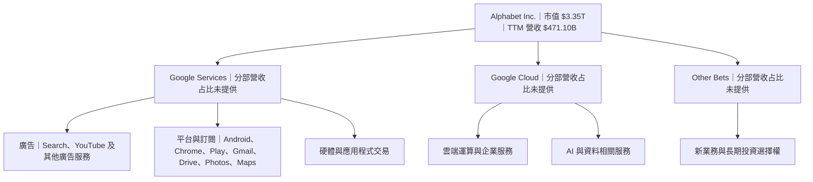
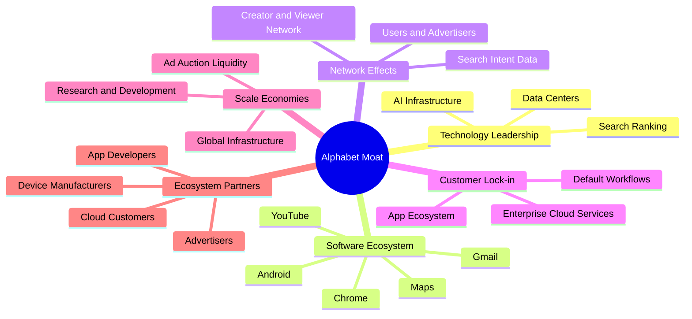
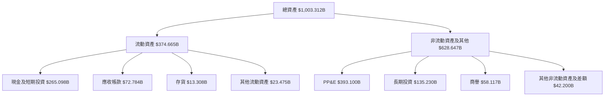
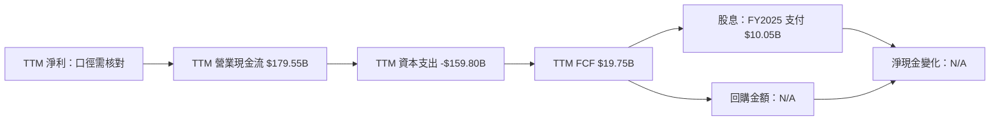
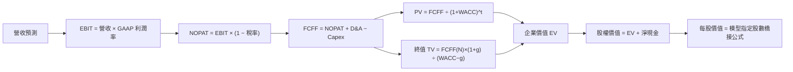
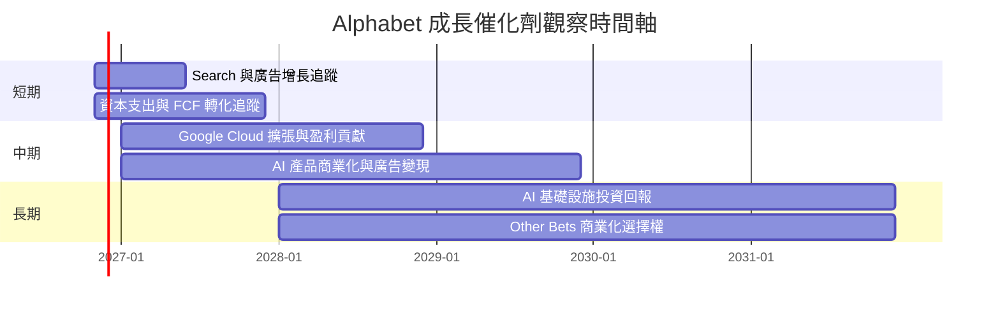
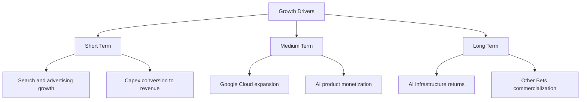
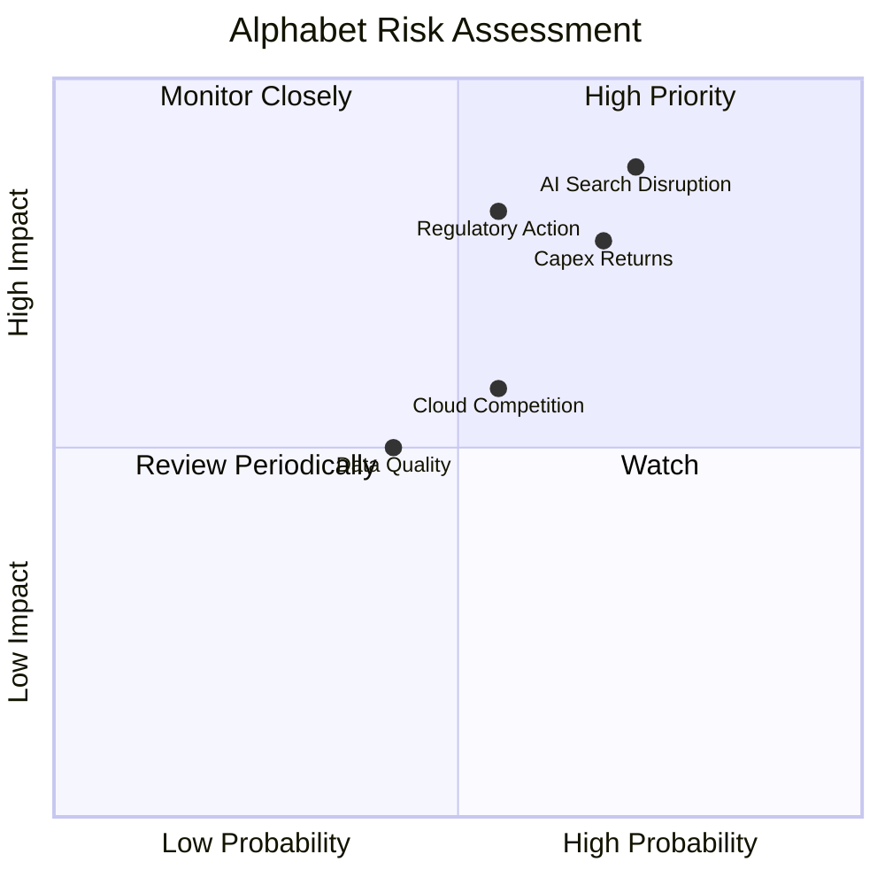
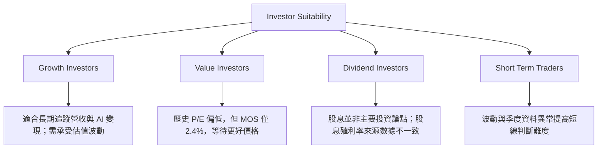

# GOOG 基本面深度分析報告
> **報告日期**：2026-11-28 ｜ **語言**：繁體中文 ｜ **數據來源**：SEC 申報資料 (XBRL)、Yahoo Finance、Finviz、StockAnalysis、Roic.ai ｜ **分析師**：CFA 級機構研究

## 目錄

| # | 章節 | 核心結論 |
|---|------|----------|
| 1 | 執行摘要 | 持有；加權合理價值 $277.62，MOS +2.4% |
| 2 | 公司概覽與商業模式 | 搜尋、影音、雲端與軟體生態構成核心護城河；分部營收占比未提供 |
| 3 | 損益表深度分析 | TTM 營收 $471.10B、TTM 成長 22.2%；最近一季年增 24.7%，但季報盈餘資料有重大異常 |
| 4 | 資產負債表分析 | 淨現金 $138.98B；流動性充裕，資本支出快速上升 |
| 5 | 現金流量深度分析 | TTM FCF $19.75B、FCF Yield 0.59%；高額資本支出壓低近期自由現金流 |
| 6 | 獲利能力與資本效率 | ROIC 23.9% 高於 WACC 10.32%，仍創造股東價值 |
| 7 | 相對估值分析 | P/E 低於同業中位數及自身歷史中位數；Forward P/E、P/S 評價較高 |
| 8 | DCF 內在價值評估 | 基準 DCF $245.54；加權合理價值 $277.62，MOS 僅 +2.4% |
| 9 | 成長催化劑 | 搜尋與雲端成長、AI 產品化及資本投入變現是主要觀察項 |
| 10 | 風險矩陣 | AI 搜尋競爭、巨額資本支出回報及監管是前三大風險 |
| 11 | 投資建議 | 持有；以 $249.86 以下作為具 10% MOS 的觀察買入價位 |

---

## 1. 執行摘要

Alphabet TTM 營收為 **$471.10B**，TTM 年增 **22.2%**，最新一季營收年增 **24.7%**，顯示需求與變現仍具動能；但最新季度營業利益率為 **31.8%**，低於 TTM 的 **33.3%**，而 TTM 自由現金流僅 **$19.75B**、FCF Yield **0.59%**，反映資料中心等資本支出大幅增加。ROIC **23.9%** 高於 WACC **10.32%**，公司仍創造經濟價值；然而 DCF 基準價值為 **$245.54**，加權合理價值為 **$277.62**，相對 **2026-11-25 收盤價 $270.98** 的 MOS 僅 **+2.4%**。因此依 MOS 門檻應評為**持有**，不作質化調整。

### 1.0 一頁式投資儀表板（Portfolio Manager 30 秒速讀）

| 項目 | 內容 |
|------|------|
| **投資論點（3 句）** | ① TTM 營收年增 22.2%，最新一季年增 24.7%，核心廣告與雲端需求仍在擴張。② ROIC 23.9% 高於 WACC 10.32%，目前資本回報仍超越資金成本。③ TTM FCF 僅 $19.75B、FCF Yield 0.59%，主因資本支出升高，投資回報仍需驗證。 |
| **綜合評分** | **7.3/10**（引用 1.1 評分卡） |
| **財務健康** | 🟢 淨現金 $138.98B；流動比率 2.786，但 F-Score 為 4/8。 |
| **ROIC vs WACC** | **23.9% vs 10.32%**；創造價值，利差 13.58 個百分點。 |
| **FCF 趨勢** | 近年年度 FCF 約 $60.01B–$73.27B；最新 TTM 因 Capex 上升降至 $19.75B，FCF Yield **0.59%**。 |
| **估值** | Forward P/E **17.81x**｜EV/EBITDA **17.4x**｜FCF Yield **0.59%** |
| **DCF 內在價值（基準）** | **$245.54**｜現價相對 DCF 溢價 **10.4%** |
| **安全邊際（MOS）** | **+2.4%＝($277.62 − $270.98) ÷ $277.62**｜🔴 <10%，不足 |
| **預期報酬（基準情境 12M）** | **-9.4%**（DCF 基準情境 $245.54 相對現價；非 12 個月價格目標） |
| **關鍵風險（前二）** | AI 搜尋替代及廣告變現模式變化；Capex 高增但 FCF 回報不足。 |
| **評級 + 信心度** | 🟡 **持有**｜信心：中；估值模型對終值及資本支出假設敏感。 |

### 1.1 綜合評分卡（全報告唯一）

| 維度 | 評分（1–10） | 主要依據（引用數字與其來源章節） |
|------|--------------|----------------------------------|
| 成長性 | 8.5 | TTM 營收年增 22.2%、最新一季年增 24.7%（第 3 章）。 |
| 獲利能力 | 8.5 | TTM 營業利益率 33.3%，ROIC 23.9% 高於 WACC 10.32%；F-Score 4/8（第 6 章）。 |
| 財務健康 | 8.0 | 淨現金 $138.98B、流動比率 2.786；但 F-Score 未通過應計品質與稀釋股數等測試（第 4、6 章）。 |
| 估值 | 5.0 | MOS +2.4%；P/E 低於自身歷史中位數，但 P/S 高於歷史中位數（第 7、8 章）。 |
| 護城河 | 8.5 | Search、Android、Chrome、YouTube、Gmail、Maps 等跨產品生態，且 TTM 營收 $471.10B（第 2 章）。 |
| 管理層與資本配置 | 5.5 | FY2025 SBC $24.95B；稀釋股數測試未通過，TTM Capex $159.80B，投資回報待觀察（第 3、5、6 章）。 |
| **綜合評分** | **7.3** | 六項算術平均＝(8.5+8.5+8.0+5.0+8.5+5.5)÷6＝**7.3**。 |

### 1.2 五大投資論點 + 三大核心風險

| 類型 | 項目 | 具體依據 | 信心度 |
|------|------|----------|--------|
| 🟢 **投資論點①** | 大型營收底盤仍在增長 | TTM 營收 $471.10B，TTM 年增 22.2%；最新一季年增 24.7%。 | 🟢 高 |
| 🟢 **投資論點②** | 資本回報高於資金成本 | ROIC 23.9%，WACC 10.32%，利差 13.58 個百分點。 | 🟢 高 |
| 🟢 **投資論點③** | 淨現金提供投資彈性 | 現金及短期投資 $265.10B，總債務 $126.12B，淨現金 $138.98B。 | 🟢 高 |
| 🟢 **投資論點④** | 核心平台具生態互補性 | Search、Android、Chrome、YouTube、Maps、Gmail 等形成跨服務觸達；分部收入占比資料未提供。 | 🟡 中 |
| 🟡 **投資論點⑤** | P/E 低於歷史中位數 | P/E 14.1x，低於五年中位數 21.9x；但不能單靠歷史倍數確認低估。 | 🟡 中 |
| 🟡 **風險①** | Capex 拉低 FCF | TTM Capex $159.80B，TTM FCF $19.75B，Capex 相當於 OCF 的高比例。 | 🟡 中 |
| 🔴 **風險②** | AI 改變搜尋使用與廣告回報 | 若搜尋流量、查詢變現或廣告拍賣效率下滑，收入成長及毛利將受壓。 | 🔴 高 |
| 🔴 **風險③** | 資料品質與季度淨利波動 | Q2 2026 淨利 $112.19B、Q3 $26.47B，且 EPS surprise 資料缺失；需要核對申報資料。 | 🔴 高 |

### 1.3 快速統計卡片

| 指標 | 公司實際值（期間） | 同業中位數 | 狀態 |
|------|--------------------|------------|------|
| 營收成長（TTM） | **22.2%** | — | 🟢 |
| 營收成長（最新一季年增） | **24.7%** | **18.8%** | 🟢 |
| 毛利率（TTM） | **60.9%** | **67.7%** | 🟡 |
| 營業利益率（TTM） | **33.3%** | — | 🟢 |
| ROIC（TTM） | **23.9%** | — | 🟢 |
| Forward P/E | **17.81x** | **20.4x** | 🟢 |
| FCF Yield（TTM） | **0.59%** | — | 🔴 |
| Piotroski F-Score | **4 / 8** | — | 🟡 |

### 1.4 投資結論

```text
╔══════════════════════════════════════════════════════════════════╗
║                    📊 投資結論摘要                               ║
╠══════════════════════════════════════════════════════════════════╣
║  評級：持有（MOS +2.4%，ROIC 23.9% 高於 WACC 10.32%）             ║
║  價格（2026-11-25 收盤）：$270.98                                ║
║  DCF 內在價值（基準）：$245.54（現價溢價 10.4%）                 ║
║  安全邊際 MOS：+2.4%（＝($277.62−$270.98)÷$277.62）             ║
║  加權合理價值（8.8）：$277.62                                    ║
║  DCF 情境價值：                                                   ║
║    悲觀情境：$107.36（-60.4%）                                   ║
║    基準情境：$245.54（-9.4%）                                    ║
║    樂觀情境：$512.45（+89.1%）                                   ║
║  綜合評分：7.3/10（引用 1.1）                                    ║
║  適合投資人：能承受估值波動、以多年期持有為目標的成長型投資人     ║
╚══════════════════════════════════════════════════════════════════╝
```

---

## 2. 公司概覽與商業模式

### 2.1 業務結構與收入來源

財務資料列示 Google Services、Google Cloud、Other Bets 三大板塊，但未提供各分部營收與占比，因此不虛構分部金額或百分比。



商業模式的核心是以免費或低摩擦服務取得使用者觸達，再透過廣告、訂閱、應用程式交易及企業雲服務變現。分部營收與毛利數據未提供，無法精確量化各項業務對集團獲利的貢獻。

### 2.2 市場份額

市場份額數據未提供，因此不列市場占比或繪製市場份額圖。以公司規模衡量，Alphabet TTM 營收 $471.10B，最近一季營收年增 24.7%；同一 Peer multiples 資料中，Meta、Microsoft、Amazon 最近一季營收成長分別為 26.1%、18.8%、12.1%。Alphabet 的最新季成長高於 Microsoft、Amazon，略低於 Meta。

### 2.3 競爭護城河分析



### 2.4 護城河強度

| 護城河項目 | 強度（強／中／弱） | 證據（引用數字或事實） | 會削弱它的情況 |
|------------|--------------------|------------------------|----------------|
| 技術與資料 | 強 | Search、YouTube、Maps 等服務累積使用情境與資料；FY2025 R&D 支出 $61.09B。 | AI 搜尋降低傳統搜尋入口價值，或競爭對手提供更佳答案與服務。 |
| 軟體生態 | 強 | Android、Chrome、Gmail、Drive、Maps、Play 等產品互相導流。 | 監管要求改變預設分發、跨服務整合受限或用戶轉向替代平台。 |
| 網路效應 | 強 | 搜尋使用者與廣告商、YouTube 創作者與觀眾互相吸引；公司規模可由 TTM 營收 $471.10B 佐證。 | 使用者注意力分散、內容供給成本上升或廣告主轉移預算。 |
| 客戶鎖定 | 中 | 個人與企業服務嵌入日常工作流程；雲端服務可提高轉換成本。 | 雲端客戶多雲策略、帳戶遷移工具改善，降低切換成本。 |
| 規模效應 | 強 | TTM OCF $179.55B，具備大規模研發與基礎設施投入能力。 | Capex 長期高於現金流增長，規模優勢轉化成低回報資產。 |
| 生態夥伴 | 中 | 裝置廠、開發者、廣告主及企業客戶共同參與平台。 | 監管限制分發協議、夥伴改採多平台或自建服務。 |

1.1「護城河」評分為 **8.5/10**，理由是產品生態、研發規模與平台網路效應具多重支撐，但未有分部與市占數據可直接量化各護城河的防禦強度。

---

## 3. 損益表深度分析

### 3.1 年度收入成長趨勢（近 4 年）

以下年度收入與增幅依年度損益資料計算；營收 CAGR 以 FY2022 至 FY2025 三年區間計算。

```text
╔══════════════════════════════════════════════════════════════════╗
║              Alphabet 年度收入趨勢（FY2022-FY2025）             ║
╠══════════════════════════════════════════════════════════════════╣
║  FY2022  $282.84B  ██████████████░░░░░░░░░░░░  YoY: 基期       ║
║  FY2023  $307.39B  ███████████████░░░░░░░░░░░  YoY: +8.7% 🟡  ║
║  FY2024  $350.02B  ██████████████████░░░░░░░░  YoY:+13.9% 🟢  ║
║  FY2025  $402.84B  ████████████████████░░░░░░  YoY:+15.1% 🟢  ║
║                                                                  ║
║  FY2022–FY2025 CAGR = (402.84 ÷ 282.84)^(1/3) − 1 = 約 12.6%    ║
╚══════════════════════════════════════════════════════════════════╝
```

收入增速由 FY2023 的 8.7% 加速至 FY2025 的 15.1%，TTM 進一步達 22.2%。這與最新季度營收同比增長 24.7% 一致，顯示近期增長快於近三年年度 CAGR；但不應把最新單季增幅直接外推為長期成長率。

### 3.2 季度收入趨勢分析

| 季度 | 營收 | QoQ 成長 | YoY 成長 | 備註 |
|------|------|----------|----------|------|
| 2025 Q4 | $113.83B | +11.2%* | 18.0% | QoQ 依 2025 Q3 的 $102.35B 計算；YoY 採 StockAnalysis 季度資料。 |
| 2026 Q1 | $109.90B | -3.5% | 21.79% | 季節性回落，但同比成長加速。 |
| 2026 Q2 | $119.80B | +9.0% | 24.23% | 同比增長延續改善。 |
| 2026 Q3 | $127.58B | +6.5% | 24.65% | 最新一季營收同比增長 24.7%，為單季 YoY，不是 TTM。 |

\*2025 Q4 QoQ ＝ $113.83B ÷ $102.35B − 1。季度營收逐季提升，但公司分部貢獻資料未提供，無法將加速明確拆分至 Search、YouTube 或 Cloud。

### 3.3 利潤率演變分析

| 利潤率指標 | FY2022 | FY2023 | FY2024 | FY2025 | 趨勢 | 評估 |
|------------|--------|--------|--------|--------|------|------|
| **毛利率** | 55.4% | 56.6% | 58.2% | 59.6% | ↗️ 逐年改善 | 🟢 |
| **營業利益率** | 26.5% | 27.4% | 32.1% | 32.0% | ↗️ FY2024 明顯提升，FY2025 大致持平 | 🟢 |
| **淨利率** | 21.2% | 24.0% | 28.6% | 32.8% | ↗️ 年度數據逐年提高 | 🟢 |

年度利潤率計算方式為年度毛利／營收、營業利益／營收及淨利／營收。年度資料顯示 FY2024 營業利益率擴張，可能反映成本控制與收入增長所形成的營業槓桿；FY2025 營收增長 15.1%，營業利益由 $112.39B 增至 $129.04B，約增 14.8%，因此營業利益率大致持平。最新季度營業利益率為 **31.8%**，低於 TTM **33.3%**，值得追蹤投入成本及資本密集業務擴張對利潤率的影響。

### 3.4 費用結構分析

完整費用明細及同一期間一致口徑的費用項目未提供，無法製作有實際數據支撐的費用結構圓餅圖。可確認 FY2025 R&D 支出為 **$61.09B**，FY2024 為 **$49.33B**，按年增加約 **23.8%**；研發投入增加支持產品與 AI 能力，但也提高短期費用負擔。

```text
╔══════════════════════════════════════════════════════════════════╗
║                        費用結構可得數據                          ║
╠══════════════════════════════════════════════════════════════════╣
║  FY2025 R&D：$61.09B｜FY2024 R&D：$49.33B｜YoY：+23.8%          ║
║  其他費用細項：資料未提供，故不製作不完整比例圖                  ║
╚══════════════════════════════════════════════════════════════════╝
```

### 3.5 季度 EPS 趨勢與盈餘品質（Quality of Earnings）

近四季 EPS actual 資料可由 StockAnalysis 交叉參考，但 EPS Est 與 Surprise 資料均為缺值，故不能判斷季度是否超預期或不及預期。

| 季度 | EPS 實際值 | YoY EPS 成長 | 超預期／不及預期 |
|------|-----------:|-------------:|-----------------|
| 2025 Q4 | $2.81 | +31.15% | N/A（估值預期數據缺失） |
| 2026 Q1 | $5.11 | +81.96% | N/A（估值預期數據缺失） |
| 2026 Q2 | $9.11 | +294.31% | N/A（需核對淨利異常） |
| 2026 Q3 | $2.14 | -25.34% | N/A（估值預期數據缺失） |

Q2 EPS 與淨利數據出現明顯不連續：季度淨利資料列為 $112.19B，Q3 為 $26.47B；單季 EPS 也由 $9.11 降至 $2.14。這些數字可能涉及資料異常、非經常性項目或期間口徑差異，必須以 SEC 申報資料核對，不宜將 Q2 EPS 增長直接當作經常性盈利趨勢。

| 盈餘品質項目 | 數值／佔比 | 評估 |
|--------------|-----------|------|
| 股權薪酬 SBC / 營收 | FY2025 $24.95B ÷ $402.84B＝**6.2%** | 🟡 SBC 會稀釋股東；F-Score 的稀釋股數測試未通過。 |
| SBC / 營業現金流 | FY2025 $24.95B ÷ $164.71B＝**15.1%** | 🟡 SBC 為非現金費用，但經濟成本仍由股東承擔。 |
| FCF / 淨利（現金轉換率） | TTM FCF $19.75B ÷ TTM 淨利 $235.694B＝約 **8.4%** | 🔴 低；但 TTM 淨利口徑與季度資料有異常，須視為低信心計算。 |
| 一次性／非經常性損益 | N/A（無可靠拆分數據） | 🟡 Q2 2026 淨利 $112.19B 的異常值待核實，不能直接歸因一次性項目。 |
| 有效稅率異常 | 最近年度有效稅率 **16.8%** | 🟢 DCF 採用此稅率；缺少完整年度稅務調節表，不判定是否有一次性稅務利益。 |
| 資本化支出 vs 費用化 | TTM Capex $159.80B；資本化與費用化明細 N/A | 🟡 Capex 增加可能降低當期 FCF；無法據現有資料判斷是否有成本過度資本化。 |

**盈餘品質結論**：營業利潤率與歷史營收趨勢支持營運獲利能力，但 TTM FCF 僅 $19.75B、SBC 占 FY2025 營收 6.2%，且季度淨利與 EPS 數據異常。因此，GAAP 獲利不能只看帳面淨利，估值應同時折價考慮現金轉換與資本投入風險。

---

## 4. 資產負債表分析

### 4.1 資產結構分解

最新 TTM 資產負債表列示總資產 $1,003.312B。以下項目依 StockAnalysis 資產負債表數據呈現；「其他資產」為總資產扣除列示細項的餘額，不另行推估其組成。



資產擴張主要可見於 PP&E：FY2025 為 $261.818B，最新 TTM 資料增至 $393.100B。該增長與高額資本支出相符，但未有資產新增的分項揭露，不能把全部增幅直接歸因於單一投資類別。

### 4.2 流動性與營運資金分析

| 指標 | 最新 TTM | 一年前 TTM | 變化 | 解讀 |
|------|----------|------------|------|------|
| 流動比率 | 2.786 | N/A | N/A | 短期資產對流動負債具緩衝；歷史比較所需同口徑數據未提供。 |
| 速動比率 | 2.512 | N/A | N/A | 現金、短期投資與應收帳款等可支持短期償債。 |
| DSO 應收帳款天數 | 56 天 | 54 天 | +2 天 | 收款週期略延長，可能與收入組合或客戶付款時點有關；無應收帳款逾期明細可供判斷。 |
| DIO 存貨天數 | 26 天 | N/A | N/A | 一年前公司未報告可用存貨餘額；不補算變化。 |
| DPO 應付帳款天數 | 43 天 | N/A | N/A | 一年前數據 N/A，不能判定供應商付款條件變化。 |
| CCC 現金轉換週期 | 39 天 | N/A | N/A | 一年前 DIO、DPO 不可得，故不比較；最新值為 DSO＋DIO−DPO。 |

### 4.3 債務結構分析

債務及現金採用程式計算的主要財務指標：總債務 **$126.12B**、現金及短期投資 **$265.10B**、淨現金 **$138.98B**。其他市場資料列示總債務 $150.33B、淨現金 $114.77B，與主要指標不一致；本報告遵循同一 verified 指標口徑，並將差異列為資料核對事項。未提供利息保障倍數與一致口徑 EBITDA，因此不推算相關比率。

```text
╔══════════════════════════════════════════════════════════════════╗
║                   Alphabet 債務健康診斷                         ║
╠══════════════════════════════════════════════════════════════════╣
║  總債務：        $126.12B  ██████████░░░░░░░░░░  🟡             ║
║  現金+短期投資： $265.10B  ████████████████████  🟢             ║
║  淨現金：        $138.98B  ██████████░░░░░░░░░░  🟢             ║
║  Debt/EBITDA：   N/A（所需分母口徑未提供）                       ║
║  Interest Coverage：N/A（利息保障倍數資料未提供）               ║
║  備註：市場資料另列總債務 $150.33B，口徑不一致，需核對申報。     ║
╚══════════════════════════════════════════════════════════════════╝
```

### 4.4 股東權益趨勢

| 年度 | 股東權益 | YoY 變化 |
|------|----------:|---------:|
| FY2022 | $256.14B | — |
| FY2023 | $283.38B | +10.6% |
| FY2024 | $325.08B | +14.7% |
| FY2025 | $415.26B | +27.7% |

股東權益在 FY2025 明顯上升，但股東權益增加不等同於每股價值同比增加；公司仍須同時觀察稀釋股數、回購與資本回報。F-Score 中「稀釋股數未增加」未通過，代表每股回報可能被股數變化部分抵銷。

```text
╔══════════════════════════════════════════════════════════════════╗
║                     股東權益變化（年度）                         ║
╠══════════════════════════════════════════════════════════════════╣
║  FY2022  $256.14B  ████████████░░░░░░░░                       ║
║  FY2023  $283.38B  ██████████████░░░░░░                       ║
║  FY2024  $325.08B  ████████████████░░░░                       ║
║  FY2025  $415.26B  ████████████████████                       ║
╚══════════════════════════════════════════════════════════════════╝
```

---

## 5. 現金流量深度分析

### 5.1 現金流量瀑布圖

最新資料可核對 TTM OCF、Capex 及 FCF；股息可由年度／季度現金流資料觀察，回購及淨現金變化缺少同口徑 TTM 明細，因此不填入圖中金額。



### 5.2 FCF 轉換率趨勢

| 年度 | OCF | Capex | FCF | 淨利 | FCF／淨利 |
|------|----:|------:|----:|----:|----------:|
| FY2022 | $91.50B | $31.48B | $60.01B | $59.97B | 100.1% |
| FY2023 | $101.75B | $32.25B | $69.50B | $73.80B | 94.2% |
| FY2024 | $125.30B | $52.53B | $72.76B | $100.12B | 72.7% |
| FY2025 | $164.71B | $91.45B | $73.27B | $132.17B | 55.4% |
| TTM 至 2026-09-30 | $179.55B | $159.80B | $19.75B | $235.694B* | 約 8.4%* |

\*TTM 淨利數值來自 StockAnalysis，但與部分季度淨利資料存在明顯口徑或資料異常，轉換率只作風險提示，不宜當成已核實的經常性指標。

OCF 持續增長，但 Capex 由 FY2024 的 $52.53B 增至 FY2025 的 $91.45B，TTM 達 $159.80B。年度 FCF 尚維持約 $73B，TTM FCF 卻降至 $19.75B，顯示近期再投資速度快於經營現金流的增長。

### 5.3 自由現金流趨勢

| 期間 | FCF | 變化／說明 |
|------|----:|------------|
| FY2022 | $60.01B | 歷史年度基準 |
| FY2023 | $69.50B | 年增約 15.8% |
| FY2024 | $72.76B | 年增約 4.7% |
| FY2025 | $73.27B | 年增約 0.7% |
| TTM 至 2026-09-30 | $19.75B | TTM OCF − Capex；FCF Yield 0.59% |

```text
╔══════════════════════════════════════════════════════════════════╗
║                    自由現金流趨勢（美元）                        ║
╠══════════════════════════════════════════════════════════════════╣
║  FY2022  $60.01B  ████████████████░░░░                         ║
║  FY2023  $69.50B  ███████████████████░                         ║
║  FY2024  $72.76B  ████████████████████                         ║
║  FY2025  $73.27B  ████████████████████                         ║
║  TTM     $19.75B  █████░░░░░░░░░░░░░░░  FCF Yield 0.59%       ║
╠══════════════════════════════════════════════════════════════════╣
║  TTM FCF = $179.55B OCF − $159.80B Capex = $19.75B              ║
╚══════════════════════════════════════════════════════════════════╝
```

### 5.4 資本配置評估

資本配置明細中可量化項目包括 Capex、股息與 SBC；回購與留存現金的完整分配資料未提供，故不以無依據比例繪製圓餅圖。

| 項目 | 可得數據 | 評估 |
|------|----------|------|
| Capex | TTM $159.80B；FY2025 $91.45B | 🔴 投入大幅提升，需觀察新增資產能否轉化為高回報收入。 |
| 股息 | FY2025 支付 $10.05B | 🟡 有現金回饋，但相對營運現金流仍非主要配置項。 |
| SBC | FY2025 $24.95B | 🟡 占營收 6.2%，是持續股東成本。 |
| 回購 | N/A（未提供同期間金額） | 無法評估回購價格與抵銷稀釋的成效。 |
| 留存現金／其他投資 | N/A | 不推估比例。 |

---

## 6. 獲利能力與資本效率

### 6.1 ROE / ROA / ROIC 趨勢

| 指標 | 數值 | 期間／來源口徑 | 評估 |
|------|------:|----------------|------|
| ROE | 34.8% | TTM，QUALITY FIGURES 口徑 | 🟢 高；杜邦拆解顯示主要由 50.0% 淨利率驅動。 |
| ROA | 12.7% | 市場資料所列 TTM | 🟢 正值且具獲利能力；但不與杜邦 ROE 混用。 |
| ROIC | 23.9% | TTM、稅後營業利益／投入資本 | 🟢 高於資本成本。 |
| WACC | 10.32% | Cost of capital inputs | 🟡 折現率，作為價值創造比較基準。 |

歷史 ROIC 的同口徑完整年度序列未提供，故不填造多年趨勢。FY2022–FY2025 的年度營業利益率則由 26.5% 升至約 32.0%，支持利潤能力結構性改善的判斷，但無法直接替代 ROIC 歷史序列。

### 6.2 ROIC vs WACC 分析（核心價值創造判斷）

```text
╔══════════════════════════════════════════════════════════════════╗
║                ROIC vs WACC 深度分析                            ║
╠══════════════════════════════════════════════════════════════════╣
║  WACC（採用 VERIFIED 成本資本數據）：                            ║
║  ├── 無風險利率（10Y美債）：  4.94%                              ║
║  ├── 市場風險溢酬 ERP：       5.00%                              ║
║  ├── 原始 Beta：              1.23                               ║
║  ├── 調整後 Beta：            1.15                               ║
║  ├── 股權成本 Ke：            10.69%                             ║
║  ├── 稅前債務成本：           0.58%                              ║
║  ├── 有效稅率：               16.8%                              ║
║  ├── 股權／債務權重：         96.4%／3.6%                         ║
║  └── ✅ WACC：                10.32%                             ║
║                                                                  ║
║  ROIC（TTM）：                 23.9%                              ║
║  經濟價值利差：                23.9% − 10.32% = 13.58 個百分點   ║
║                                                                  ║
║  ROIC 23.9%  ▓▓▓▓▓▓▓▓▓▓▓▓▓▓▓▓▓▓▓▓▓▓▓▓░░░░  🟢                  ║
║  WACC 10.32% ▓▓▓▓▓▓▓▓▓▓░░░░░░░░░░░░░░░░░░  ──                  ║
║  結論：ROIC 高於 WACC，投入資本目前仍創造股東價值。             ║
╚══════════════════════════════════════════════════════════════════╝
```

WACC 採用成本資本數據提供的 **10.32%**，不可用未標準化的總負債或另一組資本結構另行重算。ROIC 與 WACC 差距為 **13.58 個百分點**，代表現有投入資本仍具正經濟利潤；主要風險是高額 AI／資料中心投資使新增資本的邊際 ROIC 下滑。

### 6.3 杜邦三因素分解

| 因素 | 數值（TTM） | 解讀 |
|------|-------------|------|
| 淨利率 | 50.0% | 高淨利率是 ROE 的主要推動因素；季度淨利資料異常使本項需審慎解讀。 |
| 資產週轉率 | 0.47 | 每單位資產創造的收入有限於資本密集型資產增加時，可能壓低資產效率。 |
| 權益乘數 | 1.48 | 財務槓桿不高，ROE 並非主要靠高槓桿撐起。 |
| **ROE** | **34.8%** | 50.0% × 0.47 × 1.48＝34.8%（按品質指標口徑）。 |

### 6.4 財務體質：Piotroski F-Score

Piotroski F-Score 為 **4/8**；毛利率測試因資料缺失而排除，所以分母為 8，而非 9。

| 測試 | 結果 | 解讀 |
|------|------|------|
| ROA > 0 | ✅ 通過 | TTM 資產報酬為正。 |
| 營業現金流 > 0 | ✅ 通過 | TTM OCF 為 $179.55B。 |
| ROA 高於一年前 | ✅ 通過 | 獲利能力較前一年改善。 |
| 營業現金流 > 淨利（應計品質） | ❌ 未通過 | 顯示現金流低於淨利，需注意盈餘現金轉換。 |
| 長期負債／總資產低於一年前 | ❌ 未通過 | 槓桿相對資產的改善條件未達成。 |
| 流動比率高於一年前 | ✅ 通過 | 短期償債能力改善。 |
| 稀釋股數未增加 | ❌ 未通過 | SBC 或其他股數變化可能稀釋每股價值。 |
| 毛利率高於一年前 | — 無法判定 | 缺少可用輸入；測試不納入分母。 |
| 資產週轉率高於一年前 | ❌ 未通過 | 資產增長速度高於收入轉化效率改善的條件。 |

4/8 表示財務品質並非全面改善：流動性及正營業現金流是優點，應計品質、負債比率趨勢、稀釋股數與資產週轉仍需跟進。

---

## 7. 相對估值分析

### 7.1 同業估值比較表格

GOOG 公司的倍數採用提供的自身歷史估值區塊；同業倍數採 Peer multiples。公司 Forward P/E 以市場估值區塊所列 17.812368x 表示，與 DCF 估值方法所用 Forward EPS 口徑不同時，不自行替換。

| 估值指標 | **GOOG** | **META** | **MSFT** | **AMZN** | GOOG 評估 |
|----------|---------:|---------:|--------:|--------:|-----------|
| **Trailing P/E** | 14.1x | 21.5x | 25.7x | 20.5x | 🟢 低於三家同業；但須考慮淨利資料品質與業務結構差異。 |
| **Forward P/E** | 17.81x | 17.6x | 20.4x | 23.3x | 🟡 接近 META、低於 MSFT 與 AMZN；同業中位數 20.4x。 |
| **P/S Ratio** | 7.1x | 6.7x | 10.6x | 3.4x | 🟡 高於同業中位數 6.7x。 |
| **EV/EBITDA** | 17.4x | 14.1x | 18.1x | 16.0x | 🟡 高於同業中位數 16.0x。 |
| **最新一季營收 YoY** | 24.7% | 26.1% | 18.8% | 12.1% | 🟢 成長高於 MSFT、AMZN，略低於 META。 |
| **毛利率 TTM** | 60.9% | 81.0% | 67.7% | 51.4% | 🟡 低於 META、MSFT，高於 AMZN。 |

同業中位數：Trailing P/E **21.5x**、Forward P/E **20.4x**、P/S **6.7x**、EV/EBITDA **16.0x**。倍數差異反映廣告、軟體、電商及雲端組合不同，不能將單一倍數視為精確的公平價。

### 7.2 歷史估值區間分析

```text
╔══════════════════════════════════════════════════════════════════╗
║                 GOOG 五年估值區間（TTM）                         ║
╠══════════════════════════════════════════════════════════════════╣
║  P/E：       1.3x ─────────● 14.1x────────── 29.0x              ║
║              五年中位數 21.9x｜目前百分位 29%                    ║
║                                                                  ║
║  P/S：       4.1x ───────────────● 7.1x────── 9.8x              ║
║              五年中位數 6.1x｜目前百分位 67%                    ║
║                                                                  ║
║  EV/EBITDA：13.7x ───────● 17.4x─────────── 25.0x              ║
║              五年中位數 19.1x｜目前百分位 33%                    ║
╚══════════════════════════════════════════════════════════════════╝
```

P/E 與 EV/EBITDA 分別處於自身五年區間第 29 與第 33 百分位，低於歷史中位數；P/S 則位於第 67 百分位，高於自身中位數。三項指標並不一致，估值判斷不應只用 P/E。

### 7.3 情境價值（Bear / Base / Bull，照抄 DCF MODEL 的 Scenarios）

| 情境 | 第 1 年營收成長 | 期末營業利潤率 | WACC | 每股價值 | 相對現價 | 機率 | 會發生的條件 |
|------|----------------|----------------|------|----------|----------|------|--------------|
| 🔴 悲觀 | 11.1% | 27.2% | 11.32% | $107.36 | -60.4% | 25% | 搜尋廣告增速顯著放緩、AI 投資回報不足，且利潤率向下收斂。 |
| 🟡 基準 | 22.2% | 32.0% | 10.32% | $245.54 | -9.4% | 50% | 營收延續目前成長後逐步降速，長期利潤率接近歷史中位數。 |
| 🟢 樂觀 | 33.3% | 35.2% | 9.32% | $512.45 | +89.1% | 25% | AI／雲端變現延續高增長、利潤率擴張，資本成本同時下降。 |

機率加權值為 **$277.72**（模型提供值，僅供情境參考；8.8 依規定使用基準 DCF 和指定權重估值，不以此替代）。

### 7.4 相對估值隱含價格區間

```text
╔══════════════════════════════════════════════════════════════════╗
║                 相對估值隱含每股價值                            ║
╠══════════════════════════════════════════════════════════════════╣
║  $245.54 ───── $250.59 ───── $270.98 ───── $311.44             ║
║  基準 DCF     EV/EBITDA        現價        Forward P/E           ║
║                                                                  ║
║  同業 Forward P/E：$311.44                                       ║
║  Peer 中位數 20.4x × Forward EPS $15.29                         ║
║  同業 EV/EBITDA：$250.59                                         ║
║  Peer 中位數 16.0x × TTM EBITDA，再加淨現金                     ║
╚══════════════════════════════════════════════════════════════════╝
```

兩項同業相對估值一高一低：Forward P/E 法隱含 $311.44，EV/EBITDA 法隱含 $250.59。差異反映盈利與 EBITDA 倍數對當期利潤、折舊及資本密集度的敏感度不同。

---

## 8. DCF 內在價值評估（Discounted Cash Flow）

> 下列 DCF 模型假設、逐年預測、敏感度與情境數字均依模型輸出照錄；若原始輸出中的算式與數值有小幅不一致，會明確標示，不以自行重建模型取代。

### 8.0 估值推理鏈（Thinking Logic：在算之前先想清楚）

**Step 1 — 價值來源與主導變數**

Alphabet 價值主要來自既有搜尋、廣告及平台現金流底盤、雲端成長，以及 AI 與 Other Bets 的未來選擇權；但本資料沒有分部營收占比，故不虛構各來源占比。DCF 顯示終值現值占 EV **72.2%**，而敏感度矩陣顯示 g 與 WACC 變動會大幅改變每股估值，因此終值假設及長期資本成本是主要估值驅動因子。

**Step 2 — 模型選擇**

| 決策點 | 本報告採用 | 理由（含數字） | 曾考慮但否決 | 否決理由 |
|--------|-----------|----------------|--------------|----------|
| 現金流定義 | FCFF | 以 GAAP EBIT 扣稅，加回 D&A、扣除 Capex，並以 WACC 折現求 EV。 | FCFE | 公司債務、現金及資本配置會變動，FCFF 較便於企業價值橋接。 |
| 預測期 N | 10 年 | 模型固定使用 10 年，營收成長由 22.2% 線性淡化至 3.0%。 | 5 年 | 雲端與 AI 投資回報週期較長，且本次估值模型指定 10 年。 |
| 終值方法 | Gordon Growth | 永續成長率 3.0%，低於 WACC 10.32%。 | 單獨用退出倍數 | 不以退出倍數取代主 DCF；模型未提供指定退出倍數作主估值。 |
| EBIT 基礎 | GAAP | GAAP 營業利益已包含 SBC 費用。 | 非 GAAP EBIT | 加回 SBC 會使股東成本被低估，且模型採用 GAAP EBIT。 |

**Step 3 — 關鍵假設推導鏈**

- **營收成長**：錨點＝TTM 成長 22.2%，FY2025 年增 15.09% → TTM 反映近期加速，但基期與競爭不確定性使長期增速逐步回落 → **採用 FY+1 22.2%、FY+10 3.0% 線性淡化** → 曾考慮長期固定 22.2%，但因終值前仍需回到成熟企業成長水準而否決。
- **期末營業利潤率**：錨點＝TTM 營業利益率 33.3%，FY2022–FY2025 約 26.5%–32.1% → AI／雲端擴張可提高規模效益，但資料中心投入及競爭可能抵銷 → **採用 FY+1 33.3% 降至 FY+10 32.0%** → 曾考慮長期維持 33.3%，但模型以過去五年中位數（含 TTM）收斂，否決固定高位假設。
- **永續成長率 g**：錨點＝3.0% 是模型採用值，與長期成熟市場名目成長假設相容，且低於 WACC → **採用 3.0%** → 曾考慮更高 4.0%，但終值占 EV 已達 72.2%，過高 g 會放大終值依賴，因此不作基準值。
- **預測期 N**：錨點＝模型採用 10 年；TTM 成長仍高於成熟期水平 → 以十年呈現成長淡化，再接永續成長 → **採用 10 年** → 曾考慮較短 5 年，但無法呈現 22.2% 至 3.0% 的完整淡化路徑。
- **Capex／營收**：錨點＝TTM Capex／營收約 33.9% → 現期建置投入高，模型假設其逐步回落，但仍高於 D&A 以反映持續投資 → **FY+1 33.9% 線性降至 FY+10 6.5%** → 曾考慮永遠維持 33.9%，會忽略資本支出成熟化；也不採更快降至 D&A 比率，因仍需基礎設施投資。
- **WACC**：錨點＝成本資本資料提供 10.32% → 作為估值折現率直接採用；同時需注意債務權重僅 3.6%，估值主要受股權成本影響 → **採用 10.32%** → 不另自行選用較低折現率，以避免與核定模型不一致。
- **SBC 與股數**：錨點＝GAAP EBIT 已含 SBC 費用；模型明示採固定股數且不再稀釋 → **採用組合 (A)：GAAP EBIT、不再扣 SBC、年稀釋率 0%** → 否決「GAAP 再扣 SBC」及額外股數稀釋，避免重複計算同一成本。
- **稅率**：錨點＝最新年度有效稅率 16.8% → **採用 16.8%**；沒有足夠資料支持偏離。
- **D&A／營收**：錨點＝TTM 5.9% → **採用 5.9%**，模型維持固定；該值為模型輸入。
- **ΔWC**：模型未建模營運資金變動 → **採用不納入 FCFF**，因此預測現金流未扣除 ΔWC；這可能使現值偏高，尤其若營收成長需要額外營運資金。
- **終值方法**：模型以 Gordon Growth 為主，FY+10 FCFF 按 g=3.0% 永續成長 → 曾考慮退出倍數交叉驗證，但輸出未提供可直接複核的退出倍數終值，故不自行補造。

**Step 4 — 最脆弱的一環**

最脆弱假設是 Capex／營收由 FY+1 的 33.9% 降至 FY+10 的 6.5%；若資本支出長期高於假設，FCFF 與終值都會下降，尤其終值已占 EV 72.2%，估值可能顯著低於基準。

**Step 5 — 計算路徑圖**



### 8.1 模型假設總表（Model Inputs）

| 假設項目 | 採用值 | 依據／來源 | 敏感度 |
|----------|--------|-------------|--------|
| 預測期長度 **N** | 10 年 | DCF 模型固定預測 FY+1 至 FY+10。 | 🟡 中 |
| 營收成長 | FY+1 22.2%；FY+10 3.0% | TTM vs prior TTM 成長 22.2%，之後線性淡化。 | 🔴 高 |
| 營業利潤率 | FY+1 33.3% → FY+10 32.0% | TTM 33.3%，向近五年中位數收斂。 | 🔴 高 |
| 有效稅率 | 16.8% | 最新年度有效稅率。 | 🟢 低 |
| Capex／營收 | FY+1 33.9% → FY+10 6.5% | TTM 比率向 1.1×D&A 收斂；模型假設。 | 🟡 中 |
| D&A／營收 | 5.9% | TTM。 | 🟢 低 |
| 營運資金變動 | 未建模 | 模型說明 working capital is not modelled；不是零變動的經濟事實。 | 🟢 低 |
| EBIT 基礎 | GAAP | 營業利益採 GAAP，已扣 SBC。 | 🟡 中 |
| SBC 處理 | 不另扣 SBC | 採組合 (A)，GAAP EBIT 已含 SBC；股數不再稀釋。 | 🟡 中 |
| 年稀釋率 | 0% | 模型固定股數假設；與組合 (A) 一致。 | 🟡 中 |
| 永續成長率 g | 3.0% | DCF 模型指定，且低於 WACC 10.32%。 | 🔴 高 |
| 終值方法 | Gordon Growth | 模型以 FY+10 FCFF 計算終值。 | 🔴 高 |
| WACC | 10.32% | Cost of capital 輸入，直接採用。 | 🔴 高 |

本模型使用 **FCFF**，公式為 `NOPAT + D&A − Capex`；模型明確不計 ΔWC。**本模型採用 (A)，故 SBC 影響已計入一次**：GAAP EBIT 已費用化 SBC，不再從 FCFF 重複扣除，也不再另行稀釋股數。

### 8.2 折現率推導（WACC）

Beta 使用原始 Beta **1.23**，經調整後為 **1.15＝⅔×1.23＋⅓×1.00**。無風險利率輸入為 10 年期美債 **4.94%**；數據未提供觀測日期，故不另造日期。市場風險溢酬採 **5.00%**，屬成本資本模型輸入；無另加規模／國別溢酬。

```text
╔══════════════════════════════════════════════════════════════════╗
║                    WACC 推導（折現率）                           ║
╠══════════════════════════════════════════════════════════════════╣
║  股權成本 Ke（CAPM）：                                           ║
║  ├── 無風險利率 Rf：                 4.94%                       ║
║  ├── 市場風險溢酬 ERP：              5.00%                       ║
║  ├── 原始 Beta：                     1.23                        ║
║  ├── 調整後 Beta：                   1.15                        ║
║  ├── 規模／國別溢酬：                0.00%（未另加）             ║
║  └── Ke = 4.94% + 1.15×5.00% = 10.69%                           ║
║                                                                  ║
║  債務成本：                                                       ║
║  ├── 稅前 Kd：                       0.58%                       ║
║  ├── 有效稅率：                     16.8%                       ║
║  └── 稅後 Kd = 0.58%×(1−16.8%) = 0.48%                          ║
║                                                                  ║
║  資本權重：E 96.4%｜D 3.6%                                      ║
║  ✅ 採用 WACC：10.32%（模型輸入，直接使用）                     ║
╚══════════════════════════════════════════════════════════════════╝
```

逐步演算：

1. **Ke**＝Rf＋β×ERP＝4.94%＋1.15×5.00%＝**10.69%**。
2. **稅前 Kd**＝程式提供的利息／債務成本＝**0.58%**；利息費用與平均計息負債的明細金額未提供，不能自行反推。
3. **稅後 Kd**＝0.58%×(1−16.8%)＝0.58%×0.832＝**0.48256%**，四捨五入為 **0.48%**。
4. **權重**：股權／債務權重直接採成本資本資料 **96.4%／3.6%**；市值與負債細項口徑未在成本資本區塊提供完整重算輸入，故不另建權重。
5. 以輸入數字直接代入可得 `96.4%×10.69% + 3.6%×0.48256%＝10.3285%`，四捨五入至兩位小數為 **10.33%**；模型指定折現率為 **10.32%**。本報告的 DCF 與第 6.2 節依規則採用 **10.32%**，並揭露此約 0.01 個百分點的輸入／四捨五入差異。

### 8.3 逐年自由現金流預測（基準情境）

金額單位為美元十億；折現因子保留三位小數。以下年度數字照錄 DCF 模型輸出。模型不含 ΔWC 列。

| 年度 | FY+1 | FY+2 | FY+3 | FY+4 | FY+5 | FY+6 | FY+7 | FY+8 | FY+9 | FY+10 |
|------|------:|------:|------:|------:|------:|------:|------:|------:|------:|-------:|
| 營收 | 575.74 | 691.33 | 815.37 | 944.26 | 1,073.37 | 1,197.22 | 1,309.81 | 1,405.02 | 1,477.16 | 1,521.48 |
| 營收 YoY | 22.2% | 20.1% | 17.9% | 15.8% | 13.7% | 11.5% | 9.4% | 7.3% | 5.1% | 3.0% |
| 營業利潤率 | 33.3% | 33.2% | 33.0% | 32.9% | 32.7% | 32.6% | 32.5% | 32.3% | 32.2% | 32.0% |
| EBIT（GAAP） | 191.84 | 229.37 | 269.36 | 310.58 | 351.51 | 390.36 | 425.19 | 454.09 | 475.29 | 487.37 |
| − 稅 | (32.20) | (38.50) | (45.21) | (52.13) | (58.99) | (65.51) | (71.36) | (76.21) | (79.77) | (81.80) |
| NOPAT | 159.65 | 190.87 | 224.15 | 258.46 | 292.52 | 324.84 | 353.83 | 377.88 | 395.52 | 405.57 |
| + D&A | 34.21 | 41.08 | 48.45 | 56.11 | 63.79 | 71.14 | 77.84 | 83.49 | 87.78 | 90.41 |
| − Capex | (195.30) | (213.47) | (226.97) | (234.11) | (233.46) | (223.97) | (205.18) | (177.35) | (141.51) | (99.46) |
| **= FCFF** | **-1.44** | **18.48** | **45.64** | **80.46** | **122.84** | **172.02** | **226.48** | **284.03** | **341.80** | **396.53** |
| 折現因子 @10.32% | 0.906 | 0.822 | 0.745 | 0.675 | 0.612 | 0.555 | 0.503 | 0.456 | 0.413 | 0.375 |
| **FCFF 現值 PV** | **-1.31** | **15.19** | **33.99** | **54.32** | **75.18** | **95.43** | **113.89** | **129.47** | **141.22** | **148.52** |

模型提供的預測期 PV 合計為 **$805.89B**。逐年列示 PV 相加為：

`-1.31 + 15.19 + 33.99 + 54.32 + 75.18 + 95.43 + 113.89 + 129.47 + 141.22 + 148.52 = 805.90B`

與模型合計 $805.89B 差 $0.01B，屬逐格四捨五入尾差。

**FY+1 逐步演算（依模型列值）**

1. 營收：`$471.10B × (1+22.2%)`，模型列值 **$575.74B**；按未四捨五入乘法會有微小差異，模型數字照錄。
2. EBIT：`$575.74B × 33.3%＝$191.87B`；模型列值 **$191.84B**，存在約 $0.03B 的模型輸入／四捨五入差異。
3. 稅：`$191.84B × 16.8%＝$32.23B`；模型列值 **$32.20B**。
4. NOPAT：模型列示 **$159.65B**；以表內 EBIT 減稅為 `$191.84B−$32.20B＝$159.64B`，有 $0.01B 尾差。
5. D&A：模型列示 **$34.21B**。
6. Capex：模型列示 **$195.30B**。
7. ΔWC：模型明確未建模，故不列入公式。
8. FCFF：`$159.65B+$34.21B−$195.30B＝-$1.44B`。
9. 折現因子：`1÷(1+10.32%)^1＝0.9065`，模型列示 **0.906**；PV：`-$1.44B×0.906＝-$1.30464B`，四捨五入 **-$1.31B**。

模型 FY+1 的 FCFF 為負，因為 Capex $195.30B 高於 NOPAT 加 D&A；後續年度 FCFF 轉正。這使早期現金流現值小幅拖累總估值，但終值占比高，估值仍主要取決於遠期現金流與終值假設。

**合理性自檢**

- FY+1 至 FY+10 的 FCFF 由 -$1.44B 增至 $396.53B；因首年為負，傳統 CAGR 不適用。歷史 FY2022–FY2025 FCF 由 $60.01B 增至 $73.27B，三年 CAGR 約 6.9%；預測遠期增長顯著較快，核心依賴 Capex／營收由 33.9% 降至 6.5%。
- FY+10 FCFF 利潤率＝$396.53B÷$1,521.48B＝**26.1%**；目前 TTM FCF 利潤率＝$19.75B÷$471.10B＝**4.2%**。Peer 的 FCF 利潤率未提供，不作同業最佳比較。
- FY+1 FCFF 為負，是預測 Capex 大於 NOPAT 加 D&A 所致；不代表公司整體現金流為負，惟若高 Capex 持續，模型估值會高估。

```text
╔══════════════════════════════════════════════════════════════════╗
║            自由現金流：歷史實際 vs 模型預測                      ║
╠══════════════════════════════════════════════════════════════════╣
║  FY2023(實)  $69.50B  ███████░░░░░░░░░░░░░  YoY: +15.8%         ║
║  FY2024(實)  $72.76B  ███████░░░░░░░░░░░░░  YoY: +4.7%          ║
║  FY2025(實)  $73.27B  ███████░░░░░░░░░░░░░  YoY: +0.7%          ║
║  FY+1 (預)   -$1.44B  負值；Capex 高於 NOPAT+D&A                ║
║  FY+10(預)   $396.53B ████████████████████  FCFF Margin: 26.1%  ║
╠══════════════════════════════════════════════════════════════════╣
║  主要上行來源：Capex／營收由 33.9% 降至 6.5%，假設需嚴格追蹤。  ║
╚══════════════════════════════════════════════════════════════════╝
```

### 8.4 終值計算（Terminal Value）

適用性檢查：`WACC 10.32% vs g 3.0% → WACC > g？✅`

| 方法 | 計算式 | 終值 TV | TV 現值 | 佔總 EV 比重 |
|------|--------|---------|---------|--------------|
| Gordon Growth | 模型列示：396.53 × 1.03 ÷ (10.32%−3.0%) | $5,580.32B | $2,090.04B | 72.2% |
| 退出倍數法 | N/A（模型未提供可照錄的退出倍數終值） | N/A | N/A | N/A |

逐步演算（模型輸出值照錄）：

1. FY+10 FCFF＝**$396.53B**。
2. 分子依模型展示：`$396.53B×(1+3.0%)`，模型列示終值分子未另列。
3. 模型終值列示：`$396.53B×1.03÷(10.32%−3.0%)＝$5,580.32B`。
4. PV(TV) 模型列示：`$5,580.32B×0.375＝$2,090.04B`。
5. 終值占比：`$2,090.04B÷$2,895.93B＝72.2%`。

**稽核提示**：依展示數字直接計算，`$396.53×1.03÷0.073` 約為 **$5,588.0B**，與模型列值 $5,580.32B 有小幅差異；另 `$5,580.32×0.375` 亦與列示 PV 有尾差。為遵守模型輸出照錄規則，本報告保留模型 EV 與每股價值，不以自行重算替代。終值占 EV 72.2%，低於 75% 警示線但仍屬高度重要的估值來源。

### 8.5 企業價值 → 每股內在價值（Bridge）

```text
╔══════════════════════════════════════════════════════════════════╗
║              企業價值 → 每股內在價值 橋接表                      ║
╠══════════════════════════════════════════════════════════════════╣
║  預測期 FCF 現值合計            +$805.89B                        ║
║  終值現值 PV(TV)                +$2,090.04B                      ║
║  ─────────────────────────────────────────────                  ║
║  = 企業價值 EV                   $2,895.93B                      ║
║  + 淨現金                       +$138.98B                        ║
║  = 股權價值                      $3,034.91B                      ║
║  每股內在價值（模型輸出）        $245.54                          ║
║  當前股價                        $270.98                          ║
║  折溢價（現價÷DCF價值−1）        +10.4%（溢價）                   ║
╚══════════════════════════════════════════════════════════════════╝
```

逐步演算：

1. `EV＝$805.89B+$2,090.04B＝$2,895.93B`。
2. `股權價值＝$2,895.93B+$138.98B＝$3,034.91B`。
3. 每股價值採模型指定公式：`股權價值×價格÷市值`，模型輸出 **$245.54**；模型股數橋接與全精度市值資料未完整列出，不能用四捨五入市值另建每股模型。
4. 折溢價＝`$270.98÷$245.54−1＝10.4%`。這表示現價較 DCF 基準價高 10.4%；不同於 DCF 情境相對現價的 -9.4%。
5. **本節不計算 MOS**；MOS 僅在 8.8 以加權合理價值為分母計算。

股權價值橋接採模型提供的淨現金 $138.98B；資料未提供可一致核對的稀釋股數及市值精確未四捨五入數字，故每股價值依模型輸出照錄。模型採固定股數及組合 (A)，不另施加稀釋。

### 8.6 敏感性分析（WACC × 永續成長率）

下表每股價值及相對現價變化由 DCF 模型敏感度矩陣列值；相對現價計算為每股價值÷$270.98−1。

| g（列）／WACC（欄） | 8.32% | 9.32% | **10.32%（基準）** | 11.32% | 12.32% |
|-----------|------:|------:|------------------:|-------:|-------:|
| 2.0% | $318.71 (+17.6%) | $264.36 (-2.4%) | $223.77 (-17.4%) | $192.46 (-29.0%) | $167.71 (-38.1%) |
| 2.5% | $339.96 (+25.5%) | $278.77 (+2.9%) | $233.96 (-13.7%) | $199.90 (-26.2%) | $173.27 (-36.1%) |
| **3.0%（基準）** | $365.21 (+34.8%) | $295.47 (+9.0%) | **$245.54 (-9.4%)** | $208.23 (-23.2%) | $179.43 (-33.8%) |
| 3.5% | $395.69 (+46.0%) | $315.03 (+16.3%) | $258.82 (-4.5%) | $217.62 (-19.7%) | $186.29 (-31.3%) |
| 4.0% | $433.24 (+59.9%) | $338.27 (+24.8%) | $274.20 (+1.2%) | $228.30 (-15.8%) | $193.98 (-28.4%) |

**敏感度示範格：WACC 9.32% > g 2.5% ✅**。模型矩陣給出的每股價值為 **$278.77**；逐年現金流、該格折現後預測期 PV 與精確股數未完整提供，不能從已列矩陣格值重建所有中間值而冒充模型輸出。該格在相同模型下的估值高於基準格，方向與折現率下降、g 上升的估值機制一致。

**三情境 DCF（模型輸出照錄）**

| 情境 | 營收成長假設 | 期末營業利潤率 | g | WACC | 每股內在價值 | 相對現價 | 主觀機率 |
|------|-------------|----------------|---|------|--------------|----------|----------|
| 🔴 悲觀 | 年 1 成長 11.1% | 27.2% | 模型未另列 | 11.32% | $107.36 | -60.4% | 25% |
| 🟡 基準 | 年 1 成長 22.2% | 32.0% | 3.0% | 10.32% | $245.54 | -9.4% | 50% |
| 🟢 樂觀 | 年 1 成長 33.3% | 35.2% | 模型未另列 | 9.32% | $512.45 | +89.1% | 25% |
| **機率加權** | — | — | — | — | **$277.72** | **+2.5%** | 100% |

模型沒有提供悲觀及樂觀情境各自的 FY+10 營收、FCFF 與終值中間步驟，故不虛構情境算式鏈。情境值採模型照錄；機率加權模型輸出為 **$277.72**，但 8.8 依固定估值方法權重採基準加權價值 **$277.62**。

**敏感度結論**

- g 由 2.0% 升至 3.0%，在 WACC 10.32% 下價值由 $223.77 升至 $245.54，增加 **$21.77**，約 **9.7%**。
- WACC 由 9.32% 升至 10.32%，在 g 3.0% 下價值由 $295.47 降至 $245.54，減少 **$49.93**，約 **16.9%**。
- 期末營業利潤率每 +1pp 的價值變動：模型未提供該單變數敏感度數值，故為 **N/A**，不自行建立模型。
- 以可得矩陣觀察，WACC 由 9.32% 至 10.32% 的影響幅度大於 g 由 2.0% 至 3.0%；因此 WACC 是可量化矩陣中影響較大的因素，與 8.0 所指出的終值及資本成本主導估值一致。

### 8.7 反推 DCF（Reverse DCF：市場在預期什麼）

以下市場隱含值直接採模型反推結果；模型僅提供兩個已解變數，未提供其餘反推輸入或逐級試算軌跡，不自行補解。

| 求解的變數（一次一個） | 其餘變數設定 | 市場隱含值（令 DCF＝現價） | 公司歷史／基準 | 判斷 |
|------------------------|--------------|------------------------------|----------------|------|
| 年 1 營收成長 | 其他變數固定基準 | 24.7% | 基準 22.2%；最新一季營收 YoY 24.7% | 🟡 接近近期單季動能，但高於基準假設。 |
| 固定營業利潤率 | 其他變數固定基準 | 35.0% | TTM 33.3%，基準由 33.3% 降至 32.0% | 🔴 隱含長期利潤率高於目前及基準。 |
| 永續成長率 g | 未提供反推結果 | N/A（模型未提供） | 基準 3.0% | N/A |
| 預測期長度 N | 未提供反推結果 | N/A（模型未提供） | 基準 10 年 | N/A |

模型沒有提供營收 CAGR 逐步試算表或收斂軌跡，不能憑空填出三個測試點。反推結果顯示，若其他基準假設不變，要支持現價，市場約隱含年 1 營收成長 24.7%，或固定營業利益率 35.0%；後者高於目前 TTM 33.3%，是較具挑戰性的長期要求。

### 8.8 估值三角驗證與安全邊際

| 估值方法 | 隱含每股價值 | 上行空間（÷現價） | 權重 | 說明 |
|----------|--------------|-------------------|------|------|
| DCF（基準） | $245.54 | -9.4% | 40% | 10 年 FCFF，WACC 10.32%、g 3.0%。 |
| 同業 Forward P/E | $311.44 | +14.9% | 25% | 同業中位數 20.4x × Forward EPS $15.29。 |
| 同業 EV/EBITDA | $250.59 | -7.5% | 25% | 同業中位數 16.0x × TTM EBITDA，加回淨現金。 |
| 分析師共識目標價 | $389.00 | +43.6% | 10% | 15 位分析師平均目標價；非獨立現金流估值。 |
| **加權合理價值** | **$277.62** | **+2.5%** | **100%** | profitable 公司類型的固定方法權重。 |

逐步演算：

`$245.54×40% + $311.44×25% + $250.59×25% + $389.00×10%`
`＝$98.216 + $77.860 + $62.6475 + $38.900`
`＝$277.6235 ≈ $277.62`

權重合計 `40%+25%+25%+10%=100%`。公司類型為 **profitable**；本次四個指定方法均有提供，沒有方法因無法計算而剔除。

MOS 與報酬率：

- **MOS**＝`($277.62−$270.98)÷$277.62＝$6.64÷$277.62＝2.39% ≈ +2.4%`。
- **上行空間**＝`($277.62−$270.98)÷$270.98＝$6.64÷$270.98＝2.45% ≈ +2.5%`。
- DCF 折溢價另以 DCF 基準價為分母：`$270.98÷$245.54−1＝+10.4%`。

```text
╔══════════════════════════════════════════════════════════════════╗
║                  估值區間與安全邊際                              ║
╠══════════════════════════════════════════════════════════════════╣
║  $107.36 ───── $245.54 ───── [$270.98] ───── $277.62 ───── $512.45║
║  悲觀DCF       基準DCF          現價         加權合理值       樂觀DCF║
║                                                                  ║
║  MOS = (加權合理價值−現價)÷加權合理價值 = +2.4%                 ║
║  上行空間 = (合理價值−現價)÷現價 = +2.5%                        ║
║  MOS 評估：🔴 <10%，安全邊際不足                                 ║
║  建議觀察買入區間：$249.86 以下（加權合理價值的 90%）            ║
╚══════════════════════════════════════════════════════════════════╝
```

> 🔎 **程式複算（Python，依本節各項自動重算）**
>
> 加權合理價值 = $245.54 × 40% + $311.44 × 25% + $250.59 × 25% + $389.00 × 10% = **$277.62**（權重合計 100%）
>
> 以價格 $270.98 計：MOS = **+2.4%**，上行空間 = **+2.5%**
>
> ✅ 與本節所寫數值一致。

### 8.9 DCF 模型的局限與失效條件

- **終值依賴度**：終值 PV 占 EV **72.2%**，估值主要由 FY+10 之後的現金流假設決定。
- **最脆弱假設**：Capex／營收由 FY+1 的 33.9% 降至 FY+10 的 6.5%；若降幅未實現，FCFF 會低於模型。另一脆弱假設是 32.0% 的長期營業利潤率能否抵禦 AI 搜尋競爭。
- **不適用情境**：TTM FCF 雖為正 $19.75B，但低於歷史年度約 $60B–$73B，且受高再投資影響；DCF 可靠度低於現金流較穩定時。可用 EV/EBITDA、Forward P/E 及分部估值作交叉驗證，但不以未提供的分部數字自建 SOTP。
- **資料與模型限制**：季度淨利、債務口徑、DCF 算式四捨五入及逐年部分中間值有不一致；使用者應以 SEC 申報資料與原始模型進一步複核。
- **風險連結**：AI 搜尋競爭會壓低營收成長及營業利潤率；資料中心回報不足會使 Capex 假設失效；利率上升則提高 WACC 並降低終值。

### 8.10 複算檢核表（Audit Trail）

| # | 檢核項目 | 檢查方式 | 結果 |
|---|----------|----------|------|
| 1 | 所有 🔴／🟡敏感度輸入有推導邏輯 | 對照 8.0 假設說明 | ✅ 已列核心假設；模型缺少細部替代情境試算，未虛構。 |
| 2 | 每個假設有來歷 | 對照 8.1 依據欄 | ✅ 已列來源或標明模型假設。 |
| 3 | WACC 五步及相乘加總 | CAPM 與 WACC 權重核對 | ⚠️ Ke 可複核；輸入加權約 10.33%，模型採 10.32%，差異約 0.01pp，已揭露並沿用模型值。 |
| 4 | Kd 分母與債務權重同範圍 | 核對平均計息負債與期末計息負債 | ⚠️ 負債明細未提供，直接採用 Cost of capital 輸入。 |
| 5 | WACC 與第 6.2 節同值 | 比對章節 | ✅ 均採 10.32%。 |
| 6 | 年度欄位數等於 N，無省略 | 核對 FY+1 至 FY+10 | ✅ 10 年完整列示。 |
| 7 | FY+1 FCFF 與 PV | 表內數字代入 | ⚠️ FCFF 可複核；EBIT、稅及 NOPAT 有小幅四捨五入差異，已揭露。 |
| 8 | 預測期 PV 合計 | 加總十年 PV | ✅ 列示加總 $805.90B，與模型 $805.89B 差 $0.01B，為尾差。 |
| 9 | WACC > g | 比較 10.32% 與 3.0% | ✅ |
| 10 | 終值以 FY+10、折現十期 | 核對模型公式 | ⚠️ 模型終值列值與直接代入存在小幅不一致，已保留原輸出並揭露。 |
| 11 | EV → 股權價值橋接 | EV 加淨現金 | ✅ $2,895.93B+$138.98B=$3,034.91B。 |
| 12 | SBC 組合相容 | GAAP、FCFF、股數檢查 | ✅ 組合 (A)：GAAP、不另扣 SBC、固定股數。 |
| 13 | 敏感度基準格等於 DCF 基準 | 比對 8.5 與矩陣 | ✅ 均為 $245.54。 |
| 14 | 敏感度示範格有效 | WACC 9.32% > g 2.5% | ✅ 選定有效格；模型未提供中間現金流重算輸入。 |
| 15 | 三情境機率合計 | 25%+50%+25% | ✅ 100%。 |
| 16 | 反推每列僅放開一個變數 | 核對反推輸出 | ✅ 只列模型已提供的兩個變數；試算軌跡未提供，不補造。 |
| 17 | MOS 分母與折溢價分母 | 比對 1.0、8.5、8.8 | ✅ MOS 用 $277.62；折溢價用 $245.54。 |
| 18 | 報告完整至第 11 章 | 核對章節 | ✅ |
| 19 | 8.8 加權價值與乘數總和 | 重算四項方法 | ✅ $277.6235≈$277.62，無事後調整。 |
| 20 | 評級符合 MOS 門檻 | MOS +2.4% | ✅ 持有，未調整一級。 |

---

## 9. 成長催化劑

### 9.1 催化劑時間軸



以上時間軸為研究追蹤框架，並非公司正式財測日期。管理層未提供可引用的具體季度目標或 AI 營收數字。

### 9.2 TAM 市場規模分析

N/A（TAM 數據未提供）。公司 TTM 營收 $471.10B、TTM 年增 22.2%，最新一季營收年增 24.7%，顯示目前經營規模仍在擴張。惟沒有可引用的 TAM、市場滲透率或分部收入資料，不能對長期市場容量作數字化外推。

### 9.3 成長驅動力結構圖



---

## 10. 風險矩陣

### 10.1 風險評分矩陣

下列機率與影響座標為研究判斷的相對排序，不是財務數據測量值。



### 10.2 風險清單詳細分析

| # | 風險項目 | 發生機率 | 財務衝擊 | 風險評分 | 緩解措施 |
|---|----------|----------|----------|----------|----------|
| 1 | 🔴 **AI 搜尋替代及廣告模式變化** | 中高（研究判斷） | 高；若搜尋廣告收入增長連續兩季低於 10%，重新評估長期成長假設 | 🔴 高 | 監控搜尋與廣告收入成長、查詢變現、廣告主回報及營業利益率。 |
| 2 | 🔴 **高 Capex 投資回報不足** | 中高（研究判斷） | 高；TTM Capex $159.80B、FCF $19.75B，若 FCF 持續下滑將壓低 DCF | 🔴 高 | 每季追蹤 Capex／營收、OCF、FCF；若 Capex 維持高位且營收未加速，降低長期現金流預期。 |
| 3 | 🔴 **監管與反壟斷限制** | 中（研究判斷） | 高；可能影響預設分發、廣告技術及平台整合 | 🔴 高 | 追蹤法院裁決、監管救濟與分發協議變更，評估各項收入暴露。 |
| 4 | 🟡 **雲端競爭及定價壓力** | 中（研究判斷） | 中；可能拖累雲端增長及利潤率 | 🟡 中 | 觀察 Cloud 分部增長、營業利益與客戶合約趨勢；分部數字需以申報更新。 |
| 5 | 🟡 **資料與盈餘口徑異常** | 中（可觀察） | 中；季度淨利及 EPS 突變可能導致市場錯估盈利能力 | 🟡 中 | 以 SEC 10-Q／10-K 核對季報淨利、稅務項目、稀釋股數及現金流。 |

---

## 11. 投資建議

### 11.1 最終評級與評分

依 8.8 加權合理價值 $277.62 與現價 $270.98 計算，MOS 為 **+2.4%**，落在 -10% 至 +10% 區間，因此評級為**持有**；ROIC 23.9% 高於 WACC 10.32%，但不足以抵銷安全邊際有限與 FCF Yield 0.59% 的估值風險。綜合評分 **7.3/10**，六項分數為成長性 8.5、獲利能力 8.5、財務健康 8.0、估值 5.0、護城河 8.5、管理層與資本配置 5.5。

### 11.2 合理價值與隱含報酬率

| 估值基準 | 每股價值 | 相對現價 | 機率／權重 | 說明 |
|----------|---------:|---------:|------------:|------|
| 加權合理價值 | $277.62 | +2.5% 上行空間 | 固定方法權重合計 100% | 8.8 三角驗證結果。 |
| 悲觀 DCF | $107.36 | -60.4% | 25% | 年 1 成長 11.1%、期末營業利潤率 27.2%、WACC 11.32%。 |
| 基準 DCF | $245.54 | -9.4% | 50% | 年 1 成長 22.2%、期末營業利潤率 32.0%、WACC 10.32%。 |
| 樂觀 DCF | $512.45 | +89.1% | 25% | 年 1 成長 33.3%、期末營業利潤率 35.2%、WACC 9.32%。 |

### 11.3 買入時機與觸發因素

```text
╔══════════════════════════════════════════════════════════════════╗
║                  ✅ 買入觸發因素 Checklist                      ║
╠══════════════════════════════════════════════════════════════════╣
║  立即建立／維持部位前，優先確認：                                ║
║  ✅ Search、YouTube 與 Cloud 的分部營收及利潤資料可核對           ║
║  ✅ Capex 增速開始低於 OCF 增速，FCF 連續改善                     ║
║  ✅ 最新一季營業利益率不持續低於 TTM 33.3%                         ║
║                                                                  ║
║  加碼觸發條件：                                                  ║
║  ☐ 股價低於 $249.86，對 $277.62 加權合理價值具至少 10% MOS       ║
║  ☐ TTM FCF 回升並明顯高於目前 $19.75B                             ║
║  ☐ ROIC 維持高於 WACC 10.32%，且新增資本投資有營收回報            ║
║                                                                  ║
║  減碼／重新評估觸發條件：                                         ║
║  ☐ Search／廣告成長連續兩季低於 10%                               ║
║  ☐ TTM FCF 轉負，或 Capex 上升而營收增長明顯放緩                  ║
║  ☐ ROIC 跌破 WACC 10.32%                                         ║
╚══════════════════════════════════════════════════════════════════╝
```

$249.86 為加權合理價值 $277.62 的 90%：`$277.62×(1−10%)＝$249.858`，四捨五入為 **$249.86**。此為具 10% MOS 的價格參考，不是保證成交或短期目標價。

### 11.4 投資人適配度分析



### 11.5 每季財報監控清單（Quarterly Watch List）

| 監控指標 | 最新可得基準 | 加碼觀察門檻 | 減碼／重估門檻 |
|----------|--------------:|--------------|----------------|
| 營收成長 | TTM +22.2%；最新一季 YoY +24.7% | 維持雙位數且分部普遍增長 | 核心搜尋／廣告增長連續兩季低於 10% |
| 營業利益率 | TTM 33.3%；最新季度 31.8% | 最新季度回升並穩定接近 TTM 水準 | 持續低於 30% 或連續收縮 |
| Capex | TTM $159.80B | Capex／營收回落、同時收入與 OCF 保持成長 | Capex 維持高位而收入與 OCF 放緩 |
| FCF | TTM $19.75B；Yield 0.59% | FCF 連續改善並高於本期基準 | FCF 轉負或現金轉換持續偏弱 |
| SBC／稀釋 | FY2025 SBC $24.95B；F-Score 稀釋測試未通過 | SBC／營收下降、稀釋股數穩定 | SBC 持續增加且每股獲利被稀釋 |
| 雲端／AI | 分部數字未提供 | 申報資料顯示營收增長與利潤同步改善 | 投入快速增加但營收、利潤無相應回報 |
| 資產效率 | TTM 資產週轉率 0.47 | 資產投入後週轉率止跌回升 | 資產繼續擴張、營收效率下降 |
| 財報資料品質 | Q2/Q3 淨利資料有異常 | SEC 季報與資料庫口徑一致 | 重大差異未能由申報資料解釋 |

### 11.6 反面論證：什麼會證明論點錯誤（What Would Change My Mind）

```text
╔══════════════════════════════════════════════════════════════════╗
║              ⚠️ 論點失效條件（Disconfirming Evidence）           ║
╠══════════════════════════════════════════════════════════════════╣
║  本投資論點在下列情況成立時應重新檢視或退出：                    ║
║  ☐ 核心搜尋／廣告營收成長連續兩季低於 10%                         ║
║  ☐ TTM 營業利益率較 33.3% 收縮超過 3 個百分點                    ║
║  ☐ TTM FCF 轉負，或連續兩季 OCF 低於 Capex                        ║
║  ☐ ROIC 跌破 WACC 10.32%，代表新增資本不再創造超額報酬            ║
║  ☐ Capex／營收長期未向模型 FY+10 的 6.5% 假設收斂                 ║
║  ☐ SBC／營收持續高於 FY2025 的 6.2%，且稀釋股數繼續增加           ║
║  ☐ AI 搜尋改變使用者行為，使廣告變現能力連續數季惡化              ║
╚══════════════════════════════════════════════════════════════════╝
```

> **免責聲明**：本報告為 AI 自動生成，僅供研究參考，不構成投資建議。投資有風險，入市需謹慎。

---

## 資料與來源

| 項目 | 內容 |
|------|------|
| 價格 | 270.98 USD，2026-11-25 收盤（Yahoo Finance 日線） |
| 財務報表 | SEC 10-Q filed 2026-10-29，最新季度 2026-09-30（FY2026 Q3） |
| 有回應的資料來源 | SEC 申報資料 (XBRL)、Yahoo Finance、Finviz、StockAnalysis、Roic.ai |
| 由程式計算 | TTM 數字、WACC、DCF 模型、估值方法與權重、加權合理價值、MOS、評級門檻、F-Score、杜邦分解、營運資金天數、綜合評分 |
| 撰寫模型 | openai / gpt-6-luna |

> 本區塊由產生報告的程式依實際取得的資料填寫，非模型撰寫。「由程式計算」的數字不是模型的估計；其餘判斷（評分、情境、策略）是模型的分析。
