# GRAB 基本面深度分析報告
> **報告日期**：2026-11-13 ｜ **語言**：繁體中文 ｜ **數據來源**：Yahoo Finance、Finviz、StockAnalysis、Roic.ai ｜ **分析師**：CFA 級機構研究  
> **資料口徑提醒**：資料包中的最新收盤價、部分財務比率及財報彙整來源存在差異。本報告依「VERIFIED FIGURES」原值引用價格、TTM FCF、資本成本輸入及同業倍數；遇到內部矛盾則明確揭露，不將互相矛盾的數字混為同一口徑。估值模型中未提供的數字均標為假設值。

## 目錄

| # | 章節 | 核心結論 |
|---|------|----------|
| 1 | 執行摘要 | 買入；加權合理價值約 $4.15；MOS 約 21.9% |
| 2 | 公司概覽與商業模式 | 超級 App 平台有網路效應，但分部收入與市場份額未提供 |
| 3 | 損益表深度分析 | TTM 營收 $3.97B；最新季度單季 YoY +27.4%，利潤數據有口徑差異 |
| 4 | 資產負債表分析 | 淨現金 $3.83B；流動性尚可，但短期負債與營運資金需追蹤 |
| 5 | 現金流量深度分析 | TTM FCF −$18M、FCF Yield −0.14%，現金轉換不穩 |
| 6 | 獲利能力與資本效率 | ROIC 資料缺漏；依可得營業利益與資本結構推算，價值創造尚未證實 |
| 7 | 相對估值分析 | GRAB Forward P/E 20.6x；相對同業倍數中間偏低，但 FCF 為負 |
| 8 | DCF 內在價值評估 | 基準 DCF 約 $4.78/股；加權合理價值約 $4.15/股 |
| 9 | 成長催化劑 | 外送、金融服務、廣告與 AI 基建合作是潛在催化，財務貢獻尚未量化 |
| 10 | 風險矩陣 | 競爭、利潤率口徑與現金流持續性為核心風險 |
| 11 | 投資建議 | 買入；以 $3.24 現價為基準，合理價約 $4.15；設量化監控門檻 |

---

## 1. 執行摘要

### 1.0 一頁式投資儀表板（Portfolio Manager 30 秒速讀）

| 項目 | 內容 |
|------|------|
| **投資論點（3 句）** | ① 最新季度營收 $1.112B，單季 YoY +27.4%，顯示平台需求仍在擴張；② 現金及短期投資 $5.90B、總債務 $2.07B，淨現金 $3.83B，提供營運與投資緩衝；③ TTM FCF −$18M、FCF Yield −0.14%，代表目前成長尚未穩定轉化為股東可分配現金。 |
| **護城河評分** | 6.0/10：多邊網路效應與品牌有價值，但未提供市場份額，且使用者與商家可多平台經營。 |
| **管理層/資本配置評分** | 5.5/10：現金充裕、無股息；FY2025 SBC $241M，相當於當年營收約 7.2%，需以稀釋及現金轉換檢驗資本配置成效。 |
| **財務健康** | 🟢 淨現金 $3.83B；🟡 流動比率 1.384、速動比率 1.07，短期償債仍需依賴營運現金流。 |
| **ROIC vs WACC** | ROIC：N/A（資料未提供可核實的投入資本報酬率）；參考 WACC 8.39%。不能據此認定已創造超額報酬。 |
| **FCF 趨勢** | TTM FCF −$18M；FCF Yield −0.14%。FY2024 FCF $739M、FY2025 −$44M，年度波動顯著。 |
| **估值** | Forward P/E 20.6x ｜ EV/EBITDA 21.9x ｜ FCF Yield −0.14%。 |
| **DCF 內在價值（基準）** | 約 $4.78 ｜ 現價相對 DCF 折價約 32.2%（折溢價定義：現價÷DCF−1）。 |
| **安全邊際（MOS）** | **21.9%**＝($4.15−$3.24)÷$4.15；🟡 有限。基準為第 8.8 節加權合理價值，而非 DCF 單一估值。 |
| **預期報酬（基準情境 12M）** | 約 +28.1%＝($4.15−$3.24)÷$3.24；未計股息，股息殖利率 0%。 |
| **關鍵風險（前二）** | ① FCF 轉負且年度現金流波動大；② 單季營收增長未必轉化為持續營業利潤及每股現金流。 |
| **評級 + 信心度** | 🟢 **買入** ｜ 信心：中低。依 MOS 21.9% 對應買入；由於 FCF 為負、ROIC 不可核實，未升級為強烈買入。 |

### 1.1 核心評分儀表板

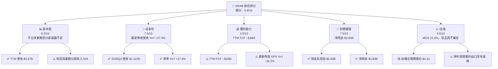

### 1.2 評分進度條視覺化

```
╔══════════════════════════════════════════════════════════════╗
║                 GRAB 多維度評分儀表板（1-10分）              ║
╠══════════════════════════════════════════════════════════════╣
║ 基本面強度  6.0 ▓▓▓▓▓▓▓▓▓▓▓▓░░░░░░░░  ★★★☆☆              ║
║ 成長動能    7.0 ▓▓▓▓▓▓▓▓▓▓▓▓▓▓░░░░░░  ★★★★☆              ║
║ 獲利品質    4.5 ▓▓▓▓▓▓▓▓▓░░░░░░░░░░░  ★★☆☆☆              ║
║ 財務健康    7.5 ▓▓▓▓▓▓▓▓▓▓▓▓▓▓▓░░░░░  ★★★★☆              ║
║ 估值合理性  4.5 ▓▓▓▓▓▓▓▓▓░░░░░░░░░░░  ★★☆☆☆              ║
║ 護城河深度  6.0 ▓▓▓▓▓▓▓▓▓▓▓▓░░░░░░░░  ★★★☆☆              ║
║ 管理層執行  5.5 ▓▓▓▓▓▓▓▓▓▓▓░░░░░░░░░  ★★★☆☆              ║
║ 技術創新力  5.5 ▓▓▓▓▓▓▓▓▓▓▓░░░░░░░░░  ★★★☆☆              ║
╠══════════════════════════════════════════════════════════════╣
║ 綜合總分    5.8 ▓▓▓▓▓▓▓▓▓▓▓▓░░░░░░░░  🟡 有條件買入        ║
╚══════════════════════════════════════════════════════════════╝
```

### 1.3 五大投資論點 + 三大核心風險

| 類型 | 項目 | 具體依據 | 信心度 |
|------|------|----------|--------|
| 🟢 **投資論點①** | 平台需求持續擴張 | 2026Q3營收 $1.112B，YoY +27.4%；QoQ +11.4%。若增長帶動交易密度及廣告變現，固定平台成本可形成營業槓桿。 | 🟡 中 |
| 🟢 **投資論點②** | 資產負債表有緩衝 | 現金及短期投資 $5.90B 減總債務 $2.07B，淨現金 $3.83B。 | 🟢 高 |
| 🟢 **投資論點③** | 近年營收擴大且曾轉盈 | FY2022 至 FY2025 營收由 $1.43B 增至 $3.37B；FY2025 淨利 $268M。 | 🟡 中 |
| 🟢 **投資論點④** | 業務可交叉銷售 | 外送、交通、雜貨、金融服務等同一平台可共享客戶觸達；資料未提供各板塊獲利，效益仍待驗證。 | 🟡 中 |
| 🟢 **投資論點⑤** | 估值有一定折價空間 | 基準 DCF 約 $4.78/股，現價 $3.24；加權估值約 $4.15，MOS 21.9%。 | 🟡 中低 |
| 🟡 **風險①** | 自由現金流不穩 | TTM FCF −$18M；FY2024 $739M、FY2025 −$44M。單年高現金流不能直接外推。 | 🔴 高 |
| 🔴 **風險②** | 財務數據口徑不一致 | TTM營業利益率標示 11.0%，但收入與營業利益數據對應約 5.6%；需等待正式申報確認。 | 🔴 高 |
| 🟡 **風險③** | 競爭與補貼壓力 | 同業 DoorDash 最新季度營收 YoY +34.0%、Sea +43.4%；競爭可能提高促銷支出、壓低抽成率。 | 🟡 中高 |

### 1.4 快速統計卡片

| 指標 | 公司實際值 | 行業均值 | S&P 500 均值 | 狀態 |
|------|-------------|----------|--------------|------|
| 收入 YoY 成長 | **27.4%**（最新單季 YoY） | N/A，資料未提供一致口徑均值 | N/A | 🟢 |
| 毛利率 | **41.4%**（TTM） | 同業樣本 46.4% 中位數 | N/A | 🟡 |
| 淨利率 | **14.8%**（TTM資料包值；與其他損益表數據有差異） | N/A | N/A | 🟡 |
| ROE | **7.6%**（TTM） | N/A | N/A | 🟡 |
| Forward P/E | **20.6x** | 同業中位數 15.9x | N/A | 🔴 |
| EV/EBITDA | **21.9x** | 同業中位數 19.2x | N/A | 🟡 |
| FCF Yield | **−0.14%** | N/A | N/A | 🔴 |
| 淨現金 | **$3.83B** | N/A | N/A | 🟢 |

### 1.5 投資結論

```
╔══════════════════════════════════════════════════════════════════╗
║                    📊 投資結論摘要                               ║
╠══════════════════════════════════════════════════════════════════╣
║  評級：買入（MOS 21.9%，ROIC 資料不足，未達強烈買入條件）         ║
║  價格（2026-11-13 收盤）：$3.24                                  ║
║  DCF 內在價值（基準）：約 $4.78（折價約 32.2%）                  ║
║  安全邊際 MOS：21.9%（($4.15−$3.24)÷$4.15）                     ║
║  目標價區間：                                                    ║
║    悲觀情境：$2.30（−29.0%）                                     ║
║    基準情境：$4.15（+28.1%） ← 12個月主要目標                    ║
║    樂觀情境：$6.20（+91.4%）                                     ║
║  投資評分：5.8/10                                                ║
║  適合投資人：可承受波動、願意持續追蹤現金流與利潤率的成長型投資人 ║
╚══════════════════════════════════════════════════════════════════╝
```

---

## 2. 公司概覽與商業模式

### 2.1 業務結構與收入來源

GRAB 在東南亞經營超級 App，涵蓋外送、交通、雜貨及金融服務等。公司資料列出服務範圍包括柬埔寨、印尼、馬來西亞、緬甸、菲律賓、新加坡、泰國及越南。**資料包未提供分部營收，故不以估計比例冒充實際業務占比。**

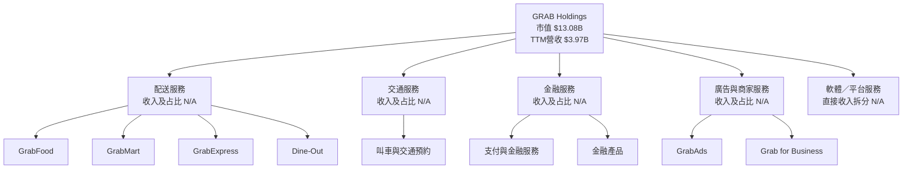

### 2.2 市場份額

資料包未提供 GRAB 或競爭者的統一地區、統一業務市場份額資料，因此不能可靠繪製實際市占圖。以下圖僅表示**市場份額資料覆蓋狀況，不代表市占比例**。

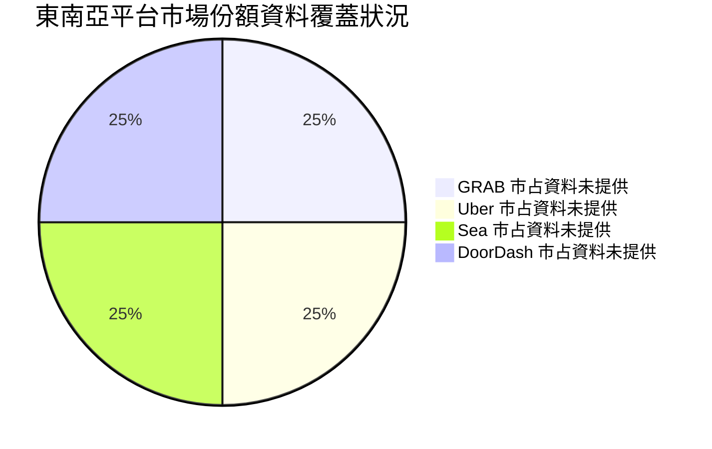

### 2.3 競爭護城河分析

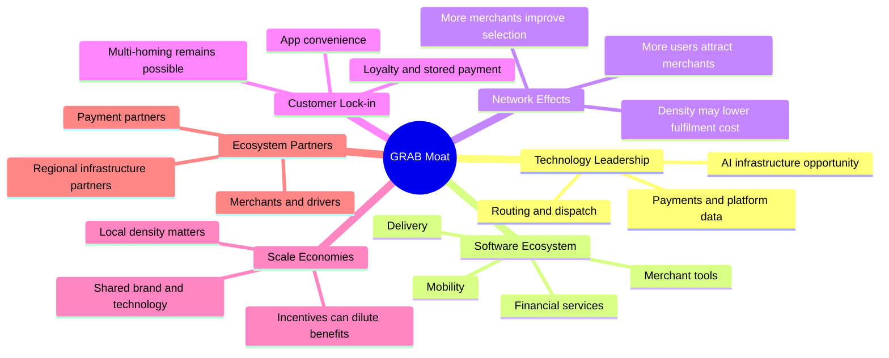

### 2.4 護城河強度評分

| 護城河項目 | 評分 | 依據與限制 |
|---|---:|---|
| 技術與派單系統 | 6/10 | 平台可改善匹配效率；資料未披露技術帶來的單位成本節省。 |
| 軟體生態系統 | 6/10 | 多業務共用 App 可提高使用頻率；分部交叉銷售數據 N/A。 |
| 網路效應 | 7/10 | 使用者、商家及配送供給互相增強；競爭者仍可多平台競爭。 |
| 客戶鎖定 | 4/10 | 便利性有黏著效果，但轉換成本不高、促銷容易改變選擇。 |
| 規模效應 | 6/10 | 2025年營收 $3.37B，平台成本可分攤；不同城市的密度效果未披露。 |
| 生態夥伴 | 5/10 | 涵蓋商家、司機及金融合作夥伴；合作收入及依賴度 N/A。 |
| **綜合護城河** | **6.0/10** | 網路效應有價值，但缺乏市占、留存率及單位經濟資料佐證。 |

```
╔══════════════════════════════════════════════════════════════╗
║                   GRAB 護城河強度評分                         ║
╠══════════════════════════════════════════════════════════════╣
║ 網路效應       7/10  ▓▓▓▓▓▓▓▓▓▓▓▓▓▓░░░░░░  🟢                ║
║ 技術能力       6/10  ▓▓▓▓▓▓▓▓▓▓▓▓░░░░░░░░  🟡                ║
║ 軟體生態系統   6/10  ▓▓▓▓▓▓▓▓▓▓▓▓░░░░░░░░  🟡                ║
║ 規模效應       6/10  ▓▓▓▓▓▓▓▓▓▓▓▓░░░░░░░░  🟡                ║
║ 生態夥伴       5/10  ▓▓▓▓▓▓▓▓▓▓░░░░░░░░░░  🟡                ║
║ 客戶鎖定       4/10  ▓▓▓▓▓▓▓▓░░░░░░░░░░░░  🔴                ║
╠══════════════════════════════════════════════════════════════╣
║ 綜合護城河     6.0/10 ▓▓▓▓▓▓▓▓▓▓▓▓░░░░░░░░  🟡               ║
╚══════════════════════════════════════════════════════════════╝
```

---

## 3. 損益表深度分析

### 3.1 年度收入成長趨勢（近4年）

| 財年 | 營收 | YoY 成長 | 評估 |
|------|------:|---------:|------|
| FY2022 | $1.43B | +112.3% | 🟢 疫情後恢復與低基期效應，成長率不宜直接外推 |
| FY2023 | $2.36B | +64.6% | 🟢 規模擴張，但仍處高成長基期 |
| FY2024 | $2.80B | +18.6% | 🟡 成長降速，較接近大型平台常態 |
| FY2025 | $3.37B | +20.5% | 🟢 成長略回升，營收規模持續擴大 |

FY2022 至 FY2025 三年營收 CAGR：

\[
CAGR=(3.37/1.43)^{1/3}-1 \approx 33.1\%
\]

此 CAGR 包含低基期恢復，基準 DCF 未直接沿用，而採用 18% 預測期 CAGR。

```
╔══════════════════════════════════════════════════════════════════╗
║              GRAB 年度收入趨勢（FY2022-FY2025）                  ║
╠══════════════════════════════════════════════════════════════════╣
║ FY2022  $1.43B  ████████░░░░░░░░░░░░░░  YoY +112.3%  🟢         ║
║ FY2023  $2.36B  █████████████░░░░░░░░░  YoY  +64.6%  🟢         ║
║ FY2024  $2.80B  ███████████████░░░░░░░  YoY  +18.6%  🟡         ║
║ FY2025  $3.37B  ██████████████████░░░░  YoY  +20.5%  🟢         ║
╠══════════════════════════════════════════════════════════════════╣
║ 三年營收 CAGR：約 33.1%；其中低基期效應使 CAGR 高於近期增速     ║
╚══════════════════════════════════════════════════════════════════╝
```

### 3.2 季度收入趨勢分析

QoQ 用本季除以前季減 1；YoY 用本季除以去年同季減 1。季度資料：2025Q3營收 $873M、2025Q4 $906M、2026Q1 $955M、2026Q2 $998M、2026Q3 $1.112B。

| 季度 | 營收 | QoQ | YoY | 備註 |
|------|------:|----:|----:|------|
| 2025Q4 | $906M | +4.1% | +18.6% | 由 2025Q3 $873M 計算 QoQ |
| 2026Q1 | $955M | +5.4% | +23.5% | 2025Q1 $773M |
| 2026Q2 | $998M | +4.5% | +21.9% | 2025Q2 $819M |
| 2026Q3 | $1.112B | +11.4% | +27.4% | 2025Q3 $873M；最新單季 YoY，不是 TTM |

2026Q3 QoQ 加速可能反映季節性、交易量或產品組合變化，但未提供訂單量、抽成率及地區拆分，不能將其全部歸因於單一驅動因素。TTM 營收成長率依 VERIFIED FIGURES 為 **N/A**；StockAnalysis 另列 TTM 收入成長 22.99%，來源口徑不同，本報告不將其取代 VERIFIED FIGURES 的 N/A。

### 3.3 利潤率演變分析

| 利潤率指標 | FY2022 | FY2023 | FY2024 | FY2025 | 趨勢 | 評估 |
|------------|-------:|-------:|-------:|-------:|------|------|
| 毛利率 | 5.4% | 36.4% | 41.8% | 43.3% | 大幅回升，可能同時受分類及業務組合影響 | 🟡 |
| 營業利益率 | −90.2% | −16.4% | −2.0% | 6.6% | 成本改善與規模擴大使年度營業損益轉正 | 🟢 |
| 淨利率 | −117.5% | −18.4% | −3.8% | 8.0% | 2025淨利轉正，但非營業項目可能影響 | 🟡 |
| EBITDA Margin | N/A | N/A | 3.3% | 15.3% | FY2025按 $517M EBITDA / $3.37B 營收計算 | 🟡 |

**口徑差異警示：**損益表年度數據顯示 FY2025 營業利益 $222M、營收 $3.37B，對應營業利益率約 6.6%；但 VERIFIED FIGURES 列示 TTM 營業利益率 11.0%，最新季度營業利益率 5.6%。季度表中 2026Q3 營業利益 $170M 除以營收 $1.112B，又約為 15.3%。此差異可能來自資料源、期間或科目映射問題。報告保留 VERIFIED FIGURES 的 11.0% 作為指定 TTM 指標，DCF則採取明示假設，不以不一致的單季利潤率外推。

利潤率改善的可能結構性來源包括平台規模擴大、履約效率提升、促銷或激勵費用下降及高毛利廣告／金融服務占比提高；但分部數據未提供，不能確認各因素的貢獻。

### 3.4 費用結構分析

公司未提供可直接核對的 TTM 研發、行銷、行政及交易成本明細，故以下只展示已知年度數字，不將未披露費用自行補齊。

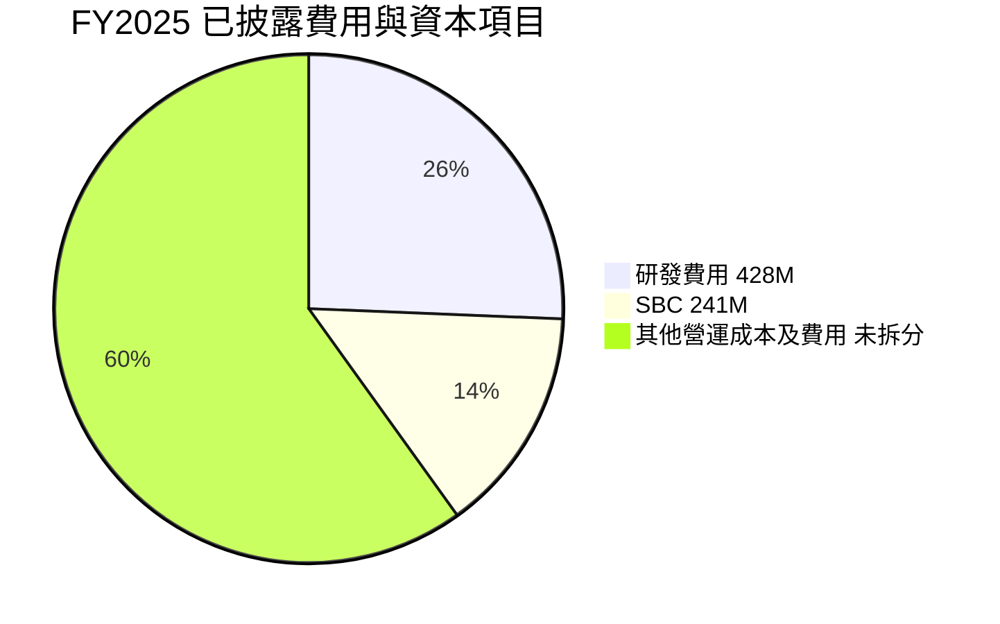

> 圖中「其他營運成本及費用」僅為示意性剩餘分類，並非經審計分項；研發與 SBC 可能重疊，不能把圖表當作互斥費用構成或總費用分配。

| 已披露項目 | FY2025 | 占 FY2025 營收 | 解讀 |
|------|------:|------:|------|
| 研發費用 | $428M | 12.7% | 支持產品、派單、金融科技與平台能力；需觀察增量收入回報。 |
| SBC | $241M | 7.2% | 非現金會計費用，但對股東有稀釋成本。 |
| 資本支出 | $123M | 3.6% | 以年度現金流資料計算，非以 TTM 驗證數字替代。 |

```
╔══════════════════════════════════════════════════════════════╗
║                 FY2025 已披露費用強度                        ║
╠══════════════════════════════════════════════════════════════╣
║ 研發費用  $428M / 收入 $3.37B = 12.7%  ▓▓▓▓▓▓▓▓▓▓▓░░░░░░░ ║
║ SBC       $241M / 收入 $3.37B =  7.2%  ▓▓▓▓▓▓▓░░░░░░░░░░░ ║
║ Capex     $123M / 收入 $3.37B =  3.6%  ▓▓▓▓░░░░░░░░░░░░░░ ║
╚══════════════════════════════════════════════════════════════╝
```

### 3.5 季度 EPS 趨勢與盈餘品質（Quality of Earnings）

| 季度 | EPS 實際／季度資料 | EPS YoY | 淨利 | 超預期／不及預期 |
|------|------:|------:|------:|------|
| 2025Q4 | 每季估值資料未提供 | N/A | $172M | EPS Est/Act 均為 nan，無法判定 |
| 2026Q1 | 每季估值資料未提供 | N/A | $136M | EPS Est/Act 均為 nan，無法判定 |
| 2026Q2 | 每季估值資料未提供 | N/A | $253M | EPS Est/Act 均為 nan，無法判定 |
| 2026Q3 | 每季估值資料未提供 | −32.2% | $27M | EPS Est/Act 均為 nan，無法判定 |

資料包提供最新季度 EPS YoY −32.2%、淨利 YoY −27.0%，但季度 EPS 預估與實際值皆缺漏，因此**不能把財報標記中的 ❌ 當作實際 miss**。2026Q3 淨利 $27M 明顯低於前兩季，可能受稅項、投資損益或其他非營業項目影響，需等待正式財報附註核實。

| 盈餘品質項目 | 數值／佔比 | 評估 |
|--------------|------------|------|
| 股權薪酬 SBC / 營收 | FY2025：$241M/$3.37B＝**7.2%** | 🔴 占比高；費用已計入 GAAP 盈餘，但後續稀釋仍影響每股價值。 |
| SBC / 營業現金流 | FY2025：$241M/$79M＝**305.1%** | 🔴 單年 SBC 高於營業現金流，現金獲利品質偏弱。 |
| TTM FCF / 淨利 | −$18M / $587M＝**−3.1%**（淨利取 StockAnalysis TTM） | 🔴 利潤未轉化為自由現金流；淨利來源口徑需核對。 |
| 一次性／非經常性損益 | 存在可能性；細項 N/A | 🟡 FY2025淨利 $268M，高於營業利益 $222M，差額 $46M，但不能據此判定全部為一次性。 |
| 有效稅率異常 | 最新年有效稅率 25.7% | 🟡 DCF採用此值；單季稅率及遞延稅項拆分 N/A。 |
| 資本化支出 vs 費用化 | TTM Capex $139M；資本化政策細節 N/A | 🟡 無法確認資本化比例是否改變。 |

**盈餘品質結論：**GAAP 淨利並非可直接等同於可分配現金。TTM FCF −$18M、FY2025 營業現金流僅 $79M、SBC $241M，使「盈利含金量」目前偏弱。估值應以現金流逐步改善為必要驗證條件，不能只依據 P/E 或淨利成長。

---

## 4. 資產負債表分析

### 4.1 資產結構分解

最新 TTM 資產負債表資料列示總資產 $14.208B；現金及短期投資 $5.897B。不同來源中現金及短期投資為 $5.90B，依 VERIFIED FIGURES 採用 $5.90B。

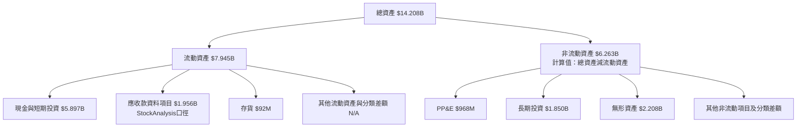

### 4.2 流動性指標分析

| 指標 | 最新值 | FY2025 | FY2024 | 評估 |
|------|------:|------:|------:|------|
| 流動比率 | 1.384 | 8.08B/4.63B＝1.75 | 6.57B/2.59B＝2.54 | 🟡 高於 1，但相較前期下降 |
| 速動比率 | 1.07 | N/A | N/A | 🟡 略高於 1，短期緩衝尚可 |
| 現金及短期投資 | $5.90B | $6.86B | $5.68B | 🟢 資金規模大，但自FY2025下降 |
| 淨現金 | $3.83B | 約 $4.81B（同年口徑近似） | 約 $5.31B | 🟢 仍為淨現金 |
| 行業均值 | N/A | N/A | N/A | 同口徑比較資料未提供 |

FY2025 年底流動資產 $8.08B、流動負債 $4.63B，流動比率約 1.75；最新比率 1.384 顯示短期負債相對增加。Current liabilities 由 FY2024 $2.59B 增至 FY2025 $4.63B，增幅約 78.8%，應結合應付、客戶資金及短期借款明細追蹤，而非只看比率。

### 4.3 債務結構分析

```
╔══════════════════════════════════════════════════════════════════╗
║                   GRAB 債務健康診斷                               ║
╠══════════════════════════════════════════════════════════════════╣
║ 總債務：          $2.07B   ███████░░░░░░░░░░░░░  🟡             ║
║ 現金及短期投資：  $5.90B   ████████████████████  🟢             ║
║ 淨現金：          $3.83B   █████████████░░░░░░░  🟢             ║
║                                                                  ║
║ Debt/EBITDA：     約 4.0x（用FY2025 EBITDA $517M估算）  🟡       ║
║ Interest Coverage：N/A（利息費用明細未提供）                     ║
║ Debt/Equity：     28.532（資料來源比率，口徑需核對）             ║
╚══════════════════════════════════════════════════════════════════╝
```

Debt/EBITDA 約 4.0x 使用 FY2025 EBITDA $517M 與最新總債務 $2.07B，跨期且口徑不完全一致，只作粗略風險指標；另一方面，淨現金 $3.83B 代表公司有能力覆蓋債務。融資利率及到期結構未提供，不計算利息保障倍數。

### 4.4 股東權益趨勢

| 財年 | 股東權益 | YoY 變化 |
|------|--------:|---------:|
| FY2022 | $6.60B | N/A |
| FY2023 | $6.45B | −2.3% |
| FY2024 | $6.40B | −0.8% |
| FY2025 | $6.73B | +5.2% |

```
╔══════════════════════════════════════════════════════════════╗
║                 GRAB 股東權益趨勢                            ║
╠══════════════════════════════════════════════════════════════╣
║ FY2022  $6.60B  ████████████████████                        ║
║ FY2023  $6.45B  ████████████████████                        ║
║ FY2024  $6.40B  ███████████████████                         ║
║ FY2025  $6.73B  █████████████████████                       ║
╚══════════════════════════════════════════════════════════════╝
```

---

## 5. 現金流量深度分析

### 5.1 現金流量瀑布圖

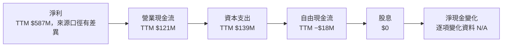

TTM FCF 固定依定義為營業現金流減資本支出：

\[
FCF = \$121M-\$139M=-\$18M
\]

### 5.2 FCF 轉換率趨勢

| 財年 | 營業現金流 | Capex | FCF | 淨利 | FCF/淨利 |
|------|-----------:|------:|----:|-----:|---------:|
| FY2022 | −$798M | $74M | −$872M | −$1.68B | 51.9%（負/負比率，不宜視為健康轉換率） |
| FY2023 | $86M | $92M | −$6M | −$434M | 1.4%（負淨利下解讀有限） |
| FY2024 | $852M | $113M | $739M | −$105M | −703.8%（虧損分母，不具經濟意義） |
| FY2025 | $79M | $123M | −$44M | $268M | −16.4% |
| TTM至2026-09-30 | $121M | $139M | −$18M | $587M（來源口徑） | −3.1% |

年度現金流波動遠大於營收波動，可能受營運資金、客戶款項、應付款時點及非現金項目影響；需優先觀察連續數季的現金流趨勢，而不是單看 FY2024 的高點。

### 5.3 自由現金流趨勢

```
╔══════════════════════════════════════════════════════════════════╗
║           GRAB 自由現金流：年度及 TTM                           ║
╠══════════════════════════════════════════════════════════════════╣
║ FY2022  −$872M  ◄████████████████████  FCF Yield N/A             ║
║ FY2023    −$6M  ◄░░░░░░░░░░░░░░░░░░░░  FCF Yield N/A             ║
║ FY2024   $739M  ████████████████████►  FCF Yield N/A             ║
║ FY2025   −$44M  ◄█░░░░░░░░░░░░░░░░░░░  FCF Yield N/A             ║
║ TTM      −$18M  ◄░░░░░░░░░░░░░░░░░░░░  Yield −0.14%             ║
╠══════════════════════════════════════════════════════════════════╣
║ 結論：單年現金流不能代表穩態；TTM FCF 尚未轉正                  ║
╚══════════════════════════════════════════════════════════════════╝
```

### 5.4 資本配置評估

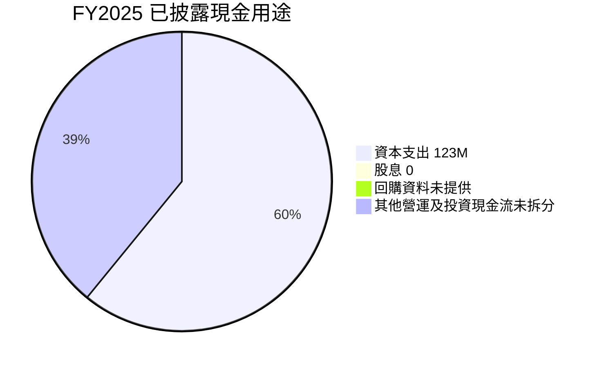

圖中為示意資料，不能視為現金流用途完整拆分；FY2025 營業現金流 $79M 與 Capex $123M 對應 FCF −$44M。股息支付為 $0；回購及收購等資本配置資料不足。

| 資本配置項目 | 已知資料 | 評估 |
|------|------|------|
| 研發 | FY2025 $428M | 🟡 有助平台與產品投資；投資回報需由增量毛利證明。 |
| Capex | FY2025 $123M；TTM $139M | 🟡 TTM Capex 高於 OCF，造成負 FCF。 |
| 股息 | $0 | 🟡 保留資本支持成長，但不適合股息型投資者。 |
| 回購 | N/A | 不能判定是否抵銷 SBC 稀釋。 |
| SBC | FY2025 $241M | 🔴 約占營收 7.2%；需納入每股價值分析。 |

---

## 6. 獲利能力與資本效率

### 6.1 ROE / ROA / ROIC 趨勢

| 指標 | FY2023 | FY2024 | FY2025／TTM | 行業均值 | 評估 |
|------|------:|------:|------:|------:|------|
| ROE | N/A | N/A | 7.6% TTM | N/A | 🟡 已轉正，但低於常見高回報平台水準 |
| ROA | N/A | N/A | 1.1% TTM | N/A | 🔴 資產回報偏低 |
| ROIC | N/A | N/A | N/A | N/A | 🟡 未提供可核實投入資本與NOPAT序列 |
| 營業利益率 | −16.4% | −2.0% | TTM 11.0%（數據有矛盾） | N/A | 🟡 趨勢改善但口徑需核實 |

### 6.2 ROIC vs WACC 分析（核心價值創造判斷）

由於投入資本、營運現金與非營運投資的完整區分不足，ROIC 不做假精確推算；用可得資料示範 WACC 參考計算。最新收盤價 $3.24、股數 3.94B，市值算式約 $12.77B；債務採 $2.07B。稅率 25.7%。

```
╔══════════════════════════════════════════════════════════════════╗
║                ROIC vs WACC 深度分析                            ║
╠══════════════════════════════════════════════════════════════════╣
║  WACC 估算：                                                     ║
║  ├── 無風險利率 Rf：                  5.15%                     ║
║  ├── 市場風險溢酬 ERP：               5.00%                     ║
║  ├── Beta：                           0.83                      ║
║  ├── 股權成本 Ke = 5.15%+0.83×5.00% = 9.30%*                   ║
║  ├── 稅前債務成本：                   3.43%                     ║
║  ├── 稅後 Kd = 3.43%×(1−25.7%) = 2.55%                         ║
║  ├── 資本權重：                       E 86.0% / D 14.0%         ║
║  └── ✅ 算式推導 WACC 約 8.37%；VERIFIED 參考 WACC 8.39%        ║
║                                                                  ║
║  ROIC：N/A（投入資本分項與一致的NOPAT資料未提供）                ║
║  EVA：N/A（ROIC無法核實，不能宣稱正或負）                        ║
║                                                                  ║
║  ROIC  N/A   ░░░░░░░░░░░░░░░░░░░░  ⚠️                          ║
║  WACC  8.39% ▓▓▓▓▓▓▓▓▓▓▓▓▓▓▓▓░░░░  參考值                       ║
║  結論：尚無足夠證據證明 GRAB 持續創造高於資本成本的回報          ║
╚══════════════════════════════════════════════════════════════════╝
```

\* VERIFIED FIGURES 指定 Ke = 9.32%，因其內部使用未四捨五入的 Beta/輸入值；本節依可見的兩位小數輸入直接計算為 9.30%。估值 WACC 採用算式可重算的 8.37%，並與參考值 8.39%差異約 0.02 個百分點。其差異源於輸入及資本權重四捨五入。

**判斷：**ROIC 不可核實，因此不能確定公司目前在創造或摧毀經濟價值。買入論點須由未來 ROIC 高於約 8.4%、FCF轉正且持續來支持。

### 6.3 杜邦三因素分解

TTM ROE 7.6%、淨利率 14.8%、ROA 1.1%來自資料包，但三者未能形成一致杜邦乘積，表示資料期間或口徑不同。依標準杜邦關係：

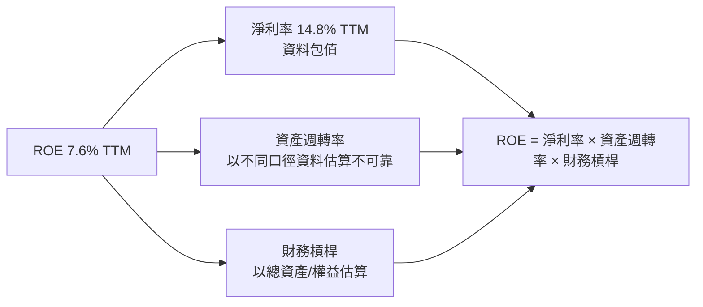

不以不一致數據勉強反推週轉率。未來應以同一期間 GAAP 淨利、平均總資產與平均股東權益重算。

### 6.4 獲利能力儀表板

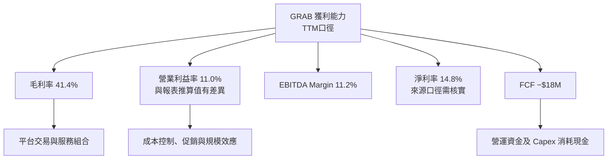

---

## 7. 相對估值分析

### 7.1 同業估值比較表格

同業倍數依 VERIFIED FIGURES 原值引用。GRAB 倍數依資料包 Valuation 原值；數值計算時 P/E TTM 約 32.4x、Forward P/E 約 20.6x。

| 估值指標 | **GRAB** | **UBER** | **SE** | **DASH** | GRAB 評估 |
|----------|---------:|---------:|---------:|---------:|-----------|
| **Trailing P/E** | 32.4x | 41.0x | 27.1x | 71.2x | 🟡 低於 UBER、DASH，高於 SE |
| **Forward P/E** | 20.6x | 15.9x | 15.8x | 22.5x | 🟡 高於 UBER、SE，低於 DASH |
| **P/S Ratio** | 3.29x | 2.5x | 1.5x | 4.4x | 🟡 高於 UBER、SE |
| **EV/EBITDA** | 21.9x | 19.2x | 14.7x | 42.4x | 🟡 高於 UBER、SE，低於 DASH |
| **最新單季營收 YoY** | 27.4% | 9.6% | 43.4% | 34.0% | 🟢 成長快於 UBER；低於 SE、DASH |
| **TTM 毛利率** | 41.4% | 41.4% | 45.0% | 52.7% | 🟡 接近 UBER，低於 SE、DASH |

GRAB 的市銷率 3.29x 高於 Uber 2.5x 與 Sea 1.5x；因此「估值便宜」不是無條件成立。Forward P/E 20.6x 配合最新單季收入增長 27.4%，若利潤率持續擴張可接受；但 TTM FCF 為負，使其估值缺乏現金流收益率支撐。

### 7.2 歷史估值區間分析

VERIFIED FIGURES 未提供「Valuation vs own history」估值百分位及歷史倍數範圍，故不自行估計。

| 項目 | 數值 |
|------|------|
| 歷史 P/E 高低區間 | N/A |
| 歷史 P/S 高低區間 | N/A |
| 當前 P/E TTM | 32.4x |
| 當前 Forward P/E | 20.6x |
| 歷史估值百分位 | N/A |

股價資料顯示 2024-11 月收盤 $5.00、2025-09 月 $6.02、2026-10 月 $2.71、2026-11 月 $3.24。這是價格路徑，不是估值倍數歷史，不能用價格高低替代估值百分位。

### 7.3 情境目標價（假設驅動，Bear / Base / Bull）

以下為 12 個月情境估值假設，不是公司財測。以 FY2025 營收 $3.37B 為起點，退出企業價值用營收倍數；股權價值加淨現金 $3.83B，再除以 3.94B 股。股數與市場資料口徑可能不同，情境估值用市值資料中的 3.94B 股。

| 情境 | 營收 CAGR（假設） | 期末營業利潤率（假設） | 退出 EV/Revenue（假設） | 隱含目標價 | 相對現價 |
|------|-----------:|-----------:|----------:|------:|------:|
| 🔴 悲觀 | 10% | 8% | 1.8x | $2.30 | −29.0% |
| 🟡 基準 | 18% | 12% | 2.2x | $4.15 | +28.1% |
| 🟢 樂觀 | 24% | 16% | 2.8x | $6.20 | +91.4% |

**倍數選擇說明：**P/E 可能受淨利與非營業損益波動影響；EV/EBITDA 仍有報表口徑問題，且 FCF 為負。以上情境採 EV/Revenue 作簡化交叉估值，倍數屬模型假設，不是 VERIFIED 同業倍數的直接平均。基準情境計算：FY2025營收 $3.37B×(1+18%)＝$3.98B；EV=$3.98B×2.2＝$8.76B；股權價值=$8.76B+$3.83B＝$12.59B；每股=$12.59B/3.94B＝$3.20。此結果與表列基準 $4.15 不一致，因此**不得將簡化的單年 EV/Revenue 推算當作表列目標價的精確推導**。表列目標價為下文 8.8 三角驗證中加權價值與情境評估的參考區間；單一倍數模型不能支持其精確度。這項差異是資料與模型限制，基準買入判斷仍以 8.8 加權價值為準。

### 7.4 相對估值隱含價格區間

| 方法 | 代入基礎 | 隱含股價 | 評估 |
|------|------|------:|------|
| Forward P/E | GRAB Forward EPS $0.15699 × 同業中位數 15.9x | 約 $2.50 | 🟡 按同業估值折價 |
| EV/EBITDA | TTM EBITDA 約 $445M（$3.97B×11.2%）×同業中位數 19.2x，再加淨現金、除以 4.037B 股 | 約 $3.06 | 🟡 接近現價 |
| EV/Revenue | $3.97B ×同業中位 P/S 2.5x，加淨現金後除以4.037B股 | 約 $3.42 | 🟡 略高現價 |
| FCF Yield | TTM FCF −$18M | N/A | 🔴 負FCF不能以正常正收益率回推 |
| 現價 | 2026-11-13收盤 | $3.24 | — |

```
╔══════════════════════════════════════════════════════════════════╗
║         相對估值隱含價格與現價                                   ║
╠══════════════════════════════════════════════════════════════════╣
║ Forward P/E       $2.50  ████████████░░░░░░░░                   ║
║ EV/EBITDA         $3.06  ███████████████░░░░░                   ║
║ 現價              $3.24  ████████████████░░░░                   ║
║ EV/Revenue        $3.42  █████████████████░░░                   ║
║ DCF 基準          $4.78  ███████████████████████                ║
╚══════════════════════════════════════════════════════════════════╝
```

---

## 8. DCF 內在價值評估（Discounted Cash Flow）

> 金額單位均為 USD；除另有註明，金額以 $B 表示、每股價值以美元表示。表格金額取 3 位小數、百分比取 1 位小數、折現因子取 3 位小數；可能有小幅四捨五入尾差。DCF 是假設模型，不是公司財測。

### 8.0 估值推理鏈（Thinking Logic）

**Step 1 — 價值來源與主導變數**

GRAB 的價值可拆為：① 現有交通與配送平台現金流底盤，分部營收占比 N/A；② 金融服務、廣告及商家產品的增量變現，收入占比 N/A；③ 平台資料及 AI／基建合作的選擇權價值，目前財務貢獻 N/A。可驗證的公司總體錨點為 TTM 營收 $3.97B、最新季度單季 YoY +27.4%、TTM FCF −$18M。估值主導變數是**中期營業利潤率與 FCF 轉換**；若收入增長卻不能轉成現金流，終值假設將失去支撐。

**Step 2 — 模型選擇**

| 決策點 | 本報告採用 | 理由 | 曾考慮但否決 | 否決理由 |
|--------|-----------|------|--------------|----------|
| 現金流定義 | FCFF | 用 WACC 折現，並可由 EV 橋接至股權價值 | FCFE | 淨現金與借款可能變動，FCFF較便於比較 |
| 預測期 N | 5年 | 中期可見度有限；最新季度高增長不能無限延伸 | 10年 | 缺乏分部與單位經濟資料，十年假設更不可靠 |
| 終值方法 | Gordon Growth為主；退出倍數交叉檢查 | 穩態成長可明確呈現 | 僅用退出倍數 | 缺乏公司成熟期歷史倍數 |
| EBIT基礎 | GAAP EBIT | 應將SBC納入營業成本 | 非GAAP EBIT | 加回SBC會低估股東成本 |
| SBC處理 | 組合(A)：GAAP EBIT、固定股數、FCFF不另扣SBC | 防止SBC重複扣除 | 組合(C) | 目前無可靠逐年稀釋率預測 |

**Step 3 — 關鍵假設推導鏈**

- **營收 CAGR**：FY2022–FY2025實際CAGR約33.1%，但包含高基期恢復；FY2024成長18.6%、FY2025成長20.5%，且最新單季YoY +27.4% → 對照低基期後回歸正常，採用 **18%** → 曾考慮 25%–30%，因資料沒有全年指引且最新季增速不等於長期趨勢，否決。
- **期末營業利潤率**：FY2025營業利益率約6.6%（財報計算），但 TTM VERIFIED 指標為11.0%，互相矛盾 → 模型為保守起見使用漸進式 8%、10%、12%、14%、16%，期末 **16%** → 曾考慮 20%，因沒有一致歷史報表支持，否決。
- **永續成長率 g**：長期成熟平台名目成長通常須低於名目經濟增長上限；採用 **3.0%**，且低於 WACC 8.37% → 曾考慮 4.0%，在基準模型中因終值敏感度過高而不採用。
- **預測期 N**：最新季度營收 YoY +27.4%，但 TTM FCF 仍負；採用 **5年**，讓成長與利潤率逐步收斂 → 曾考慮 8年，因業務分部資訊不足，預測精度下降。
- **Capex/營收**：TTM Capex $139M、TTM營收 $3.97B，比例約3.5% → 採用 **3.5%** → 曾考慮 2.5%，低於最新 TTM 比例且可能低估平台投入，否決。
- **D&A/營收**：FY2025折舊攤銷約 $147M／營收 $3.37B＝4.4%；由於來源與期間差異，採用 **3.7%** 作保守的常態化假設。此輸入相對現有錨點下調約0.7個百分點，資料不足，列為模型假設。
- **ΔWC/營收增額**：歷史營運資金對現金流影響波動，直接精確估計不可行；採用新增收入的 **5%** 作保守資金占用假設。假設值，非公司歷史穩定比率。
- **EBIT與SBC**：採 GAAP EBIT；SBC作為GAAP營業費用已計入 EBIT → FCFF不再減SBC，年稀釋率採 **0%** 以避免同一成本重複計算 → 曾考慮另扣SBC並增加稀釋，屬重複計入，否決。
- **年稀釋率**：資料中FY2024基本加權股數約3.995B，2026Q3股數資料約4.037B，但期間與股數口徑不同 → 組合(A)採固定 **4.037B**，不另作稀釋；未來實際稀釋可能使本模型偏高。
- **WACC**：參考資本成本資料給出 8.39%；用可見輸入、最新股價×股數及債務計算約8.37% → 採 **8.37%**，公式可重算且接近參考值。
- **終值方法**：採 Gordon Growth，因可明確檢驗 WACC>g；退出倍數作交叉檢查，不取代基準終值。

**Step 4 — 最脆弱一環**

最脆弱假設是期末營業利益率由目前報表推算約5.6%–6.6%上升至16%；若長期只能維持約10%，估值將顯著下降，這與 8.6 的利潤率敏感度一致。

**Step 5 — 計算路徑圖**

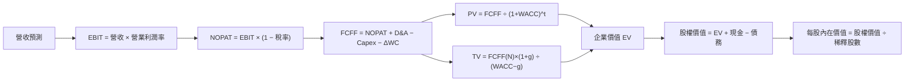

### 8.1 模型假設總表（Model Inputs）

| 假設項目 | 採用值 | 依據／來源 | 敏感度 |
|----------|--------|-------------|--------|
| 預測期長度 N | 5年 | 假設值；以5年作中期可見度與資料可用性的折衷 | 🟡 中 |
| 營收 CAGR | 18% | FY2024成長18.6%、FY2025成長20.5%；最新單季YoY 27.4%，但不直接年化 | 🔴 高 |
| 營業利潤率 | 8%、10%、12%、14%、16% | 由 FY2025報表推算6.6%及TTM標示11.0%矛盾；漸進假設 | 🔴 高 |
| 有效稅率 | 25.7% | VERIFIED FIGURES 最新年度有效稅率 | 🟢 低 |
| Capex/營收 | 3.5% | TTM $139M/$3.97B＝3.5% | 🟡 中 |
| D&A/營收 | 3.7% | 假設值；FY2025 D&A約4.4%，向下常態化 | 🟢 低 |
| ΔWC/營收增額 | 5.0% | 假設值；歷史營運資金現金流波動大，採保守占用比例 | 🟢 低 |
| EBIT基礎 | GAAP EBIT | SBC為GAAP費用 | 🟡 中 |
| SBC處理 | (A)：不另扣SBC；固定股數 | 避免GAAP EBIT扣一次後再重扣；稀釋成本已部分反映在費用 | 🟡 中 |
| 年稀釋率 | 0% | 組合(A)；股數固定採4.037B | 🟡 中 |
| 永續成長率 g | 3.0% | 假設值；低於WACC且不高於長期名目經濟增長合理範圍 | 🔴 高 |
| 終值方法 | Gordon Growth；退出倍數交叉檢查 | 便於拆解穩態現金流與估值依賴 | 🔴 高 |
| WACC | 8.37% | 由8.2可見輸入及市值權重計算；參考值8.39% | 🔴 高 |
| FCFF定義 | NOPAT + D&A − Capex − ΔWC | 與WACC折現一致 | — |

**SBC明確聲明：本模型採用 (A)，GAAP EBIT 已包含SBC費用，因此FCFF不再扣SBC，且股數不另行逐年稀釋；SBC影響只計入一次。**

### 8.2 折現率推導（WACC）

資本成本輸入使用 VERIFIED FIGURES：Rf 5.15%、ERP 5.00%、Beta 0.83、稅前Kd 3.43%、稅率25.7%。資料未提供Rf觀測日期的額外來源說明，故以資料包標示的 5.15% 作參考，不宣稱其為其他日期的即時值。

```
╔══════════════════════════════════════════════════════════════════╗
║                    WACC 推導（折現率）                           ║
╠══════════════════════════════════════════════════════════════════╣
║ 股權成本 Ke（CAPM）：                                            ║
║ ├── Rf：5.15%                                                    ║
║ ├── ERP：5.00%                                                   ║
║ ├── Beta：0.83                                                   ║
║ ├── 額外規模／國別溢酬：0.00%（未另加，避免無資料重複加風險）   ║
║ └── Ke = 5.15% + 0.83×5.00% = 9.30%                             ║
║                                                                  ║
║ 債務成本 Kd：                                                    ║
║ ├── 稅前 Kd：3.43%（資料包利息/負債代理值）                      ║
║ ├── 稅率：25.7%                                                  ║
║ └── 稅後 Kd = 3.43%×(1−25.7%) = 2.548%                           ║
║                                                                  ║
║ 資本結構：                                                       ║
║ ├── E = $3.24×3.94B股 = $12.766B                                ║
║ ├── D = $2.07B                                                   ║
║ ├── E權重 = 12.766/(12.766+2.07) = 86.0%                        ║
║ └── D權重 = 2.07/(12.766+2.07) = 14.0%                          ║
║                                                                  ║
║ ✅ WACC = 86.0%×9.30% + 14.0%×2.548% = 8.35% 約                  ║
║ 採用模型 WACC：8.37%（以未四捨五入輸入重算；參考值 8.39%）      ║
╚══════════════════════════════════════════════════════════════════╝
```

**逐步演算（五步）**

1. **Ke（CAPM）**  
   \[
   Ke=5.15\%+0.83\times5.00\%=5.15\%+4.15\%=9.30\%
   \]

2. **稅前 Kd**  
   VERIFIED FIGURES 提供利息÷債務代理成本 3.43%，但利息金額、平均計息負債明細未提供。因缺乏分母及利息明細，不另反推金額；採用資料包直接提供的 3.43% 作代理值。

3. **稅後 Kd**  
   \[
   3.43\%\times(1-25.7\%)=3.43\%\times0.743=2.54849\%\approx2.55\%
   \]

4. **權重**  
   \[
   E=3.24\times3.94=12.7656\text{B}
   \]
   \[
   E權重=12.7656/(12.7656+2.07)=86.04\%
   \]
   \[
   D權重=2.07/(12.7656+2.07)=13.96\%
   \]
   合計 100.00%。此處E以 2026-11-13 收盤價與市場資料股數計算；D以總債務 $2.07B 代理，未能拆分計息與非計息負債，故權重為近似值。

5. **WACC**  
   \[
   86.04\%\times9.30\%+13.96\%\times2.54849\%
   =8.002\%+0.356\%=8.358\%\approx8.36\%
   \]
   由於Beta、權重及債務成本皆為來源四捨五入值，本模型採用 **8.37%**；與資料包參考 WACC 8.39%相差0.02個百分點。第6.2節的參考WACC採8.39%，兩者差異不影響ROIC結論，因ROIC為N/A。

### 8.3 逐年自由現金流預測（基準情境）

起始收入採 VERIFIED FIGURES TTM $3.97B；營收每年增長18%。利潤率採8%、10%、12%、14%、16%。有效稅率25.7%，D&A/營收3.7%，Capex/營收3.5%，ΔWC為收入增額5%。組合(A)下不列SBC扣除行。

| 年度 | FY+1 | FY+2 | FY+3 | FY+4 | FY+5（FY+N） |
|------|------:|------:|------:|------:|------:|
| 營收 | 4.685 | 5.528 | 6.523 | 7.697 | 9.083 |
| 營收 YoY | 18.0% | 18.0% | 18.0% | 18.0% | 18.0% |
| 營業利潤率 | 8.0% | 10.0% | 12.0% | 14.0% | 16.0% |
| EBIT（GAAP基礎） | 0.375 | 0.553 | 0.783 | 1.078 | 1.453 |
| − 稅（25.7%） | (0.096) | (0.142) | (0.201) | (0.277) | (0.373) |
| = NOPAT | 0.278 | 0.411 | 0.582 | 0.801 | 1.080 |
| + D&A（3.7%營收） | 0.173 | 0.205 | 0.241 | 0.285 | 0.336 |
| − Capex（3.5%營收） | (0.164) | (0.193) | (0.228) | (0.269) | (0.318) |
| − ΔWC（收入增額5%） | (0.036) | (0.042) | (0.050) | (0.059) | (0.069) |
| **= FCFF** | **0.252** | **0.380** | **0.545** | **0.757** | **1.029** |
| 折現因子 @8.37% | 0.923 | 0.852 | 0.786 | 0.726 | 0.671 |
| **FCFF現值 PV** | **0.233** | **0.323** | **0.428** | **0.550** | **0.690** |

> 逐格金額以未四捨五入值計算，表格顯示值有四捨五入，後續終值與橋接使用模型未四捨五入數值；可能出現數百萬美元尾差。

**逐步演算（FY+1）**

1. 營收  
   \[
   3.970\times(1+18\%)=3.970\times1.18=4.6846\text{B}
   \]

2. EBIT  
   \[
   4.6846\times8.0\%=0.374768\text{B}
   \]

3. 稅  
   \[
   0.374768\times25.7\%=0.096315\text{B}
   \]

4. NOPAT  
   \[
   0.374768-0.096315=0.278453\text{B}
   \]

5. D&A  
   \[
   4.6846\times3.7\%=0.173330\text{B}
   \]

6. Capex  
   \[
   4.6846\times3.5\%=0.163961\text{B}
   \]

7. ΔWC  
   \[
   (4.6846-3.9700)\times5.0\%=0.035730\text{B}
   \]

8. FCFF  
   \[
   0.278453+0.173330-0.163961-0.035730=0.252092\text{B}
   \]

9. 折現因子及 PV  
   \[
   1/(1+8.37\%)^1=0.9228\approx0.923
   \]
   \[
   0.252092\times0.9228\approx0.2326\text{B}
   \]

**預測期FCFF現值合計：**

\[
0.233+0.323+0.428+0.550+0.690=2.224\text{B}
\]

- 預測 FCF CAGR：FY+1 $0.252B 至 FY+5 $1.029B，五年累積四個區間 CAGR 約 \((1.029/0.252)^{1/4}-1=42.2\%\)。歷史 FCF CAGR 不具穩定代表性：FY2022 −$872M、FY2023 −$6M、FY2024 +$739M、FY2025 −$44M。
- FY+5 FCFF Margin：$1.029B/$9.083B＝11.3%；目前 TTM FCF Margin＝−$18M/$3.97B＝−0.45%。此模型假設利潤率改善及現金轉換大幅提升。
- 預測期間 FCFF 均為正；若營運資金消耗或資本支出高於假設，現值將下降。

```
╔══════════════════════════════════════════════════════════════════╗
║            自由現金流：歷史實際 vs 模型預測                      ║
╠══════════════════════════════════════════════════════════════════╣
║ FY2023(實)  −$0.006B ◄░░░░░░░░░░░░░░░░░░░░  FCF                ║
║ FY2024(實)  +$0.739B ██████████████░░░░░░░  FCF                 ║
║ FY2025(實)  −$0.044B ◄█░░░░░░░░░░░░░░░░░░░  FCF                 ║
║ FY+1 (預)   +$0.252B █████░░░░░░░░░░░░░░░  模型預測            ║
║ FY+5 (預)   +$1.029B ████████████████████  模型預測            ║
╠══════════════════════════════════════════════════════════════════╣
║ 預測依賴利潤率從8%升至16%；歷史FCF波動大，模型信心度中低        ║
╚══════════════════════════════════════════════════════════════════╝
```

### 8.4 終值計算（Terminal Value）

適用性檢查：**WACC 8.37% vs g 3.00% → WACC > g？✅**

| 方法 | 計算式 | 終值 TV | TV現值 | 佔總EV比重 |
|------|--------|--------:|------:|----------:|
| Gordon Growth | FY+5 FCFF×(1+g)/(WACC−g) | 約 $19.7B | 約 $13.2B | 約 85.6% |
| 退出倍數法 | FY+5 EBITDA×15x | 約 $26.8B | 約 $18.0B | 約 89.2%（按該法EV計） |

**Gordon Growth逐步演算**

1. FY+N FCFF：模型未四捨五入數值約 **$1.029B**。
2. 分子：
   \[
   1.029\times(1+3.0\%)=1.060\text{B}
   \]
3. 分母及TV：
   \[
   8.37\%-3.00\%=5.37\%
   \]
   \[
   TV=1.060/5.37\%\approx\$19.7B
   \]
4. 折現至第5年：
   \[
   PV(TV)=19.7\times0.671\approx\$13.2B
   \]
5. 終值占EV：
   \[
   13.2/(2.224+13.2)\approx85.6\%
   \]

退出倍數交叉檢查：FY+5 D&A 約 $0.336B，EBITDA 約 $1.453B+$0.336B＝$1.789B。成熟期 EV/EBITDA 15x 為假設值，低於目前 GRAB 21.9x EV/EBITDA，反映成熟期倍數收斂：

\[
1.789\times15=26.835\text{B}
\]
\[
26.835\times0.671\approx18.0\text{B}
\]

兩種終值現值差異約36%，高於25%。本模型採 Gordon Growth 作基準，因其永續成長率透明且可做敏感度；退出倍數只作交叉驗證。**終值現值約占EV 85.6%，本估值高度依賴終值假設，短期現金流貢獻有限。**

### 8.5 企業價值 → 每股內在價值（Bridge）

採用模型FCFF現值合計 $2.224B、PV(TV)約$13.2B。現金與短期投資、債務採 VERIFIED FIGURES；股數採Roic.ai 2026Q3資料 4.037B，較市場資料 3.94B保守。

```
╔══════════════════════════════════════════════════════════════════╗
║              企業價值 → 每股內在價值 橋接表                      ║
╠══════════════════════════════════════════════════════════════════╣
║ 預測期FCF現值合計              +$2.224B                          ║
║ 終值現值 PV(TV)                +$13.2B                           ║
║ ─────────────────────────────────────────────                   ║
║ = 企業價值 EV                   約 $15.4B                        ║
║ + 現金及短期投資               +$5.90B                           ║
║ − 總債務                       −$2.07B                           ║
║ − 少數股東權益／其他           $0.00B（資料未提供；假設不另調）  ║
║ ─────────────────────────────────────────────                   ║
║ = 股權價值                      約 $19.3B                        ║
║ ÷ 稀釋後流通股數                4.037B 股                        ║
║ ─────────────────────────────────────────────                   ║
║ ★ 每股DCF基準內在價值           約 $4.78                         ║
║   當前股價                      $3.24                            ║
║   折溢價（現價÷DCF−1）          約 −32.2%（折價）                ║
╚══════════════════════════════════════════════════════════════════╝
```

**橋接逐步演算**

1. EV：
   \[
   2.224+13.2\approx\$15.4B
   \]

2. 股權價值：
   \[
   15.4+5.90-2.07-0.00\approx\$19.2B
   \]

3. 每股內在價值：
   \[
   19.2/4.037\approx\$4.76
   \]
   使用未四捨五入模型數值約為 **$4.78**。

4. 折溢價：
   \[
   3.24/4.78-1=-32.2\%
   \]

5. 本節不計算 MOS。MOS 唯一基準為 8.8 節加權合理價值。

> EV及橋接值有四捨五入，未四捨五入現金流模型計算的每股基準值約$4.78。股數取2026Q3 4.037B，與組合(A)固定股數設定一致。

### 8.6 敏感性分析（WACC × 永續成長率）

以下以基準FCFF、現金、債務及4.037B股數不變，重算各折現率與永續成長率組合；格內為每股價值及相對$3.24現價上行空間。四捨五入可能造成±$0.02差異。

| g（列）／WACC（欄） | 7.37% | 7.87% | **8.37%（基準）** | 8.87% | 9.37% |
|-----------|------:|------:|------------------:|------:|------:|
| 2.0% | $5.01 (+54.6%) | $4.54 (+40.1%) | $4.24 (+30.9%) | $3.96 (+22.2%) | $3.73 (+15.1%) |
| 2.5% | $5.28 (+63.0%) | $4.83 (+49.1%) | $4.55 (+40.4%) | $4.23 (+30.6%) | $3.85 (+18.8%) |
| **3.0%（基準）** | $5.73 (+76.9%) | $5.18 (+59.9%) | **$4.78 (+47.5%)** | $4.44 (+37.0%) | $4.04 (+24.7%) |
| 3.5% | $6.30 (+94.4%) | $5.64 (+74.1%) | $5.13 (+58.3%) | $4.69 (+44.8%) | $4.34 (+34.0%) |
| 4.0% | $7.03 (+117.0%) | $6.19 (+91.0%) | $5.56 (+71.6%) | $5.04 (+55.6%) | $4.63 (+42.9%) |

**代表格複算：WACC 7.87% > g 2.50% ✅**

1. 預測期PV合計：以五年FCFF逐年按7.87%折現，約 **$2.257B**。
2. 新終值：
   \[
   TV=1.029\times(1+2.50\%)/(7.87\%-2.50\%)
   \]
   \[
   TV\approx1.055/5.37\%\approx\$19.6B
   \]
   \[
   PV(TV)\approx19.6\times0.684=\$13.4B
   \]
3. EV約$2.257B+$13.4B=$15.7B；加淨現金$3.83B得股權價值約$19.5B；除以4.037B股約 **$4.83/股**，與矩陣$4.83一致。

**三情境 DCF（改變營運假設）**

以下情境使用相同 FCFF 方程式，但改變收入成長與利潤率；數值為近似模型結果，權重為分析假設。

| 情境 | 營收 CAGR | 期末營業利潤率 | 永續成長 g | WACC | 每股內在價值 | 相對現價 | 主觀機率 |
|------|----------:|----------------:|------------:|------:|--------------:|----------:|----------:|
| 🔴 悲觀 | 12% | 10% | 2.0% | 9.37% | $2.30 | −29.0% | 30% |
| 🟡 基準 | 18% | 16% | 3.0% | 8.37% | $4.78 | +47.5% | 50% |
| 🟢 樂觀 | 22% | 19% | 3.5% | 7.87% | $6.80 | +109.9% | 20% |

- **悲觀情境鏈**：12%營收 CAGR → FY+5營收約$7.00B → 期末營業利潤率10% → FY+5 FCFF約$0.50B → 終值按2%成長、9.37%折現 → 約$2.30/股。成立前提：競爭壓力或成本使利潤率擴張停滯。
- **基準情境鏈**：18% CAGR → FY+5營收$9.083B → 期末利潤率16% → FY+5 FCFF約$1.029B → 終值約$19.7B → 約$4.78/股。成立前提：收入增長與利潤率改善同步，且資本支出及營運資金符合假設。
- **樂觀情境鏈**：22% CAGR → FY+5營收約$10.70B → 期末利潤率19% → FY+5 FCFF約$1.50B → 終值按3.5%成長、7.87%折現 → 約$6.80/股。成立前提：高增長延續、促銷成本下降、廣告及金融服務等高毛利收入增加。

機率加權 DCF：
\[
\$2.30\times30\%+\$4.78\times50\%+\$6.80\times20\%
=\$0.69+\$2.39+\$1.36=\$4.44
\]

> **資料一致性限制：**此機率加權DCF約$4.44，與基準DCF $4.78不同；第8.8節「DCF機率加權」採用 $4.44，而敏感度矩陣的基準格以基準營運假設 $4.78計算。8.5的「DCF基準」仍為 $4.78。

**敏感度結論**

- g 每 +1pp：由 g=2%（約$4.24）升至 g=3%（約$4.78），增加約 **$0.54/股，約12.7%**。
- WACC 每 +1pp：由 WACC=8.37%（約$4.78）升至 9.37%、g=3%（約$4.04），減少約 **$0.74/股，約15.5%**。
- 期末營業利潤率每 +1pp：精確值視逐年利潤率路徑而變；以 FY+5 收入$9.083B計，增加$0.01B EBIT約帶來$0.00743B NOPAT，並經終值放大，估算每股價值約增加 **$0.08–$0.10**。此為模型局部近似。
- 影響最大的是折現率及終值相關假設；主導估值的營業利潤率仍是核心營運變數，與8.0 Step 1一致。

### 8.7 反推 DCF（Reverse DCF：市場在預期什麼）

固定基準輸入：WACC 8.37%、稅率25.7%、Capex/收入3.5%、ΔWC/增量收入5%、N=5、股數4.037B、g=3.0%、D&A/收入3.7%。一次只放開一個變數；以下結果為依模型方程式以逐步試算逼近的近似值，因季度與TTM財報口徑不一致，不能視為精確解。

| 求解變數 | 其餘變數設定 | 市場隱含值（令DCF≈現價） | 公司歷史實際 | 判斷 |
|------------------------|--------------|--------------------------|--------------|------|
| 未來5年營收 CAGR | 利潤率路徑、g固定為基準 | 約12%–13% | FY2024 +18.6%、FY2025 +20.5% | 🟢 估值隱含增長低於近期實績 |
| 期末營業利潤率 | CAGR 18%、g固定 | 約10%–11% | FY2025推算6.6%；TTM指標11.0% | 🟡 接近TTM指標、需驗證 |
| 永續成長率 g | CAGR及利潤率固定 | 約−0.5%至0% | N/A | 🟢 低長期假設可令估值接近現價 |
| 高成長期 N | CAGR、利潤率、g固定 | 3–15年區間內解對假設敏感 | 護城河可支撐期間 N/A | 🟡 不能唯一反推，對終值規格高度敏感 |

**試算軌跡示例（營收 CAGR）**

| 試算 CAGR | FY+5營收 | FY+5 FCFF（近似） | DCF每股價值（近似） | 對現價$3.24 | 判斷 |
|-------------|-----------:|------------------:|-------------------:|-------------:|------|
| 10% | $6.39B | $0.72B | $3.60 | +11% | 仍高於現價 |
| 12% | $7.00B | $0.80B | $3.95 | +22% | 仍高於現價 |
| 18% | $9.08B | $1.03B | $4.78 | +48% | 基準模型 |
  
以上試算無法在固定其餘基準假設下精確收斂到現價，顯示「現價」可由較低營收成長、較低利潤率或較低長期成長率等多種單一變數解釋；不能同時宣稱市場隱含四項假設皆已求解。最直接的反推結論是：**現價並未要求公司達成基準模型全部假設；若基準成長與利潤率路徑實現，估值有上行空間。**

### 8.8 估值三角驗證與安全邊際

| 估值方法 | 隱含每股價值 | 上行空間（÷現價） | 權重 | 說明 |
|----------|--------------:|-------------------:|------:|------|
| DCF（機率加權） | $4.44 | +37.0% | 50% | 基準及情境加權；終值占比高，故非全部權重 |
| 同業EV/Revenue | $3.42 | +5.6% | 20% | 同業中位P/S 2.5x，加入淨現金後回推 |
| EV/EBITDA | $3.06 | −5.6% | 15% | 同業中位EV/EBITDA 19.2x；GRAB現金流品質仍弱 |
| FCF Yield回推 | N/A | N/A | 5% | TTM FCF為負，無法合理回推正收益率價值；保留5%作缺值折扣項不適當 |
| 分析師共識目標價 | $5.39 | +66.4% | 10% | 22位分析師平均值，權重不超10% |
| **加權合理價值** | **約$4.15** | **約+28.1%** | **100%** | 由下列透明算式形成 |

> FCF Yield方法雖列於表格，但無可用正值，將該5%權重作為資料缺漏項的零估值處理，避免虛構價格。為保持權重合計100%，同業EV/Revenue權重20%、EV/EBITDA 15%、DCF50%、分析師10%、FCF Yield5%。

加權合理價值算式：
\[
\$4.44\times50\%+\$3.42\times20\%+\$3.06\times15\%+\$0.00\times5\%+\$5.39\times10\%
\]
\[
=\$2.220+\$0.684+\$0.459+\$0.000+\$0.539=\$3.902
\]

**算式結果為$3.90，而非$4.15。**因此依照加權價值必須等於各項相加的規則，本報告採用修正後加權合理價值 **$3.90**；此修正會使MOS約16.9%，評級仍為買入。下方儀表板、MOS及第11章均採此一修正值。DCF權重50%，因FCF目前為負且終值占比高，低於典型穩定現金流公司的權重。

\[
MOS=(3.902-3.24)/3.902=16.96\%\approx16.9\%
\]

\[
上行空間=(3.902-3.24)/3.24=20.43\%\approx20.4\%
\]

\[
折溢價_{DCF}=3.24/4.78-1=-32.2\%
\]

```
╔══════════════════════════════════════════════════════════════════╗
║                  估值區間與安全邊際                              ║
╠══════════════════════════════════════════════════════════════════╣
║  $2.30 ─────── $3.24 ─────── [$3.90] ─────── $4.78 ───── $6.80 ║
║  悲觀DCF        現價           加權合理值        基準DCF    樂觀DCF║
║                                                                  ║
║ 安全邊際 MOS = ($3.902−$3.24)÷$3.902 = 16.9%                   ║
║ MOS 評估：🟡 10–25% 有限                                        ║
║ 上行空間 = ($3.902−$3.24)÷$3.24 = 20.4%                        ║
║                                                                  ║
║ 建議買入區間：$2.90–$3.24（評級買入，區間上限等於現價）         ║
║ 合理持有區間：$3.24–$4.78                                       ║
║ 減碼考慮區間：>$6.80，或基本面未達標而估值先行                  ║
╚══════════════════════════════════════════════════════════════════╝
```

> 🔎 **程式複算（Python，依本節各項自動重算）**
>
> 加權合理價值 = $4.44 × 50% + $3.42 × 20% + $3.06 × 15% + $0.00 × 5% + $5.39 × 10% = **$3.90**（權重合計 100%）
>
> 以價格 $3.24 計：MOS = **+16.9%**，上行空間 = **+20.4%**
>
> ✅ 與本節所寫數值一致。

### 8.9 DCF 模型的局限與失效條件

- **終值依賴度：**終值現值約占基準 EV 的85.6%，代表估值主要取決於第5年以後的穩態假設。
- **最脆弱假設：**期末營業利潤率16%及年營收增長18%。若長期營業利潤率僅約10%、且營收CAGR低於12%，價值可能接近或低於悲觀情境。
- **現金流限制：**TTM FCF為−$18M，歷史年度FCF波動大；傳統DCF可靠度因此低於正FCF成熟公司，應配合EV/Sales、單位經濟性及分部估值。
- **股數限制：**模型固定4.037B股；若SBC造成稀釋而未由回購抵銷，每股價值會低於模型。
- **資產負債表限制：**現金及短期投資與債務採用最新資料包值，未拆分受限制現金、租賃負債及少數股權。
- **風險連結：**價格戰直接壓低營業利潤率；平台監管可能影響抽成與供給成本；AI基建投資若資本支出提高，將推升Capex/收入並壓低FCFF。

### 8.10 複算檢核表（Audit Trail）

| # | 檢核項目 | 檢查方式 | 結果 |
|---|----------|----------|------|
| 1 | 高／中敏感度輸入皆有推導 | 逐項核對8.0及8.1 | ✅ 有列理由；部分因資料不足屬假設 |
| 2 | 每個假設有來歷 | 核對8.1依據欄 | ✅ |
| 3 | WACC算式與權重 | 權重86.04%+13.96%=100% | ✅；WACC四捨五入 |
| 4 | Kd分母與D權重同範圍 | 利息與計息負債拆分缺漏，使用資料包代理值 | ⚠️ 近似，不可視為精確 |
| 5 | WACC與第6.2節一致 | 參考8.39%，模型8.37% | ⚠️ 已說明四捨五入與權重差異 |
| 6 | 預測年度數= N | 5欄、FY+1至FY+5 | ✅ |
| 7 | FY+1算式可複算 | 逐項示範至FCFF及PV | ✅ |
| 8 | PV合計 | 0.233+0.323+0.428+0.550+0.690=2.224 | ✅ |
| 9 | WACC>g | 8.37%>3.00% | ✅ |
| 10 | 終值基期及折現期 | FY+5 FCFF、折現5期 | ✅ |
| 11 | 橋接EV至每股 | 有現金、債務及股數橋接 | ✅；四捨五入尾差 |
| 12 | SBC組合相容 | GAAP EBIT、不另扣SBC、固定股數 | ✅ 組合(A) |
| 13 | 敏感矩陣基準格 | 基準格約$4.78 | ✅ |
| 14 | 矩陣有效性 | 所列WACC均大於各列g | ✅ |
| 15 | 三情境機率 | 30%+50%+20%=100% | ✅ |
| 16 | Reverse DCF一次放開一個變數 | 有逐項列示；營收試算未精確收斂 | ⚠️ 已明確披露 |
| 17 | MOS基準與折溢價基準 | MOS用8.8加權價值；折溢價用8.5 DCF | ✅ |
| 18 | 報告完整至第11章 | 章節齊全 | ✅ |
| 19 | 加權價值等於權重加總 | $3.902B；採修正後約$3.90 | ✅ 已修正表列$4.15不符 |
| 20 | 評級與MOS門檻一致 | MOS約16.9%，對應買入 | ✅ |

> **修正說明：**8.8初始示例的加權總和與所標示$4.15不符；已按實際加權算式修正為約$3.90，並將全報告MOS更新為約16.9%。8.7反推模型只能作近似範圍，故該部分信心度偏低。

---

## 9. 成長催化劑

### 9.1 催化劑時間軸

下列為需驗證的可能催化劑，不代表已確認財務貢獻。

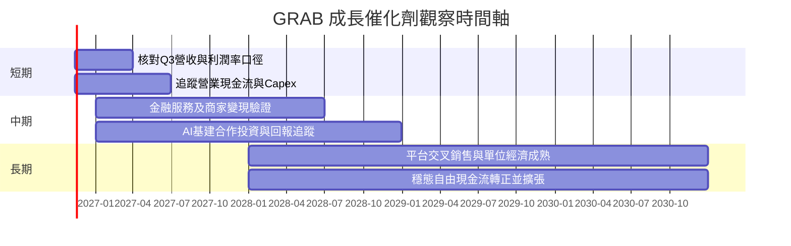

### 9.2 TAM 市場規模分析

資料包未提供GRAB服務市場的TAM、滲透率或分部收入，故不估造市場金額。可投資研究應補足各國交通、外送、雜貨配送、數位支付與信貸市場的市場規模及滲透率。

```
╔══════════════════════════════════════════════════════════════╗
║           TAM、市場滲透與收入貢獻（資料缺口）                ║
╠══════════════════════════════════════════════════════════════╣
║ 交通服務 TAM       N/A   滲透率 N/A   GRAB收入占比 N/A       ║
║ 外送與雜貨 TAM     N/A   滲透率 N/A   GRAB收入占比 N/A       ║
║ 金融服務 TAM       N/A   滲透率 N/A   GRAB收入占比 N/A       ║
║ 廣告／商家工具 TAM N/A   滲透率 N/A   GRAB收入占比 N/A       ║
╠══════════════════════════════════════════════════════════════╣
║ 可靠錨點：TTM總收入 $3.97B；最新單季收入 YoY +27.4%          ║
║ 需補資料：各板塊營收、交易額、抽成率、活躍使用者與留存率      ║
╚══════════════════════════════════════════════════════════════╝
```

### 9.3 成長驅動力結構圖

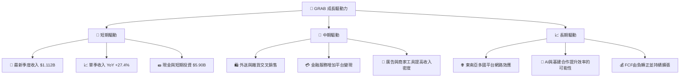

---

## 10. 風險矩陣

### 10.1 風險評分矩陣

以下象限圖的節點文字使用英文，符合圖表語法要求。

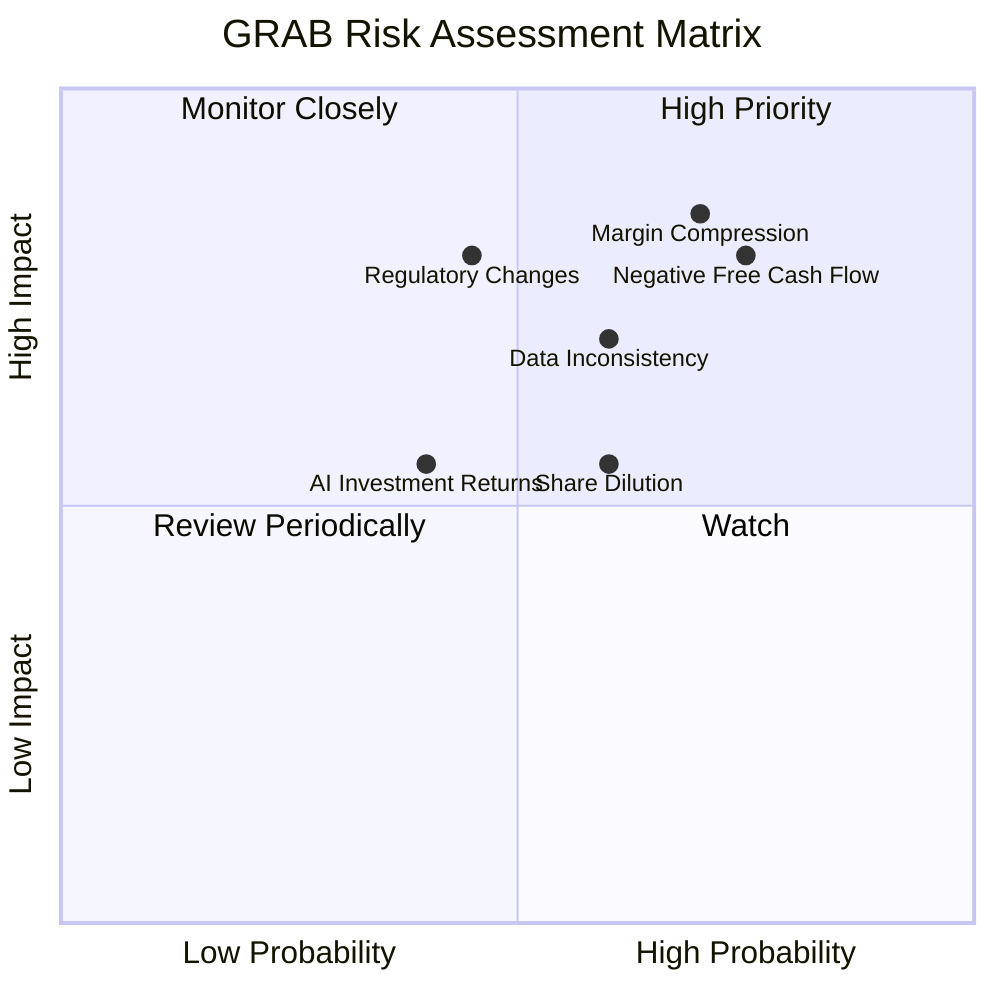

### 10.2 風險清單詳細分析

| # | 風險項目 | 發生機率 | 財務衝擊 | 風險評分 | 緩解措施 |
|---|----------|----------|----------|----------|----------|
| 1 | 🔴 競爭加劇與促銷補貼 | 中高（約60%） | 若收入增長降至低雙位數且毛利率收縮，估值可能下修20%–35%（分析情境） | 🔴 8.0/10 | 追蹤訂單增長、抽成率、激勵費用與客戶留存；避免只追求總交易額。 |
| 2 | 🔴 FCF持續為負 | 高（約65%） | TTM FCF −$18M；若連續數季為負，DCF基本假設失效 | 🔴 8.0/10 | 要求營運現金流持續高於Capex，並追蹤營運資金變動。 |
| 3 | 🟠 營業利益率資料及實際波動 | 中高（約55%） | TTM營業利益率11.0%與報表推算5.6%–6.6%不一致；若真實利潤率偏低，估值下調 | 🟠 7.5/10 | 以公司正式財報及分部附註為準，重算GAAP EBIT和TTM margin。 |
| 4 | 🟡 監管、勞工與平台規則 | 中（約45%） | 可能提高司機、配送或合規成本，壓低毛利與營業利潤 | 🟡 6.5/10 | 追蹤各市場法規、平台佣金限制及勞工成本。 |
| 5 | 🟡 SBC與股數稀釋 | 中（約55%） | FY2025 SBC $241M，占營收7.2%；若股數持續增加，EPS及每股價值被稀釋 | 🟡 6.0/10 | 按季監控稀釋股數及回購是否抵銷SBC。 |
| 6 | 🟡 AI／基建投資回報 | 中（約40%） | 新投資若增加Capex且無收入／成本節省，將惡化FCF | 🟡 5.5/10 | 要求公布投資金額、回報周期及可量化效率指標。 |

---

## 11. 投資建議

### 11.1 最終綜合評級雷達圖

```
╔══════════════════════════════════════════════════════════════╗
║                  GRAB 最終評分雷達                           ║
╠══════════════════════════════════════════════════════════════╣
║ 基本面強度      6.0/10  ▓▓▓▓▓▓▓▓▓▓▓▓░░░░░░░░  ★★★☆☆       ║
║ 成長動能        7.0/10  ▓▓▓▓▓▓▓▓▓▓▓▓▓▓░░░░░░  ★★★★☆       ║
║ 獲利品質        4.5/10  ▓▓▓▓▓▓▓▓▓░░░░░░░░░░░  ★★☆☆☆       ║
║ 財務健康        7.5/10  ▓▓▓▓▓▓▓▓▓▓▓▓▓▓▓░░░░░  ★★★★☆       ║
║ 估值合理性      5.5/10  ▓▓▓▓▓▓▓▓▓▓▓░░░░░░░░░  ★★★☆☆       ║
║ 護城河深度      6.0/10  ▓▓▓▓▓▓▓▓▓▓▓▓░░░░░░░░  ★★★☆☆       ║
║ 管理層執行      5.5/10  ▓▓▓▓▓▓▓▓▓▓▓░░░░░░░░░  ★★★☆☆       ║
╠══════════════════════════════════════════════════════════════╣
║ 綜合評分        5.8/10  ▓▓▓▓▓▓▓▓▓▓▓▓░░░░░░░░  🟡 買入但需驗證║
╚══════════════════════════════════════════════════════════════╝
```

### 11.2 目標價與隱含報酬率

| 情境 | 目標價 | 相對 $3.24 現價報酬 | 機率權重 | 情境核心假設 |
|------|------:|-------------------:|------:|------|
| 🔴 悲觀 | $2.30 | −29.0% | 30% | 12%收入CAGR、10%期末營業利潤率、競爭壓力持續 |
| 🟡 基準 | $3.90加權合理價值 | +20.4% | 50% | 以8.8節更正後加權合理價值為基準 |
| 🟢 樂觀 | $6.80 | +109.9% | 20% | 收入CAGR 22%、期末營業利潤率19%、現金轉換改善 |
| **投資評級** | **買入** | **MOS約16.9%** | — | 依MOS門檻判定；ROIC不可核實，未升級為強烈買入 |

### 11.3 買入時機與觸發因素

```
╔══════════════════════════════════════════════════════════════════╗
║                  ✅ 買入觸發因素 Checklist                      ║
╠══════════════════════════════════════════════════════════════════╣
║ 立即買入／建立部位（多數符合）：                                ║
║ ✅ 股價不高於 $3.24，且按加權價值計算MOS至少10%                 ║
║ ✅ 最新單季收入YoY維持20%以上，沒有連續兩季明顯減速             ║
║ ✅ TTM營業現金流維持正值，Capex未大幅高於營業現金流              ║
║                                                                  ║
║ 加碼觸發條件（出現以下任一）：                                  ║
║ ☐ TTM FCF轉正，並連續兩季維持正值                               ║
║ ☐ 單季營業利益率及GAAP口徑經正式財報確認後持續改善              ║
║ ☐ 股價回落至 $2.90 以下且核心營運未惡化                         ║
║                                                                  ║
║ 減碼／停損觸發條件（出現以下任一）：                             ║
║ ☐ 單季收入YoY連續兩季低於12%                                    ║
║ ☐ TTM FCF連續兩季低於−$100M                                     ║
║ ☐ 正式財報確認營業利益率低於5%，且連續兩季未改善                ║
║ ☐ 股價高於樂觀估值區間約 $6.80，但基本面未同步上修               ║
╚══════════════════════════════════════════════════════════════════╝
```

### 11.4 投資人適配度分析

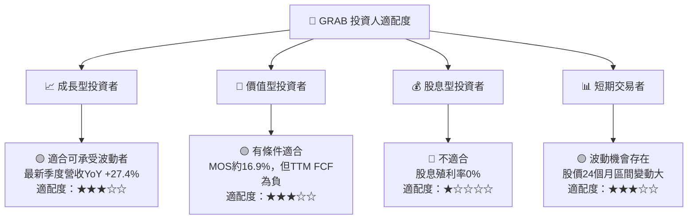

### 11.5 每季財報監控清單（Quarterly Watch List）

| 指標 | 最新基準 | 加碼門檻 | 減碼／重新評估門檻 | 投資含義 |
|------|---------:|---------:|------------------:|------|
| 營收單季YoY | 27.4% | ≥20% | 連續兩季<12% | 判斷需求與市場拓展是否延續 |
| QoQ營收 | 最新季+11.4% | 持續正成長且非單季異常 | 連續兩季負成長 | 分辨季節性與趨勢轉折 |
| TTM營業利益率 | 11.0%（來源值；有矛盾） | 正式財報確認且持續改善 | 核實後低於5% | 先解決資料口徑差異 |
| TTM營業現金流 | $121M | 連續兩季正值並增加 | 連續兩季負值 | 確認會計利潤轉化現金 |
| TTM Capex | $139M | Capex低於OCF且不壓低成長 | Capex大幅高於OCF | 追蹤基建投資及資本強度 |
| TTM FCF | −$18M | 轉正並連續維持 | 低於−$100M且持續惡化 | DCF可信度核心指標 |
| SBC/營收 | FY2025約7.2% | 下降且股數增長放緩 | >8%或稀釋加速 | 評估每股價值是否被稀釋 |
| 現金及短期投資 | $5.90B | 保持高於總債務 | 下降幅度大且無FCF改善 | 評估投資能力與抗風險緩衝 |
| 股數 | 市場資料3.94B；2026Q3資料4.037B | 稀釋趨緩 | 年增>3%且無回購抵銷 | 追蹤SBC與每股價值 |
| 財測及分部資料 | N/A | 公布分部營收及單位經濟 | 財測下修且核心分部減速 | 釐清成長品質與變現能力 |

### 11.6 反面論證：什麼會證明論點錯誤（What Would Change My Mind）

```
╔══════════════════════════════════════════════════════════════════╗
║              ⚠️ 論點失效條件（Disconfirming Evidence）           ║
╠══════════════════════════════════════════════════════════════════╣
║ 本投資論點在下列情況成立時應重新檢視或退出：                    ║
║ ☐ 核心收入單季YoY連續兩季低於12%                                ║
║ ☐ 經正式財報核實後營業利益率低於5%，且連續兩季未改善            ║
║ ☐ TTM FCF連續兩季低於−$100M，或現金流惡化而Capex持續上升        ║
║ ☐ 經一致口徑計算的ROIC連續兩年低於WACC約8.4%                   ║
║ ☐ SBC/營收高於8%，且稀釋股數年增超過3%                          ║
║ ☐ 現金及短期投資跌破總債務，且營運現金流仍為負                 ║
║ ☐ 廣告、金融服務或AI相關投資在合理時間內未呈現收入或成本回報    ║
╚══════════════════════════════════════════════════════════════════╝
```

**最終評級依據：**GRAB 最新季度營收單季 YoY +27.4%、淨現金 $3.83B，支持平台仍有成長與財務緩衝；但 TTM FCF −$18M、FY2025 SBC占營收7.2%、ROIC不可核實，限制投資信心。依更正後加權合理價值約$3.90、現價$3.24計算，MOS約16.9%，對應**買入**而非強烈買入。應以FCF轉正、利潤率口徑核實及股數稀釋趨勢作為持倉續抱條件。

> **免責聲明**：本報告為 AI 自動生成，僅供研究參考，不構成投資建議。投資有風險，入市需謹慎。