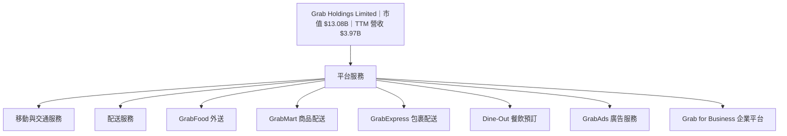
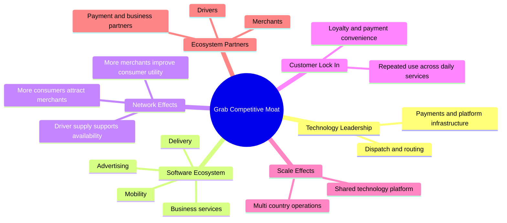
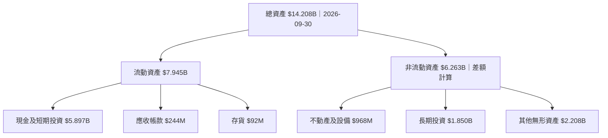
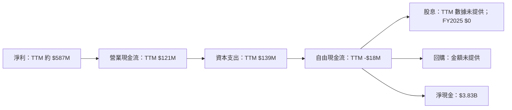
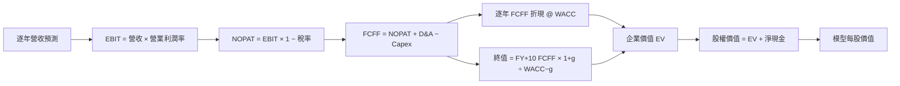
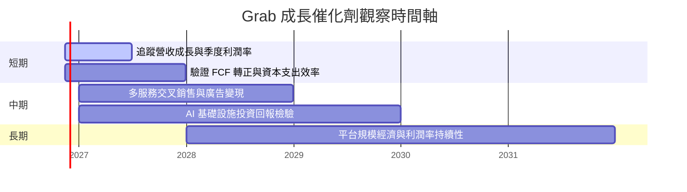
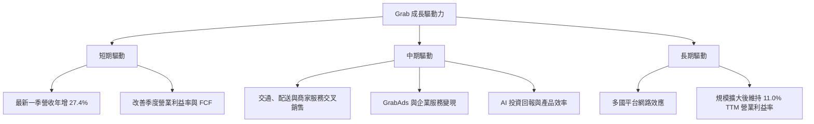
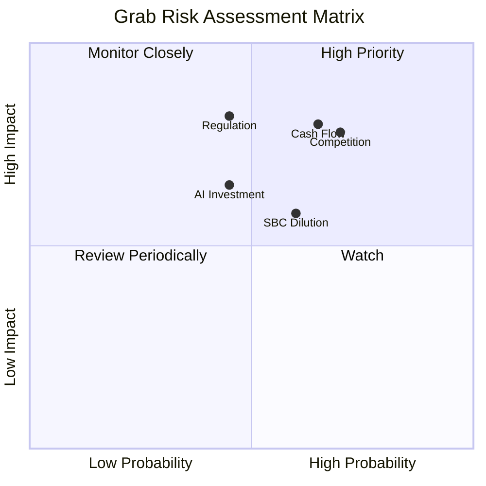
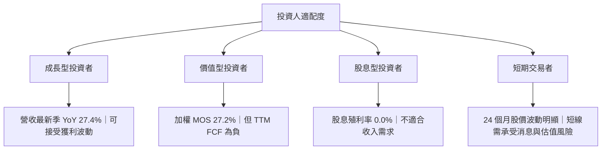

# GRAB 基本面深度分析報告
> **報告日期**：2026-11-14 ｜ **語言**：繁體中文 ｜ **數據來源**：Yahoo Finance、Finviz、StockAnalysis、Roic.ai ｜ **分析師**：CFA 級機構研究

## 目錄

| # | 章節 | 核心結論 |
|---|------|----------|
| 1 | 執行摘要 | 買入；加權合理價值 $4.45，安全邊際 MOS 27.2% |
| 2 | 公司概覽與商業模式 | 東南亞多服務平台，網路效應與生態系是主要護城河來源 |
| 3 | 損益表深度分析 | TTM 營收 $3.97B；最新一季營收年增 27.4%，但季度獲利波動 |
| 4 | 資產負債表分析 | 淨現金 $3.83B，流動性尚可；營運資金天數顯示平台取得供應商融資 |
| 5 | 現金流量深度分析 | TTM FCF 為 -$18M、FCF Yield -0.14%，現金轉換仍須改善 |
| 6 | 獲利能力與資本效率 | WACC 8.63%；可靠 ROIC 無法取得，不能確認是否持續創造經濟價值 |
| 7 | 相對估值分析 | GRAB Forward P/E 20.6x，高於同業中位數 15.8x |
| 8 | DCF 內在價值評估 | 基準 DCF 每股 $5.88；終值占 EV 65.7%，對長期假設敏感 |
| 9 | 成長催化劑 | 最新一季營收年增 27.4%；AI 投資為機會亦為資本配置風險 |
| 10 | 風險矩陣 | 主要風險為競爭與監管、獲利現金轉換、長期投資回報不確定 |
| 11 | 投資建議 | 買入；合理買入區間以 MOS ≥10% 計算為 $3.24–$4.01 |

---

## 1. 執行摘要

### 1.0 一頁式投資儀表板（Portfolio Manager 30 秒速讀）

| 項目 | 內容 |
|------|------|
| **投資論點（3 句）** | ① 最新一季營收年增 **27.4%**，高於 UBER 的 9.6%，顯示平台仍具擴張動能。② TTM 現金與短期投資 **$5.90B**、淨現金 **$3.83B**，可支撐競爭與投資。③ 但 TTM FCF 為 **-$18M**、FCF Yield **-0.14%**，成長尚未穩定轉化為自由現金流。 |
| **綜合評分** | **5.8/10**（引用 1.1 評分卡） |
| **財務健康** | 🟡 淨現金 $3.83B、流動比率 1.384；但 TTM FCF 為負 |
| **ROIC vs WACC** | ROIC：N/A（可靠投入資本資料不足） vs WACC **8.63%**；暫無法判定價值創造或摧毀 |
| **FCF 趨勢** | TTM FCF **-$18M**；FCF Yield **-0.14%**，低於 2024 年全年 FCF $739M |
| **估值** | Forward P/E **20.6x** ｜ EV/EBITDA **21.9x** ｜ FCF Yield **-0.14%** |
| **DCF 內在價值（基準）** | **$5.88** ｜現價相對 DCF 折價 **44.9%**（折溢價定義：$3.24 ÷ $5.88 − 1） |
| **安全邊際（MOS）** | **27.2%**＝($4.45 − $3.24) ÷ $4.45；🟢 MOS ≥25% |
| **預期報酬（基準情境 12M）** | **+81.5%**，採 DCF MODEL 基準情境 $5.88 相對現價計算；非保證報酬 |
| **關鍵風險（前二）** | TTM FCF 為負；最新一季營業利益率 5.6%，低於 TTM 11.0% |
| **評級 + 信心度** | 🟢 **買入** ｜ 信心：中低；評級來自 8.8 MOS，ROIC 尚不能驗證 |

### 1.1 綜合評分卡（全報告唯一）

| 維度 | 評分（1–10） | 主要依據（引用數字與其來源章節） |
|------|--------------|----------------------------------|
| 成長性 | 8.0 | 最新一季營收年增 27.4%；TTM 營收 $3.97B，但 TTM 成長率 N/A（第 3 章） |
| 獲利能力 | 5.0 | TTM 營業利益率 11.0%，但最新一季 5.6%；ROIC、Piotroski F-Score 無法取得（第 3、6 章） |
| 財務健康 | 7.0 | 淨現金 $3.83B、流動比率 1.384、CCC -182 天；TTM FCF -$18M（第 4、5 章） |
| 估值 | 6.0 | MOS 27.2%，但 Forward P/E 20.6x 高於同業中位數 15.8x（第 7、8 章） |
| 護城河 | 6.0 | 多國服務平台與網路效應具規模優勢；市場份額與分部收入占比未提供（第 2 章） |
| 管理層與資本配置 | 3.5 | 2025 SBC $241M、約占營收 7.2%；2025 FCF -$44M，且新投資回報尚無數據（第 3、5 章） |
| **綜合評分** | **5.9** | 六項算術平均：(8.0 + 5.0 + 7.0 + 6.0 + 6.0 + 3.5) ÷ 6 = 5.9 |

### 1.2 五大投資論點 + 三大核心風險

| 類型 | 項目 | 具體依據 | 信心度 |
|------|------|----------|--------|
| 🟢 **投資論點①** | 營收仍保持高成長 | 最新一季營收 $1.112B，年增 27.4%；平台交易與服務擴展可能是主要支撐，但分部貢獻未提供 | 🟢 中高 |
| 🟢 **投資論點②** | 流動性與淨現金提供緩衝 | 現金及短期投資 $5.90B、總債務 $2.07B、淨現金 $3.83B | 🟢 高 |
| 🟢 **投資論點③** | 毛利與營業獲利較歷史低點改善 | TTM 毛利率 41.4%、營業利益率 11.0%；FY2023 營業虧損 $387M、FY2025 營業利益 $222M | 🟢 中 |
| 🟢 **投資論點④** | 多服務平台可提高用戶使用頻率 | 外送、雜貨、交通、快遞、廣告與企業服務共用平台；用戶交叉銷售成效未提供 | 🟡 中 |
| 🟢 **投資論點⑤** | 加權估值低於 DCF 基準 | 加權合理價值 $4.45，較 $3.24 收盤價高 37.3%；估值結果仍受 DCF 長期假設影響 | 🟡 中 |
| 🟡 **風險①** | 現金流轉換不穩 | TTM FCF -$18M，2025 全年 FCF -$44M；若持續，盈利估值需下修 | 🔴 高衝擊 |
| 🔴 **風險②** | 獲利走勢存在季度波動 | 最新一季淨利 $27M，較前季 $253M 低 89.3%；EPS 最新季年增 -32.2% | 🔴 高 |
| 🟡 **風險③** | SBC 與資本投資侵蝕股東回報 | FY2025 SBC $241M，約占當年營收 7.2%；近期 AI 基礎設施投資計畫的回報資料不足 | 🟡 中高 |

### 1.3 快速統計卡片

| 指標 | 公司實際值（期間） | 同業中位數 | 狀態 |
|------|--------------------|------------|------|
| 營收成長（TTM） | **N/A** | — | 🟡 無 TTM 對比數據 |
| 營收成長（最新一季年增） | **27.4%** | **34.0%** | 🟢 成長高於 UBER、低於 SE 與 DASH |
| 毛利率（TTM） | **41.4%** | **45.0%**（三家中位數） | 🟡 低於同業中位數 |
| 營業利益率（TTM） | **11.0%** | — | 🟢 已轉正；季度波動仍大 |
| ROIC（TTM） | **N/A** | — | 🟡 無法可靠計算 |
| Forward P/E | **20.6x** | **15.8x** | 🟡 高於同業中位數 |
| FCF Yield（TTM） | **-0.14%** | — | 🔴 TTM FCF 為負 |
| Piotroski F-Score | **N/A** | — | 🟡 缺少跨年度 SEC 申報資料 |

### 1.4 投資結論

```text
╔══════════════════════════════════════════════════════════════════╗
║                    📊 投資結論摘要                               ║
╠══════════════════════════════════════════════════════════════════╣
║  評級：買入（依 8.8 的 MOS 27.2%；ROIC 無法確認大於 WACC）       ║
║  價格（2026-11-13 收盤）：$3.24                                  ║
║  DCF 內在價值（基準）：$5.88（現價折價 44.9%）                   ║
║  安全邊際 MOS：27.2%（＝($4.45−$3.24)÷$4.45）                  ║
║  加權合理價值（8.8）：$4.45                                      ║
║  DCF 情境價值：                                                   ║
║    悲觀情境：$3.08（-4.9%）                                      ║
║    基準情境：$5.88（+81.5%）                                     ║
║    樂觀情境：$12.00（+270.5%）                                   ║
║  綜合評分：5.9/10（引用 1.1）                                    ║
║  適合投資人：可承受獲利波動、以多年期成長為主的投資人            ║
╚══════════════════════════════════════════════════════════════════╝
```

---

## 2. 公司概覽與商業模式

### 2.1 業務結構與收入來源

Grab Holdings Limited 營運 Grab superapp，涵蓋柬埔寨、印尼、馬來西亞、緬甸、菲律賓、新加坡、泰國與越南。公司總市值 **$13.08B**，TTM 營收 **$3.97B**。資料未提供各業務分部營收與占比，因此不推算分部金額或繪製比例圖。



### 2.2 市場份額

市場份額數據未提供，因此不列市場占比。就已知數據而言，GRAB 最新一季營收年增 27.4%，高於 UBER 的 9.6%，低於 SE 的 43.4% 與 DASH 的 34.0%；但三家公司地區、產品與收入確認方式不同，營收成長率不能直接等同市場份額變化。

### 2.3 競爭護城河分析



### 2.4 護城河強度

| 護城河項目 | 強度（強／中／弱） | 證據（引用數字或事實） | 會削弱它的情況 |
|------------|--------------------|------------------------|----------------|
| 技術與派單系統 | 中 | 多項服務共用平台；研發費 FY2025 為 $428M | 技術差異難以維持、競爭者補貼導致轉換 |
| 軟體生態系統 | 中 | 平台涵蓋交通、配送、廣告、企業服務等 | 用戶跨服務使用率低、單位經濟性未改善 |
| 網路效應 | 中 | 消費者、商家與司機供給互相影響；具八國營運覆蓋 | 地方競爭者以補貼取得供給或需求 |
| 客戶鎖定 | 弱至中 | superapp 有便利性，但未提供留存率、使用頻率或轉換成本數據 | 用戶以價格為主而跨平台切換 |
| 規模效應 | 中 | TTM 營收 $3.97B，FY2025 年營收 $3.37B | 市場分散、各國營運與監管成本高 |
| 生態夥伴 | 中 | 依賴商家、司機、支付與企業合作夥伴 | 佣金、分潤或勞動規則變化提高成本 |

1.1「護城河」評分 **6.0/10**，理由是平台多服務與多國規模提供中等網路效應，但缺乏市場份額、留存率及單位經濟資料證明護城河轉化為持久超額報酬。

---

## 3. 損益表深度分析

### 3.1 年度收入成長趨勢（近4年）

年度收入分別為 FY2022 $1.43B、FY2023 $2.36B、FY2024 $2.80B、FY2025 $3.37B。下列 YoY 由年度收入計算，四捨五入至一位小數；四年期間 CAGR 以 FY2022 至 FY2025 計算。

```text
╔══════════════════════════════════════════════════════════════════╗
║             Grab 年度收入趨勢（FY2022–FY2025）                   ║
╠══════════════════════════════════════════════════════════════════╣
║  FY2022  $1.43B  ████████░░░░░░░░░░░░░░░░  起始年度              ║
║  FY2023  $2.36B  ████████████████░░░░░░░░  YoY: +64.6%  🟢     ║
║  FY2024  $2.80B  ███████████████████░░░░░  YoY: +18.6%  🟢     ║
║  FY2025  $3.37B  ████████████████████████  YoY: +20.5%  🟢     ║
║                                                                  ║
║  FY2022–FY2025 營收 CAGR：+33.1%                                 ║
╚══════════════════════════════════════════════════════════════════╝
```

計算：FY2023 YoY = $2.36B ÷ $1.43B − 1 = 64.6%；FY2024 = $2.80B ÷ $2.36B − 1 = 18.6%；FY2025 = $3.37B ÷ $2.80B − 1 = 20.5%。CAGR = ($3.37B ÷ $1.43B)^(1/3) − 1 = 33.1%。FY2023 高成長後，近兩年回落至約 19%–21%，顯示收入基數擴大後成長趨於正常化。TTM 成長率因缺少一致的 prior TTM 計算值，列為 N/A。

### 3.2 季度收入趨勢分析

| 季度 | 營收 | QoQ 成長 | YoY 成長 | 備註 |
|------|------:|---------:|---------:|------|
| 2025 Q4 | $906M | +3.8% | +18.6% | 季增計算：906 ÷ 873 − 1 |
| 2026 Q1 | $955M | +5.4% | +23.5% | 季增計算：955 ÷ 906 − 1 |
| 2026 Q2 | $998M | +4.5% | +21.9% | 季增計算：998 ÷ 955 − 1 |
| 2026 Q3 | $1,112M | +11.4% | +27.4% | 季增計算：1,112 ÷ 998 − 1；季度年增率不是 TTM 成長率 |

營收季增幅在 2026 Q3 加快至 11.4%，高於前三季約 4%–5%；若後續季度維持，可能反映平台需求、服務使用或交易額增加，但現有資料未提供訂單量、平均訂單價與分部拆分，無法區分是量增、價格或組合因素。

### 3.3 利潤率演變分析

| 利潤率指標 | FY2022 | FY2023 | FY2024 | FY2025 | 趨勢 | 評估 |
|------------|-------:|-------:|-------:|-------:|------|------|
| **毛利率** | 5.4% | 36.4% | 41.8% | 43.3% | ↑ 毛利率改善 | 🟢 |
| **營業利益率** | -90.2% | -16.4% | -2.0% | 6.6% | ↑ 從虧損轉正 | 🟢 |
| **淨利率** | -117.5% | -18.4% | -3.8% | 8.0% | ↑ FY2025 轉正 | 🟡 |

年度利潤率以當年報表金額計算，例如 FY2025 毛利率 = $1.46B ÷ $3.37B = 43.3%，營業利益率 = $222M ÷ $3.37B = 6.6%。年度趨勢顯示平台規模擴大後，毛利與營業費用吸收能力改善；但 TTM 營業利益率 11.0% 與最新一季 5.6% 的差距，代表不能把全年改善直接外推為季度穩定獲利。

### 3.4 費用結構分析

各費用項目占收入比例的完整拆分未提供，因此不繪製費用比例圓餅圖。已知 FY2025 研發費用為 **$428M**，相當於 FY2025 營收 $3.37B 的約 **12.7%**；SBC 為 $241M，約占當年營收 7.2%。兩者不能視為全部營運費用，銷售、行政及直接服務成本細項未完整提供。

### 3.5 季度 EPS 趨勢與盈餘品質（Quality of Earnings）

| 季度 | EPS 實際 | EPS 年增 | 盈餘超預期／不及預期 |
|------|---------:|--------:|----------------------|
| 2025 Q4 | $0.04 | N/A | 預估值 N/A，無法判定 |
| 2026 Q1 | -$0.01 | N/A | 預估值 N/A，無法判定 |
| 2026 Q2 | $0.06 | N/A | 預估值 N/A，無法判定 |
| 2026 Q3 | $0.01 | -32.2% | 預估值 N/A，無法判定 |

最近四季 EPS 預估值均缺漏，不能將資料標記中的錯誤符號當成「不及預期」。最新一季 EPS 年增 -32.2%，同時淨利年增 -27.0%；其原因可能涉及利潤率、一次性損益或稅項變化，但缺乏季度完整財報附註，不能定量歸因。

| 盈餘品質項目 | 數值／佔比 | 評估 |
|--------------|-----------|------|
| SBC / 營收 | FY2025：$241M ÷ $3.37B = **7.2%**；最近四季 SBC $234M ÷ TTM 營收 $3.97B = **5.9%** | 🟡 對股東有實質稀釋成本；年稀釋股數變化資料不完整 |
| SBC / 營業現金流 | FY2025：$241M ÷ $79M = **305.1%**；TTM：$234M ÷ $121M = **193.4%** | 🔴 SBC 規模高於營業現金流，應將其視為股東經濟成本 |
| FCF / 淨利（現金轉換率） | TTM：-$18M ÷ 約 $587M = **-3.1%** | 🔴 GAAP 淨利未轉化為正 FCF；營運資金與資本支出造成的影響需後續驗證 |
| 一次性／非經常性損益 | 未提供可完整拆分資料；2026 Q2 淨利 $253M，明顯高於 2026 Q3 $27M | 🟡 季度淨利波動大，無法判定一次性損益方向 |
| 有效稅率異常 | DCF 採用最新年有效稅率 **25.7%**；分季稅率 N/A | 🟡 無足夠稅務明細確認近期淨利是否受稅務項目帶動 |
| 資本化支出 vs 費用化 | TTM Capex $139M；資本化會計政策與資本化軟體金額未提供 | 🟡 無法判斷是否將支出資本化而延後費用認列 |

**盈餘品質結論**：GRAB 已呈現正的 TTM 淨利與營業利益，但 TTM FCF 仍為負，SBC 相對營業現金流偏高，季度淨利波動亦大。因此盈餘的現金含量尚未充分驗證；估值不宜只依賴 EPS，須同時觀察 FCF、SBC 及股數變化。

---

## 4. 資產負債表分析

### 4.1 資產結構分解

截至 2026-09-30，StockAnalysis 顯示總資產 **$14.208B**、流動資產 **$7.945B**。非流動資產由總資產減流動資產得 **$6.263B**。細項可能存在來源分類差異，不應強制把所列資產項目相加至總額。



### 4.2 流動性與營運資金分析

流動性年度數據依公司年度資產負債表計算；營運資金天數照列程式計算的最新值。一年前天數未提供。

| 指標 | 最新值 | 一年前 | 變化 | 解讀 |
|------|-------:|------:|------:|------|
| 流動比率 | **1.384** | N/A | N/A | 流動資產高於流動負債，但不代表全部流動資產可快速變現 |
| 速動比率 | **1.07** | N/A | N/A | 高於 1，提供短期償債緩衝 |
| DSO 應收帳款天數 | **22 天** | N/A | N/A | 一年前數據未提供，無法判定收款速度變化 |
| DIO 存貨天數 | **15 天** | N/A | N/A | 一年前數據未提供，無法判定庫存是否堆積 |
| DPO 應付帳款天數 | **219 天** | N/A | N/A | 付款週期長，可能反映平台商業模式下的供應商／商家結算時差，不能單獨視為議價力證明 |
| CCC 現金轉換週期 | **-182 天** | N/A | N/A | 由較長 DPO 造成負現金轉換週期；若結算安排改變，營運資金可能反向占用現金 |

CCC = DSO + DIO − DPO = 22 + 15 − 219 = **-182 天**。負 CCC 有利於營運資金效率，但若 DPO 來自應付商家與合作夥伴款項，必須監測結算條款、延遲付款或監管要求變動。

### 4.3 債務結構分析

```text
╔══════════════════════════════════════════════════════════════════╗
║                   GRAB 債務健康診斷                              ║
╠══════════════════════════════════════════════════════════════════╣
║  總債務：             $2.07B  ███████░░░░░░░░░░░░░  🟡          ║
║  現金+短期投資：      $5.90B  ████████████████████  🟢          ║
║  淨現金：             $3.83B  █████████████░░░░░░░  🟢          ║
║                                                                  ║
║  Debt/EBITDA：         約 4.5x（以 TTM EBITDA 估算） 🟡          ║
║  利息保障倍數：        N/A（利息費用與季度明細不足）             ║
║  流動比率：            1.384x                       🟡          ║
║  速動比率：            1.07x                        🟡          ║
╚══════════════════════════════════════════════════════════════════╝
```

Debt/EBITDA 約以 $2.07B ÷ ($3.97B × 11.2%) 估算，約 **4.7x**；因 TTM EBITDA margin 及總債務期間口徑可能不完全一致，僅作粗略參考，非資料庫驗證倍數。淨現金能緩衝償債風險，但不能取代正 FCF。

### 4.4 股東權益趨勢

| 年度 | 股東權益 | 年變化 | 評估 |
|------|---------:|-------:|------|
| 2022 | $6.60B | — | 資本基礎較大 |
| 2023 | $6.45B | -2.3% | 下降 |
| 2024 | $6.40B | -0.8% | 大致持平 |
| 2025 | $6.73B | +5.2% | 回升 |

```text
╔══════════════════════════════════════════════════════════════════╗
║                 股東權益趨勢（年度）                             ║
╠══════════════════════════════════════════════════════════════════╣
║  2022  $6.60B  ████████████████████                             ║
║  2023  $6.45B  ████████████████████                             ║
║  2024  $6.40B  ███████████████████                              ║
║  2025  $6.73B  █████████████████████                            ║
╚══════════════════════════════════════════════════════════════════╝
```

---

## 5. 現金流量深度分析

### 5.1 現金流量瀑布圖



### 5.2 FCF 轉換率趨勢

| 年度 | 營業現金流 | Capex | FCF | 淨利 | FCF / 淨利 |
|------|-----------:|------:|----:|-----:|-----------:|
| 2022 | -$798M | $74M | -$872M | -$1.68B | 51.9% |
| 2023 | $86M | $92M | -$6M | -$434M | 1.4% |
| 2024 | $852M | $113M | $739M | -$105M | 不具解讀性；分母為負 |
| 2025 | $79M | $123M | -$44M | $268M | -16.4% |
| TTM 至 2026-09-30 | $121M | $139M | -$18M | 約 $587M | -3.1% |

2024 年 FCF 大幅轉正，但 2025 與最新 TTM 再度為負。這反映現金流不如淨利穩定；需要追查營運資金、結算時點、Capex 與非現金項目的年度變化。2024 年的 FCF 高於當年淨利，不能直接視為可持續現金轉換率。

### 5.3 自由現金流趨勢

| 期間 | FCF | FCF Yield |
|------|----:|----------:|
| FY2022 | -$872M | N/A |
| FY2023 | -$6M | N/A |
| FY2024 | $739M | N/A |
| FY2025 | -$44M | N/A |
| TTM | **-$18M** | **-0.14%** |

```text
╔══════════════════════════════════════════════════════════════════╗
║             自由現金流：年度實際與最新 TTM                       ║
╠══════════════════════════════════════════════════════════════════╣
║  FY2022  -$872M  ◀██████████████████████  FCF 為負               ║
║  FY2023    -$6M  ◀█░░░░░░░░░░░░░░░░░░░░  接近損益平衡          ║
║  FY2024   $739M  ████████████████████░░░  FCF 轉正               ║
║  FY2025   -$44M  ◀██░░░░░░░░░░░░░░░░░░░  再度轉負               ║
║  TTM      -$18M  ◀█░░░░░░░░░░░░░░░░░░░░  Yield -0.14%          ║
╚══════════════════════════════════════════════════════════════════╝
```

### 5.4 資本配置評估

| 配置項目 | 已知金額／狀況 | 評估 |
|----------|---------------|------|
| Capex | TTM $139M；FY2025 $123M | 資本支出高於 TTM 營業現金流，拖累 FCF |
| 股息 | FY2022–FY2025 均為 $0；殖利率 0.0% | 現金主要留在公司，適合再投資型公司 |
| 回購 | 金額未提供 | 無法評估回購是否抵銷 SBC 稀釋 |
| SBC | FY2025 $241M | 相當於營收 7.2%，須納入股東報酬分析 |
| AI／基礎設施投資 | 新聞提及與馬來西亞 AI 基礎設施相關投資；金額與現金流歸屬未提供 | 需以可量化的回報門檻和資本承諾進度追蹤 |
| 現金留存 | 現金及短期投資 $5.90B | 有財務彈性，但閒置資金回報與投資紀律影響資本效率 |

各項資本配置金額無法完整加總，故不繪製比例圓餅圖。

---

## 6. 獲利能力與資本效率

### 6.1 ROE / ROA / ROIC 趨勢

| 指標 | FY2023 | FY2024 | FY2025／TTM | 評估 |
|------|-------:|-------:|------------:|------|
| ROE | N/A | N/A | TTM **7.6%** | 正值但不高；精確年度序列未提供 |
| ROA | N/A | N/A | TTM **1.1%** | 資產使用回報偏低 |
| ROIC | N/A | N/A | **N/A** | 投入資本口徑與平均資本資料不足 |
| Piotroski F-Score | N/A | N/A | N/A | 缺少兩個相隔一年的 SEC 財報計算資料 |

行業均值未提供，不列同業均值欄。ROE、ROA 已按資料所列 TTM 值照錄；因缺少一致的歷史序列，不以自算值填補。

### 6.2 ROIC vs WACC 分析（核心價值創造判斷）

```text
╔══════════════════════════════════════════════════════════════════╗
║                ROIC vs WACC 深度分析                             ║
╠══════════════════════════════════════════════════════════════════╣
║  WACC（程式計算輸入）：                                          ║
║  ├── 無風險利率（10Y 美債）：          5.15%                    ║
║  ├── 市場風險溢酬 ERP：                5.00%                    ║
║  ├── Beta 原始值：                     0.83                     ║
║  ├── Beta 採用值：                     0.89                     ║
║  ├── 股權成本：                        9.60%                    ║
║  ├── 稅前債務成本：                    3.43%                    ║
║  ├── 股權／債務權重：                  86.3%／13.7%             ║
║  └── ✅ WACC：                         8.63%                    ║
║                                                                  ║
║  ROIC：N/A（未提供可靠投入資本及平均資本口徑）                  ║
║  EVA = ROIC − WACC：N/A                                          ║
║                                                                  ║
║  判斷：目前無法以數據確認 ROIC 是否高於 WACC，                  ║
║        因而不能宣稱公司持續創造股東經濟價值。                  ║
╚══════════════════════════════════════════════════════════════════╝
```

Beta 調整方式為 **⅔ × 0.83 + ⅓ = 0.89**；股權成本 CAPM 為 **5.15% + 0.89 × 5.00% = 9.60%**。WACC 與 DCF 折現率一致，採用 **8.63%**。10Y 美債與 ERP 的具體觀測日／估計方法未提供；未另行添加規模或國別溢酬。

由於 ROIC 數據缺漏，本節不使用不完整的資產與現金口徑估算 ROIC，以免把現金、投資或商譽處理差異誤當成確定的資本回報。這項缺口降低對買入評級的信心。

### 6.3 杜邦三因素分解

| 因素 | 數值（TTM） | 解讀 |
|------|-------------|------|
| 淨利率 | N/A | QUALITY FIGURES 未能計算，缺少一致口徑資料 |
| 資產週轉率 | N/A | 同上 |
| 權益乘數 | N/A | 同上 |
| **ROE** | **N/A** | 杜邦品質數據列示 N/A；另有資料源報告 ROE TTM 7.6%，兩者不混用 |

### 6.4 財務體質：Piotroski F-Score

| 測試 | 結果 | 解讀 |
|------|------|------|
| Piotroski F-Score 總分 | **N/A** | 需要兩期相隔一年的 SEC 申報資料；目前資料源為 Yahoo 季報，無法計算 |
| 九項測試 | **N/A** | 九項個別結果均未提供，不能推定通過或未通過 |

因此不對未提供的測試結果作解讀；F-Score 缺漏代表財務體質的標準化評估存在資料限制。

---

## 7. 相對估值分析

### 7.1 同業估值比較表格

| 估值指標 | **GRAB** | **UBER** | **SE** | **DASH** | GRAB 評估 |
|----------|---------:|---------:|-------:|--------:|-----------|
| **Trailing P/E** | 32.4x | 41.0x | 27.1x | 71.2x | 🟡 位於同業範圍中間 |
| **Forward P/E** | 20.6x | 15.8x | 15.8x | 22.5x | 🟡 高於同業中位數 15.8x |
| **P/S Ratio** | 3.29x | 2.5x | 1.5x | 4.4x | 🟡 高於 UBER、SE，低於 DASH |
| **EV/EBITDA** | 21.9x | 19.3x | 14.9x | 42.2x | 🟡 高於 UBER、SE，遠低於 DASH |
| **最新一季營收年增** | 27.4% | 9.6% | 43.4% | 34.0% | 🟢 高於 UBER，低於 SE、DASH |
| **毛利率（TTM）** | 41.4% | 41.4% | 45.0% | 52.7% | 🟡 低於 SE、DASH |

公司估值倍數取 Yahoo Finance／Finviz 合併資料；同業倍數取 Yahoo Finance Peer multiples。Forward P/E 中位數為排序後的 **15.8x**。GRAB 的收入成長較 UBER 快，但相對 UBER 與 SE 的 Forward P/E 溢價，要求未來持續成長且改善現金流。

### 7.2 歷史估值區間分析

歷史 P/E 區間與自身歷史估值百分位數據未提供，故不估算百分位。可觀察到 24 個月股價由 2024-11 月收盤 $5.00 到 2026-11-13 收盤 $3.24，跌幅約 **35.2%**；股價走勢不等同估值倍數歷史，不能替代 P/E 區間分析。

### 7.3 情境價值（Bear / Base / Bull，照抄 DCF MODEL 的 Scenarios）

| 情境 | 第 1 年營收成長 | 期末營業利潤率 | WACC | 每股價值 | 相對現價 | 機率 | 會發生的條件 |
|------|----------------:|----------------:|-----:|----------:|---------:|-----:|--------------|
| 🔴 悲觀 | 13.7% | 9.3% | 9.63% | $3.08 | -4.9% | 25% | 成長放緩且價格競爭或營運成本令長期利潤率低於基準 |
| 🟡 基準 | 27.4% | 11.0% | 8.63% | $5.88 | +81.5% | 50% | 最新一季成長延續後逐步放緩，長期營業利潤率維持模型假設 |
| 🟢 樂觀 | 41.1% | 12.0% | 7.63% | $12.00 | +270.5% | 25% | 高成長延長、規模經濟改善利潤率且資金成本下降 |

### 7.4 相對估值隱含價格區間

```text
╔══════════════════════════════════════════════════════════════════╗
║                  相對估值每股價值比較                            ║
╠══════════════════════════════════════════════════════════════════╣
║  $2.48 ───────── $3.24 ───── $3.74 ───── $5.39 ───── $5.88     ║
║  Forward P/E       現價       EV/EBITDA   共識目標    基準 DCF   ║
╚══════════════════════════════════════════════════════════════════╝
```

| 方法 | 每股價值 | 相對現價 | 依據 |
|------|---------:|---------:|------|
| 同業 Forward P/E | $2.48 | -23.5% | UBER、SE、DASH 同業 Forward P/E 中位數 15.8x × GRAB Forward EPS $0.16 |
| 同業 EV/EBITDA | $3.74 | +15.4% | UBER、SE 同業 EV/EBITDA 中位數 17.1x × TTM EBITDA，再加淨現金 |
| 分析師共識 | $5.39 | +66.4% | 22 位分析師平均目標價 |
| DCF 基準 | $5.88 | +81.5% | 10 年 FCFF、WACC 8.63%、永續成長 3.0% |

---

## 8. DCF 內在價值評估（Discounted Cash Flow）

### 8.0 估值推理鏈（Thinking Logic）

**Step 1 — 價值由哪些變數決定？**  
模型的核心是平台收入能否由 TTM **$3.97B** 成長至更大的現金流規模，並在 **11.0%** TTM 營業利益率下持續產生 FCFF。資料未提供各業務營收占比，因此不能把交通、配送或廣告分拆成可量化的價值來源。模型敏感度的主導因素是終值，因終值現值占企業價值 **65.7%**；其背後由長期現金流、WACC 與永續成長率共同決定。

**Step 2 — 模型選擇**

| 決策點 | 本報告採用 | 理由 | 曾考慮但否決 | 否決理由 |
|--------|-----------|------|--------------|----------|
| 現金流定義 | FCFF | 以 WACC 折現得到 EV，再加淨現金 | FCFE | 債務與股權資本需分開處理 |
| 預測期 N | 10 年 | DCF MODEL 固定假設，讓成長逐步降至 3.0% | 5 年 | 模型已給定 10 年序列，不另建模型 |
| 終值方法 | Gordon Growth | DCF MODEL 指定，WACC 8.63% 高於 g 3.0% | 退出倍數 | DCF MODEL 未提供退出倍數終值，不能自行另建 |
| EBIT 基礎 | GAAP EBIT | 模型明確採用 GAAP EBIT | 非 GAAP EBIT | 會造成 SBC 處理口徑改變 |

**Step 3 — 關鍵假設推導鏈**

以下先說明原模型假設的錨點與風險，不更改模型數值：

- **營收成長**：錨點＝最新一季單季 YoY **27.4%**，不是 TTM 成長率；調整＝模型將此成長作為 FY+1 起點，並線性降至 FY+10 **3.0%**；採用值＝依模型逐年 27.4%、24.7%、22.0%、19.3%、16.6%、13.8%、11.1%、8.4%、5.7%、3.0%；曾考慮將 27.4% 視為長期成長，但否決，因季度單季成長不能直接代表十年持續成長。
- **營業利潤率**：錨點＝TTM 營業利益率 **11.0%**，最新一季為 **5.6%**；採用值＝模型全期維持 11.0%；調整理由＝並未對 TTM 水準進一步擴張，表面上偏中性，但若最新一季 5.6% 代表新常態，維持 11.0% 會偏樂觀；曾考慮以最新一季 5.6% 代表全年，否決原因是該單季不足以代表完整年度。
- **期末營業利潤率**：錨點＝TTM 11.0%；採用值＝FY+10 仍為 11.0%；模型沒有假設長期利潤率擴張。否決更高期末利潤率，因缺少分部單位經濟性與管理層長期目標數據。
- **永續成長率 g**：錨點＝模型採 **3.0%**，且長期必須小於 WACC **8.63%**；採用值＝3.0%；更高數值會提高 TV，但缺少宏觀與成熟期市場成長依據，不採用。
- **預測期 N**：錨點＝模型固定 **10 年**；採用值＝10 年；偏離 10 年會改變逐年 FCFF 加總及終值起算時間，因此不自行改動。
- **Capex／營收**：錨點＝模型採 **3.5%**，源自 TTM Capex／營收，並固定至 FY+10；採用值＝3.5%；模型註明其若高於 1.1×D&A 才向該比例收斂，此處未高於，故不調降。
- **有效稅率**：錨點＝最新年度有效稅率 **25.7%**；採用值＝25.7%。稅務逐年變化資料未提供，按模型維持不變。
- **D&A／營收**：錨點＝TTM **5.6%**；採用值＝全期固定 5.6%，未有理由另作調整。
- **營運資金變動**：模型明確不建模；採用值＝不列 ΔWC 項。CCC 為 -182 天，意味現金結算結構重要；忽略營運資金可能使估值偏高或偏低，方向取決於未來結算條件。
- **EBIT 基礎與 SBC**：採用 GAAP EBIT，EBIT 已含 SBC 費用；FCFF 不再扣 SBC，股數不另稀釋。模型採用組合 **(A)**；此處不另加回 SBC。
- **年稀釋率**：模型採固定股數，年稀釋率 **0%**；根據 (A) 的模型設定，SBC 已經在 GAAP EBIT 中費用化。現實中 SBC 仍會造成股數稀釋，模型的固定股數是假設，不代表實際稀釋不存在。
- **WACC**：錨點＝資本成本資料列示 **8.63%**；採用值＝8.63%，不另算替代 WACC。替代折現率將由敏感度矩陣展示。
- **終值方法**：錨點＝模型指定 Gordon Growth；採用值＝以 FY+10 FCFF 和 g=3.0% 計算；退出倍數法未提供可對應的退出倍數及終值，故不另建。

**Step 4 — 最脆弱環節**  
基準情境以單季 27.4% YoY 作為第一年成長錨點，並維持 11.0% 營業利潤率；若業務成長更快降溫或利潤率回落，終值與每股估值可能顯著下修，悲觀情境已示範每股價值為 **$3.08**。

**Step 5 — 計算路徑圖**



### 8.1 模型假設總表（Model Inputs）

| 假設項目 | 採用值 | 依據／來源 | 敏感度 |
|----------|--------|-------------|--------|
| 預測期長度 N | 10 年 | DCF MODEL 固定；十年收入成長逐步降至 3.0% | 🟡 中 |
| 營收成長 | FY+1 27.4% 線性降至 FY+10 3.0% | FY+1 錨定最新一季 YoY 27.4%；TTM YoY N/A | 🔴 高 |
| 營業利潤率 | 全期 11.0% | TTM 11.0%；最新一季 5.6% | 🔴 高 |
| 有效稅率 | 25.7% | 最新年度有效稅率 | 🟢 低 |
| Capex / 營收 | 全期 3.5% | 模型採 TTM Capex 比率 | 🟡 中 |
| D&A / 營收 | 全期 5.6% | 模型採 TTM | 🟢 低 |
| 營運資金變動 | 不建模 | DCF MODEL 指定 Working capital is not modelled | 🟢 低，但可能有方向性偏誤 |
| EBIT 基礎 | GAAP EBIT | 模型指定 GAAP EBIT | 🟡 中 |
| SBC 處理 | GAAP EBIT 已含 SBC；FCFF 不重扣 | 模型指定組合 (A) | 🟡 中 |
| 年稀釋率 | 0% | 固定股數組合 (A)；非對現實稀釋的預測 | 🟡 中 |
| 永續成長率 g | 3.0% | DCF MODEL 指定；低於 WACC 8.63% | 🔴 高 |
| 終值方法 | Gordon Growth | DCF MODEL 指定 | 🔴 高 |
| WACC | 8.63% | Cost of capital 資料；詳見 8.2 | 🔴 高 |

FCFF 定義：**FCFF = NOPAT + D&A − Capex**；Working capital 未建模。模型採 GAAP EBIT，故 SBC 已含在費用中，不另扣 SBC；股數固定、不另計年度稀釋，屬組合 **(A)**。

### 8.2 折現率推導（WACC）

```text
╔══════════════════════════════════════════════════════════════════╗
║                    WACC 推導（折現率）                           ║
╠══════════════════════════════════════════════════════════════════╣
║  股權成本 Ke（CAPM）：                                           ║
║  ├── 無風險利率 Rf（10Y 美債）：       5.15%                    ║
║  ├── 市場風險溢酬 ERP：                 5.00%                    ║
║  ├── Beta 原始值：                      0.83                     ║
║  ├── Beta 採用值：                      0.89                     ║
║  ├── 規模／國別溢酬：                   0.00%（未另加）         ║
║  └── Ke = 5.15% + 0.89 × 5.00% = 9.60%                         ║
║                                                                  ║
║  債務成本：                                                      ║
║  ├── 稅前 Kd：                          3.43%                    ║
║  ├── 有效稅率：                         25.7%                    ║
║  └── 稅後 Kd = 3.43% × (1−25.7%) = 2.55%                        ║
║                                                                  ║
║  資本結構權重：                                                  ║
║  ├── 股權權重 E：                       86.3%                    ║
║  ├── 債務權重 D：                       13.7%                    ║
║  └── ✅ WACC：                          8.63%                    ║
╚══════════════════════════════════════════════════════════════════╝
```

逐步演算如下：

1. **Ke（CAPM）** = 5.15% + 0.89 × 5.00% = 9.60%。
2. **稅前 Kd** = 3.43%（直接採資本成本資料列示；利息費用及平均計息負債明細未提供，故不自行重建）。
3. **稅後 Kd** = 3.43% × (1 − 25.7%) = 2.55%。
4. **權重** = 股權 86.3%；債務 13.7%；兩者合計 100.0%。資本成本資料採市值／債務權重；沒有足夠資料獨立重建分母與同口徑計息債務餘額。
5. **WACC** = 86.3% × 9.60% + 13.7% × 2.55% = 8.28% + 0.35% = **8.63%**（依提供的 Cost of capital 採用值；中間項四捨五入可能有尾差）。

原始 Beta 0.83 經調整：⅔ × 0.83 + ⅓ × 1.00 = 0.89。Rf 資料未提供具體觀測日期；ERP 為假設輸入，未附外部來源。故採用程式列示 WACC **8.63%**，不另行替換。

### 8.3 逐年自由現金流預測（基準情境）

以下逐年數值照 DCF MODEL 列示，金額為 USD billions；折現因子三位小數，金額兩位小數。

| 年度 | FY+1 | FY+2 | FY+3 | FY+4 | FY+5 | FY+6 | FY+7 | FY+8 | FY+9 | FY+10 |
|------|-----:|-----:|-----:|-----:|-----:|-----:|-----:|-----:|-----:|------:|
| 營收 | 5.06 | 6.31 | 7.69 | 9.18 | 10.70 | 12.18 | 13.53 | 14.67 | 15.51 | 15.98 |
| 營收 YoY | 27.4% | 24.7% | 22.0% | 19.3% | 16.6% | 13.8% | 11.1% | 8.4% | 5.7% | 3.0% |
| 營業利潤率 | 11.0% | 11.0% | 11.0% | 11.0% | 11.0% | 11.0% | 11.0% | 11.0% | 11.0% | 11.0% |
| EBIT | 0.55 | 0.69 | 0.84 | 1.01 | 1.17 | 1.33 | 1.48 | 1.61 | 1.70 | 1.75 |
| − 稅 | (0.14) | (0.18) | (0.22) | (0.26) | (0.30) | (0.34) | (0.38) | (0.41) | (0.44) | (0.45) |
| = NOPAT | 0.41 | 0.51 | 0.63 | 0.75 | 0.87 | 0.99 | 1.10 | 1.20 | 1.26 | 1.30 |
| + D&A | 0.28 | 0.35 | 0.43 | 0.52 | 0.60 | 0.68 | 0.76 | 0.82 | 0.87 | 0.90 |
| − Capex | (0.18) | (0.22) | (0.27) | (0.32) | (0.37) | (0.43) | (0.47) | (0.51) | (0.54) | (0.56) |
| **= FCFF** | **0.52** | **0.65** | **0.79** | **0.94** | **1.10** | **1.25** | **1.39** | **1.51** | **1.59** | **1.64** |
| 折現因子 @8.63% | 0.921 | 0.847 | 0.780 | 0.718 | 0.661 | 0.608 | 0.560 | 0.516 | 0.475 | 0.437 |
| FCFF 現值 PV | 0.48 | 0.55 | 0.62 | 0.68 | 0.73 | 0.76 | 0.78 | 0.78 | 0.76 | 0.72 |

預測期 PV 加總：**$0.48 + $0.55 + $0.62 + $0.68 + $0.73 + $0.76 + $0.78 + $0.78 + $0.76 + $0.72 = $6.86B**。DCF MODEL 列示的預測期 PV 合計為 **$6.83B**；兩者差異約 0.4%，來自各年度表格數值四捨五入及模型底層未顯示精度。估值橋接依照指定模型列示值 **$6.83B**，不以四捨五入後逐格總和取代模型值。

**FY+1 代表年度逐步演算**（使用模型列示值）：

1. 營收 = $3.97B × (1 + 27.4%) = **$5.06B**。
2. EBIT = $5.06B × 11.0% = **$0.56B**；模型列示 **$0.55B**，差異為底層未四捨五入數值。
3. 稅 = EBIT × 25.7%；模型列示 **$0.14B**。
4. NOPAT = EBIT − 稅；模型列示 **$0.41B**。
5. D&A = 營收 × 5.6%；模型列示 **$0.28B**。
6. Capex = 營收 × 3.5%；模型列示 **$0.18B**。
7. ΔWC = 不建模。
8. FCFF = NOPAT + D&A − Capex；按顯示值計算為 $0.41 + $0.28 − $0.18 = $0.51B，模型列示 **$0.52B**，存在約 2% 的顯示精度尾差。
9. PV = FCFF × 折現因子；模型列示 $0.52 × 0.921 約為 **$0.48B**。

**合理性自檢**
- FCF CAGR：FY+1 至 FY+10 = ($1.64 ÷ $0.52)^(1/9) − 1 ≈ **13.6%**；歷史 FCF CAGR 不具代表性，因 FY2022 -$872M、FY2024 +$739M、FY2025 -$44M，起點與終點波動且跨越正負。
- FY+10 FCF 利潤率 = $1.64B ÷ $15.98B = **10.3%**；目前 TTM FCF 利潤率 = -$18M ÷ $3.97B = **-0.45%**。同業最佳可比 FCF margin 未提供。
- 模型預測各年 FCFF 均為正；實際 TTM FCF 為負，代表現金流轉正假設是估值的重要前提。

```text
╔══════════════════════════════════════════════════════════════════╗
║            自由現金流：歷史實際 vs 模型預測                      ║
╠══════════════════════════════════════════════════════════════════╣
║  FY2023(實)  -$0.006B  ◀█░░░░░░░░░░░░░░░░░░░  接近損益平衡     ║
║  FY2024(實)   $0.739B  █████████░░░░░░░░░░░░  一次轉正         ║
║  FY2025(實)  -$0.044B  ◀█░░░░░░░░░░░░░░░░░░░  再度為負         ║
║  FY+1 (預)     $0.52B  ██████░░░░░░░░░░░░░░░  模型預測         ║
║  FY+10(預)     $1.64B  ████████████████████░  模型預測         ║
╠══════════════════════════════════════════════════════════════════╣
║  ⚠️ 預測 FCF 由負轉正，需以後續季度現金流確認                   ║
╚══════════════════════════════════════════════════════════════════╝
```

### 8.4 終值計算（Terminal Value）

**適用性檢查**：WACC **8.63%** vs g **3.0%** → WACC > g？✅

DCF MODEL 提供 Gordon Growth 終值；退出倍數法的倍數與估值未提供，依模型來源規則不另建。

| 方法 | 計算式 | 終值 TV | TV 現值 | 佔總 EV 比重 |
|------|--------|--------:|-------:|-------------:|
| Gordon Growth | FCFF FY+10 × (1+g) ÷ (WACC−g) | $29.96B | $13.09B | 65.7% |
| 退出倍數法 | 未提供 | N/A | N/A | N/A |

逐步演算：

1. FY+N FCFF = **$1.64B**。
2. 分子 = $1.64B × (1 + 3.0%) = **$1.6892B**。
3. 分母 = 8.63% − 3.0% = **5.63%**；依 DCF MODEL 列示終值 **$29.96B**。
4. PV(TV) = $29.96B × 0.437 = **$13.09B**。
5. 終值占比 = $13.09B ÷ $19.92B = **65.7%**。

此估值並非終值占比超過 75% 的極端情況，但仍有近三分之二 EV 來自終值，對長期成長與折現率高度敏感。

### 8.5 企業價值 → 每股內在價值（Bridge）

```text
╔══════════════════════════════════════════════════════════════════╗
║              企業價值 → 每股內在價值 橋接表                      ║
╠══════════════════════════════════════════════════════════════════╣
║  預測期 FCF 現值合計            +$6.83B                          ║
║  終值現值 PV(TV)                +$13.09B                         ║
║  ─────────────────────────────────────────────                  ║
║  = 企業價值 EV                   $19.92B                          ║
║  + 淨現金                       +$3.83B                          ║
║  = 股權價值（模型列示）          $23.74B                          ║
║  每股價值                       $5.88                            ║
║  當前股價                       $3.24                            ║
║  折溢價（現價÷DCF價值−1）       -44.9%（折價）                    ║
╚══════════════════════════════════════════════════════════════════╝
```

橋接算式與限制：

1. EV = $6.83B + $13.09B = **$19.92B**。
2. 股權價值按淨現金橋接應為 $19.92B + $3.83B = **$23.75B**；模型列示 **$23.74B**，存在 $0.01B 顯示尾差。
3. 每股內在價值依模型公式：股權價值 × 價格 ÷ 市值 = $23.74B × $3.24 ÷ $13.08B = **$5.88**。
4. 折溢價 = $3.24 ÷ $5.88 − 1 = **-44.9%**。
5. 本節不計算 MOS；全報告 MOS 只採用 8.8 加權合理價值。

股數／橋接說明：DCF MODEL 採組合 (A)，以 GAAP EBIT（已含 SBC）配合固定股數。模型使用價格與市值比例換算每股價值，未提供可獨立核對的模型稀釋股數；市場資料列示流通股數 3.94B，但 DCF 指定 per-share 公式以價格／市值比例計算，因此不另以 3.94B 重建。現金與債務採 DCF MODEL 淨現金 **$3.83B**；最新季度現金與短期投資為 $5.90B、總債務 $2.07B。

### 8.6 敏感性分析（WACC × 永續成長率）

以下敏感度矩陣照 DCF MODEL 列示。括號為相對 $3.24 現價的上行空間；矩陣模型基準格為 **$5.88**。

| g（列）／WACC（欄） | 6.63% | 7.63% | **8.63%（基準）** | 9.63% | 10.63% |
|-----------|------:|------:|------------------:|------:|-------:|
| 2.0% | $7.54 (+132.7%) | $6.26 (+93.2%) | $5.37 (+65.7%) | $4.71 (+45.4%) | $4.22 (+30.2%) |
| 2.5% | $8.13 (+150.9%) | $6.62 (+104.3%) | $5.60 (+72.8%) | $4.88 (+50.6%) | $4.33 (+33.6%) |
| 3.0% | $8.89 (+174.4%) | $7.06 (+118.0%) | **$5.88 (+81.5%)** | $5.06 (+56.2%) | $4.46 (+37.7%) |
| 3.5% | $9.89 (+205.2%) | $7.60 (+134.6%) | $6.21 (+91.7%) | $5.28 (+63.0%) | $4.61 (+42.3%) |
| 4.0% | $11.27 (+247.8%) | $8.30 (+156.2%) | $6.62 (+104.3%) | $5.54 (+71.0%) | $4.79 (+47.8%) |

矩陣基準格示範：所選格 **WACC 9.63% > g 3.0% ✅**。DCF MODEL 直接列示該格每股價值 **$5.06**；由於沒有提供該格逐年折現後 PV、終值與股權橋接明細，不能在不重建模型的情況下聲稱逐項重新計算得到相同結果。

**三情境 DCF**

| 情境 | 營收成長假設 | 期末營業利潤率 | 永續成長 g | WACC | 每股內在價值 | 相對現價 | 主觀機率 |
|------|-------------|---------------:|-----------:|-----:|--------------:|---------:|---------:|
| 🔴 悲觀 | FY+1 13.7% | 9.3% | DCF MODEL 未另列 | 9.63% | $3.08 | -4.9% | 25% |
| 🟡 基準 | FY+1 27.4%，FY+10 3.0% | 11.0% | 3.0% | 8.63% | $5.88 | +81.5% | 50% |
| 🟢 樂觀 | FY+1 41.1% | 12.0% | DCF MODEL 未另列 | 7.63% | $12.00 | +270.5% | 25% |
| **機率加權** | — | — | — | — | **$6.71** | **+107.1%** | **100%** |

模型未提供悲觀與樂觀情境的 FY+10 營收、FCFF 與終值逐項數字，因此不逆向編造推導鏈。機率加權：**$3.08 × 25% + $5.88 × 50% + $12.00 × 25% = $6.71**（使用模型列示值；以未四捨五入數字計算）。

**敏感度結論**
- g 由 2.5% 變 3.5%（WACC 8.63%）時，價值由 $5.60 變 $6.21：增加 **$0.61／10.9%**。
- WACC 由 7.63% 增至 9.63%（g 3.0%）時，價值由 $7.06 降至 $5.06：降低 **$2.00／28.3%**。
- 期末營業利潤率每 +1pp 的單獨敏感度未提供；不能自行計算。
- 已提供的矩陣顯示折現率變化影響顯著；終值本身占 EV 65.7%，因此折現率和終值假設是主導估值的變數，與 8.0 Step 1 的推理一致。

### 8.7 反推 DCF（Reverse DCF：市場在預期什麼）

固定基準輸入：WACC **8.63%**、稅率 **25.7%**、Capex／營收 **3.5%**、ΔWC 不建模、預測期 **10 年**、固定股數組合 (A)。

| 求解的變數（一次一個） | 其餘變數設定 | 市場隱含值（令 DCF = 現價） | 公司歷史／基準 | 判斷 |
|------------------------|--------------|------------------------------:|----------------|------|
| 第一年營收成長 | 其他輸入固定基準值 | **8.2%** | DCF 基準 27.4%；FY2023–FY2025 年營收 CAGR 約 33.1% | 🟢 相較基準預期偏保守 |
| 固定營業利潤率 | 營收路徑、g 固定基準值 | **3.6%** | TTM 11.0%；最新一季 5.6% | 🟢 市場隱含利潤率低於現況 |
| 永續成長率 g | 營收、利潤率固定基準值 | 未計算 | — | N/A |
| 預測期 N | 只延長／縮短預測期 | 未計算 | — | N/A |

已提供的 Reverse DCF 解只包括第一年營收成長率與固定營業利潤率；沒有其餘變數解或試算軌跡，不能虛構收斂步驟。反推結果表明，在其他基準假設固定時，現價可對應低於基準的第一年成長或營業利潤率；這不代表市場必然低估，因模型其他輸入與現金流仍有不確定性。

### 8.8 估值三角驗證與安全邊際

| 估值方法 | 隱含每股價值 | 上行空間（÷現價） | 權重 | 說明 |
|----------|--------------:|------------------:|------:|------|
| DCF（基準） | $5.88 | +81.5% | 40% | 10 年 FCFF、WACC 8.63%、永續成長 3.0% |
| 同業 Forward P/E | $2.48 | -23.5% | 25% | 同業中位數 15.8x × Forward EPS $0.16 |
| 同業 EV/EBITDA | $3.74 | +15.4% | 25% | UBER、SE 中位數 17.1x，乘 TTM EBITDA 並加淨現金 |
| 分析師共識目標價 | $5.39 | +66.4% | 10% | 22 位分析師平均目標價 |
| **加權合理價值** | **$4.45** | **+37.3%** | **100%** | 依公司類型 profitable 的固定權重 |

加權演算：**$5.88 × 40% + $2.48 × 25% + $3.74 × 25% + $5.39 × 10% = $4.446，四捨五入至美分為 $4.45**。方法權重合計 100%；未增刪估值方法。

```text
╔══════════════════════════════════════════════════════════════════╗
║                  估值區間與安全邊際                              ║
╠══════════════════════════════════════════════════════════════════╣
║  $3.08 ─────── $3.24 ─────── [$4.45] ─────── $5.88 ───── $12.00║
║  悲觀 DCF       現價          加權合理值       基準 DCF    樂觀 DCF║
║                                                                  ║
║  MOS = ($4.45 − $3.24) ÷ $4.45 = 27.2%                          ║
║  MOS 評估：🟢 ≥25% 充足                                          ║
║  上行空間 = ($4.45 − $3.24) ÷ $3.24 = 37.3%                    ║
║                                                                  ║
║  建議買入區間：$3.24 – $4.01（MOS 至少 10%）                    ║
║  合理持有區間：$4.01 – $5.88                                    ║
║  減碼考慮區間：高於 $5.88；需視成長和現金流確認                 ║
╚══════════════════════════════════════════════════════════════════╝
```

買入區間上限由加權合理價值 × 90% 得出：$4.45 × 0.90 = **$4.005，約 $4.01**。評級門檻採 MOS；加權合理價值 $4.45 是全報告 MOS 唯一分母。

> 🔎 **程式複算（Python，依本節各項自動重算）**
>
> 加權合理價值 = $5.88 × 40% + $2.48 × 25% + $3.74 × 25% + $5.39 × 10% = **$4.45**（權重合計 100%）
>
> 以價格 $3.24 計：MOS = **+27.2%**，上行空間 = **+37.3%**
>
> ✅ 與本節所寫數值一致。

### 8.9 DCF 模型的局限與失效條件

- **終值依賴度**：終值現值占 EV **65.7%**，估值有相當部分由第 10 年之後的現金流假設決定。
- **最脆弱假設**：第一年以單季營收 YoY 27.4% 作為起點，以及 10 年營業利潤率維持 11.0%。模型悲觀情境每股價值為 **$3.08**，低於現價。
- **FCF 尚未穩定**：TTM FCF -$18M、FY2025 FCF -$44M；當基期 FCF 為負時，DCF 對未來轉正速度的依賴提高，估值可靠度低於現金流穩定公司。
- **SBC 與股數**：模型以 GAAP EBIT 含 SBC、固定股數處理；現實中仍需監控股數變化，模型未將未來稀釋另行擴大。
- **營運資金**：模型未納入 ΔWC；CCC -182 天若因結算規則改變而轉差，現金流預測可能偏高。
- **交叉檢查**：同業 Forward P/E 得 $2.48，低於基準 DCF $5.88；同業 EV/EBITDA 得 $3.74。估值方法分歧顯示 DCF 的成長與終值假設需要季度驗證。
- **風險連結**：競爭和補貼會壓低營收成長與利潤率；監管和商家／司機結算改變可能影響 CCC；AI 資本支出回報低於預期則會削弱 FCF。

### 8.10 複算檢核表（Audit Trail）

| # | 檢核項目 | 檢查方式 | 結果 |
|---|----------|----------|------|
| 1 | 高／中敏感度輸入都有推導理由 | 對照 8.0 與 8.1；部分替代情境數值未提供，已標明限制 | ⚠️ 部分可核對 |
| 2 | 每個假設都有來歷 | 8.1 列明資料來源或模型設定 | ✅ |
| 3 | WACC 五步算式與權重 | 採 8.2 列示輸入；權重 86.3% + 13.7% = 100% | ⚠️ 權重明確，但無法重建原始債務明細 |
| 4 | Kd 分母與權重 D 同一範圍 | 利息費用及計息負債明細未提供，無法獨立核驗 | ⚠️ |
| 5 | WACC 與第 6.2 節相同 | 兩處均為 8.63% | ✅ |
| 6 | 預測年度數符合 N | FY+1 至 FY+10 共 10 年，無省略 | ✅ |
| 7 | FY+1 九步演算可複算 | 顯示值存在約 2% 的 FCFF 尾差；底層精確值未提供 | ⚠️ |
| 8 | 預測期 PV 加總 | 顯示年度 PV 相加 $6.86B；模型列示 $6.83B，差異約 0.4% | ✅（差異在 1% 內） |
| 9 | WACC > g | 8.63% > 3.0% | ✅ |
| 10 | 終值以 FY+10 FCFF 並折現 10 期 | 模型列示 FY+10 FCFF $1.64B、折現因子 0.437 | ✅ |
| 11 | EV 與每股橋接 | $6.83B + $13.09B = $19.92B；模型股權價值有 $0.01B 尾差 | ⚠️ |
| 12 | SBC 三要素組合相容 | GAAP EBIT、無 SBC 再扣、固定股數，組合 (A) | ✅ |
| 13 | 矩陣基準格等於 DCF 基準價 | 8.6 基準格與 8.5 均為 $5.88 | ✅ |
| 14 | 敏感性矩陣有效性 | 各格 WACC 均高於 g | ✅ |
| 15 | 情境機率與加權值 | 25% + 50% + 25% = 100%；模型加權值 $6.71 | ✅ |
| 16 | Reverse DCF 每列只放開一個變數 | 只列出模型提供的兩項解；其餘標未計算 | ✅ |
| 17 | MOS 與折溢價基準 | MOS 以 $4.45；DCF 折溢價以 $5.88 | ✅ |
| 18 | 完整至第 11 章 | 全章節依序列出 | ✅ |
| 19 | 加權價值等於方法加權總和 | 未四捨五入合計 $4.446，顯示為 $4.45 | ✅ |
| 20 | 評級符合 MOS 規則 | MOS 27.2%；依 ROIC 未確認大於 WACC，採「買入」而非「強烈買入」 | ✅ |

已知限制：DCF MODEL 的逐格四捨五入數字不能完全重建所有底層計算；本報告保留模型列示值，並對超過逐格算術精度的地方明確標出，未另造替代模型。

---

## 9. 成長催化劑

### 9.1 催化劑時間軸



時間軸為研究追蹤期間，不代表公司提供正式財測或交付承諾。

### 9.2 TAM 市場規模分析

**N/A（TAM 數據未提供）**。不填入未經資料支持的市場規模或滲透率。Grab TTM 營收為 **$3.97B**，最新一季營收年增 **27.4%**，可用作近期業務擴張的可觀察指標；但不能由收入成長率直接推算 TAM 或市場占有率。

### 9.3 成長驅動力結構圖



---

## 10. 風險矩陣

### 10.1 風險評分矩陣

以下風險座標為定性評估，不是財務資料庫提供的機率預測。



### 10.2 風險清單詳細分析

| # | 風險項目 | 發生機率 | 財務衝擊 | 風險評分 | 緩解措施 |
|---|----------|----------|----------|----------|----------|
| 1 | 🔴 **競爭與補貼壓力** | 中高；定性估計 | 可能壓低 11.0% TTM 營業利益率，並延長 FCF 為負期間 | 🔴 8.0/10 | 追蹤折扣、佣金、留存率和單位經濟性；拒絕以未驗證市場份額推定競爭優勢 |
| 2 | 🔴 **獲利未轉化為現金** | 中高；已觀察到 TTM FCF -$18M | 若 FCF 持續負值，DCF 現金流路徑與估值需下修 | 🔴 8.0/10 | 逐季監測 OCF、Capex、FCF 及 CCC；至少要求多季 FCF 為正才上調信心 |
| 3 | 🟡 **監管、勞動與商家結算** | 中；定性估計 | CCC 為 -182 天；結算條款變化可能增加營運資金占用 | 🔴 7.5/10 | 監測各國政策、司機／商家成本與 DPO 變化 |
| 4 | 🟡 **SBC 稀釋與資本配置** | 中；FY2025 SBC $241M | SBC 占 FY2025 營收 7.2%，可能減少每股價值 | 🟡 6.5/10 | 追蹤稀釋股數、SBC／營收及回購能否抵銷稀釋 |
| 5 | 🟡 **AI／基礎設施投資回報** | 中；投資金額與回報資料不足 | 資本承諾若無法轉化為新增收入或效率，可能拖低 FCF | 🟡 6.5/10 | 要求公開投資金額、交付時點、利用率與回報指標 |

---

## 11. 投資建議

### 11.1 最終評級與評分

加權合理價值 **$4.45**、現價 **$3.24**，MOS 為 **27.2%**，依規則 20 對應買入級別。由於 ROIC 未能可靠計算，且 TTM FCF 為 **-$18M**，不升級為強烈買入；1.1 綜合評分 **5.9/10**，六項分數依序為成長性 8.0、獲利能力 5.0、財務健康 7.0、估值 6.0、護城河 6.0、管理層與資本配置 3.5。

### 11.2 合理價值與隱含報酬率

| 估值基準 | 每股價值 | 相對 2026-11-13 收盤價 $3.24 | 機率 |
|----------|---------:|-----------------------------:|-----:|
| 加權合理價值 | **$4.45** | **+37.3%** | 不適用 |
| 🔴 悲觀 DCF | $3.08 | -4.9% | 25% |
| 🟡 基準 DCF | $5.88 | +81.5% | 50% |
| 🟢 樂觀 DCF | $12.00 | +270.5% | 25% |
| 機率加權 DCF | $6.71 | +107.1% | 100% |

情境報酬為模型價格相對現價的簡單比較，不包含持有期間、股息或風險調整；公司股息殖利率為 0.0%。

### 11.3 買入時機與觸發因素

```text
╔══════════════════════════════════════════════════════════════════╗
║                  ✅ 買入觸發因素 Checklist                      ║
╠══════════════════════════════════════════════════════════════════╣
║  立即買入觸發條件（多數符合）：                                  ║
║  ✅ 股價處於 $3.24–$4.01 區間，對應加權價值 MOS 約 10% 或以上  ║
║  ✅ 最新一季營收 YoY 至少維持 20% 左右，並能說明成長來源        ║
║  ✅ 營業利益率不再持續低於 TTM 11.0%                             ║
║                                                                  ║
║  加碼觸發條件（出現以下任一）：                                  ║
║  ☐ 連續兩季 TTM／單季 FCF 改善，且至少一季 FCF 明確為正         ║
║  ☐ 最新一季營業利益率回升至 8% 以上，且收入成長未明顯放緩       ║
║  ☐ SBC／營收低於 FY2025 的 7.2%，且流通股數增速同步放緩         ║
║                                                                  ║
║  減碼／停損觸發條件（出現以下任一）：                            ║
║  ☐ 股價高於 $5.88 基準 DCF，營收及現金流仍未達模型路徑          ║
║  ☐ 連續兩季營收 YoY 低於 15%，或營業利益率持續低於 5.6%         ║
║  ☐ FCF 連續四季為負，且現金及短期投資明顯下降                   ║
║  ☐ DPO 大幅下降而 CCC 轉正，顯示營運資金需求上升                 ║
╚══════════════════════════════════════════════════════════════════╝
```

### 11.4 投資人適配度分析



### 11.5 每季財報監控清單（Quarterly Watch List）

| 監控指標 | 最新基準 | 加碼／改善門檻 | 減碼／惡化門檻 |
|----------|---------|----------------|----------------|
| 營收 YoY | 最新一季 27.4% | 維持 ≥20%，並能由訂單、客戶或服務擴張佐證 | 連續兩季 <15% |
| 營業利益率 | TTM 11.0%；最新一季 5.6% | 單季回升並趨近 TTM 水準 | 連續兩季 <5.6% |
| 營業現金流 | TTM $121M | 在不異常延長付款週期下改善 | TTM 趨近 0 或轉負 |
| Capex | TTM $139M | 投資增幅低於營收增幅，且效率提高 | Capex 上升但收入與毛利未改善 |
| FCF | TTM -$18M | 至少連續兩季為正 | 未來四季累計仍為負 |
| SBC／營收 | FY2025 7.2%；最近四季估算 5.9% | 持續下降且股數增幅收斂 | 回升至或高於 FY2025 約 7.2% |
| 營運資金 | CCC -182 天 | CCC 保持負值且結算安排穩定 | CCC 轉正或 DPO 快速下降 |
| 現金及短期投資 | $5.90B | 維持足夠現金緩衝、投資回報可追蹤 | 現金下降並伴隨 FCF 長期為負 |
| AI／研發投資 | FY2025 R&D $428M；AI 投資回報未提供 | 公開資本支出、利用率或效率改善數據 | 投資增加但收入、利潤與現金流無改善 |

### 11.6 反面論證：什麼會證明論點錯誤（What Would Change My Mind）

```text
╔══════════════════════════════════════════════════════════════════╗
║              ⚠️ 論點失效條件（Disconfirming Evidence）           ║
╠══════════════════════════════════════════════════════════════════╣
║  本投資論點在下列情況成立時應重新檢視或退出：                    ║
║  ☐ 最新一季營收年增連續兩季低於 15%                              ║
║  ☐ 單季營業利益率連續兩季低於 5.6%，且營業費用率未改善          ║
║  ☐ 未來四季累計 FCF 仍為負，且現金及短期投資持續下降             ║
║  ☐ SBC／營收回升至 FY2025 的 7.2% 以上，流通股數亦加速增加       ║
║  ☐ CCC 由 -182 天大幅轉正，反映結算條款導致營運資金壓力          ║
║  ☐ 可核算 ROIC 低於 WACC 8.63%，並非短期投入造成                  ║
║  ☐ AI／基礎設施投資未能提供可驗證的營收、效率或現金流回報         ║
╚══════════════════════════════════════════════════════════════════╝
```

> **免責聲明**：本報告為 AI 自動生成，僅供研究參考，不構成投資建議。投資有風險，入市需謹慎。

---

## 資料與來源

| 項目 | 內容 |
|------|------|
| 價格 | 3.24 USD，2026-11-13 收盤（Yahoo Finance 日線） |
| 財務報表 | Yahoo quarterly statements (no SEC filing data)，最新季度 2026-09-30（TTM = four quarters to this date） |
| 有回應的資料來源 | Yahoo Finance、Finviz、StockAnalysis、Roic.ai |
| 未回應的資料來源 | SEC 申報資料 (XBRL) |
| 由程式計算 | TTM 數字、WACC、DCF 模型、估值方法與權重、加權合理價值、MOS、評級門檻、F-Score、杜邦分解、營運資金天數、綜合評分 |
| 撰寫模型 | openai / gpt-6-luna |

> 本區塊由產生報告的程式依實際取得的資料填寫，非模型撰寫。「由程式計算」的數字不是模型的估計；其餘判斷（評分、情境、策略）是模型的分析。
