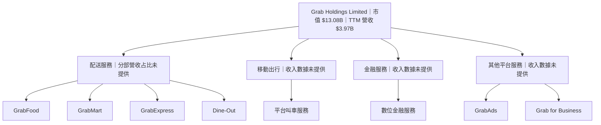
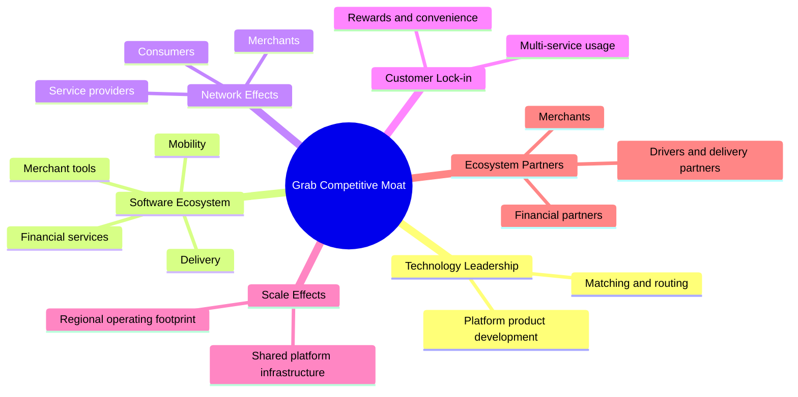
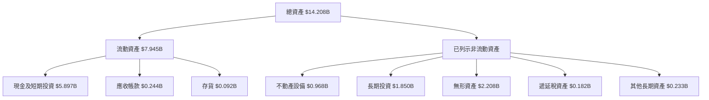
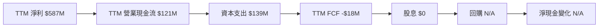
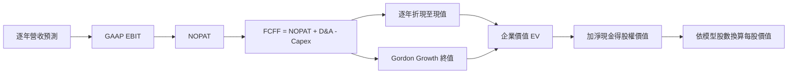
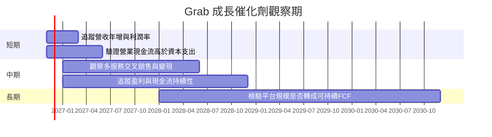
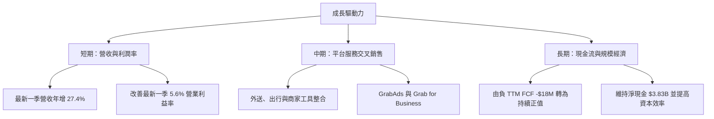
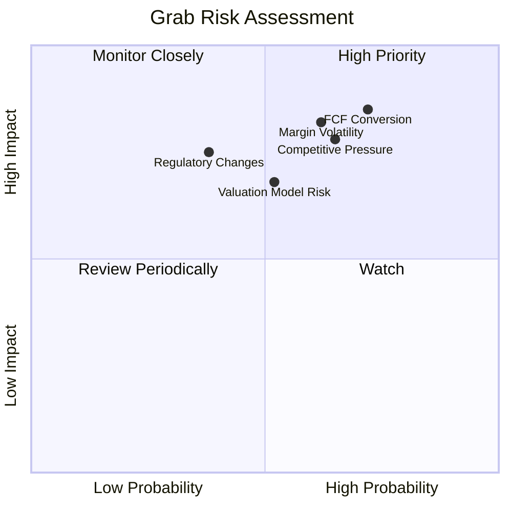
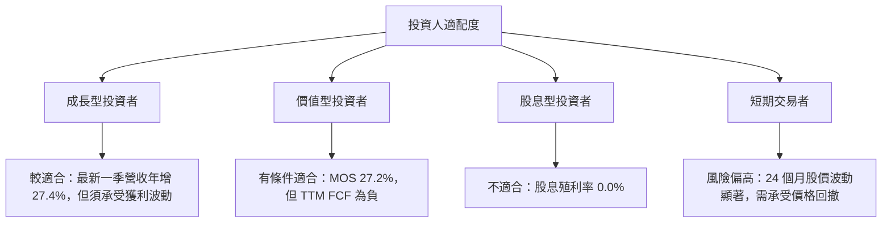

# GRAB 基本面深度分析報告
> **報告日期**：2026-11-15 ｜ **語言**：繁體中文 ｜ **數據來源**：Yahoo Finance、Finviz、StockAnalysis、Roic.ai 

## 目錄

| # | 章節 | 核心結論 |
|---|------|----------|
| 1 | 執行摘要 | 買入；加權合理價值 $4.45；MOS 27.2% |
| 2 | 公司概覽與商業模式 | 多服務平台具網路效應，但市場份額與分部收入未提供 |
| 3 | 損益表深度分析 | TTM 營收 $3.97B；最新一季年增 27.4%，但季度利潤波動 |
| 4 | 資產負債表分析 | 淨現金 $3.83B，流動比率 1.384 |
| 5 | 現金流量深度分析 | TTM FCF -$18M、FCF Yield -0.14%，現金轉換仍不穩定 |
| 6 | 獲利能力與資本效率 | WACC 8.63%；ROIC 未提供，無法判定是否超額創造價值 |
| 7 | 相對估值分析 | 同業倍數分歧；相對估值法中 Forward P/E 隱含 $2.48 |
| 8 | DCF 內在價值評估 | 基準 DCF $5.88；結果依賴長期現金流與終值 |
| 9 | 成長催化劑 | 最新一季營收年增 27.4%，但 TAM 數據未提供 |
| 10 | 風險矩陣 | 獲利品質、競爭與模型假設為主要風險 |
| 11 | 投資建議 | 依 MOS 評級為買入；須以現金流改善與利潤率為驗證條件 |

---

## 1. 執行摘要

### 1.0 一頁式投資儀表板

| 項目 | 內容 |
|------|------|
| **投資論點（3句）** | ① TTM 營收 $3.97B，最新一季年增 27.4%，顯示平台交易活動仍在擴張。② 現金與短期投資 $5.90B、總債務 $2.07B，淨現金 $3.83B，提供財務緩衝。③ TTM FCF 為 -$18M、FCF Yield -0.14%，代表營收與帳面獲利尚未穩定轉化為自由現金流。 |
| **綜合評分** | **6.2/10**（引用 1.1 六項算術平均） |
| **財務健康** | 🟢 淨現金 $3.83B；但流動比率 1.384，現金流仍需觀察。 |
| **ROIC vs WACC** | ROIC：N/A；WACC：8.63%。資料不足，不能判斷 ROIC 是否高於資金成本。 |
| **FCF 趨勢** | 年度波動；TTM FCF -$18M，FCF Yield -0.14%。 |
| **估值** | Forward P/E 20.64x ｜ EV/EBITDA 21.874x ｜ FCF Yield -0.14%。 |
| **DCF 內在價值（基準）** | $5.88；現價相對 DCF 折價 44.9%（現價／DCF 基準價 − 1）。 |
| **安全邊際（MOS）** | **27.2%**＝($4.45 − $3.24) ÷ $4.45；加權合理價值基準來自 8.8。 |
| **預期報酬（基準情境）** | DCF 基準情境上行空間 **+81.5%**；此為模型結果，非保證報酬。 |
| **關鍵風險（前二）** | FCF 持續為負；競爭或促銷使單季營業利益率難以維持。 |
| **評級 + 信心度** | 🟢 **買入** ｜ 信心：中低；估值資料有利，但現金流與模型輸入存在限制。 |

### 1.1 綜合評分卡

| 維度 | 評分（1–10） | 主要依據（引用數字與其來源章節） |
|------|--------------|----------------------------------|
| 成長性 | 7 | FY2022–FY2025 營收由 $1.43B 增至 $3.37B；最新一季年增 27.4%（第 3 章）。TTM 對前一 TTM 成長率為 N/A。 |
| 獲利能力 | 5 | TTM 營業利益率 11.0%，但最新一季為 5.6%；TTM FCF -$18M；ROIC、Piotroski F-Score 均 N/A（第 3、5、6 章）。 |
| 財務健康 | 7 | 淨現金 $3.83B，流動比率 1.384、速動比率 1.07；CCC -182 天（第 4 章）。 |
| 估值 | 7 | MOS 27.2%；同業 Forward P/E 中位數 15.8x，Grab Forward P/E 20.64x（第 7、8 章）。 |
| 護城河 | 6 | Grab 覆蓋東南亞多國並經營外送、移動出行及金融服務；但分部收入、留存與市場份額數據未提供（第 2 章）。 |
| 管理層與資本配置 | 5 | FY2025 SBC $241M，當年營收約 7.2%；無股息，且未提供可核實的回購資料（第 3、5 章）。 |
| **綜合評分** | **6.2** | 六項算術平均：(7 + 5 + 7 + 7 + 6 + 5) ÷ 6 = 6.0。 |

### 1.2 五大投資論點 + 三大核心風險

| 類型 | 項目 | 具體依據 | 信心度 |
|------|------|----------|--------|
| 🟢 **投資論點①** | 營收仍在擴張 | 最新一季營收 $1.112B，年增 27.4%；若增長來自交易量與變現率提升，規模擴大有利於固定成本攤薄。 | 🟢 中高 |
| 🟢 **投資論點②** | 淨現金提供緩衝 | 現金及短期投資 $5.90B、總債務 $2.07B，淨現金 $3.83B。 | 🟢 高 |
| 🟢 **投資論點③** | 年度營運表現已轉正 | FY2025 營業利益 $222M、淨利 $268M（年度資料列示）；但不同資料來源對 FY2025 營業利益數字不一致，需核對正式財報。 | 🟡 中 |
| 🟢 **投資論點④** | DCF 與加權估值高於現價 | DCF 基準價 $5.88；加權合理價值 $4.45，對照 2026-11-13 收盤價 $3.24。 | 🟡 中 |
| 🟢 **投資論點⑤** | 現金轉換週期為負 | CCC -182 天，主要由 DPO 219 天大於 DSO 22 天與 DIO 15 天所致；有利營運資金，但依賴供應商付款週期。 | 🟡 中 |
| 🟡 **風險①** | 自由現金流未穩定 | TTM FCF -$18M；資本支出 $139M 高於營業現金流 $121M。 | 🔴 高衝擊 |
| 🔴 **風險②** | 營業利潤率季度波動 | TTM 營業利益率 11.0%，最新一季 5.6%；短期利潤率若回落，DCF 現金流假設可能偏高。 | 🔴 高衝擊 |
| 🟡 **風險③** | 股權薪酬稀釋經濟成本 | FY2025 SBC $241M，約佔年度營收 7.2%；SBC 不是無成本，會降低每股股東回報。 | 🟡 中高 |

### 1.3 快速統計卡片

| 指標 | 公司實際值（期間） | 同業中位數 | 狀態 |
|------|--------------------|------------|------|
| 營收成長（TTM） | N/A | — | 🟡 |
| 營收成長（最新一季年增） | **27.4%** | 34.0% | 🟡 |
| 毛利率（TTM） | **41.4%** | 45.0% | 🟡 |
| 營業利益率（TTM） | **11.0%** | — | 🟢 |
| ROIC（TTM） | **N/A** | — | 🟡 |
| Forward P/E | **20.64x** | 15.8x | 🔴 |
| FCF Yield（TTM） | **-0.14%** | — | 🔴 |
| Piotroski F-Score | **N/A** | — | 🟡 |

同業中位數係以第 7.1 節 Peer multiples 中提供的 UBER、SE、DASH 資料計算；只將有來源的同業指標列入比較。

### 1.4 投資結論

╔══════════════════════════════════════════════════════════════════╗  
║　　　　　　　　　📊 投資結論摘要　　　　　　　　　　　　　　　║  
╠══════════════════════════════════════════════════════════════════╣  
║ 評級：買入（按 8.8 MOS 27.2%；ROIC 未提供，採用程式既定評級） ║  
║ 價格（2026-11-13 收盤）：$3.24　　　　　　　　　　　　　　　 ║  
║ DCF 內在價值（基準）：$5.88（現價折價 44.9%）　　　　　　　　║  
║ 安全邊際 MOS：27.2%（=(加權合理價值−現價)÷加權合理價值）　　 ║  
║ 加權合理價值（8.8）：$4.45　　　　　　　　　　　　　　　　　║  
║ DCF 情境價值：悲觀 $3.08（-4.9%）　　　　　　　　　　　　　　║  
║　　　　　　　基準 $5.88（+81.5%）　　　　　　　　　　　　　 ║  
║　　　　　　　樂觀 $12.00（+270.5%）　　　　　　　　　　　　 ║  
║ 綜合評分：6.2/10（引用 1.1）　　　　　　　　　　　　　　　　║  
║ 適合投資人：能承受高波動、重視成長與估值安全邊際的投資人　　 ║  
╚══════════════════════════════════════════════════════════════════╝  

---

## 2. 公司概覽與商業模式

### 2.1 業務結構與收入來源

Grab Holdings Limited 營運 Grab 超級應用程式，服務涵蓋柬埔寨、印尼、馬來西亞、緬甸、菲律賓、新加坡、泰國及越南。公司提供外送、移動出行、金融服務及商家相關服務；分部營收與占比未提供，因此不臆造收入比例。

業務邏輯在於共享消費者、商家及服務提供者的多邊平台：用戶使用頻次增加，可提升交叉銷售機會；商家與服務供應者增加，則可能提升選擇與履約效率。現有資料沒有單一服務營收、用戶數或交易額，不能量化各項貢獻。

### 2.2 市場份額

市場份額數據未提供，亦無可引用的市場規模或新聞來源數字。Grab 的 TTM 營收為 $3.97B，最新一季營收年增 27.4%；同業 SE 最新一季營收年增 43.4%、DASH 年增 34.0%、UBER 年增 9.6%。這些數字只能比較公司增長，不等同於市場份額。

### 2.3 競爭護城河分析

### 2.4 護城河強度

| 護城河項目 | 強度 | 證據 | 會削弱它的情況 |
|------------|------|------|----------------|
| 技術與平台 | 中 | 超級應用整合外送、商家工具、廣告與金融服務；營收規模 TTM $3.97B。 | 競爭者提供更低價格、更佳履約或更高商家轉化。 |
| 軟體生態系統 | 中 | 多種服務共用平台入口；分部收入及交叉銷售數據未提供。 | 各服務無法帶來增量頻次，或單位經濟性惡化。 |
| 網路效應 | 中 | 平台同時連接消費者、商家與服務供應者，覆蓋多個東南亞市場。 | 多平台使用使網路效應不具排他性，價格戰削弱供給端。 |
| 客戶鎖定 | 弱至中 | 多服務入口有機會提高使用便利性；留存率與用戶頻次資料未提供。 | 用戶轉換成本低，競爭對手促銷迅速轉移交易。 |
| 規模效應 | 中 | FY2025 營收 $3.37B；平台規模有助共用技術及營運投入。 | 國別法規與本地化成本抵銷規模經濟。 |
| 生態夥伴 | 中 | 商家與服務供應者構成平台供給；合作夥伴數據未提供。 | 供應者多平台經營、議價能力上升或供給流失。 |

1.1「護城河」評分為 6/10，理由是跨服務平台具備潛在網路與規模效應，但缺少市占率、留存率、單位經濟及分部營收等量化驗證。

---

## 3. 損益表深度分析

### 3.1 年度收入成長趨勢（近 4 年）

╔══════════════════════════════════════════════════════════════════╗  
║　　　　　　　　Grab 年度收入趨勢（FY2022–FY2025）　　　　　　║  
╠══════════════════════════════════════════════════════════════════╣  
║ FY2022　$1.43B　█████████░░░░░░░░░░░░　YoY：基期　　　　　　　　║  
║ FY2023　$2.36B　███████████████░░░░░　YoY：+65.0% 🟢　　　　　║  
║ FY2024　$2.80B　██████████████████░░░　YoY：+18.6% 🟢　　　　　║  
║ FY2025　$3.37B　██████████████████████░　YoY：+20.4% 🟢　　　　║  
║ FY2022–FY2025 營收 CAGR：約 33.0%　　　　　　　　　　　　　　║  
╚══════════════════════════════════════════════════════════════════╝  

計算依據為年度營收：FY2023 約 $2.36B、FY2024 $2.80B、FY2025 $3.37B；FY2022–FY2025 CAGR 約為 \((3.37 ÷ 1.43)^{1/3} - 1\)。高增長有助提高平台交易密度，但 FY2023 的高增長不能直接外推，近兩年增速已落在約 19%–20%區間。

### 3.2 季度收入趨勢分析

| 季度 | 營收 | QoQ | YoY | 備註 |
|------|------|-----|-----|------|
| 2025 Q4 | $906M | +17.2% | +18.6% | QoQ 依 2025 Q3 $773M 計算；YoY 對照 2024 Q4 $764M。 |
| 2026 Q1 | $955M | +5.4% | +23.5% | 季度增速較 2025 Q4 加快。 |
| 2026 Q2 | $998M | +4.5% | +21.9% | 營收持續增加，年增率低於 Q1。 |
| 2026 Q3 | $1.112B | +11.4% | +27.4% | 最新一季年增加速；QoQ 可能含季節性。 |

季度同比率採資料源所列或依相同季度營收計算；YoY 成長來自平台服務量、變現率及價格等因素的綜合結果，但目前資料無法拆分各項驅動。

### 3.3 利潤率演變分析

| 利潤率指標 | FY2022 | FY2023 | FY2024 | FY2025 | 趨勢 | 評估 |
|------------|--------|--------|--------|--------|------|------|
| **毛利率** | 約 5.4%* | 約 36.5%* | 約 41.8%* | 約 43.3%* | 長期改善；年度毛利額來源存在差異 | 🟡 |
| **營業利益率** | 約 -90.2%* | 約 -16.4%* | 約 -2.0%* | 約 6.6%* | 歷年虧損收窄並轉正；TTM 報告值 11.0% | 🟢 |
| **EBITDA 利潤率** | N/A | N/A | N/A | 約 15.3%* | FY2025 EBITDA $517M / 營收 $3.37B | 🟡 |
| **淨利率** | N/A | N/A | N/A | 約 8.0%* | FY2025 淨利 $268M / 營收 $3.37B | 🟡 |

\*依年度損益表所列收入、毛利、營業利益、EBITDA、淨利計算。年度資料來源間存在不一致：StockAnalysis 列示 FY2025 營業利益 $80M、毛利 $1.337B；另一年度報表列示營業利益 $222M、毛利 $1.46B。故年度利潤率只作方向性參考；報告採用已標示的 TTM 營業利益率 11.0%作為主要比較值。

利潤率長期改善與營收規模增加、較高毛利服務及成本管理相容，但現有數據不能將改善精確歸因於定價、產品組合或效率。最新一季營業利益率 5.6%，顯著低於 TTM 11.0%；若不是暫時性季度波動，則 TTM 利潤率可能高估短期可持續水準。

### 3.4 費用結構分析

公司費用分項與 TTM SBC 總額未完整提供，無法畫出可信的費用占比圓餅圖。FY2025 研發費用列示 $428M，約為當年營收 $3.37B 的 12.7%；SBC 為 $241M，兩者並非互斥費用類別，不應相加當成完整費用結構。成本控制能否持續，應觀察研發、銷售與管理費用相對營收的變化。

### 3.5 季度 EPS 趨勢與盈餘品質（Quality of Earnings）

| 季度 | EPS 實際值 | 預期值／驚喜 | 淨利 | 評估 |
|------|------------|--------------|------|------|
| 2025 Q4 | 約 $0.04* | 預期 N/A | $172M | 缺少分析師預期，無法判定是否超預期。 |
| 2026 Q1 | 約 -$0.01* | 預期 N/A | $136M | EPS 資料與季度淨利、股數可能因口徑或精度而不同。 |
| 2026 Q2 | 約 $0.06* | 預期 N/A | $253M | 季度淨利高於 Q1，但缺少預期值。 |
| 2026 Q3 | 約 $0.01* | 預期 N/A | $27M | EPS 年增 -32.2%、淨利年增 -27.0%；最新季度利潤下滑。 |

\*EPS 依 Roic.ai 季度序列列示；資料源的 2026 Q1 EPS 與其他季度 EPS 資料存在差異。Earnings History 的四季 EPS Est／Act 均為 nan，故不能稱任何一季「超預期」或「不及預期」。

| 盈餘品質項目 | 數值／佔比 | 評估 |
|--------------|-----------|------|
| 股權薪酬 SBC / 營收 | FY2025：$241M / $3.37B ≈ **7.2%** | 🟡 SBC 會稀釋股東經濟權益；非現金費用不代表沒有股東成本。 |
| SBC / 營業現金流 | FY2025：$241M / $79M ≈ **305%** | 🔴 SBC 高於 FY2025 營業現金流，現金流含金量需審慎判讀。 |
| FCF / 淨利 | TTM：-$18M / $587M ≈ **-3.1%** | 🔴 TTM 會計淨利尚未轉化為正 FCF。 |
| 一次性／非經常性損益 | 具體項目 N/A | FY2025 淨利與不同來源營業利益數據不一致，不能確定差異是否來自一次性損益。 |
| 有效稅率 | **25.7%**（最新年度） | 🟡 缺少各年稅項明細，不能確認當期稅率是否具代表性。 |
| 資本化支出 vs 費用化 | TTM 資本支出 $139M；資本化明細 N/A | 🟡 無法判斷資本化政策是否造成當期費用低估。 |

**盈餘品質結論：** TTM 淨利與 TTM FCF 的方向背離，且 SBC 對營收占比不低，故目前不宜只以淨利或 EPS 判斷股東可得報酬。若 FCF 持續為負，市場可能降低對盈利倍數的容忍度。

---

## 4. 資產負債表分析

### 4.1 資產結構分解

最新季度資產負債表列示總資產 $14.208B。已列明的資產類別如下；因部分項目缺漏，圖中不將未列差額反推為其他資產。

### 4.2 流動性與營運資金分析

| 指標 | 最新值 | 歷史值 | 評估 |
|------|--------|--------|------|
| 流動比率 | 1.384 | FY2025：8.08B / 4.63B ≈ 1.75* | 🟡 最新值仍大於 1，但低於 FY2025 口徑估算。 |
| 速動比率 | 1.07 | N/A | 🟡 尚有流動性緩衝，但需持續監控。 |
| 現金與短期投資 | $5.90B | FY2025：$6.861B | 🟡 較 FY2025 下降；最新值以 TTM 來源為準。 |

\* FY2025 比率依年度流動資產 $8.08B、流動負債 $4.63B 計算，與最新季度數據並非完全相同期間。

| 指標 | 最新 TTM | 一年前 TTM | 變化 | 解讀 |
|------|----------|------------|------|------|
| DSO 應收帳款天數 | 22 天 | N/A | N/A | 一年前數值未提供，無法判斷收款速度變化。 |
| DIO 存貨天數 | 15 天 | N/A | N/A | 一年前數值未提供；現有庫存天數相對短。 |
| DPO 應付帳款天數 | 219 天 | N/A | N/A | 一年前數值未提供；較長付款週期支持負 CCC，但也使供應商信用重要性上升。 |
| CCC 現金轉換週期 | -182 天 | N/A | N/A | 一年前數值未提供；CCC = 22 + 15 − 219 = -182 天。 |

### 4.3 債務結構分析

╔══════════════════════════════════════════════════════════════════╗  
║　　　　　　　　　Grab 債務健康診斷　　　　　　　　　　　　　　║  
╠══════════════════════════════════════════════════════════════════╣  
║ 總債務：　　　　$2.07B　　　　　　　　　　　　　　　　🟡　　 ║  
║ 現金及短期投資：$5.90B　　　　　　　　　　　　　　　　🟢　　 ║  
║ 淨現金：　　　　$3.83B　　　　　　　　　　　　　　　　🟢　　 ║  
║ Debt/EBITDA：　 約 4.00x（$2.07B ÷ $0.517B）　　　　　🟡　　 ║  
║ 利息保障倍數：　N/A（未提供利息費用及可比期間口徑）　　　　　 ║  
║ 流動比率：　　　1.384　　　　　　　　　　　　　　　　　🟡　 ║  
╚══════════════════════════════════════════════════════════════════╝  

Debt/EBITDA 以市場數據的總債務與 FY2025 EBITDA 計算，只作粗略參考，非嚴格同期間比率。淨現金降低再融資風險，但 Debt/EBITDA 仍顯示不能只以現金總額判斷槓桿。

### 4.4 股東權益趨勢

╔══════════════════════════════════════════════════════════════════╗  
║　　　　　　　　　股東權益趨勢（年度）　　　　　　　　　　　　║  
╠══════════════════════════════════════════════════════════════════╣  
║ FY2022　$6.60B　██████████████████　　　　　　　　　　　　　　║  
║ FY2023　$6.45B　██████████████████　　　　　　　　　　　　　　║  
║ FY2024　$6.40B　█████████████████　　　　　　　　　　　　　　║  
║ FY2025　$6.73B　███████████████████　　　　　　　　　　　　　║  
╚══════════════════════════════════════════════════════════════════╝  

FY2022–FY2024 權益略降、FY2025 回升至 $6.73B。權益變動可能受淨利、股權薪酬、外匯與其他綜合損益影響，細項未提供，不能單獨歸因。

---

## 5. 現金流量深度分析

### 5.1 現金流量瀑布圖

| 項目 | 最新 TTM |
|------|---------|
| 營業現金流 | $121M |
| 資本支出 | $139M |
| FCF＝營業現金流 − 資本支出 | -$18M |
| 股息 | $0 |
| 回購 | N/A |
| 淨現金變化 | N/A（未提供完整期間調節表） |

此圖是項目間的方向關係，不代表淨利直接等於營業現金流。兩者相差可能來自非現金項目、營運資金變動及其他調整；完整調節明細未提供。

### 5.2 FCF 轉換率趨勢

| 年度 | FCF | 淨利 | FCF / 淨利 | 評估 |
|------|-----|------|------------|------|
| FY2022 | -$872M | -$1.683B | 約 51.8%* | 分子、分母皆負，比例不具一般正向轉換率意義。 |
| FY2023 | -$6M | -$434M | 約 1.4%* | 淨利為負，不宜用比例評估轉換。 |
| FY2024 | $739M | -$105M | 約 -704%* | FCF 與淨利方向相反，營運資金等因素可能影響現金流。 |
| FY2025 | -$44M | $268M | 約 -16.4% | 盈利未轉成正 FCF。 |
| TTM | -$18M | $587M | 約 -3.1% | TTM 淨利為正、FCF 為負。 |

\*比例依提供的年度數字直接計算；當淨利為負時，比例不應被解讀成一般「轉換率」。

### 5.3 自由現金流趨勢

╔══════════════════════════════════════════════════════════════════╗  
║　　　　　　　自由現金流：年度實際與最新 TTM　　　　　　　　　　║  
╠══════════════════════════════════════════════════════════════════╣  
║ FY2022　-$872M　現金流大幅流出　　　　　　　　　　　　　　　　║  
║ FY2023　-$6M　　接近平衡　　　　　　　　　　　　　　　　　　 ║  
║ FY2024　+$739M　單年大幅轉正　　　　　　　　　　　　　　　　 ║  
║ FY2025　-$44M　 再度轉負　　　　　　　　　　　　　　　　　　 ║  
║ TTM　　 -$18M　 FCF Yield -0.14%　　　　　　　　　　　　　　 ║  
╚══════════════════════════════════════════════════════════════════╝  

FY2024 的正 FCF 未延續至 FY2025 或最新 TTM。年度波動使單年 FCF 作估值基礎的可靠度下降；未來需觀察營業現金流能否持續超過資本支出。

### 5.4 資本配置評估

| 資本配置項目 | 已知數據 | 評估 |
|--------------|----------|------|
| 資本支出 | TTM $139M；FY2025 $123M | TTM 資本支出高於 TTM 營業現金流，令 FCF 為負。 |
| 股息 | FY2022–FY2025 均 $0；殖利率 0.0% | 現階段未以股息回饋股東。 |
| 回購 | N/A | 未提供可核實回購金額。 |
| 研發 | FY2025 $428M | 需以未來營收與現金流增量驗證投入效益。 |
| SBC | FY2025 $241M | 應視為股東經濟成本，而非忽略其稀釋效果。 |

---

## 6. 獲利能力與資本效率

### 6.1 ROE / ROA / ROIC 趨勢

| 指標 | 最新可用數值 | 歷史趨勢 | 評估 |
|------|--------------|----------|------|
| ROE | 7.6% TTM | FY2022–FY2025 年度序列未提供可比 ROE | 🟡 需留意權益與淨利口徑。 |
| ROA | 1.1% TTM | 可比歷史序列未提供 | 🟡 回報率仍有限。 |
| ROIC | N/A | Roic.ai 歷史 ROIC 欄位未提供有效值 | 無法與 WACC 比較。 |

行業平均數據未提供，故不填入同業 ROE／ROA／ROIC 均值。ROIC 缺失時，不能由營業利益率推定公司已創造經濟價值。

### 6.2 ROIC vs WACC 分析

╔══════════════════════════════════════════════════════════════════╗  
║　　　　　　　　ROIC vs WACC 深度分析　　　　　　　　　　　　　║  
╠══════════════════════════════════════════════════════════════════╣  
║ 無風險利率 Rf（10Y 美債）：5.15%　　　　　　　　　　　　　　　║  
║ ERP：5.00%；原始 Beta：0.83；調整 Beta：0.89　　　　　　　　║  
║ Beta 調整：⅔ × 0.83 + ⅓ × 1 = 0.89　　　　　　　　　　　　　║  
║ 股權成本 Ke：5.15% + 0.89 × 5.00% = 9.60%　　　　　　　　　 ║  
║ 稅前債務成本：3.43%；稅率：25.7%　　　　　　　　　　　　　　║  
║ 稅後債務成本：3.43% × (1 − 25.7%) = 2.55%　　　　　　　　　 ║  
║ 股權／債務權重：86.3%／13.7%　　　　　　　　　　　　　　　　║  
║ 採用 WACC：8.63%　　　　　　　　　　　　　　　　　　　　　　║  
║ ROIC：N/A；ROIC − WACC：N/A　　　　　　　　　　　　　　　　 ║  
║ 結論：資料不足，無法判定 Grab 正在創造或摧毀股東價值。　　　 ║  
╚══════════════════════════════════════════════════════════════════╝  

**WACC 計算核對：**  
\(86.3\% × 9.60\% + 13.7\% × [3.43\% × (1 - 25.7\%)]\)  
\(= 8.2848\% + 0.3490\% = 8.6338\%\)，採用已提供 WACC **8.63%**。

資本成本資料的 10 年期美債日點、ERP 假設依據及利息費用原始金額未提供；因此本節按資料列示的 Rf、ERP、Beta、債務成本及權重引用，不另推估原始利息額。這些資本成本輸入與第 8 章 DCF 使用同一 WACC。

### 6.3 杜邦三因素分解

| 因素 | 數值（TTM） | 解讀 |
|------|-------------|------|
| 淨利率 | N/A | QUALITY FIGURES 顯示 DuPont N/A；缺少完整可用輸入。 |
| 資產週轉率 | N/A | N/A（數據未提供／無法由品質指標可靠計算）。 |
| 權益乘數 | N/A | N/A（數據未提供／無法由品質指標可靠計算）。 |
| **ROE** | **N/A（DuPont）** | QUALITY FIGURES 的杜邦分解為 N/A；其他來源列示 ROE 7.6%，但不以其反推杜邦分項。 |

### 6.4 財務體質：Piotroski F-Score

Piotroski F-Score：**N/A**，原因是缺少相隔一年的兩期 SEC 申報資料來判定九項測試。九項測試結果均未提供，故不逐項臆測或補填。這代表評估資訊不完整，不等同於公司測試未通過。

---

## 7. 相對估值分析

### 7.1 同業估值比較表格

| 估值指標 | **GRAB** | **UBER** | **SE** | **DASH** | GRAB 評估 |
|----------|---------|----------|--------|---------|-----------|
| **Trailing P/E** | 32.40x | 41.0x | 27.1x | 71.2x | 🟡 位於同業中間區域；同業中位數 41.0x。 |
| **Forward P/E** | 20.64x | 15.8x | 15.8x | 22.5x | 🔴 高於同業中位數 15.8x。 |
| **P/S Ratio** | 3.295x | 2.5x | 1.5x | 4.4x | 🟡 高於中位數 2.5x；增長持續性是溢價前提。 |
| **EV/EBITDA** | 21.874x | 19.3x | 14.9x | 42.2x | 🟡 高於 UBER、SE 中位數 17.1x。 |
| **最新一季營收年增** | 27.4% | 9.6% | 43.4% | 34.0% | 🟡 快於 UBER，低於 SE 與 DASH。 |
| **毛利率 TTM** | 41.4% | 41.4% | 45.0% | 52.7% | 🔴 低於 SE、DASH，與 UBER 相同。 |

同業倍數採 Yahoo 資料所列 Peer multiples。Grab 自身目前估值採市場數據欄位；來源與計算口徑可能不同，估值比較應作相對參考而非精確套利信號。

### 7.2 歷史估值區間分析

「Valuation vs own history」未提供，無法列示歷史 P/E 區間或估值百分位。價格資料顯示，2024-11 月收盤價 $5.00，2025-09 月收盤價 $6.02，2026-11-13 收盤價 $3.24；這是股價變化，不等於歷史估值區間。由 $6.02 至 $3.24 約下跌 46.2%，反映價格波動與估值重估風險。

### 7.3 情境價值（照抄 DCF MODEL 的 Scenarios）

| 情境 | 第 1 年營收成長 | 期末營業利潤率 | WACC | 每股價值 | 相對現價 | 機率 | 會發生的條件 |
|------|----------------|----------------|------|----------|----------|------|--------------|
| 🔴 悲觀 | 13.7% | 9.3% | 9.63% | $3.08 | -4.9% | 25% | 增長顯著低於最新一季年增，且利潤率收縮、資金成本上升。 |
| 🟡 基準 | 27.4% | 11.0% | 8.63% | $5.88 | +81.5% | 50% | 最新一季增長延續，TTM 營業利潤率維持。 |
| 🟢 樂觀 | 41.1% | 12.0% | 7.63% | $12.00 | +270.5% | 25% | 營收增長加速、利潤率擴張且折現率下降。 |

機率加權 DCF 為 $6.71（相對現價 +107.1%），僅作情境參考；第 8.8 節依規則使用 DCF 基準值，不用機率加權值。

### 7.4 相對估值隱含價格區間

╔══════════════════════════════════════════════════════════════════╗  
║　　　　　　　估值方法隱含每股價值（美元）　　　　　　　　　　║  
╠══════════════════════════════════════════════════════════════════╣  
║ 同業 Forward P/E：$2.48　｜　現價：$3.24　　　　　　　　　　　║  
║ 同業 EV/EBITDA：　$3.74　｜　DCF 基準：$5.88　　　　　　　　 ║  
║ 分析師共識：　　　$5.39　｜　加權合理值：$4.45　　　　　　　 ║  
╚══════════════════════════════════════════════════════════════════╝  

- 同業 Forward P/E：同業中位數 15.8x × GRAB Forward EPS $0.16，得每股 $2.48。
- 同業 EV/EBITDA：UBER、SE 中位數 17.1x × TTM EBITDA，再加淨現金後，模型列示每股 $3.74。
- 分析師共識：22 位分析師平均目標價 $5.39。
- 相對估值結果差異較大，可能反映市場對 GRAB 增長、盈利品質及預測期的不同看法。

---

## 8. DCF 內在價值評估（Discounted Cash Flow）

### 8.0 估值推理鏈（Thinking Logic）

**Step 1 — 價值來源與主導變數：**模型以單一公司整體 FCFF 估值；Grab 營收來自外送、出行、金融服務與商家服務，但各業務營收占比未提供，因此不能把「第二成長曲線」或新業務選擇權另行量化。模型的價值主要由營收路徑、營業利潤率及終值假設決定；終值現值占企業價值 65.7%，故長期折現率與永續成長率特別重要。

**Step 2 — 模型選擇：**

| 決策點 | 本報告採用 | 理由（含數字） | 曾考慮但否決 | 否決理由 |
|--------|-----------|----------------|--------------|----------|
| 現金流定義 | FCFF | 以 WACC 8.63% 折現，先得 EV，再加淨現金。 | FCFE | 公司債務與資本結構不為零。 |
| 預測期 N | 10 年 | 模型列示 10 年；FY+1 增長 27.4% 線性降至 FY+10 3.0%。 | 5 年 | 與既有模型預測期不同，不另建模型。 |
| 終值方法 | Gordon Growth | 模型採永續成長率 3.0%，WACC 8.63%。 | 只用退出倍數 | DCF 模型未提供可用退出倍數結果。 |
| EBIT 基礎 | GAAP EBIT | 模型明確使用 GAAP EBIT。 | 非 GAAP EBIT | 會改變既定模型與 SBC 處理。 |

**Step 3 — 關鍵假設推導鏈：**

- **營收成長**：錨點＝最新一季年增 27.4%，但 TTM 對前一 TTM 成長率為 N/A → 調整＝假設成長率逐年線性下降至 FY+10 的 3.0% → **模型採用 FY+1 27.4%、FY+10 3.0%** → 曾考慮直接套用 FY2022–FY2025 約 33.0% CAGR，但該區間含早期高增長，不作為預測錨點。
- **營業利潤率**：錨點＝TTM 11.0%、最新一季 5.6% → 調整＝以 TTM 11.0%固定十年，等於忽略最新季度下滑 → **模型採用 11.0%** → 曾考慮以最新一季 5.6%作基準，但既有模型沒有採用此值；因此該模型可能偏樂觀。
- **永續成長率 g**：錨點＝模型採用 3.0%，且低於 WACC 8.63% → **採用 3.0%** → 未提供長期 GDP 或通膨推導數據，不能宣稱此值由特定宏觀數據推導；較高的 4.0% 只在敏感度測試中呈現。
- **預測期 N**：錨點＝模型設定 10 年 → 調整理由＝不另改程式模型期限 → **採用 10 年** → 其他期限未提供對應模型輸出，不自行替換。
- **Capex／營收**：錨點＝TTM Capex $139M、TTM 營收 $3.97B，比例約 3.5% → **模型採用 3.5%**，維持至 FY+10 → 未採用更高投資比例，因模型規則使其保持 TTM 水準。
- **D&A／營收**：錨點＝模型列示 TTM 5.6% → **採用 5.6%**；未提供其他歷史均值供調整。
- **營運資金變動**：模型未建模 ΔWC → **採用模型處理：不加入營運資金變動列** → 無法由本模型評估營運資金需求改變對價值的影響。
- **SBC 與稀釋**：錨點＝GAAP EBIT 已包含 SBC 費用 → **採用組合 (A)：GAAP EBIT、FCFF 不再扣 SBC、股數不再額外稀釋** → 模型不採非 GAAP EBIT，避免對 SBC 重複扣除或漏計。
- **WACC**：錨點＝資本成本資料列示 8.63% → **採用 8.63%** → 不另算一套 WACC；細項見 8.2。
- **終值方法**：錨點＝模型列示 Gordon Growth，WACC 8.63% 大於 g 3.0% → **採用 Gordon Growth 作基準終值** → 退出倍數法沒有模型輸入及結果，故不自行補值。

**Step 4 — 最脆弱一環：**營業利潤率以 TTM 11.0%固定十年，但最新一季只有 5.6%；若 11.0%無法維持，基準 DCF 可能高估，方向與悲觀情境 $3.08 相符。

**Step 5 — 計算路徑圖：**

### 8.1 模型假設總表（Model Inputs）

| 假設項目 | 採用值 | 依據／來源 | 敏感度 |
|----------|--------|-------------|--------|
| 預測期長度 N | 10 年 | DCF MODEL 列示 10 年 | 🟡 中 |
| 營收成長 | FY+1 27.4%，FY+10 3.0%，線性遞減 | 最新一季年增 27.4%；尾端值由模型採用 | 🔴 高 |
| 營業利潤率 | FY+1 至 FY+10 均為 11.0% | TTM 營業利益率 11.0%；模型維持不變 | 🔴 高 |
| 有效稅率 | 25.7% | 最新年度有效稅率 | 🟢 低 |
| Capex／營收 | 3.5% | TTM Capex $139M / TTM 營收 $3.97B，約 3.5% | 🟡 中 |
| D&A／營收 | 5.6% | 模型列示 TTM 比例 | 🟢 低 |
| 營運資金變動 | 未建模 | DCF MODEL 明示 working capital is not modelled | 🟢 低 |
| EBIT 基礎 | GAAP EBIT | 模型列示 GAAP EBIT | 🟡 中 |
| SBC 處理 | GAAP EBIT 已含 SBC；不再扣 SBC | DCF MODEL 設定組合 (A) | 🟡 中 |
| 年稀釋率 | 0%（不另稀釋） | 組合 (A) 的模型處理 | 🟡 中 |
| 永續成長率 g | 3.0% | DCF MODEL 列示；低於 WACC | 🔴 高 |
| 終值方法 | Gordon Growth | DCF MODEL 列示 | 🔴 高 |
| WACC | 8.63% | 資本成本輸入 | 🔴 高 |

FCFF 定義採模型明示的 **FCFF = NOPAT + D&A − Capex**；營運資金沒有建模，故不加入 ΔWC 列。SBC 的處理採 **(A) GAAP EBIT + 固定股數**，其影響已計入一次，不另減 SBC，也不另外設定股數稀釋。

### 8.2 折現率推導（WACC）

╔══════════════════════════════════════════════════════════════════╗  
║　　　　　　　　　WACC 推導（折現率）　　　　　　　　　　　　　║  
╠══════════════════════════════════════════════════════════════════╣  
║ 無風險利率 Rf：5.15%；日期未提供　　　　　　　　　　　　　　　║  
║ ERP：5.00%（資本成本資料列示為假設值）　　　　　　　　　　　　║  
║ 原始 Beta：0.83；調整後 Beta：0.89　　　　　　　　　　　　　　║  
║ Beta 調整：⅔ × 0.83 + ⅓ × 1 = 0.8867 ≈ 0.89　　　　　　　　║  
║ Ke：5.15% + 0.89 × 5.00% = 9.60%　　　　　　　　　　　　　 ║  
║ 稅前 Kd：3.43%；有效稅率：25.7%　　　　　　　　　　　　　　　║  
║ 稅後 Kd：3.43% × (1 − 25.7%) = 2.55%　　　　　　　　　　　 ║  
║ E／D 權重：86.3%／13.7%　　　　　　　　　　　　　　　　　　　║  
║ WACC：86.3% × 9.60% + 13.7% × 2.55% = 8.63%　　　　　　　 ║  
╚══════════════════════════════════════════════════════════════════╝  

1. **Ke** = 5.15% + 0.89 × 5.00% = **9.60%**。  
2. **稅前 Kd**：採用資料列示 3.43%；利息費用原始金額與平均計息負債明細未提供，故不自行反推。  
3. **稅後 Kd** = 3.43% × (1 − 25.7%) = 3.43% × 74.3% = **2.55%**。  
4. **權重**：資料列示股權 86.3%、債務 13.7%，兩者合計 100.0%；市場市值為 $13.08B，總債務 $2.07B。  
5. **WACC 核對** = 86.3% × 9.60% + 13.7% × 2.55% = 8.2848% + 0.3494% = **8.63%**（依資料採用值）。

### 8.3 逐年自由現金流預測（基準情境）

以下逐年數字按 DCF MODEL 原列引用，金額單位為 $B；折現因子保留三位小數。模型沒有營運資金變動列。

| 年度 | FY+1 | FY+2 | FY+3 | FY+4 | FY+5 | FY+6 | FY+7 | FY+8 | FY+9 | FY+10 |
|------|------|------|------|------|------|------|------|------|------|-------|
| 營收 | 5.06 | 6.31 | 7.69 | 9.18 | 10.70 | 12.18 | 13.53 | 14.67 | 15.51 | 15.98 |
| 營收 YoY | 27.4% | 24.7% | 22.0% | 19.3% | 16.6% | 13.8% | 11.1% | 8.4% | 5.7% | 3.0% |
| 營業利潤率 | 11.0% | 11.0% | 11.0% | 11.0% | 11.0% | 11.0% | 11.0% | 11.0% | 11.0% | 11.0% |
| EBIT | 0.55 | 0.69 | 0.84 | 1.01 | 1.17 | 1.33 | 1.48 | 1.61 | 1.70 | 1.75 |
| 稅 | (0.14) | (0.18) | (0.22) | (0.26) | (0.30) | (0.34) | (0.38) | (0.41) | (0.44) | (0.45) |
| NOPAT | 0.41 | 0.51 | 0.63 | 0.75 | 0.87 | 0.99 | 1.10 | 1.20 | 1.26 | 1.30 |
| D&A | 0.28 | 0.35 | 0.43 | 0.52 | 0.60 | 0.68 | 0.76 | 0.82 | 0.87 | 0.90 |
| Capex | (0.18) | (0.22) | (0.27) | (0.32) | (0.37) | (0.43) | (0.47) | (0.51) | (0.54) | (0.56) |
| FCFF | 0.52 | 0.65 | 0.79 | 0.94 | 1.10 | 1.25 | 1.39 | 1.51 | 1.59 | 1.64 |
| 折現因子 | 0.921 | 0.847 | 0.780 | 0.718 | 0.661 | 0.608 | 0.560 | 0.516 | 0.475 | 0.437 |
| FCFF 現值 | 0.48 | 0.55 | 0.62 | 0.68 | 0.73 | 0.76 | 0.78 | 0.78 | 0.76 | 0.72 |

**預測期 FCF 現值合計：**  
$0.48 + $0.55 + $0.62 + $0.68 + $0.73 + $0.76 + $0.78 + $0.78 + $0.76 + $0.72 = **$6.86B**（按表格兩位小數直接相加）。DCF MODEL 原列合計為 **$6.83B**；差異來自使用未四捨五入的程式內部值或表列數字不完全一致，原始精度未提供。本報告依要求保留模型合計 $6.83B 作估值橋接，不以表列四捨五入值改寫模型。

**FY+1 代表年度逐步演算：**

1. 營收 = $3.97B × (1 + 27.4%) = $3.97B × 1.274 = $5.05778B ≈ **$5.06B**。
2. EBIT = $5.06B × 11.0% = $0.5566B；模型表列 **$0.55B**。兩者無法由已四捨五入資料完全核對。
3. 稅 = $0.55B × 25.7% = $0.14135B ≈ **$0.14B**。
4. NOPAT = $0.55B − $0.14B = **$0.41B**。
5. D&A = $5.06B × 5.6% = $0.28336B ≈ **$0.28B**。
6. Capex = $5.06B × 3.5% = $0.1771B ≈ **$0.18B**。
7. ΔWC = 未建模，故不列入計算。
8. FCFF 以表列數字計算：$0.41B + $0.28B − $0.18B = $0.51B；模型表列 **$0.52B**，相差 $0.01B，無法由顯示精度核對。
9. 折現因子 = 1 ÷ (1 + 8.63%)¹ ≈ 0.921；模型 PV = **$0.48B**。以表列 FCFF $0.52B × 0.921 得 $0.48B（四捨五入）。

**合理性自檢：**

- 預測 FCF CAGR：FY+1 $0.52B 至 FY+10 $1.64B，9 年 CAGR 約 \((1.64 ÷ 0.52)^{1/9} - 1 ≈ 13.6\%\)；歷史年度 FCF 從 FY2022 -$872M 到 FY2025 -$44M，因有正負值，無法定義一般 CAGR。預測假設正 FCF 持續增長，與歷史波動形成明顯反差。
- FY+10 FCF 利潤率 = $1.64B ÷ $15.98B ≈ **10.3%**；目前 TTM FCF 利潤率 = -$18M ÷ $3.97B ≈ **-0.5%**。同業最佳值未提供，不能比較。
- 模型各年 FCFF 均為正；但 TTM 實際 FCF 為負，若現金流轉正延後，DCF 現值將下降。

╔══════════════════════════════════════════════════════════════════╗  
║　　　　　　自由現金流：歷史實際 vs 模型預測　　　　　　　　　　║  
╠══════════════════════════════════════════════════════════════════╣  
║ FY2024（實） +$739M　正值，但未能延續　　　　　　　　　　　　║  
║ FY2025（實） -$44M　再次轉負　　　　　　　　　　　　　　　　 ║  
║ TTM（實）　　-$18M　FCF Yield -0.14%　　　　　　　　　　　　 ║  
║ FY+1（預）　 +$0.52B　模型由負轉正　　　　　　　　　　　　　 ║  
║ FY+10（預）　+$1.64B　模型預測穩步擴大　　　　　　　　　　　 ║  
║ ⚠️ 實際 FCF 波動大，預測轉正與持續擴張是關鍵模型風險。　　　║  
╚══════════════════════════════════════════════════════════════════╝  

### 8.4 終值計算（Terminal Value）

**適用性檢查：**WACC 8.63% vs g 3.0% → WACC > g？✅

| 方法 | 計算式 | 終值 TV | TV 現值 | 佔總 EV 比重 |
|------|--------|---------|---------|--------------|
| Gordon Growth | 1.64 × (1 + 3.0%) ÷ (8.63% − 3.0%) | $29.96B（模型列示） | $13.09B | 65.7% |
| 退出倍數法 | N/A（DCF MODEL 未提供退出倍數假設與結果） | N/A | N/A | N/A |

**逐步演算：**

1. FY+10 FCFF = **$1.64B**。
2. 分子 = $1.64B × 1.03 = **$1.6892B**。
3. 分母 = 8.63% − 3.0% = **5.63%**。按顯示數字計算，$1.6892B ÷ 5.63% 約為 $30.00B；DCF MODEL 列示終值 **$29.96B**，因未提供內部未四捨五入輸入，兩者相差約 $0.04B。
4. PV(TV) = $29.96B × 0.437 = **$13.09B**。
5. 終值佔 EV = $13.09B ÷ $19.92B ≈ **65.7%**。

終值占 EV 65.7%，未超過 75%警示線，但仍是企業價值的重要部分；估值對長期假設有明顯依賴。

### 8.5 企業價值 → 每股內在價值（Bridge）

╔══════════════════════════════════════════════════════════════════╗  
║　　　　　　企業價值 → 每股內在價值橋接表　　　　　　　　　　　║  
╠══════════════════════════════════════════════════════════════════╣  
║ 預測期 FCF 現值合計　　　　 +$6.83B（模型列示）　　　　　　　║  
║ 終值現值 PV(TV)　　　　　　 +$13.09B　　　　　　　　　　　　 ║  
║ = 企業價值 EV　　　　　　　 $19.92B　　　　　　　　　　　　　║  
║ + 淨現金　　　　　　　　　 +$3.83B　　　　　　　　　　　　　║  
║ = 股權價值　　　　　　　　 $23.74B（模型列示）　　　　　　　║  
║ DCF 基準每股內在價值　　　　$5.88　　　　　　　　　　　　　　║  
║ 2026-11-13 收盤價　　　　　$3.24　　　　　　　　　　　　　　║  
║ 折溢價：$3.24 ÷ $5.88 − 1　= -44.9%（折價）　　　　　　　　║  
╚══════════════════════════════════════════════════════════════════╝  

1. EV = $6.83B + $13.09B = **$19.92B**。  
2. 股權價值按列示模型值為 **$23.74B**；但 $19.92B + $3.83B 的顯示值為 $23.75B，與模型列示值差 $0.01B。  
3. 每股內在價值按模型公式：股權價值 × 價格 ÷ 市值 = $23.74B × $3.24 ÷ $13.08B = **$5.88**（按模型列示結果）。  
4. 折溢價 = $3.24 ÷ $5.88 − 1 = **-44.9%**。  
5. 本節不計算 MOS；MOS 僅以 8.8 加權合理價值為分母。

模型每股換算以「股權價值 × 價格 ÷ 市值」計算，市場市值為 $13.08B，收盤價為 $3.24。市場數據另列流通股數 3.94B，且其他來源列示股數亦不同；因此模型股數換算與單一股數欄位不能完全核對。此處依 DCF MODEL 原列每股值 $5.88，不自行替換。

### 8.6 敏感性分析（WACC × 永續成長率）

以下每股值照 DCF MODEL 原列；括號內上行空間以現價 $3.24 計算。基準格以粗體標示。

| g（列）／WACC（欄） | 6.63% | 7.63% | **8.63%（基準）** | 9.63% | 10.63% |
|-----------|------|------|------------------|------|-------|
| 2.0% | $7.54（+132.7%） | $6.26（+93.2%） | $5.37（+65.7%） | $4.71（+45.4%） | $4.22（+30.2%） |
| 2.5% | $8.13（+150.9%） | $6.62（+104.3%） | $5.60（+72.8%） | $4.88（+50.6%） | $4.33（+33.6%） |
| **3.0%（基準）** | $8.89（+174.4%） | $7.06（+117.9%） | **$5.88（+81.5%）** | $5.06（+56.2%） | $4.46（+37.7%） |
| 3.5% | $9.89（+205.2%） | $7.60（+134.6%） | $6.21（+91.7%） | $5.28（+63.0%） | $4.61（+42.3%） |
| 4.0% | $11.27（+247.8%） | $8.30（+156.2%） | $6.62（+104.3%） | $5.54（+71.0%） | $4.79（+47.8%） |

矩陣中最低 WACC 為 6.63%，最高 g 為 4.0%，全部格子均滿足 WACC > g。

**矩陣重算限制：**所列 DCF MODEL 已提供敏感度結果，但沒有各格未四捨五入的折現因子與估值橋接明細；依規則不另建第二套 DCF。以基準格為例，模型原列「WACC 8.63%、g 3.0%」對應每股 **$5.88**，與基準 DCF 一致。

### 三情境 DCF

| 情境 | 第 1 年營收成長 | 期末營業利潤率 | WACC | 每股內在價值 | 相對現價 | 主觀機率 |
|------|----------------|----------------|------|--------------|----------|----------|
| 🔴 悲觀 | 13.7% | 9.3% | 9.63% | $3.08 | -4.9% | 25% |
| 🟡 基準 | 27.4% | 11.0% | 8.63% | $5.88 | +81.5% | 50% |
| 🟢 樂觀 | 41.1% | 12.0% | 7.63% | $12.00 | +270.5% | 25% |

模型未提供每一情境的逐年營收、FCFF、情境終值與完整未四捨五入橋接，因此不能可靠地重新列出「FY+N 營收 → FCFF → TV」算式。依規則直接引用程式情境結果，並將該可複算性缺口列入 8.10 檢核。

### 8.7 反推 DCF（Reverse DCF）

| 求解變數 | 固定其他假設 | 市場隱含值 | 比較基準 | 判斷 |
|----------|-------------|------------|----------|------|
| 年 1 營收成長率 | 其餘輸入依基準模型 | 8.2% | 基準 27.4% | 依模型，市場價格隱含的近端營收成長低於基準假設。 |
| 固定營業利潤率 | 其餘輸入依基準模型 | 3.6% | 基準 11.0% | 市場價格可由低於基準的固定利潤率解釋。 |

DCF MODEL 未提供反推演算法、每次試算的中間點、精度或求解軌跡；因此以上只能引用程式解出的兩項結果，不能聲稱已獨立重現收斂。模型列出的「年 1 營收成長率」和「固定營業利潤率」是分開求解，不應解讀為兩者同時成立的唯一市場預期。

### 8.8 估值三角驗證與安全邊際

| 估值方法 | 隱含每股價值 | 上行空間（÷現價） | 權重 | 說明 |
|----------|--------------|-------------------|------|------|
| DCF（基準） | $5.88 | +81.5% | 40% | 10 年 FCFF、WACC 8.63%、永續成長 3.0%。 |
| 同業 Forward P/E | $2.48 | -23.5% | 25% | 同業中位數 15.8x × Forward EPS $0.16。 |
| 同業 EV/EBITDA | $3.74 | +15.4% | 25% | UBER、SE 中位數 17.1x × TTM EBITDA，加回淨現金。 |
| 分析師共識目標價 | $5.39 | +66.4% | 10% | 22 位分析師平均目標價。 |
| **加權合理價值** | **$4.45** | **+37.3%** | **100%** | 公司類型為 profitable；權重按程式規則固定。 |

**逐步演算：**  
$5.88 × 40% + $2.48 × 25% + $3.74 × 25% + $5.39 × 10%  
= $2.352 + $0.620 + $0.935 + $0.539  
= **$4.446 ≈ $4.45**。

權重合計 40% + 25% + 25% + 10% = 100%。未提供可計算的其他估值方法，故不增加方法或調整權重。

╔══════════════════════════════════════════════════════════════════╗  
║　　　　　　　　估值區間與安全邊際　　　　　　　　　　　　　　║  
╠══════════════════════════════════════════════════════════════════╣  
║ 悲觀 DCF $3.08 ─ 現價 $3.24 ─ 加權合理值 $4.45 ─ 基準 DCF $5.88║  
║ 樂觀 DCF $12.00　　　　　　　　　　　　　　　　　　　　　　　║  
║ MOS = ($4.45 − $3.24) ÷ $4.45 = 27.2%　　　　　　　　　　　　║  
║ MOS 評估：🟢 充足（≥25%）　　　　　　　　　　　　　　　　　║  
║ 上行空間 = ($4.45 − $3.24) ÷ $3.24 = 37.3%　　　　　　　　　║  
║ 建議買入區間：$2.80–$4.45（價值區間上限不低於現價）　　　　 ║  
║ 合理持有區間：$4.45–$5.88　　　　　　　　　　　　　　　　　║  
║ 減碼考慮區間：高於 $12.00，或基本面假設明顯惡化時　　　　　　║  
╚══════════════════════════════════════════════════════════════════╝  

買入區間下限 $2.80 為區間判斷值，非程式估值方法輸出；評級門檻依 MOS，並在 8.11 提供操作條件。加權合理價值 $4.45 對現價 $3.24 的 MOS、上行空間均依固定公式計算。

> 🔎 **程式複算（Python，依本節各項自動重算）**
>
> 加權合理價值 = $5.88 × 40% + $2.48 × 25% + $3.74 × 25% + $5.39 × 10% = **$4.45**（權重合計 100%）
>
> 以價格 $3.24 計：MOS = **+27.2%**，上行空間 = **+37.3%**
>
> ✅ 與本節所寫數值一致。

### 8.9 DCF 模型的局限與失效條件

- **終值依賴度：**終值 PV 占企業價值 65.7%；估值仍相當程度取決於 FY+10 之後的假設。
- **最脆弱假設：**營業利益率由 TTM 11.0%固定十年，與最新一季 5.6%差距大；若長期利潤率接近悲觀情境 9.3%，模型價值轉向悲觀情境 $3.08。
- **實際現金流波動：**FY2024 FCF +$739M、FY2025 -$44M、最新 TTM -$18M；因此 DCF 預測期現金流轉正並持續增長，需要後續財報驗證。
- **模型限制：**營運資金未建模、退出倍數未提供、情境逐年現金流未提供、模型表格四捨五入數字存在小幅不一致。
- **風險對應：**競爭促銷可能削弱收入增長或利潤率；資本支出增加會降低 FCFF；WACC 上升會壓低終值與每股價值。公司 FCF 為負且歷史波動大，應以相對估值、營運現金流及單位經濟性作交叉檢驗。

### 8.10 複算檢核表（Audit Trail）

| # | 檢核項目 | 檢查方式 | 結果 |
|---|----------|----------|------|
| 1 | 高／中敏感度輸入均有推導 | 對照 8.0 與 8.1；已說明錨點、採用值與替代值限制 | ✅ |
| 2 | 假設均有來歷 | 8.1 依據欄已列來源；未提供者標示缺漏 | ✅ |
| 3 | WACC 算式及權重 | 權重合計 100%；依列示輸入核對約為 8.63% | ✅ |
| 4 | Kd 分母與債務權重口徑一致 | 原始平均計息負債與利息費用未提供，無法獨立核對 | ❌ |
| 5 | WACC 與第 6.2 節相同 | 兩節均採 8.63% | ✅ |
| 6 | 逐年表格年度數等於 N | FY+1 至 FY+10 共 10 年，無省略 | ✅ |
| 7 | FY+1 九步算式可複算 | 表列 EBIT 與 FCFF 對顯示數字有約 $0.01B 差異 | ❌ |
| 8 | 預測期 PV 加總 | 表列兩位小數相加 $6.86B；模型列示 $6.83B，差異超過一般四捨五入尾差 | ❌ |
| 9 | WACC > g | 8.63% > 3.0% | ✅ |
| 10 | 終值基於 FY+N 並折現 N 期 | 模型列示 FY+10、折現因子 0.437 | ✅ |
| 11 | 橋接可核算 | EV 加淨現金與列示股權價值相差 $0.01B | ❌ |
| 12 | SBC 組合一致 | GAAP EBIT、不另扣 SBC、不額外稀釋，採組合 (A) | ✅ |
| 13 | 矩陣基準格等於 DCF 基準值 | 8.63%、g 3.0% 均為 $5.88 | ✅ |
| 14 | 矩陣有效格 | 全部 WACC 大於 g | ✅ |
| 15 | 情境機率合計 | 25% + 50% + 25% = 100%；機率加權值按模型列示 | ✅ |
| 16 | 反推 DCF 一次只解一個變數且有軌跡 | 僅提供解值，未提供試算軌跡 | ❌ |
| 17 | MOS 基準與折溢價基準 | MOS 以 $4.45；折溢價以 DCF $5.88 | ✅ |
| 18 | 報告章節完整 | 已輸出至第 11 章 | ✅ |
| 19 | 加權合理價值等於加權總和 | 未四捨五入總值 $4.446，列示 $4.45 | ✅ |
| 20 | 評級符合 MOS 規則 | MOS 27.2%，引用程式評級「買入」；ROIC 未提供，不主張強烈買入 | ✅ |

未能核對的項目源於模型只提供四捨五入後數字、債務成本原始明細及反推軌跡缺漏；本報告沒有擅自修改 DCF 基準、敏感度或估值方法輸出。故 DCF 作為情境參考的信心度為中低。

---

## 9. 成長催化劑

### 9.1 催化劑時間軸

公司未提供具體產品發布或財務指引時間表，以下按下一至數季的可觀察指標，而非預測公司公告日期呈現。

### 9.2 TAM 市場規模分析

N/A（TAM 數據未提供）。Grab TTM 營收為 $3.97B，最新一季營收年增 27.4%；公司業務涵蓋東南亞多國及多種平台服務，可能提供增長空間，但缺少市場規模、滲透率與分部收入，不應自行填列 TAM 金額。

### 9.3 成長驅動力結構圖

---

## 10. 風險矩陣

### 10.1 風險評分矩陣

以下機率與影響位置為定性研究判斷，不是財務數據預測；圖中坐標亦為風險排序用途。

### 10.2 風險清單詳細分析

| # | 風險項目 | 發生機率 | 財務衝擊 | 風險評估 | 緩解措施 |
|---|----------|----------|----------|----------|----------|
| 1 | 🔴 **FCF 無法持續轉正** | 中高 | TTM FCF 已為 -$18M；若 OCF 未高於 Capex，DCF 預測現金流可能落空。 | 🔴 高 | 每季比較 OCF、Capex 與 FCF；若連續兩季 FCF 為負且惡化，重新評估估值。 |
| 2 | 🔴 **營業利潤率回落** | 中高 | TTM margin 11.0%，最新一季 5.6%；回落可能使 DCF 期末 11.0%假設失效。 | 🔴 高 | 追蹤單季及 TTM 營業利益率、促銷強度與費用率。 |
| 3 | 🔴 **競爭與價格戰** | 中高 | GRAB 最新一季增長 27.4%，低於 SE 43.4%、DASH 34.0%；競爭可能影響增長及毛利。 | 🔴 高 | 觀察收入增長能否伴隨毛利率及現金流改善，而非只靠補貼。 |
| 4 | 🟡 **監管及勞動政策變化** | 中 | 多國營運帶來不同監管環境；資料未提供可量化財務影響。 | 🟡 中高 | 追蹤營運國政策、平台服務者成本與合規支出。 |
| 5 | 🟡 **DCF 長期假設錯誤** | 中 | 終值占 EV 65.7%；長期增長或 WACC 改變會顯著影響每股價值。 | 🟡 中高 | 用敏感度矩陣及同業估值交叉驗證，勿單獨依賴 DCF。 |
| 6 | 🟡 **SBC 與股數稀釋** | 中 | FY2025 SBC $241M，約佔營收 7.2%；目前模型採固定股數處理。 | 🟡 中 | 追蹤稀釋後股數及 SBC／營收比率。 |

---

## 11. 投資建議

### 11.1 最終評級與評分

加權合理價值 $4.45、現價 $3.24，MOS 為 27.2%；依規則 20 的程式評級為**買入**。未調整評級；因 ROIC 未提供，不能滿足「ROIC > WACC」的強烈買入條件。綜合評分引用 1.1 的 **6.2/10**，六項為成長性 7、獲利能力 5、財務健康 7、估值 7、護城河 6、管理層與資本配置 5。

### 11.2 合理價值與隱含報酬率

| 價值指標 | 每股價值 | 相對現價 $3.24 | 機率／權重 |
|----------|----------|----------------|------------|
| 加權合理價值 | $4.45 | +37.3% | 估值方法加權 100% |
| 悲觀 DCF 情境 | $3.08 | -4.9% | 25% |
| 基準 DCF 情境 | $5.88 | +81.5% | 50% |
| 樂觀 DCF 情境 | $12.00 | +270.5% | 25% |
| 機率加權 DCF | $6.71 | +107.1% | 僅作參考；非 8.8 加權合理價值 |

DCF 情境幅度很大，反映估值對增長、利潤率及折現率敏感，不應將樂觀情境當作目標價承諾。

### 11.3 買入時機與觸發因素

╔══════════════════════════════════════════════════════════════════╗  
║　　　　　　　　✅ 買入觸發因素 Checklist　　　　　　　　　　　║  
╠══════════════════════════════════════════════════════════════════╣  
║ 立即買入觸發條件（多數符合）：　　　　　　　　　　　　　　　　║  
║ ✅ 價格低於加權合理價值 $4.45，且營收維持正增長　　　　　　　║  
║ ✅ 最新一季年增 27.4% 能延續，且營業利益率不再惡化　　　　　 ║  
║ ✅ 淨現金維持正值，沒有大幅增加債務　　　　　　　　　　　　　║  
║ 加碼觸發條件（出現以下任一）：　　　　　　　　　　　　　　　║  
║ ☐ TTM FCF 由 -$18M 轉正，且連續季度可維持　　　　　　　　　 ║  
║ ☐ 單季營業利益率回升並穩定高於最新季度 5.6%　　　　　　　　║  
║ ☐ 營收增長維持同時毛利率不低於 TTM 41.4%　　　　　　　　　 ║  
║ 減碼／重新評估條件（出現以下任一）：　　　　　　　　　　　　║  
║ ☐ 營收年增連續兩季低於 10%　　　　　　　　　　　　　　　　 ║  
║ ☐ TTM FCF 持續惡化，或資本支出持續高於營業現金流　　　　　 ║  
║ ☐ 單季營業利益率持續低於 5.6%，且沒有營運改善證據　　　　　║  
╚══════════════════════════════════════════════════════════════════╝  

以上條件為投資監控門檻，不代表公司已發布財測或管理層指引。

### 11.4 投資人適配度分析

### 11.5 每季財報監控清單（Quarterly Watch List）

| 監控指標 | 最新基準 | 觸發加碼 | 觸發減碼／重估 |
|----------|----------|----------|---------------|
| 營收年增率 | 最新一季 27.4% | 維持正增長且不以大幅毛利犧牲換取 | 連續兩季低於 10% |
| 營業利益率 | TTM 11.0%；最新一季 5.6% | 單季連續改善且 TTM 不下滑 | 單季低於 5.6%並持續惡化 |
| 毛利率 | TTM 41.4% | 維持或改善 | 明顯低於 41.4%，且促銷成本上升 |
| 營業現金流 | TTM $121M | OCF 持續高於 Capex | OCF 下滑並使 FCF 擴大轉負 |
| 資本支出 | TTM $139M | 投資帶來收入或效率提升 | Capex 增加但營收、OCF 未改善 |
| FCF | TTM -$18M | 轉正並可持續 | 連續季度為負且惡化 |
| SBC | FY2025 $241M | SBC／營收占比下降 | SBC 增長快於營收或股數稀釋加快 |
| 流動性與淨現金 | 淨現金 $3.83B；流動比率 1.384 | 維持充足淨現金 | 淨現金快速下降或債務上升 |
| 財測與管理層指引 | N/A | 財測被實際數據支持 | 指引下修或未達成 |

### 11.6 反面論證：什麼會證明論點錯誤（What Would Change My Mind）

╔══════════════════════════════════════════════════════════════════╗  
║　　　　　⚠️ 論點失效條件（Disconfirming Evidence）　　　　　　　║  
╠══════════════════════════════════════════════════════════════════╣  
║ ☐ 最新一季營收年增連續兩季低於 10%，顯示增長假設失效　　　　 ║  
║ ☐ 單季營業利益率連續兩季低於 5.6%，且未見費用改善　　　　　 ║  
║ ☐ TTM FCF 持續為負並低於目前 -$18M　　　　　　　　　　　　 ║  
║ ☐ 淨現金由 $3.83B 快速下降，或總債務明顯增加　　　　　　　　║  
║ ☐ SBC／營收高於 FY2025 約 7.2%，且稀釋股數同步增加　　　　　║  
║ ☐ 競爭迫使毛利率持續低於 TTM 41.4%　　　　　　　　　　　　 ║  
║ ☐ 更新後 ROIC 低於 WACC 8.63%，且差距無改善跡象　　　　　　 ║  
║ ☐ DCF 基準關鍵假設（11.0%營業利潤率、FCF 持續轉正）失效　　 ║  
╚══════════════════════════════════════════════════════════════════╝  

若上述條件出現，應重新估計營收增長、利潤率與現金流，而非僅因股價下跌便維持原估值。

> **免責聲明**：本報告為 AI 自動生成，僅供研究參考，不構成投資建議。投資有風險，入市需謹慎。

---

## 資料與來源

| 項目 | 內容 |
|------|------|
| 價格 | 3.24 USD，2026-11-13 收盤（Yahoo Finance 日線） |
| 財務報表 | Yahoo quarterly statements (no SEC filing data)，最新季度 2026-09-30（TTM = four quarters to this date） |
| 有回應的資料來源 | Yahoo Finance、Finviz、StockAnalysis、Roic.ai |
| 未回應的資料來源 | SEC 申報資料 (XBRL) |
| 由程式計算 | TTM 數字、WACC、DCF 模型、估值方法與權重、加權合理價值、MOS、評級門檻、F-Score、杜邦分解、營運資金天數、綜合評分 |
| 撰寫模型 | openai / gpt-6-luna |

> 本區塊由產生報告的程式依實際取得的資料填寫，非模型撰寫。「由程式計算」的數字不是模型的估計；其餘判斷（評分、情境、策略）是模型的分析。
