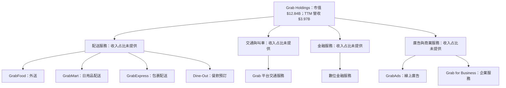
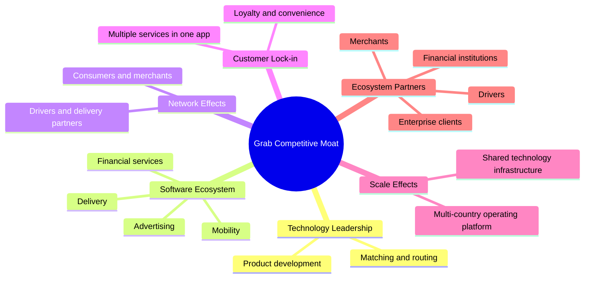
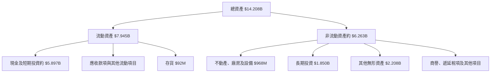
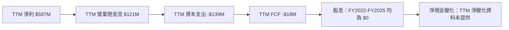
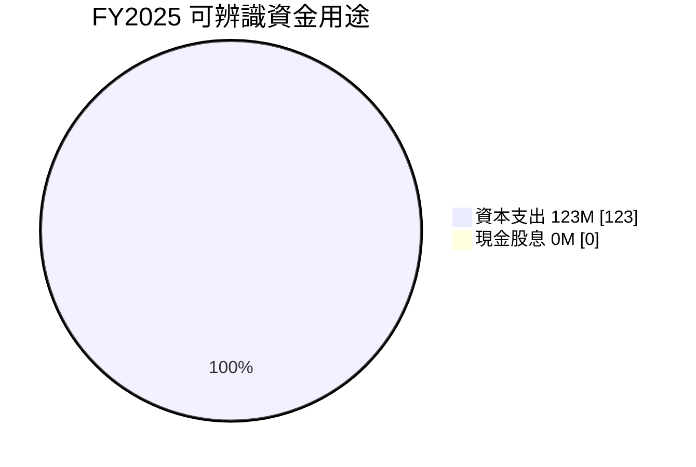
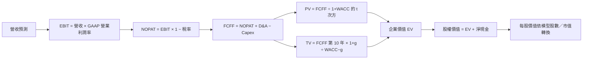
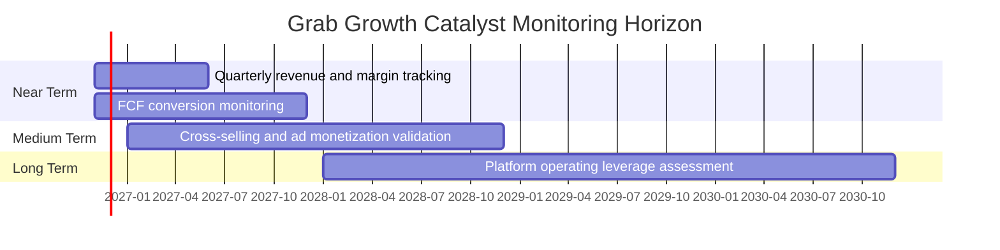
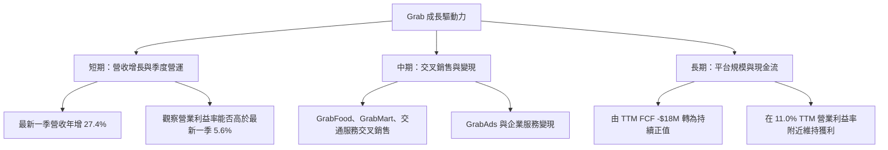
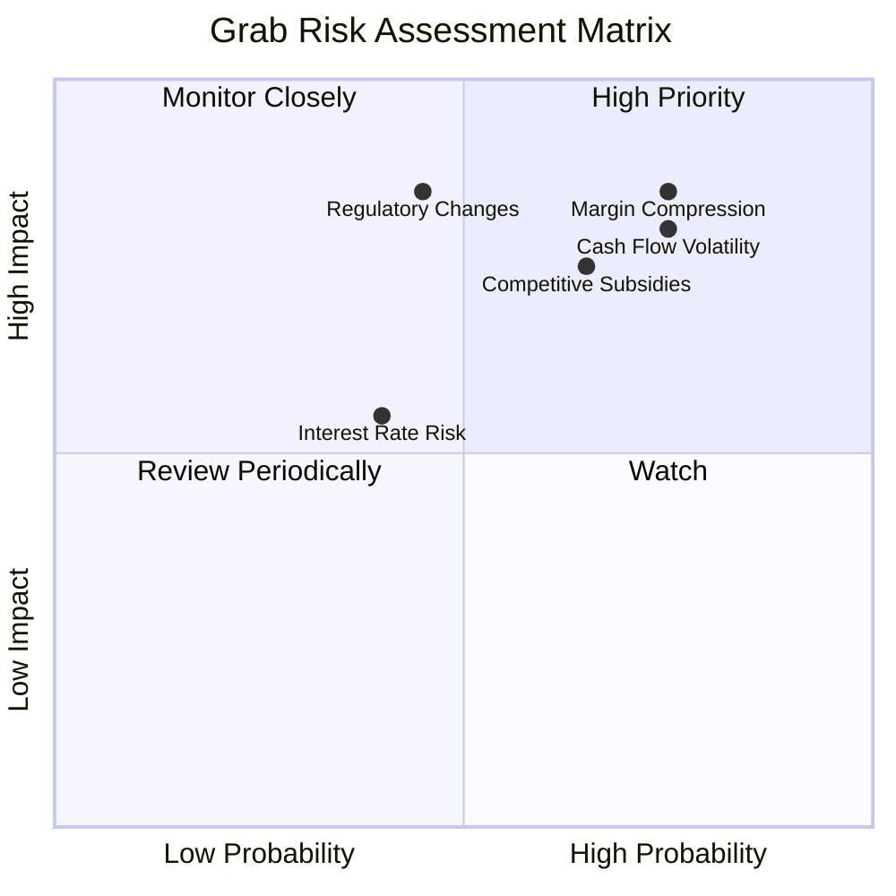
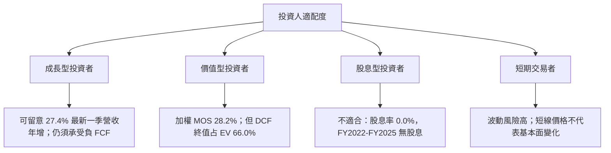

# GRAB 基本面深度分析報告
> **報告日期**：2026-11-17 ｜ **語言**：繁體中文 ｜ **數據來源**：Yahoo Finance、Finviz、StockAnalysis、Roic.ai ｜ **分析師**：CFA 級機構研究

## 目錄

| # | 章節 | 核心結論 |
|---|------|----------|
| 1 | 執行摘要 | 買入；加權合理價值 $4.43；MOS +28.2% |
| 2 | 公司概覽與商業模式 | 東南亞多邊平台；網路效應存在，但市場份額數據未提供 |
| 3 | 損益表深度分析 | TTM 營收 $3.97B；最新一季營收年增 27.4%，利潤率指標需留意期間差異 |
| 4 | 資產負債表分析 | 淨現金 $3.83B；流動性可用，營運資金天數資料顯示負 CCC |
| 5 | 現金流量深度分析 | TTM FCF -$18M；現金流轉換仍不穩定 |
| 6 | 獲利能力與資本效率 | WACC 8.57%；ROIC 缺少可靠數據，無法確認價值創造 |
| 7 | 相對估值分析 | 公司 Forward P/E 20.3x，高於同業中位數 15.6x |
| 8 | DCF 內在價值評估 | 基準 DCF $5.94；加權合理價值 $4.43，MOS +28.2% |
| 9 | 成長催化劑 | 服務交叉銷售、廣告與金融服務是可能驅動力，TAM 數字未提供 |
| 10 | 風險矩陣 | 獲利與現金流波動、競爭、監管是主要風險 |
| 11 | 投資建議 | 買入；建議分批，監控利潤率、FCF 與核心業務成長 |

## 1. 執行摘要

Grab 2026-11-17 收盤價為 **$3.18**，程式加權估值為 **$4.43**，安全邊際（MOS）為 **+28.2%**；按評級規則，因 MOS 超過 25% 但 ROIC 數據缺漏、無法確認 ROIC 高於 WACC，評級為**買入**而非強烈買入。支持估值的基準 DCF 每股價值為 **$5.94**，但 TTM FCF 為 **-$18M**、FCF Yield 為 **-0.14%**，且最新一季營業利益率為 **5.6%**，低於 TTM **11.0%**；因此本報告不把 DCF 的上行空間視為已實現報酬，而將現金流改善視為投資論點的關鍵驗證條件。

### 1.0 一頁式投資儀表板（Portfolio Manager 30 秒速讀）

| 項目 | 內容 |
|------|------|
| **投資論點（3 句）** | ① 最新一季營收年增 **27.4%**，顯示平台需求仍在擴張。② 現金及短期投資 **$5.90B**、淨現金 **$3.83B**，提供營運與投資緩衝。③ 加權合理價值 **$4.43** 高於現價 **$3.18**，但 TTM FCF **-$18M** 使估值論點仍需現金流驗證。 |
| **綜合評分** | **6.3/10**（引用 1.1 評分卡） |
| **財務健康** | 🟢 淨現金 $3.83B；但 TTM FCF 為負，短期現金創造力尚未穩定 |
| **ROIC vs WACC** | ROIC：N/A；WACC：**8.57%**。缺少 ROIC，無法判定是否創造經濟價值 |
| **FCF 趨勢** | TTM FCF **-$18M**；FCF Yield **-0.14%**，現金流仍需改善 |
| **估值** | Forward P/E **20.3x** ｜ EV/EBITDA **21.3x** ｜ FCF Yield **-0.14%** |
| **DCF 內在價值（基準）** | **$5.94** ｜現價相對 DCF 折價 **46.5%**（折溢價以 DCF 基準值計） |
| **安全邊際（MOS）** | **+28.2%**＝($4.43 − $3.18) ÷ $4.43；🟢 >25% |
| **預期報酬（基準情境 12M）** | DCF 基準情境相對現價 **+86.8%**（非 12 個月保證報酬；模型期限為 10 年） |
| **關鍵風險（前二）** | FCF 持續為負；最新一季營業利益率低於 TTM 營業利益率 |
| **評級 + 信心度** | 🟢 **買入** ｜信心：中低（現金充足，但 FCF 與獲利季度波動大） |

### 1.1 綜合評分卡（全報告唯一）

| 維度 | 評分（1–10） | 主要依據（引用數字與其來源章節） |
|------|--------------|----------------------------------|
| 成長性 | 7.0 | 最新一季營收年增 27.4%；FY2025 營收年增約 20.5%（第 3 章） |
| 獲利能力 | 5.0 | TTM 營業利益率 11.0%，但最新一季為 5.6%；ROIC、F-Score 均 N/A（第 3、6 章） |
| 財務健康 | 8.0 | 淨現金 $3.83B、流動比率 1.384、速動比率 1.07（第 4 章） |
| 估值 | 7.0 | MOS +28.2%；但 Forward P/E 20.3x 高於同業中位數 15.6x（第 7、8 章） |
| 護城河 | 6.0 | 多國平台、多類服務與網路效應具潛力，但缺少市場份額、留存率及單位經濟數據（第 2 章） |
| 管理層與資本配置 | 5.0 | FY2025 SBC $241M、無股息；年度 FCF 波動顯著，未見可供量化的回購資料（第 3、5 章） |
| **綜合評分** | **6.3** | 六項算術平均：(7+5+8+7+6+5) ÷ 6 = 6.333，四捨五入為 6.3 |

### 1.2 五大投資論點 + 三大核心風險

| 類型 | 項目 | 具體依據 | 信心度 |
|------|------|----------|--------|
| 🟢 **投資論點①** | 多業務平台仍在擴張 | 最新一季營收 $1.11B，年增 27.4%；有助攤薄平台固定成本，但不代表各業務利潤同步改善 | 🟢 高 |
| 🟢 **投資論點②** | 淨現金提供抗壓空間 | 現金及短期投資 $5.90B，總債務 $2.07B，淨現金 $3.83B | 🟢 高 |
| 🟢 **投資論點③** | 估值具加權折價 | 加權合理價值 $4.43 對現價 $3.18，MOS +28.2% | 🟡 中 |
| 🟢 **投資論點④** | 年度營收規模持續上升 | FY2022 $1.43B 增至 FY2025 $3.37B，三年 CAGR 約 33.1% | 🟡 中 |
| 🟢 **投資論點⑤** | 平台服務有交叉銷售可能 | 外送、交通、雜貨、廣告與金融服務共用平台；但收入組合細節未提供 | 🟡 中低 |
| 🟡 **風險①** | FCF 尚未形成穩定正值 | TTM FCF -$18M；FY2024 FCF +$739M，FY2025 -$44M，波動較大 | 🟡 中 |
| 🔴 **風險②** | 季度利潤率與盈餘波動 | TTM 營業利益率 11.0%，最新一季 5.6%；最新一季淨利年增 -27.0% | 🔴 高 |
| 🔴 **風險③** | 競爭及監管造成單位經濟壓力 | 市場份額及補貼支出未提供；若競爭推升折扣或配送成本，利潤率和現金流將承壓 | 🔴 高衝擊 |

### 1.3 快速統計卡片

同業中位數採 UBER、SE、DASH 的 Peer multiples；未提供 ROIC 與 F-Score 數值時不以其他來源估算。

| 指標 | 公司實際值（期間） | 同業中位數 | 狀態 |
|------|--------------------|------------|------|
| 營收成長（TTM） | **N/A** | — | 🟡 StockAnalysis 顯示 TTM 年增 22.99%，但指定 TTM 比較值缺漏 |
| 營收成長（最新一季年增） | **27.4%** | 34.0% | 🟡 |
| 毛利率（TTM） | **41.4%** | 45.0% | 🟡 |
| 營業利益率（TTM） | **11.0%** | — | 🟢 |
| ROIC（TTM） | **N/A** | — | 🟡 |
| Forward P/E | **20.3x** | 15.6x | 🔴 |
| FCF Yield（TTM） | **-0.14%** | — | 🔴 |
| Piotroski F-Score | **N/A / 9** | — | 🟡 |

### 1.4 投資結論

```text
╔══════════════════════════════════════════════════════════════════╗
║                    📊 投資結論摘要                               ║
╠══════════════════════════════════════════════════════════════════╣
║  評級：買入（依 MOS 門檻；ROIC 缺漏，未達強烈買入判定條件）       ║
║  價格（2026-11-17 收盤）：$3.18                                  ║
║  DCF 內在價值（基準）：$5.94（折價 46.5%）                       ║
║  安全邊際 MOS：+28.2%（＝(加權合理價值−現價)÷加權合理價值）     ║
║  加權合理價值（8.8）：$4.43                                      ║
║  DCF 情境價值：                                                   ║
║    悲觀情境：$3.10（-2.5%）                                      ║
║    基準情境：$5.94（+86.8%）                                     ║
║    樂觀情境：$12.16（+282.5%）                                   ║
║  綜合評分：6.3/10（引用 1.1）                                    ║
║  適合投資人：能承受高波動、願意追蹤現金流與獲利轉化的成長型投資人║
╚══════════════════════════════════════════════════════════════════╝
```

## 2. 公司概覽與商業模式

### 2.1 業務結構與收入來源

Grab Holdings Limited 營運 Grab 超級應用程式，服務範圍包括柬埔寨、印尼、馬來西亞、緬甸、菲律賓、新加坡、泰國與越南。其產品包含 GrabFood、GrabMart、GrabExpress、GrabAds、Dine-Out、Grab for Business 等。TTM 營收為 **$3.97B**，但各業務收入及占比未提供，故不以估算比例繪製收入占比。



### 2.2 市場份額

市場份額數據未提供，且近期新聞清單沒有可引用的市場份額數字，因此不繪製份額圖。Grab 在 TTM 營收 $3.97B、最新一季營收年增 27.4%；Peer 資料顯示其最新一季成長低於 SE 的 43.4% 與 DASH 的 34.0%，高於 UBER 的 9.6%。這些數字只能比較成長，不能直接推導市占率。

### 2.3 競爭護城河分析



### 2.4 護城河強度

| 護城河項目 | 強度（強／中／弱） | 證據（引用數字或事實） | 會削弱它的情況 |
|------------|--------------------|------------------------|----------------|
| 技術與平台 | 中 | 12,012 名員工；提供多類數位服務，研發支出 FY2025 為 $428M | 技術差異化未能降低配送成本或提高留存 |
| 軟體生態系統 | 中 | 同一應用程式涵蓋交通、配送、廣告與金融服務；各業務收入占比未提供 | 用戶只使用單一功能，交叉銷售效果不佳 |
| 網路效應 | 中 | 平台連結消費者、商家與司機；用戶和供給端數量、留存率未提供 | 對手補貼或價格競爭造成多邊網路流失 |
| 客戶鎖定 | 弱至中 | 多服務入口可能提升便利性，但無客戶留存、使用頻次數據 | 多平台使用普遍，轉換成本低 |
| 規模效應 | 中 | 營運八個東南亞市場、TTM 營收 $3.97B | 跨國監管、物流與本地競爭抵銷規模效益 |
| 生態夥伴 | 中 | 與商家、司機及企業客戶形成平台供給；夥伴依賴度數據未提供 | 供給端議價權提升或平台佣金受到限制 |

1.1「護城河」評分 **6.0/10**，反映多服務平台和跨國規模具備網路效應可能性，但缺乏留存、市占率及單位經濟數據，尚不足以驗證護城河能持續轉化為更高自由現金流。

## 3. 損益表深度分析

### 3.1 年度收入成長趨勢（近4年）

FY2022–FY2025 收入來自年度損益表。FY2023、FY2024、FY2025 年增率按表列收入計算；三年 CAGR 約 33.1%。

```text
╔══════════════════════════════════════════════════════════════════╗
║              Grab 年度收入趨勢（FY2022-FY2025）                  ║
╠══════════════════════════════════════════════════════════════════╣
║  FY2022  $1.43B  ████████░░░░░░░░░░░░░░  基期                  ║
║  FY2023  $2.36B  █████████████░░░░░░░░░  YoY 約 +64.6% 🟢      ║
║  FY2024  $2.80B  ███████████████░░░░░░░  YoY 約 +18.6% 🟢      ║
║  FY2025  $3.37B  ██████████████████░░░░  YoY 約 +20.5% 🟢      ║
╠══════════════════════════════════════════════════════════════════╣
║  FY2022-FY2025 三年 CAGR：約 +33.1%                              ║
╚══════════════════════════════════════════════════════════════════╝
```

計算：FY2023 約為 $2.36B ÷ $1.43B − 1；FY2024 約為 $2.80B ÷ $2.36B − 1；FY2025 約為 $3.37B ÷ $2.80B − 1。FY2023 的高成長部分來自較低基期；FY2024、FY2025 成長收斂至約 19%–21%，仍顯示規模擴張，但不能單靠營收增長判定利潤質量。

### 3.2 季度收入趨勢分析

| 季度 | 營收 | QoQ 成長 | YoY 成長 | 備註 |
|------|------:|---------:|---------:|------|
| 2025 Q4 | $906M | 約 +17.2%* | 18.59% | QoQ 與 2025 Q3 比較 |
| 2026 Q1 | $955M | 約 +5.4% | 23.54% | 年增加快 |
| 2026 Q2 | $998M | 約 +4.5% | 21.86% | 連續季度成長 |
| 2026 Q3 | $1.112B | 約 +11.4% | 27.38% | 最新一季增速升高 |

\*2025 Q4 與 2025 Q3 的營收為 $906M 與 $873M，QoQ 約 +3.8%；表格首列若採最近四季序列沒有前一列比較基期，故不將其 QoQ 作為本表比較。其餘 QoQ 算式分別為 $955M ÷ $906M − 1、$998M ÷ $955M − 1、$1.112B ÷ $998M − 1。最新一季年增率 **27.4% 是單季 YoY，不是 TTM 成長率**。TTM 對上一 TTM 的指定成長值為 N/A；StockAnalysis 顯示 TTM 年增 22.99%，口徑來源不同，僅作交叉參考。

### 3.3 利潤率演變分析

| 利潤率指標 | FY2022 | FY2023 | FY2024 | FY2025 | 趨勢 | 評估 |
|------------|--------|--------|--------|--------|------|------|
| **毛利率** | 約 5.4% | 約 36.4% | 約 41.8% | 約 43.3% | ↑ 明顯改善 | 🟢 |
| **營業利益率** | 約 -90.2% | 約 -16.4% | 約 -2.0% | 約 6.6% | ↑ 由虧轉盈 | 🟢 |
| **淨利率** | 約 -117.5% | 約 -18.4% | 約 -3.8% | 約 8.0% | ↑ 由虧轉盈 | 🟡 |

年度毛利率以年度損益表毛利 ÷ 營收計算；淨利率以淨利 ÷ 營收計算。年度來源欄位與 StockAnalysis 部分資料存在差異，因此年度毛利率不應與 TTM 毛利率直接拼接。最新可用 TTM 毛利率為 **41.4%**、TTM 營業利益率 **11.0%**；最新一季營業利益率 **5.6%**。歷史改善顯示平台逐步由擴張期走向獲利，但最新一季較低的營業利益率提醒：季度營收加速尚未必然轉化為同幅度的營業槓桿。產品組合、促銷與市場投入的季度影響缺少分部數據，不能將利潤率變化單一歸因於某個項目。

### 3.4 費用結構分析

費用類別及金額未提供完整、同口徑的 TTM 明細，因此不畫費用比例圓餅圖。已披露 FY2025 研發費用 **$428M**，約為 FY2025 營收 $3.37B 的 **12.7%**；另有 SBC **$241M**，但不能將其視為全部營運費用。研發投入有助於平台能力與產品拓展，但若未帶來更高留存或較低單位成本，將持續壓低股東可得現金流。

### 3.5 季度 EPS 趨勢與盈餘品質（Quality of Earnings）

最近四季 EPS 估值預期及實際值均為 `nan`，因此無法判定每季超預期或不及預期。以下以已提供的季度淨利與 EPS 資料呈現，不臆測市場共識：

| 季度 | 淨利 | EPS 實際 | 超預期／不及預期 |
|------|-----:|---------:|------------------|
| 2025 Q4 | $172M | $0.04（Roic.ai 顯示） | N/A，估計值缺漏 |
| 2026 Q1 | $136M | -$0.01（Roic.ai 顯示） | N/A，估計值缺漏 |
| 2026 Q2 | $253M | $0.06（Roic.ai 顯示） | N/A，估計值缺漏 |
| 2026 Q3 | $27M | $0.01（Roic.ai 顯示） | N/A，估計值缺漏 |

淨利季度波動顯著；最新一季淨利年增 **-27.0%**、EPS 年增 **-32.2%**。季度所得稅、非營業損益與稀釋股數的細項未完整提供，故無法把波動可靠地分解為核心營運、一次性項目或稅務因素。

| 盈餘品質項目 | 數值／佔比 | 評估 |
|--------------|------------|------|
| 股權薪酬 SBC / 營收 | TTM SBC 為 2025 Q4 至 2026 Q3 合計 $234M；$234M ÷ $3.97B = **5.9%** | 🟡 SBC 是真實稀釋成本，GAAP 已費用化，但股數變化仍須追蹤 |
| SBC / 營業現金流 | $234M ÷ $121M = **193.4%** | 🔴 SBC 高於 TTM 營業現金流，現金流含金量受稀釋成本影響 |
| FCF / 淨利 | -$18M ÷ TTM 淨利 $587M = **-3.1%** | 🔴 TTM 淨利未轉化為正 FCF |
| 一次性／非經常性損益 | N/A（明細未提供） | 無法判斷是否有一次性項目抬高或壓低盈餘 |
| 有效稅率異常 | 最新年度有效稅率 **25.7%** | 🟡 未提供逐季稅務調節，無法判定單季淨利波動是否受稅率扭曲 |
| 資本化支出 vs 費用化 | TTM Capex $139M；資本化政策細節 N/A | 🟡 支出已反映在現金流；無足夠資料判斷是否有成本遞延 |

**盈餘品質結論**：FY2025 SBC $241M 約占收入 7.2%，而最近四季 SBC 合計約占 TTM 營收 5.9%。同期間 TTM FCF 為負、FCF / 淨利為負，表示會計獲利尚未穩定轉化為自由現金。DCF 採用 GAAP EBIT，SBC 已列為費用且不再另扣，能避免在營運利潤與股數稀釋上重複扣除；但估值仍對持續稀釋風險敏感。

## 4. 資產負債表分析

### 4.1 資產結構分解

截至 2026-09-30，總資產為 **$14.208B**，流動資產 **$7.945B**；非流動資產約為 **$6.263B**（總資產減流動資產）。部分長期資產明細與其他來源欄位不完全一致，因此圖中只列總額與有資料的分類。



### 4.2 流動性與營運資金分析

| 指標 | 最新 TTM | 一年前 TTM | 變化 | 解讀 |
|------|----------|------------|------|------|
| DSO 應收帳款天數 | 22 天 | N/A | N/A | 一年前數據未提供，不能判斷收款速度變化 |
| DIO 存貨天數 | 15 天 | N/A | N/A | 存貨天數相對低，但欠缺一年前同口徑比較 |
| DPO 應付帳款天數 | 219 天 | N/A | N/A | 較長的應付天數使公司能延後現金支出；需觀察是否反映供應商信用條件 |
| CCC 現金轉換週期 | -182 天 | N/A | N/A | 由 22 + 15 − 219 得 -182 天；負週期表示支付供應商晚於回收營運資金 |

| 流動性指標 | 數值 | 評估 |
|------------|------|------|
| 流動比率 | 1.384 | 🟡 流動資產高於流動負債，但緩衝並非非常寬裕 |
| 速動比率 | 1.07 | 🟡 排除存貨後仍約覆蓋流動負債 |
| 現金及短期投資 | $5.90B | 🟢 流動性資產充足 |
| 淨現金 | $3.83B | 🟢 為營運、投資與景氣波動提供緩衝 |

### 4.3 債務結構分析

```text
╔══════════════════════════════════════════════════════════════════╗
║                   Grab 債務健康診斷                              ║
╠══════════════════════════════════════════════════════════════════╣
║  總債務：        $2.07B   ███████░░░░░░░░░░░░░░                 ║
║  現金+短期投資： $5.90B   ████████████████████                  ║
║  淨現金：        $3.83B   █████████████░░░░░░░  🟢              ║
║                                                                  ║
║  Debt/EBITDA：   N/A（資料包未提供可對應計算的淨口徑）           ║
║  Interest Coverage：N/A（利息費用明細未提供）                    ║
║  Debt/Equity：   28.532（來源欄位；與表內債務口徑可能不同）       ║
╚══════════════════════════════════════════════════════════════════╝
```

總債務 **$2.07B** 與現金及短期投資 **$5.90B** 形成 **$3.83B 淨現金**。FY2025 年末總債務 $2.05B，較 FY2024 年末 $364M 上升；但現金與短期投資仍高於債務。由於利息費用與債務到期明細未提供，不對利息保障倍數或具體再融資風險作無依據估算。

### 4.4 股東權益趨勢

```text
╔══════════════════════════════════════════════════════════════════╗
║                 Grab 歷年股東權益（USD）                         ║
╠══════════════════════════════════════════════════════════════════╣
║  FY2022  $6.60B  ████████████████████                            ║
║  FY2023  $6.45B  ████████████████████                            ║
║  FY2024  $6.40B  ███████████████████                             ║
║  FY2025  $6.73B  ████████████████████                            ║
╚══════════════════════════════════════════════════════════════════╝
```

FY2025 股東權益較 FY2024 增加約 $330M；但年度淨利、SBC 與其他權益變動如何分解未完整提供，不將帳面權益增加直接等同於每股股東價值增加。

## 5. 現金流量深度分析

### 5.1 現金流量瀑布圖

單季淨利、TTM 營業現金流與 TTM FCF 的期間並不完全相同；下圖以 TTM 營業現金流與資本支出為主，股息支出採年度資料可查的零值。



### 5.2 FCF 轉換率趨勢

| 年度 | 營業現金流 | Capex | FCF | 淨利 | FCF / 淨利 |
|------|-----------:|------:|----:|-----:|-----------:|
| FY2022 | -$798M | $74M | -$872M | -$1.68B | 約 51.9%* |
| FY2023 | $86M | $92M | -$6M | -$434M | 約 1.4%* |
| FY2024 | $852M | $113M | $739M | -$105M | 約 -703.8%* |
| FY2025 | $79M | $123M | -$44M | $268M | 約 -16.4% |
| TTM 至 2026-09-30 | $121M | $139M | -$18M | $587M | 約 -3.1% |

\*淨利為負時，FCF / 淨利的比率方向容易誤導，只呈現算術結果，不作正向現金轉換判讀。FY2024 正 FCF 與負淨利並存，說明營業現金流具有年度波動；FY2025、TTM FCF 為負，顯示現金轉換仍未穩定。

### 5.3 自由現金流趨勢

```text
╔══════════════════════════════════════════════════════════════════╗
║                 Grab 自由現金流：歷史與 TTM                      ║
╠══════════════════════════════════════════════════════════════════╣
║  FY2022  -$872M  ◀████████████████████  FCF Yield：N/A           ║
║  FY2023    -$6M  ◀░                    FCF Yield：N/A           ║
║  FY2024  +$739M  ████████████████████▶ FCF Yield：N/A           ║
║  FY2025   -$44M  ◀█                    FCF Yield：N/A           ║
║  TTM      -$18M  ◀░                    FCF Yield：-0.14%        ║
╚══════════════════════════════════════════════════════════════════╝
```

年度 FCF Yield 未提供一致的年度市值基礎，因此不填估值；TTM FCF Yield 使用已計算數值 **-0.14%**。FY2024 是正 FCF 的例外年度，FY2025 與最新 TTM 再度轉負，投資論點必須以後續多季正 FCF 驗證。

### 5.4 資本配置評估



| 資本配置項目 | 已知數據 | 評估 |
|--------------|----------|------|
| Capex | FY2025 $123M；TTM $139M | 對平台與技術持續投入；缺少維持性與成長性 Capex 拆分 |
| 股息 | FY2022–FY2025 每年 $0 | 無現金股息，回報主要依賴股價與企業價值增長 |
| 回購 | N/A | 未提供可核實回購金額 |
| SBC | FY2025 $241M；最近四季合計 $234M | 需以每股營收、每股 FCF 與股數變動共同評估稀釋 |
| 留存現金／投資 | 現金及短期投資 $5.90B | 提供彈性；投資回報率及資產配置明細未提供 |

## 6. 獲利能力與資本效率

### 6.1 ROE / ROA / ROIC 趨勢

| 指標 | 最新值 | 歷年可比趨勢 | 評估 |
|------|--------|--------------|------|
| ROE | 7.6%（TTM） | 歷年一致口徑數據不足 | 🟡 有正回報，但不高 |
| ROA | 1.1%（TTM） | 歷年一致口徑數據不足 | 🟡 資產回報偏低，仍受平台資產與流動資產結構影響 |
| ROIC | N/A | Roic.ai 歷史欄位缺漏 | 🟡 無法判斷投入資本回報是否超過資本成本 |
| WACC | 8.57% | 指定資本成本資料 | — |

沒有可引用的行業均值，故不呈現行業比較。ROE 與 ROA 的來源數值不與缺少投入資本口徑的 ROIC 混用。

### 6.2 ROIC vs WACC 分析（核心價值創造判斷）

```text
╔══════════════════════════════════════════════════════════════════╗
║                ROIC vs WACC 深度分析                            ║
╠══════════════════════════════════════════════════════════════════╣
║  WACC（採用資本成本資料）：                                      ║
║  ├── 無風險利率（10Y美債）：  5.10%（日期未單獨提供）            ║
║  ├── 市場風險溢酬 ERP：       5.00%（假設值，來源資料直接提供）   ║
║  ├── Beta：                   原始 0.83；調整後 0.89             ║
║  ├── 股權成本：5.10%+0.89×5.00%=9.55%                           ║
║  ├── 稅前債務成本：           3.43%                              ║
║  ├── 稅後債務成本：           3.43%×(1−25.7%)=2.55%              ║
║  ├── 資本結構：股權 86.1%，債務 13.9%                            ║
║  └── WACC：                   8.57%                              ║
║                                                                  ║
║  ROIC：N/A（投入資本與可比 NOPAT 口徑不足）                       ║
║  EVA = ROIC − WACC：N/A                                         ║
║                                                                  ║
║  結論：無法判定 Grab 的 ROIC 是否高於 8.57% WACC；                ║
║        因此不能宣稱公司已持續創造經濟價值。                      ║
╚══════════════════════════════════════════════════════════════════╝
```

WACC 按提供的權重及成本為 8.57%。ROIC 不可由 ROE 或 ROA 替代；缺少可確認的投入資本與一致期間 NOPAT，故 EVA 亦為 N/A。以 TTM 營業利益率 11.0% 作為 ROIC 會錯把營業利潤率當成資本報酬率，故不採用。

### 6.3 杜邦三因素分解

| 因素 | 數值（TTM） | 解讀 |
|------|-------------|------|
| 淨利率 | N/A | QUALITY FIGURES 的 DuPont 欄位為 N/A |
| 資產週轉率 | N/A | 同上 |
| 權益乘數 | N/A | 同上 |
| **ROE** | **N/A（杜邦分解）** | 淨利、營收、總資產或正權益的必要同口徑資料缺漏 |

### 6.4 財務體質：Piotroski F-Score

**Piotroski F-Score：N/A（需要相隔一年的兩組 SEC 申報資料；本次可用資料為 Yahoo 季度報表，無法完成九項測試）**。九項測試逐項結果皆為 N/A，不把缺資料誤標為通過或未通過。

| 測試 | 結果 | 解讀 |
|------|------|------|
| ROA 為正 | N/A | 缺少所需期間一致口徑測試資料 |
| 營業現金流為正 | N/A | 無法按 F-Score 規範完成兩年比較 |
| ROA 改善 | N/A | 同上 |
| 營業現金流高於淨利 | N/A | 同上 |
| 槓桿下降 | N/A | 同上 |
| 流動比率改善 | N/A | 同上 |
| 未發行新股 | N/A | 需可比年度稀釋股數變動資料 |
| 毛利率改善 | N/A | 需符合規範的兩期資料 |
| 資產週轉率改善 | N/A | 同上 |

## 7. 相對估值分析

### 7.1 同業估值比較表格

GRAB 公司估值倍數取市場資料，Peer 倍數取 Yahoo Finance 的指定同業資料。競爭對手為 Uber（UBER）、Sea（SE）與 DoorDash（DASH）。

| 估值指標 | **GRAB** | **UBER** | **SE** | **DASH** | 本公司評估 |
|----------|---------:|---------:|-------:|--------:|-----------|
| **Trailing P/E** | 31.8x | 40.5x | 25.0x | 68.4x | 🟡 位於同業中間區域 |
| **Forward P/E** | 20.3x | 15.6x | 14.6x | 21.6x | 🔴 高於同業中位數 15.6x |
| **P/S Ratio** | 3.23x | 2.5x | 1.4x | 4.2x | 🟡 高於 UBER、SE，低於 DASH |
| **EV/EBITDA** | 21.33x | 19.1x | 13.6x | 40.5x | 🟡 高於 UBER、SE；低於 DASH |
| **最新一季營收 YoY** | 27.4% | 9.6% | 43.4% | 34.0% | 🟡 增速高於 UBER，低於 SE、DASH |
| **毛利率（TTM）** | 41.4% | 41.4% | 45.0% | 52.7% | 🟡 低於 SE、DASH，與 UBER 相同 |

同業 Forward P/E 中位數為 UBER 15.6x、SE 14.6x、DASH 21.6x 的中間值 **15.6x**。估值溢價需由未來獲利及現金流增長支持；若營收增長未能轉化為穩定 FCF，較高的 Forward P/E 會放大下行風險。

### 7.2 歷史估值區間分析

N/A（未提供「Valuation vs own history」的歷史 P/E 區間與百分位數據）。價格歷史顯示 2024-11 月收盤 $5.00、2025-09 月 $6.02、2026-10 月 $2.71、2026-11-17 收盤 $3.18；這些價格序列不足以推導歷史 P/E 百分位。

### 7.3 情境價值（Bear / Base / Bull，照抄 DCF MODEL 的 Scenarios）

| 情境 | 第 1 年營收成長 | 期末營業利潤率 | WACC | 每股價值 | 相對現價 | 機率 | 會發生的條件 |
|------|----------------|----------------|------|----------|----------|------|--------------|
| 🔴 悲觀 | 13.7% | 9.3% | 9.57% | $3.10 | -2.5% | 25% | 成長放緩、競爭促銷持續，利潤率低於基準 |
| 🟡 基準 | 27.4% | 11.0% | 8.57% | $5.94 | +86.8% | 50% | 最新一季增速可延續初期，長期逐步回落，利潤率維持模型設定 |
| 🟢 樂觀 | 41.1% | 12.0% | 7.57% | $12.16 | +282.5% | 25% | 多業務交叉銷售、效率提升使成長與利潤率均高於基準 |

程式提供的情境假設與每股價值照錄。情境詳細逐年收入與現金流未提供，不能從三個終值倒推各情境營運數字。

### 7.4 相對估值隱含價格區間

```text
╔══════════════════════════════════════════════════════════════════╗
║                   相對估值每股價值與現價                         ║
╠══════════════════════════════════════════════════════════════════╣
║  $2.45 ───── $3.18 ───── $3.61 ─────── $5.39 ─────── $5.94      ║
║  Forward P/E    現價      EV/EBITDA    分析師共識    基準 DCF    ║
╚══════════════════════════════════════════════════════════════════╝
```

- **同業 Forward P/E：$2.45**＝同業中位數 **15.6x** × Forward EPS **$0.16**；低於現價約 23.0%。
- **同業 EV/EBITDA：$3.61**＝UBER、SE 中位數 **16.4x** × TTM EBITDA，再加淨現金；採程式計算價值，原始逐項 EBITDA 與股數橋接未提供。
- **分析師共識：$5.39**＝22 位分析師平均目標價。
- **基準 DCF：$5.94**＝10 年 FCFF，WACC 8.57%、永續成長 3.0%。

## 8. DCF 內在價值評估（Discounted Cash Flow）

> 下列 8.1–8.7 模型輸入與計算結果沿用程式計算的 DCF MODEL。財務資料以四捨五入後金額呈現，部分中間列以底層未四捨五入值計算，因此以顯示值重算時可能出現小幅尾差；不以自建假設替代既定模型。

### 8.0 估值推理鏈（Thinking Logic：在算之前先想清楚）

**Step 1 — 價值來源與主導變數**

本模型的價值來自既有平台收入與營業現金流、配送與交通等業務的持續增長，以及廣告與金融服務可能帶來的交叉銷售價值；各業務分部收入未提供，故不能量化各自占比。DCF 的主導變數是**營收成長與終值折現假設**：基準情境終值現值占企業價值 66.0%，而 8.6 矩陣顯示 WACC、永續成長率變動會明顯改變每股價值。

**Step 2 — 模型選擇**

| 決策點 | 本報告採用 | 理由（含數字） | 曾考慮但否決 | 否決理由 |
|--------|-----------|----------------|--------------|----------|
| 現金流定義 | FCFF | 使用 WACC 折現，得企業價值；提供淨現金 $3.83B 作橋接 | FCFE | 資本結構不必逐期預測 |
| 預測期 N | 10 年 | DCF MODEL 固定 10 年；收入基礎 $3.97B | 5 年 | 不符合既定模型期限，且終值依賴度會改變 |
| 終值方法 | Gordon Growth 為主 | WACC 8.57% 高於 g 3.0% | 退出倍數作主法 | 未提供 DCF MODEL 的退出倍數假設，不能另設 |
| EBIT 基礎 | GAAP EBIT | TTM 營業利益率 11.0%；GAAP 已包含 SBC 費用 | 非 GAAP EBIT | 避免加回 SBC 後漏計股東成本 |

**Step 3 — 關鍵假設推導鏈**

- **營收成長**：錨點＝最新一季單季 YoY 27.4%，FY2025 年增約 20.5%、FY2022–FY2025 CAGR 約 33.1% → 調整＝採用最新一季增速作第一年，但由 27.4% 線性回落至 3.0%，反映增長正常化 → **採用第 1 年 27.4%、第 10 年 3.0%** → 曾考慮直接延續歷史三年 CAGR 33.1%，因其含 FY2023 低基期與高增幅，且無法用 TTM YoY 驗證，否決。
- **期末營業利潤率**：錨點＝TTM 營業利益率 11.0%，最新一季為 5.6% → 調整＝基準假設不預設長期擴張或收縮，維持 11.0% → **採用 11.0%** → 曾考慮以最新一季 5.6% 作長期利潤率，因單季可能有季節及一次性波動、不是 TTM 指標，未採用；此處仍是偏樂觀風險。
- **永續成長率 g**：錨點＝長期名目經濟成長常以低個位數作估值參考，但本資料沒有可直接引用的長期 GDP／通膨預測 → 調整＝採模型 3.0%，且低於 WACC 8.57% → **採用 3.0%** → 未採用更高 g，以避免終值放大；3.0% 仍非公司財測。
- **預測期 N**：錨點＝模型設為 10 年；公司營收由 FY2022 $1.43B 升至 FY2025 $3.37B → 調整＝以 10 年涵蓋成長逐步成熟期間 → **採用 10 年** → 曾考慮 5 年，但不足以呈現模型設定的成長衰減路徑，且會改變終值權重。
- **Capex / 營收**：錨點＝TTM Capex $139M ÷ TTM 營收 $3.97B 約 3.5% → 調整＝模型維持 3.5%，不假定資本密度快速下降 → **採用 3.5%** → 未採用低於 3.5%，因缺少資本支出效率改善證據。
- **D&A / 營收**：錨點＝模型所用 TTM 比率 5.6% → **採用 5.6%**，固定不變；分項 D&A 實際值未單獨列出。
- **有效稅率**：錨點＝最新年度有效稅率 25.7% → **採用 25.7%**，不假定長期稅務優惠。
- **ΔWC / 營收增額**：資料缺少可用的 ΔWC 預測輸入；模型明確不建模營運資金變動，未另補估算。
- **EBIT 與 SBC**：錨點＝TTM 營業利益率 11.0%；TTM SBC 最近四季合計 $234M → **採用 GAAP EBIT**，不另扣 SBC，股數不再稀釋。採用組合 (A)，SBC 影響只計入一次；程式設定固定股數。
- **年稀釋率**：錨點＝最近季度 Roic.ai 股數欄位 4.037B，但與市場資料股份口徑不同 → 模型採組合 (A)，**年稀釋率 0%**，不另行稀釋；曾考慮以歷史股數變化推估稀釋率，但資料口徑不一致，否決。
- **終值方法**：錨點＝模型採 Gordon Growth，FCFF(FY+10) $1.64B、g 3.0%、WACC 8.57% → **採用 Gordon Growth** → 曾考慮退出倍數交叉驗證，但模型未提供倍數，不自行編造。
- **WACC**：錨點＝資本成本輸入 WACC 8.57% → 按指定市場權重、股權成本與稅後債務成本採用此值 → **採用 8.57%** → 不另改用較低折現率，以免在終值已占 EV 66.0% 的情況下額外推高價值。

**Step 4 — 最脆弱環節**

基準最脆弱處是將 TTM 營業利益率 **11.0%** 維持十年，儘管最新一季為 **5.6%**；若長期利潤率收斂至悲觀情境 **9.3%** 且 WACC 升至 **9.57%**，模型情境價值降至 **$3.10**。

**Step 5 — 計算路徑圖**

> DCF MODEL 的 FCFF 定義不含 ΔWC，與一般教科書常見寫法不同；此處按模型設計呈現。



### 8.1 模型假設總表（Model Inputs）

| 假設項目 | 採用值 | 依據／來源 | 敏感度 |
|----------|--------|-------------|--------|
| 預測期長度 N | 10 年 | DCF MODEL 固定假設 | 🟡 中 |
| 營收成長 | FY+1 27.4% 線性降至 FY+10 3.0% | 最新一季單季 YoY 27.4%；終點由模型設定 | 🔴 高 |
| 營業利潤率 | FY+1 至 FY+10 均 11.0% | TTM 營業利益率 11.0%；模型依近五個財年中位數設定 | 🔴 高 |
| 有效稅率 | 25.7% | 最新年度有效稅率 | 🟢 低 |
| Capex / 營收 | 3.5% | TTM $139M ÷ $3.97B 約 3.5%；模型設定 | 🟡 中 |
| D&A / 營收 | 5.6% | 模型所列 TTM 比率 | 🟢 低 |
| 營運資金變動 | 不建模 | DCF MODEL 明示 Working capital is not modelled | 🟢 低 |
| EBIT 基礎 | GAAP EBIT | TTM 營業利益率 11.0%；SBC 已為費用 | 🟡 中 |
| SBC 處理 | 不另扣 | 採組合 (A)：GAAP EBIT 已含 SBC | 🟡 中 |
| 年稀釋率 | 0%（固定股數） | 組合 (A) 模型設定；避免 SBC 重複扣除 | 🟡 中 |
| 永續成長率 g | 3.0% | DCF MODEL 假設；低於 WACC 8.57% | 🔴 高 |
| 終值方法 | Gordon Growth | DCF MODEL 提供的終值方法 | 🔴 高 |
| WACC | 8.57% | 資本成本資料，詳見 8.2 | 🔴 高 |
| FCFF 定義 | NOPAT + D&A − Capex | DCF MODEL 原式；不包含 ΔWC | — |
| 每股換算方式 | Equity value × 價格 ÷ 市值 | DCF MODEL 原式；不以一般股數除法替換 | 🔴 高 |

**FCFF 定義與 SBC 防重複說明：**本模型採用 GAAP EBIT，故 EBIT 已含 SBC 費用，不再從 FCFF 扣 SBC；股數不再另行稀釋，採組合 (A)。模型未建模營運資金變動，並非假定 ΔWC 為某個自行估出的百分比。

### 8.2 折現率推導（WACC）

```text
╔══════════════════════════════════════════════════════════════════╗
║                    WACC 推導（折現率）                           ║
╠══════════════════════════════════════════════════════════════════╣
║  股權成本 Ke（CAPM）：                                           ║
║  ├── 無風險利率 Rf（10Y 美債）：      5.10%                      ║
║  ├── 市場風險溢酬 ERP：               5.00%（假設輸入）           ║
║  ├── 原始 Beta：                     0.83                       ║
║  ├── 調整後 Beta：                   0.89                       ║
║  ├── Beta 調整：⅔×0.83+⅓×1.00 = 0.89                            ║
║  └── Ke = 5.10% + 0.89×5.00% = 9.55%                            ║
║                                                                  ║
║  債務成本 Kd：                                                    ║
║  ├── 稅前 Kd（利息 ÷ 債務）：       3.43%                      ║
║  ├── 有效稅率：                     25.7%                      ║
║  └── 稅後 Kd = 3.43%×(1−25.7%) = 2.55%                          ║
║                                                                  ║
║  資本結構（市場權重）：                                          ║
║  ├── 股權權重 E：                   86.1%                      ║
║  ├── 債務權重 D：                   13.9%                      ║
║  └── WACC：                         8.57%                      ║
╚══════════════════════════════════════════════════════════════════╝
```

**逐步演算（WACC）**

1. **Ke（CAPM）**＝Rf + β × ERP＝5.10% + 0.89 × 5.00%＝**9.55%**。
2. **稅前 Kd**＝**3.43%**，依資本成本資料的利息／債務比率直接採用；利息金額及平均計息負債金額未提供，故不能重建分子與分母。
3. **稅後 Kd**＝3.43% × (1 − 25.7%)＝2.54849% ≈ **2.55%**。
4. **權重**＝E 86.1%、D 13.9%；86.1% + 13.9%＝**100.0%**。市場權重使用價格資料庫市值與債務口徑；財務資料未提供足以重建的精確稀釋股數市值算式。
5. **WACC**＝86.1% × 9.55% + 13.9% × 2.55%＝8.22255% + 0.35445%＝**8.57700%**；程式提供並採用值為 **8.57%**。兩者差異來自輸入及權重未四捨五入前的底層精度；本報告採用指定 WACC 8.57%。

Beta 原始值為 Yahoo Finance 0.83，調整後採 ⅔ 原始 Beta 加 ⅓ 的方法得 0.89。風險溢酬 5.00% 是資本成本輸入中的假設值；無風險利率 5.10% 的具體觀測日期未單獨提供。未額外加計國別或規模溢酬。第 6.2 節與本節採同一 WACC **8.57%**。

### 8.3 逐年自由現金流預測（基準情境）

金額單位：USD billions。表中年度及數值逐項照錄 DCF MODEL；折現因子保留三位小數。

| 年度 | FY+1 | FY+2 | FY+3 | FY+4 | FY+5 | FY+6 | FY+7 | FY+8 | FY+9 | FY+10 |
|------|------:|------:|------:|------:|------:|------:|------:|------:|------:|-------:|
| 營收 | 5.06 | 6.31 | 7.69 | 9.18 | 10.70 | 12.18 | 13.53 | 14.67 | 15.51 | 15.98 |
| 營收 YoY | 27.4% | 24.7% | 22.0% | 19.3% | 16.6% | 13.8% | 11.1% | 8.4% | 5.7% | 3.0% |
| 營業利潤率 | 11.0% | 11.0% | 11.0% | 11.0% | 11.0% | 11.0% | 11.0% | 11.0% | 11.0% | 11.0% |
| 營業利益 EBIT（GAAP） | 0.55 | 0.69 | 0.84 | 1.01 | 1.17 | 1.33 | 1.48 | 1.61 | 1.70 | 1.75 |
| − 稅（有效稅率 25.7%） | (0.14) | (0.18) | (0.22) | (0.26) | (0.30) | (0.34) | (0.38) | (0.41) | (0.44) | (0.45) |
| = NOPAT | 0.41 | 0.51 | 0.63 | 0.75 | 0.87 | 0.99 | 1.10 | 1.20 | 1.26 | 1.30 |
| + D&A | 0.28 | 0.35 | 0.43 | 0.52 | 0.60 | 0.68 | 0.76 | 0.82 | 0.87 | 0.90 |
| − Capex | (0.18) | (0.22) | (0.27) | (0.32) | (0.37) | (0.43) | (0.47) | (0.51) | (0.54) | (0.56) |
| − ΔWC | 不建模 | 不建模 | 不建模 | 不建模 | 不建模 | 不建模 | 不建模 | 不建模 | 不建模 | 不建模 |
| **= FCFF** | **0.52** | **0.65** | **0.79** | **0.94** | **1.10** | **1.25** | **1.39** | **1.51** | **1.59** | **1.64** |
| 折現因子 @8.57% | 0.921 | 0.848 | 0.781 | 0.720 | 0.663 | 0.610 | 0.562 | 0.518 | 0.477 | 0.439 |
| **FCFF 現值 PV** | **0.48** | **0.55** | **0.62** | **0.68** | **0.73** | **0.76** | **0.78** | **0.78** | **0.76** | **0.72** |

預測期現值合計依 DCF MODEL 為 **$6.85B**。按表中已四捨五入顯示值逐項相加為 $6.86B；$0.01B 尾差屬逐年 PV 四捨五入造成，合計以模型未四捨五入數值的結果 $6.85B 為準。

**逐步演算（FY+1；使用展示數值，部分差異來自模型底層未四捨五入值）**

1. **營收**＝上年 TTM 營收 $3.97B × (1 + 27.4%)＝$3.97B × 1.274＝$5.05778B，表列 **$5.06B**。
2. **EBIT**＝$5.06B × 11.0%＝$0.5566B；模型表列 **$0.55B**，採用底層未四捨五入值。
3. **稅**＝EBIT × 25.7%；模型表列 **$0.14B**。
4. **NOPAT**＝EBIT − 稅；模型表列 **$0.41B**。
5. **D&A**＝營收 × 5.6%；模型表列 **$0.28B**。
6. **Capex**＝營收 × 3.5%；模型表列 **$0.18B**。
7. **ΔWC**＝不建模，因此模型沒有扣除該項。
8. **FCFF**＝NOPAT + D&A − Capex；以展示值 $0.41B + $0.28B − $0.18B＝$0.51B，模型表列 **$0.52B**，差異源於各組成數據已先行四捨五入。
9. **折現因子**＝1 ÷ (1 + 8.57%)¹＝0.921；PV＝FCFF × 折現因子，模型表列 **$0.48B**。

**合理性自檢**

- 歷史 FCF CAGR：因 FY2022–FY2025 FCF 跨越負值、接近零與正值，CAGR **N/A**；模型 FCFF 從 FY+1 $0.52B 增至 FY+10 $1.64B，端點 CAGR 約 13.6%，與歷史波動不可直接比較。
- FY+10 FCF 利潤率＝$1.64B ÷ $15.98B 約 **10.3%**；目前 TTM FCF 利潤率＝-$18M ÷ $3.97B 約 **-0.45%**。同業最佳數值未提供，不能判斷模型是否超越產業最佳。
- 模型預測各年 FCFF 均為正；實際 TTM FCF 為負，預測轉正仰賴營業利潤率與現金流轉換持續改善。

```text
╔══════════════════════════════════════════════════════════════════╗
║            自由現金流：歷史實際 vs 模型預測                      ║
╠══════════════════════════════════════════════════════════════════╣
║  FY2023(實)   -$0.006B  ◀░                 YoY：不適用           ║
║  FY2024(實)   +$0.739B  █████████          YoY：大幅反彈         ║
║  FY2025(實)   -$0.044B  ◀█                 YoY：轉負             ║
║  TTM(實)      -$0.018B  ◀░                 FCF Yield：-0.14%     ║
║  FY+1(預)     +$0.52B   ██████             FCFF                  ║
║  FY+10(預)    +$1.64B   ██████████████████ FCFF                  ║
╠══════════════════════════════════════════════════════════════════╣
║  ⚠️ 預測 FCF CAGR 約 13.6%；歷史跨零，CAGR 不可直接比較。        ║
╚══════════════════════════════════════════════════════════════════╝
```

### 8.4 終值計算（Terminal Value）

**適用性檢查**：WACC **8.57%** vs g **3.0%** → WACC > g？✅

| 方法 | 計算式 | 終值 TV | TV 現值 | 佔總 EV 比重 |
|------|--------|---------|---------|--------------|
| Gordon Growth | $1.64 × (1 + 3.0%) ÷ (8.57% − 3.0%) | $30.28B | $13.30B | 66.0% |
| 退出倍數法 | N/A | N/A | N/A | N/A |

退出倍數法未提供模型倍數及 FY+10 EBITDA，不能自行估計。

**逐步演算**

1. **FY+10 FCFF**＝**$1.64B**。
2. **分子**＝$1.64B × (1 + 3.0%)＝$1.6892B；依模型未四捨五入數據計算後為列示的終值。
3. **分母**＝8.57% − 3.0%＝5.57%；TV＝模型計算 **$30.28B**。
4. **PV(TV)**＝$30.28B × 0.439＝**$13.30B**（使用列示折現因子，底層未四捨五入有小幅尾差）。
5. **終值佔比**＝$13.30B ÷ $20.15B＝**66.0%**。

終值占 EV 66.0%，低於 75% 警示線，但仍是企業價值主要來源，長期假設變動會顯著影響估值。

### 8.5 企業價值 → 每股內在價值（Bridge）

```text
╔══════════════════════════════════════════════════════════════════╗
║              企業價值 → 每股內在價值 橋接表                      ║
╠══════════════════════════════════════════════════════════════════╣
║  預測期 FCF 現值合計            +$6.85B                          ║
║  終值現值 PV(TV)                +$13.30B                         ║
║  ─────────────────────────────────────────────                  ║
║  = 企業價值 EV                   $20.15B                         ║
║  + 淨現金                        +$3.83B                          ║
║  = 股權價值                      $23.98B                          ║
║  ÷ 模型隱含股數／市值轉換         依 DCF MODEL                     ║
║  ─────────────────────────────────────────────                  ║
║  ★ 每股內在價值                  $5.94                           ║
║    2026-11-17 收盤價             $3.18                           ║
║    折溢價（現價÷DCF值−1）         -46.5%（折價）                  ║
╚══════════════════════════════════════════════════════════════════╝
```

**逐步演算（橋接）**

1. **EV**＝預測期 PV 合計 $6.85B + PV(TV) $13.30B＝**$20.15B**。
2. **股權價值**＝EV $20.15B + 淨現金 $3.83B＝**$23.98B**。
3. **每股內在價值**＝模型原式「股權價值 × 價格 ÷ 市值」＝**$5.94**；逐股股數換算採模型計算值，不能用未確認的股數口徑替代。
4. **折溢價**＝現價 $3.18 ÷ DCF 基準價值 $5.94 − 1＝-46.4646% ≈ **-46.5%**。
5. **本節不計算 MOS**；MOS 一律以 8.8 加權合理價值作分母。

股權價值橋接所用淨現金 $3.83B 為資本成本與 DCF MODEL 採用的淨現金輸入；市場資料另列現金及短期投資 $5.90B、總債務 $2.07B。DCF 模型的每股公式是「股權價值 × 價格 ÷ 市值」，並非以單一來源股數直接相除；來源資料的流通股數口徑不一致，因此不擅自更改此轉換方式。

### 8.6 敏感性分析（WACC × 永續成長率）

下表數值照錄 DCF MODEL。括號內上行空間以現價 $3.18 計；基準格為 WACC 8.57%、g 3.0%。

| g（列）／WACC（欄） | 6.57% | 7.57% | **8.57%（基準）** | 9.57% | 10.57% |
|-----------|------:|------:|------------------:|------:|-------:|
| 2.0% | $7.63 (+139.9%) | $6.32 (+98.7%) | $5.41 (+70.1%) | $4.75 (+49.4%) | $4.24 (+33.3%) |
| 2.5% | $8.24 (+159.1%) | $6.69 (+110.4%) | $5.65 (+77.7%) | $4.91 (+54.4%) | $4.36 (+37.1%) |
| **3.0%（基準）** | $9.03 (+183.0%) | $7.14 (+124.5%) | **$5.94 (+86.8%)** | $5.11 (+60.7%) | $4.50 (+41.5%) |
| 3.5% | $10.07 (+216.7%) | $7.71 (+142.5%) | $6.28 (+97.5%) | $5.33 (+67.6%) | $4.65 (+46.2%) |
| 4.0% | $11.52 (+262.3%) | $8.43 (+165.1%) | $6.70 (+110.7%) | $5.59 (+75.8%) | $4.83 (+51.9%) |

**逐步演算示例限制：**敏感度矩陣為程式提供的模型結果；未提供每格重新折現後的十年逐年 PV 中間數據，因此不能在不自建模型的前提下完整重建任一非基準格。示例選格為 **WACC 9.57% > g 3.0% ✅**；DCF MODEL 列示該格每股價值 **$5.11**。任何聲稱以顯示精度逐項重算的 PV 合計都會需要額外模型輸入，故不偽造算式。

**三情境 DCF**

| 情境 | 營收假設 | 期末營業利潤率 | g | WACC | 每股內在價值 | 相對現價 | 主觀機率 |
|------|----------|----------------|---:|-----:|--------------|----------|----------|
| 🔴 悲觀 | 第 1 年 13.7%，之後依情境模型 | 9.3% | 情境模型；詳細值未提供 | 9.57% | $3.10 | -2.5% | 25% |
| 🟡 基準 | 第 1 年 27.4%，之後線性降至 3.0% | 11.0% | 3.0% | 8.57% | $5.94 | +86.8% | 50% |
| 🟢 樂觀 | 第 1 年 41.1%，之後依情境模型 | 12.0% | 情境模型；詳細值未提供 | 7.57% | $12.16 | +282.5% | 25% |
| **機率加權** | — | — | — | — | **$6.79** | **+113.4%** | 100% |

情境表只提供首年成長率、期末利潤率、WACC、價值與機率，未提供每種情境的逐年收入、FY+10 FCFF 和終值拆解，故不杜撰完整推導鏈。機率加權算式：$3.10 × 25% + $5.94 × 50% + $12.16 × 25%＝$0.775 + $2.970 + $3.040＝**$6.785 ≈ $6.79**。

**敏感度結論**

- **g 每 +1pp**：以 WACC 8.57% 欄比較，g 2.0% 時 $5.41，g 3.0% 時 $5.94，增值 **$0.53**，約 **+9.8%**。
- **WACC 每 +1pp**：以 g 3.0% 列比較，WACC 8.57% 時 $5.94，9.57% 時 $5.11，減值 **$0.83**，約 **-14.0%**。
- **期末營業利潤率每 +1pp**：敏感度矩陣未提供利潤率單變數敏感度，N/A；不能用悲觀、基準、樂觀情境差異當作純粹的 1pp 效應。
- 矩陣可量化的單變數結果顯示 WACC 變動影響大於 g 的 1pp 變動；這與 8.0 所述「營收與終值折現假設主導」一致，亦說明資本成本是關鍵風險。

### 8.7 反推 DCF（Reverse DCF：市場在預期什麼）

反推結果照錄 DCF MODEL。由於逐年反推試算軌跡未提供，以下不冒稱以顯示數據重新疊代；每列僅列模型實際給出的單一變數解。

| 求解的變數（一次一個） | 其餘變數設定 | 市場隱含值（令 DCF = 現價） | 公司歷史實際 | 判斷 |
|------------------------|--------------|------------------------------|--------------|------|
| 第 1 年營收成長 | 其餘維持基準 | 7.3% | FY2022–FY2025 三年 CAGR 約 33.1%；最新一季 YoY 27.4% | 🟢 相較近期成長較保守 |
| 固定營業利潤率 | 其餘維持基準 | 3.3% | TTM 營業利益率 11.0%；最新一季 5.6% | 🟢 市場隱含偏保守 |
| 永續成長率 g | 未計算 | N/A | — | 未提供解 |
| 高成長持續年數 N | 未計算 | N/A | — | 未提供解 |

反推模型固定輸入：WACC 8.57%、稅率 25.7%、Capex/營收 3.5%、預測期 N 10 年；ΔWC 不建模；股數採 DCF MODEL 固定股數設定。程式另列營收成長與利潤率反推結果，但沒有試算軌跡、求解精度或各固定輸入完整輸出，因此不補造迭代表格。

**反推結論：**以該模型其餘基準假設固定時，現價隱含的第 1 年營收成長率 7.3% 或固定營業利潤率 3.3%，均低於當前 TTM 營業指標；這顯示模型下的現價預期偏保守，但不能忽略季度利潤率與 FCF 波動。

### 8.8 估值三角驗證與安全邊際

| 估值方法 | 隱含每股價值 | 上行空間（÷現價） | 權重 | 說明 |
|----------|--------------|-------------------|------|------|
| DCF（基準） | $5.94 | +86.8% | 40% | 10 年 FCFF、WACC 8.57%、永續成長 3.0% |
| 同業 Forward P/E | $2.45 | -23.0% | 25% | 同業中位數 15.6x × Forward EPS $0.16 |
| 同業 EV/EBITDA | $3.61 | +13.5% | 25% | UBER、SE 中位數倍數 16.4x × TTM EBITDA，加淨現金 |
| 分析師共識目標價 | $5.39 | +69.5% | 10% | 22 位分析師平均目標價 |
| **加權合理價值** | **$4.43** | **+39.3%** | **100%** | 公司類型：profitable |

**逐步演算（加權合理價值）**

$5.94 × 40% + $2.45 × 25% + $3.61 × 25% + $5.39 × 10%  
＝$2.376 + $0.6125 + $0.9025 + $0.539  
＝**$4.43**。

權重合計 40% + 25% + 25% + 10%＝100%。估值方法與權重按公司類型固定；沒有被剔除的方法。

MOS＝($4.43 − $3.18) ÷ $4.43＝$1.25 ÷ $4.43＝**28.2%**。  
上行空間＝($4.43 − $3.18) ÷ $3.18＝$1.25 ÷ $3.18＝**39.3%**。

```text
╔══════════════════════════════════════════════════════════════════╗
║                  估值區間與安全邊際                              ║
╠══════════════════════════════════════════════════════════════════╣
║  $3.10 ───── $3.18 ───── [$4.43] ───── $5.94 ───── $12.16      ║
║  悲觀DCF       現價       加權合理值      基準DCF      樂觀DCF   ║
║                                                                  ║
║  MOS = (加權合理價值−現價) ÷ 加權合理價值 = +28.2%              ║
║  MOS 評估：🟢 >25% 充足 ｜ 🟡 10–25% 有限 ｜ 🔴 <10% 無         ║
║  上行空間 = (合理價值−現價) ÷ 現價 = +39.3%                     ║
║                                                                  ║
║  建議買入區間：$2.84 – $3.99（以 MOS ≥10% 為界）                ║
║  合理持有區間：$3.99 – $4.92（MOS 約 -10% 至 +10%）              ║
║  減碼考慮區間：高於 $12.16（超過樂觀 DCF 情境）                  ║
╚══════════════════════════════════════════════════════════════════╝
```

買入區間上限 $3.99 為 $4.43 × (1 − 10%)；因此高於現價 $3.18，與買入評級一致。持有區間為加權合理價值上下 10% 的參考區間，非模型保證。

> 🔎 **程式複算（Python，依本節各項自動重算）**
>
> 加權合理價值 = $5.94 × 40% + $2.45 × 25% + $3.61 × 25% + $5.39 × 10% = **$4.43**（權重合計 100%）
>
> 以價格 $3.18 計：MOS = **+28.2%**，上行空間 = **+39.3%**
>
> ✅ 與本節所寫數值一致。

### 8.9 DCF 模型的局限與失效條件

- **終值依賴度**：PV(TV) 占 EV **66.0%**，代表價值有三分之二取決於 FY+10 之後的現金流假設。
- **最脆弱假設**：第一，營業利潤率維持 11.0%，但最新一季為 5.6%；第二，WACC 與永續成長率的差距為 5.57 個百分點，若 WACC 上升，估值將明顯下降。矩陣顯示 g 3.0% 時，WACC 從 8.57% 升至 9.57%，每股價值由 $5.94 降至 $5.11。
- **FCF 狀態**：實際 TTM FCF 為 -$18M，歷史 FCF 年度波動大，故 DCF 可靠度低於已建立穩定正現金流公司的情況；應同時檢視 EV/Sales、同業倍數與營運單位經濟性。
- **模型簡化**：DCF 未建模 ΔWC；採用固定 11.0% 營業利潤率；股數不變；資料顯示股數來源口徑並不一致。以上均可能造成估值偏差。
- **與風險矩陣連結**：價格戰會衝擊營收成長及營業利潤率；監管限制會影響佣金與費用率；利率上升會提高 WACC；現金流惡化則會削弱 DCF 的 FCFF 假設。

### 8.10 複算檢核表（Audit Trail）

| # | 檢核項目 | 檢查方式 | 結果 |
|---|----------|----------|------|
| 1 | 所有 🔴 高／🟡 中敏感度輸入都有推導 | 對照 8.0 Step 3；部分模型來源細節缺漏已明示 | ⚠️ 部分無法完整複算 |
| 2 | 每個假設都有來歷 | 8.1 列出來源；缺漏標示 N/A | ✅ |
| 3 | WACC 五步算式與權重 | 權重 86.1% + 13.9% = 100%；採用值 8.57% | ✅（未四捨五入底層權重未提供） |
| 4 | Kd 分母與債務權重範圍一致 | Kd 比率直接採用；利息金額、計息負債細項未提供 | ⚠️ 無法獨立核對 |
| 5 | WACC 與第 6.2 節同值 | 兩處均 8.57% | ✅ |
| 6 | 逐年表格年度數等於 N | FY+1 至 FY+10，10 年完整列出 | ✅ |
| 7 | FY+1 算式可複算 | 四捨五入展示值有 $0.01B 尾差 | ⚠️ 底層精度未提供 |
| 8 | 預測期 PV 合計 | 模型為 $6.85B；展示行相加 $6.86B | ⚠️ 已註明四捨五入尾差 |
| 9 | WACC > g | 8.57% > 3.0% | ✅ |
| 10 | TV 以 FY+10 FCFF 為基礎、折現 10 期 | 模型列 TV $30.28B，PV $13.30B | ✅（只可核對列示值） |
| 11 | EV 至每股價值橋接 | $6.85B + $13.30B = $20.15B；加淨現金得 $23.98B；每股用模型公式 | ✅ |
| 12 | SBC 組合相容 | GAAP EBIT、無 SBC 再扣、年稀釋率 0% | ✅ |
| 13 | 矩陣基準格等於 8.5 | 基準均 $5.94 | ✅ |
| 14 | 矩陣有效性 | 所列格均 WACC > g | ✅ |
| 15 | 三情境機率相加 | 25% + 50% + 25% = 100%；加權 $6.79 | ✅ |
| 16 | 反推每列只放開一個變數及迭代軌跡 | 兩個解列示；逐步軌跡未提供 | ⚠️ 無法獨立核驗 |
| 17 | MOS 分母與折溢價基準 | MOS 使用 $4.43；折溢價使用 DCF $5.94 | ✅ |
| 18 | 已完整輸出至第 11 章 | 章節依序列出 | ✅ |
| 19 | 加權合理價值 | $4.43，各方法乘權重後相加 | ✅ |
| 20 | 評級符合 MOS 規則 | MOS +28.2%，但 ROIC 缺漏，採「買入」 | ✅ |

## 9. 成長催化劑

### 9.1 催化劑時間軸

財務資料未提供具體產品上市、管理層時程或公司財測日期；以下以可觀察的營運驗證期間表示，並非公司宣布的里程碑。



### 9.2 TAM 市場規模分析

**N/A（TAM 數據未提供）**。Grab TTM 營收 $3.97B、最新一季營收年增 27.4%，提供了公司自身規模及增長參考；但缺少來源與年份明確的市場總額，不推估 TAM 或滲透率。

### 9.3 成長驅動力結構圖



交叉銷售、廣告變現與金融服務擴張是質化催化劑，但尚無分部收入、交易量、客戶留存或單位經濟資料佐證其貢獻。投資者應以營收成長是否伴隨利潤率與 FCF 改善驗證催化劑。

## 10. 風險矩陣

### 10.1 風險評分矩陣

機率與影響座標是研究判斷，不是財務數據；各風險的財務量化條件在 10.2 列明。



### 10.2 風險清單詳細分析

| # | 風險項目 | 發生機率 | 財務衝擊 | 風險評分 | 緩解措施 |
|---|----------|----------|----------|----------|----------|
| 1 | 🔴 **利潤率收縮** | 中高（約 60%，研究判斷） | 最新一季營業利益率 5.6%，較 TTM 11.0% 低 5.4 個百分點；若延續，會降低 EBIT 與 DCF | 🔴 8/10 | 追蹤每季 GAAP 營業利益率；若連續兩季低於 6%，重新評估長期 11% 假設 |
| 2 | 🔴 **FCF 持續為負** | 中高（約 60%，研究判斷） | TTM FCF -$18M、Yield -0.14%；若長期為負，DCF 現金流基礎失效 | 🔴 8/10 | 分拆 OCF、Capex、SBC；至少觀察連續數季 FCF 是否轉正 |
| 3 | 🔴 **競爭與促銷** | 中（約 50%，研究判斷） | 若優惠及供給成本上升，可能同時壓低營業利益率與現金流；金額影響 N/A | 🔴 7/10 | 監控營收增長與營業利潤率是否同時改善，而非只追求營收 |
| 4 | 🟡 **監管與勞動政策** | 中（約 40%，研究判斷） | 可能影響佣金、司機成本及平台營運；資料未提供量化估計 | 🟡 7/10 | 監控營運所在國政策、合規成本及管理層財測 |
| 5 | 🟡 **估值對 WACC 敏感** | 中（約 45%，研究判斷） | WACC 由 8.57% 升至 9.57% 時，g 3% 的模型價值由 $5.94 降至 $5.11 | 🟡 6/10 | 以 8.8 加權價值而非單一 DCF 作投資決策，保留安全邊際 |

## 11. 投資建議

### 11.1 最終評級與評分

評級為**買入**：加權合理價值 $4.43、MOS +28.2%，按 MOS 門檻原可進入強烈買入範圍；但 ROIC 為 N/A，無法確認 ROIC 高於 WACC 8.57%，因此依規則採買入。1.1 綜合評分為 **6.3/10**，六項分數依序為成長性 7.0、獲利能力 5.0、財務健康 8.0、估值 7.0、護城河 6.0、管理層與資本配置 5.0。

### 11.2 合理價值與隱含報酬率

| 估值參考 | 每股價值 | 相對 2026-11-17 收盤價 $3.18 | 機率 |
|----------|---------:|----------------------------:|-----:|
| 加權合理價值 | $4.43 | +39.3% 上行空間；MOS +28.2% | — |
| 悲觀 DCF 情境 | $3.10 | -2.5% | 25% |
| 基準 DCF 情境 | $5.94 | +86.8% | 50% |
| 樂觀 DCF 情境 | $12.16 | +282.5% | 25% |
| 機率加權 DCF 情境 | $6.79 | +113.4% | 100% |

機率加權 DCF 是情境參考，**8.8 加權合理價值仍為 $4.43**，MOS 仍採 +28.2%。

### 11.3 買入時機與觸發因素

```text
╔══════════════════════════════════════════════════════════════════╗
║                  ✅ 買入觸發因素 Checklist                      ║
╠══════════════════════════════════════════════════════════════════╣
║  立即買入觸發條件（分批而非一次押注）：                          ║
║  ✅ 股價低於 $3.99，對 $4.43 加權合理價值仍有至少 10% MOS        ║
║  ✅ 最新一季營收年增 27.4%，持續高於 20%                         ║
║  ✅ 淨現金維持正值，現有約 $3.83B                                ║
║                                                                  ║
║  加碼觸發條件（出現以下任一並經財報確認）：                      ║
║  ☐ TTM FCF 由 -$18M 轉為正值且後續季度維持                       ║
║  ☐ 營業利益率回升並連續兩季高於 8%                               ║
║  ☐ SBC / 營收低於目前約 5.9%，且股數稀釋同步放緩                ║
║                                                                  ║
║  減碼／停損觸發條件（出現以下任一）：                            ║
║  ☐ 連續兩季營收年增低於 10%                                      ║
║  ☐ 連續兩季營業利益率低於 6%                                     ║
║  ☐ TTM FCF 持續為負且淨現金顯著下降                              ║
║  ☐ 競爭或監管變化使佣金能力、供給成本或現金流結構性惡化          ║
╚══════════════════════════════════════════════════════════════════╝
```

### 11.4 投資人適配度分析



### 11.5 每季財報監控清單（Quarterly Watch List）

| 監控指標 | 最新參考值 | 觸發加碼 | 觸發減碼／重估 |
|----------|------------|----------|----------------|
| 營收成長 | 最新一季 YoY 27.4% | 持續高於 20% | 連續兩季低於 10% |
| 營業利益率 | TTM 11.0%；最新一季 5.6% | 連續兩季高於 8%，且同比改善 | 連續兩季低於 6% |
| 營業現金流 | TTM $121M | 在營收增長下持續改善 | 多季轉負 |
| Capex | TTM $139M | 投入後 FCF 轉正 | Capex 上升但收入、FCF 不改善 |
| FCF | TTM -$18M；Yield -0.14% | TTM FCF 轉正並持續 | FCF 持續負值且淨現金下降 |
| SBC | 最近四季合計 $234M，約占營收 5.9% | SBC / 營收下降且股數增速放緩 | SBC / 營收上升或稀釋加速 |
| 現金與債務 | 淨現金 $3.83B | 維持正淨現金 | 淨現金快速下降或轉淨負債 |
| 市場／管理層指引 | 財測未提供 | 實際表現達到或超過指引 | 下修指引或成長質量惡化 |

### 11.6 反面論證：什麼會證明論點錯誤（What Would Change My Mind）

```text
╔══════════════════════════════════════════════════════════════════╗
║              ⚠️ 論點失效條件（Disconfirming Evidence）           ║
╠══════════════════════════════════════════════════════════════════╣
║  下列情況出現時應重新檢視買入論點：                              ║
║  ☐ 最新一季營收年增率連續兩季低於 10%                            ║
║  ☐ 營業利益率連續兩季低於 6%，或 TTM 由 11.0% 持續下滑           ║
║  ☐ TTM FCF 連續四季仍為負，且現金及短期投資明顯下降              ║
║  ☐ SBC / 營收高於目前約 5.9%，股數稀釋加速                       ║
║  ☐ 可核實 ROIC 低於 WACC 8.57%，且未見改善趨勢                   ║
║  ☐ 競爭或監管造成結構性抽成下降、成本上升，無法反映於價格         ║
╚══════════════════════════════════════════════════════════════════╝
```

> **免責聲明**：本報告為 AI 自動生成，僅供研究參考，不構成投資建議。投資有風險，入市需謹慎。

---

## 資料與來源

| 項目 | 內容 |
|------|------|
| 價格 | 3.18 USD，2026-11-17 收盤（Yahoo Finance 日線） |
| 財務報表 | Yahoo quarterly statements (no SEC filing data)，最新季度 2026-09-30（TTM = four quarters to this date） |
| 有回應的資料來源 | Yahoo Finance、Finviz、StockAnalysis、Roic.ai |
| 未回應的資料來源 | SEC 申報資料 (XBRL) |
| 由程式計算 | TTM 數字、WACC、DCF 模型、估值方法與權重、加權合理價值、MOS、評級門檻、F-Score、杜邦分解、營運資金天數、綜合評分 |
| 撰寫模型 | openai / gpt-6-luna |

> 本區塊由產生報告的程式依實際取得的資料填寫，非模型撰寫。「由程式計算」的數字不是模型的估計；其餘判斷（評分、情境、策略）是模型的分析。
