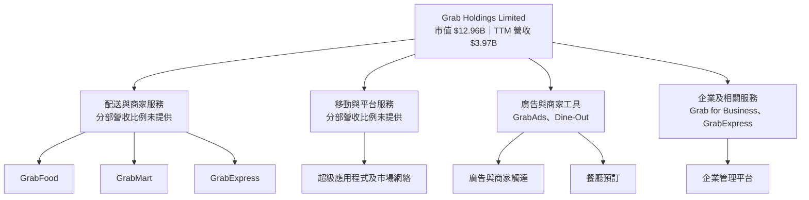
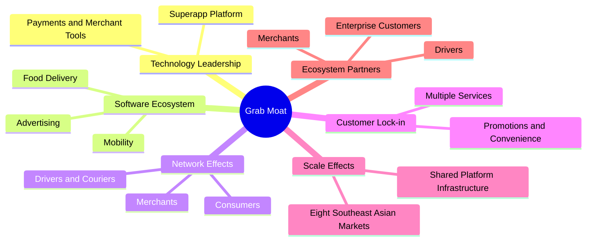
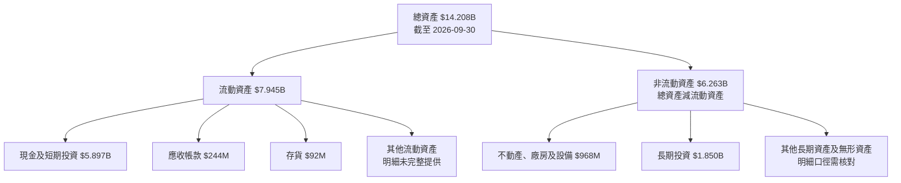
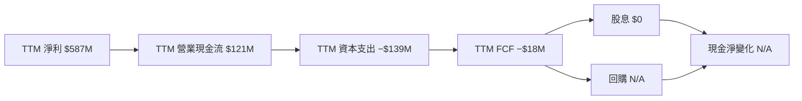
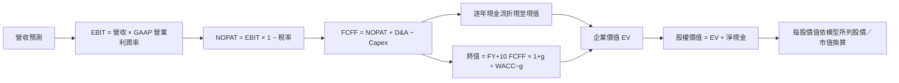
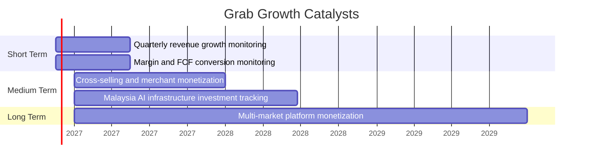
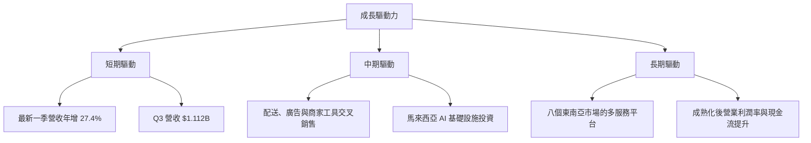
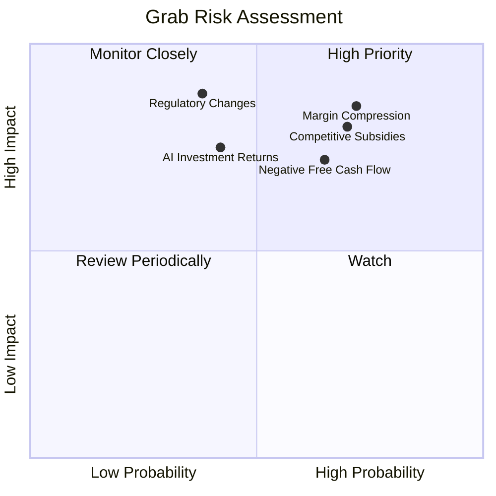
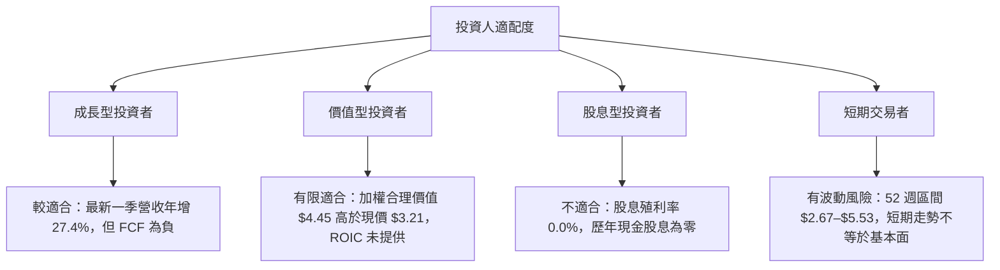

# GRAB 基本面深度分析報告
> **報告日期**：2026-11-17 ｜ **語言**：繁體中文 ｜ **數據來源**：Yahoo Finance、Finviz、StockAnalysis、Roic.ai ｜ **分析師**：CFA 級機構研究

## 目錄

| # | 章節 | 核心結論 |
|---|------|----------|
| 1 | 執行摘要 | 買入；加權合理價值 $4.45；MOS +27.9% |
| 2 | 公司概覽與商業模式 | 東南亞多邊平台具網路效應，但分部營收與市場份額未提供 |
| 3 | 損益表深度分析 | TTM 營收 $3.97B；最新一季年增 27.4%，季度營業利潤率低於 TTM |
| 4 | 資產負債表分析 | 淨現金 $3.83B；短期流動性尚可，現金較 FY2025 年底減少 |
| 5 | 現金流量深度分析 | TTM FCF −$18M，FCF Yield −0.14%，現金轉換尚不穩定 |
| 6 | 獲利能力與資本效率 | WACC 8.60%；ROIC 未提供，無法確認是否創造超額經濟價值 |
| 7 | 相對估值分析 | Forward P/E 高於同業中位數；估值方法輸出分歧 |
| 8 | DCF 內在價值評估 | 基準 DCF $5.92／股；加權合理價值 $4.45／股 |
| 9 | 成長催化劑 | 最新一季營收成長、平台交叉銷售及 AI 投資可能帶來催化 |
| 10 | 風險矩陣 | 競爭與補貼、獲利波動、AI 投資回報為主要風險 |
| 11 | 投資建議 | 買入；建議買入區間 $2.67–$4.01，重點監測利潤率與 FCF |

---

## 1. 執行摘要

### 1.0 一頁式投資儀表板

| 項目 | 內容 |
|------|------|
| **投資論點（3 句）** | ① 最新一季營收年增 27.4%，Q3 2026 營收達 $1.11B，成長動能高於 UBER 的 9.6%。② 公司有 $3.83B 淨現金，且 TTM 營業利益率為 11.0%，提供投資與抗風險緩衝。③ 但 TTM FCF 為 −$18M、FCF Yield −0.14%，最新一季營業利益率 5.6%，現金獲利與季度利潤仍需驗證。 |
| **綜合評分** | **6.0/10**（引用 1.1 評分卡） |
| **財務健康** | 🟢 淨現金 $3.83B、流動比率 1.384；但 TTM FCF 為負，短期流動性不代表現金流已穩定 |
| **ROIC vs WACC** | ROIC：N/A；WACC：8.60%。缺少可比 ROIC，暫不能判定經濟利潤正負 |
| **FCF 趨勢** | 2024 年 FCF $739M，FY2025 −$44M，TTM −$18M；TTM FCF Yield −0.14% |
| **估值** | Forward P/E 20.44716x ｜ EV/EBITDA 21.603x ｜ FCF Yield −0.14% |
| **DCF 內在價值（基準）** | $5.92；相對 2026-11-16 收盤價 $3.21 的折價為 **45.8%**（折溢價 −45.8%，DCF 基準） |
| **安全邊際（MOS）** | **+27.9%**＝($4.45 − $3.21) ÷ $4.45；🟢 >25% 充足。基準為 8.8 加權合理價值 |
| **預期報酬（基準情境 12M）** | **+38.6%**，以加權合理價值 $4.45 相對現價 $3.21 計算 |
| **關鍵風險（前二）** | 平台價格競爭侵蝕利潤；FCF 轉負且季營業利益率波動 |
| **評級 + 信心度** | 🟢 **買入** ｜ 信心：中低；估值有折價，但 ROIC、分部經濟性與 EPS 預期差資料不足 |

依加權合理價值 $4.45、現價 $3.21 計算，MOS 為 27.9%；評級依程式提供的 MOS 規則為「買入」。ROIC 數據缺漏，不以未證實的 ROIC > WACC 推導「強烈買入」。DCF 基準價值高於現價，但 TTM FCF 為負，且估值對終值假設敏感，因此評級信心度不宜過高。

### 1.1 綜合評分卡

| 維度 | 評分（1–10） | 主要依據（引用數字與其來源章節） |
|------|--------------|----------------------------------|
| 成長性 | 8.0 | TTM 營收成長率 N/A；最新一季營收年增 27.4%，高於 UBER 9.6%（第 3、7 章） |
| 獲利能力 | 5.0 | TTM 營業利益率 11.0%，但最新一季為 5.6%；ROIC 與 Piotroski F-Score N/A（第 3、6 章） |
| 財務健康 | 7.0 | 淨現金 $3.83B、流動比率 1.384、速動比率 1.07；TTM FCF −$18M（第 4、5 章） |
| 估值 | 7.0 | 加權合理價值 $4.45、MOS +27.9%；Forward P/E 20.44716x 高於同業中位數 15.9x（第 7、8 章） |
| 護城河 | 6.0 | 多國平台串接外送、交通、商家與金融服務；缺少市場份額、留存率與分部利潤數據（第 2 章） |
| 管理層與資本配置 | 3.0 | FY2025 SBC $241M，約為營收 7.2%；FY2025 股息為零，FY2025 FCF −$44M（第 3、5 章） |
| **綜合評分** | **6.0** | 六項算術平均：(8+5+7+7+6+3) ÷ 6 = 6.0 |

### 1.2 五大投資論點 + 三大核心風險

| 類型 | 項目 | 具體依據 | 信心度 |
|------|------|----------|--------|
| 🟢 **投資論點①** | 最新一季成長加速 | 2026 Q3 營收 $1.112B，年增 27.4%，較 Q2 的 21.86% 年增率提高 | 🟢 高 |
| 🟢 **投資論點②** | 現金儲備提供韌性 | 現金及短期投資 $5.90B、總債務 $2.07B、淨現金 $3.83B | 🟢 高 |
| 🟢 **投資論點③** | TTM 經營獲利已轉正 | TTM 營業利益率 11.0%，EBITDA Margin 11.2%；與過往年度營業虧損相比已有改善 | 🟡 中 |
| 🟢 **投資論點④** | 多服務平台具交叉銷售條件 | 公司在八個東南亞市場經營配送等服務，並提供廣告、商家與企業平台；分部營收未提供 | 🟡 中 |
| 🟢 **投資論點⑤** | 加權估值較現價有折價 | 加權合理價值 $4.45，現價 $3.21，MOS +27.9%；DCF 基準價值 $5.92 | 🟡 中 |
| 🟡 **風險①** | FCF 波動與轉負 | TTM FCF −$18M；FY2025 FCF −$44M，而 FY2024 曾為 +$739M，年度現金流波動顯著 | 🟡 中 |
| 🔴 **風險②** | 利潤率及盈餘波動 | TTM 營業利益率 11.0%，最新一季 5.6%；Q3 2026 淨利 $27M，低於前季 $253M | 🔴 高 |
| 🔴 **風險③** | 競爭、監管與新投資回報不確定 | 同業包含 UBER、SE、DASH；新聞提及 Grab 與 SoftBank 規劃馬來西亞 AI 基礎設施投資，投資額與回報細節未在財務資料中披露 | 🟡 中 |

### 1.3 快速統計卡片

| 指標 | 公司實際值（期間） | 同業中位數 | 狀態 |
|------|--------------------|------------|------|
| 營收成長（TTM） | **N/A** | — | 🟡 |
| 營收成長（最新一季年增） | **27.4%** | 34.0% | 🟡 |
| 毛利率（TTM） | **41.4%** | 45.0% | 🟡 |
| 營業利益率（TTM） | **11.0%** | — | 🟢 |
| ROIC（TTM） | **N/A** | — | 🟡 |
| Forward P/E | **20.44716x** | 15.9x | 🔴 |
| FCF Yield（TTM） | **−0.14%** | — | 🔴 |
| Piotroski F-Score | **N/A / 9** | — | 🟡 |

### 1.4 投資結論

```text
╔══════════════════════════════════════════════════════════════════╗
║                    📊 投資結論摘要                               ║
╠══════════════════════════════════════════════════════════════════╣
║  評級：買入（依 MOS +27.9%；ROIC 缺值，不升為強烈買入）          ║
║  價格（2026-11-16 收盤）：$3.21                                  ║
║  DCF 內在價值（基準）：$5.92（現價折價 45.8%）                   ║
║  安全邊際 MOS：+27.9%（＝($4.45−$3.21)÷$4.45）                  ║
║  加權合理價值（8.8）：$4.45                                      ║
║  DCF 情境價值：                                                   ║
║    悲觀情境：$3.09（−3.7%）                                      ║
║    基準情境：$5.92（+84.3%）                                     ║
║    樂觀情境：$12.10（+277.0%）                                   ║
║  綜合評分：6.0/10（引用 1.1）                                    ║
║  適合投資人：能承受現金流波動、持有期間較長的成長型投資人        ║
╚══════════════════════════════════════════════════════════════════╝
```

---

## 2. 公司概覽與商業模式

### 2.1 業務結構與收入來源

公司資料描述 Grab 在柬埔寨、印尼、馬來西亞、緬甸、菲律賓、新加坡、泰國與越南經營超級應用程式，提供配送及相關平台服務。財務資料沒有披露分部營收或各服務收入比例，因此不推算板塊占比。



### 2.2 市場份額

市場份額數據未提供，亦無可引用的年份與來源，故不繪製市場份額圖。Grab TTM 營收為 $3.97B，最新一季年增 27.4%；相較 UBER 最新一季年增 9.6%，Grab 的增速較快，但與 SE 的 43.4%、DASH 的 34.0% 相比仍較低。營收增速不能直接等同市場份額變化。

### 2.3 競爭護城河分析



### 2.4 護城河強度

| 護城河項目 | 強度（強／中／弱） | 證據（引用數字或事實） | 會削弱它的情況 |
|------------|--------------------|------------------------|----------------|
| 技術與平台 | 中 | 超級應用程式涵蓋配送、廣告、商家和企業服務；TTM 營收 $3.97B | 服務可靠度下降、技術投入未轉化為留存或利潤 |
| 軟體生態系統 | 中 | GrabFood、GrabMart、GrabAds、Grab for Business 等多類服務 | 同業以補貼或更低抽成吸引客戶與商家 |
| 網路效應 | 中 | 多邊平台連接消費者、商家與服務供應者；但活躍用戶及供需密度未提供 | 供應端或需求端流失造成服務品質惡化 |
| 客戶鎖定 | 弱至中 | 多服務整合可增加使用便利性；沒有留存率或切換成本數據 | 用戶可低成本轉用競爭平台 |
| 規模效應 | 中 | 在八個東南亞市場營運，TTM 營收 $3.97B | 各國監管分散、跨國成本及競爭削弱規模優勢 |
| 生態夥伴 | 中 | 平台連接商家、司機／配送人員與企業客戶 | 勞動規範變動、商家議價力增強或夥伴多平台化 |

1.1「護城河」評分為 6.0/10，理由是多服務平台和多國布局提供網路及規模效應，但目前缺乏市場份額、留存率、抽成率及分部利潤等可量化證據。

---

## 3. 損益表深度分析

### 3.1 年度收入成長趨勢（近 4 年）

| 財年 | 營收 | YoY |
|------|------|-----|
| FY2022 | $1.43B | +112.3% |
| FY2023 | $2.36B | +64.6% |
| FY2024 | $2.80B | +18.6% |
| FY2025 | $3.37B | +20.5% |

```text
╔══════════════════════════════════════════════════════════════════╗
║              Grab 年度收入趨勢（FY2022-FY2025）                  ║
╠══════════════════════════════════════════════════════════════════╣
║  FY2022  $1.43B  ████████░░░░░░░░░░░░░░░░  YoY +112.3% 🟢      ║
║  FY2023  $2.36B  ██████████████░░░░░░░░░░  YoY  +64.6% 🟢      ║
║  FY2024  $2.80B  █████████████████░░░░░░░  YoY  +18.6% 🟡      ║
║  FY2025  $3.37B  ████████████████████░░░░  YoY  +20.5% 🟢      ║
╠══════════════════════════════════════════════════════════════════╣
║  FY2022-FY2025 三年 CAGR：($3.37B ÷ $1.43B)^(1/3)−1 ≈ 33.0%   ║
╚══════════════════════════════════════════════════════════════════╝
```

收入由 FY2022 的 $1.43B 增至 FY2025 的 $3.37B，三年 CAGR 約 33.0%。但增速由 2022–2023 的高基期快速成長，轉為 FY2024–2025 約 19%–21%，顯示業務仍擴張、但不能把早期高增速直接外推至長期。

TTM 營收為 $3.97B；**TTM 對前一 TTM 成長率為 N/A**。StockAnalysis 顯示 TTM Revenue Growth 22.99%，但本報告對 TTM 成長率依指定口徑採 N/A，不以其他來源替代。

### 3.2 季度收入趨勢分析

| 季度 | 營收 | QoQ | YoY | 備註 |
|------|------|-----|-----|------|
| 2025 Q4 | $906M | +17.8% | +18.59% | QoQ 相較 2025 Q3 $873M |
| 2026 Q1 | $955M | +5.4% | +23.54% | 年增高於前一季 |
| 2026 Q2 | $998M | +4.5% | +21.86% | 連續季增，但年增略降 |
| 2026 Q3 | $1.112B | +11.4% | +27.4% | 單季年增加速，創表列季度新高 |

QoQ 按同一季度營收相除計算，例如 Q3 2026 QoQ = ($1.112B ÷ $998M) − 1 = 11.4%。季度營收連續上升，Q3 年增加速至 27.4%，是目前最直接的需求動能證據；但單季增長不能替代 TTM 成長率。

### 3.3 利潤率演變分析

下表年度毛利與營業利益採 Yahoo 年度損益資料；年度數據與其他來源的部分項目存在差異，以下以同一組年度財務表內數字計算。

| 利潤率指標 | FY2022 | FY2023 | FY2024 | FY2025 | 趨勢 | 評估 |
|------------|--------|--------|--------|--------|------|------|
| **毛利率** | 5.4% | 36.4% | 41.8% | 43.3% | 連續改善 | 🟢 |
| **營業利益率** | −90.2% | −16.4% | −2.0% | 6.6% | 明顯改善並轉正 | 🟢 |
| **淨利率** | 約 −117.5% | 約 −18.4% | 約 −3.8% | 約 8.0% | FY2025 轉正 | 🟡 |

FY2025 毛利率約 43.3%，較 FY2024 約 41.8% 上升，反映收入增加的同時，毛利額增速高於營收。FY2025 營業利益轉為 $222M，營業利潤率約 6.6%；TTM 營業利益率則為 11.0%，表示近四季相較 FY2025 全年口徑有進一步改善。惟最新一季營業利益率只有 5.6%，且 Yahoo 季度損益表與 StockAnalysis 對部分季度營業利益金額不同，單季利潤率需留意口徑差異。

| 季度 | 毛利 | 營業利益（Yahoo 季度表） | 淨利 |
|------|------|--------------------------|------|
| 2025 Q4 | $397M | $98M | $172M |
| 2026 Q1 | $414M | $74M | $136M |
| 2026 Q2 | $437M | $93M | $253M |
| 2026 Q3 | $517M | $170M | $27M |

Q3 2026 毛利升至 $517M、營業利益升至 $170M，但淨利降至 $27M；營業層面改善並未同步轉化為淨利，非營業項目、稅務或其他損益的分解數據未提供，不能將淨利下降歸因於單一因素。

### 3.4 費用結構分析

分項費用資料不足以完整拆解營收成本、行銷、研發、一般行政及其他費用，因此不繪製會暗示完整費用占比的圓餅圖。可確認的項目包括：FY2025 研發費用 $428M，SBC $241M；兩者定義與財報費用分類可能重疊，不應相加作為完整營運費用。

### 3.5 季度 EPS 趨勢與盈餘品質（Quality of Earnings）

| 季度 | EPS 實際值 | EPS 預期值 | 超預期／不及預期 |
|------|------------|------------|------------------|
| 2025 Q4 | $0.04（StockAnalysis） | N/A | N/A |
| 2026 Q1 | −$0.01（StockAnalysis） | N/A | N/A |
| 2026 Q2 | $0.06（StockAnalysis） | N/A | N/A |
| 2026 Q3 | $0.01（StockAnalysis） | N/A | N/A |

EPS Est 資料為缺值，故不能判定最近四季是否超預期或不及預期。提供的資料標示最新一季 EPS YoY −32.2%，淨利 YoY −27.0%；季度 EPS 實際值與不同來源的季度淨利呈現亦有差異，需以公司申報文件核對。

| 盈餘品質項目 | 數值／佔比 | 評估 |
|--------------|-----------|------|
| SBC / 營收 | FY2025：$241M ÷ $3.37B = **7.2%**；最近四季 SBC 合計 $234M ÷ TTM 營收 $3.97B = **5.9%** | 🔴 SBC 具實質稀釋成本，GAAP 已列為費用，但仍需關注股數變化 |
| SBC / 營業現金流 | 最近四季 $234M ÷ $121M = **193.4%** | 🔴 SBC 金額大於 TTM 營業現金流，營運現金流的股東含金量有限 |
| FCF / 淨利 | −$18M ÷ $587M = **−3.1%** | 🔴 TTM 會計淨利未轉化為正自由現金流 |
| 一次性／非經常性損益 | N/A；資料未提供足以分解的項目 | 🟡 無法判定 FY2025 盈餘或 TTM 淨利受一次性項目影響程度 |
| 有效稅率異常 | 25.7%（最近年度有效稅率） | 🟡 未提供年度稅費明細以判斷異常或遞延稅影響 |
| 資本化支出 vs 費用化 | TTM Capex $139M；FY2025 Capex $123M；資本化政策細節 N/A | 🟡 有支出數字，但無法據此判斷費用是否遞延資本化 |

**盈餘品質結論：**TTM 淨利率 14.8% 與 FCF 為負並存，且 TTM SBC 約為營業現金流的 193.4%。這表示會計獲利尚未伴隨穩定自由現金流，投資人不宜只以 P/E 衡量獲利含金量；若現金轉換未改善，DCF 的長期現金流假設需下修。

---

## 4. 資產負債表分析

### 4.1 資產結構分解

截至 2026-09-30，總資產為 $14.208B，流動資產 $7.945B。非流動資產按「總資產減流動資產」計得 $6.263B；此為算術差額，不是另行披露的報表科目。



### 4.2 流動性與營運資金分析

| 指標 | FY2022 | FY2023 | FY2024 | FY2025 | 最新資料 | 評估 |
|------|--------|--------|--------|--------|----------|------|
| 流動比率 | 5.17 | 3.90 | 2.54 | 1.75 | **1.384** | 🟡 仍高於 1，但較歷史下降 |
| 速動比率 | N/A | N/A | N/A | N/A | **1.07** | 🟡 略高於 1 |
| 現金及短期投資 | $5.13B | $5.15B | $5.68B | $6.86B | **$5.90B** | 🟡 較 FY2025 年底下降 |
| 淨現金 | N/A | N/A | N/A | N/A | **$3.83B** | 🟢 有流動性緩衝 |

FY2025 流動比率依年度流動資產除流動負債計算；最新比率採財務數據所列 1.384。不同期間口徑顯示流動性相較 FY2025 年底有所下降，但公司仍持有 $5.90B 現金及短期投資。

營運資金天數依 QUALITY FIGURES 原值引用；一年前未提供。

| 指標 | 最新 TTM | 一年前 TTM | 變化 | 解讀 |
|------|----------|------------|------|------|
| DSO 應收帳款天數 | 22 天 | N/A | N/A | 一年前數據缺漏，無法判斷收款速度趨勢 |
| DIO 存貨天數 | 15 天 | N/A | N/A | 一年前數據缺漏 |
| DPO 應付帳款天數 | 219 天 | N/A | N/A | 高 DPO 使現金轉換週期為負，但不能單獨證明議價力 |
| CCC 現金轉換週期 | −182 天 | N/A | N/A | CCC = 22 + 15 − 219 = −182 天；一年前比較缺漏 |

### 4.3 債務結構分析

```text
╔══════════════════════════════════════════════════════════════════╗
║                   Grab 債務健康診斷                              ║
╠══════════════════════════════════════════════════════════════════╣
║  總債務：        $2.07B       🟡                                ║
║  現金+短期投資： $5.90B       🟢                                ║
║  淨現金：        $3.83B       🟢                                ║
║                                                                  ║
║  流動比率：      1.384x       🟡                                ║
║  速動比率：      1.07x        🟡                                ║
║  Debt/EBITDA：   約 4.0x      🟡 以 TTM EBITDA 估算              ║
║  利息保障倍數：  N/A          缺少利息費用與可比 EBIT 口徑       ║
║                                                                  ║
║  判斷：淨現金提供緩衝，但 FCF 為負，不能只憑現金餘額判定資本    ║
║        配置已達自我融資。                                         ║
╚══════════════════════════════════════════════════════════════════╝
```

Debt/EBITDA 約為 $2.07B ÷ ($3.97B × 11.2%) = $2.07B ÷ 約 $445M = 約 4.6x；因 TTM EBITDA Margin 11.2% 與 EBITDA 金額未完全同口徑，報告不把該比率視為精確公司披露值。利息保障倍數缺乏利息費用數據，不估算。

### 4.4 股東權益趨勢

| 年末 | 股東權益 |
|------|----------|
| 2022-12-31 | $6.60B |
| 2023-12-31 | $6.45B |
| 2024-12-31 | $6.40B |
| 2025-12-31 | $6.73B |

```text
╔══════════════════════════════════════════════════════════════════╗
║                 Grab 歷年股東權益變化                            ║
╠══════════════════════════════════════════════════════════════════╣
║  FY2022  $6.60B  ████████████████████                           ║
║  FY2023  $6.45B  ███████████████████                            ║
║  FY2024  $6.40B  ███████████████████                            ║
║  FY2025  $6.73B  ████████████████████                           ║
╚══════════════════════════════════════════════════════════════════╝
```

FY2025 股東權益較 FY2024 增加 $330M；但同期 SBC 為 $241M，權益變動不能簡化為現金累積或內生獲利，仍需結合股權發行、其他綜合損益及資本交易核對。

---

## 5. 現金流量深度分析

### 5.1 現金流量瀑布圖

TTM 營業現金流 $121M，Capex $139M，依指定定義得到 FCF −$18M。TTM 淨利 $587M，股息支付為零；回購資料未提供。



### 5.2 FCF 轉換率趨勢

| 期間 | FCF | 淨利 | FCF／淨利 | 解讀 |
|------|-----|------|-----------|------|
| FY2022 | −$872M | −$1.68B | 51.9%（負值對負值，經濟意義有限） | 虧損與負 FCF 均大 |
| FY2023 | −$6M | −$434M | 1.4%（分母為負，不宜作一般轉換率解讀） | FCF 接近損益兩平 |
| FY2024 | +$739M | −$105M | 不適用 | FCF 大幅為正但淨利為負，可能受營運資金與非現金項目影響 |
| FY2025 | −$44M | +$268M | −16.4% | 正淨利未轉化成正 FCF |
| TTM | −$18M | $587M | −3.1% | 現金轉換仍弱 |

### 5.3 自由現金流趨勢

| 期間 | FCF | FCF Yield |
|------|-----|-----------|
| FY2022 | −$872M | N/A |
| FY2023 | −$6M | N/A |
| FY2024 | +$739M | N/A |
| FY2025 | −$44M | N/A |
| TTM | **−$18M** | **−0.14%** |

```text
╔══════════════════════════════════════════════════════════════════╗
║                 自由現金流：年度實際與 TTM                       ║
╠══════════════════════════════════════════════════════════════════╣
║  FY2022  −$872M  ◀████████████████████                          ║
║  FY2023    −$6M  ◀                                                ║
║  FY2024  +$739M  █████████████████                              ║
║  FY2025   −$44M  ◀█                                               ║
║  TTM      −$18M  ◀                                                ║
╠══════════════════════════════════════════════════════════════════╣
║  TTM FCF Yield：−0.14%                                           ║
╚══════════════════════════════════════════════════════════════════╝
```

FY2024 FCF 大幅為正，FY2025 與 TTM 又回到負值，顯示自由現金流仍受季度營運資金、營運現金流與資本支出波動影響。DCF 採用的長期正 FCFF 路徑，必須由後續季度現金轉換持續驗證。

### 5.4 資本配置評估

| 項目 | 可得數據 | 評估 |
|------|----------|------|
| 資本支出 | TTM $139M；FY2025 $123M | TTM Capex 高於營業現金流，造成 TTM FCF 為負 |
| 研發 | FY2025 $428M | 研發投入規模可觀，但投資回報未提供 |
| 股息 | FY2022–FY2025 均為 $0；股息殖利率 0.0% | 資本以再投資而非股息回饋為主 |
| 回購 | N/A | 無回購金額資料，不推定有無回購 |
| SBC | FY2025 $241M | 形成股東稀釋成本，需追蹤股數變化 |
| 留存現金 | 現金及短期投資 $5.90B | 提供投資與財務緩衝，但較 FY2025 年底 $6.861B 下降 |

缺乏可完整加總的資本配置支出明細，故不製作以比例呈現的資本配置圓餅圖。

---

## 6. 獲利能力與資本效率

### 6.1 ROE／ROA／ROIC 趨勢

| 指標 | 最新資料 | 歷史資料 | 評估 |
|------|----------|----------|------|
| ROE | TTM 7.6% | FY2022–FY2025 可比序列 N/A | 🟡 正值但不高；杜邦分解不可用 |
| ROA | TTM 1.1% | 可比歷史序列 N/A | 🟡 資產報酬偏低 |
| ROIC | N/A | Roic.ai 歷史 ROIC 列為缺值 | 🟡 缺少投入資本與一致 NOPAT 數據 |
| WACC | **8.60%** | 依資本成本資料 | 作為折現率與價值創造門檻 |

因 ROIC 缺值，無法把 ROE、ROA 或營業利潤率當成 ROIC 的替代指標，也無法與 WACC 做定量價差比較。

### 6.2 ROIC vs WACC 分析（核心價值創造判斷）

```text
╔══════════════════════════════════════════════════════════════════╗
║                ROIC vs WACC 深度分析                            ║
╠══════════════════════════════════════════════════════════════════╣
║  WACC（採用資本成本資料）：8.60%                                 ║
║  ├── 無風險利率（10Y 美債）：5.12%                               ║
║  ├── 市場風險溢酬 ERP：5.00%                                     ║
║  ├── 原始 Beta：0.83                                             ║
║  ├── 調整後 Beta：0.89 = ⅔×0.83 + ⅓×1.00                        ║
║  ├── 股權成本（提供值）：9.56%                                   ║
║  ├── 稅前債務成本：3.43%；有效稅率：25.7%                       ║
║  ├── 股權／債務權重：86.2%／13.8%                               ║
║  └── ✅ WACC：8.60%（採用提供值）                                ║
║                                                                  ║
║  ROIC：N/A（缺少可比投入資本及 NOPAT 資料）                     ║
║  EVA = ROIC − WACC：N/A                                          ║
║                                                                  ║
║  結論：無法判定 Grab 是否正以高於 8.60% 的 ROIC 創造股東價值。  ║
╚══════════════════════════════════════════════════════════════════╝
```

成本資本資料提供的股權成本為 9.56%。以已四捨五入的 Rf、Beta 與 ERP 直接計算會得到 5.12% + 0.89 × 5.00% = 9.57%；報告依指定採用原值 9.56%，差異為輸入精度造成的四捨五入。稅後債務成本依提供輸入約為 3.43% × (1 − 25.7%) = 2.55%；提供的 WACC 為 8.60%，全報告採用該值，不另建 WACC。

**價值判斷：**WACC 8.60% 是折現與資本回報門檻，但 ROIC 為 N/A；目前只能確認公司已實現正 TTM 營業利潤率 11.0%，不能據此推論 ROIC 一定高於 WACC。缺少投入資本、現金及營運負債口徑的完整計算。

### 6.3 杜邦三因素分解

QUALITY FIGURES 的 DuPont 為 N/A，原因是淨利、營收、總資產或正股東權益等計算條件缺漏或口徑不完整。依要求不重算、不補值。

| 因素 | 數值（TTM） | 解讀 |
|------|-------------|------|
| 淨利率 | N/A | DuPont 指標區塊為 N/A |
| 資產週轉率 | N/A | DuPont 指標區塊為 N/A |
| 權益乘數 | N/A | DuPont 指標區塊為 N/A |
| **ROE** | **N/A** | QUALITY FIGURES 的 DuPont 分解未能計算 |

另有一般財務數據列示 ROE 7.6%、ROA 1.1%；但不以此反推 DuPont 三項因子。

### 6.4 財務體質：Piotroski F-Score

Piotroski F-Score 為 N/A，原因是需要相隔一年、可比的兩期 TTM SEC 申報數據；目前來源為 Yahoo 季度財務資料，無相應 SEC 申報計算基礎。

| 測試 | 結果 | 解讀 |
|------|------|------|
| 1. 正 ROA | N/A | 依 QUALITY FIGURES 不可判定 |
| 2. 正營業現金流 | N/A | 單一期間數字不足以完成 F-Score 測試 |
| 3. ROA 改善 | N/A | 缺少可比兩期 TTM SEC 數據 |
| 4. 營業現金流高於淨利 | N/A | 不補算 F-Score 測試 |
| 5. 長期負債比下降 | N/A | 可比期間條件未滿足 |
| 6. 流動比率改善 | N/A | 可比期間條件未滿足 |
| 7. 未增發股份 | N/A | 可比期間條件未滿足 |
| 8. 毛利率改善 | N/A | 可比期間條件未滿足 |
| 9. 資產週轉率改善 | N/A | 可比期間條件未滿足 |

---

## 7. 相對估值分析

### 7.1 同業估值比較表格

| 估值指標 | **GRAB** | **UBER** | **SE** | **DASH** | GRAB 評估 |
|----------|---------|---------|-------|---------|-----------|
| **Trailing P/E** | 32.1x | 41.2x | 25.8x | 70.4x | 🟡 位於同業區間中段 |
| **Forward P/E** | 20.44716x | 15.9x | 15.0x | 22.3x | 🔴 高於三家中位數 15.9x |
| **P/S Ratio** | 3.264174x | 2.5x | 1.4x | 4.3x | 🟡 高於 UBER、SE，低於 DASH |
| **EV/EBITDA** | 21.603x | 19.4x | 14.1x | 41.7x | 🟡 高於 UBER、SE；低於 DASH |
| **最新一季營收 YoY** | 27.4% | 9.6% | 43.4% | 34.0% | 🟡 高於 UBER，低於 SE、DASH |
| **毛利率（TTM）** | 41.4% | 41.4% | 45.0% | 52.7% | 🟡 低於 SE、DASH |

GRAB Forward P/E 高於同業中位數 15.9x，代表市場已給予其成長與盈利改善一定估值；但估值溢價需要持續營收增長和利潤轉化支撐。Peer multiples 的中位數依 UBER、SE、DASH 給定數值計算；各估值方法的倍數及同業樣本則依 8.8 提供的計算口徑引用。

### 7.2 歷史估值區間分析

歷史 P/E 區間及當前 P/E 百分位資料未提供，故無法判斷當前估值相對 GRAB 自身歷史處於何種位置。股價歷史資料顯示 2024-11 月收盤價 $5.00，2026-10 月 $2.71，2026-11 月 $3.21；股價走勢不能替代歷史 P/E 區間。

### 7.3 情境價值（Bear / Base / Bull）

以下數字直接引用 DCF Scenarios；條件描述為分析解讀，並非額外假設模型輸入。

| 情境 | 第 1 年營收成長 | 期末營業利潤率 | WACC | 每股價值 | 相對現價 | 機率 | 會發生的條件 |
|------|----------------|----------------|------|----------|----------|------|--------------|
| 🔴 悲觀 | 13.7% | 9.3% | 9.60% | $3.09 | −3.7% | 25% | 增長放緩、價格競爭或配送成本上升，利潤率難以維持基準 |
| 🟡 基準 | 27.4% | 11.0% | 8.60% | $5.92 | +84.3% | 50% | 最新一季成長延續一段時間，長期增速再逐步降至 3.0% |
| 🟢 樂觀 | 41.1% | 12.0% | 7.60% | $12.10 | +277.0% | 25% | 需求與交叉銷售加速、利潤率擴張且折現率下行 |

### 7.4 相對估值隱含價格區間

```text
╔══════════════════════════════════════════════════════════════════╗
║              相對估值方法與目前股價位置                          ║
╠══════════════════════════════════════════════════════════════════╣
║  $2.49        $3.21          $3.68                $5.39   $5.92  ║
║  Forward P/E  現價           EV/EBITDA             共識    DCF   ║
║  −22.4%                       +14.6%                +67.9% +84.4%║
╚══════════════════════════════════════════════════════════════════╝
```

- **同業 Forward P/E：$2.49／股。**使用同業中位數 15.9x × GRAB Forward EPS $0.16。
- **同業 EV/EBITDA：$3.68／股。**使用 UBER、SE 同業中位數 16.7x × TTM EBITDA，再加淨現金。
- **DCF 基準：$5.92／股。**
- **分析師共識目標價：$5.39／股。**22 位分析師平均目標價。

---

## 8. DCF 內在價值評估（Discounted Cash Flow）

### 8.0 估值推理鏈（Thinking Logic）

**Step 1 — 價值來源及主導變數**

本模型以配送與平台主業現金流為主，但公司未提供各分部營收占比，因此不能可靠地把 $3.97B TTM 營收拆為主業、廣告、金融或新業務的金額。模型的主要可驗證變數是營收成長、GAAP 營業利潤率及 WACC；敏感性矩陣顯示終值成長率與 WACC 對每股價值有顯著影響。由於終值現值占企業價值 65.9%，長期現金流和折現率是主要估值驅動因子。

**Step 2 — 模型選擇**

| 決策點 | 本報告採用 | 理由（含數字） | 曾考慮但否決 | 否決理由 |
|--------|-----------|----------------|--------------|----------|
| 現金流定義 | FCFF | 對企業價值折現並使用 WACC；模型明定 FCFF = NOPAT + D&A − Capex | FCFE | 公司資本結構與債務變動需透過企業價值橋接處理 |
| 預測期 N | 10 年 | DCF 模型固定 10 年，營收增速由 27.4% 線性降至 3.0% | 5 年 | 不符合模型提供的 10 年路徑；不另改模型 |
| 終值方法 | Gordon Growth | 模型以 3.0% 永續成長率計算終值 | 僅退出倍數 | DCF 模型並未提供退出倍數終值，不自行增建 |
| EBIT 基礎 | GAAP | 模型指定 GAAP EBIT，SBC 已列為費用 | 非 GAAP EBIT | 避免加回 SBC 後再以不一致方式處理股數 |

**Step 3 — 關鍵假設推導鏈**

- **營收增速**：錨點＝最新一季營收年增 27.4%，TTM 成長率 N/A → 調整＝為模型首年提供成長起點，之後逐年線性降至第 10 年 3.0% → **採用 FY+1 27.4%、FY+10 3.0%** → 曾考慮以 TTM 成長作錨，但 TTM 對前一年數據為 N/A，故不以缺值替代。
- **營業利潤率**：錨點＝TTM 營業利潤率 11.0%，FY2025 年營業利益 $222M → 調整＝模型維持 11.0% 至 FY+10，沒有納入最新季度利潤率低至 5.6% 的短期波動 → **採用 11.0% 不變** → 曾考慮以最新季度 5.6% 作終點，但它是單季值，且模型既定採用 TTM／歷史中位數口徑。
- **永續成長率 g**：錨點＝模型採 3.0%，且低於 WACC 8.60% → 調整＝成熟後增速低於高成長期，符合模型逐年降速路徑 → **採用 3.0%** → 不採用高於 3.0% 的替代值，以免終值對長期增長假設過度依賴。
- **預測期 N**：錨點＝模型提供 10 年預測 → 調整＝使用完整十年現金流收斂路徑 → **採用 10 年** → 不擅自縮短或延長，避免改變既定估值輸出。
- **Capex／營收**：錨點＝TTM Capex $139M ÷ TTM 營收 $3.97B，約 3.5% → 模型將 3.5% 維持至 FY+10 → **採用 3.5%** → 模型不採用更低 Capex 比例；資本支出仍應跟蹤，因為 TTM Capex 高於營業現金流。
- **D&A／營收**：錨點＝模型提供 TTM 5.6% → **採用 5.6% 不變**；缺少可比歷史年度比率，不另選替代值。
- **EBIT 基礎與 SBC**：錨點＝模型採 GAAP EBIT，已含 SBC 費用 → **採用組合 (A)：不另減 SBC，固定股數、不另計稀釋** → 否決再扣 SBC 或加股數稀釋，避免同一成本被重複計入。
- **年稀釋率**：依組合 (A) 固定股數，年稀釋率 0% → 不是聲稱實際股數不變，而是依指定模型組合不在 DCF 中額外稀釋。
- **ΔWC**：模型明確未建模營運資金 → 採用「不建模」，而非假定 ΔWC 為零且在模型外另作調整；CCC 最新為 −182 天，代表營運資金可能具有現金來源效果，但未有預測數據。
- **終值方法**：錨點＝模型使用 Gordon Growth，基於 FY+10 FCFF、g 3.0% → 採用模型指定方法 → 不自行加上缺少依據的退出倍數。
- **WACC**：採用資本成本輸入的 8.60%，由 10Y 美債、ERP、調整後 Beta、債務成本與資本權重構成 → 不另以自算折現率替換程式模型值。

**Step 4 — 最脆弱假設**

最脆弱的一環是把最新一季 27.4% 年增率作為首年營收增速錨點，同時維持 11.0% 營業利潤率；若營收成長較快回落或利潤率接近最新季度 5.6%，基準 DCF 會向下修正。

**Step 5 — 計算路徑圖**



### 8.1 模型假設總表（Model Inputs）

| 假設項目 | 採用值 | 依據／來源 | 敏感度 |
|----------|--------|-------------|--------|
| 預測期長度 N | 10 年 | DCF 模型固定預測長度 | 🟡 中 |
| 營收增長路徑 | FY+1 27.4% 線性遞減至 FY+10 3.0% | 首年採最新一季 YoY；TTM YoY N/A；終年採模型假設 | 🔴 高 |
| 營業利潤率 | FY+1 至 FY+10 均 11.0% | TTM 營業利潤率 11.0%；模型維持不變 | 🔴 高 |
| 有效稅率 | 25.7% | 最近年度有效稅率 | 🟢 低 |
| Capex／營收 | FY+1 至 FY+10 均 3.5% | TTM $139M ÷ $3.97B 約 3.5%；模型維持 | 🟡 中 |
| D&A／營收 | 5.6% | DCF 模型所列 TTM 比率 | 🟢 低 |
| 營運資金變動 | 未建模 | 模型明確排除 Working Capital | 🟢 低 |
| EBIT 基礎 | GAAP EBIT | DCF 模型指定 | 🟡 中 |
| SBC 處理 | 組合 (A)：不另扣 SBC，固定股數 | GAAP EBIT 已含 SBC；模型指定不再稀釋 | 🟡 中 |
| 年稀釋率 | 0%（模型假設） | 組合 (A) 內部一致性要求 | 🟡 中 |
| 永續成長率 g | 3.0% | DCF 模型指定；低於 WACC 8.60% | 🔴 高 |
| 終值方法 | Gordon Growth | DCF 模型提供的計算方式 | 🔴 高 |
| WACC | 8.60% | Cost of capital 資料 | 🔴 高 |

本模型採用 **(A) GAAP EBIT + 固定股數**，故 SBC 影響已計入一次；FCFF 不再扣 SBC，股數亦不逐年放大。FCFF 定義為 **NOPAT + D&A − Capex**，Working Capital 未建模。

### 8.2 折現率推導（WACC）

```text
╔══════════════════════════════════════════════════════════════════╗
║                    WACC 推導（折現率）                           ║
╠══════════════════════════════════════════════════════════════════╣
║  股權成本 Ke（CAPM）：                                           ║
║  ├── 無風險利率 Rf（10Y 美債）：5.12%                            ║
║  ├── 市場風險溢酬 ERP：5.00%                                     ║
║  ├── 原始 Beta：0.83                                             ║
║  ├── 調整後 Beta：0.89 = ⅔×0.83 + ⅓×1.00                        ║
║  ├── 規模／國別額外溢酬：未提供，未另加                         ║
║  └── 股權成本（提供值）：9.56%                                  ║
║                                                                  ║
║  債務成本 Kd：                                                   ║
║  ├── 稅前債務成本：3.43%                                         ║
║  ├── 有效稅率：25.7%                                             ║
║  └── 稅後 Kd = 3.43%×(1−25.7%) = 2.55%                         ║
║                                                                  ║
║  資本結構：                                                      ║
║  ├── 股權權重：86.2%                                             ║
║  ├── 債務權重：13.8%                                             ║
║  └── ✅ 採用 WACC：8.60%                                         ║
╚══════════════════════════════════════════════════════════════════╝
```

逐步演算（WACC）：

1. **Ke（CAPM）**：以未四捨五入輸入計算後，Cost of capital 區塊提供股權成本 **9.56%**。使用已顯示的四捨五入數字重算：5.12% + 0.89 × 5.00% = 9.57%；差異 0.01 個百分點來自原始輸入精度，依規則引用 9.56%。
2. **稅前 Kd**：資料提供稅前債務成本 **3.43%**，並未提供利息費用與可比平均計息負債餘額，故不反推利息支出。
3. **稅後 Kd**：3.43% × (1 − 25.7%) = 3.43% × 74.3% = **2.55%**。
4. **資本權重**：股權 86.2% + 債務 13.8% = **100.0%**；股權市值採市場資料 $12.96B，債務採財務數據 $2.07B。
5. **WACC**：依提供的 Cost of capital 原值採用 **8.60%**。將已四捨五入的權重與成本代入，86.2% × 9.56% + 13.8% × 2.55% = 8.24% + 0.35% = 8.59%，與提供的 8.60% 差 0.01 個百分點，屬顯示精度差異。第 6.2 與本節均採 8.60%。

10Y Treasury 的觀察日未在資料中提供，故只報引用值 5.12%，不另指定日期。ERP 5.00% 為資本成本輸入的假設值。Beta 原始值 0.83，依提供調整法得到 0.89。模型未提供規模或國別溢酬，因此未自行添加。

### 8.3 逐年自由現金流預測（基準情境）

以下逐年金額與折現因子照 DCF 模型引用，金額單位 $B。模型未納入 ΔWC，因此不列 ΔWC 行。

| 年度 | FY+1 | FY+2 | FY+3 | FY+4 | FY+5 | FY+6 | FY+7 | FY+8 | FY+9 | FY+10 |
|------|------|------|------|------|------|------|------|------|------|-------|
| 營收 | 5.06 | 6.31 | 7.69 | 9.18 | 10.70 | 12.18 | 13.53 | 14.67 | 15.51 | 15.98 |
| 營收 YoY | 27.4% | 24.7% | 22.0% | 19.3% | 16.6% | 13.8% | 11.1% | 8.4% | 5.7% | 3.0% |
| 營業利潤率 | 11.0% | 11.0% | 11.0% | 11.0% | 11.0% | 11.0% | 11.0% | 11.0% | 11.0% | 11.0% |
| EBIT | 0.55 | 0.69 | 0.84 | 1.01 | 1.17 | 1.33 | 1.48 | 1.61 | 1.70 | 1.75 |
| − 稅 | (0.14) | (0.18) | (0.22) | (0.26) | (0.30) | (0.34) | (0.38) | (0.41) | (0.44) | (0.45) |
| = NOPAT | 0.41 | 0.51 | 0.63 | 0.75 | 0.87 | 0.99 | 1.10 | 1.20 | 1.26 | 1.30 |
| + D&A | 0.28 | 0.35 | 0.43 | 0.52 | 0.60 | 0.68 | 0.76 | 0.82 | 0.87 | 0.90 |
| − Capex | (0.18) | (0.22) | (0.27) | (0.32) | (0.37) | (0.43) | (0.47) | (0.51) | (0.54) | (0.56) |
| **= FCFF** | **0.52** | **0.65** | **0.79** | **0.94** | **1.10** | **1.25** | **1.39** | **1.51** | **1.59** | **1.64** |
| 折現因子 @8.60% | 0.921 | 0.848 | 0.781 | 0.719 | 0.662 | 0.610 | 0.561 | 0.517 | 0.476 | 0.438 |
| **FCFF 現值 PV** | **0.48** | **0.55** | **0.62** | **0.68** | **0.73** | **0.76** | **0.78** | **0.78** | **0.76** | **0.72** |

模型提供的預測期 PV 合計為 **$6.84B**。逐項以表中兩位小數加總為 $6.86B，與模型總計相差 $0.02B（約 0.3%）；差異來自逐年數字四捨五入，合計依模型未四捨五入數值引用。

**逐步演算（FY+1，金額取兩位小數）：**

1. **營收** = $3.97B × (1 + 27.4%) = $3.97B × 1.274 = **$5.06B**。
2. **EBIT** = 模型營收 $5.06B × 11.0% = **$0.55B**。
3. **稅** = 未四捨五入 EBIT × 25.7% = **$0.14B**。
4. **NOPAT** = EBIT − 稅 = **$0.41B**。
5. **D&A** = $5.06B × 5.6% = **$0.28B**。
6. **Capex** = $5.06B × 3.5% = **$0.18B**。
7. **ΔWC** = 模型未建模，故不列入 FCFF。
8. **FCFF** = NOPAT + D&A − Capex；使用未四捨五入中間值後為 **$0.52B**。表中兩位小數顯示相加可能出現 $0.01B 的尾差。
9. **折現因子** = 1 ÷ (1 + 8.60%)¹ = 0.921；**PV** = 未四捨五入 FCFF × 0.921 = **$0.48B**。

**合理性自檢：**

- 預測 FCF CAGR：FY+1 $0.52B 至 FY+10 $1.64B，九個年度間隔 CAGR 約 **13.6%**；歷史 FCF CAGR 因 FY2022、FY2023、FY2025 的 FCF 為負，無法以一般 CAGR 有意義比較。FY2024 FCF 曾為 $739M，顯示歷史波動很大。
- FY+10 FCFF Margin = $1.64B ÷ $15.98B = **10.3%**；TTM FCF Margin = −$18M ÷ $3.97B = **−0.5%**。同業最佳 FCF Margin 資料未提供，不作推估。
- 預測期各年 FCFF 均為正；若實際現金轉換未達模型假設，預測 PV 和終值均會下降。

```text
╔══════════════════════════════════════════════════════════════════╗
║            自由現金流：歷史實際 vs 模型預測                      ║
╠══════════════════════════════════════════════════════════════════╣
║  FY2023(實)  −$0.006B  ◀                                          ║
║  FY2024(實)  +$0.739B  █████████                                  ║
║  FY2025(實)  −$0.044B  ◀█                                         ║
║  FY+1 (預)    $0.52B    ██████                                     ║
║  FY+10(預)    $1.64B    ████████████████████                       ║
╠══════════════════════════════════════════════════════════════════╣
║  預測現金流建立在 11.0% 利潤率不變及正 FCFF 持續擴張的假設上。  ║
╚══════════════════════════════════════════════════════════════════╝
```

### 8.4 終值計算（Terminal Value）

適用性檢查：**WACC 8.60% vs g 3.0% → WACC > g？✅**

| 方法 | 計算式 | 終值 TV | TV 現值 | 佔總 EV 比重 |
|------|--------|---------|---------|--------------|
| Gordon Growth | $1.64B × (1 + 3.0%) ÷ (8.60% − 3.0%) | $30.16B | $13.22B | 65.9% |
| 退出倍數法 | N/A | N/A | N/A | N/A |

逐步演算：

1. **FY+N FCFF** = FY+10 FCFF = **$1.64B**。
2. **分子** = $1.64B × (1 + 3.0%) = **約 $1.69B**。
3. **分母** = 8.60% − 3.0% = **5.60%**；模型計算 **TV = $30.16B**。呈現數字因中間未四捨五入而略有差異，終值直接引用模型。
4. **PV(TV)** = $30.16B × FY+10 折現因子 0.438 = **$13.22B**（依模型未四捨五入值）。
5. **終值占比** = $13.22B ÷ $20.06B = **65.9%**。

終值現值占 EV 65.9%，雖未超過 75% 警戒線，但企業價值仍有近三分之二來自 FY+10 之後現金流，估值對 g 與 WACC 的設定敏感。模型未提供退出倍數法數值，不自行增建交叉估值。

### 8.5 企業價值 → 每股內在價值（Bridge）

```text
╔══════════════════════════════════════════════════════════════════╗
║              企業價值 → 每股內在價值 橋接表                      ║
╠══════════════════════════════════════════════════════════════════╣
║  預測期 FCF 現值合計            +$6.84B                          ║
║  終值現值 PV(TV)                +$13.22B                         ║
║  ─────────────────────────────────────────────                  ║
║  = 企業價值 EV                   $20.06B                         ║
║  + 現金及短期投資               +$5.90B                          ║
║  − 總債務                       −$2.07B                          ║
║  = 淨現金                        +$3.83B                          ║
║  ─────────────────────────────────────────────                  ║
║  = 股權價值                      $23.89B                         ║
║  每股換算依模型：股權價值×股價÷市值                              ║
║  ★ DCF 基準每股價值              $5.92                           ║
║    當前股價                      $3.21                           ║
║    折溢價（現價÷DCF價值−1）      −45.8%（折價）                  ║
╚══════════════════════════════════════════════════════════════════╝
```

逐步演算：

1. **EV** = $6.84B + $13.22B = **$20.06B**。
2. **股權價值** = $20.06B + $5.90B − $2.07B = **$23.89B**。
3. **每股內在價值** = 股權價值 × 價格 ÷ 市值 = $23.89B × $3.21 ÷ $12.96B = **$5.92**（依模型所列換算公式）。
4. **折溢價** = $3.21 ÷ $5.92 − 1 = **−45.8%**。
5. **本節不計算 MOS**；MOS 僅以第 8.8 節加權合理價值為分母。

股數與財報幣別換算：財報幣別及報價均為 USD；DCF 模型未以單獨稀釋股數除法，而使用模型指定的「股權價值 × 價格 ÷ 市值」公式。模型採組合 (A) 固定股數處理，與 8.1 一致。現金與債務引用最新 TTM 數據：現金及短期投資 $5.90B、總債務 $2.07B。

### 8.6 敏感性分析（WACC × 永續成長率）

矩陣照 DCF 模型原值引用。括號內上行空間依 $3.21 現價計算並四捨五入至一位小數；基準格採模型基準值 $5.92。

| g（列）／WACC（欄） | 6.60% | 7.60% | **8.60%（基準）** | 9.60% | 10.60% |
|-----------|------|------|------------------|------|-------|
| **2.0%** | $7.59（+136.4%） | $6.29（+96.0%） | $5.39（+68.0%） | $4.73（+47.4%） | $4.23（+31.8%） |
| **2.5%** | $8.20（+155.5%） | $6.66（+107.5%） | $5.63（+75.4%） | $4.90（+52.6%） | $4.35（+35.5%） |
| **3.0%（基準）** | $8.97（+179.4%） | $7.11（+121.5%） | **$5.92（+84.4%）** | $5.09（+58.6%） | $4.48（+39.6%） |
| **3.5%** | $10.00（+211.5%） | $7.67（+138.9%） | $6.26（+95.0%） | $5.31（+65.4%） | $4.64（+44.5%） |
| **4.0%** | $11.42（+255.8%） | $8.38（+161.1%） | $6.67（+107.8%） | $5.57（+73.5%） | $4.81（+49.8%） |

DCF 模型的敏感度矩陣基準格為 $5.92。表格中各格與現價的百分比為依顯示值計算；模型基準 DCF 在不同輸出段落的上行數字有 84.3%／84.4% 的四捨五入差異，本文保留各區塊原始數值，不將兩者混用。

**逐步演算說明：**模型已提供敏感度矩陣的每股輸出，但沒有提供各敏感度格的逐年折現現值明細；依「DCF MODEL 數字一律照抄、不得另建模型」的規則，不反推未提供的中間數字，也不另造一組 TV 與 EV 算式。有效格例：WACC 9.60% > g 3.0% ✅；其每股價值依矩陣為 **$5.09**。

**三情境 DCF**

| 情境 | 第 1 年營收成長 | 期末營業利潤率 | WACC | 每股內在價值 | 相對現價 | 主觀機率 |
|------|----------------|----------------|------|--------------|----------|----------|
| 🔴 悲觀 | 13.7% | 9.3% | 9.60% | $3.09 | −3.7% | 25% |
| 🟡 基準 | 27.4% | 11.0% | 8.60% | $5.92 | +84.3% | 50% |
| 🟢 樂觀 | 41.1% | 12.0% | 7.60% | $12.10 | +277.0% | 25% |
| **機率加權** | — | — | — | **$6.76** | **+110.5%** | 100% |

情境價值與機率加權依 DCF 模型直接引用。模型未提供每個情境的 FY+10 營收、FCFF 及終值拆解，故不另行反推情境逐年路徑，避免改動模型或補造輸入。機率加權檢核：$3.09 × 25% + $5.92 × 50% + $12.10 × 25% = **$6.7575，約 $6.76**；機率合計 100%。

敏感性結論（依模型矩陣）：

- **g 每 +1pp**：以基準 WACC 8.60% 為例，g 2.0% 的 $5.39 至 g 3.0% 的 $5.92，增加 **$0.53／股**，約 9.8%。
- **WACC 每 +1pp**：在 g 3.0% 下，WACC 8.60% 的 $5.92 至 9.60% 的 $5.09，減少 **$0.83／股**，約 14.0%。
- **營業利潤率每 +1pp**：敏感度矩陣未提供該項單變數數值，標示 **N/A**，不自行計算。
- 結論：模型表明 WACC 變動對上述測試點價值影響顯著；因營業利潤率單變數敏感度缺值，不能量化比較其影響大小。

### 8.7 反推 DCF（Reverse DCF：市場在預期什麼）

反推值直接引用模型輸出。模型提供的固定基準輸入包括 WACC 8.60%、稅率 25.7%、Capex／營收 3.5%、預測期 10 年，且未建模 ΔWC；固定股數依組合 (A)。利潤率反推結果為固定營業利潤率；其餘變數維持模型基準。

| 求解的變數（一次一個） | 其餘變數設定 | 市場隱含值（令 DCF = 現價） | 公司歷史實際 | 判斷 |
|------------------------|--------------|------------------------------|--------------|------|
| 年 1 營收成長率 | 其餘輸入固定於模型基準 | **7.7%** | 最新一季單季年增 27.4%；TTM 成長 N/A | 🟢 相對首年 27.4% 基準保守 |
| 固定營業利潤率 | 其餘輸入固定於模型基準 | **3.4%** | TTM 11.0%；最新季度 5.6% | 🟢 低於目前 TTM 水準 |
| 永續成長率 g | N/A，模型未提供反解結果 | 未計算 | — | 未計算 |
| 預測期長度 N | N/A，模型未提供反解結果 | 未計算 | — | 未計算 |

模型未提供迭代軌跡或各試算點的營收、FCFF 與每股價值，因此不製作虛構的收斂表。反推輸出顯示：在其他輸入固定時，模型將現價對應至 7.7% 的首年營收成長或 3.4% 的固定營業利潤率；兩者不能同時視為市場隱含條件，因為每次只反解一個變數。

### 8.8 估值三角驗證與安全邊際

| 估值方法 | 隱含每股價值 | 上行空間（÷現價） | 權重 | 說明 |
|----------|--------------|-------------------|------|------|
| DCF（基準） | $5.92 | +84.4% | 40% | 10 年 FCFF、WACC 8.60%、永續成長率 3.0% |
| 同業 Forward P/E | $2.49 | −22.4% | 25% | 同業中位數 15.9x × Forward EPS $0.16 |
| 同業 EV/EBITDA | $3.68 | +14.6% | 25% | UBER、SE 同業中位數 16.7x × TTM EBITDA，再加淨現金 |
| 分析師共識目標價 | $5.39 | +67.9% | 10% | 22 位分析師平均目標價 |
| **加權合理價值** | **$4.45** | **+38.6%** | **100%** | 程式提供的加權估值結果 |

加權計算：

**$5.92 × 40% + $2.49 × 25% + $3.68 × 25% + $5.39 × 10%  
= $2.368 + $0.6225 + $0.920 + $0.539  
= $4.4495 ≈ $4.45。**

本公司類型為 profitable，權重依公司類型固定，未新增或刪除估值方法；沒有方法因無法計算而剔除。

- **MOS** = ($4.45 − $3.21) ÷ $4.45 = $1.24 ÷ $4.45 = **27.9%**。
- **上行空間** = ($4.45 − $3.21) ÷ $3.21 = $1.24 ÷ $3.21 = **38.6%**。
- **折溢價**採 DCF 基準：$3.21 ÷ $5.92 − 1 = **−45.8%**。

```text
╔══════════════════════════════════════════════════════════════════╗
║                  估值區間與安全邊際                              ║
╠══════════════════════════════════════════════════════════════════╣
║  $3.09 ─────── $3.21 ─────── [$4.45] ─────── $5.92 ───── $12.10║
║  悲觀DCF       現價          加權合理值       基準DCF       樂觀DCF║
║                                                                  ║
║  安全邊際 MOS = ($4.45−$3.21)÷$4.45 = +27.9%                   ║
║  上行空間 = ($4.45−$3.21)÷$3.21 = +38.6%                       ║
║                                                                  ║
║  建議買入區間：$2.67–$4.01                                      ║
║  合理持有區間：$4.01–$5.92                                      ║
║  減碼考慮區間：高於 $12.10（樂觀情境價值以上）                  ║
╚══════════════════════════════════════════════════════════════════╝
```

建議買入區間上限依 MOS 至少 10% 的價格上限計算：$4.45 × (1 − 10%) = $4.005，約 **$4.01**；區間下限採 52 週低點 $2.67 作市場參考，不代表基本面保證價。

> 🔎 **程式複算（Python，依本節各項自動重算）**
>
> 加權合理價值 = $5.92 × 40% + $2.49 × 25% + $3.68 × 25% + $5.39 × 10% = **$4.45**（權重合計 100%）
>
> 以價格 $3.21 計：MOS = **+27.9%**，上行空間 = **+38.6%**
>
> ✅ 與本節所寫數值一致。

### 8.9 DCF 模型的局限與失效條件

- **終值依賴度：**終值現值占 EV **65.9%**，估值主要依賴 FY+10 之後的現金流。
- **最脆弱假設：**首年營收增速取單季 YoY 27.4%，而 TTM 成長率 N/A；若增速快速回落，DCF 下修。第二項是利潤率維持 11.0%，但最新季度營業利潤率只有 5.6%。
- **現金流局限：**TTM FCF −$18M、FY2025 FCF −$44M，而模型預測 FY+1 FCFF $0.52B 並逐年提高。歷史年度 FCF 不穩定，DCF 結果可靠度低於現金流成熟、穩定的公司；相對估值和營運單位經濟性亦應同步檢驗。
- **資本成本與營運資金：**WACC 為 8.60%，Working Capital 未建模；最新 CCC 為 −182 天，若應付週期縮短或收款惡化，現金流可能低於模型。
- **風險連結：**競爭與補貼會壓低營收成長或利潤率；監管、勞動成本與 AI 投資回收不如預期，可能抬高資本成本或資本支出；上述因素均會削弱 DCF。

### 8.10 複算檢核表（Audit Trail）

| # | 檢核項目 | 檢查方式 | 結果 |
|---|----------|----------|------|
| 1 | 所有高／中敏感度輸入有推導 | 8.0 Step 3 逐項核對 | ✅ 已列推導；部分模型情境中間值未提供 |
| 2 | 每個假設都有來歷 | 對照 8.1 依據欄 | ✅ 缺值處明確標示 N/A／模型假設 |
| 3 | WACC 算式與權重 | 權重 86.2% + 13.8% = 100%；採用原值 8.60% | ✅ 顯示精度有 0.01pp 尾差 |
| 4 | Kd 分母與權重 D 範圍一致 | 利息費用與計息負債平均餘額未提供 | ⚠️ 直接採用資本成本原值；無法獨立稽核 Kd 分母 |
| 5 | WACC 與第 6.2 節一致 | 比對兩節 | ✅ 均為 8.60% |
| 6 | 逐年表格年度數等於 N | 逐欄核對 | ✅ FY+1 至 FY+10，共 10 年 |
| 7 | FY+1 代表年度算式 | 以模型輸入及未四捨五入數值說明 | ✅ 表示精度造成尾差 |
| 8 | PV 合計與逐項加總 | 表中兩位小數相加 $6.86B，模型合計 $6.84B | ✅ 差異約 0.3%，低於 1%，屬四捨五入 |
| 9 | WACC > g | 8.60% > 3.0% | ✅ |
| 10 | 終值使用 FY+N、折現 N 期 | FY+10 FCFF、0.438 折現因子 | ✅ |
| 11 | EV 至每股橋接 | $6.84B + $13.22B = $20.06B；加淨現金 $3.83B = $23.89B | ✅ |
| 12 | SBC 組合一致 | GAAP EBIT、不另扣 SBC、固定股數 | ✅ 符合組合 (A) |
| 13 | 敏感度矩陣基準格 | 8.6%／3.0% = $5.92 | ✅ |
| 14 | 敏感度示範格有效 | 9.60% > 3.0%；不反推未提供中間值 | ✅ |
| 15 | 情境機率加總 | 25% + 50% + 25% = 100%；加權值約 $6.76 | ✅ |
| 16 | Reverse DCF 每列只反解一個變數 | 僅引用模型提供的 7.7%、3.4% | ✅ 模型未提供其餘變數及迭代軌跡，已標 N/A |
| 17 | MOS／折溢價基準 | MOS 用 $4.45；折溢價用 DCF $5.92 | ✅ |
| 18 | 報告完整至第 11 章 | 檢查章節結尾 | ✅ |
| 19 | 加權合理價值 | 按四項價值與權重相加得 $4.4495 ≈ $4.45 | ✅ |
| 20 | 評級符合 MOS 門檻 | MOS +27.9%，引用提供評級「買入」；ROIC 缺值不升級 | ✅ |

WACC 的權重計算與稅後債務成本用顯示精度相乘得到 8.59%，與提供的 8.60% 相差 0.01 個百分點；報告依規則採用 8.60%。Sensitivities 與情境的底層中間表未提供，故未自行重建。

---

## 9. 成長催化劑

### 9.1 催化劑時間軸

具體催化劑日期未提供，下列時間軸表示觀察期間而非公司已公布的時程。



### 9.2 TAM 市場規模分析

**N/A（TAM 數據未提供）。**公司 TTM 營收為 $3.97B，最新一季營收年增 27.4%，顯示仍有營收擴張；但沒有外部市場規模、滲透率或 Grab 各分部收入資料，不能估算 TAM 或市場滲透率。

### 9.3 成長驅動力結構圖



AI 基礎設施投資計畫的金額與回報時間在提供的公司財務數據中未披露，應將其視為待驗證的資本配置，而非已實現的成長貢獻。

---

## 10. 風險矩陣

### 10.1 風險評分矩陣

下列位置為定性風險評估，並非公司披露的概率數據；圖中軸線座標表示相對評估。



### 10.2 風險清單詳細分析

| # | 風險項目 | 發生機率 | 財務衝擊 | 風險評分 | 緩解措施 |
|---|----------|----------|----------|----------|----------|
| 1 | 🔴 **利潤率收縮** | 中高（分析判斷） | 高；最新季營業利潤率 5.6%，低於 TTM 11.0% | 🔴 高 | 追蹤季度營業利潤率、配送成本及促銷強度；若連續兩季低於 5.0%，重估模型 |
| 2 | 🔴 **平台競爭與補貼** | 中高（分析判斷） | 高；可同時壓低營收增速與單筆交易利潤 | 🔴 高 | 檢視營收成長是否伴隨毛利率與 FCF 改善，避免只以交易量增長判斷 |
| 3 | 🔴 **FCF 持續為負** | 中（已出現） | TTM FCF −$18M、FCF Yield −0.14% | 🔴 高 | 逐季監控 OCF、Capex、營運資金及 SBC；若 FCF 多季轉負並擴大，降低估值 |
| 4 | 🟡 **AI 基礎設施投資回報** | 中（投資計畫待核實） | 可能提高 Capex，回報時間與金額未披露 | 🟡 中高 | 要求後續披露投資承諾、資產使用率、收入貢獻與回收期 |
| 5 | 🟡 **監管與勞動規範變動** | 中（分析判斷） | 可能增加服務供應成本或限制營運模式 | 🟡 高衝擊 | 追蹤營運市場法規、服務供應者成本及公司對價格／補貼的調整 |
| 6 | 🟡 **股權薪酬稀釋** | 中高（已觀察支出） | FY2025 SBC $241M，約營收 7.2% | 🟡 中高 | 追蹤稀釋股數、SBC／營收及 SBC／OCF 趨勢，評估每股價值而非只看總營收 |

---

## 11. 投資建議

### 11.1 最終評級與評分

**評級：買入**，依 MOS +27.9% 及提供的評級規則；不因質化因素調整一級。1.1 綜合評分為 **6.0/10**，六項分數依序為成長性 8.0、獲利能力 5.0、財務健康 7.0、估值 7.0、護城河 6.0、管理層與資本配置 3.0。ROIC 尚未提供，不能確認公司已持續創造高於 8.60% WACC 的經濟回報。

### 11.2 合理價值與隱含報酬率

| 估值項目 | 每股價值 | 相對現價 | 權重／機率 |
|----------|----------|----------|------------|
| 加權合理價值 | **$4.45** | **+38.6%** | 估值方法加權 100% |
| 悲觀 DCF 情境 | $3.09 | −3.7% | 25% |
| 基準 DCF 情境 | $5.92 | +84.3% | 50% |
| 樂觀 DCF 情境 | $12.10 | +277.0% | 25% |
| 機率加權 DCF | $6.76 | +110.5% | 100% |

加權合理價值 $4.45 是評級及 MOS 的統一估值基準；機率加權 DCF $6.76 僅作情境參考，不取代 8.8 加權合理價值。

### 11.3 買入時機與觸發因素

```text
╔══════════════════════════════════════════════════════════════════╗
║                  ✅ 買入觸發因素 Checklist                      ║
╠══════════════════════════════════════════════════════════════════╣
║  分批買入觀察條件：                                              ║
║  ✅ 股價處於 $2.67–$4.01 區間，並重新確認營收成長品質            ║
║  ✅ 季營收年增維持 20% 以上，且毛利率不持續下滑                 ║
║  ✅ 營業利潤率不再顯著低於 TTM 11.0%                           ║
║                                                                  ║
║  加碼觸發條件（出現以下任一且估值未超出合理區間）：              ║
║  ☐ TTM FCF 轉正，並連續兩季維持正值                            ║
║  ☐ 最新一季營業利潤率回升至 8% 以上                             ║
║  ☐ SBC／營收下降且稀釋股數保持穩定                              ║
║                                                                  ║
║  減碼／停損觸發條件（出現以下任一）：                            ║
║  ☐ 連續兩季營收年增低於 10%                                     ║
║  ☐ 營業利潤率連續兩季低於 5.0%                                  ║
║  ☐ TTM FCF 持續為負且虧損幅度擴大                               ║
║  ☐ 股價顯著高於加權合理價值並伴隨基本面預期下修                 ║
╚══════════════════════════════════════════════════════════════════╝
```

### 11.4 投資人適配度分析



### 11.5 每季財報監控清單（Quarterly Watch List）

| 監控指標 | 最新基準 | 加碼觀察條件 | 減碼／重估條件 |
|----------|----------|--------------|----------------|
| 營收 YoY | 2026 Q3 +27.4% | 維持 ≥20% | 連續兩季 <10% |
| 營業利潤率 | TTM 11.0%；最新季 5.6% | 最新季回升並趨近 TTM | 連續兩季 <5.0% |
| 毛利率 | TTM 41.4% | 維持或改善 | 明顯連續下降 |
| OCF | TTM $121M | 隨營收成長同步增加 | 多季轉負 |
| Capex | TTM $139M | Capex 投入伴隨現金回報改善 | Capex 增長但營收／現金流不改善 |
| FCF | TTM −$18M | 轉正並連續兩季維持 | TTM 負 FCF 擴大 |
| SBC | TTM 約 $234M，約營收 5.9% | SBC／營收下降 | SBC／OCF 持續高於 100% |
| 現金及短期投資 | $5.90B | 維持足以支持投資 | 現金快速下降且負債增加 |
| EPS | Q3 2026 StockAnalysis $0.01；預期值 N/A | 盈餘改善並有現金流支持 | 淨利與現金流同步惡化 |
| AI／新投資回報 | 投資額及回報細節未提供 | 披露投資規模、使用率及回收期 | 大額投入無可驗證的收入或效率改善 |

### 11.6 反面論證：什麼會證明論點錯誤（What Would Change My Mind）

```text
╔══════════════════════════════════════════════════════════════════╗
║              ⚠️ 論點失效條件（Disconfirming Evidence）           ║
╠══════════════════════════════════════════════════════════════════╣
║  本投資論點在下列情況成立時應重新檢視或退出：                    ║
║  ☐ 核心營收成長連續兩季低於 10%                                 ║
║  ☐ 營業利潤率連續兩季低於 5.0%，且無成本改善證據               ║
║  ☐ TTM FCF 持續為負，且負值擴大至超過當前 −$18M                ║
║  ☐ SBC／營收持續高於目前 TTM 約 5.9%，或股數稀釋加速           ║
║  ☐ ROIC 一旦可計算後，持續低於 WACC 8.60%                      ║
║  ☐ AI／基礎設施投資形成重大資本支出，卻未披露可驗證回報         ║
╚══════════════════════════════════════════════════════════════════╝
```

若上述條件出現，尤其是營收增長與利潤率同時下滑、FCF 持續惡化，則「成長轉化為可持續現金流」的核心論點失效，應重新評估 DCF、加權合理價值及買入評級。

> **免責聲明**：本報告為 AI 自動生成，僅供研究參考，不構成投資建議。投資有風險，入市需謹慎。

---

## 資料與來源

| 項目 | 內容 |
|------|------|
| 價格 | 3.21 USD，2026-11-16 收盤（Yahoo Finance 即時報價（該交易日已收盤）） |
| 財務報表 | Yahoo quarterly statements (no SEC filing data)，最新季度 2026-09-30（TTM = four quarters to this date） |
| 有回應的資料來源 | Yahoo Finance、Finviz、StockAnalysis、Roic.ai |
| 未回應的資料來源 | SEC 申報資料 (XBRL) |
| 由程式計算 | TTM 數字、WACC、DCF 模型、估值方法與權重、加權合理價值、MOS、評級門檻、F-Score、杜邦分解、營運資金天數、綜合評分 |
| 撰寫模型 | openai / gpt-6-luna |

> 本區塊由產生報告的程式依實際取得的資料填寫，非模型撰寫。「由程式計算」的數字不是模型的估計；其餘判斷（評分、情境、策略）是模型的分析。
