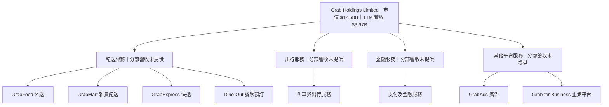
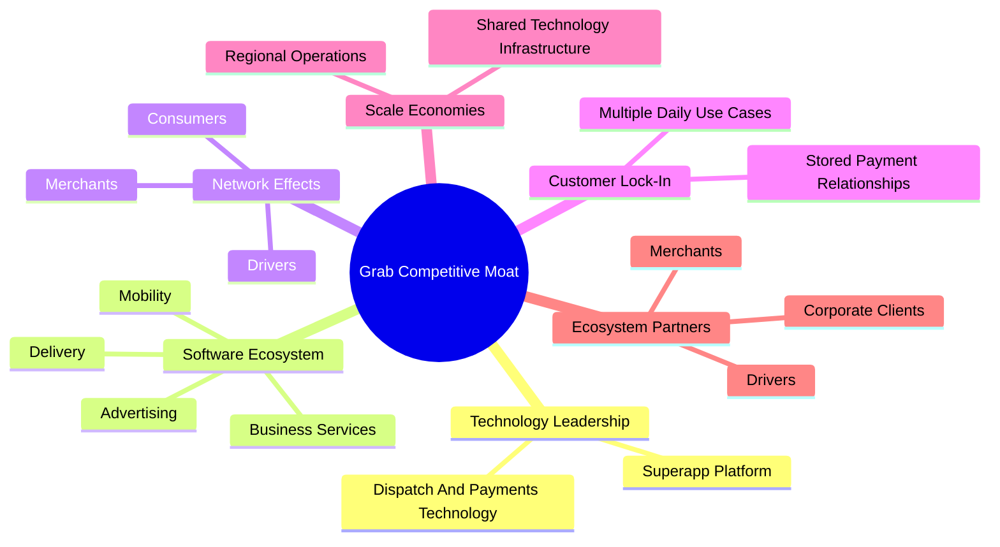
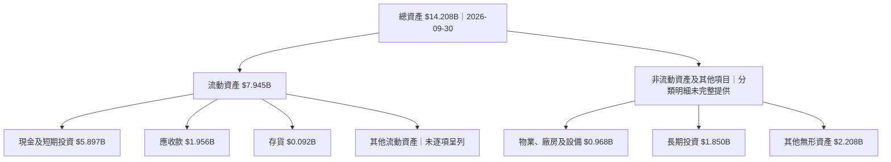
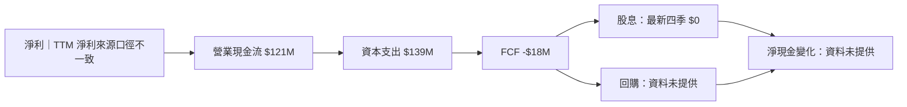
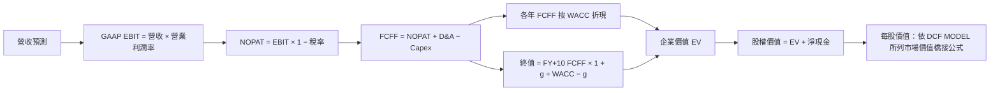
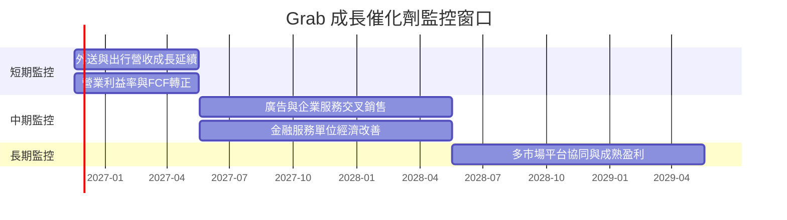
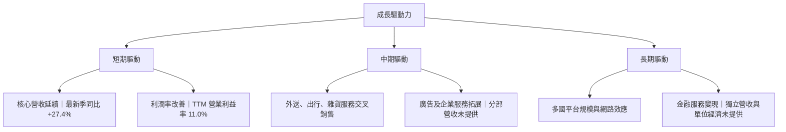
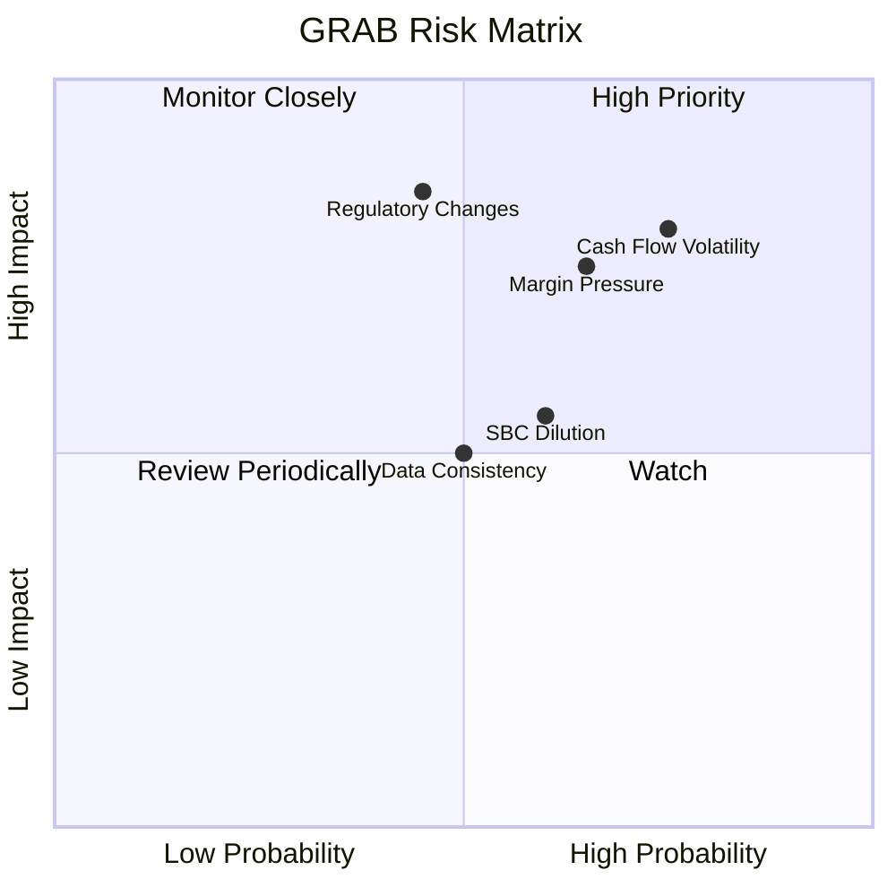
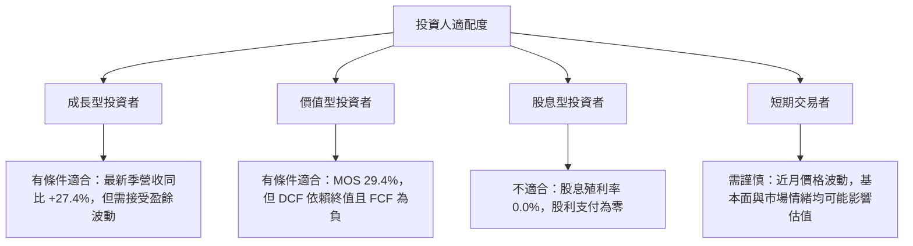

# GRAB 基本面深度分析報告
> **報告日期**：2026-11-18 ｜ **語言**：繁體中文 ｜ **數據來源**：Yahoo Finance、Finviz、StockAnalysis、Roic.ai ｜ **分析師**：CFA 級機構研究

## 目錄

| # | 章節 | 核心結論 |
|---|------|----------|
| 1 | 執行摘要 | 買入；加權合理價值 $4.45，MOS 29.4% |
| 2 | 公司概覽與商業模式 | 多服務平台具網路效應，但市場份額與板塊收入未提供 |
| 3 | 損益表深度分析 | TTM 營收 $3.97B；最新一季年增 27.4%，但最新季淨利同比下降 |
| 4 | 資產負債表分析 | 淨現金 $3.83B；營運資金指標顯示負 CCC |
| 5 | 現金流量深度分析 | TTM FCF 為 -$18M，現金轉換仍有波動 |
| 6 | 獲利能力與資本效率 | ROIC 缺乏可核實資料，無法判定是否高於 8.53% WACC |
| 7 | 相對估值分析 | 同業倍數呈現估值分歧；歷史估值區間資料未提供 |
| 8 | DCF 內在價值評估 | 基準 DCF $5.98/股；模型輸入與輸出需注意四捨五入及股數橋接差異 |
| 9 | 成長催化劑 | 外送、出行、金融與廣告協同提供成長選擇權，TAM 數字未提供 |
| 10 | 風險矩陣 | 競爭、利潤率波動與現金流轉換為主要風險 |
| 11 | 投資建議 | 買入；以 $4.45 加權合理價值為MOS基準，持續監控季度利潤與FCF |

---

## 1. 執行摘要

GRAB 的最新可用財務數據顯示，TTM 營收為 **$3.97B**，最新一季營收同比成長 **27.4%**，但最新一季淨利同比下降 **27.0%**，TTM 自由現金流為 **-$18M**。公司具 **$3.83B 淨現金**，可支撐投資與抵禦短期波動；然而，ROIC 數據缺漏，無法確認其高於 **8.53% WACC**。估值方面，程式計算的加權合理價值為 **$4.45/股**，高於 2026-11-18 收盤價 **$3.14**，MOS 為 **29.4%**。依規則 20，MOS 落在買入區間，但因 ROIC 未能驗證、TTM FCF 為負，採 **買入**而非強烈買入，不作評級調整。

### 1.0 一頁式投資儀表板（Portfolio Manager 30 秒速讀）

| 項目 | 內容 |
|------|------|
| **投資論點（3 句）** | ① 最新一季營收同比增長 **27.4%**，較前期季度增速提升，平台需求與交叉銷售具延續空間。② 現金及短期投資 **$5.90B**、總債務 **$2.07B**，淨現金 **$3.83B**，提供資金緩衝。③ 加權合理價值 **$4.45** 對比現價 **$3.14**，MOS 為 **29.4%**，但 TTM FCF **-$18M** 降低估值確定性。 |
| **綜合評分** | **6.3/10**（引用 1.1 評分卡） |
| **財務健康** | 🟢 淨現金 **$3.83B**、流動比率 **1.384**；但 TTM FCF 為負，並非毫無風險。 |
| **ROIC vs WACC** | ROIC：**N/A**；WACC：**8.53%**。缺乏可比 ROIC，不能確認是否創造經濟價值。 |
| **FCF 趨勢** | 年度 FCF 從 2024 年 **+$739M** 降至 2025 年 **-$44M**；TTM FCF **-$18M**，FCF Yield **-0.14%**。 |
| **估值** | Forward P/E **20.0x** ｜ EV/EBITDA **21.331x** ｜ FCF Yield **-0.14%**。 |
| **DCF 內在價值（基準）** | **$5.98** ｜ 現價相對 DCF 折價 **47.5%**（以 DCF 基準值衡量）。 |
| **安全邊際（MOS）** | **+29.4%＝($4.45 − $3.14) ÷ $4.45**；以加權合理價值為分母，🟢 充足。 |
| **預期報酬（基準情境 12M）** | 分析師共識目標價 **$5.39**，相對現價上行 **71.7%**；此為共識目標價參考，非 12 個月 DCF 預測。 |
| **關鍵風險（前二）** | ① TTM FCF 為負、年度現金流波動。② 最新季淨利同比下降 **27.0%**，GAAP 獲利與營收成長不同步。 |
| **評級 + 信心度** | 🟢 **買入** ｜ 信心：中低；MOS 有支持，但 FCF 與 ROIC 可驗證性不足。 |

### 1.1 綜合評分卡（全報告唯一）

| 維度 | 評分（1–10） | 主要依據（引用數字與其來源章節） |
|------|--------------|----------------------------------|
| 成長性 | 8.0 | TTM 營收成長率 N/A；最新一季營收同比 **27.4%**，見第 3 章。 |
| 獲利能力 | 5.0 | TTM 營業利益率 **11.0%**，但最新一季淨利同比下降 **27.0%**；ROIC、F-Score 缺乏可用數據，見第 3、6 章。 |
| 財務健康 | 8.0 | 淨現金 **$3.83B**、流動比率 **1.384**；TTM FCF **-$18M**，見第 4、5 章。 |
| 估值 | 7.0 | MOS **29.4%**；Forward P/E **20.0x**，低於同業 DASH 但高於 UBER、SE，見第 7、8 章。 |
| 護城河 | 6.5 | 在八個東南亞國家營運，外送、出行、商務與金融服務整合；市場份額與各板塊收入未提供，見第 2 章。 |
| 管理層與資本配置 | 3.5 | 2025 年 SBC **$241M**，現金股利為 **$0**；缺少回購金額與完整資本配置明細，見第 3、5 章。 |
| **綜合評分** | **6.3** | 六項算術平均：(8.0 + 5.0 + 8.0 + 7.0 + 6.5 + 3.5) ÷ 6 = **6.3**。 |

### 1.2 五大投資論點 + 三大核心風險

| 類型 | 項目 | 具體依據 | 信心度 |
|------|------|----------|--------|
| 🟢 **投資論點①** | 營收增速具延續性 | TTM 營收 **$3.97B**；最新一季營收 **$1.112B**，同比 **+27.4%**。 | 🟢 高 |
| 🟢 **投資論點②** | 多產品平台可提高交叉銷售 | 公司涵蓋外送、出行、雜貨、廣告、快遞及企業服務；各業務獨立營收未提供，無法量化協同收入。 | 🟡 中 |
| 🟢 **投資論點③** | 資產負債表提供防守空間 | 現金與短期投資 **$5.90B**，債務 **$2.07B**，淨現金 **$3.83B**。 | 🟢 高 |
| 🟢 **投資論點④** | 估值存在折價 | 加權合理價值 **$4.45**，高於現價 **$3.14**；MOS **29.4%**。 | 🟡 中 |
| 🟢 **投資論點⑤** | 營業槓桿已轉正 | TTM 營業利益率 **11.0%**；2025 年營業利益 **$222M**，相較 2024 年營業虧損 **$55M**改善。 | 🟡 中 |
| 🟡 **風險①** | 自由現金流不穩定 | TTM FCF **-$18M**；2025 年 FCF **-$44M**，低於 2024 年 **+$739M**。 | 🔴 高衝擊 |
| 🔴 **風險②** | 獲利波動與資料口徑不一致 | 最新季淨利同比下降 **27.0%**、EPS 同比下降 **32.2%**；部分季度營業利益在不同來源間不一致。 | 🔴 高衝擊 |
| 🟡 **風險③** | SBC 稀釋股東回報 | 2025 年 SBC **$241M**，約為 FY2025 營收 **$3.37B** 的 **7.2%**。 | 🟡 中度 |

### 1.3 快速統計卡片

| 指標 | 公司實際值（期間） | 同業中位數 | 狀態 |
|------|--------------------|------------|------|
| 營收成長（TTM） | **N/A** | — | 🟡 無法判定 |
| 營收成長（最新一季年增） | **27.4%** | **34.0%** | 🟡 低於同業中位數 |
| 毛利率（TTM） | **41.4%** | **45.0%** | 🟡 低於同業中位數 |
| 營業利益率（TTM） | **11.0%** | — | 🟢 已轉正 |
| ROIC（TTM） | **N/A** | — | 🟡 無法判定 |
| Forward P/E | **20.0x** | **15.6x** | 🔴 高於同業中位數 |
| FCF Yield（TTM） | **-0.14%** | — | 🔴 FCF 為負 |
| Piotroski F-Score | **N/A / N/A** | — | 🟡 缺少兩期 SEC 申報資料 |

### 1.4 投資結論

```text
╔══════════════════════════════════════════════════════════════════╗
║                    📊 投資結論摘要                               ║
╠══════════════════════════════════════════════════════════════════╣
║  評級：買入（MOS 29.4%；ROIC 缺資料，未達強烈買入條件）           ║
║  價格（2026-11-18 收盤）：$3.14                                  ║
║  DCF 內在價值（基準）：$5.98（相對現價折價 47.5%）                ║
║  安全邊際 MOS：+29.4%（＝($4.45−$3.14)÷$4.45）                   ║
║  加權合理價值（8.8）：$4.45                                      ║
║  DCF 情境價值：                                                   ║
║    悲觀情境：$3.12（-0.8%）                                      ║
║    基準情境：$5.98（+90.5%）                                     ║
║    樂觀情境：$12.28（+291.1%）                                   ║
║  綜合評分：6.3/10（引用 1.1）                                    ║
║  適合投資人：可承受獲利及現金流波動的成長型、長線投資者           ║
╚══════════════════════════════════════════════════════════════════╝
```

---

## 2. 公司概覽與商業模式

### 2.1 業務結構與收入來源

公司簡介顯示，Grab Holdings Limited 在柬埔寨、印尼、馬來西亞、緬甸、菲律賓、新加坡、泰國及越南營運 Grab 超級應用程式，業務包括外送、出行、雜貨配送、廣告、快遞及企業服務。分部營收及占比未提供，因此不將公司總營收拆分為臆測比例。



2025 年全年營收 **$3.37B**，TTM 營收 **$3.97B**。平台型業務的潛在優勢，在於同一用戶、商戶和司機可跨服務使用；但在沒有各板塊訂單量、抽成率與單位經濟性資料前，不能判斷目前的協同是否已轉化為更高利潤。

### 2.2 市場份額

市場份額數據未提供，因此不繪製市占率圖表，也不推估市占比例。可確認的是，GRAB 最新一季營收同比成長 **27.4%**，高於 UBER 的 **9.6%**，低於 SE 的 **43.4%** 與 DASH 的 **34.0%**；但三家公司地理覆蓋與收入組成不同，增速比較不等於市占率比較。

### 2.3 競爭護城河分析



以上是業務結構層面的護城河假說，而非可直接量化的競爭優勢。數據中沒有活躍用戶、留存率、每位用戶收入、商戶流失率或各國市占，因此護城河判斷需保持審慎。

### 2.4 護城河強度

| 護城河項目 | 強度（強／中／弱） | 證據（引用數字或事實） | 會削弱它的情況 |
|------------|--------------------|------------------------|----------------|
| 技術與軟體平台 | 中 | 平台同時包含配送、出行、廣告及企業服務；研發支出 FY2025 為 **$428M**。 | 產品體驗落後、技術支出未轉為留存或單位經濟改善。 |
| 網路效應 | 中 | 消費者、商戶與司機可形成雙邊或多邊平台；具體活躍用戶及供需密度資料未提供。 | 競爭者補貼、供給端流失或消費者多平台切換。 |
| 客戶鎖定 | 弱至中 | 多服務整合可能提高使用頻率；留存及跨售率未提供。 | 各服務切換成本低、促銷停止後訂單下降。 |
| 規模效應 | 中 | FY2025 營收 **$3.37B**，在八個東南亞國家經營。 | 各市場監管與本地競爭成本抵銷規模效益。 |
| 生態夥伴 | 中 | 平台連接商戶、司機與企業客戶；合作夥伴數與抽成率未提供。 | 供應商議價能力增強、平台抽成遭監管限制。 |
| **評分卡引用** | — | **1.1 護城河評分 6.5/10**：平台產品多元、跨市場經營，但缺乏市占、留存及單位經濟數據。 | — |

---

## 3. 損益表深度分析

### 3.1 年度收入成長趨勢（近4年）

年度營收來自 Yahoo Finance 年度損益表；年度同比依相鄰年度營收計算，FY2022 的同比參照年度未列於此表。

```text
╔══════════════════════════════════════════════════════════════════╗
║                Grab Holdings 年度收入趨勢（FY2022-FY2025）       ║
╠══════════════════════════════════════════════════════════════════╣
║  FY2022  $1.43B  ████████░░░░░░░░░░░░░░░░  YoY: +112.3%*        ║
║  FY2023  $2.36B  █████████████░░░░░░░░░░░  YoY: +64.6%          ║
║  FY2024  $2.80B  ████████████████░░░░░░░░  YoY: +18.6%          ║
║  FY2025  $3.37B  ████████████████████░░░░  YoY: +20.5%          ║
║                                                                  ║
║  FY2022-FY2025 CAGR = (3.37 ÷ 1.43)^(1/3) − 1 ≈ 33.0%          ║
╚══════════════════════════════════════════════════════════════════╝
```

\* FY2022 的 **112.3%** 為 StockAnalysis 所列 FY2022 同比成長率。FY2022–FY2025 營收 CAGR 約 **33.0%**，但後兩年的同比增速已落在約 19%–21%區間，顯示早期低基期帶來的高增速正在正常化。VERIFIED FIGURES 所列「Revenue growth (TTM vs prior TTM)」為 **N/A**；因此本報告不把其他來源的 TTM 成長率替代為該指標。

### 3.2 季度收入趨勢分析

| 季度 | 營收 | QoQ 成長率 | 單季 YoY 成長率 | 備註 |
|------|------:|------------:|----------------:|------|
| 2025 Q4 | $906M | +17.2% | +18.6% | QoQ 依 2025 Q3 $873M 計算。 |
| 2026 Q1 | $955M | +5.4% | +23.5% | 同比成長高於 2025 Q1 的 $773M。 |
| 2026 Q2 | $998M | +4.5% | +21.9% | 營收持續增加，季度增速較 Q1 放緩。 |
| 2026 Q3 | $1.112B | +11.4% | +27.4% | 末季營收增速回升；單季營收創近四季高點。 |

QoQ 公式為「本季營收 ÷ 前季營收 − 1」；YoY 為相較去年同季。QoQ 可能受季節性及季度天數影響，不宜直接視作年化成長率。

### 3.3 利潤率演變分析

以下毛利率以年度損益表毛利 ÷ 營收計算；營業利益率以年度營業利益 ÷ 營收計算。來源間 FY2025 毛利存在差異，因此年度毛利率僅作方向性參考；TTM 毛利率 **41.4%**、TTM 營業利益率 **11.0%** 按 Yahoo Finance 指標引用。

| 利潤率指標 | FY2022 | FY2023 | FY2024 | FY2025 | 趨勢 | 評估 |
|------------|------:|------:|------:|------:|------|------|
| **毛利率** | 5.4% | 36.4% | 41.8% | 43.3%* | FY2022 後快速改善 | 🟡 需留意來源口徑 |
| **營業利益率** | -90.2% | -16.4% | -2.0% | 6.6% | 由大幅虧損轉為正值 | 🟢 改善 |
| **淨利率** | -117.5% | -18.4% | -3.8% | 8.0% | FY2025 轉正 | 🟡 歷史波動大 |

\* FY2025 Yahoo 年度資料列毛利 **$1.46B**，StockAnalysis 列 **$1.337B**；表中 **43.3%** 依 Yahoo 年度值 $1.46B ÷ $3.37B 計算。TTM 毛利率統一引用 Yahoo Finance 的 **41.4%**。

利潤率改善與收入規模擴大、平台成本分攤及費用控制相符；FY2025 營業利益轉為 **$222M**，而 FY2024 為 **-$55M**。不過，最新季度營業利益在不同來源中不一致：Yahoo 季度表列 **$170M**，StockAnalysis 列 **$112M**；同時官方摘要指標列最新季營業利益率 **5.6%**。此差異不支持直接將單季數字外推，宜以後續申報資料核實。

### 3.4 費用結構分析

支出項目完整明細及各項占營收比重未提供，依資料條件不繪製費用結構圓餅圖。已知 FY2025 研發費用 **$428M**，約占 FY2025 營收 **$3.37B** 的 **12.7%**；這代表平台仍需持續投入產品與技術，但不能單獨判定其支出效率。

### 3.5 季度 EPS 趨勢與盈餘品質（Quality of Earnings）

| 季度 | EPS 實際值 | 預估值／超預期情況 | 同比資訊 | 解讀 |
|------|-----------:|--------------------|---------|------|
| 2025 Q4 | $0.04 | 預估 N/A；無法判定 beat/miss | — | 歷史季度 EPS 數字來自 Roic.ai。 |
| 2026 Q1 | -$0.01 | 預估 N/A；無法判定 beat/miss | — | 單季盈餘為負。 |
| 2026 Q2 | $0.06 | 預估 N/A；無法判定 beat/miss | — | 為近四季 EPS 高點。 |
| 2026 Q3 | $0.01 | 預估 N/A；無法判定 beat/miss | EPS 同比 **-32.2%** | 實際 EPS 有數據，但預估 EPS 缺漏；不能標註超預期或不及預期。 |

EPS Beats/Misses 表中的預估及實際值均為 `nan`，不能用來驗證超預期或不及預期。最新季 EPS 同比 **-32.2%**，淨利同比 **-27.0%**，說明營收增長尚未穩定轉化為同比盈餘增長。

| 盈餘品質項目 | 數值／佔比 | 評估 |
|--------------|-----------|------|
| 股權薪酬 SBC / 營收 | FY2025：$241M ÷ $3.37B = **7.2%**；TTM SBC 無完整數據 | 🟡 SBC 對普通股股東有稀釋成本。 |
| SBC / 營業現金流 | FY2025：$241M ÷ $79M = **305.1%** | 🔴 SBC 高於該年營業現金流；不能把其視為無成本。 |
| FCF / 淨利（現金轉換率） | TTM FCF -$18M；StockAnalysis TTM 淨利 $587M；比率約 **-3.1%** | 🔴 現金轉換偏弱，淨利未轉化為正 FCF。 |
| 一次性／非經常性損益 | 具體明細 N/A | 🟡 未提供足夠資料識別一次性項目；2025 淨利 $268M 與不同來源 TTM 淨利口徑存在差異。 |
| 有效稅率異常 | 最近年度有效稅率 **25.7%** | 🟡 未提供足夠年度稅務明細，無法判定本期是否受一次性稅務項目影響。 |
| 資本化支出 vs 費用化 | TTM Capex **$139M**；資本化支出的明細及分類 N/A | 🟡 不足以判斷是否有重大成本延後費用化。 |

**盈餘品質結論**：TTM 有正營業利益率，但 TTM FCF 為負、FY2025 SBC 高於營業現金流，且不同來源的淨利與季度營業利益有差異。現有證據不足以認定 GAAP 盈餘被高估，但現金轉換及 SBC 成本使獲利品質評估偏審慎；估值不應只依據 EPS 倍數。

---

## 4. 資產負債表分析

### 4.1 資產結構分解

最新季資產負債表的部分細項來自 StockAnalysis；總資產 **$14.208B**、流動資產 **$7.945B**。各細項未全部涵蓋總額，以下不將未列項目自行反推為特定資產。



各細項金額來自 StockAnalysis 的 2026-09-30 資產負債表。現金及短期投資加總為 $5.897B，與 Yahoo 財務數據的 $5.90B 一致（四捨五入）。

### 4.2 流動性與營運資金分析

| 指標 | 最新值 | 評估 |
|------|-------:|------|
| 流動比率 | **1.384** | 🟡 流動資產高於流動負債，但緩衝並非極寬。 |
| 速動比率 | **1.07** | 🟡 排除存貨後仍高於 1。 |
| 現金及短期投資 | **$5.90B** | 🟢 可提供較大流動性緩衝。 |
| 淨現金 | **$3.83B** | 🟢 現金及短期投資超過總債務。 |

**營運資金天數**依 QUALITY FIGURES 數值照抄。一年前對應數值未提供，因此變化不自行計算。

| 指標 | 最新 TTM | 一年前 TTM | 變化 | 解讀 |
|------|----------|------------|------|------|
| DSO 應收帳款天數 | **22 天** | N/A | N/A | 現有應收回收天數可用；無比較基準，不能判斷收款速度方向。 |
| DIO 存貨天數 | **15 天** | N/A | N/A | 存貨天數較短；Grab 服務平台模式本身不等同傳統零售庫存風險。 |
| DPO 應付帳款天數 | **219 天** | N/A | N/A | 長付款週期支持負營運資金，但需留意合作夥伴付款條款及關係。 |
| CCC 現金轉換週期 | **-182 天** | N/A | N/A | DSO + DIO − DPO = 22 + 15 − 219 = -182 天；代表營運資金可由供應商或合作夥伴資金支應，但不等於永久性現金來源。 |

### 4.3 債務結構分析

```text
╔══════════════════════════════════════════════════════════════════╗
║                   Grab 債務健康診斷                              ║
╠══════════════════════════════════════════════════════════════════╣
║  總債務：          $2.07B  ███████░░░░░░░░░░░░░  🟡             ║
║  現金及短期投資：  $5.90B  ████████████████████  🟢             ║
║  淨現金：          $3.83B  █████████████░░░░░░░  🟢             ║
║                                                                  ║
║  Debt/Equity：     28.532  數據來源列示值；口徑需核實            ║
║  Debt/EBITDA：     N/A     未提供同口徑 EBITDA／債務明細          ║
║  Interest Coverage：N/A    利息費用及利息保障倍數未提供           ║
╚══════════════════════════════════════════════════════════════════╝
```

2025 年末債務為 **$2.05B**，2024 年末為 **$364M**；最新財務快照列總債務 **$2.07B**。雖然現金緩衝較大，但債務在 2025 年上升，應追蹤債務期限、利率與用途；到期分布及融資租賃拆分未提供，不能推算利息保障倍數。

### 4.4 股東權益趨勢

```text
╔══════════════════════════════════════════════════════════════════╗
║                 股東權益歷史變化（年度）                          ║
╠══════════════════════════════════════════════════════════════════╣
║  2022  $6.60B  ████████████████████                              ║
║  2023  $6.45B  ████████████████████                              ║
║  2024  $6.40B  ███████████████████                               ║
║  2025  $6.73B  ████████████████████                              ║
╚══════════════════════════════════════════════════════════════════╝
```

股東權益由 2022 年 **$6.60B** 降至 2024 年 **$6.40B**，2025 年回升至 **$6.73B**。最新季度股東權益未在品質指標中提供；年度資產與股東權益顯示帳面權益相對穩定，但不代表每股價值同步增加，仍需結合股數變化與 SBC 評估。

---

## 5. 現金流量深度分析

### 5.1 現金流量瀑布圖

年度淨利與現金流的期間口徑不完全一致，故以 TTM 核心現金流指標呈現；股息支付可引用 TTM 季度資料為零，回購及淨現金變化明細未提供。



### 5.2 FCF 轉換率趨勢

| 年度 | FCF | 淨利 | FCF／淨利 | 趨勢解讀 |
|------|----:|-----:|---------:|----------|
| 2022 | -$872M | -$1.68B | 約 51.9% | 虧損與高現金消耗並存；比率不宜單獨解讀。 |
| 2023 | -$6M | -$434M | 約 1.4% | FCF 接近損益平衡，但淨利仍為負。 |
| 2024 | +$739M | -$105M | 不具經濟意義 | FCF 大幅轉正但淨利仍負，代表非現金及營運資金因素可能重要；缺少明細不能歸因。 |
| 2025 | -$44M | +$268M | 約 -16.4% | 會計獲利未轉為正 FCF。 |
| TTM | -$18M | $587M* | 約 -3.1% | 以 StockAnalysis TTM 淨利計算，期間口徑須留意。 |

\* TTM 淨利 $587M 來自 StockAnalysis；不同資料源的淨利數字可能不一致，因此轉換率只作參考，不替代 TTM FCF 的 VERIFIED FIGURES 原值。

### 5.3 自由現金流趨勢

```text
╔══════════════════════════════════════════════════════════════════╗
║                   自由現金流年度趨勢                              ║
╠══════════════════════════════════════════════════════════════════╣
║  2022  -$872M  ░░░░░░░░░░░░░░░░░░░░  FCF Yield：N/A             ║
║  2023    -$6M  ████████████████████  FCF Yield：N/A             ║
║  2024  +$739M  ████████████████████  FCF Yield：N/A             ║
║  2025   -$44M  ████████████████████  FCF Yield：N/A             ║
║  TTM    -$18M  ░░░░░░░░░░░░░░░░░░░░  FCF Yield：-0.14%          ║
╚══════════════════════════════════════════════════════════════════╝
```

方框中的長度僅表達正負與方向，非跨年度共用比例尺。TTM FCF 按指定定義為營業現金流 **$121M** 減資本支出 **$139M**，等於 **-$18M**。2024 年 FCF **+$739M** 與 2025 年 **-$44M** 的落差顯示現金流波動大；在查明營運資金、客戶資金及一次性現金項目前，不宜將 2024 年高 FCF 當成穩態。

### 5.4 資本配置評估

投資、回購及留存現金的完整金額未提供，因此不繪製資本配置圓餅圖。

| 資本配置項目 | 可用數據 | 評估 |
|--------------|---------|------|
| 資本支出 | TTM **$139M**；FY2025 **$123M** | 對平台基礎設施與技術的投資具必要性，詳細用途未提供。 |
| 股息 | FY2022–FY2025 均為 **$0**；最新四季亦為 **$0** | 無股息回報，股東回報主要依賴企業增長與估值變化。 |
| 股份回購 | N/A | 未提供回購金額，不能假設有回購抵消 SBC。 |
| SBC | FY2025 **$241M** | 對股東而言為經濟稀釋成本，須納入資本配置評估。 |
| 投資與留存現金 | N/A | 缺少完整資本配置明細。 |

---

## 6. 獲利能力與資本效率

### 6.1 ROE／ROA／ROIC 趨勢

| 指標 | 可用期間及數值 | 評估 |
|------|----------------|------|
| ROE | TTM **7.6%** | 正值，但未達到可確認創造股東價值的程度；ROE 也可能受股本與非經常項目影響。 |
| ROA | TTM **1.1%** | 資產回報偏低，顯示平台仍需有效提高資產使用效率。 |
| ROIC | TTM **N/A**；歷史 ROIC 欄位無可用數值 | 無法據此與 WACC 比較。 |
| WACC | **8.53%** | 按 Cost of capital 指標原值引用，見 6.2。 |

### 6.2 ROIC vs WACC 分析（核心價值創造判斷）

```text
╔══════════════════════════════════════════════════════════════════╗
║                 ROIC vs WACC 深度分析                            ║
╠══════════════════════════════════════════════════════════════════╣
║  WACC（採用程式計算輸入）：                                      ║
║  ├── 無風險利率（10Y 美債）：       5.07%                       ║
║  ├── 市場風險溢酬 ERP：              5.00%                       ║
║  ├── 原始 Beta：                     0.83                        ║
║  ├── 調整後 Beta：                   0.89                        ║
║  ├── 股權成本：                      9.51%                       ║
║  ├── 稅前債務成本：                  3.43%                       ║
║  ├── 資本權重：股權 86.0%、債務 14.0%                           ║
║  └── WACC：                          8.53%                       ║
║                                                                  ║
║  ROIC：N/A（歷史／TTM 可核實值缺漏）                              ║
║  EVA = ROIC − WACC：N/A，不能判定經濟利潤為正或負                  ║
║                                                                  ║
║  結論：營業利益率改善不等於 ROIC 已超過資本成本。                 ║
╚══════════════════════════════════════════════════════════════════╝
```

Beta 調整方式為 **⅔ × 原始 Beta 0.83 + ⅓ × 1 = 0.89**；CAPM 所列股權成本原值為 **9.51%**。依資本成本資料，WACC 為 **8.53%**。ROIC 欠缺可核實數字，故不能得出「創造」或「摧毀」股東價值的確定結論；以單一營業利益率代替 ROIC 會忽略投入資本與稅後營業利潤。

### 6.3 杜邦三因素分解

QUALITY FIGURES 的 DuPont 指標為 N/A，原因是淨利、營收、總資產或正權益的同口徑資料不足以完成其計算；依要求不自行補算。

| 因素 | 數值（TTM） | 解讀 |
|------|-------------|------|
| 淨利率 | N/A | QUALITY FIGURES 列示 N/A。 |
| 資產週轉率 | N/A | QUALITY FIGURES 列示 N/A。 |
| 權益乘數 | N/A | QUALITY FIGURES 列示 N/A。 |
| **ROE** | **N/A** | DuPont 區塊為 N/A，不另行重算。 |

### 6.4 財務體質：Piotroski F-Score

Piotroski F-Score 為 **N/A**，原因是缺少相隔一年的兩期 SEC 申報資料；目前財務來源為 Yahoo 季度報表，未提供九項測試的逐項結果。因此不將九項測試填為通過或未通過，也不以其他來源補造分數。

---

## 7. 相對估值分析

### 7.1 同業估值比較表格

GRAB 公司倍數來自 Yahoo Finance／Finviz 合併市場資料；競爭對手倍數依 Peer multiples 原值引用。公司與同業所處市場、業務組合及獲利品質不同，倍數只能作相對參考。

| 估值指標 | **GRAB** | **UBER** | **SE** | **DASH** | 本公司評估 |
|----------|---------:|---------:|---------:|---------:|-----------|
| **Trailing P/E** | 31.4x | 40.4x | 24.7x | 69.2x | 🟡 位於同業區間中段；同業中位數 40.4x。 |
| **Forward P/E** | 20.0x | 15.6x | 14.4x | 21.9x | 🟡 高於同業中位數 15.6x，需由較快增長支持。 |
| **P/S Ratio** | 3.193x | 2.5x | 1.4x | 4.3x | 🟡 高於 UBER、SE，低於 DASH；同業中位數 2.5x。 |
| **EV/EBITDA** | 21.331x | 19.1x | 13.6x | 40.5x | 🟡 高於 UBER、SE；Peer 區塊計算的同業中位數為 16.4x。 |
| **最新季營收同比** | 27.4% | 9.6% | 43.4% | 34.0% | 🟡 高於 UBER，低於 SE、DASH；中位數 34.0%。 |
| **毛利率（TTM）** | 41.4% | 41.4% | 45.0% | 52.7% | 🟡 低於 SE、DASH，等於 UBER；中位數 45.0%。 |

GRAB 的 Forward P/E **20.0x** 高於同業 Forward P/E 中位數 **15.6x**，而最新季營收增速 **27.4%** 低於同業增速中位數 **34.0%**。因此，若相對估值較高要成立，後續需有持續增長及利潤率改善，而不是只靠平台故事支撐。

### 7.2 歷史估值區間分析

```text
╔══════════════════════════════════════════════════════════════════╗
║                    GRAB 歷史估值區間                            ║
╠══════════════════════════════════════════════════════════════════╣
║  N/A（歷史 P/E 區間、估值百分位及 Valuation vs own history       ║
║       數值未提供；不自行估算歷史百分位）                           ║
╚══════════════════════════════════════════════════════════════════╝
```

### 7.3 情境價值（Bear / Base / Bull，照抄 DCF MODEL 的 Scenarios）

| 情境 | 第 1 年營收成長 | 期末營業利潤率 | WACC | 每股價值 | 相對現價 | 機率 | 會發生的條件 |
|------|----------------:|---------------:|-----:|---------:|---------:|-----:|--------------|
| 🔴 悲觀 | 13.7% | 9.3% | 9.53% | **$3.12** | **-0.8%** | 25% | 增長低於基準、競爭或促銷壓力令長期利潤率降至 9.3%，且資本成本較高。 |
| 🟡 基準 | 27.4% | 11.0% | 8.53% | **$5.98** | **+90.5%** | 50% | 最新季增速作為第一年錨點，利潤率維持 TTM 11.0%，WACC 8.53%。 |
| 🟢 樂觀 | 41.1% | 12.0% | 7.53% | **$12.28** | **+291.1%** | 25% | 成長顯著高於最新季增速、利潤率提升且資本成本下降。 |

三個情境來自 DCF MODEL 的情境輸出，不是本報告另行指定的目標價。基準情境的 **+90.5%** 是 DCF 情境相對現價的上行；估值方法表的基準 DCF 上行為 **+90.4%**，為原始資料不同欄位的四捨五入差異，兩者保留各自來源數字。

### 7.4 相對估值隱含價格區間

```text
╔══════════════════════════════════════════════════════════════════╗
║                  相對估值及共識隱含每股價值                       ║
╠══════════════════════════════════════════════════════════════════╣
║  $2.45 ───── $3.14 ───── $3.61 ───── $5.39 ───── $5.98          ║
║  Forward P/E  現價      EV/EBITDA  分析師共識   基準 DCF         ║
╚══════════════════════════════════════════════════════════════════╝
```

- **同業 Forward P/E：$2.45/股**；Peer 中位數 **15.6x**（UBER、SE、DASH）乘以 GRAB Forward EPS **$0.16**。
- **同業 EV/EBITDA：$3.61/股**；同業中位數 **16.4x**（UBER、SE）套用 GRAB TTM EBITDA，並加回淨現金。
- **分析師共識目標價：$5.39/股**；22 位分析師平均目標價。
- **基準 DCF：$5.98/股**；屬絕對估值參考，非相對估值方法。

---

## 8. DCF 內在價值評估（Discounted Cash Flow）

### 8.0 估值推理鏈（Thinking Logic：在算之前先想清楚）

#### Step 1 — 價值來源與主導變數

模型命題是：GRAB 的估值由既有平台現金流、未來營收擴張及營業利潤率能否維持共同決定。現有資料只給出公司整體 TTM 營收 **$3.97B**，未提供外送、出行、金融及廣告的營收占比，因此不將各業務拆分為虛構的占比。模型敏感度顯示，永續成長率與 WACC 的組合對每股價值影響顯著；終值現值占企業價值 **66.2%**，故終值假設是估值的主要敏感來源之一。

#### Step 2 — 模型選擇

| 決策點 | 本報告採用 | 理由（含數字） | 曾考慮但否決 | 否決理由 |
|--------|-----------|----------------|--------------|----------|
| 現金流定義 | FCFF | 採 WACC **8.53%** 折現，先得企業價值，再加淨現金。 | FCFE | 債務成本與資本權重已有資料，FCFF 與企業價值橋接較一致。 |
| 預測期 N | **10 年** | DCF MODEL 固定為 10 年；營收增速由 **27.4%** 線性降至 **3.0%**。 | 5 年 | 會縮短模型既定的增長淡出期間，且不能更改指定模型。 |
| 終值方法 | Gordon Growth | 永續成長率 **3.0%**，低於 WACC **8.53%**。 | 退出倍數 | DCF MODEL 未提供退出倍數計算輸出，不自行另建。 |
| EBIT 基礎 | GAAP EBIT | 模型列示 GAAP EBIT，SBC 已作為費用處理。 | 非 GAAP EBIT | 避免將 SBC 加回後漏計股東經濟成本。 |

#### Step 3 — 高敏感度輸入推導鏈

- **營收成長**：錨點＝最新一季同比 **27.4%**，TTM 對比成長率 N/A → 調整＝模型將增長率由第 1 年 **27.4%** 線性淡出至第 10 年 **3.0%**，反映成長逐步正常化 → **採用第 1 年 27.4%，第 10 年 3.0%** → 曾考慮以較低增長作起點，但模型未提供替代基準的完整估值，因此不自建替代情境；悲觀情境另列第 1 年 **13.7%**。
- **營業利潤率**：錨點＝TTM 營業利益率 **11.0%** → 調整＝模型將 11.0% 維持至第 10 年，不假設持續擴張 → **採用 11.0%** → 曾考慮長期利潤率下降；模型悲觀情境的期末利潤率為 **9.3%**，作為風險參照。
- **永續成長率 g**：錨點＝模型採用 **3.0%**，且低於 WACC **8.53%** → 調整＝為避免永續增長高於成熟經濟體長期可持續增長，維持 3.0% → **採用 3.0%** → 否決任何不低於 WACC 的 g，因 Gordon Growth 公式會失效。
- **預測期 N**：錨點＝模型規定 **10 年**，第 1 年增長 27.4%、第 10 年 3.0% → 調整＝以十年作增長淡出週期 → **採用 10 年** → 曾考慮縮短期間，但會偏離唯一指定 DCF 模型。
- **Capex／營收**：錨點＝TTM Capex **$139M**，TTM 營收 **$3.97B**，模型採用率 **3.5%** → 調整＝模型令預測期維持 3.5%，不假設資本支出率下降 → **採用 3.5%** → 不採用更低比率，因模型未提供可支持更低投資需求的明確資料。
- **EBIT 基礎與 SBC**：錨點＝模型使用 GAAP EBIT；FY2025 SBC **$241M** → 調整＝GAAP EBIT 已含 SBC 費用 → **採用組合 (A)：GAAP EBIT、FCFF 不再減 SBC、股數不另行稀釋** → 否決另扣 SBC 或同時額外稀釋，避免同一成本重複計入。
- **年稀釋率**：錨點＝組合 (A) 將 SBC 成本反映在 GAAP EBIT → **採用 0% 年稀釋率**（模型固定股數）→ 不採用額外稀釋率，避免重複計算 SBC。
- **終值方法**：錨點＝10 年預測期末 FCFF **$1.64B**、g **3.0%** → **採用 Gordon Growth** → 退出倍數未提供模型結果，故不自建。
- **WACC**：錨點＝Cost of capital 原值 **8.53%** → **採用 8.53%** → 不另行重算或替換，並以敏感度矩陣檢視變動。

#### Step 4 — 最脆弱假設

最脆弱環節是長期營收與利潤率能否支撐終值；終值現值占企業價值 **66.2%**，若現金流或永續增長低於基準，DCF 價值會下降，矩陣顯示在 WACC **8.53%**、g **2.0%** 時每股價值為 **$5.44**，較基準 **$5.98** 低 **$0.54**。

#### Step 5 — 計算路徑圖



### 8.1 模型假設總表（Model Inputs）

| 假設項目 | 採用值 | 依據／來源 | 敏感度 |
|----------|--------|-------------|--------|
| 預測期長度 N | **10 年** | DCF MODEL 固定輸入；增長由 27.4% 淡出至 3.0%。 | 🟡 中 |
| 營收成長 | 第 1 年 **27.4%**；第 10 年 **3.0%**，線性淡出 | 第 1 年採最新季度同比增長；TTM vs prior TTM 為 N/A。 | 🔴 高 |
| 營業利潤率 | 第 1 至第 10 年 **11.0%** | TTM 營業利益率 **11.0%**；模型固定持平。 | 🔴 高 |
| 有效稅率 | **25.7%** | Cost of capital 資料所列最近年度有效稅率。 | 🟢 低 |
| Capex／營收 | **3.5%** | DCF MODEL 假設；TTM Capex $139M、營收 $3.97B。 | 🟡 中 |
| D&A／營收 | **5.6%** | DCF MODEL 按 TTM 比率固定。 | 🟢 低 |
| 營運資金變動 | **未納入** | DCF MODEL 明確不建模營運資金。 | 🟢 低 |
| EBIT 基礎 | **GAAP EBIT** | 模型明確使用 GAAP EBIT。 | 🟡 中 |
| SBC 處理 | **組合 (A)**：不再扣 SBC | SBC 已計入 GAAP EBIT；年稀釋率 0%。 | 🟡 中 |
| 年稀釋率 | **0%** | 固定股數假設，依組合 (A)。 | 🟡 中 |
| 永續成長率 g | **3.0%** | DCF MODEL 假設；低於 WACC 8.53%。 | 🔴 高 |
| 終值方法 | Gordon Growth | DCF MODEL 提供該方法的終值。退出倍數輸出未提供。 | 🔴 高 |
| WACC | **8.53%** | Cost of capital 原值，詳見 8.2。 | 🔴 高 |

**FCFF 定義**：採用 FCFF，對應 WACC 折現。模型公式為 `FCFF = NOPAT + D&A − Capex`，且不含營運資金變動。  
**SBC 處理聲明**：本模型採用 **(A)**，GAAP EBIT 已含 SBC 費用，FCFF 不再扣 SBC，股數不另行稀釋；SBC 影響在模型中計入一次。

### 8.2 折現率推導（WACC）

```text
╔══════════════════════════════════════════════════════════════════╗
║                    WACC 推導（折現率）                           ║
╠══════════════════════════════════════════════════════════════════╣
║  股權成本 Ke（CAPM）：                                           ║
║  ├── 無風險利率 Rf（10Y 美債）：     5.07%                       ║
║  ├── 市場風險溢酬 ERP：              5.00%                       ║
║  ├── 原始 Beta（Yahoo）：             0.83                        ║
║  ├── 調整後 Beta：                    0.89                        ║
║  ├── 規模／國別溢酬：                 0.00%（未另加）             ║
║  └── 股權成本：                       9.51%                       ║
║                                                                  ║
║  債務成本 Kd：                                                   ║
║  ├── 稅前債務成本：                   3.43%                       ║
║  ├── 有效稅率：                      25.7%                       ║
║  └── 稅後 Kd：                       2.55%                       ║
║                                                                  ║
║  資本權重：股權 86.0%、債務 14.0%                               ║
║  ✅ 採用 WACC：                                                   ║
║     86.0% × 9.51% + 14.0% × [3.43% × (1−25.7%)] = 8.53%          ║
╚══════════════════════════════════════════════════════════════════╝
```

逐步演算：

1. **Ke（CAPM）**＝Rf + β × ERP＝5.07% + 0.89 × 5.00%＝**9.52%**；Cost of capital 原列 Ke **9.51%**，差異為輸入與顯示精度的捨入差異；後續以原列 **9.51%**。
2. **稅前 Kd**＝Cost of capital 原列 **3.43%**。利息費用與平均計息負債底層金額未提供，故無法從利息費用重新複算此比率。
3. **稅後 Kd**＝3.43% × (1 − 25.7%)＝3.43% × 0.743＝**2.5485%**，顯示為 **2.55%**。
4. **權重**＝Cost of capital 原列股權 **86.0%**、債務 **14.0%**，相加為 **100.0%**。最新市值 **$12.68B**、總債務 **$2.07B**；權重按 Cost of capital 原值引用，不以帳面股東權益代替市值。
5. **WACC**＝86.0% × 9.51% + 14.0% × 2.5485%＝8.1786% + 0.3568%＝**8.5354%**，依原資料四捨五入採用 **8.53%**。

Beta 原始值 **0.83** 調整至 **0.89**，公式為 ⅔ × 0.83 + ⅓ × 1。無風險利率所對應的精確觀測日未提供，因此不補造日期；ERP 為假設值 **5.00%**，依成本資本輸入採用。未另加規模／國別溢酬。債務權重與 Kd 來源中，計息負債範圍及利息費用細節未提供，須視為 WACC 複算限制。第 6.2 節及 DCF 均採用同一 WACC **8.53%**。

### 8.3 逐年自由現金流預測（基準情境）

金額單位：**USD billions**。下表逐年照錄 DCF MODEL；折現因子保留三位小數。

| 年度 | FY+1 | FY+2 | FY+3 | FY+4 | FY+5 | FY+6 | FY+7 | FY+8 | FY+9 | FY+10 |
|------|-----:|-----:|-----:|-----:|-----:|-----:|-----:|-----:|-----:|------:|
| 營收 | 5.06 | 6.31 | 7.69 | 9.18 | 10.70 | 12.18 | 13.53 | 14.67 | 15.51 | 15.98 |
| 營收 YoY | 27.4% | 24.7% | 22.0% | 19.3% | 16.6% | 13.8% | 11.1% | 8.4% | 5.7% | 3.0% |
| 營業利潤率 | 11.0% | 11.0% | 11.0% | 11.0% | 11.0% | 11.0% | 11.0% | 11.0% | 11.0% | 11.0% |
| 營業利益 EBIT（GAAP） | 0.55 | 0.69 | 0.84 | 1.01 | 1.17 | 1.33 | 1.48 | 1.61 | 1.70 | 1.75 |
| − 稅（25.7%） | (0.14) | (0.18) | (0.22) | (0.26) | (0.30) | (0.34) | (0.38) | (0.41) | (0.44) | (0.45) |
| = NOPAT | 0.41 | 0.51 | 0.63 | 0.75 | 0.87 | 0.99 | 1.10 | 1.20 | 1.26 | 1.30 |
| + D&A | 0.28 | 0.35 | 0.43 | 0.52 | 0.60 | 0.68 | 0.76 | 0.82 | 0.87 | 0.90 |
| − Capex | (0.18) | (0.22) | (0.27) | (0.32) | (0.37) | (0.43) | (0.47) | (0.51) | (0.54) | (0.56) |
| **= FCFF** | **0.52** | **0.65** | **0.79** | **0.94** | **1.10** | **1.25** | **1.39** | **1.51** | **1.59** | **1.64** |
| 折現因子 @8.53% | 0.921 | 0.849 | 0.782 | 0.721 | 0.664 | 0.612 | 0.564 | 0.519 | 0.479 | 0.441 |
| **FCFF 現值 PV** | **0.48** | **0.55** | **0.62** | **0.68** | **0.73** | **0.76** | **0.78** | **0.78** | **0.76** | **0.72** |

**預測期 FCF 現值合計**：  
$0.48 + $0.55 + $0.62 + $0.68 + $0.73 + $0.76 + $0.78 + $0.78 + $0.76 + $0.72 = **$6.86B**（依各年度已顯示至兩位小數數字加總）。DCF MODEL 的未四捨五入合計原值為 **$6.87B**；差異 **$0.01B**，來自表格各年度數字顯示精度。後續 EV 橋接照錄模型原值 **$6.87B**，不將其替換為展示值加總。

**逐步演算（FY+1，模型顯示值）**：

1. **營收**＝$3.97B × (1 + 27.4%)＝$3.97B × 1.274＝**$5.05778B**，顯示為 **$5.06B**。
2. **EBIT**＝營收 × 11.0%＝$5.06B × 11.0%＝**$0.5566B**；模型列示 **$0.55B**，差異源於模型底層精度／取整。
3. **稅**＝EBIT × 25.7%＝$0.55B × 25.7%＝**$0.14135B**，顯示為 **$0.14B**。
4. **NOPAT**＝$0.55B − $0.14B＝**$0.41B**。
5. **D&A**＝營收 × 5.6%＝$5.06B × 5.6%＝**$0.28336B**，顯示為 **$0.28B**。
6. **Capex**＝營收 × 3.5%＝$5.06B × 3.5%＝**$0.1771B**，顯示為 **$0.18B**。
7. **ΔWC**＝模型未納入，故 **不建模**。
8. **FCFF**＝NOPAT + D&A − Capex。以展示數字計算：$0.41B + $0.28B − $0.18B＝**$0.51B**；DCF MODEL 列示 **$0.52B**，此差額不能由目前展示精度完整複算。
9. **折現因子**＝1 ÷ (1 + 8.53%)¹＝**0.921**；依模型列示 FCFF 與折現因子，PV＝$0.52B × 0.921＝**$0.479B**，顯示為 **$0.48B**。

**合理性自檢**：

- 預測期 FCFF 由 **$0.52B** 增至 **$1.64B**；按十年端點估算年複合成長約 **12.2%**。歷史 FCF 年度波動極大（2022 -$872M、2024 +$739M、2025 -$44M），不適合以歷史 FCF CAGR 作穩定錨點。
- FY+10 FCFF 利潤率＝$1.64B ÷ $15.98B＝**10.3%**；目前 TTM FCF margin＝-$18M ÷ $3.97B＝**-0.5%**。Peer 區塊未提供同業 FCF margin，不能比較「同業最佳」。
- 預測期每年 FCFF 均為正；歷史 TTM FCF 為負，代表模型假設現金轉換迅速改善，是估值的重要風險來源。

```text
╔══════════════════════════════════════════════════════════════════╗
║              自由現金流：歷史實際 vs 模型預測                    ║
╠══════════════════════════════════════════════════════════════════╣
║  FY2023（實）  -$0.006B  ░░░░░░░░░░░░░░░░░░░░                  ║
║  FY2024（實）  +$0.739B  ████████████████████                  ║
║  FY2025（實）  -$0.044B  ░░░░░░░░░░░░░░░░░░░░                  ║
║  FY+1（預）     +$0.52B   ████████████████░░░░                  ║
║  FY+10（預）    +$1.64B   ████████████████████                  ║
╠══════════════════════════════════════════════════════════════════╣
║  ⚠️ 預測依賴營收增長及現金轉換改善，歷史 FCF 波動顯著。          ║
╚══════════════════════════════════════════════════════════════════╝
```

### 8.4 終值計算（Terminal Value）

適用性檢查：**WACC 8.53% vs g 3.0% → WACC > g？✅**

| 方法 | 計算式 | 終值 TV | TV 現值 | 佔總 EV 比重 |
|------|--------|---------:|--------:|-------------:|
| Gordon Growth | FCFF(FY+10) × (1+g) ÷ (WACC − g) | **$30.52B** | **$13.46B** | **66.2%** |
| 退出倍數法 | N/A | N/A（DCF MODEL 未提供退出倍數輸出） | N/A | N/A |

**逐步演算（依模型原值）**：

1. **FY+10 FCFF**＝**$1.64B**，取自 8.3 最後一欄。
2. **分子**＝$1.64B × (1 + 3.0%)＝**$1.6892B**，依模型未四捨五入數據計算。
3. **分母**＝8.53% − 3.0%＝**5.53%**；模型列示終值 **$30.52B**。以已顯示的 $1.64B 計算會因 FCFF 顯示精度產生小幅差異，故終值保留模型原值。
4. **PV(TV)**＝$30.52B × 0.441＝**$13.45932B**，顯示為 **$13.46B**。
5. **終值佔比**＝$13.46B ÷ $20.32B＝**66.2%**。

退出倍數法所需 EBITDA(FY+10) 及終值倍數未提供，因此不自行建立第二種終值模型。

### 8.5 企業價值 → 每股內在價值（Bridge）

```text
╔══════════════════════════════════════════════════════════════════╗
║              企業價值 → 每股內在價值 橋接表                      ║
╠══════════════════════════════════════════════════════════════════╣
║  預測期 FCF 現值合計             +$6.87B                         ║
║  終值現值 PV(TV)                +$13.46B                         ║
║  ─────────────────────────────────────────────                  ║
║  = 企業價值 EV                   $20.32B                         ║
║  + 淨現金                        +$3.83B                          ║
║  = 股權價值                      $24.15B                         ║
║  每股價值依模型市場價值橋接公式：                                ║
║  $24.15B × $3.14 ÷ $12.68B = $5.98/股                            ║
║  當前股價（2026-11-18 收盤）      $3.14                           ║
║  折溢價（現價÷DCF內在價值−1）     -47.5%（折價）                 ║
║  本節不計算 MOS；MOS 只在 8.8 計算一次。                          ║
╚══════════════════════════════════════════════════════════════════╝
```

逐步演算：

1. **EV**＝模型原列企業價值 **$20.32B**。模型中 PV forecast **$6.87B** 加 PV(TV) **$13.46B**，以已四捨五入顯示值相加為 **$20.33B**；$0.01B 差額為原始未四捨五入數據造成，橋接依模型原列 EV。
2. **股權價值**＝EV $20.32B + 淨現金 $3.83B＝**$24.15B**。
3. **每股內在價值**＝模型指定公式：$24.15B × $3.14 ÷ $12.68B＝**$5.98**。
4. **折溢價**＝現價 $3.14 ÷ DCF 內在價值 $5.98 − 1＝**-47.5%**，表示現價相對基準 DCF 折價。
5. **本節不計算 MOS**：MOS 以第 8.8 節加權合理價值作分母。

股權價值橋接使用財務數據列示的淨現金 **$3.83B**。模型每股價值公式以價格乘市值的倒數建立每股橋接；最新收盤價 **$3.14**、市值 **$12.68B** 推得模型所隱含股數約為 4.04B。市場資料另列流通股數 **3.94B**，兩者不一致；本節依規則照錄 DCF MODEL 的每股價值 **$5.98**，不以流通股數重算替代。

### 8.6 敏感性分析（WACC × 永續成長率）

矩陣數值依 DCF MODEL 原值照錄；括號為依現價 **$3.14** 計算的上行空間，可能因四捨五入與原始矩陣估值有小幅差異。

| g（列）／WACC（欄） | 6.53% | 7.53% | **8.53%（基準）** | 9.53% | 10.53% |
|-----------|------:|------:|------------------:|------:|-------:|
| **2.0%** | $7.70 (+145.2%) | $6.37 (+102.9%) | $5.44 (+73.2%) | $4.77 (+52.0%) | $4.26 (+35.7%) |
| **2.5%** | $8.33 (+165.3%) | $6.74 (+114.6%) | $5.69 (+81.2%) | $4.94 (+57.3%) | $4.38 (+39.5%) |
| **3.0%** | $9.13 (+190.8%) | $7.21 (+129.6%) | **$5.98 (+90.4%)** | $5.14 (+63.7%) | $4.52 (+43.9%) |
| **3.5%** | $10.21 (+225.2%) | $7.79 (+148.1%) | $6.33 (+101.6%) | $5.36 (+70.7%) | $4.67 (+48.7%) |
| **4.0%** | $11.70 (+272.6%) | $8.53 (+171.7%) | $6.76 (+115.3%) | $5.63 (+79.3%) | $4.85 (+54.5%) |

選取非基準格 **WACC 9.53% > g 2.5% ✅**。DCF MODEL 已提供該格每股價值 **$4.94**；重新計算該格所需的未四捨五入逐年 FCFF、折現因子與橋接中間值未提供。依規則不另行建立第二套模型，故此處以模型輸出作矩陣值，不能聲稱已由顯示數字完整獨立複算。

#### 三情境 DCF

| 情境 | 營收增長假設 | 期末營業利潤率 | 永續成長 g | WACC | 每股內在價值 | 相對現價 | 主觀機率 |
|------|--------------|----------------|------------|------|--------------|----------|----------|
| 🔴 悲觀 | 第 1 年 13.7%；後續路徑依模型情境 | 9.3% | 模型情境未另列 | 9.53% | **$3.12** | **-0.8%** | 25% |
| 🟡 基準 | 第 1 年 27.4%；第 10 年 3.0% | 11.0% | 3.0% | 8.53% | **$5.98** | **+90.5%** | 50% |
| 🟢 樂觀 | 第 1 年 41.1%；後續路徑依模型情境 | 12.0% | 模型情境未另列 | 7.53% | **$12.28** | **+291.1%** | 25% |
| **機率加權** | — | — | — | — | **$6.84** | **+117.8%** | **100%** |

各情境的 FY+10 營收、FY+10 FCFF、終值與機率加權計算的未四捨五入中間值未提供，因此不補造完整的情境算式鏈。機率加權值依模型原列 **$6.84**；按已顯示情境值計算為 $3.12 × 25% + $5.98 × 50% + $12.28 × 25%＝**$6.84**。

**敏感度結論**：

- **g 每 +1pp**：以 WACC 8.53% 列，g 2.0% 時 **$5.44**，g 3.0% 時 **$5.98**，價值增加 **$0.54**，即 $0.54 ÷ $5.44＝**9.9%**。
- **WACC 每 +1pp**：以 g 3.0% 列，WACC 8.53% 時 **$5.98**，WACC 9.53% 時 **$5.14**，價值減少 **$0.84**，即 $0.84 ÷ $5.98＝**14.0%**。
- **期末營業利潤率每 +1pp**：DCF MODEL 未提供單獨調整利潤率的敏感度矩陣，不能量化該一項的獨立價格彈性。
- 目前可比較的數據顯示，WACC 每變動 1pp 的敏感度高於 g 每變動 1pp 的示範值；這與 8.0 指出「終值假設」主導估值的方向一致，但不足以定量比較利潤率敏感度。

### 8.7 反推 DCF（Reverse DCF：市場在預期什麼）

DCF MODEL 提供兩項反推結果：年 1 營收成長率與固定營業利潤率。其他未由模型解出的變數列為未計算，不自行反推。

| 求解的變數（一次一個） | 其餘變數設定 | 市場隱含值（令 DCF = 現價） | 公司歷史實際 | 判斷 |
|------------------------|--------------|------------------------------|--------------|------|
| 年 1 營收成長率 | 其餘維持基準值 | **6.7%** | 最新一季同比 **27.4%**；TTM 成長率 N/A | 🟢 相對基準 **27.4%** 偏保守，但只是模型反推，不代表市場預測。 |
| 固定營業利潤率 | 其餘維持基準值 | **3.2%** | TTM 營業利益率 **11.0%** | 🟢 顯著低於當前 TTM；若模型設定成立，市場價格反映的長期獲利假設保守。 |
| 永續成長率 g | — | **未計算** | — | DCF MODEL 未提供此變數解。 |
| 高成長持續年數 N | — | **未計算** | — | DCF MODEL 未提供此變數解。 |

基準輸入中，WACC **8.53%**、稅率 **25.7%**、Capex／營收 **3.5%**、D&A／營收 **5.6%**、預測期 **10 年**、g **3.0%**；ΔWC 未建模，固定股數假設依組合 (A)。反推結果由 DCF MODEL 原列，沒有提供迭代試算軌跡或各次試算對應價值，故不補造試算表。反推訊息是：以模型其他輸入不變，現價可由 **6.7%** 的年 1 營收增長或 **3.2%** 的固定營業利潤率解釋；這不是公司實際財測。

### 8.8 估值三角驗證與安全邊際

| 估值方法 | 隱含每股價值 | 上行空間（÷現價） | 權重 | 說明 |
|----------|--------------:|-------------------:|------:|------|
| DCF（基準） | **$5.98** | **+90.4%** | **40%** | 10 年 FCFF、WACC 8.53%、g 3.0%。 |
| 同業 Forward P/E | **$2.45** | **-22.0%** | **25%** | Peer 中位數 15.6x × Forward EPS $0.16。 |
| 同業 EV/EBITDA | **$3.61** | **+15.0%** | **25%** | UBER、SE 中位數 16.4x × TTM EBITDA，並加回淨現金。 |
| 分析師共識目標價 | **$5.39** | **+71.7%** | **10%** | 22 位分析師平均目標價。 |
| **加權合理價值** | **$4.45** | **+41.7%** | **100%** | 公司類型為 profitable；按固定權重加總。 |

**加權合理價值演算**：  
$5.98 × 40% + $2.45 × 25% + $3.61 × 25% + $5.39 × 10%  
＝$2.392 + $0.6125 + $0.9025 + $0.539  
＝$4.446  
依模型原值四捨五入為 **$4.45**。權重合計為 40% + 25% + 25% + 10%＝**100%**；無方法因無法計算而剔除。

```text
╔══════════════════════════════════════════════════════════════════╗
║                  估值區間與安全邊際                              ║
╠══════════════════════════════════════════════════════════════════╣
║  $3.12 ───── $3.14 ───── [$4.45] ───── $5.98 ───── $12.28       ║
║  悲觀DCF       現價       加權合理值     基準DCF      樂觀DCF      ║
║                                                                  ║
║  MOS = ($4.45 − $3.14) ÷ $4.45 = 29.4%                          ║
║  MOS 評估：🟢 >25% 充足                                          ║
║  上行空間 = ($4.45 − $3.14) ÷ $3.14 = 41.7%                     ║
║                                                                  ║
║  建議買入區間：$2.80–$4.45（以加權合理價值為估值錨）             ║
║  合理持有區間：$4.45–$5.98（加權合理值至基準 DCF）                ║
║  減碼考慮區間：高於 $12.28（超出模型樂觀情境）                   ║
╚══════════════════════════════════════════════════════════════════╝
```

MOS **29.4%** 使用加權合理價值 **$4.45** 作分母；上行空間 **41.7%** 使用現價 **$3.14** 作分母。兩者不可互換。買入區間為分析框架的參考價帶，現價 **$3.14** 落在該範圍內。

> 🔎 **程式複算（Python，依本節各項自動重算）**
>
> 加權合理價值 = $5.98 × 40% + $2.45 × 25% + $3.61 × 25% + $5.39 × 10% = **$4.45**（權重合計 100%）
>
> 以價格 $3.14 計：MOS = **+29.4%**，上行空間 = **+41.7%**
>
> ✅ 與本節所寫數值一致。

### 8.9 DCF 模型的局限與失效條件

- **終值依賴度**：終值現值佔企業價值 **66.2%**，即估值約三分之二取決於 FY+10 之後的現金流假設。
- **最脆弱假設**：第一，營收由第 1 年 **27.4%** 線性淡出至第 10 年 **3.0%**；第二，11.0% 營業利潤率十年維持不變。最新季度淨利同比下降 **27.0%**、TTM FCF **-$18M**，均顯示高增長不必然帶來持續現金流。敏感度矩陣顯示，WACC 8.53%、g 2.0% 時每股價值為 **$5.44**；WACC 9.53%、g 3.0% 時為 **$5.14**。
- **不適用情境**：公司目前 TTM FCF 為負，且年度 FCF 從 2024 年 **+$739M** 轉至 2025 年 **-$44M**，直接 DCF 可靠度低於現金流穩定公司。宜同時追蹤 EV/Revenue、單位經濟性與分部估值；但本報告不另建 SOTP。
- **資料及模型限制**：DCF 年度表以兩位小數呈列，FY+1 依展示值計算 FCFF 為 $0.51B，而模型原列 $0.52B；PV 逐年展示值合計 $6.86B，模型原列 $6.87B。企業價值亦有 $0.01B 的顯示精度差異；每股橋接採模型指定公式，隱含股數與市場資料列示流通股數存在差異。故 $5.98 應視為依程式模型計算的基準估值，而非可由目前展示精度完全獨立複算的精確值。
- **與第 10 章風險連結**：競爭加劇會影響營收成長；補貼或監管成本上升會影響營業利潤率；營運資金條款改變會使目前未建模的 ΔWC 成為重要現金流項目。

### 8.10 複算檢核表（Audit Trail）

| # | 檢核項目 | 檢查方式 | 結果 |
|---|----------|----------|------|
| 1 | 所有高／中敏感度輸入都有推導 | 對照 8.0 Step 3 與 8.1 | ✅ 已說明模型輸入與替代思路；部分替代估值因不允許另建模型而未計算。 |
| 2 | 每個假設都有來歷 | 核對 8.1 依據欄 | ✅ 已列示來源或明確標出資料缺漏。 |
| 3 | WACC 五步算式齊全且相乘相加正確 | 權重 86%+14%=100%；使用指定成本資本輸入 | ⚠️ Ke 以顯示值算得 9.52%，來源原值 9.51%；採用原列 WACC 8.53%。 |
| 4 | Kd 分母與權重中的 D 範圍一致 | 檢查計息負債範圍及平均負債 | ⚠️ 平均計息負債及負債拆分未提供，無法逐項核對。 |
| 5 | WACC 與第 6.2 節相同 | 比對數值 | ✅ 均為 **8.53%**。 |
| 6 | 預測年度數等於 N 且無省略 | 核對 FY+1 至 FY+10 | ✅ 共 10 年，無省略年度。 |
| 7 | FY+1 九步算式可用顯示值複算 | 重新計算 FY+1 FCFF | ❌ 顯示值算得 $0.51B，DCF MODEL 列 $0.52B；已在 8.3 明列差額。 |
| 8 | 預測期 PV 逐項加總 | 加總年度已顯示 PV | ⚠️ 顯示值合計 $6.86B，模型原值 $6.87B；保留模型原值並披露 $0.01B 差異。 |
| 9 | WACC > g | 比較 8.53% 與 3.0% | ✅ |
| 10 | 終值以 FY+N FCFF 為基礎並折現 N 期 | 檢查 FY+10、折現因子 0.441 | ✅ 依模型原列輸入；底層未四捨五入數字未提供。 |
| 11 | EV 至每股價值橋接 | 核對 EV、淨現金及模型每股公式 | ⚠️ EV 項目按展示值相加有 $0.01B 差異；逐項披露並沿用模型原值。 |
| 12 | SBC 組合相容 | 核對 GAAP EBIT、SBC 列與股數稀釋 | ✅ 組合 (A)：GAAP EBIT、不另扣 SBC、年稀釋率 0%。 |
| 13 | 矩陣基準格等於 DCF 價值 | 比對 8.5、8.6 | ✅ 均為 **$5.98**。 |
| 14 | 矩陣示範格有效 | 所選格 WACC 9.53% > g 2.5% | ✅；模型矩陣全部列示格均滿足 WACC > g。 |
| 15 | 情境機率加總 | 25%+50%+25% | ✅ 100%；機率加權值 **$6.84**。 |
| 16 | 反推每列只解一個變數且有試算軌跡 | 查核模型輸出 | ⚠️ 只照錄模型提供的兩個單變數解；未提供迭代軌跡，故不補造。 |
| 17 | MOS與折溢價分母正確 | MOS 用 $4.45；折溢價用 $5.98 | ✅ MOS **29.4%**，DCF 折價 **47.5%**。 |
| 18 | 報告完整至第 11 章 | 檢查章節 | ✅ |
| 19 | 加權合理價值等於各方法加權總和 | 重算 8.8 | ✅ 未四捨五入前為 **$4.446**，顯示 **$4.45**。 |
| 20 | 評級符合 MOS 門檻 | MOS 29.4%、ROIC N/A | ✅ 依門檻為買入；ROIC 缺值，不符合強烈買入要求。 |

複算差異的原因是 DCF MODEL 顯示的年度金額與中間值已四捨五入，未提供完整精度底稿；本報告已保留模型原值並在相應位置披露差額，估值信心因此採中低。

---

## 9. 成長催化劑

### 9.1 催化劑時間軸

以下為需追蹤的營運催化劑窗口，不代表公司已公布的特定活動日期。



### 9.2 TAM 市場規模分析

**N/A（TAM 數據未提供）**。公司 TTM 營收為 **$3.97B**，最新一季同比成長 **27.4%**；FY2025 年收入為 **$3.37B**。在缺乏公司所處各國市場規模、可服務市場定義及市場份額來源的情況下，不自行估算 TAM 或滲透率。

### 9.3 成長驅動力結構圖



催化劑的關鍵不是服務清單本身，而是公司能否在維持營收增長的同時擴大現金流。TTM 營業利益率 **11.0%** 與 TTM FCF **-$18M** 的差距，說明會計營業獲利尚未穩定轉化為自由現金流。

---

## 10. 風險矩陣

### 10.1 風險評分矩陣

下圖位置為分析師定性的風險排序，並非公司披露的機率統計；機率與衝擊無可核實財務機率資料時，不宣稱為量化預測。



### 10.2 風險清單詳細分析

| # | 風險項目 | 發生機率 | 財務衝擊 | 風險評分 | 緩解措施 |
|---|----------|----------|----------|----------|----------|
| 1 | 🔴 **現金流波動與轉換不足** | 中高；分析師估計 60% | TTM FCF **-$18M**；若持續，會削弱 DCF 現金流假設。 | 🔴 8.0/10 | 每季比較 OCF、Capex 與 FCF；要求 FCF 連續改善，而非只看淨利。 |
| 2 | 🔴 **競爭或促銷壓力推高成本** | 中高；分析師估計 55% | 最新季營收同比 **27.4%**，但淨利同比 **-27.0%**；利潤率可能受壓。 | 🔴 7.5/10 | 追蹤各分部營收、交易量、促銷費用及營業利益率。 |
| 3 | 🟠 **監管與勞工政策變動** | 中；分析師估計 40% | 國別成本及合規負擔可能增加；具體收入影響未能量化。 | 🟠 7.0/10 | 追蹤主要營運市場法規、司機分類及平台收費規則變化。 |
| 4 | 🟡 **SBC 稀釋** | 中；分析師估計 45% | FY2025 SBC **$241M**，約占營收 **7.2%**。 | 🟡 5.5/10 | 比較 SBC／營收、流通股數增幅與回購；不能只用調整後獲利評價。 |
| 5 | 🟡 **財務數據來源口徑差異** | 中；已觀察到 | 最新季營業利益不同來源列 **$170M** 與 **$112M**；造成利潤趨勢判讀不確定。 | 🟡 5.0/10 | 優先核對公司申報資料與一致會計期間，避免以單一聚合資料外推。 |

---

## 11. 投資建議

### 11.1 最終評級與評分

GRAB 評級為 **買入**：加權合理價值 **$4.45** 對比 2026-11-18 收盤價 **$3.14**，MOS 為 **29.4%**，符合買入門檻。因 ROIC 未能確認高於 WACC **8.53%**，且 TTM FCF 為 **-$18M**，不升級為強烈買入。1.1 評分卡的六項分數依序為成長性 **8.0**、獲利能力 **5.0**、財務健康 **8.0**、估值 **7.0**、護城河 **6.5**、管理層與資本配置 **3.5**，綜合評分 **6.3/10**。

### 11.2 合理價值與隱含報酬率

| 估值參考 | 每股價值 | 相對現價報酬 | 機率／權重 |
|----------|---------:|--------------:|-----------:|
| 加權合理價值 | **$4.45** | **+41.7%** | 估值方法加權 100% |
| 🔴 悲觀 DCF | **$3.12** | **-0.8%** | 25% |
| 🟡 基準 DCF | **$5.98** | **+90.5%** | 50% |
| 🟢 樂觀 DCF | **$12.28** | **+291.1%** | 25% |
| 分析師共識目標價 | **$5.39** | **+71.7%** | 22 位分析師平均值 |

DCF 情境值反映模型假設與長期內在價值，不等同對未來 12 個月股價的確定預測。較適合以 **$4.45 加權合理價值**作投資決策錨，並用後續 FCF 與營業利潤率驗證模型。

### 11.3 買入時機與觸發因素

```text
╔══════════════════════════════════════════════════════════════════╗
║                  ✅ 買入觸發因素 Checklist                      ║
╠══════════════════════════════════════════════════════════════════╣
║  立即買入觸發條件（多數符合）：                                  ║
║  ✅ 現價 $3.14 低於加權合理價值 $4.45                            ║
║  ✅ 淨現金 $3.83B，且流動比率 1.384                             ║
║  ✅ 最新季營收同比成長 27.4%                                     ║
║                                                                  ║
║  加碼觸發條件（出現以下任一）：                                  ║
║  ☐ TTM FCF 由 -$18M 轉為正值，且不是由一次性項目驅動             ║
║  ☐ 營業利益率維持或高於 TTM 11.0%，並由申報資料確認              ║
║  ☐ 股價低於 $2.80 且基本面未惡化，MOS 擴大                       ║
║                                                                  ║
║  減碼／停損觸發條件（出現以下任一）：                            ║
║  ☐ 股價高於 $5.98，而 FCF 仍為負且營收增速放緩                   ║
║  ☐ 最新季營收同比連續兩季低於 15%                                ║
║  ☐ TTM 營業利益率跌破 8%，或 FCF 連續兩季惡化                    ║
║  ☐ 淨現金明顯縮小，或債務快速增加而未帶來現金流改善              ║
╚══════════════════════════════════════════════════════════════════╝
```

上述觸發門檻是投資監控規則，不是公司財測。股價低於估值區間不代表基本面風險消失；若成長、利潤率或現金流觸發失效條件，應優先重新評估價值假設。

### 11.4 投資人適配度分析



### 11.5 每季財報監控清單（Quarterly Watch List）

| 指標 | 目前基準 | 觸發加碼 | 觸發減碼／重新估值 |
|------|----------|----------|--------------------|
| 營收同比 | 最新季 **27.4%** | 維持在 20% 以上，且伴隨利潤改善 | 連續兩季低於 **15%** |
| 營業利益率 | TTM **11.0%**；最新季指標 **5.6%** | TTM 維持或高於 **11.0%**，並以一致來源驗證 | TTM 跌破 **8%**，或季度持續收縮 |
| 淨利與 EPS | 最新季淨利同比 **-27.0%**、EPS 同比 **-32.2%** | 同比轉正並由核心營運貢獻 | 營收增長而淨利連續惡化 |
| 營業現金流 | TTM **$121M** | 穩定高於 Capex | OCF 持續下降或轉負 |
| Capex | TTM **$139M** | 投資後營收及現金流同步改善 | Capex 上升但收入、FCF 未改善 |
| FCF | TTM **-$18M**；FCF Yield **-0.14%** | 轉為正值並連續維持 | 連續兩季惡化或全年持續為負 |
| SBC | FY2025 **$241M** | SBC／營收下降且流通股增幅收斂 | SBC／營收持續高於 FY2025 約 **7.2%** 水準 |
| 淨現金與債務 | 淨現金 **$3.83B** | 淨現金穩定、資金投入產生正回報 | 淨現金下降且債務增加、現金流未改善 |
| EPS 預估與實際 | 預估 EPS 缺漏，beats/misses N/A | 取得可驗證一致預估資料後追蹤 | 不以缺漏預估資料判斷超預期或不及預期 |
| 資本配置 | 股息殖利率 **0%**；SBC FY2025 **$241M** | 公布可量化、回報清晰的投資或回購政策 | SBC 增加但每股現金流及每股獲利未改善 |

### 11.6 反面論證：什麼會證明論點錯誤（What Would Change My Mind）

```text
╔══════════════════════════════════════════════════════════════════╗
║              ⚠️ 論點失效條件（Disconfirming Evidence）           ║
╠══════════════════════════════════════════════════════════════════╣
║  本投資論點在下列情況成立時應重新檢視或退出：                    ║
║  ☐ 核心營收同比連續兩季低於 15%                                  ║
║  ☐ TTM 營業利益率跌破 8%，且並非季節性或資料口徑造成             ║
║  ☐ FCF 連續兩季走弱，或年度 FCF 持續為負                         ║
║  ☐ SBC／營收高於 FY2025 約 7.2%，且股數稀釋加快                  ║
║  ☐ 淨現金 $3.83B 大幅下降，債務增加卻沒有相應現金流改善          ║
║  ☐ 後續可核實 ROIC 低於 WACC 8.53%，且長期無改善跡象             ║
║  ☐ 分部營收或單位經濟資料顯示交叉銷售、網路效應未能轉為利潤      ║
║  ☐ 申報資料證實季度營業利益率與聚合資料差異並非單純口徑問題      ║
╚══════════════════════════════════════════════════════════════════╝
```

若上述條件出現，應下調增長與利潤率假設，重新評估加權合理價值，而不應只因現價低於基準 DCF 就維持買入判斷。

> **免責聲明**：本報告為 AI 自動生成，僅供研究參考，不構成投資建議。投資有風險，入市需謹慎。

---

## 資料與來源

| 項目 | 內容 |
|------|------|
| 價格 | 3.14 USD，2026-11-18 收盤（Yahoo Finance 日線） |
| 財務報表 | Yahoo quarterly statements (no SEC filing data)，最新季度 2026-09-30（TTM = four quarters to this date） |
| 有回應的資料來源 | Yahoo Finance、Finviz、StockAnalysis、Roic.ai |
| 未回應的資料來源 | SEC 申報資料 (XBRL) |
| 由程式計算 | TTM 數字、WACC、DCF 模型、估值方法與權重、加權合理價值、MOS、評級門檻、F-Score、杜邦分解、營運資金天數、綜合評分 |
| 撰寫模型 | openai / gpt-6-luna |

> 本區塊由產生報告的程式依實際取得的資料填寫，非模型撰寫。「由程式計算」的數字不是模型的估計；其餘判斷（評分、情境、策略）是模型的分析。
