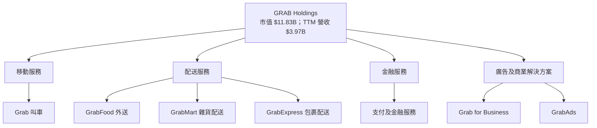
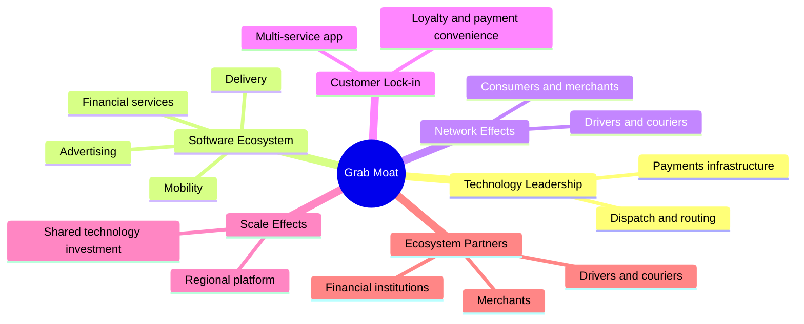
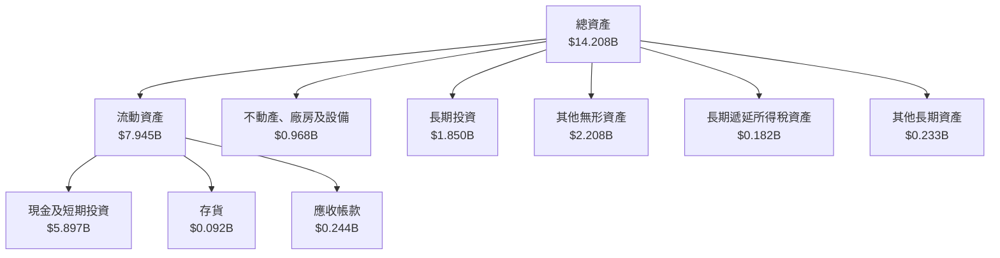
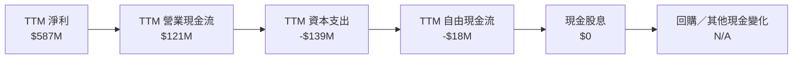
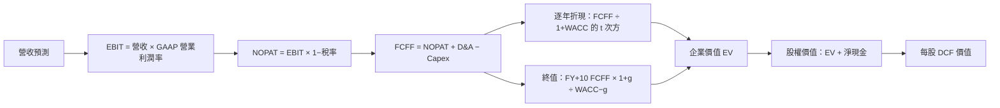
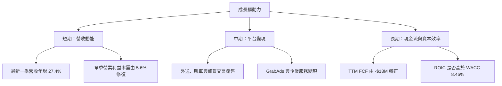
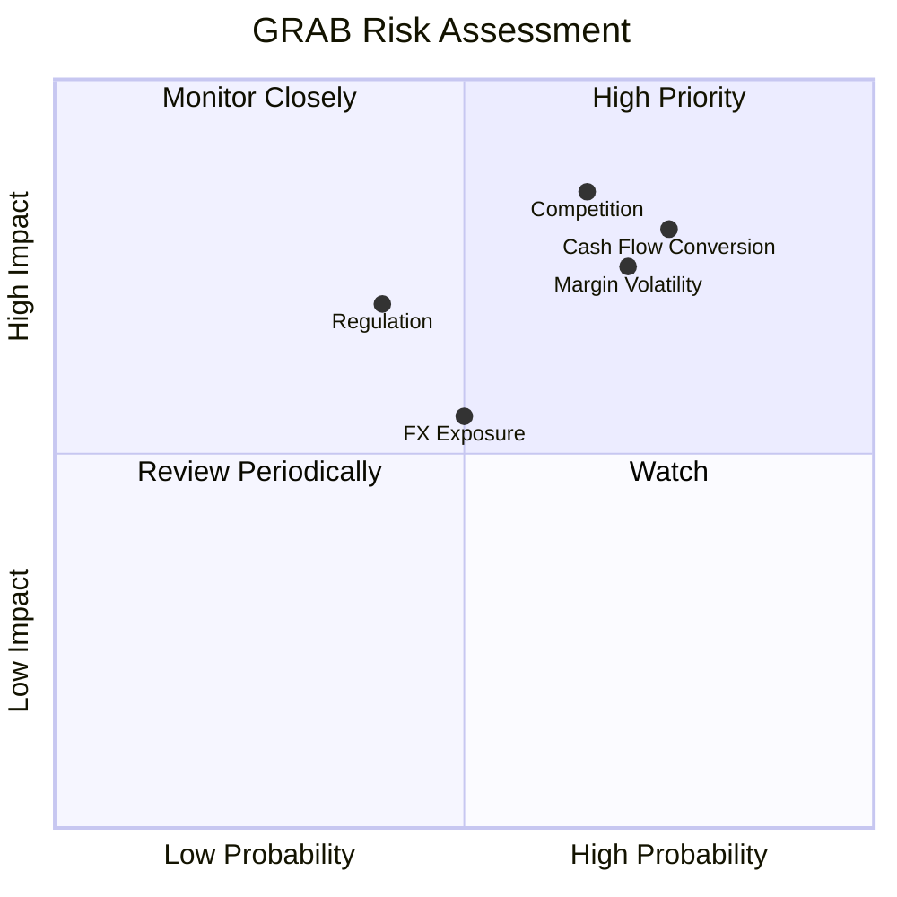
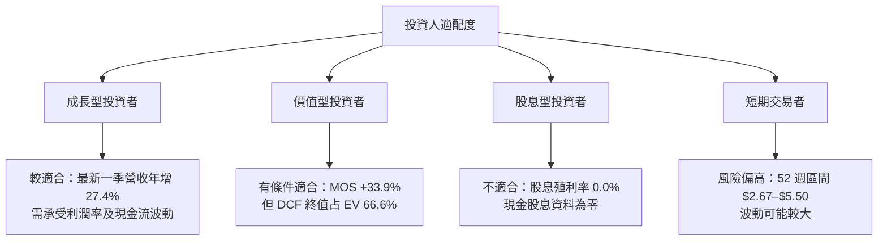

# GRAB 基本面深度分析報告
> **報告日期**：2026-11-19 ｜ **語言**：繁體中文 ｜ **數據來源**：Yahoo Finance、Finviz、StockAnalysis、Roic.ai ｜ **分析師**：CFA 級機構研究

## 目錄

| # | 章節 | 核心結論 |
|---|------|----------|
| 1 | 執行摘要 | 買入；加權合理價值 $4.43；MOS +33.9% |
| 2 | 公司概覽與商業模式 | 東南亞多邊平台具有網路效應，但分部收入及市場份額數據未提供 |
| 3 | 損益表深度分析 | TTM 營收 $3.97B；最新一季營收年增 27.4%，但單季營業利益率低於 TTM |
| 4 | 資產負債表分析 | 淨現金 $3.83B，流動性可觀；應付帳款天數高 |
| 5 | 現金流量深度分析 | TTM FCF 為 -$18M，FCF Yield -0.15%，現金轉換仍不穩定 |
| 6 | 獲利能力與資本效率 | WACC 8.46%；ROIC N/A，不能確認是否持續創造超額報酬 |
| 7 | 相對估值分析 | GRAB Forward P/E 高於同業中位數，DCF 與相對估值結果分歧 |
| 8 | DCF 內在價值評估 | 基準 DCF $6.05；加權合理價值 $4.43；模型對終值與成長假設敏感 |
| 9 | 成長催化劑 | 外送、移動服務、金融服務及廣告變現是潛在驅動力；缺少可引用 TAM 數據 |
| 10 | 風險矩陣 | 競爭、利潤率波動及現金流轉弱是主要風險 |
| 11 | 投資建議 | 買入；現價落在依 MOS 推導的買入區間內，需以 FCF 和利潤率驗證 |

---

## 1. 執行摘要

截至 **2026-11-19 收盤價 $2.93**，GRAB 的加權合理價值為 **$4.43**，依定義 MOS 為 **($4.43 − $2.93) ÷ $4.43 = +33.9%**，符合規則 20 的「買入」門檻。支持估值的正面證據包括 TTM 營收 $3.97B、最新一季營收年增 27.4%、現金及短期投資 $5.90B、淨現金 $3.83B；但 TTM FCF 為 -$18M、FCF Yield -0.15%，且最新一季營業利益率 5.6% 低於 TTM 11.0%。因此評級由 MOS 導出為買入，並非基於已驗證的高品質現金流或已確認的 ROIC 超額報酬。

### 1.0 一頁式投資儀表板

| 項目 | 內容 |
|------|------|
| **投資論點（3 句）** | ① 最新一季營收年增 **27.4%**，增長速度高於 UBER 的 9.6%，反映平台交易與變現仍有擴張空間。② 現金及短期投資 **$5.90B**、淨現金 **$3.83B**，提供競爭與投資緩衝。③ TTM FCF **-$18M**、最新一季營業利益率 **5.6%**，顯示成長尚未穩定轉化為自由現金流。 |
| **綜合評分** | **6.5/10**（引用 1.1 評分卡；六項算術平均） |
| **財務健康** | 🟡 淨現金 $3.83B、流動比率 1.384；但 TTM FCF 為負 |
| **ROIC vs WACC** | **ROIC：N/A；WACC：8.46%**。因缺少可核實 ROIC，無法判定創造或摧毀價值 |
| **FCF 趨勢** | 年度 FCF 大幅波動；TTM FCF **-$18M**、FCF Yield **-0.15%** |
| **估值** | Forward P/E **18.66x** ｜ EV/EBITDA **20.97x** ｜ FCF Yield **-0.15%** |
| **DCF 內在價值（基準）** | **$6.05** ｜ 相對現價折價 **51.6%**（現價 ÷ DCF 基準價 − 1） |
| **安全邊際（MOS）** | **+33.9%**＝($4.43 − $2.93) ÷ $4.43；🟢 超過 25% |
| **預期報酬（基準情境 12M）** | **+106.6%**（DCF MODEL 基準情境相對現價；不是保證報酬） |
| **關鍵風險（前二）** | ① 成長未轉化為現金流；② 競爭或補貼壓力使單季營業利益率繼續低於 TTM |
| **評級 + 信心度** | 🟢 **買入** ｜ 信心：中低（估值模型與現金流品質存在落差） |

### 1.1 綜合評分卡（全報告唯一）

| 維度 | 評分（1–10） | 主要依據（引用數字與其來源章節） |
|------|--------------|----------------------------------|
| 成長性 | 8 | 最新一季營收年增 27.4%；FY2022–FY2025 營收由 $1.43B 增至 $3.37B，第 3.1 節 |
| 獲利能力 | 5 | TTM 營業利益率 11.0%，但最新一季為 5.6%；TTM FCF 為 -$18M；ROIC N/A，第 3、5、6 章 |
| 財務健康 | 7 | 淨現金 $3.83B、流動比率 1.384、速動比率 1.07；CCC -182 天，第 4 章 |
| 估值 | 7 | 加權合理價值 $4.43、MOS +33.9%；Forward P/E 18.66x 高於同業中位數 14.9x，第 7、8 章 |
| 護城河 | 7 | 多國、多產品超級應用程式及跨服務網路效應；但未提供市場份額、分部收入與留存數據，第 2 章 |
| 管理層與資本配置 | 5 | 2025 年 SBC $241M、現金股息 $0；歷年 FCF 波動，回購數據未提供，第 5 章 |
| **綜合評分** | **6.5** | 六項算術平均：(8 + 5 + 7 + 7 + 7 + 5) ÷ 6 = 6.5 |

### 1.2 五大投資論點 + 三大核心風險

| 類型 | 項目 | 具體依據 | 信心度 |
|------|------|----------|--------|
| 🟢 **投資論點①** | 高於 UBER 的近期營收增速 | GRAB 最新一季營收年增 27.4%；UBER 同期為 9.6%。成長延續可擴大平台交易與廣告變現基礎 | 🟢 高 |
| 🟢 **投資論點②** | 現金緩衝充足 | 現金及短期投資 $5.90B、總債務 $2.07B，淨現金 $3.83B，可支持產品投資與抵禦市場波動 | 🟢 高 |
| 🟢 **投資論點③** | 歷史損益改善 | 年度營業損益由 FY2023 -$387M、FY2024 -$55M 轉為 FY2025 +$222M，顯示費用槓桿已開始顯現 | 🟡 中 |
| 🟢 **投資論點④** | 多服務平台有交叉銷售機會 | 公司涵蓋外送、叫車、雜貨、快遞、廣告及金融服務；但各分部收入占比未提供，尚不能量化交叉銷售效果 | 🟡 中 |
| 🟢 **投資論點⑤** | 加權估值具折價 | $4.43 加權合理價值對比 $2.93 收盤價，MOS +33.9%；估值仍依賴 DCF 長期假設 | 🟡 中 |
| 🟡 **風險①** | 成長與現金流脫節 | TTM 營收 $3.97B，但 TTM OCF $121M、Capex $139M，FCF -$18M；若持續，估值現金流基礎偏弱 | 🔴 高衝擊 |
| 🔴 **風險②** | 單季利潤率回落 | TTM 營業利益率 11.0%，最新一季 5.6%；若是補貼或成本競爭造成，年度利潤率可能下修 | 🔴 高衝擊 |
| 🟡 **風險③** | 股權薪酬造成稀釋 | FY2025 SBC $241M，約為當年營收 7.2%；長期若未下降，股東經濟回報會被稀釋 | 🟡 中高 |

### 1.3 快速統計卡片

| 指標 | 公司實際值（期間） | 同業中位數 | 狀態 |
|------|--------------------|------------|------|
| 營收成長（TTM） | **N/A**（TTM 對前一 TTM 成長率未提供） | — | 🟡 |
| 營收成長（最新一季年增） | **27.4%** | **34.0%** | 🟡 |
| 毛利率（TTM） | **41.4%** | **45.0%** | 🟡 |
| 營業利益率（TTM） | **11.0%** | — | 🟢 |
| ROIC（TTM） | **N/A** | — | 🟡 |
| Forward P/E | **18.66x** | **14.9x** | 🟡 |
| FCF Yield（TTM） | **-0.15%** | — | 🔴 |
| Piotroski F-Score | **N/A** | — | 🟡 |

### 1.4 投資結論

```text
╔══════════════════════════════════════════════════════════════════╗
║                    📊 投資結論摘要                               ║
╠══════════════════════════════════════════════════════════════════╣
║  評級：買入（依 MOS 規則；未因質化因素調整）                    ║
║  價格（2026-11-19 收盤）：$2.93                                 ║
║  DCF 內在價值（基準）：$6.05（現價較 DCF 折價 51.6%）           ║
║  安全邊際 MOS：+33.9%＝($4.43−$2.93)÷$4.43                     ║
║  加權合理價值（8.8）：$4.43                                     ║
║  DCF 情境價值：                                                  ║
║    悲觀情境：$3.14（+7.2%）                                     ║
║    基準情境：$6.05（+106.6%）                                   ║
║    樂觀情境：$12.48（+326.1%）                                  ║
║  綜合評分：6.5/10（引用 1.1）                                   ║
║  適合投資人：能承受波動、願意追蹤現金流轉化的成長型投資人      ║
╚══════════════════════════════════════════════════════════════════╝
```

---

## 2. 公司概覽與商業模式

### 2.1 業務結構與收入來源

GRAB Holdings Limited 總部位於新加坡，員工數 12,012 人，透過 Grab 超級應用程式在柬埔寨、印尼、馬來西亞、緬甸、菲律賓、新加坡、泰國及越南營運。市值為 $11.83B，TTM 營收為 $3.97B。各業務分部營收、收入占比及軟體／服務收入拆分未提供，因此圖中不臆造比例與金額。



營收分部占比及單位經濟數據未提供；上圖呈現產品範圍，不代表各分部收入占比。

### 2.2 市場份額

**市場份額數據未提供**，因此不呈現市場份額圖表或滲透率。以可比財務資料看，GRAB 最新一季營收年增 27.4%，高於 UBER 的 9.6%，低於 SE 的 43.4% 及 DASH 的 34.0%；但營收成長並不等同市場份額增加，仍需服務量、客單價與留存率數據驗證。

### 2.3 競爭護城河分析



### 2.4 護城河強度

| 護城河項目 | 強度（強／中／弱） | 證據（引用數字或事實） | 會削弱它的情況 |
|------------|--------------------|------------------------|----------------|
| 技術與派單平台 | 中 | 在 8 個東南亞國家營運；具叫車、外送、支付等整合服務，但技術效率數據未提供 | 競爭者提高派單效率或降低價格 |
| 軟體生態系統 | 中偏強 | 平台涵蓋 GrabFood、GrabMart、GrabExpress、GrabAds、Grab for Business 等服務 | 消費者只使用單一服務，交叉銷售有限 |
| 網路效應 | 中偏強 | 消費者、商家與司機／配送員形成多邊平台；最新一季營收年增 27.4% | 補貼競爭、供需兩側多平台使用 |
| 客戶鎖定 | 中 | 超級應用程式整合多種日常服務；但留存率及轉換成本數據未提供 | 服務品質下降或替代平台價格更低 |
| 規模效應 | 中 | 12,012 名員工、跨 8 國營運，研發 FY2025 為 $428M | 國別監管、營運複雜度抵銷規模節省 |
| 生態夥伴 | 中 | 涉及餐飲商家、司機／配送員、企業客戶與金融服務合作方 | 商家或司機多平台經營、合作條件惡化 |

**1.1 護城河評分 7/10**：多服務及多邊網路具結構性優勢，但缺乏市占、留存及單位經濟資料，不足以證明護城河已轉化為穩定定價權。

---

## 3. 損益表深度分析

### 3.1 年度收入成長趨勢（近 4 年）

年度收入採年度損益表列示值。FY2022 至 FY2025 的收入 CAGR 為 \((3.37 ÷ 1.43)^{1/3}-1\)，約 **33.0%**；這反映較早期高增長與疫情後恢復，不能直接外推為未來成長率。

```text
╔══════════════════════════════════════════════════════════════════╗
║              GRAB 年度收入趨勢（FY2022-FY2025）                 ║
╠══════════════════════════════════════════════════════════════════╣
║  FY2022  $1.43B  ████████░░░░░░░░░░░░░░░░░░  YoY：—            ║
║  FY2023  $2.36B  ██████████████░░░░░░░░░░░░  YoY：+64.6% 🟢    ║
║  FY2024  $2.80B  █████████████████░░░░░░░░░  YoY：+18.6% 🟢    ║
║  FY2025  $3.37B  ████████████████████░░░░░░  YoY：+20.5% 🟢    ║
╠══════════════════════════════════════════════════════════════════╣
║  FY2022-FY2025 收入 CAGR：約 +33.0%                              ║
╚══════════════════════════════════════════════════════════════════╝
```

收入由 FY2022 的 $1.43B 增至 FY2025 的 $3.37B；FY2023 高增長後，FY2024、FY2025 年增率穩定在約兩成。這種放緩但仍為正的成長，較接近規模擴張後的常態化趨勢。

### 3.2 季度收入趨勢分析

| 季度 | 營收 | QoQ | YoY | 備註 |
|------|------:|----:|----:|------|
| 2025 Q4 | $906M | +3.8% | +18.6% | YoY 採 StockAnalysis 列示 |
| 2026 Q1 | $955M | +5.4% | +23.5% | 年增加速 |
| 2026 Q2 | $998M | +4.5% | +21.9% | 持續正增長 |
| 2026 Q3 | $1.112B | +11.4% | +27.4% | 最新一季年增加速，單季收入創列示區間高位 |

YoY 為公司最新一季財務資料或 StockAnalysis 列示的單季年增率，**不是 TTM 成長率**。QoQ 按相鄰季收入計算；未提供季節性調整資料，因此單季波動不宜直接年化。

### 3.3 利潤率演變分析

年度與 TTM 財務資料來源間存在毛利額差異（例如 FY2025 毛利在不同資料表分別列示 $1.46B 與 $1.337B），故年度毛利率不作跨來源拼接；改列有一致口徑的營業損益與最新已確認毛利率。

| 利潤率指標 | FY2022 | FY2023 | FY2024 | FY2025／TTM | 趨勢 | 評估 |
|------------|--------|--------|--------|-------------|------|------|
| **毛利率** | N/A | N/A | N/A | TTM **41.4%** | 年度資料口徑不一致 | 🟡 |
| **營業利益率** | -90.0% | -16.4% | -2.0% | TTM **11.0%**；最新一季 **5.6%** | 年度由虧轉盈，最新季較 TTM 低 | 🟡 |
| **淨利率** | -117.4% | -18.4% | -3.8% | TTM **14.8%** | 歷史虧損收斂至正值，需關注稅務及非營業項目 | 🟡 |

FY2022–FY2025 營業損益由 -$1.29B、-$387M、-$55M 改善至 +$222M，代表收入增長同時伴隨成本結構改善與規模槓桿。另一方面，TTM 營業利益率 11.0% 明顯高於最新一季 5.6%；單季走低可能來自業務組合、促銷、獎勵或營運成本變化，但現有資料不足以拆分原因。需觀察後續季度能否回升，而不能直接視為永久性利潤率。

### 3.4 費用結構分析

業務成本分項及完整費用結構未提供，**不繪製費用比例圖**。可核實的 FY2025 研發費用為 $428M，約占 FY2025 營收 $3.37B 的 12.7%；SBC 為 $241M，約占收入 7.2%。兩者衡量口徑不同且 SBC 可能分布於多個費用項目，不能將其視為完整費用結構。

### 3.5 季度 EPS 趨勢與盈餘品質（Quality of Earnings）

| 季度 | EPS 實際值 | 預估值／超預期 | 解讀 |
|------|------------:|----------------|------|
| 2025 Q4 | $0.04（Roic.ai） | N/A | 預估 EPS 缺失，無法判定 beat／miss |
| 2026 Q1 | -$0.01（Roic.ai） | N/A | 同上；不同資料來源的季度 EPS 口徑需留意 |
| 2026 Q2 | $0.06（Roic.ai） | N/A | 同上 |
| 2026 Q3 | $0.01（Roic.ai） | N/A | EPS 年增 -32.2%；預估值為 nan，無法判定超預期或不及預期 |

| 盈餘品質項目 | 數值／佔比 | 評估 |
|--------------|-----------|------|
| 股權薪酬 SBC / 營收 | TTM SBC 約 $234M（49+62+78+45）；$234M ÷ $3.97B = **5.9%** | 🟡 持續 SBC 會稀釋股東的每股經濟利益 |
| SBC / 營業現金流 | $234M ÷ $121M = **193.4%** | 🔴 SBC 超過 TTM OCF，現金流含金量需審慎看待 |
| FCF / 淨利（現金轉換率） | -$18M ÷ TTM 淨利 $587M ≈ **-3.1%** | 🔴 利潤尚未轉為正的自由現金流 |
| 一次性／非經常性損益 | FY2025 淨利 $268M，營業利益 $222M；完整非營業項目拆解 N/A | 🟡 無法確認淨利中一次性項目占比 |
| 有效稅率 | **25.7%**（最新年度） | 🟡 未見年度稅費拆分，不能排除期間稅率波動 |
| 資本化支出 vs 費用化 | TTM Capex $139M；研發費用 FY2025 $428M | 🟡 資產化明細及研發資本化資料未提供 |

**盈餘品質結論**：GRAB 已由年度營業虧損轉為營業獲利，但 TTM FCF 為負，且 SBC 相當於 TTM OCF 的 193.4%。因此現階段 GAAP 淨利不能單獨代表可分配股東的經濟盈餘；估值需同時重視 FCF 轉正、SBC 占收入下降及每股股數變化。

---

## 4. 資產負債表分析

### 4.1 資產結構分解

以下展示可辨識的 TTM 資產項目。各項並非完整資產負債表的全部列項，部分資產項目缺失，故不以未提供數字補足總額。



### 4.2 流動性與營運資金分析

| 指標 | 最新值 | 歷史值 | 評估 |
|------|-------:|-------:|------|
| 流動比率 | **1.384** | FY2025 依年度流動資產 $8.08B ÷ 流動負債 $4.63B ≈ 1.75x；口徑／期間不同 | 🟡 現有流動資產高於流動負債，但較 FY2025 比率低 |
| 速動比率 | **1.07** | 一年前同口徑 N/A | 🟡 高於 1，但需留意流動負債結構 |
| 現金及短期投資 | **$5.90B** | FY2025 $6.861B | 🟢 有充足流動性緩衝 |
| 淨現金 | **$3.83B** | FY2025 資產負債表現金 $3.43B、債務 $2.05B（未含同口徑短期投資比較） | 🟢 淨現金為正 |

**營運資金天數**（QUALITY FIGURES）：

| 指標 | 最新 TTM | 一年前 TTM | 變化 | 解讀 |
|------|----------:|------------|------|------|
| DSO 應收帳款天數 | 22 天 | N/A | N/A | 單一時點資料不足以判斷收款速度變化 |
| DIO 存貨天數 | 15 天 | N/A | N/A | 存貨天數較低，但公司業務以平台服務為主 |
| DPO 應付帳款天數 | 219 天 | N/A | N/A | 應付週期長；可能反映平台結算與供應商付款安排，亦需關注付款條件 |
| CCC 現金轉換週期 | -182 天 | N/A | N/A | CCC 為負，按應收、存貨、應付定義，營運資金回收早於付款；一年前比較未提供 |

### 4.3 債務結構分析

```text
╔══════════════════════════════════════════════════════════════════╗
║                   GRAB 債務健康診斷                              ║
╠══════════════════════════════════════════════════════════════════╣
║  總債務：          $2.07B   ███████░░░░░░░░░░░░░  🟡            ║
║  現金＋短期投資：  $5.90B   ████████████████████  🟢            ║
║  淨現金：          $3.83B   █████████████░░░░░░░  🟢            ║
║                                                                  ║
║  現金／總債務：    $5.90B ÷ $2.07B ≈ 2.85x                     ║
║  Debt/EBITDA：     約 3.69x（$2.07B ÷ TTM EBITDA 約 $0.56B）     ║
║  利息保障倍數：    N/A（利息費用未提供）                         ║
║  債務到期分布：    N/A（數據未提供）                             ║
╚══════════════════════════════════════════════════════════════════╝
```

Debt/EBITDA 以 TTM EBITDA margin 11.2% × TTM 營收 $3.97B 推算 EBITDA 約 $445M，與年度／TTM 口徑可能存在差異，因此上述約 3.69x 只作粗略指標，不代表可直接與同業比較。

### 4.4 股東權益趨勢

```text
╔══════════════════════════════════════════════════════════════════╗
║                   GRAB 股東權益變化                              ║
╠══════════════════════════════════════════════════════════════════╣
║  FY2022  $6.60B  ████████████████████  基準                     ║
║  FY2023  $6.45B  ████████████████████  -$0.15B                  ║
║  FY2024  $6.40B  ███████████████████  -$0.05B                  ║
║  FY2025  $6.73B  ████████████████████  +$0.33B                  ║
╚══════════════════════════════════════════════════════════════════╝
```

FY2022 至 FY2025 權益大致維持在 $6.4B–$6.7B；FY2025 回升至 $6.73B。股權變動來源涉及淨利、SBC、其他綜合損益及股本變化，完整權益變動表未提供，不能將變化單獨歸因於某項。

---

## 5. 現金流量深度分析

### 5.1 現金流量瀑布圖

TTM 淨利的季度加總及與 TTM OCF 的精確調節項未完整提供，因此瀑布圖使用已知 OCF、Capex 與 FCF 數值；股息已知為零，回購與現金餘額變化原因未提供。



### 5.2 FCF 轉換率趨勢

| 年度 | FCF | 淨利 | FCF／淨利 | 解讀 |
|------|----:|-----:|----------:|------|
| FY2022 | -$872M | -$1.68B | 約 51.9% | 淨利及現金流皆為負，比例參考性有限 |
| FY2023 | -$6M | -$434M | 約 1.4% | FCF 接近損益兩平，但淨利仍為負 |
| FY2024 | +$739M | -$105M | 約 -704.8% | 分母為負，比例不具一般現金轉換意義 |
| FY2025 | -$44M | +$268M | 約 -16.4% | 會計獲利未轉化為正 FCF |
| TTM 至 2026-09-30 | -$18M | 約 $587M | 約 -3.1% | 現金轉換仍為負 |

年度 FCF 分別為 -$872M、-$6M、+$739M、-$44M，呈現大幅波動；FY2024 的正 FCF 亦未在 FY2025 延續，故不宜用單一年度推斷常態現金創造能力。

### 5.3 自由現金流趨勢

```text
╔══════════════════════════════════════════════════════════════════╗
║                GRAB 自由現金流：歷史實際                        ║
╠══════════════════════════════════════════════════════════════════╣
║  FY2022  -$872M  ◀████████████████████  FCF Yield：N/A          ║
║  FY2023    -$6M  ◀█                    FCF Yield：N/A          ║
║  FY2024  +$739M  ████████████████████▶  FCF Yield：N/A          ║
║  FY2025   -$44M  ◀██                   FCF Yield：N/A          ║
║  TTM       -$18M  ◀█                    FCF Yield：-0.15%       ║
╚══════════════════════════════════════════════════════════════════╝
```

市場市值對年度歷史值未提供一致日期配對，因此只列官方 TTM FCF Yield -0.15%，不自行回推各年度 FCF Yield。

### 5.4 資本配置評估

完整現金用途分配、投資收購與回購金額未提供，故不繪製資本配置比例圖。

| 項目 | 數據 | 評估 |
|------|-----:|------|
| 資本支出 | TTM $139M；FY2025 $123M | TTM 投資支出高於 OCF，造成 TTM FCF 為負 |
| 現金股息 | FY2022–FY2025 均為 $0 | 公司未以股息回饋股東 |
| SBC | FY2025 $241M；FY2024 $279M；FY2023 $304M；FY2022 $412M | 絕對金額下降，但仍為重要股東成本 |
| 回購 | N/A | 數據未提供，不能判斷是否抵銷 SBC 稀釋 |
| 現金與短期投資 | TTM $5.90B | 資金緩衝充足，但資金用途與預期報酬需持續追蹤 |

---

## 6. 獲利能力與資本效率

### 6.1 ROE／ROA／ROIC 趨勢

| 指標 | FY2022 | FY2023 | FY2024 | 最新 TTM | 評估 |
|------|--------|--------|--------|---------|------|
| ROE | N/A | N/A | N/A | **7.6%** | 為正，但 DuPont 品質分解未提供 |
| ROA | N/A | N/A | N/A | **1.1%** | 資產回報偏低，須觀察盈利提升能否提高資產效率 |
| ROIC | N/A | N/A | N/A | **N/A** | 無可靠數值，不能與 WACC 做數值差額比較 |
| 行業均值 | 不列 | 不列 | 不列 | 不列 | 未提供可核實同口徑數據 |

### 6.2 ROIC vs WACC 分析（核心價值創造判斷）

ROIC 數值未提供，因此不能以估計值代替。WACC 依資本成本資料為 8.46%，但「ROIC 是否高於 WACC」目前沒有可用結論。

```text
╔══════════════════════════════════════════════════════════════════╗
║                ROIC vs WACC 深度分析                            ║
╠══════════════════════════════════════════════════════════════════╣
║  WACC（資本成本資料）：8.46%                                     ║
║  ├── 無風險利率（10Y 美債）：5.05%                               ║
║  ├── 市場風險溢酬 ERP：5.00%                                     ║
║  ├── 原始 Beta：0.83；採用調整後 Beta：0.89                    ║
║  ├── 股權成本 Ke：5.05% + 0.89 × 5.00% = 9.50%                ║
║  ├── 稅前債務成本：3.43%；稅後成本：3.43%×(1−25.7%)=2.55%     ║
║  ├── 股權／債務權重：85.1%／14.9%                               ║
║  └── WACC：85.1%×9.50% + 14.9%×2.55% = 8.46%                  ║
║                                                                  ║
║  ROIC：N/A（缺少可靠投入資本及 NOPAT 計算資料）                  ║
║  EVA = ROIC − WACC：N/A                                          ║
║                                                                  ║
║  價值創造判斷：目前無法確認 ROIC 是否高於 8.46% WACC            ║
╚══════════════════════════════════════════════════════════════════╝
```

原始 Beta 0.83 經調整方式 \((2/3 × 0.83)+(1/3 × 1)=0.8867\)，採用值為 0.89。WACC 直接採用資本成本資料列示值；因缺乏可重算的完整債務與利息明細，不另建第二套 WACC。

### 6.3 杜邦三因素分解

**N/A（QUALITY FIGURES：缺少可一致計算的淨利、營收、總資產或正值權益組合；DuPont 三因素已標示 N/A）**。因此不重算淨利率、資產週轉率及權益乘數，也不以總體 ROE 反推缺項。

### 6.4 財務體質：Piotroski F-Score

**Piotroski F-Score：N/A**。QUALITY FIGURES 指出缺少相隔一年的兩期 SEC 申報資料，因此九項測試無法可靠判定；沒有逐項結果可供照抄，故不臆測各測試通過與否。

---

## 7. 相對估值分析

### 7.1 同業估值比較表格

GRAB 公司估值欄引用市場資料；同業欄引用 Yahoo Finance 同業倍數。中位數以三家公司可用值排序得出。

| 估值指標 | **GRAB** | **UBER** | **SE** | **DASH** | GRAB 評估 |
|----------|---------:|---------:|---------:|---------:|-----------|
| **Trailing P/E** | 29.3x | 38.6x | 23.7x | 65.2x | 🟢 低於同業中位數 38.6x；獲利品質仍需確認 |
| **Forward P/E** | 18.66x | 14.9x | 13.8x | 20.6x | 🟡 高於同業中位數 14.9x |
| **P/S Ratio** | 2.98x | 2.4x | 1.3x | 4.0x | 🟡 高於中位數 2.4x |
| **EV/EBITDA** | 20.97x | 18.3x | 13.4x | 41.0x | 🟡 高於 UBER、SE 中位數 15.85x |
| **最新一季營收年增** | 27.4% | 9.6% | 43.4% | 34.0% | 🟡 高於 UBER、低於 SE／DASH |
| **TTM 毛利率** | 41.4% | 41.4% | 45.0% | 52.7% | 🟡 低於同業中位數 45.0% |

同業數據顯示 GRAB 的營收成長高於 UBER，但估值仍高於 Forward P/E、P/S 及 UBER／SE 的 EV/EBITDA 中位數。GRAB TTM 淨利率為 14.8%，但 FCF 為負；因此 P/E 所反映的會計盈利與現金流狀況需要一併評估。

### 7.2 歷史估值區間分析

```text
╔══════════════════════════════════════════════════════════════════╗
║                 GRAB 歷史估值區間分析                            ║
╠══════════════════════════════════════════════════════════════════╣
║  歷史 P/E 區間：N/A（沒有提供 Valuation vs own history 數據）   ║
║  當前 P/E：29.3x                                                  ║
║  歷史百分位：N/A                                                 ║
║  24 個月股價：2024-11 $5.00；2025-09 $6.02；2026-11 $2.93       ║
╚══════════════════════════════════════════════════════════════════╝
```

歷史股價顯示由 2025-09 的月收盤 $6.02 回落至 2026-11 的 $2.93，但股價區間不能替代歷史估值倍數；未提供歷史 P/E 或 EV/EBITDA 區間，故不推算估值百分位。

### 7.3 情境價值（Bear / Base / Bull）

| 情境 | 第 1 年營收成長 | 期末營業利潤率 | WACC | 每股價值 | 相對現價 | 機率 | 會發生的條件 |
|------|----------------:|---------------:|-----:|---------:|---------:|-----:|--------------|
| 🔴 悲觀 | 13.7% | 9.3% | 9.46% | $3.14 | +7.2% | 25% | 需求增長減速、競爭補貼提高，利潤率下行且折現率上升 |
| 🟡 基準 | 27.4% | 11.0% | 8.46% | $6.05 | +106.6% | 50% | 最新一季增長能延續一段時間，營業利潤率維持 11.0% |
| 🟢 樂觀 | 41.1% | 12.0% | 7.46% | $12.48 | +326.1% | 25% | 交易成長與利潤率同時優於基準，資本成本下降 |

情境價值與假設均照 DCF MODEL 列示。機率加權價值 $6.93 僅作情境參考；第 8.8 節估值權重使用基準 DCF $6.05。

### 7.4 相對估值隱含價格區間

```text
╔══════════════════════════════════════════════════════════════════╗
║                 相對估值隱含每股價值                            ║
╠══════════════════════════════════════════════════════════════════╣
║  $2.34 ───── $2.93 ───── $3.53 ───────────── $5.39 ───── $6.05 ║
║  Forward P/E    現價      EV/EBITDA       分析師共識    基準 DCF ║
╚══════════════════════════════════════════════════════════════════╝
```

| 方法 | 每股價值 | 依據 |
|------|---------:|------|
| 同業 Forward P/E | $2.34 | UBER、SE、DASH 的同業中位數 14.9x × GRAB Forward EPS $0.16 |
| 同業 EV/EBITDA | $3.53 | UBER、SE 中位數 15.8x × GRAB TTM EBITDA，再加淨現金 |
| 分析師共識目標價 | $5.39 | 22 位分析師平均目標價 |
| DCF 基準 | $6.05 | 10 年 FCFF、WACC 8.46%、永續成長率 3.0% |

相對估值區間反映不同估值方法對盈利與現金流的不同定義，並非統計信賴區間。

---

## 8. DCF 內在價值評估（Discounted Cash Flow）

### 8.0 估值推理鏈（Thinking Logic）

**Step 1 — 價值來源與主導變數**

GRAB 的價值主要來自現有移動與配送平台的現金流底盤、跨服務變現，以及金融服務／廣告等新增變現機會。各業務收入占比未提供，不能量化各來源占營收比例。基準模型的敏感度矩陣顯示，WACC 與永續成長率均會造成較大估值變化；尤其終值現值占企業價值 **66.6%**，因此長期現金流與折現率是主要估值驅動因素。

**Step 2 — 模型選擇**

| 決策點 | 本報告採用 | 理由（含數字） | 曾考慮但否決 | 否決理由 |
|--------|-----------|----------------|--------------|----------|
| 現金流定義 | FCFF | 模型以 GAAP EBIT 計算 NOPAT，折現後得 EV，再加淨現金 | FCFE | 模型提供值已採 FCFF，不能另建模型 |
| 預測期 N | 10 年 | DCF MODEL 固定提供 10 年逐年預測 | 5 年 | 與既有模型不一致，且不能自行改模型 |
| 終值方法 | Gordon Growth | 模型使用 g = 3.0%、WACC = 8.46% | 退出倍數 | DCF MODEL 未提供退出倍數結果，不另行建模 |
| EBIT 基礎 | GAAP EBIT | 模型明列 GAAP EBIT，SBC 已計入費用 | 非 GAAP EBIT | 會導致模型口徑與提供結果不一致 |

**Step 3 — 關鍵假設推導鏈**

- **營收成長路徑**：錨點＝最新一季單季 YoY 27.4%；調整＝模型將其設為 FY+1 起點，之後線性降至 FY+10 的 3.0%，以反映由高增長向成熟期收斂；**採用模型提供的 27.4% 至 3.0% 路徑**；曾考慮直接採 TTM 增長，但 TTM vs prior TTM 為 N/A，因此不能替代。
- **營業利潤率**：錨點＝TTM 11.0%，但最新一季為 5.6%；模型設定 FY+1 至 FY+10 均維持 11.0%，相當於假設最新季度的低值不會成為長期常態；**採用 11.0%**；未採用 5.6% 作全期利潤率，因該值是單季指標，不足以證明長期正常利潤率。
- **永續成長率 g**：錨點＝模型設定 3.0%；採用值低於 WACC 8.46%，使 Gordon Growth 公式有效；曾考慮更高 g，但終值對 g 敏感，且長期假設不宜接近 WACC，故不採用。
- **預測期 N**：錨點＝提供模型 10 年；採用 10 年，因模型已逐年列示 FY+1 至 FY+10；未改用短期預測，避免重建模型。
- **Capex／營收**：錨點＝TTM 資本支出 $139M ÷ TTM 營收 $3.97B，模型列為 3.5%；採用 3.5% 固定；未採用更低比率，因模型已將其與 D&A 比率規則一致處理。
- **EBIT 基礎、SBC 與股數**：錨點＝模型採 GAAP EBIT、FCFF 不另扣 SBC、股數不另稀釋；**採用組合 (A)**；未改為非 GAAP EBIT，避免改動既有模型。
- **WACC**：錨點＝成本資本資料列示 8.46%；採用此數值作折現率；未另行計算替代 WACC，以遵守提供的資本成本輸入。
- **有效稅率與 D&A**：錨點＝最新年度有效稅率 25.7%、TTM D&A／營收 5.6%；採用模型列示值，未另改假設。
- **營運資金變動**：模型明確註明未建模，不能將缺失項目默認為有實際估計值；FCFF 模型按其既定公式計算，不另加入 ΔWC。

**Step 4 — 最脆弱一環**

最脆弱的假設是將 TTM 11.0% 營業利益率維持十年，尤其最新一季僅 5.6%；若較低的單季利潤率反映結構性競爭而非短期波動，DCF 價值將下修，悲觀情境為 $3.14，接近現價 $2.93。

**Step 5 — 計算路徑圖**



### 8.1 模型假設總表（Model Inputs）

| 假設項目 | 採用值 | 依據／來源 | 敏感度 |
|----------|--------|------------|--------|
| 預測期長度 **N** | 10 年 | DCF MODEL 明列 10 年預測 | 🟡 中 |
| 營收成長路徑 | FY+1 27.4% 線性降至 FY+10 3.0% | FY+1 起點為最新一季 YoY；終點依模型成熟期假設 | 🔴 高 |
| 營業利潤率 | FY+1 至 FY+10 均為 11.0% | TTM 營業利益率 11.0%；最新一季為 5.6% | 🔴 高 |
| 有效稅率 | 25.7% | 最新年度有效稅率 | 🟢 低 |
| Capex／營收 | 3.5% | DCF MODEL；TTM Capex $139M、營收 $3.97B | 🟡 中 |
| D&A／營收 | 5.6% | DCF MODEL 列示的 TTM 比率 | 🟢 低 |
| 營運資金變動 | 未建模 | DCF MODEL 明確註明 working capital is not modelled | 🟢 低 |
| EBIT 基礎 | GAAP EBIT | DCF MODEL 明列 GAAP EBIT | 🟡 中 |
| SBC 處理 | 不另扣 SBC | GAAP EBIT 已含 SBC 費用 | 🟡 中 |
| 年稀釋率 | 0%；股數不再稀釋 | 採組合 (A)，模型明列股數不再稀釋 | 🟡 中 |
| 永續成長率 g | 3.0% | DCF MODEL 列示；低於 WACC 8.46% | 🔴 高 |
| 終值方法 | Gordon Growth | DCF MODEL 有 Gordon Growth 終值，未提供退出倍數計算 | 🔴 高 |
| WACC | 8.46% | 成本資本資料；推導見 8.2 | 🔴 高 |

**模型口徑**：使用 FCFF 與 WACC 折現。SBC 處理採用 **(A) GAAP EBIT + 固定股數**：EBIT 已含 SBC 費用，因此 FCFF 不再扣 SBC，且模型不另計股數稀釋；SBC 影響在模型中計入一次。

### 8.2 折現率推導（WACC）

```text
╔══════════════════════════════════════════════════════════════════╗
║                    WACC 推導（折現率）                           ║
╠══════════════════════════════════════════════════════════════════╣
║  股權成本 Ke（CAPM）：                                           ║
║  ├── 無風險利率 Rf：5.05%                                        ║
║  ├── 市場風險溢酬 ERP：5.00%                                     ║
║  ├── 原始 Beta：0.83；調整後 Beta：0.89                         ║
║  ├── 規模／國別溢酬：未另加                                      ║
║  └── Ke = 5.05% + 0.89×5.00% = 9.50%                           ║
║                                                                  ║
║  債務成本 Kd：                                                   ║
║  ├── 稅前 Kd：3.43%（資本成本資料列示）                         ║
║  ├── 有效稅率：25.7%                                             ║
║  └── 稅後 Kd = 3.43%×(1−25.7%) = 2.55%                         ║
║                                                                  ║
║  資本結構權重：                                                  ║
║  ├── 股權 E 權重：85.1%                                          ║
║  ├── 債務 D 權重：14.9%                                          ║
║  └── WACC = 85.1%×9.50% + 14.9%×2.55% = 8.46%                 ║
╚══════════════════════════════════════════════════════════════════╝
```

**逐步演算（WACC）**

1. **Ke（CAPM）** = Rf + β × ERP = 5.05% + 0.89 × 5.00% = **9.50%**。
2. **稅前 Kd** = 成本資本資料列示 **3.43%**。其底層利息費用與平均計息負債明細未提供，故不反推利息金額。
3. **稅後 Kd** = 3.43% × (1 − 25.7%) = 3.43% × 74.3% = **2.55%**。
4. **權重** = 股權 **85.1%**、債務 **14.9%**；相加 85.1% + 14.9% = **100.0%**。資本成本資料按市值／債務權重列示；此處不以帳面權益代替市值。
5. **WACC** = 85.1% × 9.50% + 14.9% × 2.55% = 8.0845% + 0.37995% = **8.46%**（四捨五入至小數點後兩位）。

### 8.3 逐年自由現金流預測（基準情境）

以下金額均為 DCF MODEL 原列數字，單位為 **$B**；折現因子保留 3 位小數。模型沒有列 ΔWC，並註明營運資金未建模。

| 年度 | FY+1 | FY+2 | FY+3 | FY+4 | FY+5 | FY+6 | FY+7 | FY+8 | FY+9 | FY+10 |
|------|-----:|-----:|-----:|-----:|-----:|-----:|-----:|-----:|-----:|------:|
| 營收 | 5.06 | 6.31 | 7.69 | 9.18 | 10.70 | 12.18 | 13.53 | 14.67 | 15.51 | 15.98 |
| 營收 YoY | 27.4% | 24.7% | 22.0% | 19.3% | 16.6% | 13.8% | 11.1% | 8.4% | 5.7% | 3.0% |
| 營業利潤率 | 11.0% | 11.0% | 11.0% | 11.0% | 11.0% | 11.0% | 11.0% | 11.0% | 11.0% | 11.0% |
| EBIT（GAAP） | 0.55 | 0.69 | 0.84 | 1.01 | 1.17 | 1.33 | 1.48 | 1.61 | 1.70 | 1.75 |
| − 稅（25.7%） | (0.14) | (0.18) | (0.22) | (0.26) | (0.30) | (0.34) | (0.38) | (0.41) | (0.44) | (0.45) |
| = NOPAT | 0.41 | 0.51 | 0.63 | 0.75 | 0.87 | 0.99 | 1.10 | 1.20 | 1.26 | 1.30 |
| + D&A | 0.28 | 0.35 | 0.43 | 0.52 | 0.60 | 0.68 | 0.76 | 0.82 | 0.87 | 0.90 |
| − Capex | (0.18) | (0.22) | (0.27) | (0.32) | (0.37) | (0.43) | (0.47) | (0.51) | (0.54) | (0.56) |
| **= FCFF** | **0.52** | **0.65** | **0.79** | **0.94** | **1.10** | **1.25** | **1.39** | **1.51** | **1.59** | **1.64** |
| 折現因子 @8.46% | 0.922 | 0.850 | 0.784 | 0.723 | 0.666 | 0.614 | 0.566 | 0.522 | 0.481 | 0.444 |
| **FCFF 現值 PV** | **0.48** | **0.55** | **0.62** | **0.68** | **0.73** | **0.77** | **0.79** | **0.79** | **0.77** | **0.73** |

**預測期 FCF 現值加總**：0.48 + 0.55 + 0.62 + 0.68 + 0.73 + 0.77 + 0.79 + 0.79 + 0.77 + 0.73 = **$6.91B**（DCF MODEL 原列合計為 **$6.89B**；差異來自顯示金額的逐年四捨五入，估值橋接沿用模型原列 $6.89B）。

**FY+1 逐步演算示範**

1. **營收** = $3.97B × (1 + 27.4%) = **$5.06B**（模型列示值）。
2. **EBIT** = FY+1 營收 × 11.0% = 模型列示 **$0.55B**。
3. **稅** = 模型 EBIT × 25.7% ≈ **$0.14B**。
4. **NOPAT** = 模型列示 **$0.41B**。
5. **+ D&A** = 模型列示 **$0.28B**。
6. **− Capex** = 模型列示 **$0.18B**。
7. **− ΔWC** = **未建模**（模型未提供此列，不能以估計值填入）。
8. **FCFF** = 模型列示 **$0.52B**；由於 EBIT、稅、D&A 與 Capex 僅以兩位小數公布，各個顯示值直接相加可能產生約 $0.01B 的四捨五入差。
9. **折現因子** = \(1 ÷ (1+8.46\%)^1\) = **0.922**；PV = 模型列示 $0.52B × 0.922，約為 **$0.48B**。精確內部值未提供，故以模型 PV 為準。

**合理性自檢**

- 預測期 FCFF 由 $0.52B 增至 $1.64B；因歷史 FCF 多年正負波動，歷史 FCF CAGR **N/A**，無法計算差距。
- FY+10 FCF 利潤率 = $1.64B ÷ $15.98B ≈ **10.3%**；目前 TTM FCF 利潤率 = -$18M ÷ $3.97B ≈ **-0.5%**。兩者差距很大，模型假設經營現金流顯著改善。
- 預測各年 FCFF 均為正；模型未提供營運資金需求，這是其現金流估計的限制。

```text
╔══════════════════════════════════════════════════════════════════╗
║            自由現金流：歷史實際 vs 模型預測                      ║
╠══════════════════════════════════════════════════════════════════╣
║  FY2023(實)  -$0.006B  ◀█                    FCF 接近損平       ║
║  FY2024(實)  +$0.739B  ████████████████████▶  單年正值          ║
║  FY2025(實)  -$0.044B  ◀██                   再度轉負           ║
║  FY+1 (預)   +$0.52B   ██████░░░░░░░░░░░░░░  模型預測           ║
║  FY+10(預)   +$1.64B   ████████████████████  模型預測           ║
╠══════════════════════════════════════════════════════════════════╣
║  歷史 FCF 波動很大；預測依賴營業利潤率與現金轉換改善            ║
╚══════════════════════════════════════════════════════════════════╝
```

### 8.4 終值計算（Terminal Value）

**適用性檢查**：WACC **8.46%** vs g **3.0%** → WACC > g？✅

| 方法 | 計算式 | 終值 TV | TV 現值 | 佔總 EV 比重 |
|------|--------|---------:|---------:|-------------:|
| Gordon Growth | $1.64 × (1 + 3.0%) ÷ (8.46% − 3.0%) | $30.92B | $13.72B | 66.6% |
| 退出倍數法 | N/A（DCF MODEL 未提供退出倍數終值） | N/A | N/A | N/A |

**逐步演算（Gordon Growth）**

1. FY+N 的 FCFF = **$1.64B**（FY+10）。
2. 分子 = $1.64B × (1 + 3.0%) = 模型列示 **$1.69B**（未四捨五入底數由模型使用）。
3. 分母 = 8.46% − 3.0% = **5.46%**；TV = $1.64 × 1.03 ÷ 0.0546 = **$30.92B**。
4. PV(TV) = $30.92B × FY+10 折現因子 0.444 = **$13.72B**（模型以未四捨五入折現因子計算）。
5. 終值占比 = $13.72B ÷ $20.62B = **66.6%**。

終值現值占 EV 66.6%，低於 75% 警示線，但仍是企業價值主要來源之一。退出倍數的計算及交叉驗證因模型未提供而不自行補做。

### 8.5 企業價值 → 每股內在價值（Bridge）

```text
╔══════════════════════════════════════════════════════════════════╗
║              企業價值 → 每股內在價值 橋接表                      ║
╠══════════════════════════════════════════════════════════════════╣
║  預測期 FCF 現值合計            +$6.89B                          ║
║  終值現值 PV(TV)                +$13.72B                         ║
║  = 企業價值 EV                   $20.62B                          ║
║  + 淨現金                       +$3.83B                          ║
║  = 股權價值                      $24.44B                          ║
║  每股 DCF 基準內在價值            $6.05                           ║
║  2026-11-19 收盤價                $2.93                           ║
║  折溢價（現價÷DCF價值−1）        -51.6%（折價）                  ║
╚══════════════════════════════════════════════════════════════════╝
```

1. **EV** = 模型預測期 PV $6.89B + PV(TV) $13.72B；模型列示 EV **$20.62B**。顯示數字相加為 $20.61B，$0.01B 差額為模型未四捨五入底數造成。
2. **股權價值** = 模型 EV $20.62B + 淨現金 $3.83B = 模型列示 **$24.44B**；顯示數相加為 $24.45B，差額同樣來自未四捨五入底數。
3. **每股內在價值**：模型指定公式為「股權價值 × 價格 ÷ 市值」；代入模型數據為 $24.44B × $2.93 ÷ $11.83B = **$6.05**（依模型列示值）。
4. **折溢價** = 現價 $2.93 ÷ DCF 內在價值 $6.05 − 1 = **-51.6%**。
5. **本節不計算 MOS**：MOS 唯一採第 8.8 節加權合理價值為分母，本節只呈現 DCF 折溢價。

淨現金為截至最新資料期的現金及短期投資 $5.90B 減總債務 $2.07B；DCF 模型依其輸入列示淨現金 $3.83B。模型採固定股數口徑，不另以年稀釋率放大股數。

### 8.6 敏感性分析（WACC × 永續成長率）

| g（列）／WACC（欄） | 6.46% | 7.46% | **8.46%（基準）** | 9.46% | 10.46% |
|-----------|------:|------:|-------------------:|------:|-------:|
| **2.0%** | $7.82（+166.9%） | $6.44（+119.8%） | $5.50（+87.7%） | $4.81（+64.2%） | $4.29（+46.4%） |
| **2.5%** | $8.47（+189.1%） | $6.84（+133.8%） | $5.75（+96.2%） | $4.99（+70.3%） | $4.42（+50.9%） |
| **3.0%（基準）** | $9.32（+218.1%） | $7.32（+149.8%） | **$6.05（+106.5%）** | $5.19（+77.1%） | $4.56（+55.6%） |
| **3.5%** | $10.44（+256.3%） | $7.92（+170.3%） | $6.42（+119.1%） | $5.42（+85.0%） | $4.72（+61.1%） |
| **4.0%** | $12.03（+310.6%） | $8.69（+196.6%） | $6.86（+134.1%） | $5.70（+94.5%） | $4.90（+67.2%） |

上行空間按矩陣價格與 $2.93 現價計算並四捨五入。敏感度矩陣格為程式計算結果，依要求照列；其中基準格 $6.05 與 DCF 基準價一致。

**矩陣示範格**：所選格 WACC **9.46% > g 2.5% ✅**。新 WACC 下的逐年 PV、終值 PV 中間值未在模型資料中逐格提供，且要求不得另建模型，因此不以自行試算取代矩陣數值；矩陣列示價值為 **$4.99**。

**三情境 DCF（營運假設同時變動）**

| 情境 | 第 1 年營收成長 | 期末營業利潤率 | WACC | 每股內在價值 | 相對現價 | 主觀機率 |
|------|----------------:|---------------:|-----:|-------------:|---------:|----------:|
| 🔴 悲觀 | 13.7% | 9.3% | 9.46% | $3.14 | +7.2% | 25% |
| 🟡 基準 | 27.4% | 11.0% | 8.46% | $6.05 | +106.6% | 50% |
| 🟢 樂觀 | 41.1% | 12.0% | 7.46% | $12.48 | +326.1% | 25% |
| **機率加權** | — | — | — | **$6.93** | **+136.6%** | **100%** |

情境逐年營收、FY+N FCFF 與各情境 TV 的完整計算明細未在 DCF MODEL 列示，故不捏造中間值；每股價值與假設照模型原值引用。加權檢核：$3.14 × 25% + $6.05 × 50% + $12.48 × 25% = **$6.93**（依模型未四捨五入值計算）。

**敏感度解讀**

- 永續成長率：在 WACC 8.46% 下，g 2.0% 時每股 $5.50，g 3.0% 時 $6.05，g 4.0% 時 $6.86；g 上升 1 個百分點估值增加幅度並非線性。
- WACC：g 3.0% 下，WACC 7.46% 時 $7.32，8.46% 時 $6.05，9.46% 時 $5.19；WACC 上升 1 個百分點會明顯壓低價值。
- 營業利潤率每 +1pp 的獨立估值變動未在模型中提供，故標為 **N/A**，不另建模型。
- 結論：WACC 與終值假設是矩陣中可量化的主要敏感來源；這與 8.0 Step 1 所指出的長期折現和終值依賴一致。

### 8.7 反推 DCF（Reverse DCF）

DCF MODEL 已列出的反推結果只有兩個變數；其他變數沒有求解結果，依要求不自行增列推算。

| 求解的變數（一次一個） | 固定條件 | 市場隱含值（令 DCF = 現價） | 對照基準 | 判斷 |
|------------------------|----------|------------------------------|----------|------|
| 第 1 年營收成長 | 其他變數固定為基準 | **4.0%** | 基準 27.4% | 🟢 在模型設定下，市場價格隱含的短期成長要求較低 |
| 固定營業利潤率 | 其他變數固定為基準 | **2.5%** | 基準 11.0% | 🟢 代表基準利潤率假設大幅高於現價所需水準 |
| 永續成長率 g | 未提供反推結果 | N/A | 基準 3.0% | 未計算 |
| 高成長持續年數 N | 未提供反推結果 | N/A | 基準 10 年 | 未計算 |

模型提供的反推值為原列數字；逐點迭代軌跡、各試算點營收與 FCFF 未提供，故無法展示可驗算的收斂表。反推結果的含義是：在其他假設固定時，現價對應較低的單一變數門檻；但不代表公司只須做到其中一項，亦不代表其他假設均能同時維持。

### 8.8 估值三角驗證與安全邊際

| 估值方法 | 隱含每股價值 | 上行空間（÷現價） | 權重 | 說明 |
|----------|--------------:|-------------------:|-----:|------|
| DCF（基準） | $6.05 | +106.5% | 40% | 10 年 FCFF、WACC 8.46%、永續成長 3.0% |
| 同業 Forward P/E | $2.34 | -20.1% | 25% | 同業中位數 14.9x × GRAB Forward EPS $0.16 |
| 同業 EV/EBITDA | $3.53 | +20.5% | 25% | 同業中位數 15.8x × TTM EBITDA，再加淨現金 |
| 分析師共識目標價 | $5.39 | +84.0% | 10% | 22 位分析師平均目標價 |
| **加權合理價值** | **$4.43** | **+51.2%** | **100%** | 公司類型：profitable；權重依公司類型固定 |

**逐步演算（權重外顯）**

\[
\$6.05\times40\%+\$2.34\times25\%+\$3.53\times25\%+\$5.39\times10\%
=\$2.420+\$0.585+\$0.8825+\$0.539
=\$4.4265\approx\mathbf{\$4.43}
\]

權重合計 40% + 25% + 25% + 10% = 100%。加權合理價值依四個方法的權重直接加總，不作事後調整；模型未列出因無法計算而被剔除的方法。

- **MOS** = ($4.43 − $2.93) ÷ $4.43 = **+33.9%**。
- **上行空間** = ($4.43 − $2.93) ÷ $2.93 = **+51.2%**。
- **DCF 折溢價**（以第 8.5 節 $6.05 為基準）= $2.93 ÷ $6.05 − 1 = **-51.6%**。

```text
╔══════════════════════════════════════════════════════════════════╗
║                  估值區間與安全邊際                              ║
╠══════════════════════════════════════════════════════════════════╣
║  $3.14 ───── $2.93 ───── [$4.43] ───── $6.05 ───── $12.48     ║
║  悲觀DCF      現價       加權合理值     基準DCF      樂觀DCF      ║
║                                                                  ║
║  MOS = ($4.43−$2.93)÷$4.43 = +33.9%                            ║
║  MOS 評估：🟢 >25% 充足                                        ║
║  上行空間 = ($4.43−$2.93)÷$2.93 = +51.2%                      ║
║                                                                  ║
║  建議買入區間：$2.67 – $3.99（價格上限約為 90%×$4.43）         ║
║  合理持有區間：$3.99 – $6.05                                    ║
║  減碼考慮區間：高於 $12.48，並重新檢視基本面與估值             ║
╚══════════════════════════════════════════════════════════════════╝
```

> 🔎 **程式複算（Python，依本節各項自動重算）**
>
> 加權合理價值 = $6.05 × 40% + $2.34 × 25% + $3.53 × 25% + $5.39 × 10% = **$4.43**（權重合計 100%）
>
> 以價格 $2.93 計：MOS = **+33.9%**，上行空間 = **+51.2%**
>
> ✅ 與本節所寫數值一致。

### 8.9 DCF 模型的局限與失效條件

- **終值依賴度**：終值 PV 占 EV **66.6%**，估值仍由 FY+10 之後的現金流假設主導。
- **最脆弱的假設**：第一，營業利潤率全期維持 11.0%，而最新一季只有 5.6%；第二，成長率由 27.4% 逐年線性降至 3.0%，但 TTM 成長率未提供，缺乏可比的 TTM 錨點。
- **現金流品質限制**：最新 TTM FCF 為 -$18M，FY2024 FCF +$739M、FY2025 -$44M，表明歷史 FCF 波動大。以 DCF 得出的 $6.05 應與 EV/EBITDA、Forward P/E 交叉驗證，不宜單獨採信。
- **營運資金與股數限制**：模型未建模營運資金變化，且固定股數處理忽略未來可能的實際稀釋變動；因此模型價值可能高估股東可取得的每股現金流。
- **與第 10 章風險連結**：促銷競爭可能壓低營業利潤率；付款週期或平台結算改變可能影響營運資金；利率與風險溢酬上升會提高 WACC，矩陣顯示價值隨折現率上升而下降。

### 8.10 複算檢核表（Audit Trail）

| # | 檢核項目 | 檢查方式 | 結果 |
|---|----------|----------|------|
| 1 | 所有高／中敏感度輸入均有推導 | 對照 8.0 與 8.1；模型缺少歷史中間值處已明示限制 | 🟡 |
| 2 | 每個假設都有來歷 | 8.1 逐列列明資料錨點或模型假設 | ✅ |
| 3 | WACC 五步算式與權重 | 權重合計 100%；按列示輸入計算 | ✅ |
| 4 | Kd 分母與債務權重範圍一致 | 資本成本資料只有 Kd 比率及權重，缺少平均計息負債明細 | 🟡 |
| 5 | WACC 與第 6.2 節一致 | 均採 8.46% | ✅ |
| 6 | 逐年表格共 N 年且無省略 | FY+1 至 FY+10 共 10 年 | ✅ |
| 7 | FY+1 演算可完全重現 | 顯示值四捨五入，未提供底層精度 | 🟡 |
| 8 | 預測期 PV 加總 | 顯示年度 PV 相加 $6.91B；模型原列 $6.89B，為顯示精度差異 | 🟡 |
| 9 | WACC > g | 8.46% > 3.0% | ✅ |
| 10 | 終值基於 FY+10 並折現 10 期 | 模型列示 FY+10 FCFF、0.444 折現因子 | ✅ |
| 11 | 橋接數字可複算 | EV 與股權價值受未四捨五入底數影響，顯示有 $0.01B 差異 | 🟡 |
| 12 | SBC 組合相容 | GAAP EBIT、不另扣 SBC、股數不另稀釋，屬組合 (A) | ✅ |
| 13 | 矩陣基準格與 DCF 基準值 | 8.46%／3.0% 格為 $6.05 | ✅ |
| 14 | 矩陣格有效性 | 各列示組合均滿足 WACC > g | ✅ |
| 15 | 情境機率合計 | 25% + 50% + 25% = 100%；模型加權值 $6.93 | ✅ |
| 16 | 反推每列只放開一個變數 | 已列出的兩項各自單變數反推；其他項目未提供 | 🟡 |
| 17 | MOS 與折溢價分母 | MOS 採 $4.43；DCF 折溢價採 $6.05；定義分開 | ✅ |
| 18 | 完整輸出至第 11 章 | 報告完整列出 11 章 | ✅ |
| 19 | 加權合理價值 | $4.4265 四捨五入至 $4.43，未事後調整 | ✅ |
| 20 | 評級符合 MOS 門檻 | MOS +33.9%，但 ROIC N/A，依規則為買入而非強烈買入 | ✅ |

**修正與限制說明**：逐年 PV、橋接價值的差異源於模型輸出只保留兩位小數；報告保留模型原列 EV、股權價值與每股價值，不用顯示數字反推替代模型值。由於缺乏模型底層未四捨五入輸入，逐格精確重算無法完成，估值信心因此維持中低。

---

## 9. 成長催化劑

### 9.1 催化劑時間軸

公司近期資料未提供可引用的特定產品推出日期、監管里程碑或管理層財測，因此不製作帶有臆測日期的 Gantt 圖。下表是可追蹤的時間框架，不代表公司已公告確定的催化事件。

| 時間範圍 | 可追蹤催化因素 | 驗證指標 |
|----------|----------------|----------|
| 未來 1–2 季 | 最新一季營收增長能否延續 | 單季營收 YoY 是否維持雙位數；最新值 27.4% |
| 未來 2–4 季 | 單季利潤率是否回升 | 最新一季營業利益率 5.6% 是否向 TTM 11.0% 靠攏 |
| 未來 1–3 年 | 外送、移動、廣告與金融服務交叉變現 | 分部營收、交易量、客戶留存與單位經濟數據 |
| 長期 | 現金流轉換與資本效率改善 | TTM FCF 由 -$18M 轉正、ROIC 超過 WACC 8.46% |

### 9.2 TAM 市場規模分析

**N/A（TAM 數據未提供）**。GRAB TTM 營收為 $3.97B，最新一季營收年增 27.4%，公司營運範圍涵蓋 8 個東南亞國家；但未提供各國 TAM、滲透率或市占率，無法量化市場剩餘空間。

### 9.3 成長驅動力結構圖



---

## 10. 風險矩陣

### 10.1 風險評分矩陣

下列座標為分析師對風險相對機率與衝擊的定性排序，並非財務數據或統計機率估計；圖中文字依 Mermaid quadrantChart 語法使用英文。



### 10.2 風險清單詳細分析

| # | 風險項目 | 發生機率 | 財務衝擊 | 風險評分 | 緩解措施 |
|---|----------|----------|----------|----------|----------|
| 1 | 🔴 **平台競爭與補貼壓力** | 中高；定性估計 | 高；可能壓低營收變現及利潤率，幅度 N/A | 🔴 8/10（分析師定性評估） | 持續追蹤單季營業利益率、促銷成本與留存；若利潤率持續低於 TTM 11.0%，降低估值假設 |
| 2 | 🔴 **FCF 轉換不穩** | 高；已觀察到波動 | 高；TTM FCF -$18M、FCF Yield -0.15% | 🔴 8/10 | 追蹤 OCF、Capex、SBC 及營運資金；要求 TTM FCF 持續轉正再提高估值信心 |
| 3 | 🟡 **營業利潤率回落** | 中高；最新季 5.6% 對比 TTM 11.0% | 高；可能令基準 DCF 下修 | 🔴 7/10 | 觀察後續季度營業利益率與變動原因；分辨暫時性投入或結構性競爭 |
| 4 | 🟡 **監管及勞動力政策** | 中；定性估計 | 高；可能增加合規、保險或人力成本，幅度 N/A | 🟡 6/10 | 追蹤營運國家政策與相關費用揭露；避免假設費用可完全轉嫁 |
| 5 | 🟡 **匯率與跨國營運** | 中；定性估計 | 中；收入與成本涉及多國貨幣，實際敏感度 N/A | 🟡 5/10 | 追蹤各國收入／成本幣別拆分；現有資料未提供自然避險比例 |

---

## 11. 投資建議

### 11.1 最終評級與評分

依加權合理價值 $4.43 與 2026-11-19 收盤價 $2.93 計算，MOS 為 +33.9%；ROIC 因缺少資料而無法證明高於 WACC，因此依評級規則為 **買入**，而非強烈買入。1.1 綜合評分為 **6.5/10**，六項依序為成長性 8、獲利能力 5、財務健康 7、估值 7、護城河 7、管理層與資本配置 5。

### 11.2 合理價值與隱含報酬率

| 估值基準 | 每股價值 | 相對現價 | 機率／權重 |
|----------|---------:|---------:|-----------:|
| 加權合理價值 | **$4.43** | **+51.2%** | 估值方法加權 100% |
| 悲觀 DCF 情境 | $3.14 | +7.2% | 25% |
| 基準 DCF 情境 | $6.05 | +106.6% | 50% |
| 樂觀 DCF 情境 | $12.48 | +326.1% | 25% |

「相對現價」採 DCF MODEL 情境列示值；加權合理價值的上行空間以 $4.43 與 $2.93 計算，為 +51.2%，與情境報酬口徑分開。

### 11.3 買入時機與觸發因素

```text
╔══════════════════════════════════════════════════════════════════╗
║                  ✅ 買入觸發因素 Checklist                      ║
╠══════════════════════════════════════════════════════════════════╣
║  立即買入／分批建倉的觀察條件：                                  ║
║  ✅ 價格處於 MOS 推導買入區間 $2.67–$3.99                       ║
║  ✅ 最新一季營收年增 27.4%，後續維持正成長                      ║
║  ✅ 淨現金維持正值；目前 $3.83B                                 ║
║                                                                  ║
║  加碼觸發條件（需財報確認）：                                    ║
║  ☐ TTM FCF 轉正且連續兩季未再轉負                               ║
║  ☐ 單季營業利益率回升至 8% 以上，並持續向 TTM 11.0% 靠攏       ║
║  ☐ SBC／營收低於目前 TTM 約 5.9%                                ║
║                                                                  ║
║  減碼／重新評估條件：                                            ║
║  ☐ 最新一季營收年增連續兩季低於 10%                             ║
║  ☐ 單季營業利益率低於 5.6% 且原因為結構性競爭                  ║
║  ☐ 淨現金明顯下滑，或 TTM FCF 持續為負且擴大                   ║
╚══════════════════════════════════════════════════════════════════╝
```

買入區間上限約以加權合理價值的 90% 推導：$4.43 × 90% ≈ $3.99，符合買入評級下買入區間上限不得低於現價的要求。$2.67 為提供的 52 週低點，僅作觀察區間下緣，不代表價格保證支撐。

### 11.4 投資人適配度分析



### 11.5 每季財報監控清單（Quarterly Watch List）

| 指標 | 當前基準 | 加碼觸發條件 | 減碼／重新評估條件 |
|------|---------:|--------------|---------------------|
| 單季營收年增 | 27.4% | 維持 20% 以上，並能解釋各業務來源 | 連續兩季低於 10% |
| 單季營業利益率 | 5.6% | 回升至 8% 以上並持續改善 | 低於 5.6% 或持續低於 TTM 11.0% |
| TTM 營業利益率 | 11.0% | 維持 10% 以上 | 連續兩期低於 8% |
| TTM OCF | $121M | 隨收入擴大且轉化率提高 | 轉負或較現值持續下滑 |
| TTM Capex | $139M | 投資支出帶動可追蹤的收入／效率改善 | Capex 上升但 FCF 仍擴大為負 |
| TTM FCF | -$18M | 轉正並保持至少兩季 | FCF 負值持續擴大 |
| SBC／收入 | 約 5.9% | 持續下降 | 上升並高於目前水平 |
| 現金及短期投資／總債務 | $5.90B／$2.07B | 淨現金維持正值 | 淨現金大幅下降或轉為淨負債 |
| DSO／DIO／DPO／CCC | 22／15／219／-182 天 | DSO、DIO 穩定；CCC 保持健康 | DSO、DIO 明顯上升或 DPO 大幅縮短並拖累現金流 |
| 財測與分部揭露 | 分部營收 N/A | 提供各分部成長、利潤與單位經濟 | 成長只靠促銷、但分部利潤與現金流惡化 |

### 11.6 反面論證：什麼會證明論點錯誤（What Would Change My Mind）

```text
╔══════════════════════════════════════════════════════════════════╗
║              ⚠️ 論點失效條件（Disconfirming Evidence）           ║
╠══════════════════════════════════════════════════════════════════╣
║  本投資論點在下列情況成立時應重新檢視或退出：                    ║
║  ☐ 核心營收年增連續兩季低於 10%                                 ║
║  ☐ 單季營業利益率連續兩季低於 5.6%，且由競爭或促銷造成         ║
║  ☐ TTM FCF 持續為負並較目前 -$18M 擴大                          ║
║  ☐ SBC／營收高於目前約 5.9%，且股數稀釋加速                     ║
║  ☐ 淨現金 $3.83B 顯著下降或轉為淨負債                           ║
║  ☐ ROIC 後續可計算後仍低於 WACC 8.46%                           ║
║  ☐ DCF 基準所需 11.0% 營業利益率長期無法達成                    ║
╚══════════════════════════════════════════════════════════════════╝
```

---

> **免責聲明**：本報告為 AI 自動生成，僅供研究參考，不構成投資建議。投資有風險，入市需謹慎。

---

## 資料與來源

| 項目 | 內容 |
|------|------|
| 價格 | 2.93 USD，2026-11-19 收盤（Yahoo Finance 日線） |
| 財務報表 | Yahoo quarterly statements (no SEC filing data)，最新季度 2026-09-30（TTM = four quarters to this date） |
| 有回應的資料來源 | Yahoo Finance、Finviz、StockAnalysis、Roic.ai |
| 未回應的資料來源 | SEC 申報資料 (XBRL) |
| 由程式計算 | TTM 數字、WACC、DCF 模型、估值方法與權重、加權合理價值、MOS、評級門檻、F-Score、杜邦分解、營運資金天數、綜合評分 |
| 撰寫模型 | openai / gpt-6-luna |

> 本區塊由產生報告的程式依實際取得的資料填寫，非模型撰寫。「由程式計算」的數字不是模型的估計；其餘判斷（評分、情境、策略）是模型的分析。
