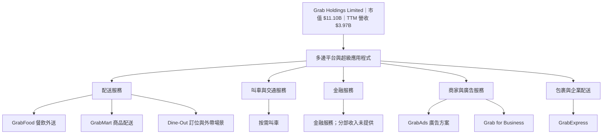
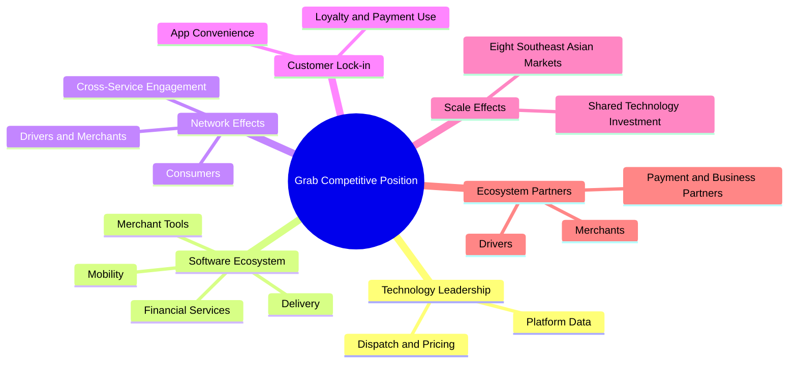
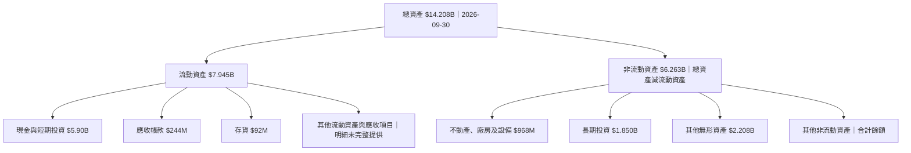
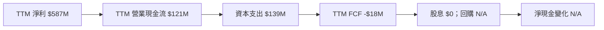
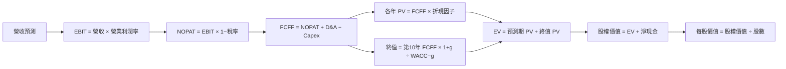
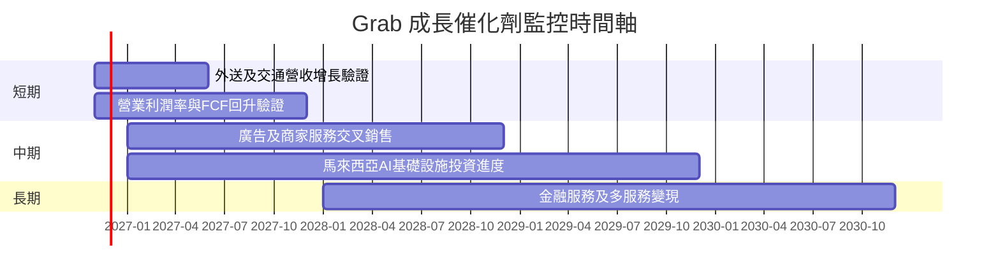
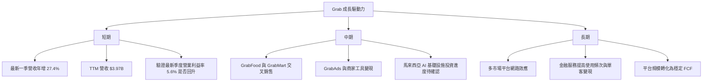
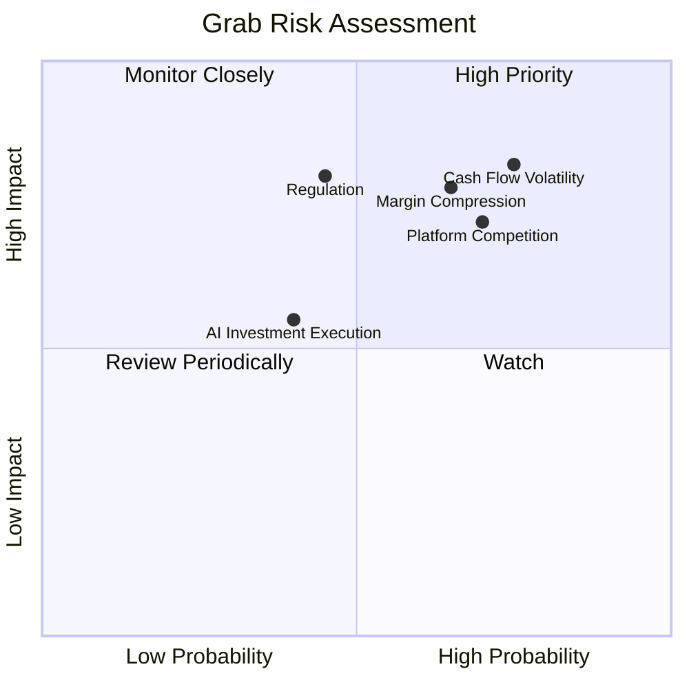
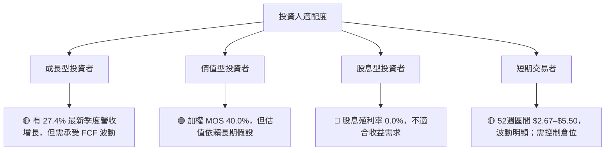

# GRAB 基本面深度分析報告
> **報告日期**：2026-11-20 ｜ **語言**：繁體中文 ｜ **數據來源**：Yahoo Finance、Finviz、StockAnalysis、Roic.ai ｜ **分析師**：CFA 級機構研究

> **資料口徑提醒**：最新收盤價為 **2026-11-20 收盤 $2.75**。財務資料主要來自 Yahoo Finance 季度報表，另以 StockAnalysis、Roic.ai 交叉參照；部分期間的營業利益、毛利及季度資料有來源差異。本報告依「VERIFIED FIGURES」指定口徑引用核心估值與財務指標，對資料衝突不作無依據調和。公司並無 SEC 申報資料納入本次財務資料集，EPS 一致預期也未提供，故不能判斷最近四季是否超預期或不及預期。

---

## 目錄

| # | 章節 | 核心結論 |
|---|------|----------|
| 1 | 執行摘要 | 買入；加權合理價值 $4.58；MOS +40.0% |
| 2 | 公司概覽與商業模式 | 區域型多邊平台具網路效應，但市場份額及分部營收未提供 |
| 3 | 損益表深度分析 | TTM 營收 $3.97B；最新一季年增 27.4%，最新一季營業利益率 5.6% |
| 4 | 資產負債表分析 | 淨現金 $3.83B；現金與短期投資 $5.90B |
| 5 | 現金流量深度分析 | TTM FCF -$18M、FCF Yield -0.16%，現金轉換仍不穩定 |
| 6 | 獲利能力與資本效率 | WACC 8.29%；ROIC N/A，不能確認目前已創造經濟價值 |
| 7 | 相對估值分析 | 本公司 Forward P/E 17.5x；估值方法結果分歧 |
| 8 | DCF 內在價值評估 | DCF 基準每股 $6.24；加權合理價值採第 8.8 節 |
| 9 | 成長催化劑 | 外送、叫車、金融服務與 AI 投資提供選擇權，TAM 數字未提供 |
| 10 | 風險矩陣 | 競爭、利潤率落差與現金流波動是主要風險 |
| 11 | 投資建議 | 買入；建議區間 $2.75–$4.12，並以季度現金流與利潤率驗證 |

---

## 1. 執行摘要

Grab 的營收動能與估值提供上行空間，但現金流轉換及最新季度獲利波動，使本案仍需以營運表現驗證估值。公司 TTM 營收為 **$3.97B**，最新一季營收年增 **27.4%**；然而 TTM FCF 為 **-$18M**、FCF Yield 為 **-0.16%**，且最新一季營業利益率 **5.6%** 低於 TTM 的 **11.0%**。DCF 基準價值為 **$6.24**，但估值方法加權後合理價值為 **$4.58**；以 2026-11-20 收盤價 **$2.75** 計，MOS 為 **40.0%**。按 MOS 門檻評級為**買入**；ROIC 未提供，無法證明 ROIC 高於 WACC，因此不採「強烈買入」。

### 1.0 一頁式投資儀表板（Portfolio Manager 30 秒速讀）

| 項目 | 內容 |
|------|------|
| **投資論點（3 句）** | ① TTM 營收 $3.97B，最新一季年增 27.4%，顯示區域平台交易量與變現仍有增長。② 現金與短期投資 $5.90B、總債務 $2.07B，淨現金 $3.83B，具備承受投資與競爭的資產負債表緩衝。③ 加權合理價值 $4.58 高於現價 $2.75，MOS 40.0%；但 TTM FCF -$18M，估值上行必須由現金流轉正支撐。 |
| **綜合評分** | **6.8/10**（引用 1.1 六項算術平均） |
| **財務健康** | 🟢 淨現金 $3.83B、流動比率 1.384；但 FCF 為負，非無風險 |
| **ROIC vs WACC** | ROIC **N/A** vs WACC **8.29%**；無法判定已創造或摧毀價值 |
| **FCF 趨勢** | 年度 FCF 波動；TTM FCF **-$18M**，FCF Yield **-0.16%** |
| **估值** | Forward P/E **17.5x** ｜ EV/EBITDA **19.1x** ｜ FCF Yield **-0.16%** |
| **DCF 內在價值（基準）** | **$6.24** ｜現價相對 DCF 折價 **55.9%**（折溢價＝$2.75÷$6.24−1） |
| **安全邊際（MOS）** | **+40.0%**＝($4.58−$2.75)÷$4.58；基準為第 8.8 節加權合理價值｜🟢 >25% |
| **預期報酬（基準情境 12M）** | DCF 基準情境相對現價 **+126.9%**；屬模型內在價值變動，不等同分析師對 12 個月價格的保證 |
| **關鍵風險（前二）** | ① TTM FCF 為負且季度現金流反覆；② 最新季度營業利益率 5.6%，顯著低於 TTM 11.0% |
| **評級 + 信心度** | 🟢 **買入** ｜信心：中；主要折價依賴 DCF 長期現金流假設，且 ROIC、TTM 營收年增率缺漏 |

### 1.1 綜合評分卡（全報告唯一）

| 維度 | 評分（1–10） | 主要依據（引用數字與其來源章節） |
|------|--------------|----------------------------------|
| 成長性 | 8.0 | 最新一季營收年增 27.4%；2022–2025 年營收由 $1.43B 增至 $3.37B，年複合成長約 33.0%（第 3 章） |
| 獲利能力 | 5.0 | TTM 營業利益率 11.0%，但最新一季為 5.6%；ROIC 與 Piotroski F-Score 均 N/A（第 3、6 章） |
| 財務健康 | 7.5 | 淨現金 $3.83B、流動比率 1.384、速動比率 1.07；但 TTM FCF -$18M（第 4、5 章） |
| 估值 | 8.0 | MOS +40.0%；同業估值方法回推價格不一，Forward P/E 17.5x（第 7、8 章） |
| 護城河 | 7.0 | 多邊平台、跨叫車與外送服務的交叉銷售，以及 8 個市場營運；未提供市占與分部數據（第 2 章） |
| 管理層與資本配置 | 5.5 | FY2025 SBC $241M，年度股息為 $0；2025 年資本支出 $123M，現金流年度間高度波動（第 5 章） |
| **綜合評分** | **6.8** | 六項算術平均＝(8.0+5.0+7.5+8.0+7.0+5.5)÷6＝6.833，四捨五入至一位小數 |

### 1.2 五大投資論點 + 三大核心風險

| 類型 | 項目 | 具體依據 | 信心度 |
|------|------|----------|--------|
| 🟢 **投資論點①** | 區域超級應用平台可持續擴大變現 | TTM 營收 $3.97B；最新一季年增 27.4%，快於 UBER 9.6% 的最新一季年增率 | 🟢 高 |
| 🟢 **投資論點②** | 資產負債表有投資緩衝 | 現金與短期投資 $5.90B，總債務 $2.07B，淨現金 $3.83B | 🟢 高 |
| 🟢 **投資論點③** | 估值有折價空間 | 加權合理價值 $4.58，相對現價 $2.75 的 MOS 為 40.0% | 🟡 中 |
| 🟢 **投資論點④** | 服務組合有交叉銷售機會 | GrabFood、GrabMart、叫車、GrabAds、GrabExpress 與金融服務共用平台；分部營收未提供，變現成效仍待確認 | 🟡 中 |
| 🟢 **投資論點⑤** | 現金轉換週期具營運資金優勢 | 最新 TTM CCC 為 -182 天，主要與 DPO 219 天有關；須觀察供應商付款條件能否持續 | 🟡 中 |
| 🟡 **風險①** | 現金流品質與持續性 | TTM FCF -$18M；FY2024 FCF $739M，但 FY2025 為 -$44M，年度間落差大 | 🔴 高衝擊 |
| 🔴 **風險②** | 季度利潤率及盈餘波動 | TTM 營業利益率 11.0%，最新季度 5.6%；EPS 最新季度年減 32.2% | 🔴 高衝擊 |
| 🟡 **風險③** | 市場競爭與監管風險 | 8 個東南亞市場的外送、叫車及金融服務面臨在地與全球平台競爭；市場份額及補貼數據未提供 | 🟡 中度 |

### 1.3 快速統計卡片

| 指標 | 公司實際值（期間） | 同業中位數 | 狀態 |
|------|--------------------|------------|------|
| 營收成長（TTM） | **N/A** | — | 🟡 TTM 同比資料未提供 |
| 營收成長（最新一季年增） | **27.4%** | **34.0%** | 🟡 低於同業中位數 |
| 毛利率（TTM） | **41.4%** | **45.0%** | 🟡 低於同業中位數 |
| 營業利益率（TTM） | **11.0%** | — | 🟢 已轉正，惟最新一季僅 5.6% |
| ROIC（TTM） | **N/A** | — | 🟡 無法與資金成本比較 |
| Forward P/E | **17.5x** | **14.4x** | 🟡 高於同業中位數 |
| FCF Yield（TTM） | **-0.16%** | — | 🔴 FCF 為負 |
| Piotroski F-Score | **N/A / 9** | — | 🟡 欠缺兩個相隔一年的 SEC TTM 期間 |

### 1.4 投資結論

```text
╔══════════════════════════════════════════════════════════════════╗
║                    📊 投資結論摘要                               ║
╠══════════════════════════════════════════════════════════════════╣
║  評級：買入（依 MOS 門檻；ROIC N/A，不能支持強烈買入）           ║
║  價格（2026-11-20 收盤）：$2.75                                  ║
║  DCF 內在價值（基準）：$6.24（現價折價 55.9%）                   ║
║  安全邊際 MOS：+40.0%（＝($4.58−$2.75)÷$4.58）                 ║
║  加權合理價值（8.8）：$4.58                                      ║
║  DCF 情境價值：                                                  ║
║    悲觀情境：$3.21（+16.6%）                                     ║
║    基準情境：$6.24（+126.9%）                                    ║
║    樂觀情境：$13.01（+373.1%）                                   ║
║  綜合評分：6.8/10（引用 1.1）                                    ║
║  適合投資人：能承受現金流波動、具中長期持有期限的成長型投資人    ║
╚══════════════════════════════════════════════════════════════════╝
```

---

## 2. 公司概覽與商業模式

### 2.1 業務結構與收入來源

Grab Holdings Limited 在柬埔寨、印尼、馬來西亞、緬甸、菲律賓、新加坡、泰國及越南營運 Grab 超級應用程式。提供的公司介紹涵蓋外送、叫車、商家服務、廣告及金融相關業務，但沒有分部營收或各業務收入占比；因此以下圖表只列公司總營收與已知業務，不推算分部比例。



### 2.2 市場份額

市場份額數據未提供，無法以可靠數字估算 Grab 在東南亞外送、叫車或數位金融市場的占比。質化而言，Grab 已在 8 個東南亞市場營運，最新一季營收年增 27.4%；同期 UBER 為 9.6%、SE 為 43.4%、DASH 為 34.0%，Grab 的增速高於 UBER、低於 SE 與 DASH。不同市場與服務組合不完全相同，這些增速只能作成長參照，不能直接視為市占變化。

### 2.3 競爭護城河分析



### 2.4 護城河強度

| 護城河項目 | 強度（強／中／弱） | 證據（引用數字或事實） | 會削弱它的情況 |
|------------|--------------------|------------------------|----------------|
| 技術與資料 | 中 | 叫車、配送、廣告及商家服務共用平台；公司員工 12,012 人 | 技術服務差異化不足，競爭者以補貼或更佳履約搶走供需雙方 |
| 軟體生態系統 | 中至強 | GrabFood、GrabMart、交通、GrabAds、GrabExpress 等組合，提供交叉銷售可能 | 使用者只在單一服務上活躍，跨服務變現無法提升 |
| 網路效應 | 中至強 | 消費者、司機與商家相互依存，平台規模可改善撮合密度 | 區域市場高度分散，競爭與多平台接單削弱單一平台網路效應 |
| 客戶鎖定 | 中 | 超級應用將多種日常服務整合於同一平台 | 轉換成本低、價格敏感，優惠減少後使用頻率下降 |
| 規模效應 | 中 | 在 8 個東南亞市場營運；TTM 營收 $3.97B | 跨國營運帶來監管、補貼與本地化成本，規模不一定轉成利潤 |
| 生態夥伴 | 中 | 與司機、商家及企業客戶形成平台供給網絡 | 夥伴議價力上升、費率監管或商家多平台化 |

1.1「護城河」評分 **7.0/10**，依據是跨服務平台與 8 個市場營運的生態系統優勢；但因缺少市場份額、留存率、分部獲利與用戶活躍數，尚不足以判斷其護城河可持續轉化為更高資本報酬。

---

## 3. 損益表深度分析

### 3.1 年度收入成長趨勢（近 4 年）

FY2022 至 FY2025 營收由 $1.43B 增至 $3.37B，年複合成長約 33.0%。高成長反映平台規模擴張及服務滲透，但營收成長本身不等於股東回報；須一併觀察現金流、補貼、SBC 與利潤率。

```text
╔══════════════════════════════════════════════════════════════════╗
║              Grab 年度收入趨勢（FY2022–FY2025）                 ║
╠══════════════════════════════════════════════════════════════════╣
║  FY2022  $1.43B  ████████░░░░░░░░░░░░░░░░  基期               ║
║  FY2023  $2.36B  ██████████████░░░░░░░░░░  YoY +64.6% 🟢       ║
║  FY2024  $2.80B  █████████████████░░░░░░░  YoY +18.6% 🟢       ║
║  FY2025  $3.37B  ████████████████████░░░░  YoY +20.5% 🟢       ║
╠══════════════════════════════════════════════════════════════════╣
║  FY2022–FY2025 營收 CAGR：約 +33.0%                              ║
╚══════════════════════════════════════════════════════════════════╝
```

年度增長率計算：
- FY2023：($2.36B÷$1.43B)−1＝約 **64.6%**
- FY2024：($2.80B÷$2.36B)−1＝約 **18.6%**
- FY2025：($3.37B÷$2.80B)−1＝約 **20.5%**
- 三年 CAGR：($3.37B÷$1.43B)^(1/3)−1＝約 **33.0%**

**口徑差異**：StockAnalysis 顯示 FY2025 營收 $3.370B、FY2024 $2.797B、FY2023 $2.359B、FY2022 $1.433B；概覽年度表以兩位小數呈現。TTM 營收同比成長率在指定財務指標中為 N/A，因此不以 StockAnalysis 年增率替代 TTM 成長率。

### 3.2 季度收入趨勢分析

| 季度 | 營收 | QoQ 成長 | YoY 成長 | 備註 |
|------|------:|---------:|---------:|------|
| 2025 Q4 | $906M | 17.2% | 18.6% | QoQ 以 2025 Q3 $873M 計；YoY 以 2024 Q4 $764M 計 |
| 2026 Q1 | $955M | 5.4% | 23.5% | 季度營收延續增長，YoY 高於 2025 Q1 |
| 2026 Q2 | $998M | 4.5% | 21.9% | QoQ 增幅放緩，YoY 仍維持雙位數 |
| 2026 Q3 | $1.112B | 11.4% | 27.4% | 最新季度年增 27.4%，QoQ 增長加快 |

QoQ 計算採相鄰季度營收：Q1 2026 ($955M÷$906M)−1＝5.4%；Q2 2026 ($998M÷$955M)−1＝4.5%；Q3 2026 ($1.112B÷$998M)−1＝11.4%。最新一季同比 27.4% 與 VERIFIED FIGURES 相符。季節性可能影響 QoQ，因此比較年度表現時應優先參照 YoY。

### 3.3 利潤率演變分析

| 利潤率指標 | FY2022 | FY2023 | FY2024 | FY2025 | 趨勢 | 評估 |
|------------|-------:|-------:|-------:|-------:|------|------|
| 毛利率（依年度損益表數值計算） | 5.4% | 36.4% | 41.8% | 43.3% | 整體改善 | 🟡 2025 毛利額來源有差異 |
| 營業利益率（依年度損益表數值計算） | -90.2% | -16.4% | -2.0% | 6.6% | 由虧轉盈 | 🟢 年度趨勢改善 |
| 淨利率（依年度損益表數值計算） | -117.5% | -18.4% | -3.8% | 8.0% | 由虧轉盈 | 🟡 單年淨利可能含非經常項目 |
| 營業利益率（TTM 指定口徑） | — | — | — | **11.0%** | TTM 已轉正 | 🟡 最新季度僅 5.6% |

年度計算示例：FY2025 營業利益率＝$222M÷$3.37B＝6.6%；但 StockAnalysis 年度資料列示 FY2025 營業利益 $80M，按同一收入計算約 2.4%。季度資料亦存在差異：Yahoo 季度表將 2026 Q3 營業利益列為 $170M，StockAnalysis 列為 $112M。故年度表採年度損益表所列金額計算，核心 TTM 與最新季度營業利益率則使用 VERIFIED FIGURES 的 **11.0%** 與 **5.6%**，不把不同資料源混為同一序列。

**利潤率演變深度解析**：FY2022–FY2025 年營業利益由 -$1.29B 改善至 $222M，顯示平台規模擴大後，固定技術與營運成本有望被更多交易量吸收；年度毛利率資料亦呈上升。不過最新季度營業利益率僅 5.6%，低於 TTM 11.0%，加上季度營業利益來源差異，需確認改善是否來自可持續的服務組合、定價與成本控制，而非單季或一次性項目。

### 3.4 費用結構分析

完整的營業費用分項資料未提供，無法將研發、行銷、行政等費用構成作成可靠圓餅圖。可引用的費用資訊包括：FY2025 研發費用 $428M，約為當年營收 $3.37B 的 12.7%；SBC 為 $241M，約占 FY2025 營收 7.2%。研發支出維持平台產品與技術投入，但 SBC 對股東的經濟成本不可忽略。

```text
╔══════════════════════════════════════════════════════════════════╗
║                 已披露費用項目（FY2025）                        ║
╠══════════════════════════════════════════════════════════════════╣
║  研發費用  $428M  約占營收 12.7%                                 ║
║  SBC       $241M  約占營收  7.2%                                 ║
║  其他營業費用分項：數據未提供，無法拆分                         ║
╚══════════════════════════════════════════════════════════════════╝
```

### 3.5 季度 EPS 趨勢與盈餘品質（Quality of Earnings）

最近四季 EPS 實際數可由 StockAnalysis 提供，但 EPS 估計值為 nan，故沒有一致預期可比較；不能把缺少一致預期解讀為盈餘超預期或不及預期。

| 季度 | EPS 實際值 | EPS 年增 | 超預期／不及預期 |
|------|-----------:|---------:|------------------|
| 2025 Q4 | $0.04 | N/A | N/A：EPS 預期值未提供 |
| 2026 Q1 | -$0.01 | N/A | N/A：EPS 預期值未提供 |
| 2026 Q2 | $0.06 | N/A | N/A：EPS 預期值未提供 |
| 2026 Q3 | $0.01 | -32.2% | N/A：EPS 預期值未提供 |

季度淨利分別為 2025 Q4 $172M、2026 Q1 $136M、Q2 $253M、Q3 $27M，顯示季度淨利波動顯著。最新季度 EPS 年減 32.2%、淨利年減 27.0%，但欠缺完整稅項與一次性項目附註，不能將變動歸因於單一因素。

| 盈餘品質項目 | 數值／佔比 | 評估 |
|--------------|-----------:|------|
| 股權薪酬 SBC / 營收 | TTM SBC 約 $234M ÷ $3.97B＝**5.9%** | 🟡 有實質稀釋成本；不應只看剔除 SBC 的調整後獲利 |
| SBC / 營業現金流 | $234M ÷ $121M＝**193.4%** | 🔴 SBC 高於 TTM 營業現金流，現金流對股東報酬的含金量偏弱 |
| FCF / 淨利（現金轉換率） | -$18M ÷ TTM 淨利 $587M＝**-3.1%** | 🔴 TTM 獲利未轉成正 FCF |
| 一次性／非經常性損益 | N/A：明細未提供 | 🟡 2026 Q2 淨利 $253M、Q3 $27M，波動值得追查，但不可僅據此推定一次性收益 |
| 有效稅率 | **25.7%**（最近年度） | 🟡 沒有稅務調節表，無法判斷異常項目 |
| 資本化支出 vs 費用化 | TTM 資本支出 $139M；資本化／費用化拆分 N/A | 🟡 不足以判斷是否有成本遞延或資本化變化 |

**盈餘品質結論**：TTM 淨利為正，但 TTM FCF 為負、SBC 約為營業現金流的 1.93 倍，說明會計獲利尚未形成相同程度的現金回報，且 SBC 代表既有股東承擔的經濟稀釋。估值不宜只依賴 P/E，需同步追蹤 OCF、資本支出與稀釋股數。

---

## 4. 資產負債表分析

### 4.1 資產結構分解

最新季度資產負債表（2026-09-30）總資產為 $14.208B，流動資產 $7.945B。現金與短期投資的指定核心數為 $5.90B；StockAnalysis 另列現金及短期投資 $5.897B，兩者僅有四捨五入差異。非流動資產按總資產減流動資產計為 $6.263B，以下為計算值。



### 4.2 流動性與營運資金分析

| 指標 | 最新 TTM | 一年前 TTM | 變化 | 解讀 |
|------|----------:|------------:|------|------|
| DSO 應收帳款天數 | **22 天** | N/A | N/A | 一年前口徑資料未提供，無法判斷收款速度是否改善 |
| DIO 存貨天數 | **15 天** | N/A | N/A | 存貨天數不高，但缺少一年前對照 |
| DPO 應付帳款天數 | **219 天** | N/A | N/A | 高 DPO 支持負 CCC；亦需留意付款條件與供應商關係 |
| CCC 現金轉換週期 | **-182 天** | N/A | N/A | 公司可在回收現金前較久延後支付部分供應商款項；不能單憑負 CCC 判定議價力 |

指定品質指標定義為期末餘額除以 TTM 流量乘以 365，CCC＝DSO＋DIO−DPO。三項最新天數計算為 22＋15−219＝-182 天；因品質指標未提供一年前數值，不自行回推。

| 流動性指標 | 數值 | 評估 |
|------------|-----:|------|
| 現金及短期投資 | $5.90B | 🟢 現金資源高於總債務 |
| 總債務 | $2.07B | 🟡 需結合到期結構與利息資料觀察 |
| 淨現金 | $3.83B | 🟢 有資產負債表緩衝 |
| 流動比率 | 1.384 | 🟡 流動資產高於流動負債 |
| 速動比率 | 1.07 | 🟡 高於 1，但不是寬裕到可忽略現金流風險 |

### 4.3 債務結構分析

```text
╔══════════════════════════════════════════════════════════════════╗
║                    Grab 債務健康診斷                            ║
╠══════════════════════════════════════════════════════════════════╣
║  總債務：             $2.07B                                     ║
║  現金＋短期投資：      $5.90B                                     ║
║  淨現金：              $3.83B  🟢                                 ║
║                                                                  ║
║  流動比率：             1.384  🟡                                 ║
║  速動比率：             1.07   🟡                                 ║
║  Debt/EBITDA：          N/A（未提供可直接引用的 TTM EBITDA 金額） ║
║  Interest Coverage：    N/A（利息費用與利息保障倍數未提供）      ║
╚══════════════════════════════════════════════════════════════════╝
```

淨現金是資產負債表緩衝，不代表營運現金流已健康。TTM FCF -$18M，且 FY2025 總債務 $2.05B、FY2024 $364M，反映債務餘額曾有明顯變化；需追蹤借款用途、期限與利息支出。

### 4.4 股東權益趨勢

| 年度 | 股東權益 | 年增／變化 |
|------|---------:|-----------:|
| 2022 | $6.60B | — |
| 2023 | $6.45B | -$0.15B |
| 2024 | $6.40B | -$0.05B |
| 2025 | $6.73B | +$0.33B |

```text
╔══════════════════════════════════════════════════════════════════╗
║                 股東權益趨勢（年度）                            ║
╠══════════════════════════════════════════════════════════════════╣
║  2022  $6.60B  ████████████████████                              ║
║  2023  $6.45B  ███████████████████▌                              ║
║  2024  $6.40B  ███████████████████▍                              ║
║  2025  $6.73B  █████████████████████                             ║
╚══════════════════════════════════════════════════════════════════╝
```

權益在 2022–2024 年小幅下降、2025 年回升；資料未提供股東權益變化的完整組成，因此不能將變化單獨歸因於保留盈餘、股份支付或其他項目。

---

## 5. 現金流量深度分析

### 5.1 現金流量瀑布圖

TTM 營業現金流 $121M，資本支出 $139M，按指定定義 FCF＝OCF−Capex＝-$18M。股息支出為零；回購與淨現金變動未提供。



淨利並非營業現金流的同義詞；TTM 淨利 $587M 而 OCF $121M，顯示權責發生制獲利與現金回收存在差距。股息為零，保留資金可投入營運，但資本配置是否有效仍需用未來 FCF 驗證。

### 5.2 FCF 轉換率趨勢

| 期間 | FCF | 淨利 | FCF / 淨利 | 解讀 |
|------|----:|----:|-----------:|------|
| FY2022 | -$872M | -$1.68B | 約 51.9% | 分子分母皆為負，比例不代表正向現金轉換 |
| FY2023 | -$6M | -$434M | 約 1.4% | 虧損大幅收窄，FCF 接近損益兩平 |
| FY2024 | $739M | -$105M | 約 -704.8% | 淨利為負使比率失去一般解讀意義；可能受營運資金或其他非現金項目影響 |
| FY2025 | -$44M | $268M | 約 -16.4% | 獲利為正但 FCF 為負 |
| TTM 至 2026-09-30 | -$18M | $587M | 約 -3.1% | 仍未把會計淨利轉為正 FCF |

年度 FCF 與淨利採年度現金流及損益表數據；TTM FCF 嚴格採指定 OCF−Capex 數值。負淨利年份的 FCF/淨利比例不宜當作一般效率指標。

### 5.3 自由現金流趨勢

```text
╔══════════════════════════════════════════════════════════════════╗
║                  自由現金流趨勢（USD）                          ║
╠══════════════════════════════════════════════════════════════════╣
║  FY2022  -$872M  ◀████████████████████  FCF 為負                 ║
║  FY2023    -$6M  ◀█                    接近損益兩平               ║
║  FY2024  +$739M  ████████████████████▶                            ║
║  FY2025   -$44M  ◀██                   再度轉負                  ║
║  TTM      -$18M  ◀█                    FCF Yield -0.16%          ║
╚══════════════════════════════════════════════════════════════════╝
```

年度 FCF 從 FY2024 的 $739M 降至 FY2025 的 -$44M，再到 TTM -$18M，顯示現金流仍有波動。年報資本支出以負數列示，計算 FCF 時依現金流出方向扣除；不將某一年的高 FCF 直接外推為穩態。

### 5.4 資本配置評估

資本配置用途的完整資金分配比例未提供，故不作資金比例圓餅圖。

| 項目 | 可引用資料 | 評估 |
|------|------------|------|
| 股息 | 2022–2025 年均為 $0；股息殖利率 0.0% | 未以現金股息回饋股東 |
| 資本支出 | FY2025 $123M；FY2024 $113M；FY2023 $92M；FY2022 $74M | 長期投入增加，但 TTM Capex $139M 高於 TTM OCF $121M |
| SBC | FY2025 $241M；FY2024 $279M；FY2023 $304M；FY2022 $412M | 呈下降趨勢，但仍對股東有稀釋成本 |
| 回購 | N/A：回購金額未提供 | 不評判回購成效 |
| 留存現金與投資 | 2026-09-30 現金與短期投資約 $5.90B | 為擴張和韌性提供資金，但回報率需追蹤 |

---

## 6. 獲利能力與資本效率

### 6.1 ROE / ROA / ROIC 趨勢

| 指標 | 最新可用值 | 歷史趨勢 | 評估 |
|------|-----------:|----------|------|
| ROE | 7.6%（TTM） | 其他年度口徑缺少一致序列 | 🟡 正值，但未提供可用杜邦拆解 |
| ROA | 1.1%（TTM） | 其他年度口徑缺少一致序列 | 🟡 資產回報偏薄 |
| ROIC | N/A | 缺少可直接引用的 ROIC 歷史資料 | 🟡 不能與 WACC 比較 |
| TTM 營業利益率 | 11.0% | 最新季度 5.6% | 🟡 TTM 獲利改善，但近期季度較弱 |

行業均值未提供，故不作無來源比較。ROE、ROA 雖可引用，但不足以代替 ROIC；資本效率結論以 ROIC N/A 為限。

### 6.2 ROIC vs WACC 分析（核心價值創造判斷）

```text
╔══════════════════════════════════════════════════════════════════╗
║                  ROIC vs WACC 深度分析                          ║
╠══════════════════════════════════════════════════════════════════╣
║  資金成本（指定口徑）：                                          ║
║  ├── 無風險利率（10Y 美債）：       4.91%                        ║
║  ├── 市場風險溢酬 ERP：              5.00%                        ║
║  ├── 調整後 Beta：                   0.89                         ║
║  ├── 股權成本：4.91% + 0.89×5.00% = 9.36%                       ║
║  ├── 稅前債務成本：                  3.43%                        ║
║  ├── 稅後債務成本：3.43%×(1−25.7%) = 2.55%                       ║
║  ├── 資本結構：股權 84.3%，債務 15.7%                            ║
║  └── WACC：                          8.29%                        ║
║                                                                  ║
║  ROIC：N/A（沒有足夠資料按一致口徑計算）                         ║
║  EVA = ROIC − WACC：N/A                                           ║
║  結論：目前無法判定 Grab 的投入資本回報高於 8.29% 資金成本       ║
╚══════════════════════════════════════════════════════════════════╝
```

ROIC 未提供，故不以營業利益率 11.0% 代替 ROIC，也不推算投入資本。公司目前是否創造股東價值，須等到有可比期間的 NOPAT、投入資本與資本化項目資料後再判斷。WACC 的完整算式見第 8.2 節，兩處一致採用 8.29%。

### 6.3 杜邦三因素分解

| 因素 | 數值（TTM） | 解讀 |
|------|-------------|------|
| 淨利率 | N/A | 品質指標區塊判定缺少一致所需資料 |
| 資產週轉率 | N/A | N/A |
| 權益乘數 | N/A | N/A |
| **ROE** | **N/A（杜邦分解）** | 品質指標區塊因所需淨利、營收、總資產或正權益口徑缺漏而列 N/A |

雖另有 ROE 7.6% 的市場資料，品質指標中的杜邦拆解依指定口徑列為 N/A；不以不同來源數字自行重建三因素。

### 6.4 財務體質：Piotroski F-Score

**Piotroski F-Score：N/A（九項測試皆無法按指定方式完整判定）**。原因是缺少相隔一年的兩組 SEC 申報 TTM 資料，且本次財務資料未提供九項測試各自結果。為避免推算或臆測，不逐項補填測試結果。

---

## 7. 相對估值分析

### 7.1 同業估值比較表格

Grab 是東南亞多業務平台，UBER、SE、DASH 的業務組合及市場地域不同，倍數比較適合作估值參照，不代表直接等同。競爭對手倍數使用 Yahoo Finance 指定數據。

| 估值指標 | **GRAB** | **UBER** | **SE** | **DASH** | 本公司評估 |
|----------|---------:|---------:|-------:|--------:|-----------|
| **Trailing P/E** | 27.5x | 37.3x | 22.5x | 63.3x | 🟡 位於同業區間內；盈利組成及可持續性需驗證 |
| **Forward P/E** | 17.5x | 14.4x | 13.1x | 20.0x | 🟡 高於同業中位數 14.4x |
| **P/S Ratio（TTM）** | 2.8x | 2.3x | 1.3x | 3.9x | 🟡 高於 UBER、SE，低於 DASH |
| **EV/EBITDA（TTM）** | 19.1x | 18.3x | 12.9x | 38.5x | 🟡 略高於 UBER、SE，低於 DASH |
| **最新一季營收年增** | 27.4% | 9.6% | 43.4% | 34.0% | 🟡 高於 UBER，低於 SE、DASH |
| **毛利率（TTM）** | 41.4% | 41.4% | 45.0% | 52.7% | 🟡 等於 UBER，低於 SE、DASH |

Forward P/E 公司值以報表估值數據的 **17.517038x** 為來源；為表格可讀性顯示 17.5x。相對估值呈現「成長較快於 UBER，但估值也高於 UBER 和 SE」的組合。TTM FCF 為負，因此 FCF Yield 不適合用來作正向估值支撐。

### 7.2 歷史估值區間分析

**N/A（數據未提供：缺少公司歷史 P/E、EV/EBITDA 或估值百分位區間）**。24 個月股價資料顯示 2024-11 收盤 $5.00、2025-09 為 $6.02，至 2026-11 為 $2.75；這只能描述股價路徑，不能用來替代歷史估值區間或估值百分位。

### 7.3 情境價值（Bear / Base / Bull，照抄 DCF MODEL 的 Scenarios）

| 情境 | 第 1 年營收成長 | 期末營業利潤率 | WACC | 每股價值 | 相對現價 | 機率 | 會發生的條件 |
|------|----------------:|----------------:|-----:|----------:|---------:|-----:|--------------|
| 🔴 悲觀 | 13.7% | 9.3% | 9.29% | $3.21 | +16.6% | 25% | 成長降至基準假設一半、長期利潤率低於現行 TTM，且風險折現率上升 |
| 🟡 基準 | 27.4% | 11.0% | 8.29% | $6.24 | +126.9% | 50% | 最新季度成長延續至模型首年，長期營業利潤率維持 11.0% |
| 🟢 樂觀 | 41.1% | 12.0% | 7.29% | $13.01 | +373.1% | 25% | 成長高於最新季度增速、利潤率提升，且資金成本下降 |

情境參數與價值照抄 DCF MODEL。情境的永續成長率沒有另列，故不自行補造；需注意「樂觀」情境同時假設更快成長、更高利潤率與較低 WACC，三項有利假設疊加，價值對情境選擇敏感。

### 7.4 相對估值隱含價格區間

```text
╔══════════════════════════════════════════════════════════════════╗
║              相對估值與方法回推每股價值                         ║
╠══════════════════════════════════════════════════════════════════╣
║  $2.26 ───────── $2.75 ───────── $3.92 ───── $5.39 ─── $6.24  ║
║  Forward P/E      現價           EV/EBITDA   共識均價   DCF基準 ║
║                                                                  ║
║  同業 Forward P/E：$2.26                                           ║
║  同業 EV/EBITDA： $3.92                                           ║
╚══════════════════════════════════════════════════════════════════╝
```

- **同業 Forward P/E $2.26**：同業中位數 Forward P/E **14.4x**（UBER 14.4x、SE 13.1x、DASH 20.0x）乘以 Grab Forward EPS **$0.16**；估值方法輸出採指定數值。
- **同業 EV/EBITDA $3.92**：同業中位數 EV/EBITDA **18.3x**（UBER、SE、DASH）乘 TTM EBITDA，再加回淨現金；倍數回推值照指定估值方法。
- **分析師共識目標價 $5.39**：22 位分析師平均目標價，僅作參考，不取代基本面估值。

---

## 8. DCF 內在價值評估（Discounted Cash Flow）

> 本節以 DCF MODEL 的基準假設與輸出為準，不另建模型、不更改模型數字。由於計算表只公布兩位小數的年度數值，部分逐年中間值會因未四捨五入原始數據而有小幅差異；下文會明確指出，避免把四捨五入差異包裝成精確重算。

### 8.0 估值推理鏈（Thinking Logic：在算之前先想清楚）

**Step 1 — 公司價值由哪些變數決定？**  
模型把價值視為既有平台營收擴張、利潤率維持與成熟期現金流三部分：已披露 TTM 總營收 $3.97B，但各服務營收占比未提供，不能把外送、叫車或金融服務各自拆成百分比。模型最敏感的變數是 **WACC 與永續成長率 g**：在敏感度矩陣中，基準 g=3.0% 時，WACC 7.29% 對應每股 $7.60，WACC 9.29% 對應 $5.32；而 WACC 8.29% 時，g=2.0% 對應 $5.64、g=4.0% 對應 $7.12。

**Step 2 — 模型選擇**

| 決策點 | 本報告採用 | 理由（含數字） | 曾考慮但否決 | 否決理由 |
|--------|-----------|----------------|--------------|----------|
| 現金流定義 | FCFF | 以企業現金流配合 WACC 折現，再由 EV 橋接至股權價值 | FCFE | 債務及現金需在企業價值橋接中單獨處理 |
| 預測期 N | 10 年 | 模型固定 10 年；Grab 最新一季年增 27.4%，成長與成熟轉型需要長期期間表達 | 5 年 | 無法呈現模型從 27.4% 線性遞減至 3.0% 的假設路徑 |
| 終值方法 | Gordon Growth 為主 | WACC 8.29% 高於 g 3.0%，公式可用 | 單獨退出倍數 | DCF MODEL 未提供退出倍數終值數字，不自行建立 |
| EBIT 基礎 | GAAP EBIT | 模型採 TTM 營業利益率 11.0% | 非 GAAP EBIT | 缺少一致調整項目與加回明細 |

**Step 3 — 關鍵假設推導鏈**

- **營收成長路徑**：錨點＝最新一季營收年增 27.4%，2022–2025 年營收 CAGR 約 33.0% → 調整＝單季高增速不宜直接當作十年長期速度，模型把年 1 成長率自 27.4% 線性遞減至第 10 年 3.0% → **採用首年 27.4%、第 10 年 3.0%** → 曾考慮直接採三年歷史 CAGR 33.0% 作首年，因最新季度增速低於歷史 CAGR 且此後長期維持風險高而不採。
- **期末營業利潤率**：錨點＝TTM 營業利益率 11.0%，最新季度僅 5.6% → 調整＝模型假設 TTM 利潤率可長期維持，未因最新季度回落下修 → **採用 11.0%（年 1 至年 10）** → 曾考慮採用最新季度 5.6%，但該季度與 TTM 的期間不同，不能直接以單季率取代長期 TTM 錨點；反之也不代表 11.0% 已獲最新季度確認。
- **永續成長率 g**：錨點＝長期名目經濟成長的成熟期假設；外部宏觀來源未提供，**3.0% 為模型假設值（依據：DCF MODEL 採用的成熟期永續成長假設）** → 調整＝成熟後增速低於首年 27.4%，且低於 WACC → **採用 3.0%** → 不採用高於 3.0% 的無來源替代值；g 必須小於 WACC 8.29%。
- **預測期 N**：錨點＝模型規定 N=10 年 → 調整＝用十年表示平台由高成長過渡到成熟期 → **採用 10 年** → 不用 5 年，因短期模型會壓縮終值前的過渡期；此期限仍是模型假設而非公司財測。
- **Capex/營收**：錨點＝TTM Capex $139M ÷ TTM 營收 $3.97B＝約 3.5% → 調整＝模型假設資本支出比率維持 3.5%，與 D&A 5.6% 比率比較後未上調至 1.1×D&A → **採用 3.5%** → 不採用更高比率，因模型內歷史 TTM 比率為基準；但若基礎設施投資加速，現假設可能偏低。
- **EBIT、SBC 與股數**：錨點＝模型用 GAAP EBIT（TTM 利潤率 11.0%）→ 調整＝GAAP EBIT 已把 SBC 當費用，不再從 FCFF 重複扣一次；股數也不額外逐年稀釋 → **採用組合 A：GAAP EBIT、無 −SBC 列、固定股數** → 不採用非 GAAP EBIT，因缺少一致的 SBC 加回明細。模型設定的股數稀釋率為 0%，此為模型處理方式，不代表公司實際股數不變。
- **D&A/營收**：錨點＝TTM D&A/營收 5.6% → **採用 5.6%** 並維持常數；不另加調整。
- **ΔWC**：錨點＝最新 CCC -182 天，但 DCF 模型沒有營運資金明細 → **模型未建模 ΔWC**；不以 CCC 倒推現金流。
- **終值方法**：錨點＝WACC 8.29%、g 3.0% → 調整＝模型以 Gordon Growth 將第 10 年 FCFF 永續化 → **採用 Gordon Growth**；退出倍數法未有模型輸出，故不自行指定倍數。
- **WACC**：錨點＝資金成本區塊的 WACC 8.29% → 調整＝不作調整，直接按指定值作折現率 → **採用 8.29%**；不另以主觀風險溢酬重算或替換。

**Step 4 — 最脆弱的一環**  
最脆弱的是十年維持 11.0% 營業利益率並以終值延續的假設：終值現值占企業價值 67.4%；若成長、利潤率或折現率不符，股權價值會顯著下降，方向與第 8.6 節敏感度矩陣一致。

**Step 5 — 計算路徑圖**



### 8.1 模型假設總表（Model Inputs）

| 假設項目 | 採用值 | 依據／來源 | 敏感度 |
|----------|--------|-------------|--------|
| 預測期長度 N | 10 年 | DCF MODEL 固定；成長從首年逐步遞減至第 10 年 | 🟡 中 |
| 營收成長路徑 | 第 1 年 27.4% → 第 10 年 3.0% | 首年取最新一季年增率；其後線性遞減，非 TTM 成長率 | 🔴 高 |
| 營業利潤率 | 第 1 年至第 10 年均 11.0% | TTM 營業利益率；模型以 GAAP EBIT | 🔴 高 |
| 有效稅率 | 25.7% | 最近年度有效稅率 | 🟢 低 |
| Capex / 營收 | 3.5% | TTM Capex ÷ TTM 營收；模型維持此比率 | 🟡 中 |
| D&A / 營收 | 5.6% | TTM 比率，模型固定 | 🟢 低 |
| 營運資金變動 / 營收增額 | 未建模 | DCF MODEL 明確未納入營運資金；不補造比率 | 🟢 低 |
| EBIT 基礎 | GAAP | DCF MODEL 使用 GAAP EBIT | 🟡 中 |
| SBC 處理 | 已包含於 GAAP EBIT；FCFF 不另扣 SBC | 模型組合 A | 🟡 中 |
| 年稀釋率 | 0%（模型固定股數） | 與 GAAP EBIT + 固定股數組合 A 相容；不是對實際未來股數的預測 | 🟡 中 |
| 永續成長率 g | 3.0% | DCF MODEL 假設；低於 WACC 8.29% | 🔴 高 |
| 終值方法 | Gordon Growth | DCF MODEL 提供 Gordon Growth 終值 | 🔴 高 |
| WACC | 8.29% | 資金成本輸入；見 8.2 | 🔴 高 |

**FCFF 定義**：採 FCFF＝NOPAT＋D&A−Capex。模型未納入 ΔWC，亦不另扣 SBC。**本模型採用組合 (A)，故 SBC 影響已透過 GAAP EBIT 計入一次。**

### 8.2 折現率推導（WACC）

Beta 原始值為 0.83，採用調整後 Beta 0.89；調整方法為 ⅔×原始 Beta＋⅓×1.0。10 年期美國公債利率 4.91%、ERP 5.00%，均依指定資金成本資料。區塊沒有另列日期或規模／國別溢酬，故不自行加計。

```text
╔══════════════════════════════════════════════════════════════════╗
║                    WACC 推導（折現率）                           ║
╠══════════════════════════════════════════════════════════════════╣
║  股權成本 Ke（CAPM）：                                           ║
║  ├── 無風險利率 Rf：                 4.91%                       ║
║  ├── 市場風險溢酬 ERP：               5.00%                       ║
║  ├── 原始 Beta：                      0.83                         ║
║  ├── 調整後 Beta：                    0.89                         ║
║  ├── 規模／國別溢酬：                 0.00%（未另加）             ║
║  └── Ke = 4.91% + 0.89×5.00% = 9.36%                            ║
║                                                                  ║
║  債務成本 Kd：                                                   ║
║  ├── 稅前 Kd：                        3.43%                       ║
║  ├── 有效稅率：                       25.7%                       ║
║  └── 稅後 Kd = 3.43%×(1−25.7%) = 2.55%                          ║
║                                                                  ║
║  資本結構權重：                                                  ║
║  ├── 股權 E 權重：                    84.3%                       ║
║  ├── 債務 D 權重：                    15.7%                       ║
║  └── WACC = 84.3%×9.36% + 15.7%×2.55% = 8.29%                  ║
╚══════════════════════════════════════════════════════════════════╝
```

**逐步演算（WACC）**

1. **Ke（CAPM）**＝Rf＋β×ERP＝4.91%＋0.89×5.00%＝4.91%＋4.45%＝**9.36%**。
2. **稅前 Kd**＝指定資金成本資料列示利息÷債務成本＝**3.43%**；利息金額與平均計息負債餘額未提供，故不能重建原始除法。此處採區塊計算結果，不以總負債或應付帳款重算。
3. **稅後 Kd**＝3.43%×(1−25.7%)＝3.43%×0.743＝**2.55%**。
4. **資本權重**＝股權權重 **84.3%**，債務權重 **15.7%**；84.3%＋15.7%＝**100.0%**。指定區塊以市值／債務權重列示；市值為 $11.10B、總債務 $2.07B。
5. **WACC**＝84.3%×9.36%＋15.7%×2.55%＝7.89%＋0.40%＝**8.29%**。

Kd 的利息費用及平均計息債務餘額沒有提供，以上採用指定稅前 Kd 與 WACC，不自行反推。ROIC 對照仍使用同一 WACC **8.29%**。

### 8.3 逐年自由現金流預測（基準情境）

下表按 DCF MODEL 原值抄列，金額為 USD billions；折現因子保留三位小數。年成長率從 27.4% 線性遞減至 3.0%，模型假設營業利益率維持 11.0%。

| 年度 | FY+1 | FY+2 | FY+3 | FY+4 | FY+5 | FY+6 | FY+7 | FY+8 | FY+9 | FY+10 |
|------|-----:|-----:|-----:|-----:|-----:|-----:|-----:|-----:|-----:|------:|
| 營收 | 5.06 | 6.31 | 7.69 | 9.18 | 10.70 | 12.18 | 13.53 | 14.67 | 15.51 | 15.98 |
| 營收 YoY | 27.4% | 24.7% | 22.0% | 19.3% | 16.6% | 13.8% | 11.1% | 8.4% | 5.7% | 3.0% |
| 營業利潤率 | 11.0% | 11.0% | 11.0% | 11.0% | 11.0% | 11.0% | 11.0% | 11.0% | 11.0% | 11.0% |
| EBIT（GAAP） | 0.55 | 0.69 | 0.84 | 1.01 | 1.17 | 1.33 | 1.48 | 1.61 | 1.70 | 1.75 |
| − 稅 | (0.14) | (0.18) | (0.22) | (0.26) | (0.30) | (0.34) | (0.38) | (0.41) | (0.44) | (0.45) |
| NOPAT | 0.41 | 0.51 | 0.63 | 0.75 | 0.87 | 0.99 | 1.10 | 1.20 | 1.26 | 1.30 |
| + D&A | 0.28 | 0.35 | 0.43 | 0.52 | 0.60 | 0.68 | 0.76 | 0.82 | 0.87 | 0.90 |
| − Capex | (0.18) | (0.22) | (0.27) | (0.32) | (0.37) | (0.43) | (0.47) | (0.51) | (0.54) | (0.56) |
| ΔWC | 未建模 | 未建模 | 未建模 | 未建模 | 未建模 | 未建模 | 未建模 | 未建模 | 未建模 | 未建模 |
| − SBC | 不另扣 | 不另扣 | 不另扣 | 不另扣 | 不另扣 | 不另扣 | 不另扣 | 不另扣 | 不另扣 | 不另扣 |
| **FCFF** | **0.52** | **0.65** | **0.79** | **0.94** | **1.10** | **1.25** | **1.39** | **1.51** | **1.59** | **1.64** |
| 折現因子 @8.29% | 0.923 | 0.853 | 0.788 | 0.727 | 0.672 | 0.620 | 0.573 | 0.529 | 0.488 | 0.451 |
| **FCFF 現值 PV** | **0.48** | **0.55** | **0.62** | **0.68** | **0.74** | **0.77** | **0.80** | **0.80** | **0.78** | **0.74** |

預測期現值加總（逐項列示）：
**$0.48+$0.55+$0.62+$0.68+$0.74+$0.77+$0.80+$0.80+$0.78+$0.74＝$6.96B**。

**逐步演算（FY+1，示範）**

1. **營收**＝TTM 營收 $3.97B×(1+27.4%)＝$3.97B×1.274＝**$5.06B**（四捨五入）。
2. **EBIT**＝營收 $5.06B×營業利益率 11.0%＝**$0.55B**（以模型輸出為準）。
3. **稅**＝EBIT $0.55B×25.7%＝**$0.14B**。
4. **NOPAT**＝$0.55B−$0.14B＝**$0.41B**。
5. **D&A**＝營收 $5.06B×5.6%＝**$0.28B**。
6. **Capex**＝營收 $5.06B×3.5%＝**$0.18B**。
7. **ΔWC**＝模型未建模，**不另列數值**。
8. **FCFF**＝NOPAT＋D&A−Capex＝$0.41B＋$0.28B−$0.18B＝$0.51B；DCF MODEL 列示 **$0.52B**。差異來自表格只顯示兩位小數，底層未四捨五入數值未提供，故不改寫程式輸出。
9. **折現因子**＝1÷(1+8.29%)^1＝**0.923**；PV＝模型 FCFF $0.52B×0.923＝**$0.48B**（以模型輸出為準）。

> **合理性自檢**
> - 預測期 FCF CAGR：約由 $0.52B 增至 $1.64B，九年間 CAGR＝($1.64÷$0.52)^(1/9)−1＝約 **13.6%**；歷史 FCF CAGR 不適合直接計算，因 FY2022–FY2025 FCF 跨越負值、正值與負值。
> - FY+10 FCF 利潤率＝$1.64B÷$15.98B＝約 **10.3%**；現有 TTM FCF 利潤率＝-$18M÷$3.97B＝約 **-0.5%**。同業最佳 FCF 利潤率未提供，不能作數字比較。
> - 模型每年 FCFF 均為正；若實際資本支出、營運資金或競爭性補貼高於假設，FCFF 會低於預測。

```text
╔══════════════════════════════════════════════════════════════════╗
║            自由現金流：歷史實際 vs 模型預測                      ║
╠══════════════════════════════════════════════════════════════════╣
║  FY2023(實)  -$0.006B  ◀█              FCF 接近損益兩平           ║
║  FY2024(實)  +$0.739B   █████████      年度現金流高點             ║
║  FY2025(實)  -$0.044B  ◀█              再度轉負                   ║
║  FY+1 (預)   +$0.52B    ███████         模型值                     ║
║  FY+10(預)   +$1.64B    ████████████████████ 模型值                ║
╠══════════════════════════════════════════════════════════════════╣
║  模型 FY+1 至 FY+10 FCFF CAGR 約 13.6%；歷史跨正負，不宜用 CAGR  ║
╚══════════════════════════════════════════════════════════════════╝
```

### 8.4 終值計算（Terminal Value）

**適用性檢查**：WACC **8.29%** vs g **3.0%** → **WACC > g ✅**

| 方法 | 計算式 | 終值 TV | TV 現值 | 佔總 EV 比重 |
|------|--------|---------:|--------:|-------------:|
| Gordon Growth | $1.64×(1+3.0%)÷(8.29%−3.0%) | $31.94B | $14.41B | 67.4% |
| 退出倍數法 | N/A：DCF MODEL 未提供終值倍數與相應輸出 | N/A | N/A | N/A |

**逐步演算**

1. **FY+N FCFF**＝FY+10 FCFF＝**$1.64B**。
2. **分子**＝$1.64B×(1+3.0%)＝$1.64B×1.03＝**$1.6892B**（未四捨五入）。
3. **分母**＝8.29%−3.00%＝**5.29%**；TV＝模型以底層未四捨五入現金流計得 **$31.94B**。以展示後數字直接算，$1.6892÷0.0529 約為 $31.93B；約 $0.01B 的差異屬未顯示精度差異，採用指定模型輸出 $31.94B。
4. **PV(TV)**＝$31.94B×第 10 年折現因子 0.451＝模型輸出 **$14.41B**。
5. **終值佔比**＝$14.41B÷企業價值 $21.37B＝**67.4%**。

終值占 EV 67.4%，未超過 75% 警戒線，但估值仍主要依賴第 10 年以後的現金流。退出倍數法沒有程式輸出，因此不以同業 EV/EBITDA 倍數另建終值。

### 8.5 企業價值 → 每股內在價值（Bridge）

```text
╔══════════════════════════════════════════════════════════════════╗
║              企業價值 → 每股內在價值 橋接表                      ║
╠══════════════════════════════════════════════════════════════════╣
║  預測期 FCF 現值合計             +$6.96B                         ║
║  終值現值 PV(TV)                 +$14.41B                        ║
║  ─────────────────────────────────────────────                  ║
║  = 企業價值 EV                    $21.37B                        ║
║  + 淨現金                         +$3.83B                         ║
║  = 股權價值（模型）               $25.19B                        ║
║  每股計算採用股份數               約4.037B股                      ║
║  ★ DCF 基準每股價值               $6.24                          ║
║  2026-11-20 收盤價                $2.75                          ║
║  折溢價（現價÷DCF價值−1）         -55.9%（折價）                 ║
╚══════════════════════════════════════════════════════════════════╝
```

**逐步演算（橋接）**

1. **EV**＝預測期 PV $6.96B＋PV(TV) $14.41B＝**$21.37B**。
2. **股權價值**＝EV $21.37B＋淨現金 $3.83B＝$25.20B；模型列示 **$25.19B**，差異 $0.01B 來自未四捨五入底層數字。為遵守指定輸出，後續採模型股權價值 $25.19B。
3. **每股內在價值**＝$25.19B÷約 4.037B 股＝**$6.24**（模型公式亦列為 equity value×price÷market cap＝$6.24）。
4. **折溢價**＝現價 $2.75÷DCF 基準價值 $6.24−1＝**-55.9%**，即現價較 DCF 基準價值折價 55.9%。
5. **本節不計算 MOS**：MOS 固定使用第 8.8 節加權合理價值作分母。

**股數與資產負債表口徑**：DCF 使用模型隱含約 4.037B 股的股數（由 $25.19B÷$6.24 得出，與 Roic.ai 2026-09 顯示的 4.037B 流通股接近），固定股數與組合 (A) 相容。現金及債務採最新 TTM 指定值 $5.90B 與 $2.07B，淨現金 $3.83B。模型列示的「EV＋淨現金」與股權價值有約 $0.01B 的四捨五入差異，保留原始模型數字。

### 8.6 敏感性分析（WACC × 永續成長率）

下表每股價值照抄 DCF MODEL；上行空間以相對現價 $2.75 計算並四捨五入至一位小數。

| g（列）／WACC（欄） | 6.29% | 7.29% | **8.29%（基準）** | 9.29% | 10.29% |
|-----------|------:|------:|-------------------:|------:|-------:|
| **2.0%** | $8.13（+195.6%） | $6.65（+141.8%） | $5.64（+105.1%） | $4.92（+78.9%） | $4.38（+59.3%） |
| **2.5%** | $8.85（+221.8%） | $7.07（+157.1%） | $5.92（+115.3%） | $5.11（+85.8%） | $4.51（+64.0%） |
| **3.0%（基準）** | $9.79（+256.0%） | $7.60（+176.4%） | **$6.24（+126.9%）** | $5.32（+93.5%） | $4.65（+69.1%） |
| **3.5%** | $11.07（+302.5%） | $8.26（+200.4%） | $6.63（+141.1%） | $5.57（+102.5%） | $4.82（+75.3%） |
| **4.0%** | $12.91（+369.5%） | $9.13（+232.0%） | $7.12（+158.9%） | $5.87（+113.5%） | $5.02（+82.5%） |

**矩陣格示範**：所選格 WACC **9.29% > g 2.0% ✅**。DCF MODEL 提供該格每股價值 **$4.92**，但未提供該格下各年重新計算後的 PV 合計與終值明細；按要求不自行另建模型或補造中間值，故無法從已公布的圓整年度現金流完整重現 $4.92。矩陣值保留程式輸出。

**敏感度結論（依矩陣量化）**

- **g 變動**：在 WACC 8.29% 下，g 由 2.0% 升至 3.0%，價值由 $5.64 升至 $6.24，即 **+$0.60／+10.6%**；g 由 3.0% 升至 4.0%，價值由 $6.24 升至 $7.12，即 **+$0.88／+14.1%**。
- **WACC 變動**：在 g 3.0% 下，WACC 由 8.29% 升至 9.29%，價值由 $6.24 降至 $5.32，即 **-$0.92／-14.7%**；由 8.29% 降至 7.29%，價值升至 $7.60，即 **+$1.36／+21.8%**。
- **營業利潤率每 +1pp 的價值變動**：DCF MODEL 未提供單獨利潤率敏感度，**N/A**，不自行求解。
- WACC 與 g 是矩陣中可量化的主導估值變數，與 8.0 指出終值及折現率最脆弱的判斷一致。

**三情境 DCF（營運假設會變動）**

| 情境 | 年 1 成長 | 期末營業利潤率 | g | WACC | 每股內在價值 | 相對現價 | 機率 |
|------|---------:|----------------:|---:|-----:|--------------:|---------:|-----:|
| 🔴 悲觀 | 13.7% | 9.3% | 未另列 | 9.29% | $3.21 | +16.6% | 25% |
| 🟡 基準 | 27.4% | 11.0% | 基準 3.0% | 8.29% | $6.24 | +126.9% | 50% |
| 🟢 樂觀 | 41.1% | 12.0% | 未另列 | 7.29% | $13.01 | +373.1% | 25% |
| **機率加權** | — | — | — | — | **$7.17** | **+160.9%** | 100% |

情境表未提供悲觀及樂觀情境各自的 g、FY+10 營收、FCFF 與終值分解，因此無法在不重建模型的前提下補出「營收 CAGR → FY+N 營收 → FCFF → TV」完整鏈。可核查的情境條件及每股價值如上；機率加權按模型列示 $7.17。用展示後兩位小數直接計算，$3.21×25%＋$6.24×50%＋$13.01×25%＝$7.175；程式提供 $7.17，存在展示精度的半分差異，依指定輸出保留 $7.17。

### 8.7 反推 DCF（Reverse DCF：市場在預期什麼）

市場價格為 2026-11-20 收盤 $2.75。Reverse DCF 只提供兩個單變數解；其餘變數固定在基準值的詳細迭代軌跡未提供，因此不自行疊代試算。

| 求解的變數（一次一個） | 其餘變數設定 | 市場隱含值（令 DCF = 現價） | 公司歷史實際 | 判斷 |
|------------------------|--------------|------------------------------|--------------|------|
| 年 1 營收成長率 | 其他輸入固定基準；WACC 8.29%、稅率25.7%、Capex 3.5%、N=10、g 3.0% | **1.0%** | 最新一季年增 27.4%；FY2022–FY2025 CAGR 約33.0% | 🟢 以單變數模型看，現價隱含成長要求偏低 |
| 固定營業利潤率 | 其他輸入固定基準；營收成長採基準路徑 | **1.9%** | TTM 營業利益率 11.0%；最新季度 5.6% | 🟢 低於目前 TTM，但最新季回落使可持續性仍待驗證 |
| 永續成長率 g | 未計算 | **未計算** | — | N/A |
| 預測期長度 N | 未計算 | **未計算** | — | N/A；不能由已提供結果推導 |

Reverse DCF 已提供的兩項結果顯示：若其他條件保持基準值，現價可由遠低於基準的年 1 成長率或營業利潤率解釋。這不等於公司只需達到其中一項即可，因每列均為「一次只改一個變數」的模型結果；詳細試算軌跡未提供，故不宣稱已獨立複算或達成誤差小於 1%。

### 8.8 估值三角驗證與安全邊際

| 估值方法 | 隱含每股價值 | 上行空間（÷現價） | 權重 | 說明 |
|----------|--------------:|-------------------:|------:|------|
| DCF（基準） | $6.24 | +126.9% | 40% | 10 年 FCFF、WACC 8.29%、終值成長 3.0% |
| 同業 Forward P/E | $2.26 | -17.8% | 25% | 同業中位數 14.4x × Grab Forward EPS $0.16 |
| 同業 EV/EBITDA | $3.92 | +42.5% | 25% | 同業中位數 EV/EBITDA 18.3x × TTM EBITDA，再加淨現金 |
| 分析師共識目標價 | $5.39 | +96.0% | 10% | 22 位分析師平均目標價 |
| **加權合理價值** | **$4.58** | **+66.5%** | **100%** | Profitable 類型固定權重；未提供方法不納入 |

**逐步演算（加權合理價值）**

加權合理價值  
＝$6.24×40%＋$2.26×25%＋$3.92×25%＋$5.39×10%  
＝$2.496＋$0.565＋$0.980＋$0.539  
＝**$4.580，四捨五入為 $4.58**。

此權重對應「profitable」公司類型，採用 DCF、同業 Forward P/E、同業 EV/EBITDA 與分析師共識四種方法；沒有額外增加估值方法。未提供的歷史估值法不納入。

```text
╔══════════════════════════════════════════════════════════════════╗
║                  估值區間與安全邊際                              ║
╠══════════════════════════════════════════════════════════════════╣
║  $2.75 ─────── $3.21 ─────── [$4.58] ─────── $6.24 ─── $13.01 ║
║   現價        悲觀DCF       加權合理值       基準DCF     樂觀DCF ║
║                                                                  ║
║  安全邊際 MOS = ($4.58−$2.75)÷$4.58 = +40.0%                    ║
║  MOS 評估：🟢 >25% 充足                                           ║
║  上行空間 = ($4.58−$2.75)÷$2.75 = +66.5%                       ║
║                                                                  ║
║  建議買入區間：$2.75–$4.12（上限＝$4.58×90%）                   ║
║  合理持有區間：$4.12–$5.04（至加權價值上方10%）                 ║
║  減碼考慮區間：高於 $13.01（超過模型樂觀情境）                  ║
╚══════════════════════════════════════════════════════════════════╝
```

買入區間上限 $4.12 的推導為：MOS 至少 10% 時，價格上限＝加權合理價值×(1−10%)＝$4.58×0.90＝$4.122，約 **$4.12**。合理持有區間上端採 MOS 為 -10% 的價格＝$4.58×1.10＝$5.038，約 **$5.04**。這些是估值區間推導，不是價格保證。

- MOS＝($4.58−$2.75)÷$4.58＝**40.0%**。
- 上行空間＝($4.58−$2.75)÷$2.75＝**66.5%**。
- DCF 折溢價＝$2.75÷$6.24−1＝**-55.9%**。

> 🔎 **程式複算（Python，依本節各項自動重算）**
>
> 加權合理價值 = $6.24 × 40% + $2.26 × 25% + $3.92 × 25% + $5.39 × 10% = **$4.58**（權重合計 100%）
>
> 以價格 $2.75 計：MOS = **+40.0%**，上行空間 = **+66.5%**
>
> ✅ 與本節所寫數值一致。

### 8.9 DCF 模型的局限與失效條件

- **終值依賴度**：終值現值占 EV **67.4%**，代表價值大部分來自第 10 年後的現金流。
- **最脆弱假設之一：長期營業利益率 11.0%**。最新季度營業利益率僅 5.6%；若 TTM 11.0% 無法維持，DCF 基準值可能高估。
- **最脆弱假設之二：永續成長與折現率**。g 由 2.0% 至 4.0%、WACC 由 6.29% 至 10.29% 的矩陣，價值跨度為 $4.38–$12.91，反映長期假設高度影響結果。
- **現金流限制**：TTM FCF 為 -$18M，FY2024 FCF $739M、FY2025 -$44M，表示公司尚未建立穩定的歷史 FCF 基礎；DCF 可靠度低於成熟且現金流穩定的企業。應與 EV/Sales、同業倍數及營運單位經濟性一併評估。
- **模型未納入項目**：營運資金變化未建模；退出倍數未提供；未提供逐年稀釋率預測。股數固定是模型設定，不代表未來沒有稀釋。
- **資料差異與精度**：橋接的 $21.37B EV 加 $3.83B 淨現金為 $25.20B，而模型列示股權價值 $25.19B；逐年表格及終值因只顯示兩位小數，也無法每一項都用展示值精確還原底層輸出。估值結果依指定模型保留，這些差異降低可獨立審核程度。
- **與第 10 章風險連結**：競爭加劇會壓低營收成長與利潤率；成本、監管或補貼上升會提高 WACC 或降低 FCFF；現金流持續為負會削弱 DCF 的預測可信度。

### 8.10 複算檢核表（Audit Trail）

| # | 檢核項目 | 檢查方式 | 結果 |
|---|----------|----------|------|
| 1 | 所有中高敏感度輸入有四段式推導 | 逐項對照 8.0 Step 3 | ✅ 已逐項列示；未提供的輸入明確標示 |
| 2 | 每個假設都有來歷 | 檢查 8.1 依據欄 | ✅ 有來源；ΔWC 標示未建模 |
| 3 | WACC 五步算式齊全且相乘相加正確 | 84.3%×9.36%＋15.7%×2.55% | ✅ 四捨五入為 8.29%；Kd 原始利息分母未提供 |
| 4 | Kd 分母與債務權重範圍一致 | 檢查指定輸入及負債定義 | ⚠️ 指定 Kd 直接採用；平均計息負債明細未提供，無法獨立確認範圍 |
| 5 | WACC 與第 6.2 節同值 | 比對兩節 | ✅ 均為 8.29% |
| 6 | 逐年表格年度數等於 N，無省略 | FY+1 至 FY+10 | ✅ 10 年完整列示 |
| 7 | FY+1 代表年度算式可複算 | 以顯示至兩位小數的輸入檢查 | ⚠️ 未四捨五入底層值缺漏；$0.51B 與模型 $0.52B 有圓整差異，已揭露且保留模型值 |
| 8 | 預測期 PV 加總 | 十項 PV 逐項相加 | ✅ $6.96B |
| 9 | WACC > g | 8.29% > 3.0% | ✅ |
| 10 | 終值以 FY+10 FCFF 為基礎並折現 10 期 | 第 8.4 節公式 | ✅ 模型採 FY+10、第 10 年折現因子 |
| 11 | EV 至每股橋接 | EV、淨現金、股權價值及每股值 | ⚠️ 模型列值有約 $0.01B 圓整差異，已保留原輸出並說明 |
| 12 | SBC 組合相容 | GAAP EBIT、無 −SBC 列、固定股數 | ✅ 組合 (A)，SBC 計入一次 |
| 13 | 敏感度基準格＝DCF 基準值 | 比對基準格 | ✅ $6.24 |
| 14 | 矩陣有效性 | WACC 最低 6.29% 高於最高 g 4.0% | ✅ 全格 WACC > g |
| 15 | 情境機率加總 | 25%＋50%＋25% | ✅ 100%；展示值加權為 $7.175，模型列 $7.17，揭露精度差 |
| 16 | Reverse DCF 單變數求解 | 檢查已列示變數 | ⚠️ 只照抄已提供的兩項解，完整迭代軌跡與其他求解值未提供 |
| 17 | MOS 以加權價值為分母；DCF 折溢價以 DCF 價值為基準 | 比對摘要及 8.5、8.8 | ✅ MOS 40.0%；DCF 折價 55.9% |
| 18 | 報告完整至第 11 章 | 檢查章節 | ✅ |
| 19 | 加權合理價值等於各項乘權重之和 | 6.24×40%＋2.26×25%＋3.92×25%＋5.39×10% | ✅ $4.58，未另作調整 |
| 20 | 評級符合 MOS 門檻 | MOS 40.0%、ROIC N/A | ✅ MOS 支持買入；ROIC 未證實高於 WACC，故不評強烈買入 |

---

## 9. 成長催化劑

### 9.1 催化劑時間軸

下列催化劑是依公司業務結構與近期資料整理的監控方向，不代表公司已發布特定財務承諾。近期消息提及 Grab 與 SoftBank 規劃在馬來西亞投資 US$1.85B AI 基礎設施；另有 $750M AI 資料中心投資相關新聞標題。由於無法確認兩項新聞是否互相重疊或是否屬公司直接資本承諾，不將其作為公司 Capex 或 DCF 輸入。



### 9.2 TAM 市場規模分析

**N/A（TAM 數據未提供）**。目前可量化的是公司 TTM 營收 $3.97B 與最新一季營收年增 27.4%，顯示業務仍在擴張；由於沒有 TAM 來源、年份或市場滲透率資料，不能推算市場容量或份額。

### 9.3 成長驅動力結構圖



---

## 10. 風險矩陣

### 10.1 風險評分矩陣

以下矩陣座標與風險機率、衝擊分數是分析師的定性評估，並非公司公布的財務預測；不代表精確機率估計。



### 10.2 風險清單詳細分析

| # | 風險項目 | 發生機率 | 財務衝擊 | 風險評分 | 緩解措施 |
|---|----------|----------|----------|----------|----------|
| 1 | 🔴 **FCF 長期轉換不穩** | 中高；分析師定性 | 高；TTM FCF 已為 -$18M | 🔴 高 | 追蹤 OCF、Capex、SBC/OCF；若連續兩季 FCF 為負且 OCF 下滑，重新檢視 DCF |
| 2 | 🔴 **營業利潤率回落** | 中高；最新季度已有 5.6% 低於 TTM 11.0% | 高；若費用率上升，EBIT 與終值同步下修 | 🔴 高 | 追蹤季度營業利益率及成本增速；確認利潤率回落是否由一次性因素造成 |
| 3 | 🟠 **平台競爭與價格補貼** | 中高；定性評估 | 高；可能同時壓低營收成長與毛利率 | 🟠 中高 | 觀察營收成長、毛利率及服務交叉銷售，避免只以交易量或補貼促成成長 |
| 4 | 🟠 **監管與勞動力政策** | 中；各市場政策差異 | 高；可能增加履約、人力或合規成本 | 🟠 中 | 追蹤各市場政策變化及營運費用；財務資料未提供可量化成本敏感度 |
| 5 | 🟡 **AI 投資執行與資本配置** | 中；新聞顯示計畫性投資，但細節需核實 | 中至高；投資未轉成收入會壓低 FCF | 🟡 中 | 確認投資金額、出資方、公司承擔比例與投產時程，並要求披露可衡量回報 |
| 6 | 🟡 **SBC 與股數稀釋** | 中；FY2025 SBC $241M | 中；SBC 約占 FY2025 營收 7.2% | 🟡 中 | 追蹤 SBC/營收、流通股數與回購；DCF 固定股數假設需以實際股數驗證 |

---

## 11. 投資建議

### 11.1 最終評級與評分

按加權合理價值 $4.58 與 2026-11-20 收盤價 $2.75 計算，MOS 為 40.0%，依 MOS 門檻評級為**買入**。未調整一級；由於 ROIC 為 N/A，不能確認回報高於 WACC 8.29%，因此不採更高的強烈買入評級。1.1 綜合評分為 **6.8/10**，六項分數依序為成長性 8.0、獲利能力 5.0、財務健康 7.5、估值 8.0、護城河 7.0、管理層與資本配置 5.5。

### 11.2 合理價值與隱含報酬率

| 估值基準 | 每股價值 | 相對現價 $2.75 | 機率 | 使用方式 |
|----------|---------:|----------------:|-----:|----------|
| 加權合理價值 | **$4.58** | **+66.5%** | — | 評級與 MOS 的主要估值基準 |
| 🔴 悲觀 DCF | $3.21 | +16.6% | 25% | 成長放慢、期末利潤率下降、WACC 升高 |
| 🟡 基準 DCF | $6.24 | +126.9% | 50% | 首年成長 27.4%、營業利潤率 11.0%、WACC 8.29% |
| 🟢 樂觀 DCF | $13.01 | +373.1% | 25% | 高成長、高利潤率、較低 WACC 同時成立 |
| 機率加權 DCF | $7.17 | +160.9% | 100% | 模型情境參考，不取代第 8.8 節加權合理價值 |

### 11.3 買入時機與觸發因素

```text
╔══════════════════════════════════════════════════════════════════╗
║                  ✅ 買入觸發因素 Checklist                      ║
╠══════════════════════════════════════════════════════════════════╣
║  立即買入觸發條件（多數符合）：                                  ║
║  ✅ 現價 $2.75 低於加權合理價值 $4.58，MOS 40.0%                 ║
║  ✅ 淨現金 $3.83B，短期資產負債表緩衝充足                       ║
║  ☐ 後續季度營業利益率不再明顯低於 TTM 11.0%                     ║
║  ☐ TTM FCF 由 -$18M 回到正值並持續                              ║
║                                                                  ║
║  加碼觸發條件（出現以下任一）：                                  ║
║  ☐ 股價回落至 $2.75 以下，且營收年增仍保持雙位數                ║
║  ☐ 連續兩季 FCF 為正，且 SBC/營業現金流持續下降                 ║
║  ☐ 最新季度營業利益率回升並接近 TTM 11.0%                        ║
║                                                                  ║
║  減碼／停損觸發條件（出現以下任一）：                            ║
║  ☐ 股價高於 $5.04，進入加權合理價值上方超過 10% 區域             ║
║  ☐ FCF 持續為負且營收成長連續兩季低於 10%                        ║
║  ☐ 淨現金快速下降，或監管成本令營業利益率連續收縮                ║
╚══════════════════════════════════════════════════════════════════╝
```

### 11.4 投資人適配度分析



### 11.5 每季財報監控清單（Quarterly Watch List）

| 監控指標 | 現有基準 | 觸發加碼 | 觸發減碼／重新評估 |
|----------|----------|----------|-------------------|
| 營收年增 | 最新一季 27.4% | 維持雙位數且未依賴顯著補貼 | 連續兩季低於 10% |
| 營業利益率 | TTM 11.0%；最新一季 5.6% | 季度率回升並逐步接近 TTM 水準 | 連續兩季低於 5.6%，或 TTM 率明顯下滑 |
| 營業現金流 | TTM $121M | OCF 穩定增長，並高於資本支出 | OCF 連續兩季為負 |
| 資本支出 | TTM $139M | 投資帶來營收或效率提升，Capex/營收受控 | Capex 持續高於 OCF 且無回報證據 |
| 自由現金流 | TTM -$18M | 轉正並維持至少兩季 | FCF 持續為負或顯著擴大 |
| SBC | TTM 約 $234M，約占營收 5.9% | SBC/營收下降且股數增幅受控 | SBC/營收上升或股數快速增加 |
| 現金與債務 | 現金及短期投資 $5.90B；債務 $2.07B | 淨現金保持正值 | 淨現金大幅下降或借款增加而 FCF 未改善 |
| AI／基礎設施投資 | 新聞提及馬來西亞 AI 投資計畫，實際公司出資口徑未確認 | 公布清楚投資額、時程與可量化收益 | 實際投入擴大但未披露回報或導致現金流惡化 |
| EPS 與一次性項目 | 最新季度 EPS $0.01，年減 32.2% | EPS 改善且由核心營運支持 | 淨利波動持續、一次性收益占比上升 |
| 預測與指引 | 管理層財測未提供 | 指引符合或高於營收及利潤率趨勢 | 指引下修或財測與實際連續落差 |

### 11.6 反面論證：什麼會證明論點錯誤（What Would Change My Mind）

```text
╔══════════════════════════════════════════════════════════════════╗
║              ⚠️ 論點失效條件（Disconfirming Evidence）           ║
╠══════════════════════════════════════════════════════════════════╣
║  本投資論點在下列情況成立時應重新檢視或退出：                    ║
║  ☐ 最新一季營收年增連續兩季低於 10%                              ║
║  ☐ TTM 營業利益率由 11.0% 回落，且連續兩季低於 5.6%             ║
║  ☐ TTM FCF 持續為負，且較現有 -$18M 明顯惡化                    ║
║  ☐ SBC/營收高於目前約 5.9%，同時股數持續增加                     ║
║  ☐ 淨現金 $3.83B 快速下降，且負現金流不能由一次性投入解釋        ║
║  ☐ 後續可計算 ROIC 低於 WACC 8.29%，且沒有改善趨勢               ║
║  ☐ 最新季度營收增長依賴大幅補貼，導致毛利率或營業利益率收縮      ║
║  ☐ AI 或其他大型投資增加資本支出，但未形成可驗證的營收或效率收益 ║
╚══════════════════════════════════════════════════════════════════╝
```

> **免責聲明**：本報告為 AI 自動生成，僅供研究參考，不構成投資建議。投資有風險，入市需謹慎。

---

## 資料與來源

| 項目 | 內容 |
|------|------|
| 價格 | 2.75 USD，2026-11-20 收盤（Yahoo Finance 日線） |
| 財務報表 | Yahoo quarterly statements (no SEC filing data)，最新季度 2026-09-30（TTM = four quarters to this date） |
| 有回應的資料來源 | Yahoo Finance、Finviz、StockAnalysis、Roic.ai |
| 未回應的資料來源 | SEC 申報資料 (XBRL) |
| 由程式計算 | TTM 數字、WACC、DCF 模型、估值方法與權重、加權合理價值、MOS、評級門檻、F-Score、杜邦分解、營運資金天數、綜合評分 |
| 撰寫模型 | openai / gpt-6-luna |

> 本區塊由產生報告的程式依實際取得的資料填寫，非模型撰寫。「由程式計算」的數字不是模型的估計；其餘判斷（評分、情境、策略）是模型的分析。
