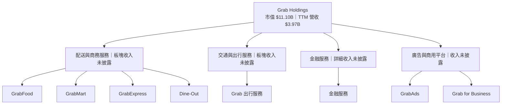
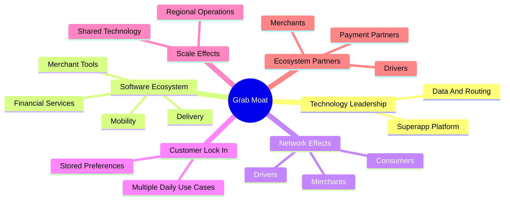
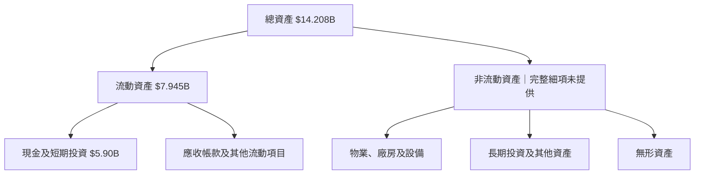
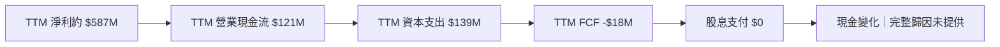
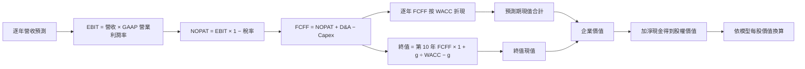
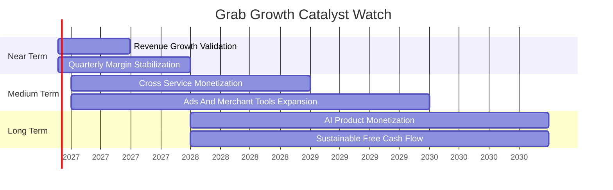
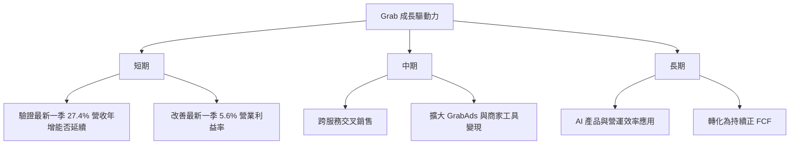
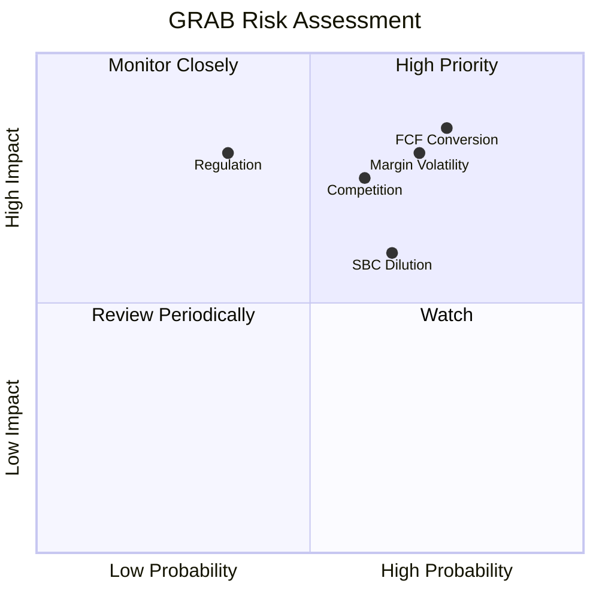
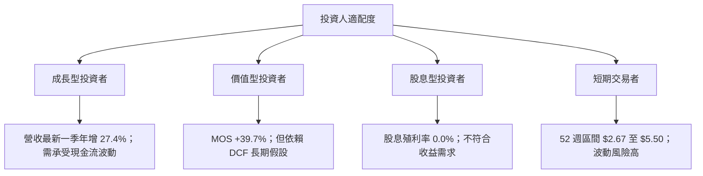

# GRAB 基本面深度分析報告
> **報告日期**：2026-11-21 ｜ **語言**：繁體中文 ｜ **數據來源**：Yahoo Finance、Finviz、StockAnalysis、Roic.ai ｜ **分析師**：CFA 級機構研究

---

## 目錄

| # | 章節 | 核心結論 |
|---|------|----------|
| 1 | 執行摘要 | 買入；加權合理價值 $4.56；MOS +39.7% |
| 2 | 公司概覽與商業模式 | 超級應用程式串連多種在地服務；護城河主要來自生態與網路效應 |
| 3 | 損益表深度分析 | 2026-09-30 最新一季營收年增 27.4%；利潤率數據存在來源差異 |
| 4 | 資產負債表分析 | 淨現金 $3.83B；流動性尚可，現金較 FY2025 年末下降 |
| 5 | 現金流量深度分析 | TTM FCF 為 -$18M，現金轉換仍不穩定 |
| 6 | 獲利能力與資本效率 | ROIC 未能可靠取得；WACC 為 8.29%，無法確認 ROIC 是否高於 WACC |
| 7 | 相對估值分析 | Forward P/E 高於同業中位數，但 DCF 與同業 EV/EBITDA 顯示不同訊號 |
| 8 | DCF 內在價值評估 | DCF 基準價值 $6.24；加權合理價值 $4.56 |
| 9 | 成長催化劑 | 最新一季營收年增 27.4%；AI 與跨服務交叉銷售是潛在催化因素 |
| 10 | 風險矩陣 | 現金流轉弱、利潤率回落與估值假設敏感度為主要風險 |
| 11 | 投資建議 | 買入；建議區間 $2.75–$4.10，並以季度 FCF 與營業利潤率驗證 |

---

## 1. 執行摘要

2026-11-20 收盤價為 **$2.75**。依估值方法固定權重計算，加權合理價值為 **$4.56**，安全邊際（MOS）為 **+39.7%**，按指定評級規則為**買入**。支持估值的證據包括：最新一季營收年增 **27.4%**、公司淨現金 **$3.83B**，但 TTM FCF 為 **-$18M**，最新一季營業利益率為 **5.6%**，而 TTM 營業利益率數據亦有來源口徑差異。這些數據支持正面估值，但現金流與盈利持續性尚待驗證。

### 1.0 一頁式投資儀表板（Portfolio Manager 30 秒速讀）

| 項目 | 內容 |
|------|------|
| **投資論點（3 句）** | ① 最新一季營收年增 **27.4%**，高於 UBER 的 9.6%，但低於 SE 的 43.4%及 DASH 的 34.0%。② 現金及短期投資 **$5.90B**、總債務 **$2.07B**，形成 **$3.83B 淨現金**。③ TTM FCF **-$18M**、FCF Yield **-0.16%**，營收成長尚未穩定轉化為自由現金流。 |
| **綜合評分** | **6.5/10**（引用 1.1 評分卡） |
| **財務健康** | 🟢 **尚可**：淨現金 $3.83B；但流動比率 1.384，TTM FCF 為負。 |
| **ROIC vs WACC** | ROIC **N/A** vs WACC **8.29%**；資料不足，不能確認是否創造經濟價值。 |
| **FCF 趨勢** | 年度與季度波動大；TTM FCF Yield **-0.16%**。 |
| **估值** | Forward P/E **17.517038x** ｜ EV/EBITDA **17.439x** ｜ FCF Yield **-0.16%** |
| **DCF 內在價值（基準）** | **$6.24** ｜ 現價相對 DCF 折價 **55.9%**（折溢價以 DCF 基準價值計） |
| **安全邊際（MOS）** | **+39.7%**＝（加權合理價值 $4.56 − 現價 $2.75）÷ $4.56｜🟢 >25% |
| **預期報酬（基準情境 12M）** | **+126.9%**，引用 DCF 基準情境相對現價變化；不代表 12 個月保證報酬。 |
| **關鍵風險（前二）** | TTM FCF 為負；最新一季營業利益率 5.6%，與 TTM 11.0% 有明顯差異。 |
| **評級 + 信心度** | 🟢 **買入** ｜ 信心：中（估值上行空間高，但 DCF 假設與現金流品質待驗證） |

### 1.1 綜合評分卡（全報告唯一）

| 維度 | 評分（1–10） | 主要依據（引用數字與其來源章節） |
|------|--------------|----------------------------------|
| 成長性 | 6 | 最新一季營收年增 27.4%；TTM 對前一 TTM 成長率 N/A（第 3 章） |
| 獲利能力 | 5 | TTM 營業利益率 11.0%，但最新一季為 5.6%；TTM FCF -$18M；ROIC N/A（第 3、5、6 章） |
| 財務健康 | 8 | 淨現金 $3.83B、流動比率 1.384、CCC -182 天（第 4 章） |
| 估值 | 7 | MOS +39.7%；Forward P/E 17.517038x，高於同業中位數 14.4x（第 7、8 章） |
| 護城河 | 7 | 多國多服務超級應用程式與跨服務網絡效應；但市場份額及各板塊收入數據未提供（第 2 章） |
| 管理層與資本配置 | 6 | FY2025 SBC $241M、股息支付為零；FCF 表現有波動（第 3、5 章） |
| **綜合評分** | **6.5** | 六項算術平均： (6 + 5 + 8 + 7 + 7 + 6) ÷ 6 = **6.5** |

### 1.2 五大投資論點 + 三大核心風險

| 類型 | 項目 | 具體依據 | 信心度 |
|------|------|----------|--------|
| 🟢 **投資論點①** | 仍具成長動能 | 最新一季營收 $1.11B，年增 27.4%；營收從 FY2022 $1.43B 增至 FY2025 $3.37B。 | 🟢 高 |
| 🟢 **投資論點②** | 淨現金提供緩衝 | 現金及短期投資 $5.90B，總債務 $2.07B，淨現金 $3.83B。 | 🟢 高 |
| 🟢 **投資論點③** | 多種服務共用用戶與供應網絡 | 外送、交通、雜貨、快遞、廣告與商用平台共處於同一應用程式；板塊收入比例未披露。 | 🟡 中 |
| 🟢 **投資論點④** | 估值交叉驗證仍有上行空間 | 加權合理價值 $4.56，相對現價 $2.75 的上行空間 +65.8%。 | 🟡 中 |
| 🟢 **投資論點⑤** | TTM 營業利益轉正 | TTM 營業利益率資料列示 11.0%；年度營業利益 FY2025 為 $222M，FY2024 為 -$55M。 | 🟡 中 |
| 🟡 **風險①** | 現金流品質不足 | TTM OCF $121M、Capex $139M，按定義 TTM FCF 為 -$18M。 | 🟡 中 |
| 🔴 **風險②** | 季度利潤率與 TTM 口徑差異大 | TTM 營業利益率 11.0%，最新一季為 5.6%；需追蹤是否是持續性下滑。 | 🔴 高衝擊 |
| 🔴 **風險③** | SBC 稀釋股東回報 | FY2025 SBC $241M，相當於該年營收約 7.2%；TTM SBC 約 $234M。 | 🔴 高衝擊 |

### 1.3 快速統計卡片

| 指標 | 公司實際值（期間） | 同業中位數 | 狀態 |
|------|--------------------|------------|------|
| 營收成長（TTM） | **N/A** | — | 🟡 無法判讀 |
| 營收成長（最新一季年增） | **27.4%** | **34.0%** | 🟡 低於中位數 |
| 毛利率（TTM） | **41.4%** | **45.0%** | 🟡 低於中位數 |
| 營業利益率（TTM） | **11.0%** | — | 🟢 正值；與最新一季口徑差異需留意 |
| ROIC（TTM） | **N/A** | — | 🟡 未能判定 |
| Forward P/E | **17.517038x** | **14.4x** | 🟡 高於中位數 |
| FCF Yield（TTM） | **-0.16%** | — | 🔴 負值 |
| Piotroski F-Score | **N/A** | — | 🟡 缺少符合計算要求的兩期 SEC 資料 |

### 1.4 投資結論

╔══════════════════════════════════════════════════════════════════╗  
║                    📊 投資結論摘要                               ║  
╠══════════════════════════════════════════════════════════════════╣  
║ 評級：買入（依 MOS +39.7% 的門檻判定）                           ║  
║ 價格（2026-11-20 收盤）：$2.75                                   ║  
║ DCF 內在價值（基準）：$6.24（現價折價 55.9%）                    ║  
║ 安全邊際 MOS：+39.7%（＝($4.56−$2.75)÷$4.56）                   ║  
║ 加權合理價值（8.8）：$4.56                                       ║  
║ DCF 情境價值：                                                   ║  
║   悲觀情境：$3.21（+16.6%）                                      ║  
║   基準情境：$6.24（+126.9%）                                     ║  
║   樂觀情境：$13.01（+373.1%）                                    ║  
║ 綜合評分：6.5/10（引用 1.1）                                     ║  
║ 適合投資人：能承受波動、願意追蹤現金流與利潤率的成長型投資人     ║  
╚══════════════════════════════════════════════════════════════════╝  

---

## 2. 公司概覽與商業模式

### 2.1 業務結構與收入來源

Grab Holdings Limited 營運 Grab 超級應用程式，業務涵蓋柬埔寨、印尼、馬來西亞、緬甸、菲律賓、新加坡、泰國與越南。2026-11-20 市值為 **$11.10B**，TTM 營收為 **$3.97B**。現有資料沒有各業務板塊的營收金額與佔比，故不推算板塊比例。

### 2.2 市場份額

市場份額數據未提供，因此不繪製份額圖、不推算比例。可觀察到公司最新一季營收年增 27.4%，高於 UBER 的 9.6%，但低於 SE 的 43.4%及 DASH 的 34.0%；這只能比較公司成長表現，不能替代市場份額資料。

### 2.3 競爭護城河分析

### 2.4 護城河強度

| 護城河項目 | 強度（強／中／弱） | 證據（引用數字或事實） | 會削弱它的情況 |
|------------|--------------------|------------------------|----------------|
| 技術與平台 | 中 | 超級應用程式整合多類服務；員工 12,012 人。 | 服務可靠性下降、競爭者平台功能與補貼更具吸引力。 |
| 軟體生態系統 | 中 | GrabFood、GrabMart、GrabExpress、GrabAds、Grab for Business 等服務共用平台。 | 用戶只使用單一服務，無法形成跨服務留存與交叉銷售。 |
| 網路效應 | 中 | 消費者、商家與司機可在同一平台互動；具體用戶數及市場份額未提供。 | 競爭平台在關鍵城市形成更高密度或更低價格。 |
| 客戶鎖定 | 弱至中 | 多服務整合可能增加便利性；留存率及客戶取得成本未提供。 | 用戶切換成本低，補貼減少後轉向競爭平台。 |
| 規模效應 | 中 | TTM 營收 $3.97B，服務跨八個東南亞市場。 | 各市場法規、成本與需求差異限制規模經濟。 |
| 生態夥伴 | 中 | 平台連接商家、司機及企業客戶；合作夥伴數據未提供。 | 夥伴多平台經營，平台議價能力與供給穩定性下降。 |

1.1 的護城河評分為 **7/10**，主要基於多服務整合與跨市場經營的質化證據；由於市場份額、留存率及分部收入未披露，評分並非建立在可量化的份額優勢上。

---

## 3. 損益表深度分析

### 3.1 年度收入成長趨勢（近 4 年）

| 財年 | 營收 | YoY | 觀察 |
|------|------|-----|------|
| FY2022 | $1.43B | — | 基期 |
| FY2023 | $2.36B | +64.6% | 快速恢復與擴張 |
| FY2024 | $2.80B | +18.6% | 成長放緩但維持正值 |
| FY2025 | $3.37B | +20.5% | 成長再加速 |

╔══════════════════════════════════════════════════════════════════╗  
║              Grab 年度收入趨勢（FY2022–FY2025）                  ║  
╠══════════════════════════════════════════════════════════════════╣  
║ FY2022  $1.43B  █████████░░░░░░░░░░░░░░░░  YoY：基期             ║  
║ FY2023  $2.36B  ██████████████░░░░░░░░░░  YoY：+64.6%            ║  
║ FY2024  $2.80B  █████████████████░░░░░░░  YoY：+18.6%            ║  
║ FY2025  $3.37B  ████████████████████░░░░░  YoY：+20.5%            ║  
╠══════════════════════════════════════════════════════════════════╣  
║ FY2022–FY2025 營收 CAGR = (3.37 ÷ 1.43)^(1/3) − 1 ≈ 33.1%        ║  
╚══════════════════════════════════════════════════════════════════╝  

FY2022 至 FY2025 的營收 CAGR 約 **33.1%**，主要反映較低基期及平台服務擴張；但不能直接外推為未來成長率。TTM 營收為 **$3.97B**；TTM 對前一 TTM 成長率為 **N/A**。StockAnalysis 對 TTM 成長另列 22.99%，但本報告不以該值取代統一口徑的 TTM 成長數據。

### 3.2 季度收入趨勢分析

| 季度 | 營收 | QoQ | YoY | 備註 |
|------|------|-----|-----|------|
| 2025-12-31 | $906M | — | 18.6% | 與 2024-12-31 的 $764M 比較 |
| 2026-03-31 | $955M | +5.4% | 23.5% | 年增率依 StockAnalysis 季度數據 |
| 2026-06-30 | $998M | +4.5% | 21.9% | 季增延續 |
| 2026-09-30 | $1.11B | +11.4% | 27.4% | 年增率依統一採用的最新一季資料 |

QoQ 以當季營收除以前季營收減一計算，並因原始季度數據四捨五入而有尾差。2026-09-30 的營收年增 27.4%，反映最近一季營收動能較 FY2025 全年 20.5% 成長率更快，但一季數據不足以證明加速趨勢可持續。

### 3.3 利潤率演變分析

| 利潤率指標 | FY2022 | FY2023 | FY2024 | FY2025 | 趨勢 | 評估 |
|------------|--------|--------|--------|--------|------|------|
| 毛利率（依年度損益表金額計算） | 約 5.4% | 約 36.4% | 約 41.8% | 約 43.3% | 整體改善 | 🟡 年度來源與 TTM 統一口徑有差異 |
| 營業利益率（依年度損益表金額計算） | 約 -90.2% | 約 -16.4% | 約 -2.0% | 約 6.6% | 明顯改善 | 🟢 但年度來源不完全一致 |
| 營業利益率（統一口徑） | — | — | — | TTM 11.0%；最新一季 5.6% | TTM 與季度差異大 | 🟡 需核對定義與持續性 |
| EBITDA 利潤率 | — | — | — | TTM 11.2% | 正值 | 🟢 |
| 淨利率 | — | — | — | TTM 14.8% | 正值 | 🟡 淨利高於營業獲利，須留意非營業及稅務項目 |

年度營業利益由 FY2022 **-$1.29B**、FY2023 **-$387M**、FY2024 **-$55M**，改善至 FY2025 **$222M**；另一來源對 FY2025 報告的營業利益為 $80M，顯示資料源有差異。最新一季營業利益率 5.6%也低於列示的 TTM 11.0%。可能反映季度產品組合、補貼、營運成本或會計口徑變動，但缺少分部成本與調節表，無法單獨歸因。評估盈利趨勢時應以後續季報驗證，不能將 TTM 利潤率直接視為穩態利潤率。

### 3.4 費用結構分析

完整費用明細及可核對的費用結構比例未提供，故不繪製費用圓餅圖。已知 FY2025 研發費用為 **$428M**；FY2024 為 $410M、FY2023 為 $421M、FY2022 為 $465M。研發投入對平台、推薦、派單及風控能力可能有支持作用，但其變現效率無法由現有數據單獨確認。

### 3.5 季度 EPS 趨勢與盈餘品質（Quality of Earnings）

| 項目 | 數值／比例 | 評估 |
|------|------------|------|
| 近四季 EPS 實際值 | 2025-12：$0.04；2026-03：$0.03；2026-06：$0.06；2026-09：$0.01（Roic.ai） | 最新一季低於前季；各來源 EPS 口徑可能不同。 |
| EPS 超預期／不及預期 | 四季 EPS 預估值均為 NaN | 🟡 無法判斷超預期或不及預期；不得把缺失預估值當成失誤。 |
| 最新一季 EPS 年增 | -32.2% | 🔴 盈餘年減；與營收年增 27.4%呈背離。 |
| SBC / 營收 | TTM 約 $234M ÷ $3.97B = **5.9%** | 🟡 對股東回報有持續稀釋成本；SBC 雖為非現金費用，仍是經濟成本。 |
| SBC / 營業現金流 | $234M ÷ $121M = **193.4%** | 🔴 SBC 規模高於 TTM OCF，現金流尚不足以掩蓋股權薪酬造成的稀釋。 |
| FCF / 淨利 | -$18M ÷ 約 $587M = **-3.1%** | 🔴 淨利尚未轉化為正 FCF；現金轉換品質偏弱。 |
| 一次性／非經常性損益 | N/A；缺少完整調節資料 | 🟡 不能量化本期淨利是否受一次性項目推升。 |
| 有效稅率 | 25.7%（最新年度有效稅率） | 🟡 可供模型使用；缺乏各年度稅務調節，不能確認 TTM 淨利是否受稅務利益影響。 |
| 資本化支出 vs 費用化 | TTM Capex $139M；資本化開發成本明細 N/A | 🟡 無法判定是否有成本延後費用化問題。 |

**過去四季盈餘表現：**可取得的 EPS 實際值顯示 2025-12 至 2026-06 上升至 $0.06，2026-09 回落至 $0.01；最新季度 EPS 年增 -32.2%，淨利年增 -27.0%。Earnings History 的四季預估值均缺失，故不能作「超預期／不及預期」判定。季度淨利分別為 $172M、$136M、$253M、$27M，最新一季下滑尤其明顯。

**盈餘品質結論：**TTM 淨利約 $587M，但 TTM FCF 為 -$18M，且 SBC 約佔營收 5.9%、相當於 OCF 的 193.4%。因此 GAAP 淨利不能直接視為可分配給股東的現金盈餘。估值應同時觀察現金流改善與股數稀釋，而不能只看 P/E 或淨利成長。

---

## 4. 資產負債表分析

### 4.1 資產結構分解

最新 TTM 資產負債表列示總資產 **$14.208B**、流動資產 **$7.945B**；其餘資產項目部分缺漏或來源有差異，不以殘差反推。

### 4.2 流動性與營運資金分析

| 指標 | 最新值 | 歷史／比較值 | 評估 |
|------|--------|--------------|------|
| 流動比率 | 1.384 | FY2025 流動資產 $8.08B、流動負債 $4.63B | 🟡 高於 1，但安全緩衝不算寬。 |
| 速動比率 | 1.07 | — | 🟡 短期流動性尚可。 |
| 現金及短期投資 | $5.90B | FY2025 年末現金及短期投資 $6.861B | 🟡 較 FY2025 年末減少；期間資產口徑可能有差異。 |
| 淨現金 | $3.83B | 現金及短期投資 $5.90B − 總債務 $2.07B | 🟢 淨現金提供資金緩衝。 |

**營運資金天數（照錄品質指標）：**

| 指標 | 最新 TTM | 一年前 TTM | 變化 | 解讀 |
|------|----------|------------|------|------|
| DSO 應收帳款天數 | 22 天 | N/A | N/A | 一年前數值未提供，無法判斷收款速度變化。 |
| DIO 存貨天數 | 15 天 | N/A | N/A | 一年前數值未提供；平台服務的存貨天數不必然代表主要營運資金項目。 |
| DPO 應付帳款天數 | 219 天 | N/A | N/A | 應付天數偏長可能支持平台現金週期，但可能反映結算時點；不能僅據此判斷議價力。 |
| CCC 現金轉換週期 | -182 天 | N/A | N/A | 代表應付天數大於應收與存貨天數之和；可能降低營運資金需求，但應監控付款條款與供應方穩定性。 |

### 4.3 債務結構分析

╔══════════════════════════════════════════════════════════════════╗  
║                   Grab 債務健康診斷                              ║  
╠══════════════════════════════════════════════════════════════════╣  
║ 總債務：             $2.07B                                      ║  
║ 現金及短期投資：     $5.90B                                      ║  
║ 淨現金：             $3.83B　🟢                                 ║  
║ Debt/EBITDA：        N/A（缺少口徑一致的債務及 EBITDA 計算資料） ║  
║ Interest Coverage：  N/A（利息費用金額未提供）                   ║  
║ 債務成本（稅前）：   3.43%（資本成本資料）                       ║  
╚══════════════════════════════════════════════════════════════════╝  

淨現金能減低短期融資風險，但年度總債務由 FY2024 的 **$364M**升至 FY2025 的 **$2.05B**，需與流動性及借款用途一併追蹤。利息保障倍數資料未提供，不能將低債務成本等同於沒有償債風險。

### 4.4 股東權益趨勢

| 年度 | 股東權益 |
|------|----------|
| FY2022 | $6.60B |
| FY2023 | $6.45B |
| FY2024 | $6.40B |
| FY2025 | $6.73B |

╔══════════════════════════════════════════════════════════════════╗  
║                Grab 股東權益趨勢（年度）                         ║  
╠══════════════════════════════════════════════════════════════════╣  
║ FY2022  $6.60B  ████████████████████                             ║  
║ FY2023  $6.45B  ███████████████████                              ║  
║ FY2024  $6.40B  ███████████████████                              ║  
║ FY2025  $6.73B  ████████████████████                             ║  
╚══════════════════════════════════════════════════════════════════╝  

FY2025 股東權益較 FY2024 回升至 $6.73B；但缺少 2026-09-30 對應權益值，無法延伸判斷最新趨勢。

---

## 5. 現金流量深度分析

### 5.1 現金流量瀑布圖

淨利與 OCF 的差異顯示應計盈餘未全部轉為現金；再扣除 $139M 資本支出後，TTM FCF 為負。季度 FCF 依序為 $17M、-$72M、$28M、$9M，反映季度現金流波動明顯。

### 5.2 FCF 轉換率趨勢

| 年度 | FCF | 淨利 | FCF / 淨利 | 解讀 |
|------|-----|------|------------|------|
| FY2022 | -$872M | -$1.68B | 約 51.9% | 分子、分母均為負，比例不具一般現金轉換率解讀。 |
| FY2023 | -$6M | -$434M | 約 1.4% | 淨利為負，單看比率意義有限。 |
| FY2024 | $739M | -$105M | 約 -704.8% | 現金流與淨利方向相反，可能受營運資金等因素影響；細項調節未提供。 |
| FY2025 | -$44M | $268M | 約 -16.4% | 淨利為正但 FCF 為負，現金轉換偏弱。 |
| TTM 至 2026-09-30 | -$18M | 約 $587M | 約 -3.1% | 盈利尚未形成正自由現金流。 |

### 5.3 自由現金流趨勢

| 期間 | FCF | 備註 |
|------|-----|------|
| FY2022 | -$872M | OCF -$798M，Capex $74M |
| FY2023 | -$6M | 接近損益兩平 |
| FY2024 | $739M | 單年現金流顯著高於其他年度，持續性待驗證 |
| FY2025 | -$44M | OCF $79M、Capex $123M |
| TTM 至 2026-09-30 | -$18M | OCF $121M、Capex $139M |

╔══════════════════════════════════════════════════════════════════╗  
║             自由現金流：歷史實際與最新 TTM                       ║  
╠══════════════════════════════════════════════════════════════════╣  
║ FY2022  -$0.872B  ◀ 負值                                        ║  
║ FY2023  -$0.006B  ◀ 接近損益兩平                                ║  
║ FY2024  +$0.739B  ████████████████████                           ║  
║ FY2025  -$0.044B  ◀ 負值                                        ║  
║ TTM     -$0.018B  ◀ 負值；FCF Yield -0.16%                       ║  
╚══════════════════════════════════════════════════════════════════╝  

### 5.4 資本配置評估

資本配置各項金額並非全部可由現有資料完整拆分，因此不繪製比例圓餅圖。

| 項目 | 可觀察數據 | 評估 |
|------|------------|------|
| 資本支出 | TTM $139M；FY2025 $123M | TTM Capex 高於 TTM OCF，令 FCF 為負。 |
| 股息 | FY2022–FY2025 均為 $0；股息殖利率 0.0% | 目前沒有股息回報。 |
| SBC | FY2025 $241M；FY2024 $279M；FY2023 $304M；FY2022 $412M | 對員工激勵有用，但會稀釋既有股東。 |
| 回購 | 數據未提供 | 無法判斷是否以回購抵銷稀釋。 |
| 留存及其他投資 | 分配明細未提供 | 不以殘差推算。 |

---

## 6. 獲利能力與資本效率

### 6.1 ROE / ROA / ROIC 趨勢

| 指標 | 最新可得值 | 歷史趨勢 | 評估 |
|------|------------|----------|------|
| ROE | 7.6%（TTM） | FY2022–FY2025 權益與淨利歷史口徑不完全一致 | 🟡 正值但未能反映完整資本回報趨勢 |
| ROA | 1.1%（TTM） | 歷史一致口徑未提供 | 🟡 資產回報率偏低，仍需改善 |
| ROIC | N/A | Roic.ai 歷史回報欄位為缺失 | 🟡 無法可靠估算 |
| WACC | 8.29% | 資本成本資料 | 作為 ROIC 比較基準 |

### 6.2 ROIC vs WACC 分析（核心價值創造判斷）

╔══════════════════════════════════════════════════════════════════╗  
║                ROIC vs WACC 深度分析                            ║  
╠══════════════════════════════════════════════════════════════════╣  
║ WACC 估算：                                                      ║  
║ ├── 無風險利率（10Y 美債）：4.91%（具體觀測日期未提供）          ║  
║ ├── 市場風險溢酬 ERP：5.00%（假設值）                            ║  
║ ├── 原始 Beta：0.83；調整後 Beta：0.89                            ║  
║ ├── 股權成本 Ke：4.91% + 0.89 × 5.00% = 9.36%                   ║  
║ ├── 稅前債務成本：3.43%；稅後約 2.55%                            ║  
║ ├── 資本結構：股權 84.3%、債務 15.7%                             ║  
║ └── WACC：8.29%                                                  ║  
║                                                                  ║  
║ ROIC：N/A（投入資本與一致口徑 NOPAT 資料不足）                    ║  
║ EVA = ROIC − WACC：N/A                                           ║  
║                                                                  ║  
║ 結論：無法確認公司目前 ROIC 是否高於 8.29% WACC；                  ║  
║       因此不能據現有資料斷言其正在創造或摧毀股東價值。            ║  
╚══════════════════════════════════════════════════════════════════╝  

**WACC 計算檢視：**

1. 股權成本：\(4.91\% + 0.89 \times 5.00\% = 9.36\%\)。
2. 原始 Beta 0.83，調整方式：\(⅔ \times 0.83 + ⅓ = 0.89\)。
3. 稅後債務成本：\(3.43\% \times (1 - 25.7\%) = 2.55\%\)。
4. 權重採資本成本資料列示的股權 84.3%、債務 15.7%；市值 $11.10B、債務 $2.07B。利息費用與平均計息負債明細未提供，因此無法從原始美元金額獨立重建 3.43%。
5. WACC：\(84.3\% \times 9.36\% + 15.7\% \times 2.55\% = 7.89\% + 0.40\% = 8.29\%\)。

本報告在第 6.2 與第 8 章均使用 **8.29%**。無風險利率的具體觀測日期及 ERP 的外部依據未提供，故沿用資本成本資料中的輸入，不另行更改。

### 6.3 杜邦三因素分解

**N/A**（品質指標資料指出缺少可用的淨利、營收、總資產或正股東權益一致性輸入，無法可靠提供杜邦三因素分解；不另行重算或補值）。

### 6.4 財務體質：Piotroski F-Score

**N/A**（需兩個相隔一年的 TTM SEC 申報資料期間；現有財務資料並非 SEC 申報資料）。九項測試的個別結果均未提供，故不逐項推測。

---

## 7. 相對估值分析

### 7.1 同業估值比較表格

| 估值指標 | **GRAB** | **UBER** | **SE** | **DASH** | GRAB 評估 |
|----------|---------|---------|--------|---------|-----------|
| **Trailing P/E** | 27.5x | 37.3x | 22.5x | 63.3x | 🟡 介於同業範圍 |
| **Forward P/E** | 17.517038x | 14.4x | 13.1x | 20.0x | 🟡 高於同業中位數 14.4x |
| **P/S** | 2.7964108x | 2.3x | 1.3x | 3.9x | 🟡 高於 UBER、SE，低於 DASH |
| **EV/EBITDA** | 17.439x | 17.7x | 12.1x | 37.3x | 🟡 接近 UBER，明顯低於 DASH |
| **最新一季營收年增** | 27.4% | 9.6% | 43.4% | 34.0% | 🟡 高於 UBER、低於 SE 與 DASH |
| **TTM 毛利率** | 41.4% | 41.4% | 45.0% | 52.7% | 🟡 低於 SE、DASH |

Peer multiples 來源為 Yahoo Finance。三家同業的 Forward P/E 中位數為 **14.4x**，GRAB 的 Forward P/E **17.517038x**高於該中位數；因此不能單以 P/E 認為 GRAB 相對便宜。EV/EBITDA 則與 UBER 接近，且低於 DASH，但 GRAB 的負 FCF 使 EBITDA 倍數需要搭配現金流品質判讀。

### 7.2 歷史估值區間分析

╔══════════════════════════════════════════════════════════════════╗  
║                   GRAB 歷史估值區間                              ║  
╠══════════════════════════════════════════════════════════════════╣  
║ N/A（歷史估值區間及當前歷史百分位數據未提供）                    ║  
║ 價格歷史顯示：2024-11 收盤 $5.00；2025-09 $6.02；                 ║  
║ 2026-11 收盤 $2.75。價格走勢不能替代歷史 P/E 或估值百分位資料。   ║  
╚══════════════════════════════════════════════════════════════════╝  

### 7.3 情境價值（Bear / Base / Bull，照錄 DCF 模型）

| 情境 | 第 1 年營收成長 | 期末營業利潤率 | WACC | 每股價值 | 相對現價 | 機率 | 會發生的條件 |
|------|----------------|----------------|------|----------|----------|------|--------------|
| 🔴 悲觀 | 13.7% | 9.3% | 9.29% | $3.21 | +16.6% | 25% | 營收增速向基準以下回落，且成熟期利潤率低於基準假設。 |
| 🟡 基準 | 27.4% | 11.0% | 8.29% | $6.24 | +126.9% | 50% | 最新一季增速延續，營業利潤率保持模型假設。 |
| 🟢 樂觀 | 41.1% | 12.0% | 7.29% | $13.01 | +373.1% | 25% | 收入成長明顯超出基準，且利潤率上升、折現率下降。 |

上述價值與機率為模型情境輸出，不能視為精確機率預測。悲觀情境仍高於現價，但該結論依賴情境輸入與模型結構。

### 7.4 相對估值隱含價格區間

╔══════════════════════════════════════════════════════════════════╗  
║                 相對估值方法回推每股價值                         ║  
╠══════════════════════════════════════════════════════════════════╣  
║ 同業 Forward P/E：$2.26｜基礎：同業中位數 14.4x × Forward EPS $0.16║  
║ 同業 EV/EBITDA：  $3.83｜基礎：同業中位數 17.7x × TTM EBITDA，   ║  
║                           再加回淨現金                           ║  
║ 分析師共識目標價：$5.39｜22 位分析師平均目標價                   ║  
║ 現價：$2.75；DCF 基準值：$6.24；樂觀情境：$13.01                 ║  
╚══════════════════════════════════════════════════════════════════╝  

相對估值法顯示 Forward P/E 回推值 **$2.26**、EV/EBITDA 回推值 **$3.83**。兩種方法使用同業中位數倍數，不使用 GRAB 自身目前倍數。分析師共識平均目標價為 $5.39，低於 DCF 基準值。

---

## 8. DCF 內在價值評估（Discounted Cash Flow）

> 本章使用程式計算的 DCF 模型數字。由於模型輸入與逐年現金流有四捨五入，以下逐年表格照錄模型，任何獨立反推若需未四捨五入輸入均標明資料限制。

### 8.0 估值推理鏈（Thinking Logic）

**Step 1 — 價值來源與主導變數**

GRAB 的價值主要取決於既有平台業務的收入成長與營業利潤率；目前 TTM 營收 **$3.97B**，但分部佔比未提供，因此不能量化交通、配送、金融服務及廣告各自的價值貢獻。模型中估值的主導變數是 **營收成長與終值假設**：終值現值佔 EV **67.4%**，且敏感性矩陣顯示 WACC 與永續成長率改變會顯著改變每股價值。

**Step 2 — 模型選擇**

| 決策點 | 本報告採用 | 理由（含數字） | 曾考慮但否決 | 否決理由 |
|--------|-----------|----------------|--------------|----------|
| 現金流定義 | FCFF | 使用 GAAP EBIT、NOPAT，按 WACC 折現並求 EV | FCFE | 模型已固定採用 FCFF 與 WACC。 |
| 預測期 N | 10 年 | DCF 模型固定預測 10 年，收入成長由 27.4%逐步降至 3.0% | 5 年 | 不符合指定模型的 10 年期輸出。 |
| 終值方法 | Gordon Growth | 模型提供終值 $31.94B，並以 3.0% 永續成長率計算 | 退出倍數 | DCF 模型未提供退出倍數輸出，不能自行補造。 |
| EBIT 基礎 | GAAP EBIT | 模型明確使用 GAAP EBIT | 非 GAAP EBIT | 會改變 SBC 的計入方式，與模型不符。 |

**Step 3 — 關鍵假設推導鏈**

- **營收成長**：錨點為最新一季營收年增 **27.4%**；模型以此作第 1 年起點，並線性淡化至第 10 年 **3.0%** → 採用 DCF 所列成長路徑 → 未採用把 27.4% 永久維持的替代做法，因該做法會忽略基期增大與長期成熟。
- **營業利潤率**：錨點為 TTM 營業利益率 **11.0%**，但最新一季為 **5.6%** → 模型採 11.0%維持至第 10 年 → 不採用更高的長期利潤率，因沒有數據支持高於 11.0%；但維持 11.0%仍可能偏樂觀，若季度口徑代表趨勢，價值會下降。
- **永續成長率 g**：採用 **3.0%**，為模型設定且低於 WACC 8.29% → 不採用高於 WACC 的值，避免 Gordon Growth 分母失效；長期成長率缺乏公司或宏觀預測依據，應視為估值敏感假設。
- **預測期 N**：採用 **10 年**，依模型提供的十年逐年預測 → 不縮短或延長，因無管理層十年財測可供另行取代。
- **Capex / 營收**：採用 **3.5%**，模型依 TTM Capex／營收設定，並維持至預測期末 → 不自行降至更低比例，因 TTM FCF 為負，減少再投資假設會過度改善 FCF。
- **GAAP EBIT 與 SBC**：採 GAAP EBIT；FY2025 SBC 為 **$241M**，已列入費用口徑 → 不另從 FCFF 扣 SBC，也不放大股數，以免重複計算或偏離模型。
- **年稀釋率**：依模型組合 A 採 **0%**、固定股數 → 不是對公司未來稀釋的預測，而是模型以 GAAP 費用反映 SBC 成本的處理選擇；若實際稀釋持續，模型每股價值可能高估。
- **終值方法**：採 Gordon Growth，終值基於第 10 年 FCFF → 不自行加入退出倍數，因模型未提供可稽核的退出倍數。
- **WACC**：採用 **8.29%** → 與已列示股權成本、稅後債務成本及資本權重一致；不以另選 Beta 或風險溢酬重建替代模型折現率。

**Step 4 — 最脆弱的一環**

最脆弱的是長期維持 **11.0%** 營業利潤率並搭配 **3.0%** 永續成長率；若市場競爭令利潤率低於假設，或折現率升高，DCF 每股價值會下降，敏感性矩陣中 WACC 10.29%、g 3.0%時價值為 **$4.65**，低於基準 $6.24。

**Step 5 — 計算路徑**

### 8.1 模型假設總表（Model Inputs）

| 假設項目 | 採用值 | 依據／來源 | 敏感度 |
|----------|--------|-------------|--------|
| 預測期長度 N | 10 年 | DCF 模型固定預測十年 | 🟡 中 |
| 營收成長 | 第 1 年 27.4%，第 10 年 3.0%，逐年淡化 | 最新一季年增 27.4%；非 TTM 成長率 | 🔴 高 |
| 營業利潤率 | GAAP EBIT 11.0%維持至第 10 年 | TTM 11.0%；最新一季 5.6%，存在差異 | 🔴 高 |
| 有效稅率 | 25.7% | 最新年度有效稅率 | 🟢 低 |
| Capex / 營收 | 3.5% | 模型依 TTM 設定，年 1 至年 10 為 3.5% | 🟡 中 |
| D&A / 營收 | 5.6% | 模型依 TTM 設定並固定 | 🟢 低 |
| 營運資金變動 | 未建模 | DCF 模型明確排除營運資金變動；非假設為零 | 🟢 低 |
| EBIT 基礎 | GAAP EBIT | DCF 模型指定 GAAP EBIT | 🟡 中 |
| SBC 處理 | 組合 A：已含於 GAAP EBIT，不再扣 SBC | 模型指定 GAAP EBIT、FCFF 不另扣 SBC | 🟡 中 |
| 年稀釋率 | 模型固定股數，不另稀釋 | 與組合 A 相容；非對實際未來稀釋的判斷 | 🟡 中 |
| 永續成長率 g | 3.0% | DCF 模型指定；低於 WACC 8.29% | 🔴 高 |
| 終值方法 | Gordon Growth | 模型所列終值計算 | 🔴 高 |
| WACC | 8.29% | Cost of capital 資料，詳見 8.2 | 🔴 高 |

**FCFF 定義：**採用 FCFF，對應 WACC 折現。模型定義為 **NOPAT + D&A − Capex**；營運資金變動未納入。  
**SBC 防重複扣除：**本模型採用 **(A)**，故 SBC 影響已計入 GAAP EBIT 一次；FCFF 不另扣 SBC，股數不再另行稀釋。

### 8.2 折現率推導（WACC）

╔══════════════════════════════════════════════════════════════════╗  
║                    WACC 推導（折現率）                           ║  
╠══════════════════════════════════════════════════════════════════╣  
║ 股權成本 Ke（CAPM）：                                            ║  
║ ├── 無風險利率 Rf：4.91%（10Y 美債；觀測日期未提供）              ║  
║ ├── 市場風險溢酬 ERP：5.00%（採資本成本資料中的假設值）           ║  
║ ├── 原始 Beta：0.83；調整後 Beta：0.89                            ║  
║ ├── Beta 調整：⅔ × 0.83 + ⅓ = 0.89                              ║  
║ └── Ke = 4.91% + 0.89 × 5.00% = 9.36%                           ║  
║                                                                  ║  
║ 債務成本 Kd：                                                    ║  
║ ├── 稅前 Kd：3.43%（資本成本資料；利息金額與平均負債額未提供）    ║  
║ ├── 有效稅率：25.7%                                               ║  
║ └── 稅後 Kd = 3.43% × (1 − 25.7%) = 2.55%                       ║  
║                                                                  ║  
║ 資本結構：                                                       ║  
║ ├── 股權權重：84.3%（市值基礎）                                  ║  
║ ├── 債務權重：15.7%（市場價值／帳面值近似）                      ║  
║ └── WACC = 84.3% × 9.36% + 15.7% × 2.55% = 8.29%                ║  
╚══════════════════════════════════════════════════════════════════╝  

WACC 五步計算：

1. **Ke（CAPM）** = Rf + β × ERP = 4.91% + 0.89 × 5.00% = **9.36%**。
2. **稅前 Kd** = **3.43%**（來源列示為利息 ÷ 債務；原始利息金額與平均計息負債金額未提供，故不能獨立重算）。
3. **稅後 Kd** = 3.43% × (1 − 25.7%) = **2.55%**。
4. **權重** = E 84.3%、D 15.7%；84.3% + 15.7% = **100.0%**。資本成本資料中的權重以市值及債務計算，對應市值 $11.10B、總債務 $2.07B。
5. **WACC** = 84.3% × 9.36% + 15.7% × 2.55% = 7.8905% + 0.4001% = **8.29%**（以未四捨五入輸入計算後四捨五入）。

### 8.3 逐年自由現金流預測（基準情境）

金額單位：$B；折現因子保留三位小數。模型未納入 ΔWC，也未另列 SBC 扣除。

| 年度 | FY+1 | FY+2 | FY+3 | FY+4 | FY+5 | FY+6 | FY+7 | FY+8 | FY+9 | FY+10 |
|------|------|------|------|------|------|------|------|------|------|-------|
| 營收 | 5.06 | 6.31 | 7.69 | 9.18 | 10.70 | 12.18 | 13.53 | 14.67 | 15.51 | 15.98 |
| 營收 YoY | 27.4% | 24.7% | 22.0% | 19.3% | 16.6% | 13.8% | 11.1% | 8.4% | 5.7% | 3.0% |
| 營業利潤率 | 11.0% | 11.0% | 11.0% | 11.0% | 11.0% | 11.0% | 11.0% | 11.0% | 11.0% | 11.0% |
| EBIT（GAAP） | 0.55 | 0.69 | 0.84 | 1.01 | 1.17 | 1.33 | 1.48 | 1.61 | 1.70 | 1.75 |
| − 稅 | (0.14) | (0.18) | (0.22) | (0.26) | (0.30) | (0.34) | (0.38) | (0.41) | (0.44) | (0.45) |
| = NOPAT | 0.41 | 0.51 | 0.63 | 0.75 | 0.87 | 0.99 | 1.10 | 1.20 | 1.26 | 1.30 |
| + D&A | 0.28 | 0.35 | 0.43 | 0.52 | 0.60 | 0.68 | 0.76 | 0.82 | 0.87 | 0.90 |
| − Capex | (0.18) | (0.22) | (0.27) | (0.32) | (0.37) | (0.43) | (0.47) | (0.51) | (0.54) | (0.56) |
| − ΔWC | 未建模 | 未建模 | 未建模 | 未建模 | 未建模 | 未建模 | 未建模 | 未建模 | 未建模 | 未建模 |
| = FCFF | 0.52 | 0.65 | 0.79 | 0.94 | 1.10 | 1.25 | 1.39 | 1.51 | 1.59 | 1.64 |
| 折現因子 @ 8.29% | 0.923 | 0.853 | 0.788 | 0.727 | 0.672 | 0.620 | 0.573 | 0.529 | 0.488 | 0.451 |
| FCFF 現值 PV | 0.48 | 0.55 | 0.62 | 0.68 | 0.74 | 0.77 | 0.80 | 0.80 | 0.78 | 0.74 |

**預測期 FCF 現值合計：**  
$0.48 + $0.55 + $0.62 + $0.68 + $0.74 + $0.77 + $0.80 + $0.80 + $0.78 + $0.74 = **$6.96B**（模型所列合計；表格為四捨五入後數字）。

**逐步演算（FY+1 代表年度）：**

1. **營收** = $3.97B × (1 + 27.4%) = **$5.06B**。
2. **EBIT** = $5.06B × 11.0% = **$0.55B**。
3. **稅** = $0.55B × 25.7% = **$0.14B**。
4. **NOPAT** = $0.55B − $0.14B = **$0.41B**。
5. **D&A** = $5.06B × 5.6% = **$0.28B**。
6. **Capex** = $5.06B × 3.5% = **$0.18B**。
7. **ΔWC** = 未建模；不是以資料反推為零。
8. **FCFF** = $0.41B + $0.28B − $0.18B = **$0.51B**；模型列示 **$0.52B**，差異來自未四捨五入底層輸入與表格呈現精度。
9. **折現因子** = 1 ÷ (1 + 8.29%)¹ = **0.923**；PV = 模型 FCFF $0.52B × 0.923 = **$0.48B**。

合理性自檢：

- 預測 FCF CAGR：歷史 FCF 多年正負交錯，包含 FY2024 $739M 與 FY2025 -$44M，故歷史 FCF CAGR **不具可比性（N/A）**。
- FY+10 FCFF 利潤率 = $1.64B ÷ $15.98B ≈ **10.3%**；目前 TTM FCF 利潤率 = -$18M ÷ $3.97B ≈ **-0.5%**。同業最佳 FCF 利潤率資料未提供。
- 模型各年 FCFF 均為正；但 TTM FCF 為負，模型假設代表未來現金流必須出現明顯轉正與擴張。

╔══════════════════════════════════════════════════════════════════╗  
║          自由現金流：歷史實際 vs 模型預測                        ║  
╠══════════════════════════════════════════════════════════════════╣  
║ FY2023（實） -$0.006B  ◀                                         ║  
║ FY2024（實） +$0.739B  ████████████████████                       ║  
║ FY2025（實） -$0.044B  ◀                                         ║  
║ TTM（實）    -$0.018B  ◀                                         ║  
║ FY+1（預）    $0.52B   ██████                                     ║  
║ FY+10（預）   $1.64B   ████████████████████                       ║  
╠══════════════════════════════════════════════════════════════════╣  
║ 歷史 FCF 正負交錯；預測要求 FCF 由 TTM 負值轉為持續正值。        ║  
╚══════════════════════════════════════════════════════════════════╝  

### 8.4 終值計算（Terminal Value）

**適用性檢查：**WACC **8.29%** vs g **3.0%** → **WACC > g？✅**

| 方法 | 計算式 | 終值 TV | TV 現值 | 佔總 EV 比重 |
|------|--------|---------|---------|--------------|
| Gordon Growth | $1.64 × (1 + 3.0%) ÷ (8.29% − 3.0%) | $31.94B | $14.41B | 67.4% |
| 退出倍數法 | N/A（DCF 模型未提供退出倍數法結果） | N/A | N/A | N/A |

逐步演算：

1. **FY+N FCFF** = **$1.64B**。
2. **分子** = $1.64B × (1 + 3.0%) = **$1.6892B**。
3. **分母** = 8.29% − 3.0% = **5.29%**；$1.6892B ÷ 5.29% = **$31.94B**（模型列示）。
4. **PV(TV)** = $31.94B × 0.451 = **$14.41B**。
5. **終值佔比** = $14.41B ÷ $21.37B = **67.4%**。

終值佔企業價值 67.4%，低於 75%警示門檻，但估值仍有約三分之二來自終值，對長期 g、WACC 與利潤率假設敏感。退出倍數未提供，因此不自行建立交叉驗證數字。

### 8.5 企業價值 → 每股內在價值（Bridge）

╔══════════════════════════════════════════════════════════════════╗  
║              企業價值 → 每股內在價值 橋接表                      ║  
╠══════════════════════════════════════════════════════════════════╣  
║ 預測期 FCF 現值合計             +$6.96B                           ║  
║ 終值現值 PV(TV)                 +$14.41B                          ║  
║ = 企業價值 EV                   $21.37B                           ║  
║ + 淨現金                        +$3.83B                           ║  
║ = 股權價值                      $25.19B（模型列示）               ║  
║ 每股價值換算                    $25.19B × $2.75 ÷ $11.10B         ║  
║ ★ DCF 每股內在價值              $6.24                             ║  
║ 當前股價（2026-11-20 收盤）     $2.75                             ║  
║ 折溢價（現價÷DCF內在價值−1）    -55.9%（折價）                    ║  
╚══════════════════════════════════════════════════════════════════╝  

逐步演算：

1. **EV** = $6.96B + $14.41B = **$21.37B**。
2. **股權價值** = $21.37B + $3.83B = $25.20B；DCF 模型列示 **$25.19B**。兩者 $0.01B 差異為表格顯示精度與底層未四捨五入數值差異，以下每股價值依照模型列值。
3. **每股內在價值** = 股權價值 × 價格 ÷ 市值 = $25.19B × $2.75 ÷ $11.10B = **$6.24**（依模型指定換算方法）。
4. **折溢價** = $2.75 ÷ $6.24 − 1 = **-55.9%**；即現價相對 DCF 基準值折價 55.9%。
5. **本節不計算 MOS**；安全邊際一律以第 8.8 節加權合理價值為分母。

模型採 GAAP EBIT、固定股數的組合 A，且模型將每股價值以股權價值 × 價格 ÷ 市值換算；未以 3.94B 流通股直接除出每股價值。現金及債務採模型所列淨現金 $3.83B；該數據為最新 TTM 資料。

### 8.6 敏感性分析（WACC × 永續成長率）

下表照錄 DCF 模型；括號為相對現價 $2.75 的上行空間。

| g（列）／WACC（欄） | 6.29% | 7.29% | **8.29%（基準）** | 9.29% | 10.29% |
|-----------|------|------|------------------|------|-------|
| **2.0%** | $8.13（+195.6%） | $6.65（+141.8%） | $5.64（+105.1%） | $4.92（+78.9%） | $4.38（+59.3%） |
| **2.5%** | $8.85（+221.8%） | $7.07（+157.1%） | $5.92（+115.3%） | $5.11（+85.8%） | $4.51（+64.0%） |
| **3.0%（基準）** | $9.79（+255.6%） | $7.60（+176.4%） | **$6.24（+126.9%）** | $5.32（+93.5%） | $4.65（+69.1%） |
| **3.5%** | $11.07（+302.5%） | $8.26（+200.4%） | $6.63（+141.1%） | $5.57（+102.5%） | $4.82（+75.3%） |
| **4.0%** | $12.91（+369.5%） | $9.13（+232.0%） | $7.12（+158.9%） | $5.87（+113.5%） | $5.02（+82.5%） |

**代表格說明：**選取 WACC = **9.29%**、g = **2.5%**，9.29% > 2.5% ✅。DCF 模型給出的每股價值為 **$5.11**。該格所需的新 WACC 逐年 PV、未四捨五入 FCFF 與終值折現細節未提供；為遵守不得另建或改動模型數字的要求，不以四捨五入的表格現金流重造另一個數值。

**三情境 DCF：**

| 情境 | 年 1 營收成長 | 期末營業利潤率 | WACC | 每股價值 | 相對現價 | 機率 |
|------|---------------|----------------|------|----------|----------|------|
| 🔴 悲觀 | 13.7% | 9.3% | 9.29% | $3.21 | +16.6% | 25% |
| 🟡 基準 | 27.4% | 11.0% | 8.29% | $6.24 | +126.9% | 50% |
| 🟢 樂觀 | 41.1% | 12.0% | 7.29% | $13.01 | +373.1% | 25% |
| **機率加權** | — | — | — | **$7.17** | **+160.9%** | **100%** |

三情境的逐年營收、FY+10 FCFF 與各自 TV 中間值未提供，故不能自行補寫完整情境推導鏈。可核對的機率加權算式為：  
**$3.21 × 25% + $6.24 × 50% + $13.01 × 25% = $7.175 ≈ $7.17**（模型列示，四捨五入差異來自底層未四捨五入數值）。

**敏感度觀察：**

- g 由 2.0%升至 3.0%、WACC 固定 8.29%：每股價值由 $5.64 升至 $6.24，增加 **$0.60**，約 **10.6%**。
- WACC 由 8.29%升至 9.29%、g 固定 3.0%：每股價值由 $6.24 降至 $5.32，減少 **$0.92**，約 **14.7%**。
- 期末營業利潤率每增加 1pp 的獨立彈性：**N/A**（模型未提供該變數的一維敏感度結果；不可自行重建）。
- 兩個可直接觀察的變數中，WACC 的變化影響較大；與 8.0 所述「長期現金流折現假設主導估值」一致。

### 8.7 反推 DCF（Reverse DCF）

反推模型固定其餘基準輸入時，DCF 模型提供的結果如下。該模型只列示兩個已解變數，其餘依規則標示未計算。

| 求解的變數 | 其餘變數設定 | 市場隱含值 | 基準值／歷史參照 | 判斷 |
|------------|--------------|------------|------------------|------|
| 年 1 營收成長率 | 其餘維持基準模型 | 1.0% | 基準 27.4% | 🟢 現價隱含成長要求低於基準假設 |
| 固定營業利潤率 | 其餘維持基準模型 | 1.9% | 基準 11.0% | 🟢 現價隱含利潤率低於基準假設 |
| 永續成長率 g | 未計算 | 未計算 | 基準 3.0% | N/A |
| 預測期長度 N | 未計算 | 未計算 | 基準 10 年 | N/A |

求解試算軌跡及收斂誤差未提供，不能自行捏造中間試算點。模型結果顯示，若其他輸入維持基準值，現價只隱含 **1.0% 年 1 營收成長**或 **1.9% 固定營業利潤率**。這代表市場價格對未來成長與利潤率採較低期待；但若基準模型的其他假設不成立，該反推結論也會改變。

### 8.8 估值三角驗證與安全邊際

| 估值方法 | 隱含每股價值 | 上行空間（÷現價） | 權重 | 說明 |
|----------|--------------|-------------------|------|------|
| DCF（基準） | $6.24 | +126.9% | 40% | 10 年 FCFF、WACC 8.29%、g 3.0% |
| 同業 Forward P/E | $2.26 | -17.8% | 25% | 同業中位數 14.4x × Forward EPS $0.16 |
| 同業 EV/EBITDA | $3.83 | +39.3% | 25% | 同業中位數 17.7x × TTM EBITDA，加回淨現金 |
| 分析師共識目標價 | $5.39 | +96.0% | 10% | 22 位分析師平均目標價 |
| **加權合理價值** | **$4.56** | **+65.8%** | **100%** | 公司類型：獲利公司；四種方法均保留 |

**加權演算：**  
$6.24 × 40% + $2.26 × 25% + $3.83 × 25% + $5.39 × 10%  
= $2.496 + $0.565 + $0.9575 + $0.539  
= **$4.5575 ≈ $4.56**。

**安全邊際與報酬率：**

- **MOS** = ($4.56 − $2.75) ÷ $4.56 = **+39.7%**。
- **上行空間** = ($4.56 − $2.75) ÷ $2.75 = **+65.8%**。
- **折溢價**（以 DCF 基準 $6.24 為分母基準）= $2.75 ÷ $6.24 − 1 = **-55.9%**。

╔══════════════════════════════════════════════════════════════════╗  
║                  估值區間與安全邊際                              ║  
╠══════════════════════════════════════════════════════════════════╣  
║ $2.26 ─── $2.75 ─── [$4.56] ─── $6.24 ─── $13.01                ║  
║ 同業 P/E      現價      加權合理值     基準 DCF     樂觀 DCF      ║  
║                                                                  ║  
║ MOS = ($4.56 − $2.75) ÷ $4.56 = +39.7%                          ║  
║ 評估：🟢 MOS >25%                                                ║  
║ 上行空間 = ($4.56 − $2.75) ÷ $2.75 = +65.8%                     ║  
║ 建議買入區間：$2.75–$4.10（上限約為 $4.56 × 90%）               ║  
╚══════════════════════════════════════════════════════════════════╝  

> 🔎 **程式複算（Python，依本節各項自動重算）**
>
> 加權合理價值 = $6.24 × 40% + $2.26 × 25% + $3.83 × 25% + $5.39 × 10% = **$4.56**（權重合計 100%）
>
> 以價格 $2.75 計：MOS = **+39.7%**，上行空間 = **+65.8%**
>
> ✅ 與本節所寫數值一致。

### 8.9 DCF 模型的局限與失效條件

- **終值依賴度：**終值現值佔企業價值 **67.4%**，代表估值相當依賴 FY+10 之後的現金流假設。
- **最脆弱假設：**GAAP EBIT 利潤率維持 11.0%，但最新一季營業利益率為 5.6%；其次為 3.0% 永續成長率及 8.29% WACC。矩陣中 WACC 10.29%、g 3.0%時每股價值為 $4.65。
- **模型限制：**TTM FCF 為負、FY2024 FCF 曾達 $739M、FY2025 再轉為 -$44M，現金流歷史波動使 DCF 可信度受限。可搭配 EV/Sales、同業 EV/EBITDA 及服務別單位經濟性檢視。
- **SBC 及股數：**模型使用 GAAP EBIT、固定股數；若未來股份持續稀釋，模型每股價值可能偏高。
- **未納入營運資金：**CCC 為 -182 天，但 DCF 未建模 ΔWC；若付款條款或營運資金需求轉差，預測 FCFF 可能高估。
- **風險連結：**競爭補貼增加會壓低營業利潤率；服務成長放緩會降低營收路徑；資本成本上升則透過 WACC 直接壓低終值現值。

### 8.10 複算檢核表（Audit Trail）

| # | 檢核項目 | 檢查方式 | 結果 |
|---|----------|----------|------|
| 1 | 所有高／中敏感度輸入均有推導 | 對照 8.0、8.1 | ✅ |
| 2 | 每個假設均有來歷 | 8.1 依據欄 | ✅（部分輸入本身為模型假設） |
| 3 | WACC 算式及權重 | 權重合計 100%；以提供的輸入核對 | ✅（Kd 原始美元分子、分母未提供） |
| 4 | Kd 與債務權重負債範圍一致 | 缺少利息金額及平均計息負債明細 | ⚠️ 無法獨立稽核 |
| 5 | WACC 與第 6.2 同值 | 比對兩處 | ✅ 8.29% |
| 6 | 逐年表格年數等於 N | FY+1 至 FY+10 | ✅ |
| 7 | FY+1 代表年度演算 | 以已四捨五入表格重算 | ⚠️ FCFF $0.51B 與模型列 $0.52B 有底層精度差 |
| 8 | PV 逐項加總 | 表格四捨五入數字與模型合計比對 | ✅ 容許四捨五入尾差 |
| 9 | WACC > g | 8.29% > 3.0% | ✅ |
| 10 | 終值使用 FY+10 並折現 10 期 | 依模型終值及 0.451 因子 | ✅ |
| 11 | 橋接 EV 至每股價值 | 依模型列示數字 | ⚠️ $21.37B + $3.83B 與列示 $25.19B 相差 $0.01B，屬呈現精度差 |
| 12 | SBC 三要素相容 | GAAP EBIT、無 SBC 扣除列、固定股數 | ✅ 組合 A |
| 13 | 敏感性基準格等於 DCF 基準價值 | $6.24 vs $6.24 | ✅ |
| 14 | 敏感性矩陣 WACC > g | 全部矩陣格均滿足 | ✅ |
| 15 | 三情境機率合計 | 25% + 50% + 25% = 100% | ✅ |
| 16 | 反推每列僅解一變數且附試算軌跡 | 模型提供解值，未提供試算點 | ⚠️ 軌跡無法獨立稽核 |
| 17 | MOS 與折溢價分母一致 | MOS 用 $4.56；折溢價用 $6.24 | ✅ |
| 18 | 完整輸出至第 11 章 | 章節檢查 | ✅ |
| 19 | 加權合理價值為方法價值乘權重總和 | 依 8.8 算式 | ✅ |
| 20 | 評級符合 MOS 門檻 | MOS +39.7%、ROIC N/A；規則判定買入 | ✅ |

未能完全獨立驗證的部分包括：Kd 原始利息與負債分母、表格四捨五入對 FCFF 的影響、模型橋接 $0.01B 尾差，以及反推 DCF 的逐步試算軌跡。這些限制不改動模型指定的估值輸出，但降低 DCF 的可獨立重建程度。

---

## 9. 成長催化劑

### 9.1 催化劑時間軸

催化劑的具體落地日期及管理層財測未提供，以下以定性時間順序呈現，不代表公司正式指引。

### 9.2 TAM 市場規模分析

**N/A（TAM 數據未提供）**。公司 TTM 營收為 **$3.97B**，最新一季營收年增 **27.4%**，顯示仍有收入擴張動能；但沒有可引用的市場規模、滲透率或公司市場份額數據，不能量化滲透空間。

### 9.3 成長驅動力結構圖

近期新聞提及 Grab 的 AI 投入，但沒有可核對的 AI 營收或投資回報數字。因此，AI 應視為潛在選擇權，而非已被財務數據證實的成長引擎。

---

## 10. 風險矩陣

### 10.1 風險評分矩陣

風險概率與衝擊並無公司量化披露，以下座標為分析者的定性排序，不是財務預測。

### 10.2 風險清單詳細分析

| # | 風險項目 | 發生機率 | 財務衝擊 | 風險評分 | 緩解措施 |
|---|----------|----------|----------|----------|----------|
| 1 | 🔴 **FCF 持續為負** | 中高；分析者估計 60% | 若營收持續增長但 Capex、營運成本吸收現金，估值折現與財務彈性下降；現況 TTM FCF -$18M | 🔴 高 | 每季追蹤 OCF、Capex、FCF；連續兩季 FCF 為正才提高現金流信心。 |
| 2 | 🔴 **營業利潤率回落** | 中高；分析者估計 55% | 最新一季營業利益率 5.6%，低於列示 TTM 11.0%；若差異反映實際下滑，DCF 11.0%假設偏高 | 🔴 高 | 追蹤季度營業利益及利潤率，要求利潤率穩定回升而非僅依賴營收成長。 |
| 3 | 🟠 **區域競爭與補貼** | 中；分析者估計 45% | UBER、SE、DASH 的最新一季營收成長率分別為 9.6%、43.4%、34.0%；價格競爭可能壓低毛利及留存 | 🟠 中高 | 觀察各市場貢獻、補貼及單位經濟性；分部資料未提供，需以管理層揭露補足。 |
| 4 | 🟡 **SBC 與股數稀釋** | 中高；分析者估計 55% | FY2025 SBC $241M、約佔營收 7.2%；TTM SBC 約為 OCF 的 193.4% | 🟠 中高 | 追蹤 SBC / 營收與流通股數變化，要求回購或盈利增長抵銷稀釋。 |
| 5 | 🟡 **法規與跨市場營運風險** | 中；概率未量化 | 公司經營八個東南亞市場；牌照、勞動分類與消費者保護要求可能影響成本或服務供給 | 🟠 中高 | 持續披露法規變化、合規成本與市場營運狀況。 |

---

## 11. 投資建議

### 11.1 最終評級與評分

依加權合理價值 $4.56、現價 $2.75 計算，MOS 為 **+39.7%**；按指定 MOS 規則應評為**買入**，且 ROIC 資料缺失，因此不調整評級。公司綜合評分為 **6.5/10**，六項分數依序為成長性 6、獲利能力 5、財務健康 8、估值 7、護城河 7、管理層與資本配置 6；評分反映資產負債表較強，但 FCF 與利潤率仍需驗證。

### 11.2 合理價值與隱含報酬率

| 估值項目 | 每股價值 | 相對現價 $2.75 | 機率／權重 |
|----------|----------|----------------|------------|
| 加權合理價值 | $4.56 | +65.8% | 固定權重合計 100% |
| 悲觀 DCF 情境 | $3.21 | +16.6% | 25% |
| 基準 DCF 情境 | $6.24 | +126.9% | 50% |
| 樂觀 DCF 情境 | $13.01 | +373.1% | 25% |
| 機率加權 DCF（參考） | $7.17 | +160.9% | 100% |

評級及買入區間依規則使用 8.8 的加權合理價值及 MOS，而非以機率加權 DCF 取代。

### 11.3 買入時機與觸發因素

╔══════════════════════════════════════════════════════════════════╗  
║                  ✅ 買入觸發因素 Checklist                       ║  
╠══════════════════════════════════════════════════════════════════╣  
║ 目前價格與估值：                                                 ║  
║ ✅ 2026-11-20 收盤 $2.75，低於加權合理價值 $4.56                ║  
║ ✅ MOS +39.7%，符合買入評級門檻                                  ║  
║                                                                  ║  
║ 加碼觸發條件：                                                   ║  
║ ☐ 最新一季營收年增維持在 20% 以上，且營業利潤率不再低於 5.6%    ║  
║ ☐ TTM FCF 轉正，且後續季度不是由一次性營運資金變動造成           ║  
║ ☐ SBC／營收比率低於目前約 5.9%，或流通股數稀釋放緩               ║  
║                                                                  ║  
║ 減碼／退出觸發條件：                                             ║  
║ ☐ 連續兩季營收年增低於 10%                                      ║  
║ ☐ 最新季度營業利益率低於 5.6% 且未見修復                         ║  
║ ☐ TTM FCF 持續為負且現金及短期投資明顯下降                       ║  
╚══════════════════════════════════════════════════════════════════╝  

### 11.4 投資人適配度分析

### 11.5 每季財報監控清單（Quarterly Watch List）

| 監控指標 | 目前基準 | 加碼觀察條件 | 減碼／重估條件 |
|----------|----------|--------------|----------------|
| 營收年增 | 最新一季 27.4% | 維持 20%以上 | 連續兩季低於 10% |
| 營業利益率 | 最新一季 5.6%；TTM 11.0% | 季度利潤率回穩並改善 | 低於 5.6%且連續惡化 |
| TTM FCF | -$18M | 轉正並延續 | 繼續為負且 OCF 下滑 |
| OCF / Capex | $121M / $139M | OCF 持續高於 Capex | Capex 上升而 OCF 無相應改善 |
| SBC / 營收 | TTM 約 5.9% | 比率下降或稀釋獲得抵銷 | 比率持續上升且股數增加 |
| 現金及短期投資 | $5.90B | 維持充足、淨現金為正 | 現金快速下降或淨現金轉負 |
| DSO / DIO / DPO / CCC | 22 / 15 / 219 / -182 天 | CCC 保持負值且供應關係穩定 | DSO 上升、CCC 轉正或付款壓力增加 |
| 財測與 AI 變現 | 財測及 AI 收入未提供 | 後續披露可量化收入或效率成果 | 投入增加但收入與效率無改善 |

### 11.6 反面論證：什麼會證明論點錯誤（What Would Change My Mind）

╔══════════════════════════════════════════════════════════════════╗  
║              ⚠️ 論點失效條件（Disconfirming Evidence）           ║  
╠══════════════════════════════════════════════════════════════════╣  
║ 若出現以下任一情況，應重新檢視或降低投資部位：                  ║  
║ ☐ 營收年增連續兩季低於 10%                                      ║  
║ ☐ 最新季度營業利益率低於 5.6%，且連續兩季未回升                  ║  
║ ☐ TTM FCF 持續為負，且營業現金流連續兩季下降                     ║  
║ ☐ SBC／營收高於目前約 5.9%，同時流通股數持續增加                 ║  
║ ☐ 淨現金 $3.83B 明顯下降，或淨現金轉為淨負債                     ║  
║ ☐ ROIC 可計算後連續低於 WACC 8.29%                               ║  
║ ☐ 最新一季 27.4% 營收年增無法轉化為更穩定的營業利潤與正 FCF      ║  
╚══════════════════════════════════════════════════════════════════╝  

> **免責聲明：**本報告為 AI 自動生成，僅供研究參考，不構成投資建議。投資有風險，入市需謹慎。

---

## 資料與來源

| 項目 | 內容 |
|------|------|
| 價格 | 2.75 USD，2026-11-20 收盤（Yahoo Finance 日線） |
| 財務報表 | Yahoo quarterly statements (no SEC filing data)，最新季度 2026-09-30（TTM = four quarters to this date） |
| 有回應的資料來源 | Yahoo Finance、Finviz、StockAnalysis、Roic.ai |
| 未回應的資料來源 | SEC 申報資料 (XBRL) |
| 由程式計算 | TTM 數字、WACC、DCF 模型、估值方法與權重、加權合理價值、MOS、評級門檻、F-Score、杜邦分解、營運資金天數、綜合評分 |
| 撰寫模型 | openai / gpt-6-luna |

> 本區塊由產生報告的程式依實際取得的資料填寫，非模型撰寫。「由程式計算」的數字不是模型的估計；其餘判斷（評分、情境、策略）是模型的分析。
