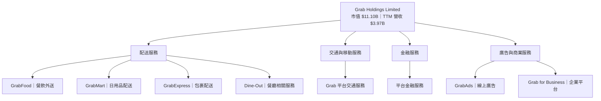
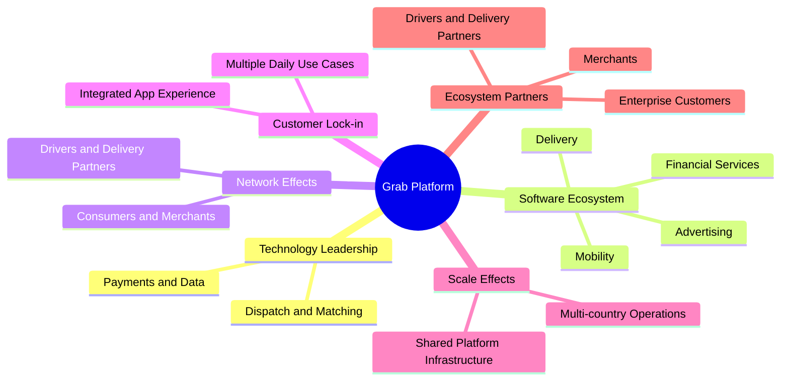
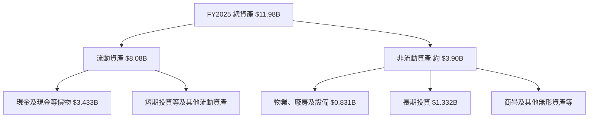
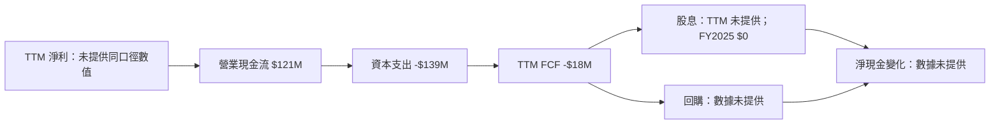
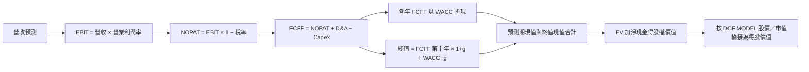
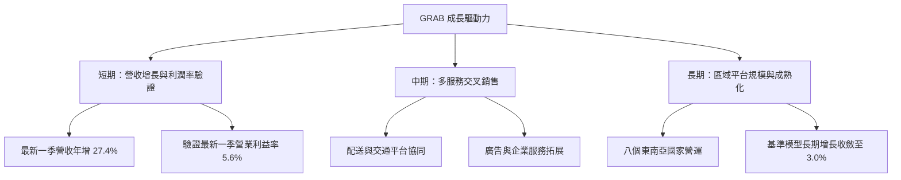
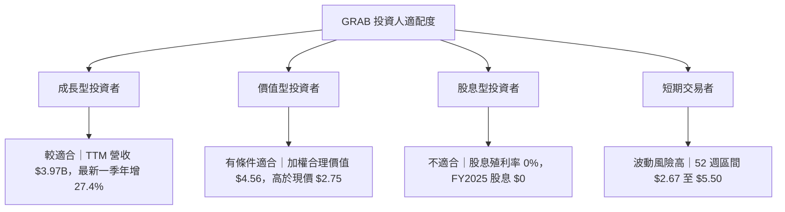

# GRAB 基本面深度分析報告
> **報告日期**：2026-11-22 ｜ **語言**：繁體中文 ｜ **數據來源**：Yahoo Finance、Finviz、StockAnalysis、Roic.ai ｜ **分析師**：CFA 級機構研究  
> **價格基準**：2026-11-20 收盤價 **$2.75**。財務資料截至 2026-09-30；財報來源為 Yahoo Finance 季度報表，非 SEC 申報資料。

## 目錄

| # | 章節 | 核心結論 |
|---|------|----------|
| 1 | 執行摘要 | 評級買入；加權合理價值 $4.56；MOS 39.7% |
| 2 | 公司概覽與商業模式 | 區域超級應用平台具網路效應，但市場份額數據未提供 |
| 3 | 損益表深度分析 | TTM 營收 $3.97B；最新一季年增 27.4%，獲利指標存在季間波動 |
| 4 | 資產負債表分析 | 淨現金 $3.83B；流動性可支應營運，但現金較 FY2025 減少 |
| 5 | 現金流量深度分析 | TTM FCF 為 -$18M、FCF Yield -0.16%，現金轉換尚未穩定 |
| 6 | 獲利能力與資本效率 | ROIC 為 N/A，無法確認是否高於 8.29% WACC |
| 7 | 相對估值分析 | 同業 Forward P/E 中位數 14.4x；GRAB Forward P/E 約 17.5x |
| 8 | DCF 內在價值評估 | 基準 DCF 每股 $6.24；結果高度依賴終值及成長假設 |
| 9 | 成長催化劑 | 最新一季營收年增 27.4%；TAM 與市場份額數據未提供 |
| 10 | 風險矩陣 | 核心風險為利潤率波動、FCF 轉負及競爭壓力 |
| 11 | 投資建議 | 買入；建議以財報驗證現金流、利潤率及營收增長的持續性 |

---

## 1. 執行摘要

GRAB 的估值判斷由「成長高、現金流尚未穩定」兩項力量拉扯：截至 2026-09-30 的 TTM 營收為 **$3.97B**，最新一季營收年增 **27.4%**，但 TTM 自由現金流按營業現金流減資本支出計算為 **-$18M**，FCF Yield 為 **-0.16%**。基準 DCF 每股價值為 **$6.24**，但估值方法加權後合理價值為 **$4.56**；以 2026-11-20 收盤價 **$2.75** 計算，MOS 為 **39.7%**。ROIC 資料缺漏，無法驗證 ROIC 是否高於 WACC，因此評級依 MOS 規則為**買入**，而非強烈買入。

### 1.0 一頁式投資儀表板（Portfolio Manager 30 秒速讀）

| 項目 | 內容 |
|------|------|
| **投資論點（3 句）** | ① TTM 營收 $3.97B，最新一季年增 27.4%，成長動能仍在。② 現金及短期投資 $5.90B、總債務 $2.07B，淨現金 $3.83B，提供營運與投資緩衝。③ TTM FCF 為 -$18M、FCF Yield -0.16%，獲利轉現金仍需驗證。 |
| **綜合評分** | **7.2/10**（引用 1.1 評分卡） |
| **財務健康** | 🟢 淨現金 $3.83B、流動比率 1.384；惟 TTM FCF 為負 |
| **ROIC vs WACC** | ROIC：N/A；WACC：8.29%。資料不足，無法確認價值創造或摧毀 |
| **FCF 趨勢** | 2024 年 FCF $739M，2025 年 -$44M，TTM -$18M；FCF Yield -0.16% |
| **估值** | Forward P/E 17.5x ｜ EV/EBITDA 17.439x ｜ FCF Yield -0.16% |
| **DCF 內在價值（基準）** | $6.24 ｜相對 DCF 基準價值折價 **55.9%**（$2.75 ÷ $6.24 − 1） |
| **安全邊際（MOS）** | **39.7%**＝($4.56 加權合理價值 − $2.75 現價) ÷ $4.56；🟢 >25% |
| **預期報酬（基準情境 12M）** | **+126.9%**（DCF 基準情境每股 $6.24 相對現價；非保證報酬） |
| **關鍵風險（前二）** | TTM FCF 為負；最新一季 GAAP 淨利 $27M，低於前兩季 |
| **評級 + 信心度** | 🟢 **買入** ｜ 信心：中（估值折價明顯，但 ROIC、分部與市場份額資訊不足） |

### 1.1 綜合評分卡（全報告唯一）

| 維度 | 評分（1–10） | 主要依據（引用數字與其來源章節） |
|------|--------------|----------------------------------|
| 成長性 | 8.0 | TTM 營收 $3.97B；最新一季年增 27.4%（第 3 章） |
| 獲利能力 | 6.0 | TTM 營業利益率 11.0%，但最新一季為 5.6%；ROIC、F-Score 無法取得（第 3、6 章） |
| 財務健康 | 8.0 | 淨現金 $3.83B、流動比率 1.384；TTM FCF -$18M（第 4、5 章） |
| 估值 | 8.0 | MOS 39.7%；GRAB Forward P/E 17.5x，高於同業中位數 14.4x（第 7、8 章） |
| 護城河 | 7.0 | 東南亞多國超級應用與跨業務平台網路效應；市場份額、留存率及單位經濟數據未提供（第 2 章） |
| 管理層與資本配置 | 6.0 | FY2025 SBC $241M、無現金股息；FY2025 FCF -$44M，資本配置轉化成現金的穩定性仍待觀察（第 3、5 章） |
| **綜合評分** | **7.2** | 六項算術平均：(8+6+8+8+7+6) ÷ 6 = **7.2** |

### 1.2 五大投資論點 + 三大核心風險

| 類型 | 項目 | 具體依據 | 信心度 |
|------|------|----------|--------|
| 🟢 **投資論點①** | 平台仍在擴張 | TTM 營收 $3.97B；最新一季年增 27.4%，高於 UBER 的 9.6% | 🟢 高 |
| 🟢 **投資論點②** | 資產負債表有緩衝 | 現金及短期投資 $5.90B、債務 $2.07B、淨現金 $3.83B | 🟢 高 |
| 🟢 **投資論點③** | DCF 有較大估值差距 | DCF 基準價值 $6.24，較 $2.75 現價高 126.9%；模型假設需審慎驗證 | 🟡 中 |
| 🟢 **投資論點④** | 年度營收長期擴張 | FY2022 至 FY2025 營收由 $1.43B 增至 $3.37B，三年 CAGR 約 33.1% | 🟢 高 |
| 🟢 **投資論點⑤** | 區域多服務平台具交叉銷售可能 | 業務涵蓋外送、交通、商業配送與金融服務；實際分部收入占比未提供 | 🟡 中 |
| 🟡 **風險①** | 自由現金流未穩定 | TTM FCF -$18M；FY2024 為 +$739M、FY2025 為 -$44M | 🟡 中 |
| 🔴 **風險②** | 季度利潤率可能波動 | TTM 營業利益率 11.0%，最新一季營業利益率 5.6%；不同來源季度營業利益數據亦有差異 | 🔴 高衝擊 |
| 🔴 **風險③** | DCF 終值與高成長假設敏感 | 終值現值占企業價值 67.4%；基準第一年採用最新一季 27.4% 年增率作為預測起點 | 🔴 高衝擊 |

### 1.3 快速統計卡片

| 指標 | 公司實際值（期間） | 同業中位數 | 狀態 |
|------|--------------------|------------|------|
| 營收成長（TTM） | **N/A**（TTM 對前一 TTM） | — | 🟡 |
| 營收成長（最新一季年增） | **27.4%** | **34.0%** | 🟡 |
| 毛利率（TTM） | **41.4%** | **45.0%** | 🟡 |
| 營業利益率（TTM） | **11.0%** | — | 🟢 |
| ROIC（TTM） | **N/A** | — | 🟡 |
| Forward P/E | **17.5x** | **14.4x** | 🟡 |
| FCF Yield（TTM） | **-0.16%** | — | 🔴 |
| Piotroski F-Score | **N/A** | — | 🟡 |

### 1.4 投資結論

```text
╔══════════════════════════════════════════════════════════════════╗
║                    📊 投資結論摘要                               ║
╠══════════════════════════════════════════════════════════════════╣
║  評級：買入（MOS 39.7%；ROIC 資料缺漏，不符合強烈買入條件）       ║
║  價格（2026-11-20 收盤）：$2.75                                  ║
║  DCF 內在價值（基準）：$6.24（相對 DCF 折價 55.9%）              ║
║  安全邊際 MOS：39.7%（＝($4.56−$2.75)÷$4.56）                   ║
║  加權合理價值（8.8）：$4.56                                      ║
║  DCF 情境價值：                                                   ║
║    悲觀情境：$3.21（+16.6%）                                     ║
║    基準情境：$6.24（+126.9%）                                    ║
║    樂觀情境：$13.01（+373.1%）                                   ║
║  綜合評分：7.2/10（引用 1.1）                                    ║
║  適合投資人：可承受波動的成長型、長線持有者；不適合股息需求者     ║
╚══════════════════════════════════════════════════════════════════╝
```

---

## 2. 公司概覽與商業模式

### 2.1 業務結構與收入來源

GRAB Holdings Limited 營運 Grab 超級應用平台，服務柬埔寨、印尼、馬來西亞、緬甸、菲律賓、新加坡、泰國及越南。公司提供配送、交通、金融服務及廣告等服務。TTM 營收為 **$3.97B**，市值 **$11.10B**。目前財務資料沒有提供各業務板塊營收與占比，因此不拆分並不以示意數字製作收入占比圖。



### 2.2 市場份額

市場份額數據未提供，無法以可核實數字比較各國外送、交通或金融科技市場的占有率。作為相對尺度，GRAB TTM 營收為 **$3.97B**，最新一季年增 **27.4%**；同業 SE、DASH 最新一季年增分別為 **43.4%**、**34.0%**，UBER 為 **9.6%**。此比較僅反映公司層級增長，不能替代市場份額或分部成長比較。

### 2.3 競爭護城河分析



### 2.4 護城河強度

| 護城河項目 | 強度（強／中／弱） | 證據（引用數字或事實） | 會削弱它的情況 |
|------------|--------------------|------------------------|----------------|
| 技術與平台 | 中 | 公司營運多項 App 服務；研發費用 FY2025 為 $428M | 技術差異無法形成較高留存或更佳單位經濟 |
| 軟體生態系統 | 中 | 涵蓋配送、交通、廣告及企業平台 | 使用者偏好單一服務競品，交叉銷售不成立 |
| 網路效應 | 中 | 消費者、商戶與配送/交通供應者構成雙邊平台 | 競爭者補貼提高、供應者跨平台多歸屬 |
| 客戶鎖定 | 弱至中 | 多服務整合提供便利性；實際留存率與使用頻率未提供 | 使用者可低成本切換至其他平台 |
| 規模效應 | 中 | 八個東南亞國家營運，TTM 營收 $3.97B | 各國監管、物流與競爭差異稀釋規模優勢 |
| 生態夥伴 | 中 | 依賴商戶、企業客戶及供應者網絡 | 合作條款惡化或供應者要求更高報酬 |

1.1 的護城河評分 **7.0/10**，依據是多服務區域平台及 FY2025 研發投入 $428M；但市場份額、留存率與分部經濟數據未提供，故不將護城河視為已由數據完全證實。

---

## 3. 損益表深度分析

### 3.1 年度收入成長趨勢（FY2022–FY2025）

年度營收由 FY2022 的 **$1.43B** 增至 FY2025 的 **$3.37B**。FY2022–FY2025 CAGR 約 **33.1%**，計算為 \((3.37 ÷ 1.43)^{1/3} - 1\)。FY2023 增幅較高，之後增長回落至約 20%，顯示公司仍在擴張，但基期擴大後年度增長較常態化。

```text
╔══════════════════════════════════════════════════════════════════╗
║              GRAB 年度收入趨勢（FY2022-FY2025）                  ║
╠══════════════════════════════════════════════════════════════════╣
║  FY2022  $1.43B  ████████░░░░░░░░░░░░░░░░  YoY：N/A             ║
║  FY2023  $2.36B  ██████████████░░░░░░░░░░  YoY：+64.9% 🟢       ║
║  FY2024  $2.80B  █████████████████░░░░░░░  YoY：+18.6% 🟢       ║
║  FY2025  $3.37B  ████████████████████░░░░  YoY：+20.4% 🟢       ║
╠══════════════════════════════════════════════════════════════════╣
║  FY2022-FY2025 營收 CAGR：(3.37÷1.43)^(1/3)-1 ≈ 33.1%           ║
╚══════════════════════════════════════════════════════════════════╝
```

年度增長率以年度收入表計算：FY2023 \(2.36 ÷ 1.43 - 1\)，FY2024 \(2.80 ÷ 2.36 - 1\)，FY2025 \(3.37 ÷ 2.80 - 1\)。年度報表資料有不同供應商版本差異，以上使用 Yahoo 年度收入表的數字。

### 3.2 季度收入趨勢分析

| 季度 | 營收 | QoQ | YoY | 備註 |
|------|------:|----:|----:|------|
| 2025 Q4 | $906M | +3.8% | +18.6% | QoQ 比較 2025 Q3 $873M；YoY 比較 2024 Q4 $764M |
| 2026 Q1 | $955M | +5.4% | +23.5% | YoY 比較 2025 Q1 $773M |
| 2026 Q2 | $998M | +4.5% | +21.9% | YoY 比較 2025 Q2 $819M |
| 2026 Q3 | $1,112M | +11.4% | +27.4% | YoY 數值符合最新一季年增指標 |

最近四季營收依序提高，2026 Q3 的 QoQ 增速升至 11.4%。但 QoQ 會受季節性影響，不應將單季變化直接外推為全年增長。

### 3.3 利潤率演變分析

| 利潤率指標 | FY2022 | FY2023 | FY2024 | FY2025 | 趨勢 | 評估 |
|------------|-------:|-------:|-------:|-------:|------|------|
| 毛利率 | 5.4% | 36.4% | 41.8% | 43.3% | FY2022–FY2025 上升 | 🟢 |
| 營業利益率 | -90.2% | -16.4% | -2.0% | 6.6% | 損失收斂並轉正 | 🟢 |
| EBITDA 利潤率 | -99.1% | -9.4% | 3.3% | 15.3% | FY2025 改善 | 🟢 |
| 淨利率 | -117.5% | -18.4% | -3.8% | 8.0% | FY2025 轉正 | 🟢 |

以上 FY2022–FY2025 毛利率、營業利益率按年度財報收入與毛利、營業利益計算。FY2025 年度報表中淨利 $268M、收入 $3.37B，對應淨利率約 8.0%。另需注意，年度毛利、營業利益等項目在 Yahoo 與 StockAnalysis 的歷史序列有差異；公司 TTM 毛利率 **41.4%**、營業利益率 **11.0%** 依財務資料中的指定指標引用，不與年度比率混為同一期間。

**利潤率演變深度解析：** FY2022 的營業虧損幅度極大，隨營收規模擴張，FY2025 已轉為正營業利益。這與平台規模擴大、成本效率提升相符，但現有資料沒有提供補貼、抽成率及分部成本，無法精確分解改善來源。TTM 營業利益率 11.0% 與最新一季 5.6% 的差距提醒投資人：單年或 TTM 利潤率不能取代季度持續性檢驗。

### 3.4 費用結構分析

可核實的年度費用資料包括 FY2025 研發費用 **$428M**，FY2025 SBC **$241M**，以及 TTM 資本支出 **$139M**。公司完整費用項目及各項占營收比例未提供；此外，資本支出不屬於損益表費用，故不以 pie chart 將費用及資本支出混合呈現。

### 3.5 季度 EPS 趨勢與盈餘品質（Quality of Earnings）

**EPS 過去四季超預期／不及預期：** 財報資料所列 2026 Q3、Q2、Q1 及 2025 Q4 的 EPS 預估值均為 NaN，無法計算實際 EPS 對市場預期的 beat/miss；不能據此判斷超預期或不及預期。可核實的單季 EPS 年增指標為最新一季 **-32.2%**，淨利年增 **-27.0%**。2026 Q3 淨利為 $27M，低於 2026 Q2 的 $253M、Q1 的 $136M；來源資料未提供足以拆解單季稅項、投資收益或一次性項目的細節。

| 盈餘品質項目 | 數值／佔比 | 評估 |
|--------------|-----------|------|
| 股權薪酬 SBC / TTM 營收 | 約 **5.9%**；TTM SBC 約 $234M ÷ $3.97B | 🟡 SBC 非現金列帳，但代表股東稀釋成本；比重不低 |
| SBC / TTM 營業現金流 | 約 **193.4%**；$234M ÷ $121M | 🔴 SBC 金額高於營業現金流，現金流未能覆蓋其量級 |
| FCF / 淨利（現金轉換率） | 約 **-3.1%**；TTM FCF -$18M ÷ 四季淨利約 $588M | 🔴 當期 GAAP 淨利沒有轉化為正 FCF；淨利取季度報表加總 |
| 一次性／非經常性損益 | N/A（缺少完整調節資料） | 🟡 無法判斷投資收益、稅務或一次性項目的影響 |
| 有效稅率異常 | 25.7%（模型採用的最新年度有效稅率） | 🟡 單季稅費明細不足，不能判定最新季度異常與否 |
| 資本化支出 vs 費用化 | TTM Capex $139M；資本化政策細節 N/A | 🟡 無法判斷是否有成本遞延或資本化政策變動 |

**盈餘品質結論：** FY2025 SBC 為 **$241M**，TTM SBC 約 $234M，對股東回報具有實質稀釋影響。TTM FCF -$18M，而近四季淨利合計約 $588M，現金轉換偏弱。由於未提供完整現金流與非經常項目調節，不能斷言 GAAP 淨利必然高估經濟盈餘；但目前估值不宜只依 EPS 或淨利，應把 FCF 轉正及 SBC 占比下降列為必要驗證項目。

---

## 4. 資產負債表分析

### 4.1 資產結構分解

FY2025 總資產 **$11.98B**，流動資產 **$8.08B**；非流動資產按差額為約 **$3.90B**。最新 TTM 資產負債表資料另列總資產 $14.208B、流動資產 $7.945B。因時點及供應商報表口徑不同，圖示採用 FY2025 同一年度表格數據。



### 4.2 流動性與營運資金分析

| 指標 | 最新 TTM | 一年前 TTM | 變化 | 解讀 |
|------|----------|------------|------|------|
| 流動比率 | 1.384 | N/A | N/A | 流動資產高於流動負債，但流動比率並非現金流保障的替代品 |
| 速動比率 | 1.07 | N/A | N/A | 高於 1，短期流動性尚可 |
| DSO 應收帳款天數 | 22 天 | N/A | N/A | 應收天數資料存在；缺少一年前同口徑數值，無法評估收款趨勢 |
| DIO 存貨天數 | 15 天 | N/A | N/A | 缺少去年同期數值，無法判定庫存週轉方向 |
| DPO 應付帳款天數 | 219 天 | N/A | N/A | 應付天數較長，可能反映平台結算週期及供應商付款安排；不足以單獨證明議價力 |
| CCC 現金轉換週期 | -182 天 | N/A | N/A | 負 CCC 代表營運資金模型中應付帳款天數高於應收與存貨天數；比較年度變化資料未提供 |

CCC 依提供指標為 \(22+15-219=-182\) 天。負 CCC 通常可降低營運資金占用，但 DPO 高也需觀察結算安排、商戶與供應者條款是否可持續。

### 4.3 債務結構分析

```text
╔══════════════════════════════════════════════════════════════════╗
║                   GRAB 債務健康診斷                              ║
╠══════════════════════════════════════════════════════════════════╣
║  總債務：          $2.07B  ███████░░░░░░░░░░░  🟡               ║
║  現金及短期投資：  $5.90B  ████████████████████ 🟢               ║
║  淨現金：          $3.83B  █████████████░░░░░░ 🟢               ║
║                                                                  ║
║  流動比率：1.384x ｜速動比率：1.07x                               ║
║  Debt/EBITDA：未列為 VERIFIED 指標；按 TTM EBITDA 粗略推算約4.7x ║
║  利息保障倍數：N/A（利息費用及 EBIT 同期詳細明細未提供）         ║
╚══════════════════════════════════════════════════════════════════╝
```

淨現金由指定財務數據直接引用：**$5.90B − $2.07B = $3.83B**。Debt/EBITDA 約 4.7x 是估計推算：TTM EBITDA 按 EBITDA margin 11.2% × TTM 營收 $3.97B 得約 $445M，再以 $2.07B ÷ $445M；由於 EBITDA 及債務口徑可能不同，此數僅作輔助，不替代正式債務倍數。

### 4.4 股東權益趨勢

FY2022–FY2025 股東權益分別為 **$6.60B、$6.45B、$6.40B、$6.73B**。FY2024 較 FY2023 減少約 0.8%，FY2025 回升約 5.2%。股東權益變動可能同時受損益、SBC 與其他權益項目影響，資料不足以完整歸因。

```text
╔══════════════════════════════════════════════════════════════════╗
║                  GRAB 股東權益趨勢（USD）                        ║
╠══════════════════════════════════════════════════════════════════╣
║  FY2022  $6.60B  ████████████████████                           ║
║  FY2023  $6.45B  ████████████████████                           ║
║  FY2024  $6.40B  ███████████████████                            ║
║  FY2025  $6.73B  ████████████████████                           ║
╚══════════════════════════════════════════════════════════════════╝
```

---

## 5. 現金流量深度分析

### 5.1 現金流量瀑布圖

TTM 營業現金流為 $121M，資本支出 $139M，故按指定定義計算 FCF 為 **-$18M**。TTM 淨利、股息與回購的完整現金流橋接及淨現金變化未提供，故圖中不填入推算值。



### 5.2 FCF 轉換率趨勢

| 年度 | FCF | 淨利 | FCF / 淨利 | 評估 |
|------|----:|----:|-----------:|------|
| FY2022 | -$872M | -$1.68B | 51.9% | 兩者均為負，比例不可解讀為正常現金轉換 |
| FY2023 | -$6M | -$434M | 1.4% | FCF 接近損益兩平，淨利仍為負 |
| FY2024 | $739M | -$105M | N/M | 淨利為負，倍數不具經濟解釋力 |
| FY2025 | -$44M | $268M | -16.4% | 正淨利未轉化為正 FCF |
| TTM | -$18M | 約 $588M* | 約 -3.1% | 以最近四季淨利報表加總作參考；來源口徑可能不完全一致 |

\*TTM 淨利以四個季度 $27M、$253M、$136M、$172M 相加估算。年度與季度財報來源存在差異，表中比率應視為近似品質指標，不是經審計的同一口徑調節表。

### 5.3 自由現金流趨勢

```text
╔══════════════════════════════════════════════════════════════════╗
║                  GRAB 自由現金流趨勢（USD）                      ║
╠══════════════════════════════════════════════════════════════════╣
║  FY2022  -$872M  ◀████████████████████████  FCF Yield：N/A      ║
║  FY2023    -$6M  ◀░░░░░░░░░░░░░░░░░░░░░░░  FCF Yield：N/A      ║
║  FY2024  +$739M  ████████████████████       FCF Yield：N/A      ║
║  FY2025   -$44M  ◀█░░░░░░░░░░░░░░░░░░░░░    FCF Yield：N/A      ║
║  TTM      -$18M  ◀░░░░░░░░░░░░░░░░░░░░░    FCF Yield：-0.16%   ║
╚══════════════════════════════════════════════════════════════════╝
```

年度 FCF 波動很大：FY2024 **+$739M**，FY2025 **-$44M**，TTM **-$18M**。單年 FCF 可能受到營運資金與付款時點影響；然而連續兩個期間轉負，說明不能只用 FY2024 的高 FCF 推斷常態現金創造能力。

### 5.4 資本配置評估

| 項目 | 可核實數據 | 評估 |
|------|-----------:|------|
| 資本支出 | TTM $139M；FY2025 $123M | 用於資產及平台相關投入，投資回報需觀察 |
| 股權薪酬 | FY2025 $241M；FY2024 $279M | 屬非現金費用，但造成股東稀釋 |
| 現金股息 | FY2022–FY2025 均為 $0 | 公司沒有股息回報 |
| 股票回購 | N/A | 回購資料未提供 |
| 留存／併購投資 | N/A | 資料不足，無法拆出金額 |

由於無法取得各資本配置類別一致期間的完整金額，不以 pie chart 製作比例。

---

## 6. 獲利能力與資本效率

### 6.1 ROE / ROA / ROIC 趨勢

| 指標 | 可得期間與數值 | 評估 |
|------|----------------|------|
| ROE | TTM 7.6% | 正值，但權益收益率不是資本回報品質的完整衡量 |
| ROA | TTM 1.1% | 低於 ROE，資產盈利效率仍有限 |
| ROIC | N/A | 資料缺少構成 ROIC 的完整投入資本與稅後營業利益口徑 |
| 行業均值 | 未提供 | 不列未經核實的比較數字 |

### 6.2 ROIC vs WACC 分析（核心價值創造判斷）

目前 ROIC 無法由可核實資料計算，因此不能據此宣稱 GRAB 正在創造或摧毀股東價值。WACC 依成本資本資料為 **8.29%**，供 DCF 折現與資本效率比較使用。

```text
╔══════════════════════════════════════════════════════════════════╗
║                ROIC vs WACC 深度分析                            ║
╠══════════════════════════════════════════════════════════════════╣
║  WACC 輸入：                                                     ║
║  ├── 無風險利率（10Y Treasury）：4.91%                           ║
║  ├── 股權風險溢酬 ERP：5.00%                                     ║
║  ├── 原始 Beta：0.83；調整後 Beta：0.89                          ║
║  ├── 股權成本 Ke：9.36%（採用指定成本資本數據）                  ║
║  ├── 稅前債務成本：3.43%                                         ║
║  ├── 有效稅率：25.7%；股權／債務權重：84.3%／15.7%              ║
║  └── WACC：8.29%                                                 ║
║                                                                  ║
║  ROIC：N/A（缺少可用的投入資本及 NOPAT 同口徑資料）              ║
║  EVA＝ROIC−WACC：N/A                                             ║
║                                                                  ║
║  ROIC：N/A  ░░░░░░░░░░░░░░░░░░░░░░░░░░░░                       ║
║  WACC：8.29% ████████░░░░░░░░░░░░░░░░░░░░                      ║
║                                                                  ║
║  結論：無法判定 ROIC 是否高於 WACC；不可宣稱已創造經濟價值。    ║
╚══════════════════════════════════════════════════════════════════╝
```

### 6.3 杜邦三因素分解

| 因素 | 數值（TTM） | 解讀 |
|------|-------------|------|
| 淨利率 | N/A | QUALITY FIGURES 指示杜邦資料缺漏 |
| 資產週轉率 | N/A | 無法在指定口徑下核實 |
| 權益乘數 | N/A | 無法在指定口徑下核實 |
| **ROE** | **N/A（杜邦分解）** | 杜邦品質數據因淨利、營收、總資產或正權益資料缺漏而不可用；另行披露的 ROE TTM 為 7.6%，不可混作杜邦計算結果 |

### 6.4 財務體質：Piotroski F-Score

Piotroski F-Score 為 **N/A**，原因是缺少相隔一年的兩個 TTM SEC 申報資料。九項測試結果無法判定，不能補填或推測。

| 測試 | 結果 | 解讀 |
|------|------|------|
| 盈利能力及營業現金流相關測試 | N/A | 不具備計算所需的標準化兩期申報資料 |
| 槓桿、流動性及股權發行測試 | N/A | 無法按指定 QUALITY FIGURES 口徑核實 |
| 營運效率測試 | N/A | 無法形成九項測試總分 |

---

## 7. 相對估值分析

### 7.1 同業估值比較表格

| 估值指標 | **GRAB** | **UBER** | **SE** | **DASH** | GRAB 評估 |
|----------|---------:|---------:|-------:|--------:|-----------|
| **Trailing P/E** | 27.5x | 37.3x | 22.5x | 63.3x | 🟡 位於同業高低值之間 |
| **Forward P/E** | 17.5x | 14.4x | 13.1x | 20.0x | 🟡 高於同業中位數 14.4x |
| **P/S Ratio** | 2.80x | 2.3x | 1.3x | 3.9x | 🟡 高於 SE、低於 UBER/DASH |
| **EV/EBITDA** | 17.439x | 17.7x | 12.1x | 37.3x | 🟡 接近 UBER，低於 DASH |
| **最新一季營收年增** | 27.4% | 9.6% | 43.4% | 34.0% | 🟢 增長高於 UBER、低於 SE/DASH |
| **毛利率（TTM）** | 41.4% | 41.4% | 45.0% | 52.7% | 🟡 低於 SE、DASH |

Peer multiples 取自 Yahoo Finance 同業資料；GRAB 自身倍數取自市場與估值資料。此表是倍數比較而非完全同口徑的業務比較，尤其商業模式與地域曝險存在差異。

### 7.2 歷史估值區間分析

歷史估值區間及當前估值百分位資料未提供；因此不填歷史 P/E 區間、百分位或估值分布圖。可核實的股價紀錄顯示，2024-11 收盤 $5.00，2026-11-20 收盤 $2.75；52 週高低為 $5.50 與 $2.67，但股價走勢不能代替估值倍數歷史。

### 7.3 情境價值（Bear / Base / Bull）

| 情境 | 第 1 年營收成長 | 期末營業利潤率 | WACC | 每股價值 | 相對現價 | 機率 | 會發生的條件 |
|------|----------------|----------------|------|----------|----------|------|--------------|
| 🔴 悲觀 | 13.7% | 9.3% | 9.29% | $3.21 | +16.6% | 25% | 需求降速、價格競爭或利潤率收縮 |
| 🟡 基準 | 27.4% | 11.0% | 8.29% | $6.24 | +126.9% | 50% | 最新一季年增能延續初期，長期增速逐年降至 3.0%，利潤率維持 11.0% |
| 🟢 樂觀 | 41.1% | 12.0% | 7.29% | $13.01 | +373.1% | 25% | 新服務交叉銷售與平台增長高於基準，利潤率提高且資本成本下降 |

三情境及機率照 DCF MODEL 引用。樂觀情境的第一年營收增長顯著高於最新一季 27.4%，且 WACC 低於基準，屬較高預期，不宜將其當作主要目標價。

### 7.4 相對估值隱含價格區間

```text
╔══════════════════════════════════════════════════════════════════╗
║                相對估值方法與每股價值                           ║
╠══════════════════════════════════════════════════════════════════╣
║  $2.26       $2.75      $3.83          $5.39             $6.24   ║
║  Forward P/E 現價       EV/EBITDA      分析師共識       基準 DCF ║
║  ─────────────────────────────────────────────────────────────  ║
║  Forward P/E：同業中位數 14.4x × GRAB Forward EPS $0.16          ║
║  EV/EBITDA：同業中位數 17.7x × TTM EBITDA，再加回淨現金          ║
║  分析師共識：22 位分析師平均目標價 $5.39                          ║
╚══════════════════════════════════════════════════════════════════╝
```

Forward P/E 導出的 $2.26 低於現價；EV/EBITDA 導出的 $3.83 高於現價。兩種方法映射出較大的分歧，說明相對估值對同業倍數及 GRAB 預估盈利／EBITDA口徑敏感。

---

## 8. DCF 內在價值評估（Discounted Cash Flow）

> 本章 DCF 數據採用程式計算模型所列假設與結果，不另行建立模型。模型採 FCFF、WACC 折現，預測期為 10 年，金額單位為 USD billions，逐年數值均照模型列示。部分顯示至小數點後兩位的中間數存在四捨五入差異，以下保留模型提供的結果並在 8.10 揭露不能僅以顯示精度完全復算之處。

### 8.0 估值推理鏈（Thinking Logic）

**Step 1 — 價值來源與主導變數：** GRAB 目前收入主要來自配送、交通及平台延伸服務，但各業務收入占比未提供，不能捏造「主業／第二曲線」比例。模型以 TTM 收入 $3.97B 作單一合併起點；估值最受長期營收路徑、營業利潤率及終值假設影響。終值現值占 EV **67.4%**，故永續增長率與折現率的差距是估值敏感度核心。

**Step 2 — 模型選擇**

| 決策點 | 本報告採用 | 理由（含數字） | 曾考慮但否決 | 否決理由 |
|--------|-----------|----------------|--------------|----------|
| 現金流定義 | FCFF | 使用 WACC 折現，再加淨現金得到股權價值；TTM 淨現金 $3.83B | FCFE | 股權融資及債務權重不固定，FCFF 較適合企業價值橋接 |
| 預測期 N | 10 年 | DCF MODEL 固定 10 年，收入成長由 27.4% 線性降至 3.0% | 5 年 | 對長期平台成熟化的模型路徑不足以呈現 |
| 終值方法 | Gordon Growth | 永續成長率 3.0%，WACC 8.29%，滿足 WACC > g | 退出倍數 | DCF MODEL 未提供退出倍數假設，不能另造 |
| EBIT 基礎 | GAAP EBIT | 模型明確使用 GAAP EBIT | 非 GAAP EBIT | 避免把 SBC 加回後漏計股東成本 |

**Step 3 — 關鍵假設推導鏈**

- **營收成長**：錨點＝最新一季營收年增 27.4%，而 FY2022–FY2025 營收 CAGR 約 33.1% → 調整＝採用季度增長率作 FY+1 起點，之後線性降至成熟期 3.0%，但季度數字不等於 TTM 成長 → **採用 FY+1 27.4%、FY+10 3.0%** → 曾考慮直接以歷史 CAGR 延伸 10 年，因其忽視規模增加後的增長回落而否決。
- **營業利潤率**：錨點＝TTM 營業利益率 11.0%，最新一季 5.6% → 調整＝模型將 TTM 11.0%維持至第十年，實際上對季度波動不敏感 → **採用 11.0% 固定** → 曾考慮跟隨最新一季 5.6%，但該值是單季、不可直接替代全年，因此模型未採用；這仍是基準模型偏樂觀處。
- **永續成長率 g**：錨點＝長期成熟企業增長需低於資本成本，模型採 3.0% → 調整＝選擇正成長但低於 WACC 的終值假設 → **採用 3.0%** → 否決高於或接近 8.29% 的 g，因 Gordon Growth 公式會失效或使終值異常放大。
- **預測期 N**：錨點＝模型固定預測 10 年，期間由高增長逐步淡出至 3.0% → 調整＝對平台成熟過程給足時間，但增速每年下降 → **採用 10 年** → 否決更長預測期，因後續年度營運能見度低、容易增加模型假精確。
- **Capex／營收**：錨點＝TTM Capex $139M ÷ TTM 營收 $3.97B 約 3.5% → 模型假設維持 3.5% → **採用 3.5%** → 否決更低比例，因尚未有證據證明增長所需資本投入已持續下降。
- **EBIT 基礎與 SBC**：錨點＝GAAP EBIT 已將 SBC 列為費用；FY2025 SBC $241M → **採用組合 (A)：GAAP EBIT、FCFF 不再扣 SBC、固定股數、年稀釋率 0%** → 否決再扣一次 SBC 或額外稀釋股數，避免重複計成本。本模型採用 (A)，故 SBC 影響已計入一次。
- **終值方法**：錨點＝第 10 年 FCFF $1.64B、WACC 8.29% → 採 Gordon Growth 作主方法 → **採用 Gordon Growth** → 退出倍數因缺少模型輸入及可比較成熟期倍數而不另行設定。
- **WACC**：錨點＝成本資本資料提供 WACC 8.29% → 採用指定值作折現率 → **採用 8.29%** → 不自行調整國別或規模溢酬，避免與既定資本成本口徑不一致。
- **年稀釋率**：模型採組合 (A)，**採用 0%**；資料未提供可與模型一致的未來淨稀釋預測。這讓 GAAP SBC 費用承擔全部模型成本，但不代表實際股數未來必然不變。

**Step 4 — 最脆弱環節：** 基準模型把最新一季 27.4% 年增率當作 FY+1 成長起點，並假設 11.0% 營業利潤率維持十年；若成長或利潤率不達標，價值可能向悲觀情境 **$3.21** 下修。

**Step 5 — 計算路徑圖**



### 8.1 模型假設總表（Model Inputs）

| 假設項目 | 採用值 | 依據／來源 | 敏感度 |
|----------|--------|-------------|--------|
| 預測期長度 N | 10 年 | DCF MODEL；收入成長從 27.4% 降至 3.0% | 🟡 中 |
| 營收成長 | FY+1 27.4% 線性降至 FY+10 3.0% | FY+1 取最新一季年增；FY+10 取模型成熟期值 | 🔴 高 |
| 營業利潤率 | 11.0% 維持 FY+1 至 FY+10 | TTM 營業利益率 11.0%；但最新一季 5.6% | 🔴 高 |
| 有效稅率 | 25.7% | 最新年度有效稅率輸入 | 🟢 低 |
| Capex／營收 | 3.5% | TTM Capex $139M ÷ TTM 營收 $3.97B 約 3.5%；模型值 3.5% | 🟡 中 |
| D&A／營收 | 5.6% | DCF MODEL 所列 TTM 比率 | 🟢 低 |
| 營運資金變動／營收增額 | 未建模 | DCF MODEL 明確不含營運資金變動，不補估 | 🟢 低 |
| EBIT 基礎 | GAAP | DCF MODEL 採 GAAP EBIT | 🟡 中 |
| SBC 處理 | 組合 (A)：已包含在 GAAP EBIT，不另扣 | GAAP 費用化 SBC；FY2025 SBC $241M | 🟡 中 |
| 年稀釋率 | 0% | 模型固定股數組合 (A) | 🟡 中 |
| 永續成長率 g | 3.0% | DCF MODEL 假設；低於 WACC 8.29% | 🔴 高 |
| 終值方法 | Gordon Growth | DCF MODEL 提供終值；退出倍數未提供 | 🔴 高 |
| WACC | 8.29% | 成本資本輸入，見 8.2 | 🔴 高 |

FCFF 定義為 **NOPAT + D&A − Capex**。模型不含 ΔWC；因此不能把 8.3 模型結果解讀為已完整反映未來營運資金變化。

### 8.2 折現率推導（WACC）

```text
╔══════════════════════════════════════════════════════════════════╗
║                    WACC 推導（折現率）                           ║
╠══════════════════════════════════════════════════════════════════╣
║  股權成本 Ke（CAPM）：                                           ║
║  ├── 無風險利率 Rf：4.91%（資料未列觀察日期）                    ║
║  ├── ERP：5.00%（成本資本假設值）                                ║
║  ├── 原始 Beta：0.83                                             ║
║  ├── 調整後 Beta：0.89＝⅔×0.83＋⅓×1                              ║
║  └── Ke＝4.91%＋0.89×5.00%＝9.36%（依成本資本輸入）              ║
║                                                                  ║
║  債務成本：                                                      ║
║  ├── 稅前 Kd：3.43%（指定成本資本數據）                          ║
║  ├── 有效稅率：25.7%                                             ║
║  └── 稅後 Kd：3.43%×(1−25.7%)＝2.55%                            ║
║                                                                  ║
║  資本結構：股權權重 84.3%；債務權重 15.7%                        ║
║  ✅ WACC：8.29%（指定成本資本輸入）                              ║
╚══════════════════════════════════════════════════════════════════╝
```

逐步檢查如下：

1. **Ke**：調整後 Beta \(=⅔×0.83+⅓×1=0.8867\)，四捨五入為 0.89；依提供的 CAPM 結果 **Ke = 9.36%**。用已四捨五入的 Beta 手算 \(4.91\%+0.89×5.00\%=9.36\%\)。
2. **稅前 Kd**：指定為 3.43%；利息費用與平均計息負債的完整分子、分母沒有提供，不能自行重建。
3. **稅後 Kd**：\(3.43\%×(1−25.7\%)=2.548\%\)，四捨五入為 **2.55%**。
4. **權重**：股權 84.3%，債務 15.7%，合計 **100.0%**。成本資本資料未提供對應的市場價值 E、計息債務 D 明細，故採用提供的權重，不以帳面權益替代。
5. **WACC**：\(84.3\%×9.36\%+15.7\%×2.548\%=8.2845\%\)，四捨五入為 **8.29%**。

為避免偽精確，以上不另推算 E、D 金額；原始 Beta 0.83 調整至 0.89 的方式為 \(⅔×\text{原始 Beta}+⅓×1\)。無風險利率資料未列日期，ERP 為假設輸入。第 6.2 與 DCF 均使用相同 WACC **8.29%**。

### 8.3 逐年自由現金流預測（基準情境）

金額為 USD billions；折現因子取三位小數，其餘數值照模型原值列示。

| 年度 | FY+1 | FY+2 | FY+3 | FY+4 | FY+5 | FY+6 | FY+7 | FY+8 | FY+9 | FY+10 |
|------|-----:|-----:|-----:|-----:|-----:|-----:|-----:|-----:|-----:|------:|
| 營收 | 5.06 | 6.31 | 7.69 | 9.18 | 10.70 | 12.18 | 13.53 | 14.67 | 15.51 | 15.98 |
| 營收 YoY | 27.4% | 24.7% | 22.0% | 19.3% | 16.6% | 13.8% | 11.1% | 8.4% | 5.7% | 3.0% |
| 營業利潤率 | 11.0% | 11.0% | 11.0% | 11.0% | 11.0% | 11.0% | 11.0% | 11.0% | 11.0% | 11.0% |
| EBIT（GAAP） | 0.55 | 0.69 | 0.84 | 1.01 | 1.17 | 1.33 | 1.48 | 1.61 | 1.70 | 1.75 |
| − 稅 | (0.14) | (0.18) | (0.22) | (0.26) | (0.30) | (0.34) | (0.38) | (0.41) | (0.44) | (0.45) |
| NOPAT | 0.41 | 0.51 | 0.63 | 0.75 | 0.87 | 0.99 | 1.10 | 1.20 | 1.26 | 1.30 |
| + D&A | 0.28 | 0.35 | 0.43 | 0.52 | 0.60 | 0.68 | 0.76 | 0.82 | 0.87 | 0.90 |
| − Capex | (0.18) | (0.22) | (0.27) | (0.32) | (0.37) | (0.43) | (0.47) | (0.51) | (0.54) | (0.56) |
| **FCFF** | **0.52** | **0.65** | **0.79** | **0.94** | **1.10** | **1.25** | **1.39** | **1.51** | **1.59** | **1.64** |
| 折現因子 | 0.923 | 0.853 | 0.788 | 0.727 | 0.672 | 0.620 | 0.573 | 0.529 | 0.488 | 0.451 |
| **FCFF 現值 PV** | **0.48** | **0.55** | **0.62** | **0.68** | **0.74** | **0.77** | **0.80** | **0.80** | **0.78** | **0.74** |

預測期 PV 合計依模型為 **$6.96B**。逐項顯示值相加為 \(0.48+0.55+0.62+0.68+0.74+0.77+0.80+0.80+0.78+0.74=6.96\)。

**逐步演算（FY+1，依模型顯示精度）：**

1. 營收：\(3.97×(1+27.4\%)=5.06\)（模型列示，按顯示精度）
2. EBIT：模型列示 **$0.55B**；公式為營收 × 11.0%
3. 稅：模型列示 **$0.14B**；公式為 EBIT × 25.7%
4. NOPAT：模型列示 \(0.55-0.14=\) **$0.41B**
5. D&A：模型列示 **$0.28B**；約按營收 × 5.6%
6. Capex：模型列示 **$0.18B**；約按營收 × 3.5%
7. ΔWC：**未建模**
8. FCFF：模型列示 **$0.52B**
9. 折現：\(1÷(1+8.29\%)^1=0.923\)；\(0.52×0.923\) 約為 **$0.48B**（模型 PV $0.48B）

由於各中間項目僅顯示至 $0.01B，FY+1 以列示中間數直接計算 \(0.41+0.28-0.18=0.51\)，與模型 FCFF $0.52B 有約 $0.01B 差異；這是模型未四捨五入底層數與顯示值的精度差異，不應把表格顯示值誤當成可精確回推出全部底層數。

**合理性自檢：**
- 預測 FCFF 由 FY+1 $0.52B 增至 FY+10 $1.64B；兩端年化增幅約 13.6%。歷史 FCF 多期正負波動，無法計算有意義的穩定歷史 FCF CAGR，預測顯著高於近期 TTM -$18M，須依賴營收增長與利潤率維持。
- FY+10 FCFF 利潤率：\(1.64÷15.98=10.3\%\)；現時 TTM FCF margin：\(-0.018÷3.97=-0.5\%\)。因同業最佳 FCFF margin 未提供，不能宣稱超越同業最佳水準。
- 模型所有年度 FCFF 均為正；但這是模型預測，不代表目前實際 TTM FCF 已轉正。

```text
╔══════════════════════════════════════════════════════════════════╗
║            自由現金流：歷史實際 vs 模型預測                      ║
╠══════════════════════════════════════════════════════════════════╣
║  FY2023(實)  -$0.006B   接近零                                  ║
║  FY2024(實)  +$0.739B   正值                                     ║
║  FY2025(實)  -$0.044B   負值                                     ║
║  TTM(實)     -$0.018B   FCF Yield：-0.16%                        ║
║  FY+1 (預)   +$0.52B    模型預測                                 ║
║  FY+10(預)   +$1.64B    模型預測                                 ║
╠══════════════════════════════════════════════════════════════════╣
║  預測依賴營收增長、11.0%營業利潤率維持及不計營運資金變動。       ║
╚══════════════════════════════════════════════════════════════════╝
```

### 8.4 終值計算（Terminal Value）

**適用性檢查：** WACC **8.29%** vs g **3.0%** → WACC > g？✅

| 方法 | 計算式 | 終值 TV | TV 現值 | 佔總 EV 比重 |
|------|--------|---------:|--------:|-------------:|
| Gordon Growth | $1.64 × (1+3.0%) ÷ (8.29%−3.0%) | $31.94B | $14.41B | 67.4% |
| 退出倍數法 | N/A（模型未提供退出倍數或 FY+10 EBITDA 倍數） | N/A | N/A | N/A |

逐步計算依模型列示：
1. FY+N FCFF：FY+10 **$1.64B**。
2. 分子：\(1.64×(1+3.0\%)\)，模型以未四捨五入數據計得終值。
3. 分母：\(8.29\%-3.0\%=5.29\%\)；模型終值為 **$31.94B**。
4. PV(TV)：模型列示 \(31.94×0.451=\) **$14.41B**。
5. 終值占 EV：\(14.41÷21.37=\) **67.4%**。

以兩位小數的顯示值重算 Gordon 公式，可能因內部未四捨五入而有尾差。終值占比雖未高於 75%，仍占企業價值約三分之二，估值對長期假設高度敏感。

### 8.5 企業價值 → 每股內在價值（Bridge）

```text
╔══════════════════════════════════════════════════════════════════╗
║              企業價值 → 每股內在價值 橋接表                      ║
╠══════════════════════════════════════════════════════════════════╣
║  預測期 FCF 現值合計             +$6.96B                         ║
║  終值現值 PV(TV)                 +$14.41B                        ║
║  = 企業價值 EV                    $21.37B                         ║
║  + 淨現金                         +$3.83B                         ║
║  = 股權價值（模型列示）           $25.19B                         ║
║  每股價值（模型橋接）             $6.24                           ║
║  當前股價（2026-11-20 收盤）       $2.75                           ║
║  折溢價：2.75÷6.24−1               -55.9%（折價）                 ║
╚══════════════════════════════════════════════════════════════════╝
```

橋接核對：
1. EV：\(6.96+14.41=\) **$21.37B**。
2. 模型列示股權價值 **$25.19B**；直接以顯示數計算 \(21.37+3.83=25.20\)，差 $0.01B，為模型未四捨五入底層數造成的尾差。
3. DCF MODEL 每股價值依其明列公式：**股權價值 × 股價 ÷ 市值 = $6.24**。此法不等於單純用股權價值除以流通股數；市值 $11.10B、股價 $2.75，按顯示值手算有精度差異。
4. 折溢價：\((2.75÷6.24)-1=-55.9\%\)，表示現價較 DCF 基準價值折價 55.9%。
5. 本節不計算 MOS；MOS 只在 8.8 以加權合理價值為分母計算。

股數方面，市場資料列流通股數 **3.94B 股**，Roic.ai 2026 Q3 列 shares outstanding 4.037B；兩者口徑不同。DCF MODEL 使用「股權價值 × 價格 ÷ 市值」公式得到 $6.24，並採 GAAP EBIT + 固定股數組合 (A)，不另放大股數。現金、債務及淨現金採截至 2026-09-30 的 TTM 數據。

### 8.6 敏感性分析（WACC × 永續成長率）

每格括號為相對 $2.75 現價的上行空間，依模型矩陣價值計算並四捨五入至一位小數。

| g（列）／WACC（欄） | 6.29% | 7.29% | **8.29%（基準）** | 9.29% | 10.29% |
|-----------|------:|------:|------------------:|------:|-------:|
| 2.0% | $8.13（+195.6%） | $6.65（+141.8%） | $5.64（+105.1%） | $4.92（+78.9%） | $4.38（+59.3%） |
| 2.5% | $8.85（+221.8%） | $7.07（+157.1%） | $5.92（+115.3%） | $5.11（+85.8%） | $4.51（+64.0%） |
| **3.0%（基準）** | $9.79（+256.0%） | $7.60（+176.4%） | **$6.24（+126.9%）** | $5.32（+93.5%） | $4.65（+69.1%） |
| 3.5% | $11.07（+302.5%） | $8.26（+200.4%） | $6.63（+141.1%） | $5.57（+102.5%） | $4.82（+75.3%） |
| 4.0% | $12.91（+369.5%） | $9.13（+232.0%） | $7.12（+158.9%） | $5.87（+113.5%） | $5.02（+82.5%） |

示範非基準格：**WACC = 9.29% > g = 3.0% ✅**。模型矩陣該格每股價值為 **$5.32**；矩陣逐年現金流 PV 及終值重算所需未四捨五入現金流沒有提供，因此不另造中間數重建該格。

**三情境 DCF（照模型輸出）：**

| 情境 | 營收假設（第 1 年） | 期末營業利潤率 | WACC | 每股價值 | 相對現價 | 機率 |
|------|---------------------:|---------------:|-----:|---------:|---------:|-----:|
| 🔴 悲觀 | 13.7% | 9.3% | 9.29% | $3.21 | +16.6% | 25% |
| 🟡 基準 | 27.4% | 11.0% | 8.29% | $6.24 | +126.9% | 50% |
| 🟢 樂觀 | 41.1% | 12.0% | 7.29% | $13.01 | +373.1% | 25% |
| **機率加權** | — | — | — | **$7.17** | **+160.9%** | **100%** |

模型已提供三情境每股價值及假設，但沒有各情境的 FY+N 收入、FCFF、終值完整明細；依規則不反推或杜撰中間值。機率加權為 \(3.21×25\%+6.24×50\%+13.01×25\%=\) **$7.175**，模型列示 **$7.17**（模型內部未四捨五入結果）。

**敏感度結論：**
- 基準 WACC 8.29% 下，g 由 2.0% 升至 3.0%，每股價值由 $5.64 升至 $6.24，增加 **$0.60，約 10.6%**；由 3.0% 升至 4.0%，$6.24 升至 $7.12，增加 **$0.88，約 14.1%**。
- g = 3.0% 時，WACC 由 7.29% 升至 8.29%，價值由 $7.60 降至 $6.24，減少 **$1.36，約 17.9%**；再升至 9.29%，由 $6.24 降至 $5.32，減少 **$0.92，約 14.7%**。
- 營業利潤率每 +1pp 對價值的獨立影響未列於敏感度矩陣，**N/A**，不可自行補算。
- 對照 8.0，估值確實受長期增長與終值折現敏感；另由於終值占 EV 67.4%，WACC 對價格影響尤為顯著。

### 8.7 反推 DCF（Reverse DCF）

模型反推結果只提供兩個變數的解，其他變數不列出未經計算的答案。

| 求解的變數（一次一個） | 其餘變數設定 | 市場隱含值（令 DCF = 現價） | 公司歷史／基準 | 判斷 |
|------------------------|--------------|------------------------------|----------------|------|
| 第 1 年營收成長 | 其餘基準假設固定 | 1.0% | 基準模型 27.4%；FY2022–FY2025 CAGR 約 33.1% | 相對 DCF 基準保守 |
| 固定營業利潤率 | 其餘基準假設固定 | 1.9% | 基準模型 11.0%；最新一季 5.6% | 市場價格隱含較低盈利能力 |
| 永續成長率 g | 未提供反解 | 未計算 | 基準 3.0% | N/A |
| 高成長持續年數 N | 未提供反解 | 未計算 | 基準預測期 10 年 | N/A |

模型提供的反推值為第 1 年營收增長 **1.0%**，以及固定營業利潤率 **1.9%**。反推演算法的逐步試算軌跡未提供，無法列出可核實的迭代表格。依該反推結果，現價可由相對低的增長或利潤率假設解釋；但不能把這兩項同時視為市場預期，因為每次反推只放開一個變數。

### 8.8 估值三角驗證與安全邊際

| 估值方法 | 隱含每股價值 | 上行空間（÷現價） | 權重 | 說明 |
|----------|--------------:|-------------------:|-----:|------|
| DCF（基準） | $6.24 | +126.9% | 40% | 十年 FCFF、WACC 8.29%、g 3.0% |
| 同業 Forward P/E | $2.26 | -17.8% | 25% | 同業中位數 14.4x × GRAB Forward EPS $0.16 |
| 同業 EV/EBITDA | $3.83 | +39.3% | 25% | 同業中位數 17.7x × TTM EBITDA，加回淨現金 |
| 分析師共識目標價 | $5.39 | +96.0% | 10% | 22 位分析師平均目標價 |
| **加權合理價值** | **$4.56** | **+65.8%** | **100%** | 公司類型：獲利公司 |

逐項加權算式：  
\[
6.24×40\%+2.26×25\%+3.83×25\%+5.39×10\%
=2.496+0.565+0.9575+0.539
=4.5575
\]
四捨五入至美分為 **$4.56**；權重合計 \(40\%+25\%+25\%+10\%=100\%\)。本公司類型為 profitable；所有列示方法均保留，沒有剔除方法。

\[
\text{MOS}=(4.56-2.75)÷4.56=39.7\%
\]
\[
\text{上行空間}=(4.56-2.75)÷2.75=65.8\%
\]

```text
╔══════════════════════════════════════════════════════════════════╗
║                  估值區間與安全邊際                              ║
╠══════════════════════════════════════════════════════════════════╣
║  $3.21 ─── $2.75 ─── [$4.56] ─── $6.24 ─── $13.01              ║
║  悲觀DCF      現價      加權合理值     基準DCF      樂觀DCF      ║
║                                                                  ║
║  MOS = (加權合理價值−現價)÷加權合理價值 = 39.7%                  ║
║  MOS 評估：🟢 >25% 充足                                           ║
║  上行空間 = (4.56−2.75)÷2.75 = 65.8%                            ║
║                                                                  ║
║  買入區間參考：不高於 $4.10（MOS 約 ≥10% 的價格上限）            ║
║  合理持有區間：$4.10–$6.24（依加權價值至基準 DCF）               ║
║  減碼考慮：接近或高於樂觀 DCF $13.01 時重新評估                   ║
╚══════════════════════════════════════════════════════════════════╝
```

建議買入區間上限依 MOS 10% 門檻計算：\(4.56×(1-10\%)=4.104\)，約 **$4.10**。該價格是估值門檻推導，不是額外估值方法或目標價。

> 🔎 **程式複算（Python，依本節各項自動重算）**
>
> 加權合理價值 = $6.24 × 40% + $2.26 × 25% + $3.83 × 25% + $5.39 × 10% = **$4.56**（權重合計 100%）
>
> 以價格 $2.75 計：MOS = **+39.7%**，上行空間 = **+65.8%**
>
> ✅ 與本節所寫數值一致。

### 8.9 DCF 模型的局限與失效條件

- **終值依賴度：** 終值現值占 EV **67.4%**，價值主要受十年後現金流與永續成長假設影響。
- **最脆弱假設：** 第一年度收入增長從最新一季年增 27.4% 起步；營業利益率則假設連續十年保持 11.0%，高於最新一季 5.6%。若低成長及較低利潤率同時發生，模型悲觀情境為 $3.21。
- **FCF 現況：** TTM FCF -$18M，FY2025 FCF -$44M；DCF 預測由第一年起即為正 FCF，存在從現況到模型的轉折風險。
- **模型未建模項目：** ΔWC 未納入；DCF 每股橋接採模型公式而非直接除以市場流通股數；退出倍數與情境逐年現金流明細未提供。
- **替代方法：** 可搭配 EV/Sales、單位經濟性、分部估值與現金流轉換分析；但資料不足以自行建立新的目標價。
- **風險連結：** 競爭補貼可能壓低利潤率；需求減速會影響收入成長；營運資金惡化可能使實際 FCF 低於模型。

### 8.10 複算檢核表（Audit Trail）

| # | 檢核項目 | 檢查方式 | 結果 |
|---|----------|----------|------|
| 1 | 高／中敏感度輸入有推導 | 對照 8.0 Step 3 與 8.1 | ✅ |
| 2 | 假設均有來源或明確列為未提供 | 查核 8.1 依據欄 | ✅ |
| 3 | WACC 五步及權重算式 | 權重合計 100%；使用指定輸入 | ⚠️ 利息費用及債務餘額分子分母未提供 |
| 4 | Kd 分母與 D 權重範圍一致 | 查核計息債務明細 | ⚠️ 明細未提供，採指定權重及 Kd |
| 5 | WACC 與 6.2 相同 | 兩處比較 | ✅ 8.29% |
| 6 | 預測年度數等於 N | FY+1 至 FY+10 共 10 年 | ✅ |
| 7 | FY+1 可依顯示值完全複算 | 檢查 FCFF 與 PV | ⚠️ 顯示精度造成約 $0.01B 尾差 |
| 8 | 預測期 PV 相加 | 十項列示 PV 加總 | ✅ $6.96B |
| 9 | WACC > g | 8.29% > 3.0% | ✅ |
| 10 | 終值基於 FY+N 並折現十期 | 模型列示 FY+10、折現因子 0.451 | ✅ |
| 11 | 橋接 EV 至每股價值 | 依模型列示數值核對 | ⚠️ 股權價值顯示尾差及每股橋接公式非直接股數除法 |
| 12 | SBC 三要素組合相容 | GAAP EBIT、無 SBC 扣除列、年稀釋 0% | ✅ 組合 (A) |
| 13 | 敏感度矩陣基準格 | 基準格對照 DCF 基準值 | ✅ $6.24 |
| 14 | 矩陣格 WACC > g | 最低 WACC 6.29% 高於最高 g 4.0% | ✅ |
| 15 | 情境機率及加權 | 25%+50%+25%=100%；模型列示 $7.17 | ⚠️ 顯示情境值重算有四捨五入尾差 |
| 16 | 反推每列一次一變數及疊代軌跡 | 模型只提供兩項反推解，未提供試算軌跡 | ⚠️ 軌跡資料未提供 |
| 17 | MOS 與折溢價基準一致 | MOS 用 $4.56；折溢價用 $6.24 | ✅ |
| 18 | 報告完整至第 11 章 | 檢查章節 | ✅ |
| 19 | 加權合理價值等於方法加權總和 | 四項加權相加 | ✅ $4.5575，顯示 $4.56 |
| 20 | 評級符合 MOS 門檻 | MOS 39.7%，ROIC N/A | ✅ 買入 |

未能完全復算的項目原因是模型只提供四捨五入數值、債務成本底層分子分母、反推迭代軌跡及每股橋接細節不足；本報告保留模型原值，未自行替換。

---

## 9. 成長催化劑

### 9.1 催化劑時間軸

可核實資料沒有提供具體產品推出日期、管理層財測或重大投資計畫的日期，故不以虛構日期製作 Gantt 圖。未來財報應優先追蹤最新一季 27.4% 的收入增長是否能延續，以及營業利益率能否回到 TTM 11.0% 附近。

### 9.2 TAM 市場規模分析

**N/A（TAM 數據未提供）**。以公司實際規模而言，TTM 營收 $3.97B、最新一季年增 27.4%，表明平台仍在擴張；但沒有市場規模、滲透率或各國份額資料，不能量化剩餘市場空間。

### 9.3 成長驅動力結構圖



業務協同及長期成熟化屬質化催化因素，分部營收占比未提供；圖中數字只使用現有季度及 DCF 模型數據。

---

## 10. 風險矩陣

### 10.1 風險評分矩陣

風險發生機率與財務衝擊的量化機率資料未提供，因此不使用帶有臆測座標的 quadrantChart；下表採定性分級，避免把主觀位置偽裝成統計數據。

| 風險項目 | 發生可能性 | 潛在衝擊 | 依據 |
|----------|------------|----------|------|
| 獲利率及季度淨利波動 | 中至高 | 高 | 最新一季營業利益率 5.6%，低於 TTM 11.0%；單季淨利 $27M |
| 自由現金流無法持續轉正 | 中 | 高 | TTM FCF -$18M，FY2025 -$44M |
| 競爭、補貼與價格壓力 | 中 | 高 | 同業 DASH、SE 季度營收增長高於 GRAB；競爭可能影響利潤率 |
| SBC 持續造成稀釋 | 中 | 中 | FY2025 SBC $241M，約為營收 7.2% |
| 國家及監管差異 | 中 | 中至高 | 公司在八個國家營運，監管及市場條件各異 |

### 10.2 風險清單詳細分析

| # | 風險項目 | 發生機率 | 財務衝擊 | 風險評估 | 緩解措施 |
|---|----------|----------|----------|----------|----------|
| 1 | 🔴 **利潤率回落** | 中至高；未有精確機率 | 高；最新一季營業利益率 5.6%，比 TTM 低 5.4pp | 🔴 高 | 每季對比 GAAP 營業利益率、補貼與 SBC；不要只看 TTM |
| 2 | 🔴 **FCF 持續為負** | 中 | 高；TTM FCF -$18M | 🔴 高 | 監控營業現金流、Capex、營運資金及季度 FCF |
| 3 | 🟡 **同業競爭與增長放緩** | 中 | 中至高；GRAB 一季增長 27.4%，低於 SE 43.4% 和 DASH 34.0% | 🟡 中高 | 追蹤分部收入、活躍使用者、單位經濟及市場投入 |
| 4 | 🟡 **SBC 與股東稀釋** | 中 | 中；FY2025 SBC $241M | 🟡 中 | 追蹤 SBC／收入、稀釋股數與回購政策 |
| 5 | 🟡 **國別監管及匯率曝險** | 中 | 中至高；區域分布及幣別敏感度資料未提供 | 🟡 中 | 追蹤各市場監管、匯率與區域收入披露 |

---

## 11. 投資建議

### 11.1 最終評級與評分

以加權合理價值 $4.56、現價 $2.75 計算，MOS 為 **39.7%**，依規則 20 的門檻評級為**買入**；ROIC 為 N/A，因此不符合「強烈買入」所需的 ROIC 高於 WACC 條件。本報告綜合評分引用 1.1 的 **7.2/10**，六項分數依序為成長性 8.0、獲利能力 6.0、財務健康 8.0、估值 8.0、護城河 7.0、管理層與資本配置 6.0。

### 11.2 合理價值與隱含報酬率

| 指標 | 每股價值 | 相對現價 $2.75 | 機率／權重 |
|------|---------:|---------------:|-----------:|
| 加權合理價值 | $4.56 | +65.8% | 估值方法加權 100% |
| 🔴 DCF 悲觀情境 | $3.21 | +16.6% | 25% |
| 🟡 DCF 基準情境 | $6.24 | +126.9% | 50% |
| 🟢 DCF 樂觀情境 | $13.01 | +373.1% | 25% |
| 機率加權 DCF（參考） | $7.17 | +160.9% | 100% |

相對現價的估值上行空間是模型情境推導，不等同於保證報酬，也未涵蓋未來稀釋或市場估值變化。

### 11.3 買入時機與觸發因素

```text
╔══════════════════════════════════════════════════════════════════╗
║                  ✅ 買入觸發因素 Checklist                       ║
╠══════════════════════════════════════════════════════════════════╣
║  逐步建倉的確認條件：                                            ║
║  ✅ 股價低於加權合理價值 MOS 10% 門檻：約 $4.10                  ║
║  ✅ 最新一季營收年增 27.4% 後，後續季度仍維持正成長              ║
║  ✅ TTM 營業利益率維持約 11.0%，而非持續向 5.6% 下滑             ║
║  ✅ TTM FCF 由 -$18M 改善並轉正                                 ║
║                                                                  ║
║  加碼觸發條件：                                                  ║
║  ☐ 連續兩季 FCF 為正，且 Capex 未顯著快於營收增長               ║
║  ☐ SBC／營收低於目前約 5.9%，或稀釋股數增速下降                 ║
║  ☐ 營業利益率穩定回升並有季度資料支持                            ║
║                                                                  ║
║  減碼／停損觸發條件：                                            ║
║  ☐ 營收連續兩季年增低於 10%                                     ║
║  ☐ TTM FCF 持續為負且相對營收進一步惡化                         ║
║  ☐ 營業利益率連續兩季低於 5.6%                                  ║
║  ☐ 股價高於加權合理價值後，盈利與現金流未同步改善               ║
╚══════════════════════════════════════════════════════════════════╝
```

### 11.4 投資人適配度分析



### 11.5 每季財報監控清單（Quarterly Watch List）

| 監控指標 | 最新基準 | 加碼觸發參考 | 減碼／重新評估參考 |
|----------|---------|--------------|--------------------|
| 營收年增 | 最新一季 27.4% | 維持 20% 以上且無明顯放緩 | 連續兩季低於 10% |
| 營業利益率 | TTM 11.0%；最新一季 5.6% | 單季回升並逐步接近 TTM 水準 | 連續兩季低於 5.6% |
| 營業現金流 | TTM $121M | 持續改善並能覆蓋 Capex | TTM 明顯低於資本支出 |
| Capex | TTM $139M | 投資帶來收入／效率改善 | Capex 上升但營收增長減速 |
| FCF | TTM -$18M；FCF Yield -0.16% | 連續兩季正 FCF | TTM FCF 持續為負 |
| SBC／營收 | 約 5.9%（TTM 估算） | 占比下降或股數增速放緩 | SBC 占比上升並伴隨股數稀釋 |
| 現金及短期投資 | $5.90B | 維持充足且淨現金為正 | 淨現金快速下降或債務上升 |
| EPS／市場預期 | 最近四季 EPS 預估資料缺漏 | 取得可靠預估及實際值後追蹤 beat/miss | 不以無效估計值作交易依據 |
| AI／研發及新服務 | FY2025 R&D $428M | 觀察研發是否轉化為營收與利潤 | 投入增加但收入與效率無改善 |

### 11.6 反面論證：什麼會證明論點錯誤（What Would Change My Mind）

```text
╔══════════════════════════════════════════════════════════════════╗
║              ⚠️ 論點失效條件（Disconfirming Evidence）           ║
╠══════════════════════════════════════════════════════════════════╣
║  ☐ 營收連續兩季年增低於 10%，且未見分部或新業務補足               ║
║  ☐ 單季營業利益率連續兩季低於 5.6%，或 TTM 營業利益率持續下滑    ║
║  ☐ TTM FCF 持續低於零，且營業現金流未能覆蓋資本支出              ║
║  ☐ SBC／營收高於目前約 5.9%並伴隨稀釋股數持續增加                ║
║  ☐ 淨現金 $3.83B 快速縮減，或總債務相對現金顯著上升              ║
║  ☐ 後續可靠資料顯示 ROIC 低於 WACC 8.29%                         ║
║  ☐ 成長及利潤假設落入悲觀情境附近或更差，DCF 價值低於 $3.21      ║
╚══════════════════════════════════════════════════════════════════╝
```

> **免責聲明**：本報告為 AI 自動生成，僅供研究參考，不構成投資建議。投資有風險，入市需謹慎。

---

## 資料與來源

| 項目 | 內容 |
|------|------|
| 價格 | 2.75 USD，2026-11-20 收盤（Yahoo Finance 日線） |
| 財務報表 | Yahoo quarterly statements (no SEC filing data)，最新季度 2026-09-30（TTM = four quarters to this date） |
| 有回應的資料來源 | Yahoo Finance、Finviz、StockAnalysis、Roic.ai |
| 未回應的資料來源 | SEC 申報資料 (XBRL) |
| 由程式計算 | TTM 數字、WACC、DCF 模型、估值方法與權重、加權合理價值、MOS、評級門檻、F-Score、杜邦分解、營運資金天數、綜合評分 |
| 撰寫模型 | openai / gpt-6-luna |

> 本區塊由產生報告的程式依實際取得的資料填寫，非模型撰寫。「由程式計算」的數字不是模型的估計；其餘判斷（評分、情境、策略）是模型的分析。
