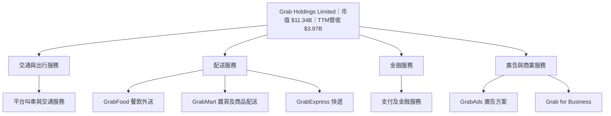
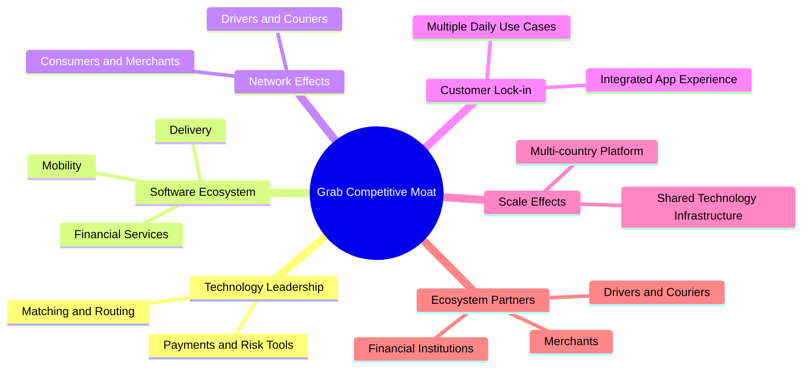
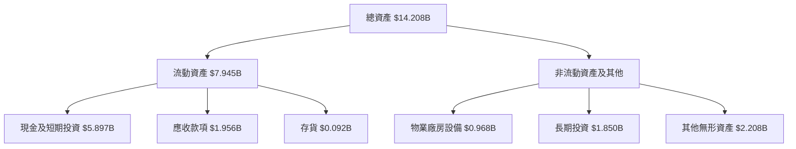
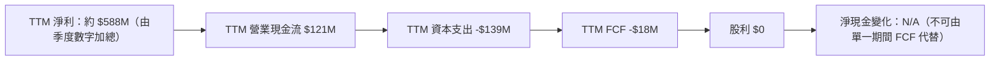
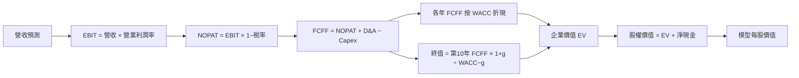
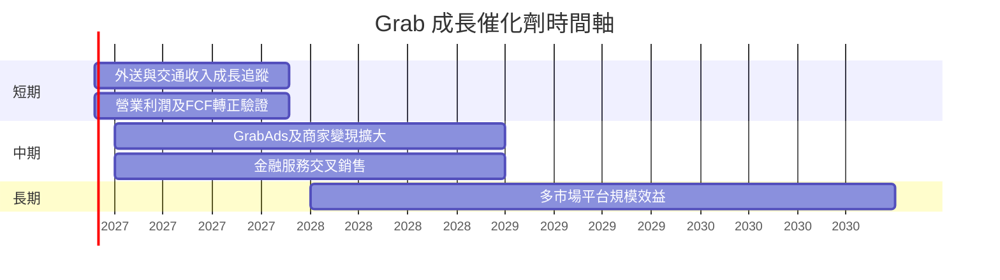
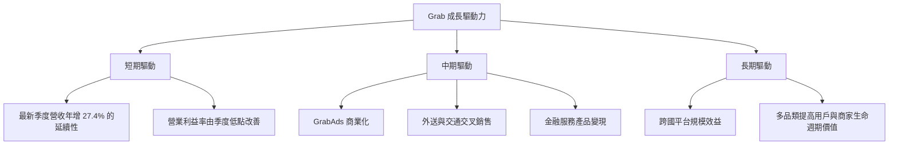
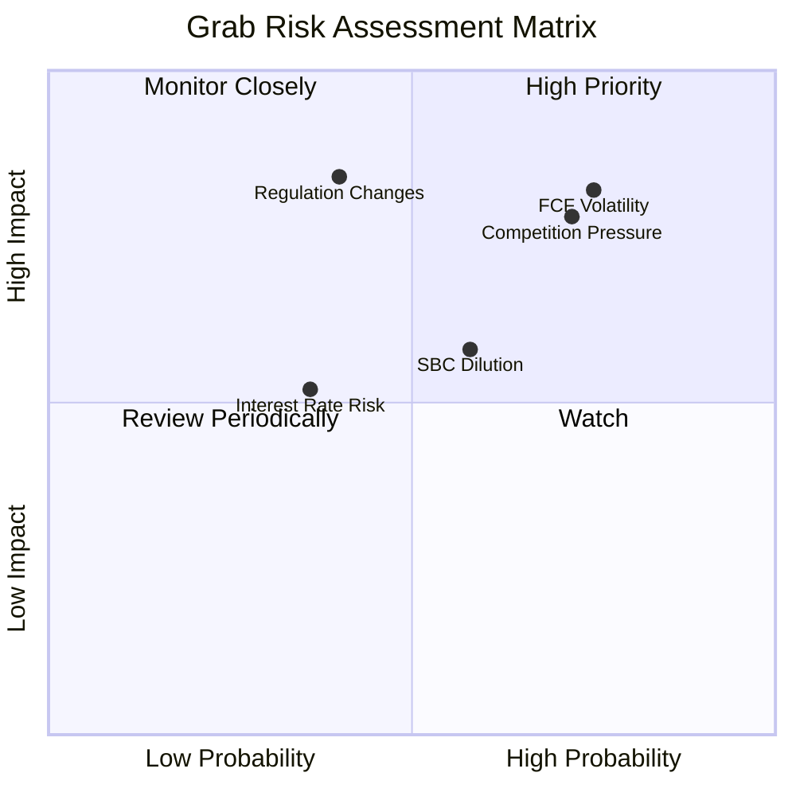
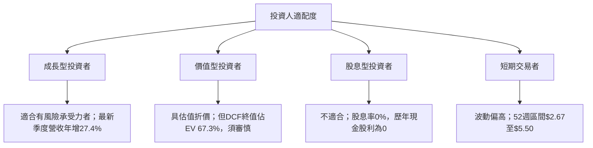

# GRAB 基本面深度分析報告
> **報告日期**：2026-11-24 ｜ **語言**：繁體中文 ｜ **數據來源**：Yahoo Finance、Finviz、StockAnalysis、Roic.ai ｜ **分析師**：CFA 級機構研究

## 目錄

| # | 章節 | 核心結論 |
|---|------|----------|
| 1 | 執行摘要 | 買入；加權合理價值 $4.56；MOS +38.4% |
| 2 | 公司概覽與商業模式 | 多品類超級應用程式平台；業務分部收入比例未提供 |
| 3 | 損益表深度分析 | 最新季度營收年增 27.4%；但季度獲利數據來源存在差異 |
| 4 | 資產負債表分析 | 淨現金 $3.83B；短期流動性尚可 |
| 5 | 現金流量深度分析 | TTM FCF -$18M，FCF Yield -0.16% |
| 6 | 獲利能力與資本效率 | WACC 8.31%；ROIC 無法以同期間資料可靠計算 |
| 7 | 相對估值分析 | Forward P/E 高於同業中位數；DCF 與同業法結論分歧 |
| 8 | DCF 內在價值評估 | 基準 DCF $6.21／股；終值佔 EV 67.3% |
| 9 | 成長催化劑 | 外送、交通、廣告與金融服務可拓寬平台變現 |
| 10 | 風險矩陣 | 競爭、獲利波動與監管／營運風險為主要關注 |
| 11 | 投資建議 | 買入；合理買入區間 $2.81–$4.10，須追蹤現金流與利潤率 |

---

## 1. 執行摘要

### 1.0 一頁式投資儀表板（Portfolio Manager 30 秒速讀）

| 項目 | 內容 |
|------|------|
| **投資論點（3 句）** | ① 最新季度營收年增 **27.4%**，顯示平台交易與變現仍在擴張。② 公司有 **$3.83B 淨現金**，較能承受競爭與再投資需求。③ TTM FCF 為 **-$18M**、FCF Yield **-0.16%**，目前營收成長尚未穩定轉成自由現金流。 |
| **綜合評分** | **6.7/10**（引用 1.1 評分卡） |
| **財務健康** | 🟢 淨現金 $3.83B、流動比率 1.384；但 TTM FCF 為負 |
| **ROIC vs WACC** | ROIC：**N/A**（缺乏一致期間投入資本資料） vs WACC **8.31%**；無法確定是否持續創造經濟價值 |
| **FCF 趨勢** | TTM FCF **-$18M**；FCF Yield **-0.16%**。近年波動大，尚未形成穩定正現金流 |
| **估值** | Forward P/E **17.9x** ｜ EV/EBITDA **17.982x** ｜ FCF Yield **-0.16%** |
| **DCF 內在價值（基準）** | **$6.21** ｜ 相對現價折價 **54.8%**（折溢價以 DCF 基準價值計） |
| **安全邊際（MOS）** | **+38.4%**＝($4.56 − $2.81) ÷ $4.56；🟢 相對加權合理價值具緩衝 |
| **預期報酬（基準情境 12M）** | 加權合理價值對現價的上行空間 **+62.3%**；非獨立 12 個月預測 |
| **關鍵風險（前二）** | TTM FCF 為負且波動；營收增長未能保證季度營業利潤率穩定 |
| **評級 + 信心度** | 🟢 **買入** ｜ 信心：中低（估值結果對長期假設敏感，ROIC 及 EPS 預期資料不完整） |

評級以加權合理價值 $4.56、現價 $2.81 計得 MOS +38.4%，落在買入區間；但 ROIC 無法可靠驗證高於 WACC，且 TTM FCF 為負，因此不符合「強烈買入」所需的 ROIC 條件，也不提高評級。

### 1.1 綜合評分卡（全報告唯一）

| 維度 | 評分（1–10） | 主要依據（引用數字與其來源章節） |
|------|--------------|----------------------------------|
| 成長性 | 7.0 | 最新季度營收年增 27.4%；年度營收由 FY2022 $1.43B 增至 FY2025 $3.37B（第 3 章） |
| 獲利能力 | 5.0 | TTM 營業利益率 11.0%，但最新季度提供值為 5.6%；TTM FCF -$18M，ROIC 無法可靠判定是否高於 8.31% WACC（第 3、5、6 章） |
| 財務健康 | 8.0 | 淨現金 $3.83B、現金及短期投資 $5.90B、流動比率 1.384；現金轉換週期 -182 天（第 4 章） |
| 估值 | 7.0 | 加權合理價值 $4.56，相對現價 MOS +38.4%；但 Forward P/E 17.9x 高於同業中位數 14.5x（第 7、8 章） |
| 護城河 | 7.0 | 多國、多品類超級應用程式與平台網路效應具黏著性；但缺少市場份額、留存率及分部營收數據（第 2 章） |
| 管理層與資本配置 | 6.0 | FY2025 SBC $241M、近四季 SBC 約 $234M；現金股利為零，尚未提供可驗證的回購紀錄（第 3、5 章） |
| **綜合評分** | **6.7** | 六項算術平均 = (7.0 + 5.0 + 8.0 + 7.0 + 7.0 + 6.0) ÷ 6 = 6.666…，四捨五入至一位小數 |

### 1.2 五大投資論點 + 三大核心風險

| 類型 | 項目 | 具體依據 | 信心度 |
|------|------|----------|--------|
| 🟢 **投資論點①** | 平台營收仍具成長 | 最新季度營收 $1.112B，年增 27.4%；若交易量與變現同步提升，可繼續推升平台營收 | 🟢 高 |
| 🟢 **投資論點②** | 資產負債表提供緩衝 | 現金及短期投資 $5.90B，總債務 $2.07B，淨現金 $3.83B | 🟢 高 |
| 🟢 **投資論點③** | 多品類可提高用戶生命週期價值 | 交通、外送、雜貨、廣告、快遞及金融服務共用平台；分部收入未披露，無法量化交叉銷售效果 | 🟡 中 |
| 🟢 **投資論點④** | DCF 與加權估值均高於現價 | DCF 基準 $6.21、加權合理價值 $4.56，分別高於 $2.81 現價 | 🟡 中 |
| 🟢 **投資論點⑤** | 年度營運結果已轉正 | FY2025 營業利益 $222M，對比 FY2024 -$55M；仍須以後續現金流驗證盈餘品質 | 🟡 中 |
| 🟡 **風險①** | 現金流未穩定轉正 | TTM OCF $121M、資本支出 $139M，依定義 TTM FCF -$18M | 🔴 高衝擊 |
| 🔴 **風險②** | 季度獲利數據波動與來源差異 | 最新季度淨利 $27M，低於前季 $253M；不同資料源的季度營業利益數值不一致 | 🔴 高衝擊 |
| 🟡 **風險③** | SBC 對股東的經濟成本 | FY2025 SBC $241M；最近四季合計約 $234M，約為同期營收 5.9% | 🟡 中度 |

### 1.3 快速統計卡片

| 指標 | 公司實際值（期間） | 同業中位數 | 狀態 |
|------|--------------------|------------|------|
| 營收成長（TTM） | **N/A**（可引用的 TTM 年增率未提供） | — | 🟡 |
| 營收成長（最新一季年增） | **27.4%** | 34.0% | 🟡 |
| 毛利率（TTM） | **41.4%** | 45.0% | 🟡 |
| 營業利益率（TTM） | **11.0%** | — | 🟢 |
| ROIC（TTM） | **N/A** | — | 🟡 |
| Forward P/E | **17.9x** | 14.5x | 🟡 |
| FCF Yield（TTM） | **-0.16%** | — | 🔴 |
| Piotroski F-Score | **N/A**（缺少兩期 SEC 申報資料） | — | 🟡 |

同業中位數以 UBER、SE、DASH 三家公司之 Peer multiples 計算：最新季度營收增長率中位數為 34.0%，毛利率中位數為 45.0%，Forward P/E 中位數為 14.5x。GRAB 的 TTM 營收成長率不能以其他年度或單季數字替代。

### 1.4 投資結論

╔══════════════════════════════════════════════════════════════════╗  
║　　　　　　　　　📊 投資結論摘要　　　　　　　　　　　　　　║  
╠══════════════════════════════════════════════════════════════════╣  
║ 評級：買入（MOS +38.4%；ROIC 未能證明高於 WACC，不評為強烈買入）║  
║ 價格（2026-11-23 收盤）：$2.81　　　　　　　　　　　　　　　　║  
║ DCF 內在價值（基準）：$6.21（相對現價折價 54.8%）　　　　　　　║  
║ 安全邊際 MOS：+38.4%＝($4.56−$2.81)÷$4.56　　　　　　　　　　║  
║ 加權合理價值（8.8）：$4.56　　　　　　　　　　　　　　　　　　║  
║ DCF 情境價值：　　　　　　　　　　　　　　　　　　　　　　　║  
║　悲觀情境：$3.20（+13.7%）　　　　　　　　　　　　　　　　　║  
║　基準情境：$6.21（+121.1%）　　　　　　　　　　　　　　　　 ║  
║　樂觀情境：$12.93（+360.3%）　　　　　　　　　　　　　　　　║  
║ 綜合評分：6.7/10（引用 1.1）　　　　　　　　　　　　　　　　 ║  
║ 適合投資人：能承受高波動、重視長期平台變現的成長型投資人　　　║  
╚══════════════════════════════════════════════════════════════════╝

---

## 2. 公司概覽與商業模式

### 2.1 業務結構與收入來源

公司資料顯示，Grab Holdings Limited 在柬埔寨、印尼、馬來西亞、緬甸、菲律賓、新加坡、泰國及越南營運 Grab 超級應用程式。各業務收入與佔比未提供，因此不以推估比例繪製收入結構。

目前財務資料只給出公司合併營收 $3.97B，沒有各業務的營收金額、毛利率或占比；因此不能判斷成長主要來自交通、外送或金融服務。

### 2.2 市場份額

市場份額數據未提供。以公司規模作質化參照，GRAB TTM 營收為 $3.97B，最新季度營收年增 27.4%；同業最新季度年增率中位數為 34.0%。這表示公司保持增長，但現有資料不足以證明其在各國交通或外送市場的份額變化。

### 2.3 競爭護城河分析

### 2.4 護城河強度

| 護城河項目 | 強度（強／中／弱） | 證據（引用數字或事實） | 會削弱它的情況 |
|------------|--------------------|------------------------|----------------|
| 技術與平台 | 中 | 同一應用程式涵蓋交通、外送、快遞、廣告與企業服務；研發 FY2025 為 $428M | 產品體驗無法維持、技術投入未改善單位經濟 |
| 軟體生態系統 | 中 | 多品類服務可在同一平台觸達消費者及商家；各服務收入與交叉使用率未提供 | 用戶只使用單一服務，跨品類轉化低 |
| 網路效應 | 中 | 消費者、商家、司機及外送人員形成多邊平台；量化用戶及供給端數據未提供 | 競爭者補貼造成供需雙邊流失 |
| 客戶鎖定 | 中偏弱 | 多品類便利性可能增加使用頻率，但留存、頻率及轉換成本資料未提供 | 對價格敏感、跨平台比價或促銷依賴升高 |
| 規模效應 | 中 | 營運八個東南亞國家；TTM 營收 $3.97B | 各國監管、語言及營運差異抵銷規模效益 |
| 生態夥伴 | 中 | 商家、司機、金融機構等為平台供給來源；合作夥伴集中度未提供 | 夥伴抽成上升、供給端議價權增強 |

1.1「護城河」評分為 **7.0/10**：多品類、多邊平台及跨國營運提供黏著度基礎，但缺少市佔、留存率與分部經濟數據，尚不能將護城河視為已由量化指標證實。

---

## 3. 損益表深度分析

### 3.1 年度收入成長趨勢（近 4 年）

年度營收來自年度損益表；YoY 依年度營收計算。單位：美元。

╔══════════════════════════════════════════════════════════════════╗  
║　　　　　　Grab 年度收入趨勢（FY2022–FY2025）　　　　　　　　　║  
╠══════════════════════════════════════════════════════════════════╣  
║ FY2022　$1.43B　█████████░░░░░░░░░░░　YoY：N/A　　　　　　　　　║  
║ FY2023　$2.36B　██████████████░░░░░　YoY：+64.8%　🟢　　　　　　║  
║ FY2024　$2.80B　█████████████████░░　YoY：+18.6%　🟢　　　　　　║  
║ FY2025　$3.37B　████████████████████　YoY：+20.4%　🟢　　　　　 ║  
╠══════════════════════════════════════════════════════════════════╣  
║ FY2022–FY2025 營收 CAGR：約 +33.0%　　　　　　　　　　　　　　║  
╚══════════════════════════════════════════════════════════════════╝

計算：FY2023 增長率 = ($2.36B ÷ $1.43B) − 1 = 約 64.8%；FY2024 = ($2.80B ÷ $2.36B) − 1 = 約 18.6%；FY2025 = ($3.37B ÷ $2.80B) − 1 = 約 20.4%。三年 CAGR = ($3.37B ÷ $1.43B)^(1/3) − 1 ≈ 33.0%。FY2023 的高增長部分來自較低基期，FY2024–FY2025 增長回到約兩成，較適合作為成熟期增長的參考；最新季度年增 27.4% 顯示近期有所加速，但不能直接視為 TTM 成長率。

### 3.2 季度收入趨勢分析

| 季度 | 營收 | QoQ | YoY | 備註 |
|------|------:|----:|----:|------|
| 2025 Q4 | $906M | — | +18.6% | 依 StockAnalysis 季度資料，對比 2024 Q4 $764M |
| 2026 Q1 | $955M | +5.4% | +23.5% | 對比 2025 Q1 $773M |
| 2026 Q2 | $998M | +4.5% | +21.9% | 對比 2025 Q2 $819M |
| 2026 Q3 | $1,112M | +11.4% | **+27.4%** | 最新季度年增率為單季數字，不是 TTM |

QoQ 公式以本季營收除以前季營收再減一。例如 Q3 2026 QoQ = ($1,112M ÷ $998M) − 1 ≈ 11.4%。Q3 的年增加速，可能來自交易量、品類擴張或平台變現增加；由於訂單、客單價與分部收入未提供，無法分辨各因素的貢獻。

### 3.3 利潤率演變分析

| 利潤率指標 | FY2022 | FY2023 | FY2024 | FY2025 | 趨勢 | 評估 |
|------------|--------|--------|--------|--------|------|------|
| **毛利率** | 約 5.4% | 約 36.4% | 約 41.8% | 約 43.3% | 逐年改善 | 🟢 |
| **營業利益率** | 約 -90.2% | 約 -16.4% | 約 -2.0% | 約 +6.6% | 損失收窄並轉正 | 🟢 |
| **淨利率** | 約 -117.5% | 約 -18.4% | 約 -3.8% | 約 +8.0% | FY2025 轉正 | 🟡 |

毛利率與營業利益率由年度損益表金額推算。例如 FY2025 營業利益率 = $222M ÷ $3.37B ≈ 6.6%。FY2025 年度獲利改善與收入擴張、成本控制及平台規模增加相符，但不能只憑合併數字確認各業務的單位經濟已改善。

須特別留意跨來源差異：程式整理的 TTM 營業利益率為 **11.0%**，最新季度營業利益率為 **5.6%**；另有季度營業利益金額在 Yahoo Finance 與 StockAnalysis 之間不一致。故年度比率以上述年度報表金額計算，TTM 及最新季度標準值則引用程式提供的指標，避免混為同一期間。

### 3.4 費用結構分析

**合併費用結構圓餅圖：N/A（缺少可完整拆分且口徑一致的 TTM 費用項目，不能以殘差推算或繪製比例）。**

可觀察的項目包括：FY2025 研發費用 $428M，FY2024 $410M，FY2023 $421M，FY2022 $465M；FY2025 股權薪酬 $241M。研發投入支撐平台技術及產品開發，但未提供各項營運費用、行銷費用與 SBC 的 TTM 完整拆分，不能據此推算總成本佔比。

### 3.5 季度 EPS 趨勢與盈餘品質（Quality of Earnings）

| 盈餘品質項目 | 數值／佔比 | 評估 |
|--------------|-----------|------|
| 股權薪酬 SBC / 營收 | 最近四季 SBC 約 $234M ÷ 營收約 $3.971B = **約 5.9%** | 🟡 SBC 是非現金費用，但經濟上仍代表股東稀釋成本 |
| SBC / 營業現金流 | 約 $234M ÷ $121M = **約 193.4%** | 🔴 SBC 高於 TTM OCF，需關注現金盈利與股權薪酬的差距 |
| FCF / 淨利（現金轉換率） | 約 -$18M ÷ 最近四季淨利約 $588M = **約 -3.1%** | 🔴 會計獲利未轉化為正 TTM FCF |
| 一次性／非經常性損益 | N/A（無完整調節表） | 不足以判定 FY2025 淨利是否受一次性收益顯著影響 |
| 有效稅率異常 | **25.7%**（最近年度有效稅率） | DCF 使用此稅率；無多年稅率趨勢可判斷是否異常 |
| 資本化支出 vs 費用化 | TTM 資本支出 $139M；資本化項目拆分 N/A | 缺少資本化政策及資產明細，不能判斷是否遞延費用 |

最近四季 EPS 實際值資料不完整且來源口徑不同；StockAnalysis 顯示 2025 Q4 約 $0.04、2026 Q1 約 -$0.01、Q2 約 $0.06、Q3 約 $0.01，而另一組季度淨利資料為 Q3 $27M、Q2 $253M、Q1 $136M、Q4 $172M。EPS 預期值均為 NaN，故**無法判定過去四季是否超預期或不及預期**，也不能將季度 EPS 的波動直接解讀為市場驚喜。

整體而言，FY2025 GAAP 淨利轉正是正面訊號，但 TTM FCF 為負、FCF 對淨利轉換率為負、SBC 約佔營收 5.9%。因此盈餘含金量仍需後續 FCF 轉正來驗證；估值不宜只依賴 EPS 或非現金 SBC 調整後指標。

---

## 4. 資產負債表分析

### 4.1 資產結構分解

最新可取得的 StockAnalysis 資產負債表列示總資產約 $14.208B、流動資產 $7.945B。以下細項是資產負債表列示金額，不代表完整加總；缺漏科目不以差額回推。

各細項來自不同報表分類，個別科目與總資產並非完整可加總呈列；總資產及流動資產金額按報表原值引用。

### 4.2 流動性與營運資金分析

| 指標 | 最新 TTM | 一年前 TTM | 變化 | 解讀 |
|------|----------|------------|------|------|
| DSO 應收帳款天數 | **22 天** | N/A | N/A | 平均收款週期資料未提供一年比較 |
| DIO 存貨天數 | **15 天** | N/A | N/A | 存貨週轉一年變化無法判斷 |
| DPO 應付帳款天數 | **219 天** | N/A | N/A | 供應商付款週期較長；需留意是否可持續 |
| CCC 現金轉換週期 | **-182 天** | N/A | N/A | 依提供指標計算口徑，營運資金占用較低；不等於現金流必然為正 |

流動比率為 **1.384**、速動比率為 **1.07**，短期資產高於短期負債，形成一定流動性緩衝。CCC 為負，主要受 DPO 219 天高於 DSO 22 天與 DIO 15 天影響；若付款條件收緊或商家、供應商要求提前付款，現金週轉可能惡化。由於一年前營運資金天數未提供，不對趨勢作推測。

### 4.3 債務結構分析

╔══════════════════════════════════════════════════════════════════╗  
║　　　　　　　　　Grab 債務健康診斷　　　　　　　　　　　　　 ║  
╠══════════════════════════════════════════════════════════════════╣  
║ 總債務：　　　　 $2.07B　███░░░░░░░░░░░░░░░　有債務但可覆蓋　　 ║  
║ 現金及短期投資： $5.90B　██████████████████　流動資金充足　　　 ║  
║ 淨現金：　　　　 $3.83B　████████████░░░░░░　🟢 正淨現金　　　　║  
║ Debt/EBITDA：　約 4.7x（估計：$2.07B ÷ TTM EBITDA 約 $0.445B）　║  
║ 利息保障倍數：　N/A（利息費用與同口徑 EBIT 資料未完整提供）　　║  
║ 短期流動性：　　流動比率 1.384；速動比率 1.07　　　　　　　　║  
╚══════════════════════════════════════════════════════════════════╝

Debt/EBITDA 為粗略估計：TTM EBITDA 以 TTM EBITDA margin 11.2% × TTM 營收 $3.97B 推算約 $0.445B；此估計不取代同口徑報表 EBITDA。淨現金是財務緩衝，不代表公司可以忽略 FCF 長期為負或資本配置效率。

### 4.4 股東權益趨勢

╔══════════════════════════════════════════════════════════════════╗  
║　　　　　　　　歷年股東權益變化（年度）　　　　　　　　　　　║  
╠══════════════════════════════════════════════════════════════════╣  
║ FY2022　$6.60B　████████████████████　　　　　　　　　　　　　║  
║ FY2023　$6.45B　███████████████████░　　　　　　　　　　　　 ║  
║ FY2024　$6.40B　███████████████████░　　　　　　　　　　　　 ║  
║ FY2025　$6.73B　████████████████████　　　　　　　　　　　　　║  
╚══════════════════════════════════════════════════════════════════╝

FY2022–FY2024 權益略降，FY2025 回升至 $6.73B。FY2025 資產與負債同時增長，須注意負債結構及資產增加是否伴隨更高的現金回報。

---

## 5. 現金流量深度分析

### 5.1 現金流量瀑布圖

### 5.2 FCF 轉換率趨勢

| 年度／期間 | FCF | 淨利 | FCF／淨利 | 趨勢與解讀 |
|------------|----:|----:|----------:|------------|
| FY2022 | -$872M | -$1.683B | 約 51.8% | 淨利與 FCF 均為負，轉換率的經濟意義有限 |
| FY2023 | -$6M | -$434M | 約 1.4% | 接近損益兩平但仍為負 FCF |
| FY2024 | $739M | -$105M | -703.8% | 淨利為負，比例不適合解讀為正常轉換率 |
| FY2025 | -$44M | $268M | 約 -16.4% | 會計淨利轉正、FCF 再轉負 |
| TTM 至 2026-09-30 | **-$18M** | 約 $588M* | 約 **-3.1%** | 淨利與 FCF 表現不一致 |

\* TTM 淨利約由最近四季季度淨利相加估算；季度資料可能與其他來源的 TTM 指標口徑有差異。

### 5.3 自由現金流趨勢

╔══════════════════════════════════════════════════════════════════╗  
║　　　　　　　自由現金流趨勢（歷史實際）　　　　　　　　　　　║  
╠══════════════════════════════════════════════════════════════════╣  
║ FY2022　-$872M　░░░░░░░░░░░░░░░░░░░░　FCF Yield：N/A　　　　　║  
║ FY2023　　-$6M　░░░░░░░░░░░░░░░░░░░░　FCF Yield：N/A　　　　　║  
║ FY2024　+$739M　████████████████████　FCF Yield：N/A　　　　　║  
║ FY2025　　-$44M　░░░░░░░░░░░░░░░░░░░░　FCF Yield：N/A　　　　　║  
║ TTM　　　-$18M　░░░░░░░░░░░░░░░░░░░░　FCF Yield：-0.16%　　　║  
╚══════════════════════════════════════════════════════════════════╝

年度 FCF 由現金流量表列示，TTM FCF 按指定定義為營業現金流 $121M 減資本支出 $139M = -$18M。FY2024 的正 FCF 未延續至 FY2025，故不能僅以單一正現金流年度假設公司已進入穩定現金生成階段。

### 5.4 資本配置評估

資本配置圓餅圖：**N/A（缺少完整、互斥的資本配置金額分類，不能繪製比例圖）。**

| 項目 | 可觀察數據 | 評估 |
|------|-----------|------|
| 資本支出 | TTM $139M；FY2025 $123M | 維持平台及營運所需資產投入 |
| 股利 | FY2022–FY2025 均為 $0；股息率 0% | 未以股利回饋股東 |
| 股權薪酬 | FY2025 $241M；最近四季約 $234M | 是員工激勵工具，但會形成股東稀釋成本 |
| 回購 | N/A（資料未提供） | 不據此宣稱有回購或回購規模 |
| 現金留存 | 現金及短期投資 $5.90B | 為營運、併購或投資提供彈性；投資回報尚需追蹤 |

---

## 6. 獲利能力與資本效率

### 6.1 ROE / ROA / ROIC 趨勢

| 指標 | 可用期間 | 數值 | 評估 |
|------|----------|------:|------|
| ROE | TTM | 7.6% | 正值，但不足以單獨反映風險調整後資本回報 |
| ROA | TTM | 1.1% | 資產基礎大，資產回報仍低 |
| ROIC | TTM | N/A | 缺少同期間投入資本與稅後營業利潤的可靠配對資料 |
| Piotroski F-Score | TTM | N/A | 需要相隔一年的兩期 SEC 申報資料 |

行業均值未提供，故不列行業比較。ROE、ROA 引用公司資料所列數值；ROIC 不以期間不匹配的資產、權益及營業利益自建一個看似精確的點估值。

### 6.2 ROIC vs WACC 分析（核心價值創造判斷）

╔══════════════════════════════════════════════════════════════════╗  
║　　　　　　　　ROIC vs WACC 深度分析　　　　　　　　　　　　　║  
╠══════════════════════════════════════════════════════════════════╣  
║ WACC 估算：　　　　　　　　　　　　　　　　　　　　　　　　　║  
║ ├── 無風險利率（10Y 美債）：4.92%　　　　　　　　　　　　　　║  
║ ├── 市場風險溢酬 ERP：5.00%　　　　　　　　　　　　　　　　 ║  
║ ├── 原始 Beta：0.83；採用調整後 Beta：0.89　　　　　　　　　　║  
║ ├── 股權成本 Ke：9.36%（程式提供值）　　　　　　　　　　　　║  
║ ├── 稅前債務成本：3.43%；稅後約 2.55%　　　　　　　　　　　 ║  
║ ├── 股權／債務權重：84.6%／15.4%　　　　　　　　　　　　　　║  
║ └── ✅ WACC：8.31%　　　　　　　　　　　　　　　　　　　　　║  
║　　　　　　　　　　　　　　　　　　　　　　　　　　　　　　　║  
║ ROIC：N/A（缺少一致期間投入資本資料）　　　　　　　　　　　　║  
║ EVA = ROIC − WACC：N/A；無法判定創造或摧毀價值　　　　　　　　║  
║　　　　　　　　　　　　　　　　　　　　　　　　　　　　　　　║  
║ 結論：ROIC 是否高於 8.31% WACC，現有資料不足以確認。　　　　　║  
╚══════════════════════════════════════════════════════════════════╝

Beta 調整方式：⅔ × 原始 Beta 0.83 + ⅓ × 1 = 約 0.89。股權成本的程式提供值為 9.36%；將四捨五入後的 Rf、Beta、ERP 直接相乘，會有小幅四捨五入差異，因此本報告沿用指定 Ke 與 WACC，不另替換。債務成本計算所需利息費用明細未提供，故使用指定的稅前債務成本 3.43%。

WACC 權重核對：股權權重 = $11.34B ÷ ($11.34B + $2.07B) ≈ 84.6%；債務權重 = $2.07B ÷ ($11.34B + $2.07B) ≈ 15.4%。稅後 Kd = 3.43% × (1 − 25.7%) ≈ 2.55%。WACC = 84.6% × 9.36% + 15.4% × 2.55% ≈ 8.31%。Rf 的精確觀察日期未提供。

由於 ROIC 為 N/A，不能直接宣稱 GRAB 正在創造或摧毀股東價值；評級也因此只採用 MOS 對應的「買入」，不升為「強烈買入」。

### 6.3 杜邦三因素分解

| 因素 | 數值（TTM） | 解讀 |
|------|-------------|------|
| 淨利率 | N/A | QUALITY FIGURES 因缺少可用資料而標為 N/A |
| 資產週轉率 | N/A | 同上 |
| 權益乘數 | N/A | 同上 |
| **ROE** | **N/A（杜邦分解）** | 淨利率 × 資產週轉率 × 權益乘數無法按指定品質指標核驗 |

公司另提供 ROE TTM 7.6%，但本節按品質指標要求不反推三因素，避免以期間或股權基礎不同的資料製造不一致的分解。

### 6.4 財務體質：Piotroski F-Score

**N/A（缺少相隔一年的兩期 SEC 申報資料，F-Score 及九項逐項測試均未能計算）。**因此不補列九項測試或推估通過數。

---

## 7. 相對估值分析

### 7.1 同業估值比較表格

| 估值指標 | **GRAB** | **UBER** | **SE** | **DASH** | GRAB 評估 |
|----------|---------:|---------:|-------:|--------:|-----------|
| **Trailing P/E** | 28.1x | 37.7x | 23.6x | 67.0x | 🟡 位於同業區間中段；同業中位數 37.7x |
| **Forward P/E** | 17.9x | 14.5x | 13.7x | 21.2x | 🟡 高於同業中位數 14.5x |
| **P/S Ratio** | 2.86x | 2.3x | 1.3x | 4.1x | 🟡 高於同業中位數 2.3x |
| **EV/EBITDA** | 17.982x | 17.9x | 12.8x | 39.6x | 🟡 接近同業中位數 17.9x |
| **最新季度營收年增** | 27.4% | 9.6% | 43.4% | 34.0% | 🟡 低於同業中位數 34.0% |
| **毛利率（TTM）** | 41.4% | 41.4% | 45.0% | 52.7% | 🟡 低於同業中位數 45.0% |

同業倍數直接採用 Yahoo Finance Peer multiples。GRAB 的 Forward P/E、P/S 與 EV/EBITDA 採公司估值數據；Forward P/E 高於同業中位數，意味市場已對未來獲利給予一定成長溢價，而營收增速及毛利率尚未超越同業中位數。

### 7.2 歷史估值區間分析

╔══════════════════════════════════════════════════════════════════╗  
║　　　　　　　　　自身歷史估值區間　　　　　　　　　　　　　　║  
╠══════════════════════════════════════════════════════════════════╣  
║ N/A（未提供 Valuation vs own history 的估值百分位或歷史倍數區間）║  
║ 24 個月月末股價：2024-11 $5.00；2025-09 $6.02；2026-11 $2.81　║  
╚══════════════════════════════════════════════════════════════════╝

股價歷史可用於描述市場價格變動，但不等於歷史 P/E 或 EV/EBITDA 區間，故不以股價走勢推算估值百分位。

### 7.3 情境價值（Bear / Base / Bull，照抄 DCF MODEL 的 Scenarios）

| 情境 | 第 1 年營收成長 | 期末營業利潤率 | WACC | 每股價值 | 相對現價 | 機率 | 會發生的條件 |
|------|----------------:|----------------:|-----:|---------:|---------:|-----:|--------------|
| 🔴 悲觀 | 13.7% | 9.3% | 9.31% | $3.20 | +13.7% | 25% | 交易增長放緩、價格競爭壓低長期利潤率，資本成本上升 |
| 🟡 基準 | 27.4% | 11.0% | 8.31% | $6.21 | +121.1% | 50% | 最新季度增長延續但逐步減速，利潤率維持基準 |
| 🟢 樂觀 | 41.1% | 12.0% | 7.31% | $12.93 | +360.3% | 25% | 多品類交叉銷售、變現與營運槓桿均高於基準，資本成本下降 |

### 7.4 相對估值隱含價格區間

╔══════════════════════════════════════════════════════════════════╗  
║　　　　　　　　估值法每股價值與現價　　　　　　　　　　　　　║  
╠══════════════════════════════════════════════════════════════════╣  
║ Forward P/E：$2.28 ── 現價 $2.81 ── EV/EBITDA：$3.86　　　　　 ║  
║ DCF 基準：$6.21　　分析師共識：$5.39　　　　　　　　　　　　 ║  
╚══════════════════════════════════════════════════════════════════╝

- **同業 Forward P/E：$2.28／股**，依 Peer 中位數 **14.5x** × GRAB Forward EPS **$0.16**；使用程式提供的估值方法結果，不以四捨五入後的 EPS 重算替代。
- **同業 EV/EBITDA：$3.86／股**，依同業中位數 **17.9x** × GRAB TTM EBITDA，再加回淨現金；採用程式提供的每股結果。
- 基準 DCF 為 $6.21／股；分析師共識目標價為 $5.39／股，22 位分析師的平均目標價。

---

## 8. DCF 內在價值評估（Discounted Cash Flow）

### 8.0 估值推理鏈（Thinking Logic：在算之前先想清楚）

**Step 1 — 價值來源與主導變數**

DCF 模型以合併平台現金流作為估值底盤；交通、配送、金融服務與廣告等第二成長曲線可能提高長期變現，但各業務營收占比未提供，不能分拆其價值。估值最受**終值現金流及 WACC、永續成長率 g**影響：基準 DCF 的終值現值佔 EV 67.3%，故長期假設是估值主導因素。

**Step 2 — 模型選擇**

| 決策點 | 本報告採用 | 理由（含數字） | 曾考慮但否決 | 否決理由 |
|--------|-----------|----------------|--------------|----------|
| 現金流定義 | FCFF | 以 WACC 8.31% 折現並得到 EV；模型定義 FCFF = NOPAT + D&A − Capex | FCFE | 程式模型以 FCFF 計算，不另建 FCFE |
| 預測期 N | 10 年 | DCF MODEL 固定十年預測，增長由 27.4% 線性降至 3.0% | 5 年 | 無法與程式模型逐年結果一致 |
| 終值方法 | Gordon Growth | 使用 g 3.0%、WACC 8.31%，且 WACC > g | 只用退出倍數 | DCF MODEL 未提供退出倍數終值結果，不自建模型 |
| EBIT 基礎 | GAAP EBIT | 模型明確以 GAAP EBIT 推算 FCFF | 非 GAAP EBIT | 避免加回 SBC 後漏計或重複計算 SBC |

**Step 3 — 關鍵假設推導鏈**

- **營收增長**：錨點＝最新季度營收年增 27.4%；調整＝以線性淡化方式降低至第十年 3.0%，反映單季高增長不宜永久延續；**採用第 1 年 27.4%、第 10 年 3.0%**；曾考慮以 TTM 增長作錨，但該項為 N/A，故不替代。
- **期末營業利潤率**：錨點＝程式提供 TTM 營業利益率 11.0%；調整＝模型假設維持至第十年，沒有再擴張；**採用 11.0%**；曾考慮採用最新季度 5.6%，但模型採 TTM 為統一基準，且短期季度值可能波動，因此不替代。
- **永續成長率 g**：錨點＝模型提供 3.0%；調整＝位於長期名目增長常見合理範圍的低端，且低於 WACC 8.31%；**採用 3.0%**；不採更高值，因終值已佔 EV 67.3%，提高 g 會顯著放大估值。
- **預測期 N**：錨點＝DCF MODEL 固定 10 年；調整＝不作改動；**採用 10 年**；曾考慮較短期限，但會改變現金流及終值起算年，不能與提供模型比較。
- **Capex／營收**：錨點＝TTM 資本支出 $139M ÷ TTM 營收 $3.97B ≈ 3.5%；調整＝模型維持 3.5%；**採用 3.5%**；不採更低比例，因目前自由現金流仍為負。
- **D&A／營收**：錨點＝模型輸入 5.6%，來源為 TTM；**採用 5.6%**。歷史序列未提供，不另行調整。
- **有效稅率**：錨點＝最近年度有效稅率 25.7%；**採用 25.7%**。多年稅率資料不足，不作額外正規化。
- **營運資金變動**：模型明確未建模；不以零作為已驗證的歷史事實。CCC -182 天提供營運資金可能有利的方向性線索，但欠缺逐年 ΔWC 資料。
- **SBC 與稀釋**：採用 **(A) GAAP EBIT + 固定股數**。GAAP EBIT 已含 SBC 費用；FCFF 不另扣 SBC，稀釋率設定為 0%，股數不再逐年放大。因此 SBC 影響按模型約定計入一次。
- **終值方法**：錨點＝模型用 Gordon Growth；採用 3.0% g。退出倍數終值未提供，為避免自行建立第二套模型，不替換。
- **WACC**：錨點＝程式提供 8.31%；採用原值。曾考慮另以風險溢酬調整，但成本資本數據已提供完整指定值，故不另算。

**Step 4 — 最脆弱假設**

最脆弱的一環是十年內維持 11.0% GAAP 營業利潤率、同時讓營收增長從 27.4% 線性降至 3.0%；若競爭或補貼使長期利潤率降低，價值會下修，悲觀情境 DCF 為 $3.20／股。

**Step 5 — 計算路徑**

### 8.1 模型假設總表（Model Inputs）

| 假設項目 | 採用值 | 依據／來源 | 敏感度 |
|----------|--------|-------------|--------|
| 預測期長度 **N** | 10 年 | DCF MODEL 固定預測期 | 🟡 中 |
| 營收增長 | 第 1 年 27.4% → 第 10 年 3.0%，線性遞減 | 第 1 年採最新季度 YoY；第 10 年採長期 g | 🔴 高 |
| 營業利潤率 | 第 1 年至第 10 年均 11.0% | TTM 營業利益率；模型假設不變 | 🔴 高 |
| 有效稅率 | 25.7% | 最近年度有效稅率 | 🟢 低 |
| Capex／營收 | 第 1 至第 10 年 3.5% | TTM 資本支出／營收的模型值 | 🟡 中 |
| D&A／營收 | 5.6% | TTM 模型輸入 | 🟢 低 |
| 營運資金變動／營收增額 | 未建模 | DCF MODEL 明確未納入 ΔWC | 🟢 低 |
| EBIT 基礎 | GAAP | 模型使用 GAAP EBIT | 🟡 中 |
| SBC 處理 | 採 (A)：已反映在 GAAP EBIT，不另扣 | 固定股數、不額外稀釋 | 🟡 中 |
| 年稀釋率 | 0%（模型固定股數） | 與組合 (A) 一致；實際未來稀釋不代表為零 | 🟡 中 |
| 永續成長率 g | 3.0% | DCF MODEL 指定；低於 WACC | 🔴 高 |
| 終值方法 | Gordon Growth | DCF MODEL 指定 | 🔴 高 |
| WACC | 8.31% | Cost of capital 指定值 | 🔴 高 |

模型 FCFF 定義為 **FCFF = NOPAT + D&A − Capex**，不含 ΔWC 列；使用 GAAP EBIT，且不另扣 SBC。本模型採用 **(A)**，因此 SBC 影響已計入一次。

### 8.2 折現率推導（WACC）

╔══════════════════════════════════════════════════════════════════╗  
║　　　　　　　　　WACC 推導（折現率）　　　　　　　　　　　　　║  
╠══════════════════════════════════════════════════════════════════╣  
║ 股權成本 Ke（CAPM）：　　　　　　　　　　　　　　　　　　　　 ║  
║ ├── 無風險利率 Rf：4.92%（觀察日期未提供）　　　　　　　　　　║  
║ ├── ERP：5.00%（模型假設）　　　　　　　　　　　　　　　　　║  
║ ├── 原始 Beta：0.83；調整後 Beta：0.89　　　　　　　　　　　　║  
║ ├── 規模／國別溢酬：未另加　　　　　　　　　　　　　　　　　║  
║ └── Ke：程式提供 9.36%　　　　　　　　　　　　　　　　　　　║  
║　　　　　　　　　　　　　　　　　　　　　　　　　　　　　　　║  
║ 債務成本 Kd：　　　　　　　　　　　　　　　　　　　　　　　　║  
║ ├── 稅前 Kd：3.43%（利息費用明細未提供，沿用指定值）　　　　║  
║ ├── 有效稅率：25.7%　　　　　　　　　　　　　　　　　　　　 ║  
║ └── 稅後 Kd = 3.43% × (1 − 25.7%) = 約 2.55%　　　　　　　　║  
║　　　　　　　　　　　　　　　　　　　　　　　　　　　　　　　║  
║ 資本結構：股權權重 84.6%；債務權重 15.4%　　　　　　　　　　║  
║ ✅ WACC = 84.6% × 9.36% + 15.4% × 2.55% = 8.31%　　　　　　　║  
╚══════════════════════════════════════════════════════════════════╝

WACC 五步演算：

1. **Ke（CAPM）**：程式提供 Ke = **9.36%**。以呈現精度代入，4.92% + 0.89 × 5.00% = 9.37%；與提供 Ke 相差 0.01 個百分點，屬輸入值未四捨五入前的精度差異，依規則沿用 9.36%。
2. **稅前 Kd**：利息費用與平均計息負債的原始明細未提供；採指定稅前 Kd **3.43%**，不以總負債反推。
3. **稅後 Kd**：3.43% × (1 − 25.7%) = 3.43% × 74.3% = **約 2.55%**。
4. **權重**：E = $11.34B，D = $2.07B；E 權重 = $11.34B ÷ ($11.34B + $2.07B) ≈ **84.6%**；D 權重 = $2.07B ÷ ($11.34B + $2.07B) ≈ **15.4%**。
5. **WACC**：84.6% × 9.36% + 15.4% × 2.55% = 7.9186% + 0.3927% ≈ **8.31%**。

第 6.2 節及本節使用同一個 WACC **8.31%**。利息成本的底層明細不足，為此 WACC 的可獨立複核限制之一。

### 8.3 逐年自由現金流預測（基準情境）

單位：$B；折現因子採三位小數。以下逐年數字照錄 DCF MODEL；因展示金額四捨五入，表內單格反算可能出現小額差異。

| 年度 | FY+1 | FY+2 | FY+3 | FY+4 | FY+5 | FY+6 | FY+7 | FY+8 | FY+9 | FY+10 |
|------|-----:|-----:|-----:|-----:|-----:|-----:|-----:|-----:|-----:|------:|
| 營收 | 5.06 | 6.31 | 7.69 | 9.18 | 10.70 | 12.18 | 13.53 | 14.67 | 15.51 | 15.98 |
| 營收 YoY | 27.4% | 24.7% | 22.0% | 19.3% | 16.6% | 13.8% | 11.1% | 8.4% | 5.7% | 3.0% |
| 營業利潤率 | 11.0% | 11.0% | 11.0% | 11.0% | 11.0% | 11.0% | 11.0% | 11.0% | 11.0% | 11.0% |
| 營業利益 EBIT | 0.55 | 0.69 | 0.84 | 1.01 | 1.17 | 1.33 | 1.48 | 1.61 | 1.70 | 1.75 |
| − 稅 | (0.14) | (0.18) | (0.22) | (0.26) | (0.30) | (0.34) | (0.38) | (0.41) | (0.44) | (0.45) |
| = NOPAT | 0.41 | 0.51 | 0.63 | 0.75 | 0.87 | 0.99 | 1.10 | 1.20 | 1.26 | 1.30 |
| + D&A | 0.28 | 0.35 | 0.43 | 0.52 | 0.60 | 0.68 | 0.76 | 0.82 | 0.87 | 0.90 |
| − Capex | (0.18) | (0.22) | (0.27) | (0.32) | (0.37) | (0.43) | (0.47) | (0.51) | (0.54) | (0.56) |
| **= FCFF** | **0.52** | **0.65** | **0.79** | **0.94** | **1.10** | **1.25** | **1.39** | **1.51** | **1.59** | **1.64** |
| 折現因子 @8.31% | 0.923 | 0.852 | 0.787 | 0.727 | 0.671 | 0.619 | 0.572 | 0.528 | 0.487 | 0.450 |
| **FCFF 現值 PV** | **0.48** | **0.55** | **0.62** | **0.68** | **0.74** | **0.77** | **0.79** | **0.79** | **0.78** | **0.74** |

**預測期 FCF 現值合計**：以表中兩位小數顯示值相加，$0.48 + $0.55 + $0.62 + $0.68 + $0.74 + $0.77 + $0.79 + $0.79 + $0.78 + $0.74 = **$6.94B**；模型以未四捨五入數值計算的指定合計為 **$6.95B**，差額 $0.01B，低於 1%。

**FY+1 代表年度逐步演算**

1. **營收** = $3.97B × (1 + 27.4%) = $5.05778B ≈ **$5.06B**。
2. **EBIT** = $5.06B × 11.0% ≈ **$0.55B**（模型列示值；顯示精度下直接相乘會有小額差異）。
3. **稅** = EBIT × 25.7% ≈ **$0.14B**。
4. **NOPAT** = EBIT − 稅 = $0.55B − $0.14B = **$0.41B**。
5. **D&A** = 營收 × 5.6% = $5.06B × 5.6% ≈ **$0.28B**。
6. **Capex** = 營收 × 3.5% = $5.06B × 3.5% ≈ **$0.18B**。
7. **ΔWC** = 模型未建模，FCFF 公式中不列此項。
8. **FCFF** = NOPAT + D&A − Capex；模型指定值為 **$0.52B**。顯示後數字 $0.41B + $0.28B − $0.18B = $0.51B，與模型值差 $0.01B；此差異來自模型未四捨五入底層值未提供，故不以四捨五入數字替換模型值。
9. **折現因子** = 1 ÷ (1 + 8.31%)¹ ≈ **0.923**；PV = 模型 FCFF $0.52B × 0.923 ≈ **$0.48B**。

**合理性自檢**

- 歷史 FCF CAGR：不適合計算，歷史 FCF 在 FY2022–FY2025 正負交替；預測期 FCF 由 $0.52B 增至 $1.64B，模型所隱含增長顯著高於歷史穩定性。
- FY+10 FCFF 利潤率 = $1.64B ÷ $15.98B ≈ **10.3%**；目前 TTM FCF 利潤率 = -$18M ÷ $3.97B ≈ **-0.5%**。同業最佳 FCF margin 未提供，不能比較是否超越同業。
- 預測期間 FCFF 均為正；但與目前 TTM 負 FCF 的落差顯示，模型依賴營業槓桿與營運現金流改善。

╔══════════════════════════════════════════════════════════════════╗  
║　　　　　　自由現金流：歷史實際 vs 模型預測　　　　　　　　　　║  
╠══════════════════════════════════════════════════════════════════╣  
║ FY2022 實　-$0.872B　░░░░░░░░░░░░░░░░░░░░　　　　　　　　　　　║  
║ FY2023 實　-$0.006B　░░░░░░░░░░░░░░░░░░░░　　　　　　　　　　　║  
║ FY2024 實　+$0.739B　█████████░░░░░░░░░░░　　　　　　　　　　　║  
║ FY2025 實　-$0.044B　░░░░░░░░░░░░░░░░░░░░　　　　　　　　　　　║  
║ FY+1 預　　+$0.52B　███████░░░░░░░░░░░░░　　　　　　　　　　　 ║  
║ FY+10 預　 +$1.64B　████████████████████　FCFF margin 約 10.3%　║  
╠══════════════════════════════════════════════════════════════════╣  
║ 歷史現金流不穩定，預測可行性取決於利潤率與現金轉換改善　　　　║  
╚══════════════════════════════════════════════════════════════════╝

### 8.4 終值計算（Terminal Value）

適用性檢查：**WACC 8.31% vs g 3.0% → WACC > g？✅**

| 方法 | 計算式 | 終值 TV | TV 現值 | 佔總 EV 比重 |
|------|--------|---------|---------|--------------|
| Gordon Growth | $1.64B × (1 + 3.0%) ÷ (8.31% − 3.0%) | $31.79B | $14.31B | 67.3% |
| 退出倍數法 | N/A（DCF MODEL 未提供退出倍數終值，不自行建立模型） | N/A | N/A | N/A |

逐步演算：

1. **FY+N 的 FCFF** = FY+10 FCFF = **$1.64B**。
2. **分子** = $1.64B × (1 + 3.0%) = **$1.6892B**。
3. **分母** = 8.31% − 3.0% = **5.31%**；TV = $1.6892B ÷ 5.31% = **$31.79B**。
4. **PV(TV)** = $31.79B × 0.450 = **$14.31B**。
5. **終值佔比** = $14.31B ÷ $21.26B = **67.3%**。

終值不足 EV 的 75% 警示門檻，但佔比仍高，估值明顯依賴第十年以後的假設。退出倍數法數值未提供，不以同業 EV/EBITDA 另建終值模型。

### 8.5 企業價值 → 每股內在價值（Bridge）

╔══════════════════════════════════════════════════════════════════╗  
║　　　　　　企業價值 → 每股內在價值橋接表　　　　　　　　　　　║  
╠══════════════════════════════════════════════════════════════════╣  
║ 預測期 FCF 現值合計　　　　　+$6.95B　　　　　　　　　　　　　║  
║ 終值現值 PV(TV)　　　　　　　+$14.31B　　　　　　　　　　　　║  
║ = 企業價值 EV　　　　　　　　$21.26B　　　　　　　　　　　　 ║  
║ + 淨現金　　　　　　　　　　+$3.83B　　　　　　　　　　　　　║  
║ = 股權價值　　　　　　　　　$25.09B　　　　　　　　　　　　 ║  
║ 每股內在價值（模型公式）　　$6.21　　　　　　　　　　　　　 ║  
║ 當前股價　　　　　　　　　　$2.81　　　　　　　　　　　　　 ║  
║ 折溢價：現價／DCF價值−1　　 -54.8%（折價）　　　　　　　　　 ║  
╚══════════════════════════════════════════════════════════════════╝

逐步演算：

1. **EV** = $6.95B + $14.31B = **$21.26B**。
2. **股權價值** = $21.26B + $3.83B = **$25.09B**。
3. **每股內在價值** = 模型指定公式：股權價值 × 現價 ÷ 市值 = $25.09B × $2.81 ÷ $11.34B = **$6.21**。
4. **折溢價** = $2.81 ÷ $6.21 − 1 = **-54.8%**。
5. **本節不計算 MOS**；MOS 僅於 8.8 以加權合理價值為分母計算。

現金與債務採最新可用資料列示的現金及短期投資 $5.90B、總債務 $2.07B，淨現金 $3.83B。模型每股換算依程式提供的「股權價值 × 價格 ÷ 市值」公式。市場資料列示流通股數 3.94B，價格與市值換算隱含股數並非完全一致，因此此處照錄模型公式，不以另一種股數口徑替代。

### 8.6 敏感性分析（WACC × 永續成長率）

每格括號為相對 $2.81 現價的上行空間；估值格均照錄 DCF MODEL。

| g／WACC | 6.31% | 7.31% | **8.31%（基準）** | 9.31% | 10.31% |
|---------|------:|------:|------------------:|------:|-------:|
| **2.0%** | $8.08（+187.5%） | $6.62（+135.6%） | $5.62（+100.0%） | $4.91（+74.7%） | $4.36（+55.2%） |
| **2.5%** | $8.79（+212.8%） | $7.04（+150.5%） | $5.89（+109.6%） | $5.09（+81.1%） | $4.49（+59.8%） |
| **3.0%（基準）** | $9.72（+246.3%） | $7.56（+169.0%） | **$6.21（+121.0%）** | $5.30（+88.6%） | $4.64（+65.1%） |
| **3.5%** | $10.98（+290.7%） | $8.21（+192.2%） | $6.60（+134.9%） | $5.55（+97.5%） | $4.81（+71.2%） |
| **4.0%** | $12.78（+354.8%） | $9.07（+222.8%） | $7.08（+152.0%） | $5.84（+107.8%） | $5.00（+78.0%） |

**敏感度量化**

- g 上升 1 個百分點，在 WACC 8.31% 下比較 g 2.5% 與 3.5%：$5.89 → $6.60，增加 **$0.71／股**，約 **12.1%**。
- WACC 上升 1 個百分點，在 g 3.0% 下比較 WACC 7.31% 與 9.31%：$7.56 → $5.30，減少 **$2.26／股**，約 **29.9%**。
- 期末營業利潤率每變動 1 個百分點的單項敏感度：N/A（矩陣未提供，且不另建模型）。
- WACC 與 g 的組合對估值影響顯著，與 8.0 指出終值及折現假設為估值主導因素一致。

矩陣是程式模型輸出，未提供未四捨五入的逐年現金流及每個敏感性格的中間折現值；依規則直接照錄，不以表內四捨五入現金流重建矩陣。

**三情境 DCF（照錄程式模型輸出）**

| 情境 | 營收增長假設 | 期末營業利潤率 | 永續 g | WACC | 每股內在價值 | 相對現價 | 主觀機率 |
|------|--------------|----------------|------:|-----:|--------------:|---------:|---------:|
| 🔴 悲觀 | 第 1 年 13.7%，第 10 年增長淡化至 3.0% | 9.3% | 3.0%（程式情境未另列，採基準 g） | 9.31% | $3.20 | +13.7% | 25% |
| 🟡 基準 | 第 1 年 27.4%，第 10 年 3.0% | 11.0% | 3.0% | 8.31% | $6.21 | +121.1% | 50% |
| 🟢 樂觀 | 第 1 年 41.1%，第 10 年增長淡化至 3.0% | 12.0% | 3.0%（程式情境未另列，採基準 g） | 7.31% | $12.93 | +360.3% | 25% |
| **機率加權** | — | — | — | — | **$7.14** | **+154.1%** | 100% |

情境模型未提供三種情境的 FY+10 營收、FCFF 與 TV 中間數字，故不虛構逐年推導鏈。機率加權核對：$3.20 × 25% + $6.21 × 50% + $12.93 × 25% = $0.80 + $3.105 + $3.2325 = **$7.1375，四捨五入 $7.14**。第 8.8 節使用基準價值與指定方法權重，不以機率加權情境值替代。

### 8.7 反推 DCF（Reverse DCF：市場在預期什麼）

| 求解的變數（一次一個） | 其餘變數設定 | 市場隱含值（令 DCF = 現價） | 公司歷史實際 | 判斷 |
|------------------------|--------------|------------------------------|--------------|------|
| 第 1 年營收成長 | 其餘基準輸入固定 | **1.8%** | 最新季度年增 27.4%；TTM 年增 N/A | 🟢 相對基準假設 27.4% 保守 |
| 固定營業利潤率 | 其餘基準輸入固定 | **2.0%** | TTM 指標 11.0%；最新季度 5.6% | 🟢 市場價格隱含低獲利假設 |
| 永續成長率 g | 未計算 | 未計算 | — | N/A |
| 預測期長度 N | 未計算 | 未計算 | 護城河可支撐年數未量化 | N/A |

上表兩項為 DCF MODEL 直接提供的反推結果；其餘變數固定基準值包括 WACC 8.31%、稅率 25.7%、Capex／營收 3.5%、ΔWC 未建模、預測期 10 年及固定股數。模型未提供試算迭代軌跡與未四捨五入中間值，故不自行補造收斂表。

反推結果表示，按模型的其他基準輸入固定，現價可由低至 1.8% 的第 1 年營收增長或 2.0% 的固定營業利潤率解釋。這是模型條件解，不代表市場實際預期，也不應忽略 DCF 對現金流定義與終值的敏感性。

### 8.8 估值三角驗證與安全邊際

| 估值方法 | 隱含每股價值 | 上行空間（÷現價） | 權重 | 說明 |
|----------|--------------:|-------------------:|-----:|------|
| DCF（基準） | $6.21 | +121.0% | 40% | 10 年 FCFF、WACC 8.31%、永續成長 3.0% |
| 同業 Forward P/E | $2.28 | -18.9% | 25% | 同業中位數 14.5x × Forward EPS $0.16 |
| 同業 EV/EBITDA | $3.86 | +37.4% | 25% | 同業中位數 17.9x × TTM EBITDA，加回淨現金 |
| 分析師共識目標價 | $5.39 | +91.8% | 10% | 22 位分析師平均目標價 |
| **加權合理價值** | **$4.56** | **+62.3%** | **100%** | 公司類型：獲利公司；方法及權重依固定分類 |

加權計算：$6.21 × 40% + $2.28 × 25% + $3.86 × 25% + $5.39 × 10% = $2.484 + $0.570 + $0.965 + $0.539 = $4.558 ≈ **$4.56**。四項方法權重合計 40% + 25% + 25% + 10% = 100%。相對估值方法未被剔除；程式未提供其他方法，故不增加或刪除估值方法。

╔══════════════════════════════════════════════════════════════════╗  
║　　　　　　　　估值區間與安全邊際　　　　　　　　　　　　　　║  
╠══════════════════════════════════════════════════════════════════╣  
║ $3.20 ── $2.81 ── [$4.56] ── $6.21 ── $12.93　　　　　　　　║  
║ 悲觀DCF　 現價　　 加權合理值　 基準DCF　 樂觀DCF　　　　　　 ║  
║　　　　　　　　　　　　　　　　　　　　　　　　　　　　　　　║  
║ MOS = ($4.56 − $2.81) ÷ $4.56 = +38.4%　　　　　　　　　　　　║  
║ MOS 評估：🟢 >25% 充足　　　　　　　　　　　　　　　　　　　║  
║ 上行空間 = ($4.56 − $2.81) ÷ $2.81 = +62.3%　　　　　　　　║  
║ 建議買入區間：$2.81–$4.10（約對應 MOS ≥ 10%）　　　　　　　　║  
║ 合理持有區間：$4.10–$6.21　　　　　　　　　　　　　　　　　 ║  
║ 減碼考慮區間：高於 $12.93，並重新檢驗樂觀假設　　　　　　　 ║  
╚══════════════════════════════════════════════════════════════════╝

買入區間上限以 $4.56 × (1 − 10%) = $4.104 計算，四捨五入約 $4.10；評級為買入，區間包含現價 $2.81。

> 🔎 **程式複算（Python，依本節各項自動重算）**
>
> 加權合理價值 = $6.21 × 40% + $2.28 × 25% + $3.86 × 25% + $5.39 × 10% = **$4.56**（權重合計 100%）
>
> 以價格 $2.81 計：MOS = **+38.4%**，上行空間 = **+62.3%**
>
> ✅ 與本節所寫數值一致。

### 8.9 DCF 模型的局限與失效條件

- **終值依賴度**：終值現值佔 EV **67.3%**，代表相當部分估值取決於 FY+10 之後的現金流與折現率。
- **最脆弱假設**：其一是 11.0% 營業利潤率維持十年；其二是營收由第 1 年 27.4% 線性降至第 10 年 3.0%。若增長、利潤率或 WACC 接近悲觀情境，DCF 每股價值為 **$3.20**；若 WACC 上升，在 g 3.0% 下敏感性矩陣從 WACC 8.31% 的 $6.21 降至 9.31% 的 $5.30。
- **適用性限制**：目前 TTM FCF 為負、年度 FCF 大幅波動，DCF 可靠度低於現金流穩定公司。應同時追蹤 EV/Sales、現金流轉換及各業務單位經濟性；但各分部資料未提供，不能進一步做 SOTP。
- **風險連結**：競爭與補貼壓力會影響營收增長及營業利潤率；利率上升會提高折現率；供應商付款期限縮短可能令營運資金需求增加，而本模型未建模 ΔWC。

### 8.10 複算檢核表（Audit Trail：輸出前自我驗算）

| # | 檢核項目 | 檢查方式 | 結果 |
|---|----------|----------|------|
| 1 | 所有高／中敏感度輸入均有推導 | 對照 8.0 Step 3 | ✅ |
| 2 | 每個假設都有來源或明示模型限制 | 對照 8.1 | ✅ |
| 3 | WACC 五步及權重核對 | 權重合計 100%；WACC 採 8.31% | ✅（Ke 有 0.01pp 顯示差異，已披露） |
| 4 | Kd 分母與債務權重口徑一致 | 原始利息費用及平均計息負債未提供；使用指定 Kd 與債務權重 | ⚠️ |
| 5 | WACC 與第 6.2 節相同 | 兩處均為 8.31% | ✅ |
| 6 | 逐年表格年度數等於 N | FY+1 至 FY+10，共 10 年 | ✅ |
| 7 | FY+1 算式可複核 | 顯示值受模型未四捨五入輸入影響 | ⚠️ |
| 8 | 預測期 PV 加總 | 顯示值合計 $6.94B，模型未四捨五入合計 $6.95B，差額低於 1% | ✅ |
| 9 | WACC > g | 8.31% > 3.0% | ✅ |
| 10 | 終值以 FY+10 FCFF 為基礎、折現 10 期 | 依模型終值及折現因子 | ✅ |
| 11 | EV 至股權價值橋接 | $6.95B + $14.31B = $21.26B；加淨現金得 $25.09B | ✅ |
| 12 | SBC 組合經濟一致 | GAAP EBIT；不另扣 SBC；稀釋率 0% | ✅ |
| 13 | 敏感性矩陣基準格 | g 3.0%、WACC 8.31% 為 $6.21 | ✅ |
| 14 | 矩陣格有效性 | 模型所列矩陣數值均照錄；不另重算 | ✅ |
| 15 | 三情境機率加總與權重計算 | 25% + 50% + 25% = 100%；加權 $7.14 | ✅ |
| 16 | 反推 DCF 一次只放開一個變數 | 只列模型提供的兩個反推結果；無迭代軌跡 | ⚠️ |
| 17 | MOS、折溢價基準一致 | MOS 以 $4.56；折溢價以 DCF $6.21 | ✅ |
| 18 | 報告完整至第 11 章 | 已包含全部章節 | ✅ |
| 19 | 加權合理價值 | 各方法價值乘權重合計 $4.558 ≈ $4.56 | ✅ |
| 20 | 評級符合 MOS 門檻 | MOS +38.4% 對應買入；ROIC 未證明高於 WACC | ✅ |

**未完全可複核項目說明**：利息費用明細、DCF 模型未四捨五入中間值及反推迭代軌跡未提供；報告已沿用程式輸出、標明精度限制，不自行創造底層數字。DCF 結論信心度因此維持中低。

---

## 9. 成長催化劑

### 9.1 催化劑時間軸

時間軸屬研究觀察窗口，不代表公司已公布具體財測日期或承諾。

### 9.2 TAM 市場規模分析

**N/A（TAM 數據未提供）**。公司 TTM 營收為 $3.97B，最新季度年增 27.4%，在交通、配送、廣告及金融服務等多個品類營運。沒有可引用的 TAM 金額、年份與來源，因此不估算市場滲透率。

### 9.3 成長驅動力結構圖

短期關鍵驗證點不是營收是否增長，而是增長能否轉成正 FCF：目前 TTM FCF 為 -$18M，Capex 為 $139M。廣告及金融服務的收入貢獻未單獨提供，故其成長價值仍屬定性催化因素。

---

## 10. 風險矩陣

### 10.1 風險評分矩陣

下圖機率與衝擊座標為分析師定性估計，並非公司公布或財務資料庫計算的實際發生機率。

### 10.2 風險清單詳細分析

| # | 風險項目 | 發生機率 | 財務衝擊 | 風險評分 | 緩解措施 |
|---|----------|----------|----------|----------|----------|
| 1 | 🔴 **自由現金流波動** | 中高（分析師估計 60%–75%） | 高；TTM FCF 已為 -$18M，若持續則降低 DCF 現金流基礎 | 🔴 高 | 逐季追蹤 OCF、Capex 與 FCF；FCF 連續轉負時重新評估 |
| 2 | 🔴 **競爭及補貼壓力** | 中高（分析師估計 55%–75%） | 高；可能使營收增長低於 27.4% 且壓低 11.0% 長期營業利潤率假設 | 🔴 高 | 追蹤營收、利潤率及促銷成本，不以營收增速單項判斷 |
| 3 | 🟠 **監管與跨國營運風險** | 中（分析師估計 30%–50%） | 高；公司跨八個東南亞國家營運，規則或許可變化可能影響平台服務 | 🟠 中高 | 追蹤各營運市場法規、服務限制及合規成本 |
| 4 | 🟡 **股權薪酬與稀釋** | 中（分析師估計 45%–60%） | 中；近四季 SBC 約 $234M，約為營收 5.9% | 🟡 中 | 追蹤 SBC／營收與流通股數變化 |
| 5 | 🟡 **利率與估值折現率** | 中低（分析師估計 30%–45%） | 中；DCF 基準 WACC 8.31%，敏感性矩陣顯示折現率升高會壓低估值 | 🟡 中 | 以較高 WACC 情境檢查估值，避免單看基準 DCF |
| 6 | 🟡 **盈餘資料及季度波動** | 中（分析師估計 40%–60%） | 中；最新季度淨利 $27M，前季 $253M，資料源的營業利益亦存在差異 | 🟡 中 | 以申報資料確認季度淨利、調整項目及現金流口徑 |

---

## 11. 投資建議

### 11.1 最終評級與評分

按加權合理價值 $4.56 與 2026-11-23 收盤價 $2.81 計算，MOS 為 +38.4%，依 MOS 門檻對應**買入**；沒有作一級質化調整。ROIC 無法可靠確認高於 WACC 8.31%，因此不評為強烈買入。1.1 綜合評分為 **6.7/10**，六項分數為成長性 7.0、獲利能力 5.0、財務健康 8.0、估值 7.0、護城河 7.0、管理層與資本配置 6.0。

### 11.2 合理價值與隱含報酬率

| 估值基準 | 每股價值 | 相對現價 $2.81 | 機率／權重 |
|----------|---------:|----------------:|-----------:|
| 加權合理價值 | **$4.56** | **+62.3%** | 固定估值方法權重合計 100% |
| DCF 悲觀情境 | $3.20 | +13.7% | 25% |
| DCF 基準情境 | $6.21 | +121.1% | 50% |
| DCF 樂觀情境 | $12.93 | +360.3% | 25% |
| DCF 機率加權值（僅情境參考） | $7.14 | +154.1% | 100% |

投資決策以 $4.56 加權合理價值及其 MOS 作為評級基礎；$7.14 是 DCF 情境機率加權參考，不取代 8.8 的固定權重合理價值。

### 11.3 買入時機與觸發因素

╔══════════════════════════════════════════════════════════════════╗  
║　　　　　　　　✅ 買入觸發因素 Checklist　　　　　　　　　　 ║  
╠══════════════════════════════════════════════════════════════════╣  
║ 立即買入觸發條件（多數符合）：　　　　　　　　　　　　　　　　║  
║ ✅ 股價不高於約 $4.10，對 $4.56 加權價值仍保有至少約 10% MOS　║  
║ ✅ 最新季度營收年增維持 20% 以上，且非單季一次性因素　　　　　 ║  
║ ✅ TTM FCF 由 -$18M 轉正，並有後續季度現金流支持　　　　　　　 ║  
║　　　　　　　　　　　　　　　　　　　　　　　　　　　　　　　║  
║ 加碼觸發條件（出現以下任一）：　　　　　　　　　　　　　　　　║  
║ ☐ 營收增長延續且季度營業利益率逐步回到／高於 TTM 11.0%　　　　║  
║ ☐ 連續兩季 FCF 為正，且 SBC／營收持續下降　　　　　　　　　　 ║  
║ ☐ 股價回落至加權合理價值的 75% 以下，即約 $3.42 以下　　　　　 ║  
║　　　　　　　　　　　　　　　　　　　　　　　　　　　　　　　║  
║ 減碼／停損觸發條件（出現以下任一）：　　　　　　　　　　　　　║  
║ ☐ 連續兩季營收年增低於 10%　　　　　　　　　　　　　　　　　 ║  
║ ☐ TTM FCF 持續為負且資本支出／營收高於模型 3.5%　　　　　　　 ║  
║ ☐ 核心業務競爭使營業利潤率顯著低於悲觀情境 9.3%　　　　　　　 ║  
║ ☐ 資料核對顯示淨現金 $3.83B 明顯下降或債務快速上升　　　　　　 ║  
╚══════════════════════════════════════════════════════════════════╝

### 11.4 投資人適配度分析

- **成長型投資者**：可考慮，但須接受營收成長不等於現金流已成熟。
- **價值型投資者**：現價低於加權合理價值；但模型依賴長期利潤率與終值假設。
- **股息型投資者**：不適合，股息率為 0%。
- **短期交易者**：價格波動、資料來源差異與財報反應均可能放大風險。

### 11.5 每季財報監控清單（Quarterly Watch List）

| 指標 | 目前基準 | 觸發加碼 | 觸發減碼／重新評估 |
|------|----------|----------|---------------------|
| 營收年增 | 最新季度 27.4% | 維持 20% 以上 | 連續兩季低於 10% |
| TTM 營收增長 | N/A | 後續資料可核驗且維持雙位數增長 | 連續下滑或低於 10% |
| 營業利益率 | TTM 11.0%；最新季度 5.6% | 季度率改善且 TTM 率維持 11% 左右 | TTM 率低於 9.3% 或連續收縮 |
| TTM OCF | $121M | 持續增長並高於資本支出 | OCF 轉負 |
| TTM Capex | $139M | Capex／營收不高於模型 3.5% 且 FCF 轉正 | Capex 上升但現金流未改善 |
| TTM FCF | -$18M | 連續兩季為正，且 TTM 轉正 | FCF 持續為負並擴大 |
| SBC／營收 | 最近四季約 5.9% | 比率下降 | 持續上升或股數稀釋加速 |
| 淨現金 | $3.83B | 維持正淨現金 | 淨現金快速減少或轉淨負債 |
| 庫存與 CCC | DIO 15 天、CCC -182 天 | CCC 維持負值且供應商付款條件穩定 | CCC 明顯上升、DPO 快速下降 |
| EPS 與財測 | EPS 預期值未提供 | 實際 EPS 與現金流同步改善 | 淨利主要來自一次性收益或不轉為現金 |
| 研發支出 | FY2025 $428M | 投入帶動產品變現與利潤改善 | 支出提高但收入或利潤無改善 |
| 分部披露 | 未提供收入占比 | 新增可比較的分部成長及利潤資料 | 分部資訊不足以驗證增長質量 |

### 11.6 反面論證：什麼會證明論點錯誤（What Would Change My Mind）

╔══════════════════════════════════════════════════════════════════╗  
║　　　　　　⚠️ 論點失效條件（Disconfirming Evidence）　　　　　　║  
╠══════════════════════════════════════════════════════════════════╣  
║ ☐ 最新季度營收年增連續兩季低於 10%　　　　　　　　　　　　　 ║  
║ ☐ TTM 營業利益率低於悲觀情境的 9.3%，且沒有改善跡象　　　　　 ║  
║ ☐ TTM FCF 持續為負，且相對 -$18M 的基準繼續惡化　　　　　　　 ║  
║ ☐ SBC／營收持續高於目前約 5.9%，或流通股數稀釋明顯加快　　　　 ║  
║ ☐ ROIC 在可取得同期間資料後低於 WACC 8.31%　　　　　　　　　 ║  
║ ☐ 淨現金 $3.83B 明顯下降，或公司轉為淨負債　　　　　　　　　 ║  
║ ☐ 多品類營收增長無法改善營業利益率，顯示平台交叉銷售未形成槓桿║  
╚══════════════════════════════════════════════════════════════════╝

若上述條件出現，尤其是營收增長降至低雙位數以下、現金流仍為負且利潤率低於悲觀情境假設，則目前以 DCF 長期利潤率與終值支撐的估值論點應重新檢驗，而不應僅因現價低於模型基準價值而持續持有。

> **免責聲明**：本報告為 AI 自動生成，僅供研究參考，不構成投資建議。投資有風險，入市需謹慎。

---

## 資料與來源

| 項目 | 內容 |
|------|------|
| 價格 | 2.81 USD，2026-11-23 收盤（Yahoo Finance 日線） |
| 財務報表 | Yahoo quarterly statements (no SEC filing data)，最新季度 2026-09-30（TTM = four quarters to this date） |
| 有回應的資料來源 | Yahoo Finance、Finviz、StockAnalysis、Roic.ai |
| 未回應的資料來源 | SEC 申報資料 (XBRL) |
| 由程式計算 | TTM 數字、WACC、DCF 模型、估值方法與權重、加權合理價值、MOS、評級門檻、F-Score、杜邦分解、營運資金天數、綜合評分 |
| 撰寫模型 | openai / gpt-6-luna |

> 本區塊由產生報告的程式依實際取得的資料填寫，非模型撰寫。「由程式計算」的數字不是模型的估計；其餘判斷（評分、情境、策略）是模型的分析。
