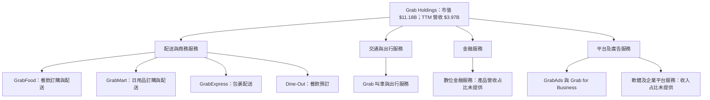
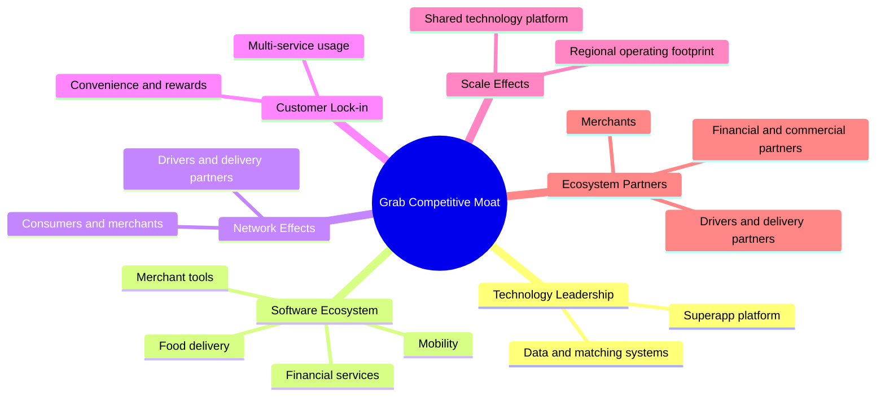
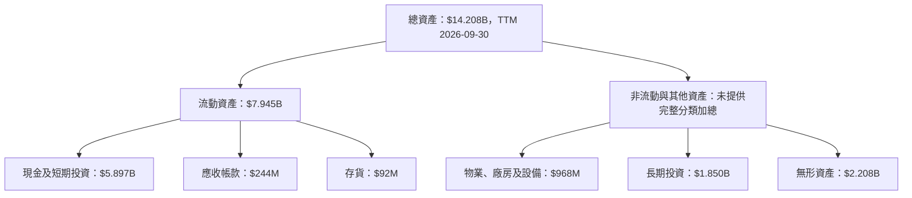
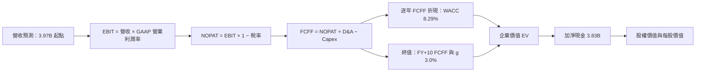
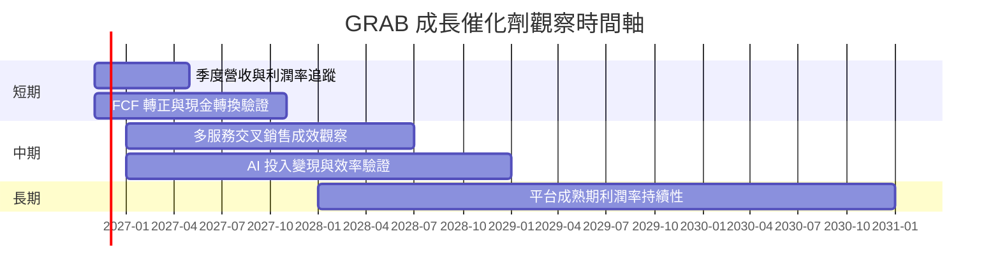
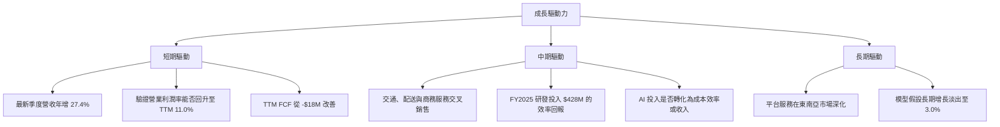
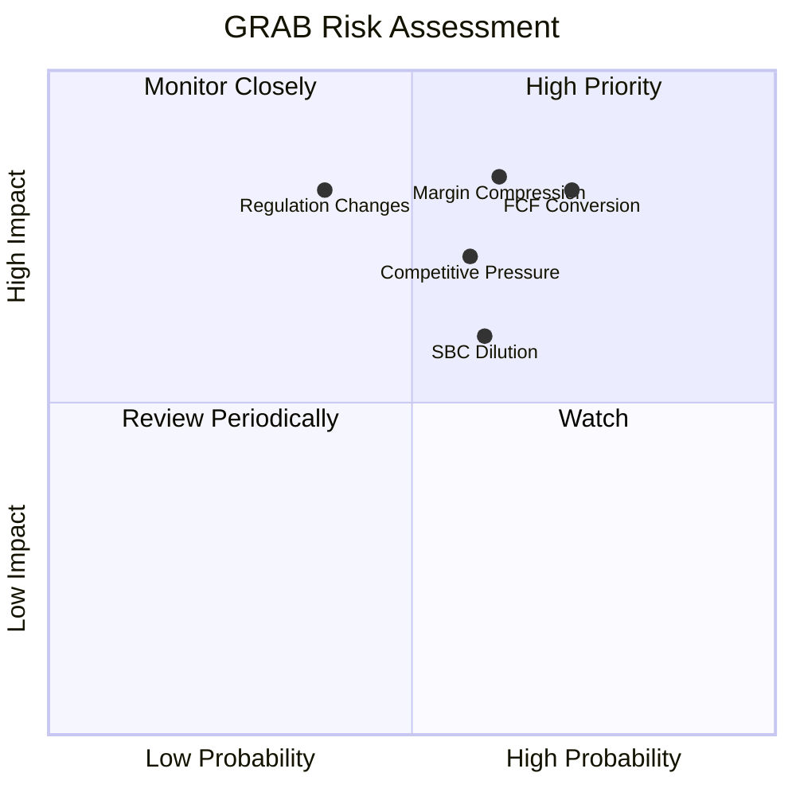
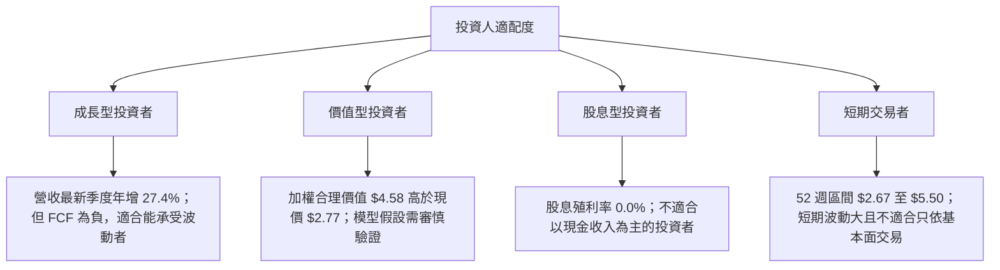

# GRAB 基本面深度分析報告
> **報告日期**：2026-11-25 ｜ **語言**：繁體中文 ｜ **數據來源**：Yahoo Finance、Finviz、StockAnalysis、Roic.ai ｜ **分析師**：CFA 級機構研究

## 目錄

| # | 章節 | 核心結論 |
|---|------|----------|
| 1 | 執行摘要 | 買入；加權合理價值 $4.58；MOS +39.5% |
| 2 | 公司概覽與商業模式 | 多服務平台具網路效應，但分部營收資料未提供，護城河強度需觀察 |
| 3 | 損益表深度分析 | TTM 營收 $3.97B；最新一季營收年增 27.4%，但最新季度營業利益率低於 TTM |
| 4 | 資產負債表分析 | 淨現金 $3.83B；流動性尚可，CCC 為 -182 天 |
| 5 | 現金流量深度分析 | TTM FCF 為 -$18M，現金轉換仍有波動 |
| 6 | 獲利能力與資本效率 | WACC 8.29%；ROIC 缺資料，不能確認是否持續創造經濟價值 |
| 7 | 相對估值分析 | 同業估值區間分歧；程式計算的同業估值法價值為 $2.30–$3.88 |
| 8 | DCF 內在價值評估 | 基準 DCF $6.24；加權合理價值 $4.58；估值高度依賴終值 |
| 9 | 成長催化劑 | 最新一季年增 27.4%及 AI 投入可能支持成長；TAM 數據未提供 |
| 10 | 風險矩陣 | 盈餘品質、競爭與估值模型假設為主要風險 |
| 11 | 投資建議 | 買入；以 $4.58 加權合理價值作 MOS 基準，並監控 FCF 與季度利潤率 |

## 1. 執行摘要

GRAB 2026-11-24 收盤價為 **$2.77**。程式計算的基準 DCF 每股價值為 **$6.24**，相對現價折價 **55.6%**；但較具代表性的三角估值加權合理價值為 **$4.58**，對應 **MOS +39.5%**、上行空間 **+65.3%**，按評級門檻為**買入**。估值吸引力須與現金流品質一併考量：TTM 營業利益率 11.0%，但最新季度為 5.6%；TTM FCF 為 **-$18M**、FCF Yield 為 **-0.16%**，且 ROIC 資料缺失，故不能確認目前資本報酬已高於 8.29% WACC。基準 DCF 有 67.4% 企業價值來自終值，價值對長期假設敏感。

### 1.0 一頁式投資儀表板

| 項目 | 內容 |
|------|------|
| **投資論點（3 句）** | ① 最新季度營收年增 27.4%，提供成長支撐；② 現金及短期投資 $5.90B、總債務 $2.07B，淨現金 $3.83B；③ 加權合理價值 $4.58，高於 2026-11-24 收盤價 $2.77，但 TTM FCF 為 -$18M，現金流尚未穩定。 |
| **綜合評分** | **7.2/10**（引用 1.1 評分卡） |
| **財務健康** | 🟢 淨現金 $3.83B、速動比率 1.07；但 TTM FCF 為負，現金轉換仍須追蹤。 |
| **ROIC vs WACC** | ROIC：N/A；WACC：8.29%。因 ROIC 缺漏，無法判定創造或摧毀價值。 |
| **FCF 趨勢** | TTM FCF **-$18M**，FCF Yield **-0.16%**；季度 FCF 在 2026 年第 1 季為 -$72M、第 2 季 $28M、第 3 季 $9M，波動大。 |
| **估值** | Forward P/E 17.64x ｜ EV/EBITDA 17.62x ｜ FCF Yield -0.16% |
| **DCF 內在價值（基準）** | $6.24 ｜ 現價相對 DCF 折價 **55.6%**（折溢價 = 現價 ÷ DCF − 1） |
| **安全邊際（MOS）** | **+39.5%**＝($4.58 − $2.77) ÷ $4.58；🟢高於 25%，基準為 8.8 加權合理價值 |
| **預期報酬（基準情境 12M）** | DCF 基準情境相對現價 **+125.3%**；非短期報酬承諾，且依賴長期模型假設。 |
| **關鍵風險（前二）** | 最新季營業利益率 5.6%低於 TTM 11.0%；TTM FCF 為負且基準 DCF 終值佔 EV 67.4%。 |
| **評級 + 信心度** | 🟢 **買入** ｜ 信心：中低（估值訊號正向，但 FCF、ROIC 與 EPS 預期資料缺漏） |

### 1.1 綜合評分卡

| 維度 | 評分（1–10） | 主要依據（引用數字與其來源章節） |
|------|--------------|----------------------------------|
| 成長性 | 8.0 | 最新季度營收年增 27.4%；TTM 營收年增率 N/A（第 3 章）。 |
| 獲利能力 | 6.0 | TTM 營業利益率 11.0%，但最新季度 5.6%；ROIC、Piotroski F-Score 均 N/A（第 3、6 章）。 |
| 財務健康 | 8.0 | 淨現金 $3.83B、流動比率 1.384、速動比率 1.07（第 4 章）；TTM FCF 為負。 |
| 估值 | 8.0 | MOS +39.5%；同業 Forward P/E 法回推 $2.30、EV/EBITDA 法 $3.88（第 7、8 章）。 |
| 護城河 | 7.0 | 覆蓋多個東南亞市場並經營外送、交通、金融等服務；但市場份額及各業務收入占比未提供（第 2 章）。 |
| 管理層與資本配置 | 6.0 | 2025 年 SBC $241M、資本支出 $123M；股息為零；回購資料未提供（第 3、5 章）。 |
| **綜合評分** | **7.2** | 六項算術平均： (8.0 + 6.0 + 8.0 + 8.0 + 7.0 + 6.0) ÷ 6 = 7.1667，四捨五入至一位小數。 |

### 1.2 五大投資論點 + 三大核心風險

| 類型 | 項目 | 具體依據 | 信心度 |
|------|------|----------|--------|
| 🟢 **投資論點①** | 營收成長動能 | 2026 Q3 營收 $1.112B，年增 27.4%、季增 11.4%；反映平台服務需求擴張，但單季成長不等同 TTM 成長。 | 🟢 高 |
| 🟢 **投資論點②** | 淨現金提供財務緩衝 | 現金及短期投資 $5.90B，債務 $2.07B，淨現金 $3.83B；可支持投資與應對市場波動。 | 🟢 高 |
| 🟢 **投資論點③** | 歷年營運損失收斂 | 年營業利益由 2022 年 -$1.29B，改善至 2025 年 $222M；顯示規模與費用控制已有進展。 | 🟢 中 |
| 🟢 **投資論點④** | 多服務平台可共享用戶與供應 | 公司經營交通、外送、商務、廣告及金融服務；潛在交叉銷售與平台密度優勢，但分部數字未提供。 | 🟡 中 |
| 🟢 **投資論點⑤** | 加權估值低於現價之上 | $4.58 加權合理價值對 $2.77 現價，MOS +39.5%；折價能否收斂取決於 FCF 轉正及利潤率延續。 | 🟡 中 |
| 🟡 **風險①** | 自由現金流品質不穩 | TTM FCF -$18M、FCF Yield -0.16%；2025 年 FCF -$44M，2024 年則 $739M，波動可能反映營運資金或現金流時點差異。 | 🔴 高衝擊 |
| 🔴 **風險②** | 季度利潤率可能承壓 | TTM 營業利益率 11.0%，最新季度 5.6%；若低利潤率延續，DCF 的固定 11.0%假設將偏樂觀。 | 🔴 高衝擊 |
| 🟡 **風險③** | SBC 與模型終值依賴 | 2025 年 SBC $241M，約為當年營收 7.2%；基準 DCF 終值佔 EV 67.4%，假設失準將放大每股價值下行。 | 🟡 中至高 |

### 1.3 快速統計卡片

Peer multiples 僅提供三家競爭對手的最新季度營收成長率與毛利率；其餘未提供公司可比中位數，不另行推算。

| 指標 | 公司實際值（期間） | 同業中位數 | 狀態 |
|------|--------------------|------------|------|
| 營收成長（TTM） | **N/A** | — | 🟡 TTM 對比資料未提供 |
| 營收成長（最新一季年增） | **27.4%** | 34.0%（UBER、SE、DASH） | 🟡 低於同業中位數 |
| 毛利率（TTM） | **41.4%** | 45.0%（UBER、SE、DASH） | 🟡 低於同業中位數 |
| 營業利益率（TTM） | **11.0%** | — | 🟢 已轉正，季度值較低 |
| ROIC（TTM） | **N/A** | — | 🟡 資料不足以判定資本效率 |
| Forward P/E | **17.64x** | 14.7x（同業 Forward P/E 中位數） | 🟡 高於同業中位數 |
| FCF Yield（TTM） | **-0.16%** | — | 🔴 FCF 為負 |
| Piotroski F-Score | **N/A / 9** | — | 🟡 缺少跨年度 SEC 財務資料 |

### 1.4 投資結論

╔══════════════════════════════════════════════════════════════════╗  
║                    📊 投資結論摘要                               ║  
╠══════════════════════════════════════════════════════════════════╣  
║  評級：買入（MOS 規則評級；未作質化調整）                        ║  
║  價格（2026-11-24 收盤）：$2.77                                  ║  
║  DCF 內在價值（基準）：$6.24（折價 55.6%）                      ║  
║  安全邊際 MOS：+39.5%（＝($4.58−$2.77)÷$4.58）                  ║  
║  加權合理價值（8.8）：$4.58                                      ║  
║  DCF 情境價值：                                                  ║  
║    悲觀情境：$3.21（+15.7%）                                     ║  
║    基準情境：$6.24（+125.3%）                                    ║  
║    樂觀情境：$13.01（+369.7%）                                   ║  
║  綜合評分：7.2/10（引用 1.1）                                    ║  
║  適合投資人：可承受波動、重視東南亞平台成長且持有期限較長者      ║  
╚══════════════════════════════════════════════════════════════════╝

## 2. 公司概覽與商業模式

### 2.1 業務結構與收入來源

Grab Holdings Limited 營運 Grab 超級應用程式，服務涵蓋柬埔寨、印尼、馬來西亞、緬甸、菲律賓、新加坡、泰國與越南。財務資料提供 TTM 總營收 **$3.97B**，但沒有按業務板塊拆分的營收與占比，因此不以推估比例繪製營收結構圖。

公司收入主要由平台交易與相關服務支撐；目前未提供各板塊金額、抽成率或毛利貢獻，故無法量化哪一板塊主導毛利與增長。

### 2.2 市場份額

市場份額數據未提供，亦沒有可引用的 TAM 或市場規模數字。可觀察到 GRAB TTM 營收 $3.97B、最新季度營收年增 27.4%；同業中 UBER 最新季度年增 9.6%、SE 為 43.4%、DASH 為 34.0%，GRAB 成長高於 UBER、低於 SE 與 DASH。

### 2.3 競爭護城河分析

### 2.4 護城河強度

| 護城河項目 | 強度（強／中／弱） | 證據（引用數字或事實） | 會削弱它的情況 |
|------------|--------------------|------------------------|----------------|
| 網路效應 | 中 | 平台同時連接消費者、商家及司機／配送夥伴；營收 TTM $3.97B，覆蓋 8 個東南亞國家。 | 競爭者補貼、用戶多平台使用或供應端流失。 |
| 軟體生態系統 | 中 | 外送、交通、商務、廣告及金融服務共用品牌與應用入口。 | 跨服務導流未能轉化為更高留存或單位經濟效益。 |
| 規模效應 | 中 | 2025 年營收 $3.37B，較 2022 年 $1.43B 擴大；但國別盈利及密度資料未提供。 | 不同國家需分別投入補貼、營運和合規成本。 |
| 客戶鎖定 | 弱至中 | 多服務整合可提升便利性；缺少留存、頻次、會員或轉換成本數據。 | 用戶對優惠敏感、替代平台切換成本低。 |
| 技術與數據 | 中 | 公司維持平台研發，2025 年研發費用 $428M；未提供 AI 變現或效率量化結果。 | 研發支出未轉化為更高利潤或生產力。 |
| 生態夥伴 | 中 | 商家與配送夥伴是平台運作基礎；合作方數量與集中度未提供。 | 夥伴議價力上升、監管要求改變合作模式。 |

1.1「護城河」評分 **7.0/10**，依據是多服務、跨國平台與 $3.97B TTM 營收規模；市場份額、留存、單位經濟及分部盈利資料不足，限制了評分上限。

## 3. 損益表深度分析

### 3.1 年度收入成長趨勢（近 4 年）

年度營收分別為 2022 年 $1.43B、2023 年 $2.36B、2024 年 $2.80B、2025 年 $3.37B。以報列金額計，2022–2025 年三年 CAGR 約 **33.1%**；計算為 \((3.37÷1.43)^{1/3}-1\)。此增長來自平台交易規模持續擴張，但不代表未來維持相同速度。

╔══════════════════════════════════════════════════════════════════╗  
║            Grab 年度收入趨勢（FY2022–FY2025）                    ║  
╠══════════════════════════════════════════════════════════════════╣  
║ FY2022  $1.43B  ████████░░░░░░░░░░░░░░░  YoY：—                 ║  
║ FY2023  $2.36B  █████████████░░░░░░░░░░  YoY：+64.6%            ║  
║ FY2024  $2.80B  ███████████████░░░░░░░░░  YoY：+18.6%            ║  
║ FY2025  $3.37B  ██████████████████░░░░░░  YoY：+20.5%            ║  
║                                                                  ║  
║ 2022–2025 三年營收 CAGR：約 +33.1%                               ║  
╚══════════════════════════════════════════════════════════════════╝

FY2023 的 64.6% 增長明顯高於其後年度；FY2024、FY2025 約 18.6%及 20.5%，顯示增長回歸較可持續但較低的水平。StockAnalysis 顯示 TTM 營收年增 22.99%，但 VERIFIED TTM 成長欄位為 N/A；本報告因此不把該補充來源數字冒充 VERIFIED TTM 成長率。

### 3.2 季度收入趨勢分析

以下 QoQ 以相鄰季度營收計算；YoY 以 StockAnalysis 同季數據計算。最新季度年增率 27.4%引用公司財務資料的單季指標。

| 季度 | 營收 | QoQ | YoY | 備註 |
|------|------:|----:|----:|------|
| 2025 Q4 | $906M | +17.2% | +18.6% | 較 2025 Q3 的 $873M 增加。 |
| 2026 Q1 | $955M | +5.4% | +23.5% | 同季 2025 Q1 為 $773M。 |
| 2026 Q2 | $998M | +4.5% | +21.9% | 同季 2025 Q2 為 $819M。 |
| 2026 Q3 | $1.112B | +11.4% | +27.4% | 同季 2025 Q3 為 $873M；年增加速。 |

### 3.3 利潤率演變分析

年度毛利率以年度毛利除年度營收計算；營業利益率以年度營業利益除年度營收計算。2025 年毛利數字在 Yahoo 季年表與 StockAnalysis 年表略有差異，本表依同一年度損益表列示的毛利／營收計算，並提示資料源差異。

| 利潤率指標 | FY2022 | FY2023 | FY2024 | FY2025 | 趨勢 | 評估 |
|------------|-------:|-------:|-------:|-------:|------|------|
| **毛利率** | 5.4% | 36.4% | 41.8% | 43.3% | ↗️ 2022–2025 上升；2025 年毛利 $1.46B／營收 $3.37B | 🟢 |
| **營業利益率** | -90.2% | -16.4% | -2.0% | 6.6% | ↗️ 由大額虧損轉為正值 | 🟢 |
| **淨利率** | -117.5% | -18.4% | -3.8% | 8.0% | ↗️ 2025 年轉正；單年可能受非營業項目影響 | 🟡 |

TTM 營業利益率為 11.0%，而最新季度資料指標為 5.6%。另一方面，季度收入表列示最新季度營業利益 $170M，除以營收 $1.11B 約為 15.3%；StockAnalysis 同期營業利益為 $112M。此資料源口徑存在差異，故以指定的 VERIFIED 最新季度營業利益率 **5.6%** 作為統一引用，不以單一季度表重新覆蓋該指標。季度利潤率差異可能來自資料源分類或調整，應以公司正式季報核對。

利潤率改善可能反映平台規模擴大、補貼及營運費用控制；但缺乏分部毛利、促銷支出及各國費用拆分，無法將改善精確歸因於產品組合或定價。最新季度營業利益率低於 TTM，可能代表季度波動，亦可能意味短期投入或競爭支出回升。

### 3.4 費用結構分析

財務資料沒有提供完整費用項目占營收比重，亦沒有可直接繪製的成本結構百分比，因此不製作 Mermaid pie 或比例方框。可確認 FY2025 研發費用為 **$428M**，約占營收 $3.37B 的 **12.7%**；SBC 為 **$241M**，約占營收 **7.2%**。兩者衡量口徑不同，SBC 可能分散列於不同營業費用項目，不可直接相加視為互斥費用。

### 3.5 季度 EPS 趨勢與盈餘品質（Quality of Earnings）

EPS 歷史表提供季度實際 EPS 部分數值，但 EPS Est 全部為 NaN，因此無法確認最近四季是否超預期或不及預期。2026 Q3 EPS 年增 -32.2%，淨利年增 -27.0%，顯示最新季度盈餘較去年同期下降；2026 Q2 淨利 $253M，高於 Q1 $136M 與 Q3 $27M，季度盈利波動明顯。

| 盈餘品質項目 | 數值/佔比 | 評估 |
|--------------|-----------|------|
| 股權薪酬 SBC / 營收 | FY2025 $241M ÷ $3.37B = **7.2%** | 🔴 對股東有稀釋成本；金額仍相當於收入的重要比例。 |
| SBC / 營業現金流 | FY2025 $241M ÷ $79M = **305.1%** | 🔴 SBC 高於年度營業現金流；現金流期間差異與非現金費用不可混為現金盈餘。 |
| FCF / 淨利（現金轉換率） | TTM FCF -$18M；TTM 淨利未由同一 VERIFIED 指標提供 | 🟡 N/A，不以年度淨利替代 TTM 分母。 |
| 一次性/非經常性損益 | N/A（未提供完整調節表） | 🟡 無法判斷 2025 年 $268M 淨利中一次性項目占比。 |
| 有效稅率異常 | 25.7%（成本資本資料中的最新年度有效稅率） | 🟡 無年度稅務調節表，無法判斷單季稅率或稅務利益影響。 |
| 資本化支出 vs 費用化 | TTM Capex $139M；FY2025 Capex $123M；資本化政策細節 N/A | 🟡 可見資本支出，但缺少資本化與折舊攤銷政策明細。 |

**盈餘品質結論**：GRAB 已由多年營業虧損轉為獲利，但 TTM FCF 為負、年度 SBC 相對營收偏高，而且最新季度淨利較去年同期下降。GAAP 營業利益已將 SBC 作為費用反映；評估股東回報時仍需將股數變化與 SBC 一併監控。現有資料不足以定量判斷非經常性損益，因此不把單年淨利直接視為穩態盈利能力。

## 4. 資產負債表分析

### 4.1 資產結構分解

下圖按 TTM 資產負債表數字列示可用項目。由於列示細項未涵蓋全部資產，不能把未列項目自行反推為某一類別。

### 4.2 流動性與營運資金分析

| 指標 | 最新 TTM | 一年前 TTM | 變化 | 解讀 |
|------|----------|------------|------|------|
| DSO 應收帳款天數 | 22 天 | N/A | N/A | 一年前數據未提供，無法判定收款速度變化。 |
| DIO 存貨天數 | 15 天 | N/A | N/A | 一年前數據未提供；平台業務存貨絕對值 $92M，但不代表全體業務庫存風險。 |
| DPO 應付帳款天數 | 219 天 | N/A | N/A | 較長付款週期可能支持供應商融資，但需確認是否可持續且不損害夥伴關係。 |
| CCC 現金轉換週期 | -182 天 | N/A | N/A | CCC 為負，按提供公式計算；因無一年前比較資料，不推斷其改善或惡化。 |

流動性指標如下：流動比率 **1.384**、速動比率 **1.07**。流動比率高於 1 表示帳面流動資產大於流動負債；速動比率略高於 1，短期流動性尚可，但現金及短期投資 TTM 同比下降 17.07%，值得持續觀察。

### 4.3 債務結構分析

╔══════════════════════════════════════════════════════════════════╗  
║                   GRAB 債務健康診斷                              ║  
╠══════════════════════════════════════════════════════════════════╣  
║ 總債務：       $2.07B      ███████░░░░░░░░░░░░░  有息與負債範圍按來源║  
║ 現金及短投：   $5.90B      ████████████████████  高於債務          ║  
║ 淨現金：       $3.83B      █████████████░░░░░░░  🟢                ║  
║ 流動比率：     1.384x                            🟢                ║  
║ 速動比率：     1.07x                             🟡                ║  
║ Debt/EBITDA：  N/A（同一期間債務及 EBITDA 口徑未提供）             ║  
║ 利息保障倍數： N/A（利息費用未提供）                               ║  
╚══════════════════════════════════════════════════════════════════╝

### 4.4 股東權益趨勢

| 年度 | 股東權益 | YoY 變化 |
|------|---------:|---------:|
| 2022 | $6.60B | — |
| 2023 | $6.45B | -2.3% |
| 2024 | $6.40B | -0.8% |
| 2025 | $6.73B | +5.2% |

╔══════════════════════════════════════════════════════════════════╗  
║                  股東權益趨勢（年度）                            ║  
╠══════════════════════════════════════════════════════════════════╣  
║ 2022  $6.60B  ████████████████████                              ║  
║ 2023  $6.45B  ███████████████████▌                              ║  
║ 2024  $6.40B  ███████████████████▍                              ║  
║ 2025  $6.73B  █████████████████████                             ║  
╚══════════════════════════════════════════════════════════════════╝

FY2025 權益上升至 $6.73B；期間債務也由 2024 年 $364M 增至 $2.05B。權益變化不能單獨視為股東價值提升，仍需結合新增債務用途、股份變動及投資回報評估。

## 5. 現金流量深度分析

### 5.1 現金流量瀑布圖

季度淨利、營業現金流及 FCF 口徑並非完全一致，且本期未提供股息或回購現金支出的完整逐項資料。下圖只連接已提供的 TTM 營業現金流、資本支出與 FCF，不把缺漏項目畫成金額。

### 5.2 FCF 轉換率趨勢

| 年度 | FCF | 淨利 | FCF / 淨利 | 解讀 |
|------|----:|-----:|-----------:|------|
| 2022 | -$872M | -$1.68B | 51.9% | 兩者皆負，比例不宜作一般轉換率解讀。 |
| 2023 | -$6M | -$434M | 1.4% | FCF 接近損益兩平，仍未轉正盈利。 |
| 2024 | $739M | -$105M | -703.8% | FCF 正、淨利負，比例失真，可能受營運資金等現金流時點影響。 |
| 2025 | -$44M | $268M | -16.4% | 會計淨利未轉化為年度正 FCF。 |
| TTM 至 2026-09-30 | -$18M | N/A | N/A | TTM 淨利對應值未在 VERIFIED 指標提供，不混用期間。 |

### 5.3 自由現金流趨勢

TTM FCF 依指定定義為營業現金流減資本支出，結果為 **-$18M**。歷史年報 FCF 有大幅波動，2024 年正 $739M、2025 年負 $44M；不能把單一年度高點外推為穩態。

╔══════════════════════════════════════════════════════════════════╗  
║                 自由現金流趨勢（年度實際）                       ║  
╠══════════════════════════════════════════════════════════════════╣  
║ 2022  -$872M  ◀████████████████████  FCF Yield：N/A             ║  
║ 2023    -$6M  ◀▏                   FCF Yield：N/A               ║  
║ 2024   $739M  ████████████████████▶ FCF Yield：N/A              ║  
║ 2025   -$44M  ◀█                    FCF Yield：N/A               ║  
║ TTM   -$18M  ◀▌                     FCF Yield：-0.16%            ║  
╚══════════════════════════════════════════════════════════════════╝

### 5.4 資本配置評估

公司 FY2025 資本支出 $123M、股息支付 $0、SBC $241M；回購與其他投資用途的完整金額未提供，因此不製作比例圓餅圖。

| 資本配置項目 | 已知數據 | 評估 |
|--------------|----------|------|
| 資本支出 | FY2025 $123M；TTM $139M | TTM 投入高於 FY2025 全年，需觀察新增投資是否提升平台效率。 |
| 股息 | FY2025 $0；股息殖利率 0% | 資本未以現金股息返還股東。 |
| 股份回購 | N/A | 無法評估是否抵銷 SBC 稀釋。 |
| SBC | FY2025 $241M | 對員工激勵有用途，但構成股東經濟成本。 |
| 留存與投資 | 現金及短期投資 $5.90B | 提供投資彈性，但未提供按用途的資本配置明細。 |

## 6. 獲利能力與資本效率

### 6.1 ROE / ROA / ROIC 趨勢

| 指標 | FY2022 | FY2023 | FY2024 | FY2025／TTM | 評估 |
|------|-------:|-------:|-------:|------------:|------|
| ROE | N/A | N/A | N/A | TTM 7.6% | 由來源提供的 TTM 指標；年度可比序列未提供。 |
| ROA | N/A | N/A | N/A | TTM 1.1% | 資產報酬偏低，但平台轉型期需看後續趨勢。 |
| ROIC | N/A | N/A | N/A | N/A | 缺少投入資本與 NOPAT 的品質指標，不能自行推算。 |

行業平均 ROE／ROA／ROIC 數據未提供，不列作比較。

### 6.2 ROIC vs WACC 分析（核心價值創造判斷）

ROIC 缺少可核實數據，因此不能計算 EVA 或宣稱已創造股東價值；WACC 依資本成本資料採用 **8.29%**，並與 DCF 一致。

╔══════════════════════════════════════════════════════════════════╗  
║                ROIC vs WACC 深度分析                             ║  
╠══════════════════════════════════════════════════════════════════╣  
║ WACC 輸入：                                                     ║  
║ ├── 無風險利率（10Y 美債）：4.90%                                ║  
║ ├── 市場風險溢酬 ERP：5.00%                                      ║  
║ ├── Beta（原始）：0.83；採用調整後 Beta：0.89                    ║  
║ ├── Ke = 4.90% + 0.89 × 5.00% = 9.35%                           ║  
║ ├── 稅前債務成本：3.43%；稅率：25.7%                             ║  
║ ├── 股權／債務權重：84.4%／15.6%                                 ║  
║ └── WACC：8.29%                                                  ║  
║                                                                  ║  
║ ROIC：N/A（品質指標未提供；投入資本資料不足以按指定口徑計算）     ║  
║ EVA = ROIC − WACC：N/A                                           ║  
║                                                                  ║  
║ 結論：無法判定 ROIC 是否高於 8.29% WACC，價值創造需待資料補足。  ║  
╚══════════════════════════════════════════════════════════════════╝

Beta 調整方式為 \(2/3×0.83+1/3×1=0.8867\)，資料指定採用 **0.89**。股權成本 CAPM 算式為 \(4.90\%+0.89×5.00\%=9.35\%\)。成本資本來源提供稅前債務成本、有效稅率及資本權重，但未提供可對齊的利息費用、平均計息負債明細與市場市值權重底稿；因此此處不另行重建 WACC，直接沿用來源值 8.29%。

### 6.3 杜邦三因素分解

| 因素 | 數值（TTM） | 解讀 |
|------|-------------|------|
| 淨利率 | N/A | 品質指標區塊明確標示 DuPont N/A，缺少指定期間一致的淨利與收入輸入。 |
| 資產週轉率 | N/A | 同上，不補算。 |
| 權益乘數 | N/A | 同上，不補算。 |
| **ROE** | **N/A** | 缺少可用的一致性資料；不以其他來源數字替代品質指標結果。 |

### 6.4 財務體質：Piotroski F-Score

Piotroski F-Score：**N/A**，原因是計算需要相隔一年的 SEC 申報資料；目前可用來源沒有足以執行九項測試的兩期 SEC 數據。

| 測試 | 結果 | 解讀 |
|------|------|------|
| 1. 淨利為正 | N/A | 缺少品質指標要求的兩期 SEC 數據。 |
| 2. 營業現金流為正 | N/A | 不以其他來源替代程式計算口徑。 |
| 3. ROA 改善 | N/A | 缺少一致跨年數據。 |
| 4. 營業現金流高於淨利 | N/A | 缺少一致性 SEC 期間資料。 |
| 5. 槓桿下降 | N/A | 無法按標準測試確認方向。 |
| 6. 流動性改善 | N/A | 無法按指定歷史期間檢驗。 |
| 7. 未增發股份 | N/A | 缺少同一口徑的兩期股數測試資料。 |
| 8. 毛利率改善 | N/A | 品質指標要求的跨期資料不足。 |
| 9. 資產週轉率改善 | N/A | 缺少完整對應數據。 |

## 7. 相對估值分析

### 7.1 同業估值比較表格

| 估值指標 | **GRAB** | **UBER** | **SE** | **DASH** | GRAB 評估 |
|----------|---------:|--------:|-------:|--------:|-----------|
| **Trailing P/E** | 27.7x | 38.1x | 23.4x | 66.4x | 🟡 位於同業區間中低段，但盈利口徑與組合不同。 |
| **Forward P/E** | 17.64x | 14.7x | 13.6x | 21.0x | 🟡 高於 UBER、SE，低於 DASH；公司自身預期 EPS 約 $0.157。 |
| **P/S Ratio** | 2.82x | 2.3x | 1.3x | 4.1x | 🟡 高於 UBER、SE，低於 DASH。 |
| **EV/EBITDA** | 17.62x | 18.0x | 12.6x | 39.3x | 🟡 接近 UBER，高於 SE，低於 DASH。 |
| **最新季度營收年增** | 27.4% | 9.6% | 43.4% | 34.0% | 🟡 高於 UBER，低於 SE 與 DASH。 |
| **毛利率（TTM）** | 41.4% | 41.4% | 45.0% | 52.7% | 🟡 與 UBER 相同，低於 SE、DASH。 |

以上 GRAB 自身估值來自市場資料；同業倍數按 Yahoo Finance 同業區塊引用。P/E、EV/EBITDA 會受各公司獲利及業務組合差異影響，不應脫離成長與現金流單獨判斷。

### 7.2 歷史估值區間分析

N/A（財務數據未提供「Valuation vs own history」估值區間或歷史百分位資料）。可確認的價格歷史顯示，2024-11 月收盤 $5.00，2025-09 月 $6.02，2026-11 月收盤 $2.77；這是股價趨勢，不等同歷史 P/E 估值百分位。

### 7.3 情境價值（Bear / Base / Bull，照抄 DCF MODEL 的 Scenarios）

| 情境 | 第 1 年營收成長 | 期末營業利潤率 | WACC | 每股價值 | 相對現價 | 機率 | 會發生的條件 |
|------|----------------|----------------|------|----------|----------|------|--------------|
| 🔴 悲觀 | 13.7% | 9.3% | 9.29% | $3.21 | +15.7% | 25% | 成長放緩、價格競爭加劇，利潤率低於基準且風險折現率上升。 |
| 🟡 基準 | 27.4% | 11.0% | 8.29% | $6.24 | +125.3% | 50% | 最新季度成長可延續一段時間，長期回落至成熟增長，利潤率維持 11.0%。 |
| 🟢 樂觀 | 41.1% | 12.0% | 7.29% | $13.01 | +369.7% | 25% | 需求與跨服務變現加速，利潤率提升，市場風險溢酬下降。 |

情境價值與假設按程式計算結果原值引用；中間逐年情境現金流未提供，不另建模型。

### 7.4 相對估值隱含價格區間

╔══════════════════════════════════════════════════════════════════╗  
║                  估值方法隱含每股價值                            ║  
╠══════════════════════════════════════════════════════════════════╣  
║ 同業 Forward P/E：$2.30 ─── 現價 $2.77 ─── 同業 EV/EBITDA：$3.88 ║  
║ 分析師共識目標價：$5.39 ─── 基準 DCF：$6.24                    ║  
╚══════════════════════════════════════════════════════════════════╝

| 方法 | 每股價值 | 依據 |
|------|---------:|------|
| 同業 Forward P/E | $2.30 | UBER、SE、DASH 同業中位數 14.7x × GRAB Forward EPS $0.16。 |
| 同業 EV/EBITDA | $3.88 | 同業中位數 EV/EBITDA 18.0x × TTM EBITDA，再加淨現金。 |
| 分析師共識 | $5.39 | 22 位分析師平均目標價；非基本面模型，作交叉參考。 |

## 8. DCF 內在價值評估（Discounted Cash Flow）

> 本章採用程式計算的唯一 DCF 模型；金額均為美元，除非另有說明。逐年表格依模型原值列示，不重建或修正模型輸入。部分輸入缺乏可由公開財務數據獨立驗證的明細，故清楚標示其限制。

### 8.0 估值推理鏈（Thinking Logic：在算之前先想清楚）

**Step 1 — 價值由哪些變數決定？**  
模型將價值拆為平台既有營收現金流、由交通與配送等服務交叉銷售帶來的成長，以及長期終值。分部營收占比未提供，不能為各項指定比例；模型中對價值影響最直接的變數是營收路徑、營業利益率、WACC 與終值成長率。敏感度表顯示在固定基準下，WACC 與永續成長率對終值的折現影響顯著。

**Step 2 — 模型選擇**

| 決策點 | 本報告採用 | 理由（含數字） | 曾考慮但否決 | 否決理由 |
|--------|-----------|----------------|--------------|----------|
| 現金流定義 | FCFF | 配合 8.29% WACC，折現後得企業價值；公式為 NOPAT + D&A − Capex。 | FCFE | 模型已固定使用 FCFF 與企業價值橋接。 |
| 預測期 N | 10 年 | DCF 模型固定 10 年，營收年增由 27.4% 線性降至 3.0%。 | 5 年 | 會改變程式模型期限與估值，不能擅自替換。 |
| 終值方法 | Gordon Growth | 模型採永續成長率 3.0%，且 WACC 8.29% 高於 g。 | 退出倍數 | DCF 區塊未提供退出倍數終值模型，不能自建。 |
| EBIT 基礎 | GAAP EBIT | 模型指明採 GAAP EBIT，已含 SBC 費用。 | 非 GAAP EBIT | 可能加回 SBC，與固定模型口徑不符。 |

**Step 3 — 關鍵假設推導鏈**

- **營收增長**：錨點＝最新季度單季營收 YoY 27.4%，TTM 成長率 N/A；調整＝模型讓年增率由 27.4% 線性淡出至 3.0%，以反映基期擴大和成熟化；**採用第 1 年 27.4%、第 10 年 3.0%**；曾考慮直接採用長期 27.4%，但否決，因最新季度單季增幅不能直接代表 10 年長期增長。
- **期末營業利潤率**：錨點＝TTM GAAP 營業利益率 11.0%，最新季度指標 5.6%；調整＝模型保持 11.0% 不變，實際上忽略季度回落風險；**採用 11.0%**；曾考慮採用最新季度 5.6%，但模型不允許更改，故保留並列為重大樂觀風險。
- **永續成長率 g**：錨點＝模型採 3.0%；調整＝假設 10 年後進入成熟期且維持長期正成長；**採用 3.0%**；否決高於 3.0% 的替代值，因沒有可引用的長期市場增長或公司成熟期資料，且 g 必須低於 WACC。
- **預測期 N**：錨點＝程式模型 10 年；調整＝不作調整；**採用 10 年**；否決 5 年或其他期限，避免違反固定模型。
- **Capex／營收**：錨點＝TTM Capex $139M、D&A／營收 5.6%；模型採 3.5% 並維持 10 年；**採用 3.5%**；未採 1.1×D&A 的較高比率，因程式輸入已固定為 3.5%，但這是可能低估再投資的假設。
- **D&A／營收**：錨點＝TTM 5.6%；**採用 5.6%**，模型維持固定；此項資料來自模型輸入，未另行調整。
- **EBIT 與 SBC**：錨點＝模型指明 GAAP EBIT；**採用 GAAP EBIT + 固定股數，年稀釋率 0%**。模型不再另扣 SBC，也不逐年增加股數，避免將 SBC 重複扣除；但經濟上 SBC 對股東的長期稀釋沒有在該模型股數中另行反映。
- **ΔWC**：模型不建模營運資金變動；營運資金天數提供 CCC -182 天，但沒有可用的預測增額／收入假設。**採用模型的未建模處理**，因此可能高估或低估未來 FCFF。
- **WACC**：錨點＝資本成本區塊 WACC 8.29%；**採用 8.29%**；不另計一個折現率，以保持與 6.2 節一致。
- **終值方法**：錨點＝模型使用 Gordon Growth；**採用 Gordon Growth**；不另加入未提供的退出倍數，避免自行增加估值方法。

**Step 4 — 最脆弱環節**  
最脆弱假設是把 TTM 營業利益率 11.0%維持十年，而最新季度指標為 5.6%；若長期利潤率回落，基準 DCF $6.24 可能顯著下修，模型敏感度表不能直接替代重新設定營運假設的完整模型。

**Step 5 — 計算路徑圖**

### 8.1 模型假設總表（Model Inputs）

| 假設項目 | 採用值 | 依據／來源 | 敏感度 |
|----------|--------|-------------|--------|
| 預測期長度 N | 10 年 | DCF 模型固定輸入；年增率由 FY+1 至 FY+10 逐年淡出。 | 🟡 中 |
| 營收增長 | FY+1 27.4%；FY+10 3.0% | FY+1 使用最新季度 YoY；FY+10 為模型固定終值附近增長。 | 🔴 高 |
| 營業利潤率 | FY+1 至 FY+10 均 11.0% | TTM 營業利益率 11.0%；模型稱採五年中位數含 TTM。 | 🔴 高 |
| 有效稅率 | 25.7% | 最新年度有效稅率輸入。 | 🟢 低 |
| Capex／營收 | 3.5% | DCF 模型固定值；TTM Capex 為 $139M，但未提供逐項推導。 | 🟡 中 |
| D&A／營收 | 5.6% | TTM 輸入。 | 🟢 低 |
| 營運資金變動 | 未建模 | DCF 模型明確不納入營運資金變動。 | 🟢 低 |
| EBIT 基礎 | GAAP EBIT | 模型說明 GAAP EBIT。 | 🟡 中 |
| SBC 處理 | 組合 (A)：GAAP EBIT；FCFF 不另扣 SBC；股數不再稀釋 | SBC 已在 GAAP EBIT 中作為費用，模型固定股數。 | 🟡 中 |
| 年稀釋率 | 0%（模型固定股數） | DCF 模型組合 A 的處理。實際股數變化資料顯示 Sep 2026 shares 4.037B，模型不外推。 | 🟡 中 |
| 永續成長率 g | 3.0% | DCF 模型固定值；低於 WACC 8.29%。 | 🔴 高 |
| 終值方法 | Gordon Growth | 模型提供 Terminal Value 算式。 | 🔴 高 |
| WACC | 8.29% | Cost of capital 區塊固定採用。 | 🔴 高 |

本模型 FCFF 定義為 \(NOPAT + D&A - Capex\)，不含 ΔWC 項。**本模型採用 (A)，故 SBC 影響已在 GAAP EBIT 中計入一次；不另扣 SBC，也不在預測股數中再計稀釋。**

### 8.2 折現率推導（WACC）

╔══════════════════════════════════════════════════════════════════╗  
║                    WACC 推導（折現率）                           ║  
╠══════════════════════════════════════════════════════════════════╣  
║ 股權成本 Ke（CAPM）：                                            ║  
║ ├── 無風險利率 Rf：4.90%（資料提供 10Y Treasury，日期未提供）   ║  
║ ├── 市場風險溢酬 ERP：5.00%（假設值，按成本資本輸入）          ║  
║ ├── 原始 Beta：0.83；調整後 Beta：0.89                          ║  
║ ├── 規模／國別溢酬：未另加計                                    ║  
║ └── Ke = 4.90% + 0.89 × 5.00% = 9.35%                           ║  
║                                                                  ║  
║ 債務成本：                                                       ║  
║ ├── 稅前 Kd：3.43%（資料提供；利息與平均債務細項未提供）        ║  
║ ├── 有效稅率：25.7%                                              ║  
║ └── 稅後 Kd = 3.43% × (1−25.7%) = 2.54899% ≈ 2.55%             ║  
║                                                                  ║  
║ 資本權重：股權 84.4%；債務 15.6%                                 ║  
║ └── WACC = 84.4% × 9.35% + 15.6% × 2.54899% = 8.289% ≈ 8.29%   ║  
╚══════════════════════════════════════════════════════════════════╝

逐步演算：

1. **Ke（CAPM）** = \(4.90\% + 0.89 × 5.00\%\) = **9.35%**。
2. **稅前 Kd** = **3.43%**（來源已提供；未提供利息費用與平均計息負債明細，不能獨立複算分子及分母）。
3. **稅後 Kd** = \(3.43\% × (1 − 25.7\%)\) = \(3.43\% × 74.3\%\) = **2.54899% ≈ 2.55%**。
4. **權重**：股權 **84.4%**；債務 **15.6%**；合計 \(84.4\%+15.6\%=100.0\%\)。市值基礎權重計算底稿未提供，因此引用成本資本區塊權重，不以帳面權益重算。
5. **WACC** = \(84.4\%×9.35\% + 15.6\%×2.54899\%\) = \(7.8914\%+0.3976\%\) = **8.2890% ≈ 8.29%**。

稅前 Kd 的債務範圍及成本資本區塊權重底稿未提供，無法核對是否完全使用相同的計息負債範圍；本報告依要求沿用程式採用的 WACC，不用自行替代值。Rf 的觀測日期亦未提供，故不杜撰日期。

### 8.3 逐年自由現金流預測（基準情境）

金額單位為 $B。年增、收入、EBIT、FCFF、折現因子及 PV 均照模型原值列示。模型不包含 ΔWC，因此不列 ΔWC 行；SBC 不另扣除。

| 年度 | FY+1 | FY+2 | FY+3 | FY+4 | FY+5 | FY+6 | FY+7 | FY+8 | FY+9 | FY+10 |
|------|------:|------:|------:|------:|------:|------:|------:|------:|------:|-------:|
| 營收 | 5.06 | 6.31 | 7.69 | 9.18 | 10.70 | 12.18 | 13.53 | 14.67 | 15.51 | 15.98 |
| 營收 YoY | 27.4% | 24.7% | 22.0% | 19.3% | 16.6% | 13.8% | 11.1% | 8.4% | 5.7% | 3.0% |
| 營業利潤率 | 11.0% | 11.0% | 11.0% | 11.0% | 11.0% | 11.0% | 11.0% | 11.0% | 11.0% | 11.0% |
| EBIT（GAAP） | 0.55 | 0.69 | 0.84 | 1.01 | 1.17 | 1.33 | 1.48 | 1.61 | 1.70 | 1.75 |
| − 稅 | (0.14) | (0.18) | (0.22) | (0.26) | (0.30) | (0.34) | (0.38) | (0.41) | (0.44) | (0.45) |
| = NOPAT | 0.41 | 0.51 | 0.63 | 0.75 | 0.87 | 0.99 | 1.10 | 1.20 | 1.26 | 1.30 |
| + D&A | 0.28 | 0.35 | 0.43 | 0.52 | 0.60 | 0.68 | 0.76 | 0.82 | 0.87 | 0.90 |
| − Capex | (0.18) | (0.22) | (0.27) | (0.32) | (0.37) | (0.43) | (0.47) | (0.51) | (0.54) | (0.56) |
| = FCFF | **0.52** | **0.65** | **0.79** | **0.94** | **1.10** | **1.25** | **1.39** | **1.51** | **1.59** | **1.64** |
| 折現因子 @ 8.29% | 0.923 | 0.853 | 0.788 | 0.727 | 0.672 | 0.620 | 0.573 | 0.529 | 0.488 | 0.451 |
| FCFF 現值 PV | **0.48** | **0.55** | **0.62** | **0.68** | **0.74** | **0.77** | **0.80** | **0.80** | **0.78** | **0.74** |

預測期 PV 合計（模型原值）：
\[
0.48+0.55+0.62+0.68+0.74+0.77+0.80+0.80+0.78+0.74
=6.96\text{B}
\]

逐步演算（FY+1；模型各行以兩位小數呈現，未四捨五入底層數字未提供）：

1. **營收** = $3.97B × (1 + 27.4%) = **$5.06B**。
2. **EBIT** = $5.06B × 11.0% = **$0.55B**（按模型原值）。
3. **稅** = $0.55B × 25.7% = **$0.14B**（按模型原值）。
4. **NOPAT** = $0.55B − $0.14B = **$0.41B**。
5. **D&A** = $5.06B × 5.6% = **$0.28B**。
6. **Capex** = $5.06B × 3.5% = **$0.18B**。
7. **ΔWC** = 模型未建模，無數值。
8. **FCFF** = $0.41B + $0.28B − $0.18B = **$0.52B**（模型原值）。
9. **折現因子** = \(1÷(1+8.29\%)^1=0.923\)；**PV** = $0.52B × 0.923 = **$0.48B**。

上述使用模型已四捨五入的行項，逐項相加可能有尾差；模型底層未四捨五入值未提供，故逐年表與模型 PV 合計以原列數字為準。

合理性自檢：

- 預測 FCFF 由 FY+1 $0.52B 增至 FY+10 $1.64B；由兩端計算約為 13.6% 年複合增長，但歷史 FCF 極度波動，無法提供可比的穩態歷史 CAGR。
- FY+10 FCFF 利潤率 = $1.64B ÷ $15.98B = **10.3%**；目前 TTM FCF 利潤率 = -$18M ÷ $3.97B = **-0.5%**。兩者差距很大，預測隱含營運現金流及投資效率顯著改善。
- 模型預測期 FCFF 均為正；實際 TTM FCF 為負，表示 DCF 的現金流轉正速度是核心風險。
- 同業最佳長期 FCF 利潤率資料未提供，不做比較。

╔══════════════════════════════════════════════════════════════════╗  
║            自由現金流：歷史實際 vs 模型預測                      ║  
╠══════════════════════════════════════════════════════════════════╣  
║ FY2023（實）  -$0.006B  ◀▏                         FCF 仍略負    ║  
║ FY2024（實）   $0.739B  ████████████████████       年度高波動    ║  
║ FY2025（實）  -$0.044B  ◀█                         FCF 再轉負    ║  
║ TTM（實）     -$0.018B  ◀▌                         Yield -0.16%  ║  
║ FY+1（預）     $0.52B   ██████░░░░░░░░░░░░░░       模型預測     ║  
║ FY+10（預）    $1.64B   ████████████████████       模型預測     ║  
╠══════════════════════════════════════════════════════════════════╣  
║ ⚠️ 模型預測與近期實際 FCF 差距大，依賴收入增長與利潤率延續。    ║  
╚══════════════════════════════════════════════════════════════════╝

### 8.4 終值計算（Terminal Value）

適用性檢查：**WACC 8.29% vs g 3.0% → WACC > g？✅**

| 方法 | 計算式 | 終值 TV | TV 現值 | 佔總 EV 比重 |
|------|--------|---------|---------|--------------|
| Gordon Growth | 1.64 × (1 + 3.0%) ÷ (8.29% − 3.0%) | $31.94B | $14.41B | 67.4% |
| 退出倍數法 | N/A（DCF 模型未提供退出倍數終值） | N/A | N/A | N/A |

逐步演算（模型原值）：

1. **FY+N 的 FCFF** = FY+10 **$1.64B**。
2. **分子** = $1.64B × (1 + 3.0%) = **$1.6892B**（模型以未四捨五入 FCFF 計算後列示 TV）。
3. **分母** = 8.29% − 3.0% = **5.29%**；模型算式：\(1.64×(1+3.0\%)÷(8.29\%-3.0\%)=\)**$31.94B**。
4. **PV(TV)** = $31.94B × FY+10 折現因子 0.451 = **$14.41B**（採模型原值）。
5. **終值佔比** = $14.41B ÷ $21.37B = **67.4%**。

終值占比低於 75%警示門檻，但仍佔企業價值約三分之二，代表估值對長期 WACC、g 及成熟期現金流敏感。

### 8.5 企業價值 → 每股內在價值（Bridge）

╔══════════════════════════════════════════════════════════════════╗  
║              企業價值 → 每股內在價值 橋接表                      ║  
╠══════════════════════════════════════════════════════════════════╣  
║ 預測期 FCF 現值合計             +$6.96B                          ║  
║ 終值現值 PV(TV)                 +$14.41B                         ║  
║ = 企業價值 EV                    $21.37B                         ║  
║ + 淨現金                         +$3.83B                          ║  
║ = 股權價值                       $25.19B（模型列示）              ║  
║ 每股價值                         $6.24                            ║  
║ 當前股價（2026-11-24 收盤）      $2.77                            ║  
║ 折溢價（現價÷DCF−1）             -55.6%（折價）                   ║  
╚══════════════════════════════════════════════════════════════════╝

逐步演算：

1. **EV** = $6.96B + $14.41B = **$21.37B**。
2. **股權價值** = EV $21.37B + 淨現金 $3.83B = $25.20B；模型列示股權價值 **$25.19B**，相差 $0.01B，屬模型顯示精度／底層未四捨五入造成的約 0.04% 尾差。
3. **每股內在價值**依模型原式：股權價值 × 價格 ÷ 市值 = **$6.24**。模型的市值與股數精確底稿未提供，不改用其他分母重算。
4. **折溢價** = $2.77 ÷ $6.24 − 1 = **-55.6%**，表示現價相對 DCF 基準價折價。
5. **本節不計算 MOS**；MOS 固定以 8.8 加權合理價值為分母。

股數處理：DCF 指定 GAAP EBIT、固定股數，與組合 (A) 相容；未再按近期股份數變化外推稀釋。現金／債務依 DCF 模型採用淨現金 $3.83B；TTM 資產負債表現金及短期投資為 $5.90B、債務 $2.07B。

### 8.6 敏感性分析（WACC × 永續成長率）

以下直接引用 DCF 模型矩陣。括號為以現價 $2.77 計算的上行空間，按矩陣每股價值四捨五入至兩位小數計算，與模型未四捨五入數值可能略有差異。

| g（列）／WACC（欄） | 6.29% | 7.29% | **8.29%（基準）** | 9.29% | 10.29% |
|-----------|------:|------:|-------------------:|------:|-------:|
| **2.0%** | $8.13（+193.5%） | $6.65（+140.1%） | $5.64（+103.6%） | $4.92（+77.6%） | $4.38（+58.1%） |
| **2.5%** | $8.85（+219.5%） | $7.07（+155.2%） | $5.92（+113.7%） | $5.11（+84.5%） | $4.51（+62.8%） |
| **3.0%（基準）** | $9.79（+253.4%） | $7.60（+174.4%） | **$6.24（+125.3%）** | $5.32（+92.1%） | $4.65（+67.9%） |
| **3.5%** | $11.07（+299.6%） | $8.26（+198.2%） | $6.63（+139.4%） | $5.57（+101.1%） | $4.82（+74.0%） |
| **4.0%** | $12.92（+366.8%） | $9.13（+229.6%） | $7.12（+157.0%） | $5.87（+111.9%） | $5.02（+81.2%） |

逐步演算示範：所選格 **WACC = 9.29% > g = 3.0% ✅**。模型直接列示該格每股價值 **$5.32**；但未提供該敏感度格的逐年 PV 與終值明細。由於嚴格要求禁止另建 DCF 模型，不能臆造新 WACC 下的 PV 合計及 TV 中間值；故此處直接引用矩陣輸出，不宣稱已獨立重算。

三情境依 DCF 模型輸出：

| 情境 | 第 1 年成長 | 期末營業利潤率 | g | WACC | 每股價值 | 相對現價 | 機率 |
|------|------------:|---------------:|---:|-----:|---------:|---------:|------:|
| 🔴 悲觀 | 13.7% | 9.3% | 模型未單列 | 9.29% | $3.21 | +15.7% | 25% |
| 🟡 基準 | 27.4% | 11.0% | 3.0% | 8.29% | $6.24 | +125.3% | 50% |
| 🟢 樂觀 | 41.1% | 12.0% | 模型未單列 | 7.29% | $13.01 | +369.7% | 25% |
| **機率加權** | — | — | — | — | **$7.17** | **+159.0%** | **100%** |

DCF 模型未列出悲觀及樂觀情境的 g、逐年營收、FCFF、終值中間值，因此不自行補造情境推導鏈。機率加權核對：\(3.21×25\%+6.24×50\%+13.01×25\%=7.175\)，模型列示 **$7.17**，差異來自各情境每股數字顯示精度；依要求保留程式輸出原值。

**敏感度結論（引用矩陣）：**

- **g 每 +1pp**，固定 WACC 8.29%時，模型每股價值由 $6.24（g=3.0%）升至 $7.12（g=4.0%）：**+$0.88／+14.1%**。
- **WACC 每 +1pp**，固定 g=3.0%時，模型每股價值由 $6.24（8.29%）降至 $5.32（9.29%）：**-$0.92／-14.7%**。
- 期末營業利潤率每 +1pp 的獨立敏感度數字未提供，不能以情境差額冒充單一變數敏感度。
- 現有敏感度顯示 WACC 與 g 均具實質影響；與 8.0 所指長期增長與利潤率為核心變數一致，但終值折現率亦不可忽略。

### 8.7 反推 DCF（Reverse DCF：市場在預期什麼）

模型反推欄提供兩個單變數解：年 1 營收增長率 1.2%，以及固定營業利益率 1.9%。其他變數及試算軌跡未提供。

| 求解的變數 | 其餘變數設定 | 市場隱含值 | 公司歷史實際 | 判斷 |
|------------------------|--------------|----------------|--------------|------|
| Year-1 營收成長 | 其餘基準輸入固定 | 1.2% | 最新季度 YoY 27.4%；FY2022–2025 營收 CAGR 約 33.1% | 若模型其他假設成立，市場價格隱含增長要求低；但 TTM 成長欄位 N/A。 |
| 固定營業利益率 | 其餘基準輸入固定 | 1.9% | TTM 11.0%；最新季度 5.6% | 市場價格隱含利潤率遠低於 TTM，但季度較弱，應防止過度解讀。 |
| 永續成長率 g | 未計算 | 未計算 | — | 程式未提供該反推解。 |
| 預測期長度 N | 未計算 | 未計算 | — | 程式未提供該反推解；不自行迭代。 |

DCF 區塊未提供被固定輸入清單與 CAGR 試算軌跡，且禁止自行重建模型，因此無法列示可複現的收斂表。按現有兩個解，模型指出現價所需的短期增長或固定利潤率低於基準輸入；但這不等同於市場已低估，因模型本身的 11.0% 長期利潤率、零稀釋及不建模營運資金都可能偏樂觀。

### 8.8 估值三角驗證與安全邊際

| 估值方法 | 隱含每股價值 | 上行空間（÷現價） | 權重 | 說明 |
|----------|--------------:|-------------------:|------:|------|
| DCF（基準） | $6.24 | +125.3% | 40% | 10 年 FCFF、WACC 8.29%、g 3.0%。 |
| 同業 Forward P/E | $2.30 | -17.0% | 25% | 同業中位數 14.7x × Forward EPS $0.16。 |
| 同業 EV/EBITDA | $3.88 | +40.1% | 25% | 同業中位數 18.0x × TTM EBITDA，再加淨現金。 |
| 分析師共識目標價 | $5.39 | +94.6% | 10% | 22 位分析師平均目標價。 |
| **加權合理價值** | **$4.58** | **+65.3%** | **100%** | 各估值方法按公司類型權重計算。 |

逐步演算：  
\[
6.24×40\%+2.30×25\%+3.88×25\%+5.39×10\%
=2.496+0.575+0.970+0.539
=4.580
=\mathbf{\$4.58}
\]
公司類型為獲利公司，使用固定配置權重；未提供的估值方法不自行增列。四項權重合計 \(40\%+25\%+25\%+10\%=100\%\)。

安全邊際及上行空間：

\[
MOS=(4.58-2.77)÷4.58=1.81÷4.58=39.5\%
\]

\[
上行空間=(4.58-2.77)÷2.77=1.81÷2.77=65.3\%
\]

╔══════════════════════════════════════════════════════════════════╗  
║                  估值區間與安全邊際                              ║  
╠══════════════════════════════════════════════════════════════════╣  
║ $3.21 ───── $2.77 ───── [$4.58] ───── $6.24 ───── $13.01       ║  
║ 悲觀 DCF      現價       加權合理值     基準 DCF      樂觀 DCF   ║  
║                                                                  ║  
║ MOS = ($4.58−$2.77) ÷ $4.58 = +39.5%                            ║  
║ MOS 評估：🟢 >25% 充足                                           ║  
║ 上行空間 = ($4.58−$2.77) ÷ $2.77 = +65.3%                       ║  
║                                                                  ║  
║ 建議買入區間：依 MOS≥10%，價格上限 $4.12；現價低於此上限。      ║  
║ 合理持有區間：以加權合理價值附近作參考，非保證價格區間。        ║  
║ 減碼考慮：高於基準價後重新檢視；樂觀 DCF $13.01 非目標承諾。   ║  
╚══════════════════════════════════════════════════════════════════╝

買入區間上限計算：\(4.58×(1-10\%)=4.122\)，四捨五入為 **$4.12**；在該價位 MOS 為 10%。下限不由評級門檻決定，因此不虛構固定下限。

> 🔎 **程式複算（Python，依本節各項自動重算）**
>
> 加權合理價值 = $6.24 × 40% + $2.30 × 25% + $3.88 × 25% + $5.39 × 10% = **$4.58**（權重合計 100%）
>
> 以價格 $2.77 計：MOS = **+39.5%**，上行空間 = **+65.3%**
>
> ✅ 與本節所寫數值一致。

### 8.9 DCF 模型的局限與失效條件

- **終值依賴度**：終值現值佔 EV **67.4%**，估值相當部分取決於第 10 年後現金流、WACC 與永續成長率。
- **最脆弱假設**：① 營業利益率十年維持 11.0%，但最新季度為 5.6%；② TTM FCF 為負，但模型第一年即預測 $0.52B 正 FCFF。若這些假設不成立，價值會低於基準 $6.24；目前模型未提供「下修利潤率至某值」的獨立估值，不能編造具體下行情境價。
- **適用性**：歷史 FCF 由 -$872M 到 +$739M 再回落至 -$44M，波動極大，DCF 可靠度受限；宜同時參照同業 Forward P/E、EV/EBITDA、平台單位經濟與現金流轉換。
- **營運資金**：模型未納入 ΔWC，而 CCC 為 -182 天；若商家／夥伴結算條件改變，實際 FCFF 會與模型不同。
- **SBC／稀釋**：模型 GAAP EBIT 已計 SBC，但股數固定；若實際股數增加，模型每股價值可能高估。
- **對應第 10 章風險**：競爭促銷可能壓低營業利潤率；監管變化可能改變供應端成本與付款週期；AI 或新服務若無法變現，研發費用未必帶來預測增長。

### 8.10 複算檢核表（Audit Trail）

| # | 檢核項目 | 檢查方式 | 結果 |
|---|----------|----------|------|
| 1 | 高／中敏感度輸入均有推導 | 8.0 Step 3 逐項說明，資料不足處明示 | ✅（輸入來源本身不足處已揭露） |
| 2 | 每個假設都有來歷 | 8.1 列出模型或財務數據錨點 | ✅ |
| 3 | WACC 算式與組成 | CAPM、稅後 Kd、權重與 WACC 算式列示 | ✅ |
| 4 | Kd 分母與債務權重範圍一致性 | 平均計息負債明細及權重底稿未提供 | ⚠️ 無法獨立核對；沿用指定 WACC |
| 5 | WACC 與第 6.2 節一致 | 兩處均為 8.29% | ✅ |
| 6 | 預測表年度數等於 N | FY+1 至 FY+10 共 10 年 | ✅ |
| 7 | FY+1 現金流演算 | 以模型原值和已四捨五入行項示範 | ✅（底層未四捨五入值未提供） |
| 8 | 預測 PV 相加 | 表列 PV 合計 6.96B | ✅（顯示精度可能有尾差） |
| 9 | WACC > g | 8.29% > 3.0% | ✅ |
| 10 | 終值基期及折現期 | FY+10 FCFF，折現因子 0.451 | ✅ |
| 11 | 橋接 EV 至每股 | EV 21.37B；淨現金 3.83B；模型每股 6.24 | ⚠️ EV 加淨現金與模型股權價值有 $0.01B 顯示尾差 |
| 12 | SBC 組合合法 | GAAP EBIT、無額外扣 SBC、固定股數 | ✅ |
| 13 | 基準敏感度格與 DCF | g 3.0%、WACC 8.29% 為 $6.24 | ✅ |
| 14 | 矩陣有效格 | 所列最小 WACC 6.29%仍高於最大 g 4.0% | ✅ |
| 15 | 三情境機率合計 | 25% + 50% + 25% = 100% | ✅；加權值沿用模型 $7.17 |
| 16 | 反推 DCF 單變數 | 只列模型提供的年 1 成長與固定利潤率解；未提供迭代軌跡 | ⚠️ 不自行重建 |
| 17 | MOS 與折溢價基準 | MOS 用 $4.58；DCF 折溢價用 $6.24 | ✅ |
| 18 | 報告完整至第 11 章 | 章節完整 | ✅ |
| 19 | 加權合理價值 | 四項價值乘權重合計 $4.58 | ✅ |
| 20 | 評級符合 MOS 門檻 | MOS +39.5%，ROIC N/A，依固定規則為買入 | ✅ |

## 9. 成長催化劑

### 9.1 催化劑時間軸

實際業務催化劑時程未提供管理層指引，因此時間軸標示為觀察區間，不宣稱公司已公布確切落地日期。

### 9.2 TAM 市場規模分析

N/A（TAM 數據未提供）。GRAB TTM 營收為 $3.97B，最新季度營收年增 27.4%；其業務覆蓋多國、多服務類別，仍有拓展與提高平台變現的可能，但缺少市場規模與份額資料，不能量化滲透率。

### 9.3 成長驅動力結構圖

## 10. 風險矩陣

### 10.1 風險評分矩陣

下圖為分析師對事件可能性與衝擊的定性定位，不代表財務資料中的統計機率。

### 10.2 風險清單詳細分析

| # | 風險項目 | 發生機率 | 財務衝擊 | 風險評分 | 緩解措施 |
|---|----------|----------|----------|----------|----------|
| 1 | 🔴 **FCF 轉正與持續性不足** | 中高（定性） | 高：TTM FCF -$18M；若持續為負將削弱 DCF 現金流前提 | 🔴 高 | 逐季核對營業現金流、Capex 與 FCF；要求連續多季改善而非單季轉正。 |
| 2 | 🔴 **利潤率收縮** | 中高（定性） | 高：最新季度營業利益率 5.6%，低於 TTM 11.0% | 🔴 高 | 追蹤促銷支出、產品組合、各板塊盈利；若 TTM 營業利益率跌破 8%，重新評估估值。 |
| 3 | 🟡 **平台競爭與補貼壓力** | 中（定性） | 中高：可能壓低抽成與利潤率；同業最新季度成長 9.6%–43.4% | 🟡 中高 | 追蹤營收成長與利潤率是否同時改善，避免只以交易量增長判斷。 |
| 4 | 🟡 **SBC 與股數稀釋** | 中（定性） | 中：FY2025 SBC $241M，占營收 7.2% | 🟡 中 | 比較 SBC、股數變動、回購；避免只看 GAAP 淨利而忽略每股價值變化。 |
| 5 | 🟡 **終值與折現率假設風險** | 中（定性） | 高：終值佔基準 EV 67.4%；WACC、g 每 1pp 可令估值明顯變動 | 🟡 高衝擊 | 以敏感度表追蹤 WACC 6.29%–10.29%、g 2.0%–4.0%下估值分布。 |
| 6 | 🟡 **監管與勞動模式變化** | 低至中（定性） | 可能增加夥伴成本或改變平台責任；資料未提供可量化損失估計 | 🟡 高衝擊 | 追蹤各市場法規、合作夥伴成本與服務供給變化。 |
| 7 | 🟡 **AI／研發投資回報不確定** | 中（定性） | FY2025 研發費用 $428M；若未提升效率或收入，費用將壓低回報 | 🟡 中 | 要求產品採用、客服成本、配送效率或廣告收入等可量化成效。 |

## 11. 投資建議

### 11.1 最終評級與評分

MOS 為 **+39.5%**，落在規則 20 的 10%–25%之上；但因 ROIC 缺失，不能達到「MOS ≥25%且 ROIC > WACC」的強烈買入條件，故依規則評級為**買入**，不作質化調整。綜合評分引用 1.1 的 **7.2/10**，六項分數依序為成長性 8.0、獲利能力 6.0、財務健康 8.0、估值 8.0、護城河 7.0、管理層與資本配置 6.0。

### 11.2 合理價值與隱含報酬率

| 價值來源 | 每股價值 | 相對 2026-11-24 收盤價 $2.77 | 機率 |
|----------|---------:|------------------------------:|------:|
| 加權合理價值（8.8） | **$4.58** | **+65.3%** | — |
| 🔴 悲觀 DCF 情境 | $3.21 | +15.7% | 25% |
| 🟡 基準 DCF 情境 | $6.24 | +125.3% | 50% |
| 🟢 樂觀 DCF 情境 | $13.01 | +369.7% | 25% |
| DCF 機率加權 | $7.17 | +159.0% | 100% |

估值區間不是保證報酬；加權合理價值 $4.58 是 MOS 與評級的基準，DCF 情境則展示營運及折現假設變動的結果。

### 11.3 買入時機與觸發因素

╔══════════════════════════════════════════════════════════════════╗  
║                  ✅ 買入觸發因素 Checklist                       ║  
╠══════════════════════════════════════════════════════════════════╣  
║ 逐步建倉可觀察條件：                                             ║  
║ ✅ 現價 $2.77 低於加權合理價值 $4.58，MOS +39.5%。              ║  
║ ✅ 最新季度營收年增 27.4%，後續至少維持雙位數增長。             ║  
║ ✅ TTM 營業利益率 11.0%，避免連續季度大幅低於此水平。           ║  
║                                                                  ║  
║ 加碼觸發條件：                                                   ║  
║ ☐ TTM FCF 轉正且連續兩季維持正值。                              ║  
║ ☐ 最新季度營業利益率回升並維持在 8% 以上。                      ║  
║ ☐ 股數稀釋率下降，且 SBC／營收低於 FY2025 的 7.2%。            ║  
║                                                                  ║  
║ 減碼／重新評估條件：                                             ║  
║ ☐ 連續兩季營收年增低於 10%。                                    ║  
║ ☐ TTM 營業利益率低於 8%，或 FCF 持續為負且擴大。               ║  
║ ☐ 股價高於 $4.58 後，基本面未同步改善；重新評估風險報酬。       ║  
╚══════════════════════════════════════════════════════════════════╝

### 11.4 投資人適配度分析

### 11.5 每季財報監控清單（Quarterly Watch List）

| 監控指標 | 目前基準 | 加碼觸發門檻 | 減碼／重估門檻 |
|----------|----------|--------------|----------------|
| 營收 YoY | 最新季度 27.4% | 維持 ≥20%，且非單季波動 | 連續兩季 <10% |
| 營業利益率 | TTM 11.0%；最新季度 5.6% | 季度回升至 ≥8%，並有延續性 | TTM 跌破 8%或單季持續收縮 |
| 營業現金流 | TTM $121M | 在 Capex 後仍能產生正 FCF | TTM OCF 轉負或大幅下降 |
| Capex | TTM $139M | Capex 支出伴隨效率或營收增長 | Capex 上升而營收及現金流不改善 |
| FCF | TTM -$18M；Yield -0.16% | 轉正並連續兩季維持正值 | FCF 持續負值且虧損擴大 |
| SBC | FY2025 $241M；約營收 7.2% | SBC／營收下降、股數稀釋受控 | SBC 占收入升高且股份數增加 |
| 現金與債務 | 現金及短投 $5.90B；債務 $2.07B | 淨現金維持正值 | 淨現金快速下降且投資回報未改善 |
| 研發／AI 投入 | FY2025 R&D $428M | 可量化降低成本或帶來收入 | 支出增加但效率或變現無證據 |
| 財測與預期 | 分析師平均目標價 $5.39；22 位分析師 | 公司指引與實際結果同步改善 | 連續下修預期或實績不及指引 |

### 11.6 反面論證：什麼會證明論點錯誤（What Would Change My Mind）

╔══════════════════════════════════════════════════════════════════╗  
║              ⚠️ 論點失效條件（Disconfirming Evidence）           ║  
╠══════════════════════════════════════════════════════════════════╣  
║ 本投資論點在下列情況成立時應重新檢視或退出：                    ║  
║ ☐ 核心營收連續兩季年增低於 10%。                                ║  
║ ☐ TTM 營業利益率低於 8%，或最新季度利潤率進一步收縮。           ║  
║ ☐ TTM FCF 持續為負且負值擴大，或營業現金流轉負。                ║  
║ ☐ SBC／營收高於 FY2025 的 7.2%，且股份數持續增加。              ║  
║ ☐ 公司正式資料顯示 ROIC 低於 8.29% WACC 且無改善趨勢。          ║  
║ ☐ 平台成長無法轉化成利潤與現金流，令 DCF 固定 11.0% 利潤率失效。║  
╚══════════════════════════════════════════════════════════════════╝

> **免責聲明**：本報告為 AI 自動生成，僅供研究參考，不構成投資建議。投資有風險，入市需謹慎。

---

## 資料與來源

| 項目 | 內容 |
|------|------|
| 價格 | 2.77 USD，2026-11-24 收盤（Yahoo Finance 即時報價（該交易日已收盤）） |
| 財務報表 | Yahoo quarterly statements (no SEC filing data)，最新季度 2026-09-30（TTM = four quarters to this date） |
| 有回應的資料來源 | Yahoo Finance、Finviz、StockAnalysis、Roic.ai |
| 未回應的資料來源 | SEC 申報資料 (XBRL) |
| 由程式計算 | TTM 數字、WACC、DCF 模型、估值方法與權重、加權合理價值、MOS、評級門檻、F-Score、杜邦分解、營運資金天數、綜合評分 |
| 撰寫模型 | openai / gpt-6-luna |

> 本區塊由產生報告的程式依實際取得的資料填寫，非模型撰寫。「由程式計算」的數字不是模型的估計；其餘判斷（評分、情境、策略）是模型的分析。
