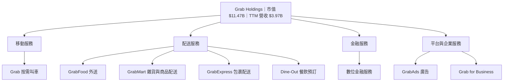
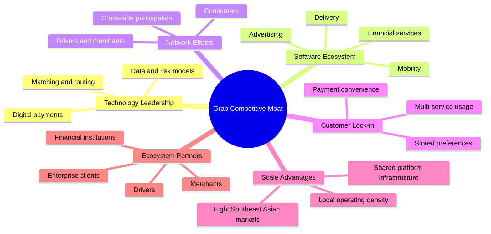
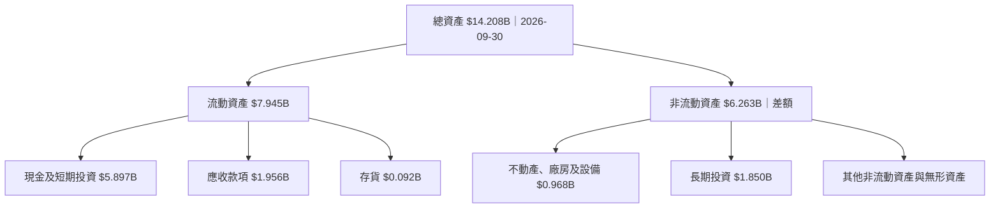
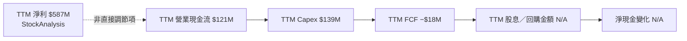
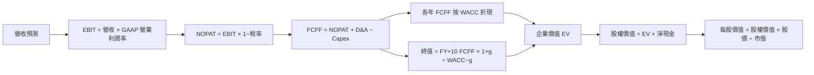
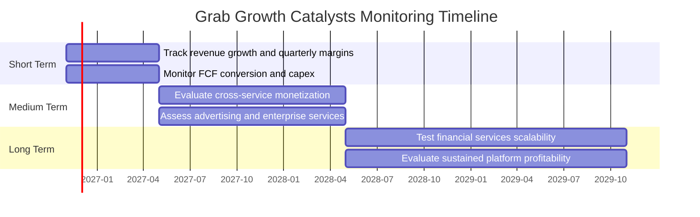
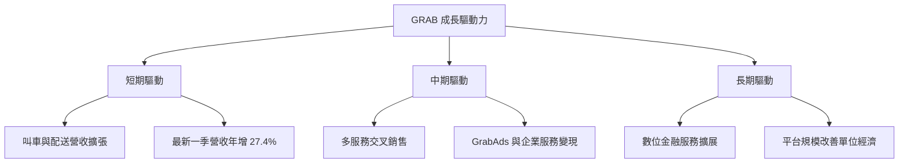
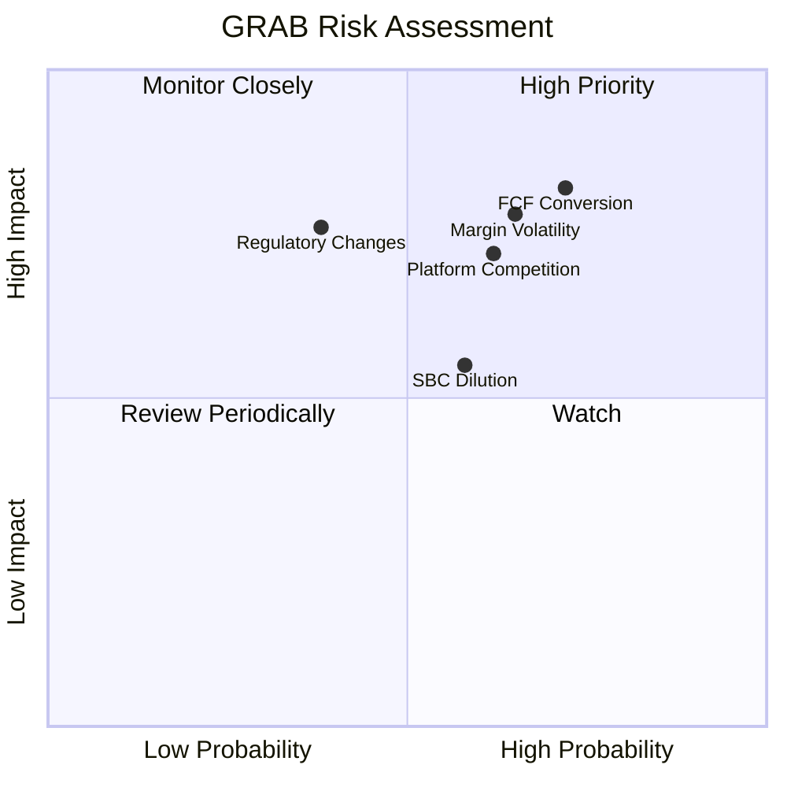
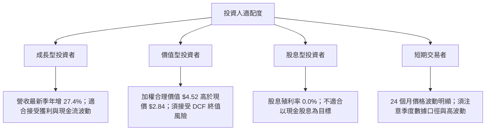

# GRAB 基本面深度分析報告
> **報告日期**：2026-11-26 ｜ **語言**：繁體中文 ｜ **數據來源**：Yahoo Finance、Finviz、StockAnalysis、Roic.ai ｜ **分析師**：CFA 級機構研究

## 目錄

| # | 章節 | 核心結論 |
|---|------|----------|
| 1 | 執行摘要 | 買入；加權合理價值 $4.52；MOS 37.2% |
| 2 | 公司概覽與商業模式 | 超級 App 多業務平台；市占與分部營收占比未提供 |
| 3 | 損益表深度分析 | TTM 營收 $3.97B；最新一季年增 27.4%，季度營業利益率 5.6% |
| 4 | 資產負債表分析 | 淨現金 $3.83B；流動比率 1.384 |
| 5 | 現金流量深度分析 | TTM FCF −$18M，FCF Yield −0.16% |
| 6 | 獲利能力與資本效率 | WACC 8.26%；ROIC 未提供，無法判定價值創造 |
| 7 | 相對估值分析 | 相對估值方法結果分散；分析師共識目標價 $5.39 |
| 8 | DCF 內在價值評估 | DCF 基準值 $6.27；加權合理價值 $4.52 |
| 9 | 成長催化劑 | 外送、叫車、金融服務與廣告可擴張；TAM 數字未提供 |
| 10 | 風險矩陣 | 主要風險為利潤波動、競爭與 FCF 轉換不穩 |
| 11 | 投資建議 | 買入；建議區間 $2.84–$4.07，並以季度現金流與利潤率驗證 |

## 1. 執行摘要

GRAB 的 2026-11-25 收盤價為 **$2.84**。依估值方法加權，合理價值為 **$4.52**，安全邊際（MOS）為 **37.2%**，規則 20 的評級為**買入**。支持估值的數據包括：基準 DCF 每股價值 **$6.27**、同業 Forward P/E 法 **$2.36**、同業 EV/EBITDA 法 **$3.52**、22 位分析師平均目標價 **$5.39**。但 TTM FCF 為 **−$18M**、FCF Yield **−0.16%**，且 ROIC 資料缺漏，故本報告不將評級上調為強烈買入；核心論點仍須由後續正向 FCF 與利潤率趨勢驗證。

### 1.0 一頁式投資儀表板

| 項目 | 內容 |
|------|------|
| **投資論點（3 句）** | ① 最新一季營收年增 **27.4%**，平台交易與服務擴張帶動成長。② TTM 營業利益率 **11.0%**，但最新一季為 **5.6%**，顯示季度獲利波動值得監控。③ 現金及短期投資 **$5.90B**，高於總債務 **$2.07B**，但 TTM FCF **−$18M** 表示現金創造尚未穩定。 |
| **綜合評分** | **6.7/10**（引用 1.1 評分卡） |
| **財務健康** | 🟢 淨現金 **$3.83B**、流動比率 **1.384**；但 TTM FCF 為負 |
| **ROIC vs WACC** | **N/A vs 8.26%**；ROIC 缺少可用數據，無法判定是否創造價值 |
| **FCF 趨勢** | 近年波動、TTM 為 **−$18M**；FCF Yield **−0.16%** |
| **估值** | Forward P/E **18.09x** ｜ EV/EBITDA **18.163x** ｜ FCF Yield **−0.16%** |
| **DCF 內在價值（基準）** | **$6.27** ｜ 相對 DCF 折價 **54.7%**（現價 ÷ DCF 價值 − 1） |
| **安全邊際（MOS）** | **37.2%**＝（加權合理價值 **$4.52** − 現價 **$2.84**）÷ **$4.52**｜🟢 >25% |
| **預期報酬（基準情境 12M）** | **+120.7%**（DCF 基準情境 $6.27 相對現價；非時間保證） |
| **關鍵風險（前二）** | 最新一季營業利益率僅 **5.6%**；TTM FCF **−$18M** |
| **評級 + 信心度** | 🟢 **買入** ｜ 信心：中（DCF 受終值假設主導，且 ROIC、分部資料缺漏） |

### 1.1 綜合評分卡（全報告唯一）

| 維度 | 評分（1–10） | 主要依據（引用數字與其來源章節） |
|------|--------------:|----------------------------------|
| 成長性 | 8.0 | 最新一季營收年增 **27.4%**；TTM 營收成長率 N/A（第 3 章） |
| 獲利能力 | 5.0 | TTM 營業利益率 **11.0%**，但最新一季 **5.6%**；ROIC、F-Score N/A（第 3、6 章） |
| 財務健康 | 7.5 | 淨現金 **$3.83B**、流動比率 **1.384**、現金轉換週期 **−182 天**（第 4 章） |
| 估值 | 7.0 | MOS **37.2%**；同業 Forward P/E 法價值 $2.36，低於現價（第 7、8 章） |
| 護城河 | 7.0 | 八個國家營運、叫車／外送／金融等多服務超級 App；市場份額與用戶留存數據未提供（第 2 章） |
| 管理層與資本配置 | 5.5 | 2025 年 SBC **$241M**、股息支出為零；回購資料未提供，資本回報仍有限（第 3、5 章） |
| **綜合評分** | **6.7** | 六項算術平均＝(8.0+5.0+7.5+7.0+7.0+5.5)÷6＝**6.7** |

### 1.2 五大投資論點 + 三大核心風險

| 類型 | 項目 | 具體依據 | 信心度 |
|------|------|----------|--------|
| 🟢 **投資論點①** | 平台交易仍有成長動能 | 2026 Q3 營收 **$1.112B**，較 2025 Q3 **$873M** 年增 **27.4%**；擴大使用頻次與跨服務滲透可延續營收增長 | 🟢 高 |
| 🟢 **投資論點②** | 盈利基礎已由虧轉盈 | 2025 年營業利益 **$222M**，相較 2024 年 **−$55M** 改善；規模提升可帶來營運槓桿，但季度利潤仍有波動 | 🟡 中 |
| 🟢 **投資論點③** | 資產負債表具緩衝 | 現金及短期投資 **$5.90B**、總債務 **$2.07B**、淨現金 **$3.83B** | 🟢 高 |
| 🟢 **投資論點④** | 估值方法加權後低於內在價值 | 加權合理價值 **$4.52**，較現價 $2.84 高；MOS **37.2%** | 🟡 中 |
| 🟢 **投資論點⑤** | 多服務平台具交叉銷售條件 | 業務涵蓋叫車、外送、雜貨配送、數位金融與廣告；但分部收入占比及交叉銷售效果未提供 | 🟡 中 |
| 🟡 **風險①** | 現金流尚未穩定 | TTM 營業現金流 **$121M**、Capex **$139M**，FCF **−$18M**；持續負 FCF 會削弱 DCF 支撐 | 🔴 高衝擊 |
| 🔴 **風險②** | 季度營業利益與淨利波動 | 2026 Q3 營業利益 $170M、淨利 $27M；季度表與其他財務來源的營業利益數據存在差異，需確認會計口徑 | 🔴 高衝擊 |
| 🟡 **風險③** | 股權薪酬造成股東稀釋 | 2025 SBC **$241M**，約為當年營收 **7.2%**；若 SBC 長期維持高位，將稀釋股東經濟報酬 | 🟡 中度 |

### 1.3 快速統計卡片

| 指標 | 公司實際值（期間） | 同業中位數 | 狀態 |
|------|--------------------|------------|------|
| 營收成長（TTM） | **N/A** | — | 🟡 |
| 營收成長（最新一季年增） | **27.4%** | **34.0%**（UBER、SE、DASH 中位數） | 🟡 |
| 毛利率（TTM） | **41.4%** | **45.0%** | 🟡 |
| 營業利益率（TTM） | **11.0%** | — | 🟢 |
| ROIC（TTM） | **N/A** | — | 🟡 |
| Forward P/E | **18.09x** | **15.1x**（三家中位數） | 🟡 |
| FCF Yield（TTM） | **−0.16%** | — | 🔴 |
| Piotroski F-Score | **N/A / 9** | — | 🟡 |

### 1.4 投資結論

╔══════════════════════════════════════════════════════════════════╗  
║                    📊 投資結論摘要                               ║  
╠══════════════════════════════════════════════════════════════════╣  
║  評級：買入（依規則 20；MOS 達 37.2%，但 ROIC 未提供，未升級）   ║  
║  價格（2026-11-25 收盤）：$2.84                                 ║  
║  DCF 內在價值（基準）：$6.27（相對現價折價 54.7%）               ║  
║  安全邊際 MOS：37.2%（以加權合理價值為分母）                     ║  
║  加權合理價值（8.8）：$4.52                                     ║  
║  DCF 情境價值：                                                   ║  
║    悲觀情境：$3.22（+13.2%）                                     ║  
║    基準情境：$6.27（+120.7%）                                    ║  
║    樂觀情境：$13.09（+360.9%）                                   ║  
║  綜合評分：6.7/10（引用 1.1）                                    ║  
║  適合投資人：可承受波動、重視平台成長與估值折價的長線投資人      ║  
╚══════════════════════════════════════════════════════════════════╝  

## 2. 公司概覽與商業模式

### 2.1 業務結構與收入來源

GRAB 經營 Grab 超級 App，服務範圍涵蓋柬埔寨、印尼、馬來西亞、緬甸、菲律賓、新加坡、泰國與越南。公司資料未提供各業務線營收及營收占比，因此不以推估比例繪製分部圖。

各項業務均為公司服務範圍的描述，**沒有可核實的分部營收與占比數字**；因此不將 $3.97B TTM 營收拆分至個別服務，也不假設軟體收入比重。

### 2.2 市場份額

市場份額數據未提供。GRAB TTM 營收為 **$3.97B**，最新一季營收年增 **27.4%**；Peer multiples 中 UBER 最新一季營收年增 **9.6%**、SE **43.4%**、DASH **34.0%**。這些數字能比較公司成長動能，不能直接推導市場份額。

### 2.3 競爭護城河分析

### 2.4 護城河強度

| 護城河項目 | 強度（強／中／弱） | 證據（引用數字或事實） | 會削弱它的情況 |
|------------|--------------------|------------------------|----------------|
| 技術平台 | 中 | 超級 App 支援多類交易；員工 **12,012 人**。研發費用 FY2025 **$428M** | 技術差異無法轉化為留存或單位經濟改善 |
| 軟體生態系統 | 中至強 | 叫車、外送、雜貨、快遞、廣告及企業服務整合於同一平台 | 用戶跨服務使用率低、各業務仍需獨立補貼 |
| 網路效應 | 中 | 連結消費者、商戶、司機及配送員；用戶與供應端規模數據未提供 | 競爭者補貼或供應端多平台化稀釋網路優勢 |
| 客戶鎖定 | 中 | 多服務與支付便利性可能提升使用黏著；留存率數據未提供 | 用戶對價格敏感、輕易轉換平台 |
| 規模效應 | 中 | 八個東南亞國家營運，TTM 營收 $3.97B | 各市場營運碎片化、法規與補貼成本吞噬規模效益 |
| 生態夥伴 | 中 | 商戶、司機、金融機構與企業服務客戶形成供應合作網 | 合作方議價能力增加，或補貼、抽成條件惡化 |

**1.1「護城河」評分為 7.0/10**：多服務平台與八國營運構成生態優勢，但缺少市占、用戶留存及單位經濟數據，故不視為已被量化證實的強護城河。

## 3. 損益表深度分析

### 3.1 年度收入成長趨勢（近 4 年）

╔══════════════════════════════════════════════════════════════════╗  
║              GRAB 年度收入趨勢（FY2022–FY2025）                 ║  
╠══════════════════════════════════════════════════════════════════╣  
║  FY2022  $1.43B  █████████░░░░░░░░░░░░░░░  YoY：+112.3% 🟢     ║  
║  FY2023  $2.36B  ███████████████░░░░░░░░░  YoY：+64.6%  🟢     ║  
║  FY2024  $2.80B  ██████████████████░░░░░░░  YoY：+18.6%  🟢     ║  
║  FY2025  $3.37B  ██████████████████████░░░  YoY：+20.5%  🟢     ║  
║                                                                  ║  
║  FY2022–FY2025 收入 CAGR：約 33.0%                               ║  
╚══════════════════════════════════════════════════════════════════╝  

FY2022 至 FY2025 的收入 CAGR 約 **33.0%**，計算為 \((3.37÷1.433)^{1/3}-1\)。但此 CAGR 包含較低的 FY2022 基期；FY2023 後增速回落至約 19%–21%，顯示不能將早期高增長直接外推。

年度收入數據來源呈現精度差異：年度損益表列 FY2024 $2.80B、FY2025 $3.37B；StockAnalysis 分別列 $2.797B、$3.370B。本節以財務表所列數值展示，未以細小差異推導其他指標。

### 3.2 季度收入趨勢分析

| 季度 | 營收 | QoQ 成長 | YoY 成長 | 備註 |
|------|------:|---------:|---------:|------|
| 2025 Q4 | $906M | +4.0% | N/A | QoQ 對照 2025 Q3 $873M；缺少可一致引用的 2024 Q4 單季數字 |
| 2026 Q1 | $955M | +5.4% | +23.5% | YoY 對照 2025 Q1 $773M |
| 2026 Q2 | $998M | +4.5% | +21.9% | YoY 對照 2025 Q2 $819M |
| 2026 Q3 | $1,112M | +11.4% | +27.4% | YoY 對照 2025 Q3 $873M |

QoQ 與 YoY 按季度營收計算，例如 2026 Q3 QoQ＝$1,112M÷$998M−1＝**11.4%**。營收成長可反映平台交易擴張與服務使用增加，但未提供訂單量、抽成率與價格貢獻拆分，無法判斷成長究竟由交易量或變現率主導。

### 3.3 利潤率演變分析

| 利潤率指標 | FY2022 | FY2023 | FY2024 | FY2025 | 趨勢 | 評估 |
|------------|-------:|-------:|-------:|-------:|------|------|
| **毛利率** | 約 5.4% | 約 36.4% | 約 41.8% | 約 43.3% | ↑ | 🟡 |
| **營業利益率** | 約 −90.2% | 約 −16.4% | 約 −2.0% | 約 6.6% | ↑ | 🟢 |
| **淨利率** | 約 −117.5% | 約 −18.4% | 約 −3.8% | 約 8.0% | ↑ | 🟡 |

年度毛利率與營業利益率為依年度損益表金額計算的近似值；毛利數據亦存在不同來源的差異。TTM 口徑的已核實毛利率為 **41.4%**、營業利益率 **11.0%**、淨利率 **14.8%**；最新一季營業利益率為 **5.6%**。季度表的營業利益金額與公司摘要中的季度營業利益率並非完全一致，故應以所列 TTM／最新季已核實比率為主，不把單季差異當成已確認的利潤率趨勢。

營業利益從 FY2022 的 −$1.29B 改善至 FY2025 的 $222M，反映營收規模擴大與費用負擔相對下降的可能性。不過 FY2026 最新一季營業利益率 5.6% 低於 TTM 的 11.0%，須查明季度項目、促銷與獎勵成本、產品組合及會計列報差異，不能單憑 TTM 認定利潤率已穩定。

### 3.4 費用結構分析

完整且同口徑的費用結構數據未提供，故不以不完整項目繪製費用占比圓餅圖。已披露的研發支出為 FY2025 **$428M**，約占營收 **12.7%**（$428M÷$3.37B）；FY2024 為 $410M，FY2023 為 $421M，FY2022 為 $465M。研發投入支援平台、產品與技術能力，但需配合客戶留存、變現率與利潤改善評估回報。

### 3.5 季度 EPS 趨勢與盈餘品質（Quality of Earnings）

| 季度 | EPS 實際值 | EPS 預估／超預期狀況 | 淨利 | 判讀 |
|------|-----------:|----------------------|-----:|------|
| 2025 Q4 | $0.04 | 預估值 N/A | $172M | 無法判斷 beat/miss |
| 2026 Q1 | −$0.01 | 預估值 N/A | $136M | EPS 與淨利資料呈現不完全一致 |
| 2026 Q2 | $0.06 | 預估值 N/A | $253M | 無法判斷 beat/miss |
| 2026 Q3 | $0.01 | 預估值 N/A | $27M | 最新一季 EPS 年增 −32.2%；淨利年增 −27.0% |

EPS estimate 與實際 EPS 的歷史資料欄位皆為 nan，因此**無法判斷過去四季是否超預期或不及預期，也無法可靠解釋市場預期差異**。EPS 實際值依 StockAnalysis 季度資料列示。

| 盈餘品質項目 | 數值／佔比 | 評估 |
|--------------|------------|------|
| 股權薪酬 SBC / 營收 | 近四季 SBC 合計 **$234M**；÷ TTM 營收 $3.97B＝**5.9%** | 🟡 持續 SBC 會稀釋股東經濟報酬 |
| SBC / 營業現金流 | $234M÷$121M＝**193.4%** | 🔴 高於營業現金流，現金轉換尚弱 |
| FCF / 淨利（現金轉換率） | 以近四季淨利 $588M 計：−$18M÷$588M＝**−3.1%** | 🔴 正會計獲利尚未轉成正 FCF |
| 一次性／非經常性損益 | N/A；未提供足夠項目明細 | 無法確認淨利是否受到一次性項目影響 |
| 有效稅率異常 | **25.7%**（最新年度有效稅率） | 缺少季度稅務調節表，不能判斷單季稅率異常 |
| 資本化支出 vs 費用化 | TTM Capex **$139M**；資本化明細未提供 | 無法量化資本化政策對當期利潤的影響 |

近四季 SBC 合計為 $49M+$62M+$78M+$45M＝**$234M**；近四季淨利為 $27M+$253M+$136M+$172M＝**$588M**。兩項為揭露季度數字的加總，並非另行估計。淨利轉換為 FCF 為負，故目前的 GAAP 盈利含金量仍須由未來數季現金流證實；估值上不宜只依 EPS 或淨利倍數判斷。

## 4. 資產負債表分析

### 4.1 資產結構分解

截至 2026-09-30，總資產 **$14.208B**、流動資產 **$7.945B**；非流動資產以總資產減流動資產推得 **$6.263B**。單項資產可能有重分類或口徑差異，不將列示明細相加作為資產負債表平衡表。

### 4.2 流動性與營運資金分析

| 指標 | 最新 TTM | 一年前 TTM | 變化 | 解讀 |
|------|---------:|------------:|------:|------|
| DSO 應收帳款天數 | 22 天 | N/A | N/A | 一年前數據未提供，無法判斷收款速度變化 |
| DIO 存貨天數 | 15 天 | N/A | N/A | 存貨天數不高，但缺少同比基準 |
| DPO 應付帳款天數 | 219 天 | N/A | N/A | 反映付款週期較長；是否代表議價力或供應商條件，仍需結合合約與應付項目確認 |
| CCC 現金轉換週期 | −182 天 | N/A | N/A | CCC＝22+15−219＝−182 天；可能表示收款快於付款，但服務平台應付項目構成需進一步拆解 |

流動比率為 **1.384**、速動比率 **1.07**，均高於 1，但流動負債在 2025 年底升至 **$4.63B**，高於 2024 年底 $2.59B。現金及短期投資提供了較大短期緩衝；應持續監控負債分類、應付商戶款與短期借款的構成。

### 4.3 債務結構分析

╔══════════════════════════════════════════════════════════════════╗  
║                   GRAB 債務健康診斷                             ║  
╠══════════════════════════════════════════════════════════════════╣  
║  總債務：        $2.07B  ███████░░░░░░░░░░░░░  🟡              ║  
║  現金＋短期投資：$5.90B  ████████████████████  🟢              ║  
║  淨現金：        $3.83B  █████████████░░░░░░░  🟢              ║  
║                                                                  ║  
║  流動比率：1.384｜速動比率：1.07                                ║  
║  Debt/EBITDA、利息保障倍數：N/A（缺少可一致核對的輸入）          ║  
╚══════════════════════════════════════════════════════════════════╝  

現金與短期投資超過總債務 **$3.83B**，因此償債緩衝尚可；但不宜將全部短期投資視為可立即動用現金，也不能由資料缺漏處自行補算利息保障倍數或 Debt/EBITDA。

### 4.4 股東權益趨勢

╔══════════════════════════════════════════════════════════════════╗  
║                 GRAB 年度股東權益變化                           ║  
╠══════════════════════════════════════════════════════════════════╣  
║  FY2022  $6.60B  ████████████████████                      ║  
║  FY2023  $6.45B  ████████████████████                      ║  
║  FY2024  $6.40B  ███████████████████                      ║  
║  FY2025  $6.73B  █████████████████████                    ║  
║  2026-09-30：股東權益數值未提供                                 ║  
╚══════════════════════════════════════════════════════════════════╝  

FY2025 股東權益較 FY2024 增加 **$0.33B**，但完整權益變動表未提供，無法拆解淨利、SBC、換算調整與其他變動的貢獻。

## 5. 現金流量深度分析

### 5.1 現金流量瀑布圖

季度淨利、營業現金流及資本支出存在不同期間／口徑，以下瀑布圖用 TTM 營業現金流與 Capex，淨利與分配項目不作金額連接，避免混用期間。

### 5.2 FCF 轉換率趨勢

| 年度 | FCF | 淨利 | FCF／淨利 | 解讀 |
|------|----:|-----:|----------:|------|
| FY2022 | −$872M | −$1.683B | 約 51.8% | 分子、分母皆負，比率不具一般現金轉換率的經濟意義 |
| FY2023 | −$6M | −$434M | 約 1.4% | 淨虧損下比值不適合用作獲利品質指標 |
| FY2024 | $739M | −$105M | 約 −703.8% | 正 FCF 與會計虧損方向相反，可能受營運資金等影響；明細不足 |
| FY2025 | −$44M | $268M | 約 −16.4% | 會計獲利未轉成正 FCF |
| TTM 至 2026-09-30 | −$18M | 約 $587M | 約 −3.1% | FCF 為負，現金轉換仍需改善 |

### 5.3 自由現金流趨勢

╔══════════════════════════════════════════════════════════════════╗  
║                 GRAB 歷史自由現金流                             ║  
╠══════════════════════════════════════════════════════════════════╣  
║  FY2022  −$872M  ◀████████████████████  FCF Yield N/A            ║  
║  FY2023    −$6M  ◀░░░░░░░░░░░░░░░░░░░░  FCF Yield N/A            ║  
║  FY2024   $739M  ████████████████████▶  FCF Yield N/A            ║  
║  FY2025   −$44M  ◀█░░░░░░░░░░░░░░░░░░░  FCF Yield N/A            ║  
║  TTM      −$18M  ◀░░░░░░░░░░░░░░░░░░░  FCF Yield −0.16%         ║  
╚══════════════════════════════════════════════════════════════════╝  

歷史 FCF 大幅波動，且 FY2024 的 $739M 未延續至 FY2025。TTM FCF 由營業現金流 $121M 減資本支出 $139M 得 **−$18M**；因此，未來估值成立的關鍵之一是營收成長能否同時提高現金轉換，而不是只帶來會計利潤。

### 5.4 資本配置評估

股息與資本配置金額不完整，不以比例圓餅圖呈現。

| 項目 | 已知金額 | 評估 |
|------|---------:|------|
| Capex | TTM **$139M**；FY2025 $123M | 支持平台與營運能力；未提供維持性／成長性拆分 |
| 現金股息 | FY2022–FY2025 均為 **$0**；股息殖利率 0.0% | 資本回報主要依賴股價增值 |
| SBC | FY2025 **$241M**；2025 Q4 至 2026 Q3 合計 $234M | 需關注稀釋成本是否隨營收下降 |
| 回購 | N/A | 回購金額資料未提供 |
| 現金與短期投資 | **$5.90B** | 提供財務彈性，但投資配置細節未提供 |

## 6. 獲利能力與資本效率

### 6.1 ROE / ROA / ROIC 趨勢

| 指標 | 已知數值 | 趨勢與評估 |
|------|---------:|------------|
| ROE（TTM） | **7.6%** | 當期為正，但缺少一致的多年度季度序列 |
| ROA（TTM） | **1.1%** | 資產回報較低，需關注資產效率與獲利持續性 |
| ROIC（TTM） | **N/A** | 缺少可用的投入資本／NOPAT 口徑，無法判斷是否高於資本成本 |
| 行業均值 | N/A | 未提供可核實同業 ROE、ROA、ROIC 均值，不列入比較 |

### 6.2 ROIC vs WACC 分析（核心價值創造判斷）

╔══════════════════════════════════════════════════════════════════╗  
║                ROIC vs WACC 深度分析                            ║  
╠══════════════════════════════════════════════════════════════════╣  
║  WACC 輸入（依 Cost of capital）：                               ║  
║  ├── 無風險利率（10Y 美債）：4.85%                               ║  
║  ├── ERP：5.00%                                                  ║  
║  ├── 原始 Beta：0.83；採用調整後 Beta：0.89                     ║  
║  ├── 股權成本 Ke：9.29%                                         ║  
║  ├── 稅前債務成本：3.43%；有效稅率：25.7%                       ║  
║  ├── E／D 權重：84.7%／15.3%                                    ║  
║  └── ✅ 採用 WACC：8.26%                                        ║  
║                                                                  ║  
║  ROIC（TTM）：N/A（投入資本與 NOPAT 資料不足）                   ║  
║  EVA＝ROIC−WACC：N/A                                             ║  
║  結論：不能判定 GRAB 正在創造或摧毀股東價值                     ║  
╚══════════════════════════════════════════════════════════════════╝  

採用 WACC 為資料列示的 **8.26%**，不是另行重估。調整後 Beta 的規則為 \(⅔×0.83+⅓×1=0.89\)，呈現值依來源為 0.89；來源提供的 Ke 為 9.29%。ROIC 資料缺漏，不能以營業利益率或 ROE 代替 ROIC，也不能計算 EVA 或 ROIC/WACC 倍數。

### 6.3 杜邦三因素分解

**N/A（數據未提供：品質指標計算需要的淨利、營收、總資產或正權益口徑未能同時匹配；不能重算替代。）**

### 6.4 財務體質：Piotroski F-Score

**N/A（需 SEC 申報資料及兩個相隔一年的 TTM 期間；目前可用資料不符合計算條件。）** 九項測試的個別結果亦未提供，因此不補列或推算分數。

## 7. 相對估值分析

### 7.1 同業估值比較表格

GRAB 公司估值來自市場資料；同業估值倍數依同一 Peer multiples 數據列示。

| 估值指標 | **GRAB** | **UBER** | **SE** | **DASH** | GRAB 評估 |
|----------|---------:|---------:|-------:|--------:|-----------|
| **Trailing P/E** | 28.4x | 39.0x | 24.1x | 69.0x | 🟡 位於同業區間內 |
| **Forward P/E** | 18.09x | 15.1x | 14.0x | 21.8x | 🟡 高於 UBER、SE，低於 DASH |
| **P/S Ratio** | 2.89x | 2.4x | 1.4x | 4.3x | 🟡 高於 UBER、SE，低於 DASH |
| **EV/EBITDA** | 18.163x | 18.4x | 13.1x | 40.9x | 🟡 接近 UBER、高於 SE |
| 最新一季營收年增 | 27.4% | 9.6% | 43.4% | 34.0% | 🟡 高於 UBER、低於 SE 與 DASH |
| **毛利率（TTM）** | 41.4% | 41.4% | 45.0% | 52.7% | 🟡 低於 SE、DASH |

Peer multiples 中位數：Forward P/E **15.1x**（三家）、EV/EBITDA **15.8x**（區塊列示的 UBER、SE 兩家）。GRAB 的 Forward P/E **18.09x** 高於其同業倍數中位數；能否維持溢價，取決於營收成長是否轉化為穩定正 FCF。

### 7.2 歷史估值區間分析

╔══════════════════════════════════════════════════════════════════╗  
║                 GRAB 歷史估值區間                               ║  
╠══════════════════════════════════════════════════════════════════╣  
║  歷史 P/E 區間／估值百分位：N/A（未提供自身歷史估值區間）        ║  
║  當前 Trailing P/E：28.4x｜Forward P/E：18.09x                   ║  
╚══════════════════════════════════════════════════════════════════╝  

24 個月股價資料顯示 2024-11 月收盤 $5.00、2025-09 月 $6.02、2026-10 月 $2.71、2026-11 月 $2.84；這是價格歷史，不能取代估值倍數的歷史百分位。

### 7.3 情境價值（Bear / Base / Bull，依 DCF MODEL）

| 情境 | 第 1 年營收成長 | 期末營業利潤率 | WACC | 每股價值 | 相對現價 | 機率 | 會發生的條件 |
|------|----------------:|---------------:|-----:|---------:|---------:|-----:|--------------|
| 🔴 悲觀 | 13.7% | 9.3% | 9.26% | $3.22 | +13.2% | 25% | 成長明顯降速，競爭與成本壓力令利潤率低於基準 |
| 🟡 基準 | 27.4% | 11.0% | 8.26% | $6.27 | +120.7% | 50% | 最新一季成長能延續起步，利潤率維持基準假設 |
| 🟢 樂觀 | 41.1% | 12.0% | 7.26% | $13.09 | +360.9% | 25% | 交易與多服務變現加速、利潤率改善且資本成本降低 |

情境價值是 DCF 模型的既定輸出，不是分析師另行建立的退出倍數目標。各情境同時變動成長、利潤率與 WACC，因此不應把其價值差額單獨歸因於某一因素。

### 7.4 相對估值隱含價格區間

╔══════════════════════════════════════════════════════════════════╗  
║              相對估值與共識隱含每股價值                         ║  
╠══════════════════════════════════════════════════════════════════╣  
║  $2.36 ───── $2.84 ───── $3.52 ───── $5.39 ───── $6.27          ║  
║  Forward P/E  現價    EV/EBITDA   分析師共識      基準 DCF       ║  
╚══════════════════════════════════════════════════════════════════╝  

| 方法 | 每股價值 | 依據 |
|------|---------:|------|
| 同業 Forward P/E | **$2.36** | 同業中位數 **15.1x** × GRAB Forward EPS **$0.16** |
| 同業 EV/EBITDA | **$3.52** | 同業中位數 **15.8x**（UBER、SE）× TTM EBITDA，再加回淨現金 |
| 分析師共識 | **$5.39** | 22 位分析師平均目標價 |
| DCF 基準 | **$6.27** | 10 年 FCFF、WACC 8.26%、永續成長率 3.0% |

## 8. DCF 內在價值評估（Discounted Cash Flow）

### 8.0 估值推理鏈（Thinking Logic）

**核心命題**：GRAB 的價值主要由現有叫車與配送服務的現金流底盤、金融及廣告等平台服務的變現能力，以及長期營收成長共同決定；但各業務分部營收占比未提供，無法量化各引擎權重。模型中最主導估值的是終值與未來 FCFF，終值現值占企業價值 **67.6%**。

| 決策點 | 本報告採用 | 理由（含數字） | 曾考慮但否決 | 否決理由 |
|--------|-----------|----------------|--------------|----------|
| 現金流定義 | FCFF | 配合 WACC 折現得企業價值 | FCFE | 不採用股權現金流模型，以免債務變化與折現口徑混用 |
| 預測期 N | 10 年 | DCF MODEL 固定 10 年；使營收增速由 27.4% 線性降至 3.0% | 5 年 | 會改變已提供模型，不符合本報告鎖定的程式輸出 |
| 終值方法 | Gordon Growth 為基準 | 模型採 g=3.0%，低於 WACC=8.26% | 自行替換退出倍數 | 區塊未提供退出倍數法終值輸出，不另建模型 |
| EBIT 基礎 | GAAP EBIT | 模型明列 GAAP EBIT | 非 GAAP EBIT | 會改變既有 DCF 輸入及 SBC 處理 |

#### 關鍵假設推導鏈

- **營收成長**：錨點＝最新一季營收 YoY **27.4%**，TTM 對前一個 TTM 成長率 N/A → 模型以 27.4% 作 FY+1 起點，之後線性降至 FY+10 的 3.0% → **採用模型逐年列示的 27.4% 至 3.0%** → 不以 FY2022–FY2025 CAGR 約 33.0% 當長期增速，因低基期會高估可持續性；也不以缺失的管理層財測替代。
- **期末營業利潤率**：錨點＝TTM 營業利益率 **11.0%**；FY2025 營業利益 $222M、營收 $3.37B → 模型維持 11.0% 不再擴張 → **採用 11.0%** → 否決超過 11.0% 的基準利潤率，因最新一季營業利益率僅 5.6%，近期表現未支持更高利潤率。
- **永續成長率 g**：錨點＝模型採用 **3.0%**；資料未提供 GRAB 長期宏觀成長預測 → **採用 3.0%**，低於 WACC 8.26% → 不採用高於 3.0% 的基準值，以避免對長期終值過度樂觀。
- **預測期 N**：錨點＝DCF MODEL 固定 **10 年**，營收增速逐年衰減 → **採用 10 年** → 不改用更短或更長年期，因模型已固定且無管理層長期預測可另作校準。
- **Capex／營收**：錨點＝TTM Capex／營收約 **3.5%** → 模型在 FY+1 至 FY+10 維持 3.5% → **採用 3.5%** → 不採用低於 3.5% 的比例，因 TTM FCF 尚為負、也未有長期資本支出指引。
- **EBIT 基礎與 SBC**：錨點＝模型採用 GAAP EBIT，既有 TTM 營業利益率 11.0% → GAAP 已將 SBC 納入費用 → **採用固定股數、不再扣 SBC、年稀釋率 0%** → 不再額外扣除 SBC，避免重複扣除。本模型採用 **(A) GAAP EBIT + 固定股數**，故 SBC 影響已計入一次。
- **WACC**：錨點＝資本成本資料給出的 WACC **8.26%** → 直接採用，不自行重算或替換 → 不採用自行估算的 WACC，以保持與 DCF MODEL 一致。
- **稅率、D&A／營收**：錨點及模型採用值分別為 **25.7%**、**5.6%**；由模型固定沿用。
- **ΔWC／營收增額**：DCF MODEL 明確未建模營運資金變化，故本模型不加入 ΔWC 項；這是模型簡化，不代表營運資金不影響現金流。

**最脆弱的一環**：FY+1 直接採用最新季度 27.4% 成長率，且終值占 EV 的 67.6%；若成長或永續現金流低於模型，價值將向敏感性矩陣中的較低值移動，例如 WACC 9.26%、g 3.0% 時每股 **$5.34**。

### 8.1 模型假設總表（Model Inputs）

| 假設項目 | 採用值 | 依據／來源 | 敏感度 |
|----------|--------|-------------|--------|
| 預測期長度 N | **10 年** | DCF MODEL 固定年期 | 🟡 中 |
| FY+1 營收成長 | **27.4%**，之後線性降至 FY+10 3.0% | 最新一季 YoY 27.4%；TTM 成長率 N/A | 🔴 高 |
| 營業利潤率 | FY+1–FY+10 **11.0%** | TTM 營業利益率 11.0% | 🔴 高 |
| 有效稅率 | **25.7%** | 最新年度有效稅率 | 🟢 低 |
| Capex／營收 | **3.5%** | TTM 數據 | 🟡 中 |
| D&A／營收 | **5.6%** | TTM 模型輸入 | 🟢 低 |
| 營運資金變動 | **未建模** | DCF MODEL 說明 | 🟢 低 |
| EBIT 基礎 | **GAAP** | DCF MODEL | 🟡 中 |
| SBC 處理 | GAAP 已含 SBC；不另扣 | 組合 A | 🟡 中 |
| 年稀釋率 | **0%**，固定股數處理 | 組合 A；每股換算採模型公式 | 🟡 中 |
| 永續成長率 g | **3.0%** | DCF MODEL | 🔴 高 |
| 終值方法 | Gordon Growth | DCF MODEL；未提供退出倍數終值 | 🔴 高 |
| WACC | **8.26%** | Cost of capital | 🔴 高 |

模型採用 FCFF＝NOPAT + D&A − Capex，沒有 ΔWC 列；因為輸入模型明確未建模營運資金，不能自行加入估算值。金額以下均為美元十億元，沿用模型列示數字，四捨五入依模型各欄位精度。

### 8.2 折現率推導（WACC）

╔══════════════════════════════════════════════════════════════════╗  
║                    WACC 推導（折現率）                           ║  
╠══════════════════════════════════════════════════════════════════╣  
║  股權成本 Ke（CAPM）：                                           ║  
║  ├── 無風險利率：4.85%                                           ║  
║  ├── ERP：5.00%                                                  ║  
║  ├── 原始 Beta：0.83；採用調整後 Beta：0.89                     ║  
║  ├── 規模／國別額外溢酬：未列示                                  ║  
║  └── 資料列示 Ke：9.29%                                          ║  
║                                                                  ║  
║  債務成本 Kd：                                                   ║  
║  ├── 稅前債務成本：3.43%                                         ║  
║  ├── 有效稅率：25.7%                                             ║  
║  └── 稅後 Kd：3.43%×(1−25.7%)＝2.55%                            ║  
║                                                                  ║  
║  資本結構：股權 84.7%；債務 15.3%                                ║  
║  ✅ 採用 WACC：8.26%                                             ║  
╚══════════════════════════════════════════════════════════════════╝  

**逐步演算與可稽核性說明：**

1. **Ke（CAPM）**：\(Rf+\beta×ERP\)，代入資料列示輸入 \(4.85\%+0.89×5.00\%\)。因 Beta 已四捨五入，按顯示數字計算與來源 Ke **9.29%** 可能有尾差；依要求採用來源列示 Ke，不替換。
2. **稅前 Kd**：來源列示 **3.43%**，計算口徑標為利息 ÷ debt；利息金額、平均計息負債明細未提供，故無法獨立重建分子與分母。
3. **稅後 Kd**：\(3.43\%×(1−25.7\%)=2.54849\%\)，四捨五入為 **2.55%**。
4. **權重**：來源列示股權 **84.7%**、債務 **15.3%**，合計 **100.0%**。最新市值 $11.47B、債務 $2.07B；但來源的權重分母與負債範圍細節未提供，故照用已核實權重，不另行改算。
5. **WACC**：依來源直接採用 **8.26%**。以顯示數字做簡化檢核，\(84.7\%×9.29\%+15.3\%×2.55\%=7.8706\%+0.3902\%=8.2608\%\)，四捨五入為 **8.26%**。

WACC 亦用於第 6.2 節，兩處一致。因缺少債務平均餘額與完整利息費用明細，以上是輸入值核對而非獨立重建 WACC。

### 8.3 逐年自由現金流預測（基準情境）

| 年度 | FY+1 | FY+2 | FY+3 | FY+4 | FY+5 | FY+6 | FY+7 | FY+8 | FY+9 | FY+10 |
|------|-----:|-----:|-----:|-----:|-----:|-----:|-----:|-----:|-----:|------:|
| 營收 | 5.06 | 6.31 | 7.69 | 9.18 | 10.70 | 12.18 | 13.53 | 14.67 | 15.51 | 15.98 |
| 營收 YoY | 27.4% | 24.7% | 22.0% | 19.3% | 16.6% | 13.8% | 11.1% | 8.4% | 5.7% | 3.0% |
| 營業利潤率 | 11.0% | 11.0% | 11.0% | 11.0% | 11.0% | 11.0% | 11.0% | 11.0% | 11.0% | 11.0% |
| EBIT（GAAP） | 0.55 | 0.69 | 0.84 | 1.01 | 1.17 | 1.33 | 1.48 | 1.61 | 1.70 | 1.75 |
| − 稅 | (0.14) | (0.18) | (0.22) | (0.26) | (0.30) | (0.34) | (0.38) | (0.41) | (0.44) | (0.45) |
| = NOPAT | 0.41 | 0.51 | 0.63 | 0.75 | 0.87 | 0.99 | 1.10 | 1.20 | 1.26 | 1.30 |
| + D&A | 0.28 | 0.35 | 0.43 | 0.52 | 0.60 | 0.68 | 0.76 | 0.82 | 0.87 | 0.90 |
| − Capex | (0.18) | (0.22) | (0.27) | (0.32) | (0.37) | (0.43) | (0.47) | (0.51) | (0.54) | (0.56) |
| **= FCFF** | **0.52** | **0.65** | **0.79** | **0.94** | **1.10** | **1.25** | **1.39** | **1.51** | **1.59** | **1.64** |
| 折現因子 @ 8.26% | 0.924 | 0.853 | 0.788 | 0.728 | 0.672 | 0.621 | 0.574 | 0.530 | 0.490 | 0.452 |
| **FCFF 現值 PV** | **0.48** | **0.55** | **0.62** | **0.69** | **0.74** | **0.78** | **0.80** | **0.80** | **0.78** | **0.74** |

模型列示預測期 PV 合計 **$6.97B**。依表格已四捨五入的 PV 加總為 \(0.48+0.55+0.62+0.69+0.74+0.78+0.80+0.80+0.78+0.74=6.98\)；與模型合計 $6.97B 相差 $0.01B，屬逐年數值四捨五入尾差。DCF 橋接採用模型總數 **$6.97B**，不以表格四捨五入數改寫模型。

**FY+1 逐步演算示範**：模型逐年表採用已四捨五入欄位，以下中間值與模型列示值可能有 $0.01B 內的尾差。

1. 營收：\(3.97×(1+27.4\%)=5.05778\)，模型列示 **$5.06B**。
2. EBIT：\(5.06×11.0\%=0.5566\)，模型列示 **$0.55B**。
3. 稅：\(0.55×25.7\%=0.14135\)，模型列示 **$0.14B**。
4. NOPAT：依模型列示 \(0.55−0.14=\)**$0.41B**。
5. D&A：\(5.06×5.6\%=0.28336\)，模型列示 **$0.28B**。
6. Capex：\(5.06×3.5\%=0.1771\)，模型列示 **$0.18B**。
7. ΔWC：模型未建模，未扣除。
8. FCFF：模型列示 **$0.52B**；以已四捨五入的分項直接相減會有尾差，採用模型精度下 FCFF。
9. 折現與 PV：\(1÷(1+8.26\%)^1=0.9237\)，列示 **0.924**；模型 PV **$0.48B**。

模型的逐年 FCFF、PV 與使用已四捨五入分項重算並非每格完全一致，故保留模型原值並明示精度限制，不以自行重算值替代。

**合理性自檢**

- 歷史 FCF CAGR：由 FY2022 −$872M、FY2025 −$44M 及 FY2024 正 $739M 構成，因有正負切換，**CAGR 不具可比性**；模型 FCFF 由 FY+1 $0.52B 至 FY+10 $1.64B，不能直接視為已由歷史趨勢驗證。
- FY+10 FCFF 利潤率＝模型列示 \(1.64÷15.98\) 約 **10.3%**；模型未提供可直接比較的同業 FCFF 利潤率，不能判斷是否高於產業最佳。
- 模型期間 FCFF 均為正；但實際 TTM FCF **−$18M**，預測轉正依賴營收成長與穩定利潤率假設。

╔══════════════════════════════════════════════════════════════════╗  
║            自由現金流：歷史實際 vs 模型預測                      ║  
╠══════════════════════════════════════════════════════════════════╣  
║  FY2022 實際  −$0.872B  ◀████████████████████                   ║  
║  FY2023 實際  −$0.006B  ◀░░░░░░░░░░░░░░░░░░░░                   ║  
║  FY2024 實際  +$0.739B  █████████████████                       ║  
║  FY2025 實際  −$0.044B  ◀█░░░░░░░░░░░░░░░░░░░                   ║  
║  FY+1 預測    +$0.52B   █████████████                           ║  
║  FY+10 預測   +$1.64B   █████████████████████                   ║  
╠══════════════════════════════════════════════════════════════════╣  
║  模型預測由負的 TTM FCF 轉向正 FCFF；需以未來實際現金流驗證       ║  
╚══════════════════════════════════════════════════════════════════╝  

### 8.4 終值計算（Terminal Value）

**適用性檢查**：WACC **8.26%** vs g **3.0%** → WACC > g？✅

| 方法 | 計算式 | 終值 TV | TV 現值 | 佔總 EV 比重 |
|------|--------|---------:|--------:|-------------:|
| Gordon Growth | 模型列示：1.64×(1+3.0%)÷(8.26%−3.0%) | $32.09B | $14.51B | 67.6% |
| 退出倍數法 | N/A（DCF MODEL 未提供此法終值） | N/A | N/A | N/A |

按模型列示值，TV 現值占 EV **67.6%**，尚未超過 75% 警示線，但終值仍占企業價值逾三分之二，估值對長期假設相當敏感。用顯示值直接計算 Gordon Growth 會受已四捨五入的 FY+10 FCFF 與折現因子影響；本報告沿用模型提供的 $32.09B、$14.51B，不用顯示值重建並改寫輸出。

### 8.5 企業價值 → 每股內在價值（Bridge）

╔══════════════════════════════════════════════════════════════════╗  
║              企業價值 → 每股內在價值 橋接表                      ║  
╠══════════════════════════════════════════════════════════════════╣  
║  預測期 FCF 現值合計            +$6.97B                          ║  
║  終值現值 PV(TV)                +$14.51B                         ║  
║  = 企業價值 EV                   $21.48B                         ║  
║  + 淨現金                       +$3.83B                          ║  
║  = 股權價值                      $25.31B                         ║  
║  每股 DCF 基準價值               $6.27                           ║  
║  現價（2026-11-25）              $2.84                           ║  
║  折溢價（現價÷DCF價值−1）        −54.7%（折價）                  ║  
╚══════════════════════════════════════════════════════════════════╝  

1. EV：\($6.97B+$14.51B=\)**$21.48B**。
2. 股權價值：\($21.48B+$3.83B=\)**$25.31B**。
3. 每股價值：模型公式為 equity value × price ÷ market cap；代入 \(25.31×2.84÷11.47=6.2666\)，列示 **$6.27**。此模型以股價／市值換算股數，不以股東權益帳面值除股數。
4. 折溢價：\($2.84÷$6.27−1\)＝約 **−54.7%**，代表現價低於 DCF 基準值。
5. 本節不計算 MOS；MOS 僅依 8.8 加權合理價值計算。

淨現金採用截至 2026-09-30 的現金及短期投資 **$5.90B** 減總債務 **$2.07B**，即 $3.83B。DCF 使用 GAAP EBIT，已含 SBC 費用；依組合 (A) 不另扣 SBC，股數不另按年放大。

### 8.6 敏感性分析（WACC × 永續成長率）

下表直接照錄模型敏感性輸出；括號上行空間以現價 $2.84 計，按表內每股價值四捨五入計算。

| g（列）／WACC（欄） | 6.26% | 7.26% | **8.26%（基準）** | 9.26% | 10.26% |
|-----------|------:|------:|------------------:|------:|-------:|
| 2.0% | $8.17（+187.7%） | $6.68（+135.2%） | $5.67（+99.6%） | $4.94（+73.9%） | $4.39（+54.6%） |
| 2.5% | $8.91（+213.7%） | $7.11（+150.4%） | $5.94（+109.2%） | $5.12（+80.3%） | $4.52（+59.2%） |
| **3.0%（基準）** | $9.87（+247.5%） | $7.64（+169.0%） | **$6.27（+120.8%）** | $5.34（+88.0%） | $4.67（+64.4%） |
| 3.5% | $11.17（+293.3%） | $8.32（+192.9%） | $6.67（+134.9%） | $5.59（+96.8%） | $4.84（+70.4%） |
| 4.0% | $13.05（+359.5%） | $9.20（+223.9%） | $7.16（+152.1%） | $5.89（+107.4%） | $5.04（+77.5%） |

**逐步演算示範**：選格 WACC **9.26% > g 3.0% ✅**。模型矩陣該格的每股價值為 **$5.34**；但模型未列出新 WACC 下預測期逐年 PV、終值及股權橋接的未四捨五入明細。為避免另建模型或以已四捨五入數值冒充模型輸出，本報告不重構該格中間值；矩陣數字為模型原值。

**三情境 DCF（模型輸出）**

| 情境 | 營收成長設定 | 期末營業利潤率 | WACC | 每股內在價值 | 相對現價 | 主觀機率 |
|------|--------------|---------------:|-----:|--------------:|---------:|---------:|
| 🔴 悲觀 | Year 1 13.7% | 9.3% | 9.26% | $3.22 | +13.2% | 25% |
| 🟡 基準 | Year 1 27.4% | 11.0% | 8.26% | $6.27 | +120.7% | 50% |
| 🟢 樂觀 | Year 1 41.1% | 12.0% | 7.26% | $13.09 | +360.9% | 25% |
| **機率加權** | — | — | — | **$7.21** | **+153.9%** | **100%** |

三種情境的逐年收入、FCFF 與終值明細未提供，故只列模型輸出的情境假設與價值，不自行補造「FY+N 營收→FCFF→TV」推導鏈。機率加權的模型值為 **$7.21**；依規則 19，第 8.8 權重估值仍採 DCF 基準值 **$6.27**，不以機率加權值取代。

- **g 每 +1pp**：在 WACC 8.26% 下，g 從 2.5% 的 $5.94 升至 3.5% 的 $6.67，增加 **$0.73**，約 **12.3%**（$0.73÷$5.94）。
- **WACC 每 +1pp**：g 3.0% 下，WACC 8.26% 的 $6.27 降至 9.26% 的 $5.34，減少 **$0.93**，約 **14.8%**（$0.93÷$6.27）。
- **期末營業利潤率每 +1pp**：單變數利潤率敏感度未提供，**N/A**；不能把同時改動成長與 WACC 的情境價差當成利潤率單獨影響。
- 結論：已提供的矩陣中，WACC 變動 1pp 的相對影響略大於 g 變動 1pp；與 8.0 所述終值與折現率為主要估值驅動因素一致。

### 8.7 反推 DCF（Reverse DCF）

模型提供兩個反推結果，其餘固定輸入明細與反覆試算軌跡未提供。依要求不另行補算未提供的市場隱含變數。

| 求解的變數 | 模型反推結果 | 基準模型值 | 判斷 |
|------------|--------------:|-----------:|------|
| Year-1 營收成長 | **2.0%** | 27.4% | 現價隱含成長明顯低於基準模型起始增速，方向上偏保守 |
| 固定營業利潤率 | **2.1%** | 11.0% | 若以此變數單獨解出，現價隱含利潤率低於基準 |
| 永續成長率 g | 未計算 | 3.0% | 模型未提供 |
| 高成長持續年數 N | 未計算 | 10 年 | 模型未提供 |

反推結論：模型在其他條件固定時顯示，市場價格可由較低的 Year-1 成長或較低的固定營業利潤率解釋；這表示低價並不必然代表市場錯估，也可能反映投資人對盈利持續性與現金流轉換的疑慮。模型未提供求解軌跡和其他輸入固定清單，故不將其視為可獨立複算的預測。

### 8.8 估值三角驗證與安全邊際

| 估值方法 | 隱含每股價值 | 上行空間（÷現價） | 權重 | 說明 |
|----------|--------------:|------------------:|-----:|------|
| DCF（基準） | $6.27 | +120.8% | 40% | 10 年 FCFF，WACC 8.26%、g 3.0% |
| 同業 Forward P/E | $2.36 | −16.9% | 25% | 同業中位數 15.1x × Forward EPS $0.16 |
| 同業 EV/EBITDA | $3.52 | +23.9% | 25% | 同業中位數 15.8x × TTM EBITDA，再加淨現金 |
| 分析師共識目標價 | $5.39 | +89.8% | 10% | 22 位分析師平均目標 |
| **加權合理價值** | **$4.52** | **+59.2%** | **100%** | 權重依 profitable 公司類型固定 |

**逐步演算（權重外顯）**：

\[
6.27×40\%+2.36×25\%+3.52×25\%+5.39×10\%
=2.508+0.590+0.880+0.539
=4.517
\]

按每股價值取兩位小數，列示加權合理價值 **$4.52**。依模型 MOS 採 **37.2%**，上行空間 **59.2%**，評級 **買入**。此方法涵蓋 DCF、兩項同業相對估值與分析師共識，無項目剔除；各方法按公司類型給定權重，沒有自行調整。

╔══════════════════════════════════════════════════════════════════╗  
║                  估值區間與安全邊際                              ║  
╠══════════════════════════════════════════════════════════════════╣  
║  $3.22 ───── $2.84 ───── [$4.52] ───── $6.27 ───── $13.09       ║  
║  悲觀 DCF     現價       加權合理值      基準 DCF      樂觀 DCF   ║  
║                                                                  ║  
║  MOS = ($4.52−$2.84)÷$4.52 = 37.2%                              ║  
║  上行空間 = ($4.52−$2.84)÷$2.84 = 59.2%                        ║  
║  建議買入區間：$2.84–$4.07                                      ║  
║  合理持有區間：$4.07–$5.02                                      ║  
║  減碼考慮區間：高於 $5.02；若接近 $13.09，須重新檢視假設        ║  
╚══════════════════════════════════════════════════════════════════╝  

買入區間上限按 MOS 至少 10% 推算：加權合理價值 $4.52 × (1−10%)＝約 **$4.07**；MOS −10% 對應價格約 $4.52÷0.90＝**$5.02**。這些是估值門檻，不是價格保證。

> 🔎 **程式複算（Python，依本節各項自動重算）**
>
> 加權合理價值 = $6.27 × 40% + $2.36 × 25% + $3.52 × 25% + $5.39 × 10% = **$4.52**（權重合計 100%）
>
> 以價格 $2.84 計：MOS = **+37.2%**，上行空間 = **+59.2%**
>
> ✅ 與本節所寫數值一致。

### 8.9 DCF 模型的局限與失效條件

- **終值依賴度**：終值現值占 EV **67.6%**，表示大部分價值取決於 FY+10 之後的現金流假設。
- **最脆弱假設**：FY+1 營收成長採最新單季 27.4%，但 TTM 成長率 N/A；其次，固定 11.0% 營業利益率與實際最新季 5.6% 存在落差。
- **FCF 基期偏弱**：實際 TTM FCF 為 −$18M，而模型 FY+1 FCFF 為正 $0.52B；若現金流改善未實現，DCF 可靠度下降，應加重相對估值、單位經濟與分部現金流分析。
- **模型簡化**：ΔWC 未建模；股數固定；未提供退出倍數終值與逐年情境明細。這些簡化可使估值偏高或降低可稽核性。
- **風險連結**：競爭和補貼增加會壓低營業利潤率；平台交易放緩會降低營收成長；應付與商戶結算條件變化會改變營運資金需求，進而使未建模的 ΔWC 成為估值偏差來源。

### 8.10 複算檢核表（Audit Trail）

| # | 檢核項目 | 檢查方式 | 結果 |
|---|----------|----------|------|
| 1 | 高／中敏感度輸入均交代推導鏈與資料限制 | 對照 8.0、8.1 | ✅ |
| 2 | 每項假設均列出依據，缺項明示未提供 | 對照 8.1 | ✅ |
| 3 | WACC 輸入、權重、稅後 Kd 有列算式 | 來源 WACC 8.26%；底層利息與債務明細不足已揭露 | ✅ |
| 4 | Kd 分母與債務權重範圍一致性 | 原始底層負債範圍未提供；不自行重建，採來源 WACC | ⚠️ |
| 5 | WACC 與第 6.2 節一致 | 兩處均為 8.26% | ✅ |
| 6 | 預測年度數等於 N，無省略年度 | FY+1 至 FY+10 共 10 年 | ✅ |
| 7 | FY+1 計算步驟可核對 | 已列營收、稅、D&A、Capex、折現；分項受四捨五入影響 | ⚠️ |
| 8 | 預測期 PV 與合計差異 | 四捨五入逐項和 $6.98B，模型合計 $6.97B，差 $0.01B | ✅（尾差已揭露） |
| 9 | WACC > g | 8.26% > 3.0% | ✅ |
| 10 | 終值以 FY+10 FCFF 起算並折現 10 年 | 依 DCF MODEL 列示 | ✅ |
| 11 | EV 與股權價值橋接 | $6.97B+$14.51B=$21.48B；+$3.83B=$25.31B | ✅ |
| 12 | SBC 處理相容 | GAAP EBIT、不再扣 SBC、固定股數 | ✅ |
| 13 | 敏感性矩陣基準格與 DCF 基準 | 矩陣列示 $6.27，與 DCF 基準相同 | ✅ |
| 14 | 敏感性矩陣只呈現有效的 WACC>g 格 | 全部 WACC 均高於 g | ✅ |
| 15 | 情境機率合計 | 25%+50%+25%=100% | ✅ |
| 16 | Reverse DCF 每列只解一個變數 | 僅照列模型提供的兩個反推變數；未提供迭代軌跡 | ⚠️ |
| 17 | MOS 與折溢價基準一致 | MOS 以 $4.52；折溢價以 DCF $6.27 | ✅ |
| 18 | 報告完整至第 11 章 | 章節均列出 | ✅ |
| 19 | 加權合理價值等於各方法乘權重總和 | 未四捨五入合計 $4.517，列示 $4.52 | ✅ |
| 20 | 評級依 MOS 門檻 | MOS 37.2%，來源評級為買入；未因質化因素調整 | ✅ |

⚠️ 項目 4、7、16 的原始明細不足，已在相應章節明示，不以自建數值填補；估值信心因此維持中等。

## 9. 成長催化劑

### 9.1 催化劑時間軸

未提供各催化劑明確公司時程或量化目標，下列按投資觀察週期分類，並非公司財測。

### 9.2 TAM 市場規模分析

**N/A（TAM 數據未提供）**。GRAB TTM 營收為 **$3.97B**，最新一季營收年增 **27.4%**；這些數字可以說明公司目前規模與近期成長，不能據此推算可服務市場金額或滲透率。可觀察的成長空間主要來自既有市場跨服務使用、商戶與廣告變現，以及金融服務擴張，但各項收入占比與 TAM 均未提供。

### 9.3 成長驅動力結構圖

上述業務驅動力與公司服務內容一致，但金融服務營收、交叉銷售率及單位經濟指標未提供，需以未來財報數字確認其實際貢獻。

## 10. 風險矩陣

### 10.1 風險評分矩陣

以下機率與衝擊位置為研究判斷的定性排序，不代表財務數據或公司指引。

### 10.2 風險清單詳細分析

| # | 風險項目 | 發生機率 | 財務衝擊 | 風險評分 | 緩解措施 |
|---|----------|----------|----------|----------|----------|
| 1 | 🔴 **FCF 轉換不佳** | 中高（定性） | TTM FCF **−$18M**、FCF Yield **−0.16%**；若延續，DCF 現金流假設難以實現 | 🔴 高 | 逐季追蹤 OCF、Capex、營運資金及 FCF；若連續兩季為負且惡化，重新評估估值 |
| 2 | 🔴 **營業利益率波動** | 中高（定性） | TTM **11.0%**，最新一季 **5.6%**；口徑差異亦需核實 | 🔴 高 | 核對季報與年度口徑，追蹤獎勵費用、促銷及產品組合 |
| 3 | 🟡 **平台競爭與價格補貼** | 中（定性） | 最新一季營收年增 27.4%，若成長依賴補貼，利潤率與現金流可能受壓 | 🟠 中高 | 追蹤營收成長、利潤率、SBC 與 FCF 是否同步改善 |
| 4 | 🟡 **監管及市場規則變動** | 中（定性） | 於八個國家營運，跨市場規則變化可能影響成本及服務供給；金額影響 N/A | 🟠 中高 | 分市場監控法規、合作方條款與履約成本 |
| 5 | 🟡 **SBC 稀釋** | 中（定性） | 近四季 SBC **$234M**，占 TTM 營收 **5.9%** | 🟡 中 | 監控 SBC／營收與流通股數；評估稀釋是否隨規模增加而下降 |

## 11. 投資建議

### 11.1 最終評級與評分

依加權合理價值 **$4.52** 與 2026-11-25 收盤價 **$2.84** 計算，MOS 為 **37.2%**，對應規則 20 評級**買入**；不作一級質化調整。1.1 評分卡綜合評分為 **6.7/10**，六項分數為成長性 8.0、獲利能力 5.0、財務健康 7.5、估值 7.0、護城河 7.0、管理層與資本配置 5.5。

### 11.2 合理價值與隱含報酬率

| 價值基準 | 每股價值 | 相對現價 | 機率／權重 |
|----------|---------:|---------:|-----------:|
| 加權合理價值 | **$4.52** | **+59.2%** | 估值權重 100% |
| DCF 悲觀情境 | $3.22 | +13.2% | 25% |
| DCF 基準情境 | $6.27 | +120.7% | 50% |
| DCF 樂觀情境 | $13.09 | +360.9% | 25% |
| DCF 機率加權值 | $7.21 | +153.9% | 情境參考；不取代加權合理價值 |

### 11.3 買入時機與觸發因素

╔══════════════════════════════════════════════════════════════════╗  
║                  ✅ 買入觸發因素 Checklist                       ║  
╠══════════════════════════════════════════════════════════════════╣  
║  目前關注／分批買入條件：                                        ║  
║  ✅ 現價 $2.84 低於加權合理價值 $4.52                           ║  
║  ✅ 淨現金 $3.83B，流動比率 1.384                               ║  
║  ☐ 後續季度營收年增維持正成長，且利潤率不再明顯下滑             ║  
║                                                                  ║  
║  加碼觸發條件：                                                  ║  
║  ☐ TTM FCF 轉正，並連續兩季維持正值                             ║  
║  ☐ 最新季度營業利益率回升並接近 TTM 11.0%                       ║  
║  ☐ SBC／營收低於目前近四季約 5.9%                               ║  
║                                                                  ║  
║  減碼／停損觸發條件：                                            ║  
║  ☐ 營收年增連續兩季低於 10%                                     ║  
║  ☐ 營業利益率連續兩季低於 5.6%                                  ║  
║  ☐ FCF 持續為負且淨現金顯著下降                                 ║  
║  ☐ 市價超過 $5.02，且營收／FCF 無相應改善                        ║  
╚══════════════════════════════════════════════════════════════════╝  

以上門檻是投資監控條件，不是保證觸發的交易訊號；應先核對各期財報口徑一致性。

### 11.4 投資人適配度分析

- **成長型投資者**：較適配，但應以 FCF 與利潤率驗證成長品質。
- **價值型投資者**：有估值折價，但 DCF 對長期假設敏感，適合分批與設定再評估條件。
- **股息型投資者**：不適配，股息殖利率為 0.0%。
- **短期交易者**：價格波動可提供交易機會，但財報口徑差異與估值情境範圍都提高風險。

### 11.5 每季財報監控清單（Quarterly Watch List）

| 指標 | 目前基準 | 觸發加碼 | 觸發減碼／重新評估 |
|------|---------:|----------|-------------------|
| 營收年增率 | 最新一季 **27.4%** | 維持 20% 以上，且營業利益率同步改善 | 連續兩季低於 10% |
| TTM 營業利益率 | **11.0%** | 維持或提升 | 連續兩季低於最新一季 5.6% |
| 最新一季營業利益率 | **5.6%** | 回升並趨近 TTM 水準 | 持續走低，且無明確一次性因素說明 |
| TTM OCF | **$121M** | 隨營收增長並轉化為穩定正 FCF | OCF 下降或轉負 |
| TTM Capex | **$139M** | Capex 後 FCF 轉正 | Capex 增加但營收與現金流未改善 |
| TTM FCF | **−$18M** | 轉正並連續兩季維持 | 負值擴大或持續未轉正 |
| SBC／營收 | 近四季約 **5.9%** | 比率下降、股數穩定 | 比率上升或稀釋加速 |
| 現金及短期投資／總債務 | **$5.90B／$2.07B** | 淨現金維持正值 | 淨現金快速減少或短債上升 |
| 分部業務成長與 AI／研發變現 | 分部資料 N/A；FY2025 R&D **$428M** | 公司披露可量化成效，且支援變現或成本效率 | 投入增加但缺乏可量化商業成果 |
| EPS 預期差異 | 過去四季 EPS estimate N/A | 後續財報披露可比預估與實際數據 | EPS 惡化且無法由營運因素解釋 |

### 11.6 反面論證：什麼會證明論點錯誤（What Would Change My Mind）

╔══════════════════════════════════════════════════════════════════╗  
║              ⚠️ 論點失效條件（Disconfirming Evidence）           ║  
╠══════════════════════════════════════════════════════════════════╣  
║  ☐ 最新一季營收年增連續兩季低於 10%                             ║  
║  ☐ 最新一季營業利益率連續兩季低於 5.6%，且非一次性因素          ║  
║  ☐ TTM FCF 持續為負且負值擴大，現金及短期投資持續下降           ║  
║  ☐ SBC／營收高於近四季約 5.9%，且股數稀釋沒有改善               ║  
║  ☐ ROIC 一旦可計算，低於 WACC 8.26% 且持續兩個年度              ║  
║  ☐ 平台營收成長未帶來利潤率或 FCF 改善，顯示成長品質不足        ║  
╚══════════════════════════════════════════════════════════════════╝  

若上述條件成立，應重新檢視目前 DCF 的營收成長、固定 11.0% 營業利益率、未建模營運資金及 3.0% 永續成長率；必要時降低對 DCF 的依賴，改以同業相對估值與可觀察的現金流表現為主。

> **免責聲明**：本報告為 AI 自動生成，僅供研究參考，不構成投資建議。投資有風險，入市需謹慎。

---

## 資料與來源

| 項目 | 內容 |
|------|------|
| 價格 | 2.84 USD，2026-11-25 收盤（Yahoo Finance 即時報價（該交易日已收盤）） |
| 財務報表 | Yahoo quarterly statements (no SEC filing data)，最新季度 2026-09-30（TTM = four quarters to this date） |
| 有回應的資料來源 | Yahoo Finance、Finviz、StockAnalysis、Roic.ai |
| 未回應的資料來源 | SEC 申報資料 (XBRL) |
| 由程式計算 | TTM 數字、WACC、DCF 模型、估值方法與權重、加權合理價值、MOS、評級門檻、F-Score、杜邦分解、營運資金天數、綜合評分 |
| 撰寫模型 | openai / gpt-6-luna |

> 本區塊由產生報告的程式依實際取得的資料填寫，非模型撰寫。「由程式計算」的數字不是模型的估計；其餘判斷（評分、情境、策略）是模型的分析。
