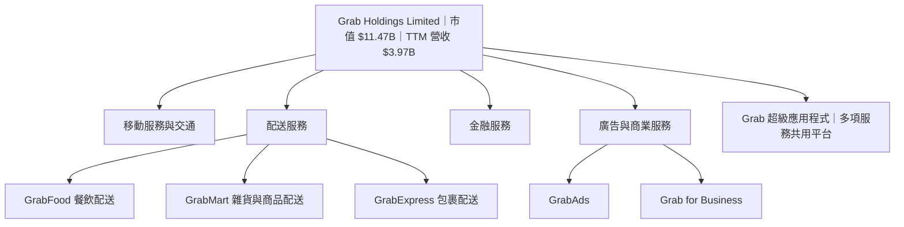
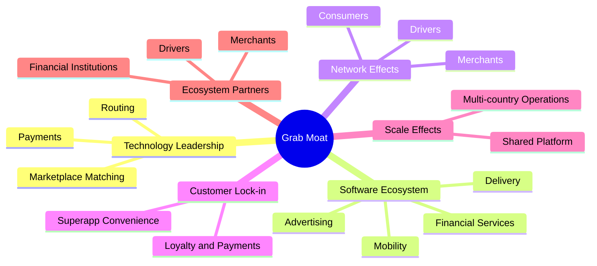
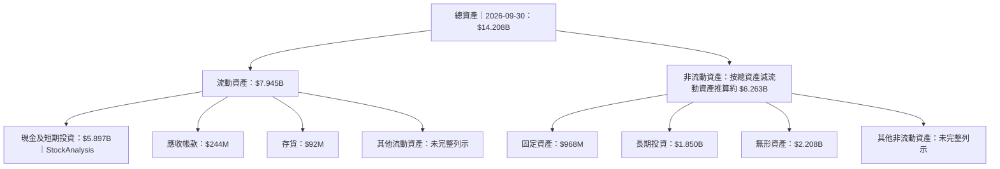
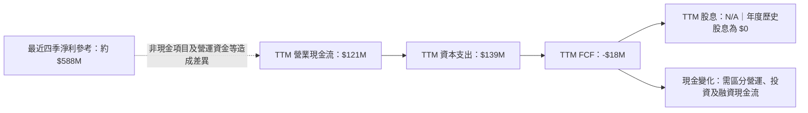
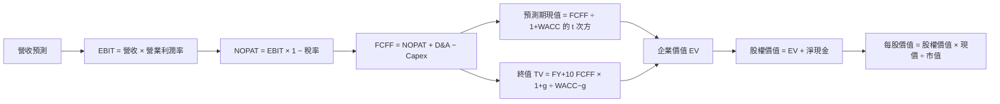
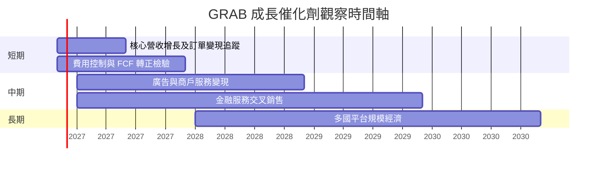
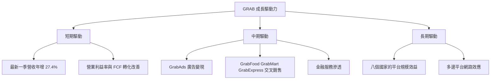
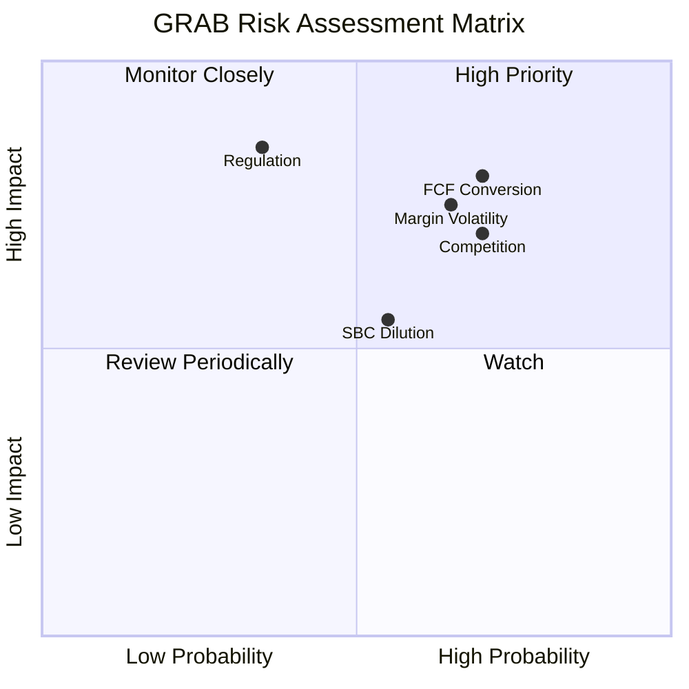
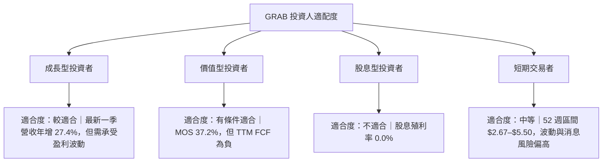

# GRAB 基本面深度分析報告
> **報告日期**：2026-11-27 ｜ **語言**：繁體中文 ｜ **數據來源**：Yahoo Finance、Finviz、StockAnalysis、Roic.ai ｜ **分析師**：CFA 級機構研究

## 目錄

| # | 章節 | 核心結論 |
|---|------|----------|
| 1 | 執行摘要 | 買入；加權合理價值 $4.52；MOS +37.2% |
| 2 | 公司概覽與商業模式 | 多業務超級應用程式平台；市場份額數據未提供 |
| 3 | 損益表深度分析 | TTM 營收 $3.97B；最新一季年增 27.4%，但單季營業利益率低於 TTM |
| 4 | 資產負債表分析 | 淨現金 $3.83B；流動比率 1.384 |
| 5 | 現金流量深度分析 | TTM FCF -$18M、FCF Yield -0.16%；現金轉換有波動 |
| 6 | 獲利能力與資本效率 | ROIC N/A，不能確認是否高於 8.26% WACC |
| 7 | 相對估值分析 | GRAB 估值低於部分同業倍數，但自身歷史估值區間數據未提供 |
| 8 | DCF 內在價值評估 | 基準 DCF $6.27；三角驗證加權合理價值 $4.52 |
| 9 | 成長催化劑 | 外送、交通、金融服務與廣告變現可提供成長選項；TAM 未提供 |
| 10 | 風險矩陣 | 現金流品質、利潤率波動與市場競爭為主要風險 |
| 11 | 投資建議 | 買入；建議買入區間 $2.84–$4.07，按估值及營運指標分批執行 |

---

## 1. 執行摘要

GRAB 的最新一季營收年增 **27.4%**，TTM 營收為 **$3.97B**，而 2025 年營業利益已由 2024 年的 **-$55M**轉為 **$222M**；另一方面，TTM FCF 為 **-$18M**、FCF Yield 為 **-0.16%**，且最新一季營業利益率 **5.6%**低於 TTM **11.0%**。以 **2026-11-25 收盤價 $2.84**計算，估值方法加權後合理價值為 **$4.52**，安全邊際 MOS 為 **+37.2%**；依規則 20，評級為**買入**。ROIC 數據缺失，因此不能以 ROIC 高於 WACC 作為買入論據；結論主要依據估值折價、淨現金與營收成長，並以負 FCF 和利潤率波動作風險折扣。

### 1.0 一頁式投資儀表板

| 項目 | 內容 |
|------|------|
| **投資論點（3 句）** | ① 最新一季營收年增 27.4%，增長動能仍在。② 淨現金 $3.83B，提供資產負債表緩衝。③ 加權合理價值 $4.52，高於現價 $2.84，但 TTM FCF -$18M 顯示獲利轉現仍待驗證。 |
| **綜合評分** | **6.1/10**（引用 1.1 評分卡） |
| **財務健康** | 🟡 現金及短期投資 $5.90B、總債務 $2.07B；流動比率 1.384，但 TTM FCF 為負 |
| **ROIC vs WACC** | ROIC：N/A；WACC：8.26%。缺少 ROIC，無法判定是否創造經濟價值 |
| **FCF 趨勢** | TTM FCF -$18M；FCF Yield -0.16%。2024 年年度 FCF 為 $739M、2025 年為 -$44M，年度現金流波動大 |
| **估值** | Forward P/E 18.09x ｜ EV/EBITDA 18.254x ｜ FCF Yield -0.16% |
| **DCF 內在價值（基準）** | $6.27 ｜ 現價相對 DCF 折價 **54.7%**，即 $2.84 ÷ $6.27 − 1 |
| **安全邊際（MOS）** | **+37.2%**＝($4.52 − $2.84) ÷ $4.52；🟢 >25% 充足 |
| **預期報酬（基準情境 12M）** | 相對加權合理價值上行空間 **+59.2%**；此為估值比較，不是保證的 12 個月報酬 |
| **關鍵風險（前二）** | TTM FCF 為負；最新一季營業利益率低於 TTM |
| **評級 + 信心度** | 🟢 **買入** ｜ 信心：中低（DCF 終值佔 EV 67.6%，且 ROIC、EPS 預期驚喜資料缺失） |

### 1.1 綜合評分卡

| 維度 | 評分（1–10） | 主要依據（引用數字與其來源章節） |
|------|--------------|----------------------------------|
| 成長性 | 8.0 | 最新一季營收年增 27.4%；2022–2025 年營收由 $1.433B 增至 $3.370B（第 3 章） |
| 獲利能力 | 5.5 | TTM 營業利益率 11.0%，但最新一季 5.6%；ROIC、Piotroski F-Score 均 N/A（第 3、6 章） |
| 財務健康 | 7.0 | 淨現金 $3.83B、流動比率 1.384；TTM FCF -$18M（第 4、5 章） |
| 估值 | 7.5 | MOS +37.2%；Forward P/E 18.09x，低於 UBER 與 DASH，但高於 SE 的 14.0x（第 7、8 章） |
| 護城河 | 6.0 | 多國超級應用程式與多服務交叉銷售具平台優勢，但市場份額及分部收入數據未提供（第 2 章） |
| 管理層與資本配置 | 2.5 | 2025 年 SBC $241M、股息為零；回購金額未提供，現金流年度波動大（第 3、5 章） |
| **綜合評分** | **6.1** | 六項算術平均：$(8.0+5.5+7.0+7.5+6.0+2.5)÷6=6.08≈6.1$ |

### 1.2 五大投資論點 + 三大核心風險

| 類型 | 項目 | 具體依據 | 信心度 |
|------|------|----------|--------|
| 🟢 **投資論點①** | 近期營收加速 | 2026 Q3 營收 $1.112B，年增 27.4%；高於 2025 Q3 的 $873M | 🟢 高 |
| 🟢 **投資論點②** | 多年營收擴張 | 年營收由 2022 年 $1.433B 增至 2025 年 $3.370B | 🟢 高 |
| 🟢 **投資論點③** | 淨現金緩衝 | 現金及短期投資 $5.90B，總債務 $2.07B，淨現金 $3.83B | 🟢 高 |
| 🟢 **投資論點④** | 營業損益轉正 | 2025 年營業利益 $222M；StockAnalysis 列示 TTM 營業利益 $221M | 🟡 中 |
| 🟢 **投資論點⑤** | 估值有折價空間 | 加權合理價值 $4.52 對比現價 $2.84，MOS +37.2% | 🟡 中 |
| 🟡 **風險①** | FCF 尚未穩定 | TTM FCF -$18M；2025 年年度 FCF -$44M，資本支出 $139M 高於 TTM 營業現金流 $121M | 🔴 高衝擊 |
| 🔴 **風險②** | 利潤率短期走弱 | TTM 營業利益率 11.0%，最新一季營業利益率 5.6%；須釐清口徑與季度波動 | 🔴 高衝擊 |
| 🟡 **風險③** | SBC 與資料可靠度 | 2025 年 SBC $241M，約為全年營收 7.2%；部分季度 EPS 預期與實際值缺失 | 🟡 中度 |

### 1.3 快速統計卡片

| 指標 | 公司實際值（期間） | 同業中位數 | 狀態 |
|------|--------------------|------------|------|
| 營收成長（TTM） | **N/A** | — | 🟡 |
| 營收成長（最新一季年增） | **27.4%** | **34.0%** | 🟡 |
| 毛利率（TTM） | **41.4%** | **45.0%** | 🟡 |
| 營業利益率（TTM） | **11.0%** | — | 🟢 |
| ROIC（TTM） | **N/A** | — | 🟡 |
| Forward P/E | **18.09x** | **15.1x** | 🟡 |
| FCF Yield（TTM） | **-0.16%** | — | 🔴 |
| Piotroski F-Score | **N/A / 9 項** | — | 🟡 |

同業中位數依 UBER、SE、DASH 的 Peer multiples 計算；未提供的同業指標不列示。

### 1.4 投資結論

```text
╔══════════════════════════════════════════════════════════════════╗
║                    📊 投資結論摘要                               ║
╠══════════════════════════════════════════════════════════════════╣
║  評級：買入（MOS +37.2%；ROIC 缺失，不以 ROIC > WACC 為依據）   ║
║  價格（2026-11-25 收盤）：$2.84                                  ║
║  DCF 內在價值（基準）：$6.27（現價折價 54.7%）                  ║
║  安全邊際 MOS：+37.2%（＝($4.52−$2.84)÷$4.52）                 ║
║  加權合理價值（8.8）：$4.52                                     ║
║  DCF 情境價值：                                                  ║
║    悲觀情境：$3.22（+13.2%）                                    ║
║    基準情境：$6.27（+120.7%）                                   ║
║    樂觀情境：$13.09（+360.9%）                                  ║
║  綜合評分：6.1/10（引用 1.1）                                   ║
║  適合投資人：能承受波動、願意追蹤現金流與利潤率的中長期投資人  ║
╚══════════════════════════════════════════════════════════════════╝
```

---

## 2. 公司概覽與商業模式

### 2.1 業務結構與收入來源

分部營收和各板塊佔比未提供，以下不推定收入占比。



公司在柬埔寨、印尼、馬來西亞、緬甸、菲律賓、新加坡、泰國及越南營運。分部收入、軟體收入及各服務的營收貢獻比例未提供，不能將公司總營收拆分為各業務金額。

### 2.2 市場份額

市場份額數據未提供，因此不呈現市佔率圖表或自行估算份額。可確認的相對規模為 TTM 營收 $3.97B，最新一季營收年增 27.4%；同期 UBER、SE、DASH 營收年增分別為 9.6%、43.4%、34.0%，GRAB 增長高於 UBER、低於 SE 與 DASH。

### 2.3 競爭護城河分析



上述節點是業務模式分析，不代表公司已披露各項網路效應強度或使用者數字。

### 2.4 護城河強度

| 護城河項目 | 強度 | 證據 | 會削弱它的情況 |
|------------|------|------|----------------|
| 技術與撮合平台 | 中 | 多服務共用 Grab 超級應用程式；員工 12,012 人，但技術收入及效率指標未提供 | 服務品質下降、技術投入無法轉化為留存或單位經濟改善 |
| 軟體生態系統 | 中 | 同一平台涵蓋交通、外送、金融與廣告等服務 | 使用者只使用單一服務，跨服務交叉銷售不成立 |
| 網路效應 | 中 | 需求端消費者與供應端司機、商戶需在平台配對 | 對手補貼、供給端多平台化、消費者轉換成本低 |
| 客戶鎖定 | 弱至中 | 多服務整合可能增加便利性；留存率及重複使用率未提供 | 促銷退坡後訂單量或活躍度下降 |
| 規模效應 | 中 | 八個東南亞國家營運，TTM 營收 $3.97B | 各國監管、勞動及競爭條件差異抵銷共用平台效益 |
| 生態夥伴 | 中 | 商戶、司機、金融機構構成服務供給網絡 | 供應方議價能力上升、平台佣金受到監管 |

1.1「護城河」評分為 **6.0/10**：平台多服務與多國營運提供結構優勢，但缺少市佔率、留存、單位經濟與分部收入數據，無法將護城河判定為強。

---

## 3. 損益表深度分析

### 3.1 年度收入成長趨勢（近 4 年）

年營收來源：2022–2025 年財報數據。年度增速按相鄰年度營收計算；2022 年因缺少 2021 可比年度，不列 YoY。

```text
╔══════════════════════════════════════════════════════════════════╗
║              GRAB 年度收入趨勢（FY2022–FY2025）                  ║
╠══════════════════════════════════════════════════════════════════╣
║  FY2022  $1.433B  █████████░░░░░░░░░░░  YoY：N/A                 ║
║  FY2023  $2.359B  ██████████████░░░░░░  YoY：+64.6% 🟢          ║
║  FY2024  $2.797B  █████████████████░░░  YoY：+18.6% 🟢          ║
║  FY2025  $3.370B  ████████████████████  YoY：+20.5% 🟢          ║
║                                                                  ║
║  2022–2025 年營收 CAGR：[(3.370÷1.433)^(1÷3)−1] = 約 33.0%      ║
╚══════════════════════════════════════════════════════════════════╝
```

2023 年營收加速至 64.6%，其後 2024、2025 年維持約 19%–21% 增長。這表示業務規模仍在擴張，但增速已較 2023 年高基期回落；不能將 2023 年的高增長直接外推至長期。

### 3.2 季度收入趨勢分析

| 季度 | 營收 | QoQ 成長 | YoY 成長 | 備註 |
|------|------:|---------:|---------:|------|
| 2025 Q4 | $906M | 17.2% | 18.59% | QoQ 比較 2025 Q3 $773M |
| 2026 Q1 | $955M | 5.4% | 23.54% | YoY 比較 2025 Q1 $773M |
| 2026 Q2 | $998M | 4.5% | 21.86% | YoY 比較 2025 Q2 $819M |
| 2026 Q3 | $1.112B | 11.4% | 27.4% | YoY 比較 2025 Q3 $873M |

QoQ 計算：2026 Q3 為 $1.112B ÷ $998M − 1 = 11.4%；2026 Q2 為 $998M ÷ $955M − 1 = 4.5%。最近一季年增回升至 27.4%，但單季增長不等同 TTM 增長；程式計算的 Revenue growth（TTM vs prior TTM）為 N/A。

### 3.3 利潤率演變分析

下表年度毛利率、營業利益率依年度損益表金額計算；不同來源對毛利及營業利益存在差異，故以報表欄位口徑計算的結果只作方向性參考。TTM 與最新一季營業利益率採用已核實指標。

| 利潤率指標 | FY2022 | FY2023 | FY2024 | FY2025 | 趨勢 | 評估 |
|------------|-------:|-------:|-------:|-------:|------|------|
| **毛利率** | 5.4% | 36.4% | 41.8% | 43.3% | 年度報表顯示持續改善；TTM 核實值為 41.4% | 🟢 |
| **營業利益率** | -90.0% | -16.4% | -2.0% | 6.6% | 2025 轉正；TTM 核實值 11.0%，最新一季 5.6% | 🟡 |
| **淨利率** | -117.4% | -18.4% | -3.8% | 8.0% | 2025 年轉正；TTM 核實值 14.8% | 🟡 |

2022 年毛利率按表列毛利 $77M ÷ 營收 $1.433B 計算；StockAnalysis 的 2022 毛利為負數，顯示來源口徑不一致，不宜把該年度毛利率視為可比較的精確序列。2025 年營業利益轉正，可能反映平台擴張及成本控制帶來的營業槓桿；但最新一季核實營業利益率 5.6% 低於 TTM 11.0%，顯示季度獲利能力仍可能受產品組合、促銷、成本或非經常性項目影響。資料不足以量化各原因的貢獻。

### 3.4 費用結構分析

分項費用資料未提供完整且可比的 TTM 金額，故不繪製費用結構圓餅圖。可確認 2025 年研發費用為 **$428M**，約佔營收 **12.7%**（$428M ÷ $3.37B）；同年 SBC 為 **$241M**。兩者口徑可能有交集，不應直接相加作為總費用率。

### 3.5 季度 EPS 趨勢與盈餘品質（Quality of Earnings）

近四季 EPS 預期值與實際值的資料均為 NaN，不能判斷超預期或不及預期。可用的 EPS 成長資料顯示最新一季 EPS 年增 **-32.2%**，淨利年增 **-27.0%**；季度實際 EPS 序列在不同來源間口徑不一，需以公司正式財報核實。

| 盈餘品質項目 | 數值／佔比 | 評估 |
|--------------|-----------|------|
| 股權薪酬 SBC / 營收 | 2025：$241M ÷ $3.37B = **7.2%**；最近四季 SBC $234M ÷ TTM 營收 $3.97B = **5.9%** | 🔴 SBC 是實質股東成本；若長期以股份支付，會稀釋每股經濟利益 |
| SBC / 營業現金流 | TTM：$234M ÷ $121M = **193.4%** | 🔴 SBC 高於 TTM 營業現金流，營運現金流對股權薪酬成本的覆蓋不足 |
| FCF / 淨利（現金轉換率） | TTM FCF -$18M；用四季淨利合計約 $588M 作參考，約 **-3.1%** | 🔴 利潤尚未轉成正 FCF；季度淨利和 TTM 口徑有資料差異，僅作近似分析 |
| 一次性／非經常性損益 | N/A（未提供可分拆明細） | 無法判斷報告期淨利受一次性項目影響程度 |
| 有效稅率異常 | 最新年度有效稅率 **25.7%** | 🟡 模型採用此稅率；缺少年度稅項調節表，不能確認是否含一次性稅務利益 |
| 資本化支出 vs 費用化 | TTM Capex $139M；資本化與費用化明細 N/A | 🟡 不能判斷是否有成本資本化令當期利潤偏高 |

**盈餘品質結論**：2025 年 GAAP 淨利為 $268M，但 TTM FCF 為 -$18M，且 SBC 約為 TTM 營收 5.9%、TTM 營業現金流的 193.4%。因此，獲利的現金含量偏弱；估值不宜只依賴 P/E，應同步追蹤 FCF 轉正及 SBC 相對營收下降。

---

## 4. 資產負債表分析

### 4.1 資產結構分解

最新 TTM 資產負債表列示總資產 $14.208B，流動資產 $7.945B。部分資產細項僅在不同資料來源或不同日期列示，不能將非同一期數值強行加總。



現金及短期投資的核實值為 $5.90B；StockAnalysis 同期列示 $5.897B，差異來自四捨五入。

### 4.2 流動性與營運資金分析

| 指標 | 最新 TTM | 一年前 TTM | 變化 | 解讀 |
|------|----------|------------|------|------|
| DSO 應收帳款天數 | 22 天 | N/A | N/A | 一年前數值未提供，不能判斷收款速度變化 |
| DIO 存貨天數 | 15 天 | N/A | N/A | 一年前數值未提供 |
| DPO 應付帳款天數 | 219 天 | N/A | N/A | 高 DPO 壓低現金轉換週期；須關注供應商付款條款是否可持續 |
| CCC 現金轉換週期 | -182 天 | N/A | N/A | 代表應付帳款天數高於應收及存貨天數合計；不能僅憑負 CCC 判定供應商議價力 |

| 流動性指標 | 數值 | 評估 |
|------------|------:|------|
| 流動比率 | 1.384 | 🟡 流動資產高於流動負債，但不代表全部可即時轉為現金 |
| 速動比率 | 1.07 | 🟡 大於 1；流動性尚可 |
| 現金及短期投資 | $5.90B | 🟢 超過總債務 $2.07B |
| 營運資金天數 | CCC -182 天 | 🟡 結構性可提供營運融資，但須觀察付款週期 |

### 4.3 債務結構分析

```text
╔══════════════════════════════════════════════════════════════════╗
║                   GRAB 債務健康診斷                              ║
╠══════════════════════════════════════════════════════════════════╣
║  總債務：        $2.07B   ███████░░░░░░░░░░░░░  🟡              ║
║  現金及短期投資：$5.90B   ████████████████████  🟢              ║
║  淨現金：        $3.83B   █████████████░░░░░░░  🟢              ║
║                                                                  ║
║  Debt/EBITDA：N/A（未提供與總債務一致的可核實 EBITDA 口徑）      ║
║  Interest Coverage：N/A（利息費用與利息保障倍數未提供）         ║
║  流動比率：1.384 ｜ 速動比率：1.07                              ║
╚══════════════════════════════════════════════════════════════════╝
```

淨現金計算：$5.90B − $2.07B = **$3.83B**。總債務較 2024 年底的 $364M 高，但現金及短期投資亦大；應關注新增債務的用途、期限與利息支出，而非只看淨現金。

### 4.4 股東權益趨勢

| 年度 | 股東權益 |
|------|---------:|
| 2022 | $6.60B |
| 2023 | $6.45B |
| 2024 | $6.40B |
| 2025 | $6.73B |

```text
╔══════════════════════════════════════════════════════════════════╗
║                   GRAB 股東權益趨勢                              ║
╠══════════════════════════════════════════════════════════════════╣
║  2022  $6.60B  ████████████████████                              ║
║  2023  $6.45B  ████████████████████                              ║
║  2024  $6.40B  ███████████████████                                ║
║  2025  $6.73B  ████████████████████                              ║
╚══════════════════════════════════════════════════════════════════╝
```

股東權益三年內變動有限，2025 年回升至 $6.73B。單看權益帳面值不能判定資本回報率，且 2025 年底的股東權益與 2026 年 TTM 的財報日期不同。

---

## 5. 現金流量深度分析

### 5.1 現金流量瀑布圖

TTM 淨利約 $588M 為最近四季損益表列示數的合計參考值；營業現金流及資本支出則使用核實 TTM 數據。由於兩者期間和資料源存在口徑差異，圖中不將淨利強行橋接至營業現金流。



### 5.2 FCF 轉換率趨勢

| 年度 | FCF | 淨利 | FCF／淨利 | 解讀 |
|------|----:|-----:|----------:|------|
| 2022 | -$872M | -$1.68B | 51.9% | FCF 與淨利同為負，比例受負數分母限制 |
| 2023 | -$6M | -$434M | 1.4% | 虧損收窄，但現金流仍略負 |
| 2024 | $739M | -$105M | 不具經濟意義 | FCF 正值但淨利負值，可能受營運資金等影響 |
| 2025 | -$44M | $268M | -16.4% | 會計獲利未轉化為正 FCF |
| TTM | -$18M | 約 $588M 參考 | 約 -3.1% | 期間及來源口徑有差異，僅作方向性參考 |

### 5.3 自由現金流趨勢

```text
╔══════════════════════════════════════════════════════════════════╗
║                GRAB 自由現金流：年度實際與 TTM                  ║
╠══════════════════════════════════════════════════════════════════╣
║  FY2022  -$872M  ◀████████████████████  FCF Yield：N/A           ║
║  FY2023    -$6M  ◀█                    FCF Yield：N/A           ║
║  FY2024   $739M   ████████████████████  FCF Yield：N/A           ║
║  FY2025   -$44M  ◀██                    FCF Yield：N/A           ║
║  TTM      -$18M  ◀█                    FCF Yield：-0.16%        ║
╚══════════════════════════════════════════════════════════════════╝
```

年度 FCF 波動顯著，2024 年正 FCF 並未延續至 2025 年與最新 TTM。TTM FCF 按固定定義為營業現金流 $121M − 資本支出 $139M = **-$18M**。

### 5.4 資本配置評估

回購金額與完整投資配置資料未提供，不繪製資本配置圓餅圖。

| 資本配置項目 | 可得數據 | 評估 |
|--------------|----------|------|
| 資本支出 | TTM $139M | 高於 TTM 營業現金流 $121M，導致 TTM FCF 為負 |
| 股息 | 2022–2025 年均為 $0；股息殖利率 0.0% | 現金未透過股息回饋股東 |
| SBC | 2025 年 $241M | 對股東構成稀釋成本；應檢視每股營收、每股 FCF 是否同步提升 |
| 回購 | N/A | 無法判斷回購是否抵銷 SBC 稀釋 |
| 現金與短期投資 | $5.90B | 有資產負債表彈性，但投資回報及現金用途未完整提供 |

---

## 6. 獲利能力與資本效率

### 6.1 ROE / ROA / ROIC 趨勢

| 指標 | 可得期間 | 數值 | 評估 |
|------|----------|------:|------|
| ROE | TTM | 7.6% | 🟡 正值，但淨利、權益口徑與資產變動須同步追蹤 |
| ROA | TTM | 1.1% | 🟡 資產回報較低 |
| ROIC | TTM | N/A | 🟡 缺少計算所需的營運資本及稅後營業利潤資料 |
| ROIC 歷史序列 | 2019–2024 | N/A | Roic.ai 歷史欄位未提供可用的 ROIC 數值 |

### 6.2 ROIC vs WACC 分析（核心價值創造判斷）

```text
╔══════════════════════════════════════════════════════════════════╗
║                ROIC vs WACC 深度分析                            ║
╠══════════════════════════════════════════════════════════════════╣
║  WACC（使用資本成本數據）：                                      ║
║  ├── 無風險利率（10Y美債）： 4.85%                               ║
║  ├── 市場風險溢酬：           5.00%                               ║
║  ├── Beta：原始 0.83；調整後 0.89                               ║
║  ├── 股權成本：9.29%（資本成本來源值）                           ║
║  ├── 稅前債務成本：3.43%；有效稅率：25.7%                       ║
║  ├── 股權／債務權重：84.7%／15.3%                               ║
║  └── ✅ WACC：8.26%                                              ║
║                                                                  ║
║  ROIC：N/A（營運投入資本與相關稅後營業利益資料不足）              ║
║  EVA = ROIC − WACC：N/A                                          ║
║                                                                  ║
║  結論：無法判定 ROIC 是否高於 8.26%，故不能確認是否創造價值。   ║
╚══════════════════════════════════════════════════════════════════╝
```

WACC 按資本成本資料使用 **8.26%**，不另建第二套折現率。由於 ROIC 數據缺失，不能計算 EVA，也不能推斷公司已創造或摧毀股東價值。2025 年營業利益轉正是改善跡象，但單一年度營業利益不能取代 ROIC。

### 6.3 杜邦三因素分解

| 因素 | 數值（TTM） | 解讀 |
|------|-------------|------|
| 淨利率 | N/A | QUALITY FIGURES 的 DuPont 結果為 N/A |
| 資產週轉率 | N/A | 缺少可一致配對的淨利、營收及平均資產數據 |
| 權益乘數 | N/A | QUALITY FIGURES 的 DuPont 結果為 N/A |
| **ROE** | **N/A** | DuPont 欄位缺少所需數據；不得以其他來源自行補算 |

### 6.4 財務體質：Piotroski F-Score

Piotroski F-Score：**N/A**。缺少相隔一年的兩期 SEC 申報資料，因此九項測試均無法逐項判定。

| 測試 | 結果 | 解讀 |
|------|------|------|
| 獲利能力、現金流、資產品質、槓桿、流動性及營運效率等九項測試 | N/A | Yahoo 季度資料不足以取代所需的年度 SEC 比較資料；不補判或推算 |

---

## 7. 相對估值分析

### 7.1 同業估值比較表格

同業數據採 Yahoo Finance Peer multiples；GRAB 公司估值採市場資料欄位。Forward P/E 公司的展示值與 Peer multiples 計算所用 forward EPS 口徑可能不同，因此相對估值方法另以已核實的同業中位數及公司 Forward EPS 推算。

| 估值指標 | **GRAB** | **UBER** | **SE** | **DASH** | GRAB 評估 |
|----------|---------:|--------:|------:|--------:|-----------|
| **Trailing P/E** | 28.4x | 39.0x | 24.1x | 69.0x | 🟡 低於 UBER、DASH，高於 SE |
| **Forward P/E** | 18.09x | 15.1x | 14.0x | 21.8x | 🟡 高於 UBER、SE，低於 DASH |
| **P/S Ratio** | 2.89x | 2.4x | 1.4x | 4.3x | 🟡 高於 UBER、SE，低於 DASH |
| **EV/EBITDA** | 18.254x | 18.4x | 13.1x | 40.9x | 🟡 接近 UBER，高於 SE，低於 DASH |
| **最新一季營收年增** | 27.4% | 9.6% | 43.4% | 34.0% | 🟡 高於 UBER，低於 SE、DASH |
| **毛利率（TTM）** | 41.4% | 41.4% | 45.0% | 52.7% | 🟡 低於 SE、DASH，等於 UBER |

同業中位數 Forward P/E 為 **15.1x**（三家中位數），EV/EBITDA 中位數依指定同業集合為 **15.8x**（UBER、SE）。比較倍數不能忽略業務地區、會計口徑與成長差異。

### 7.2 歷史估值區間分析

N/A（未提供「Valuation vs own history」的歷史估值區間或百分位數，不能自行推算）。價格歷史顯示 2024-11 月收盤 $5.00，2025-09 月 $6.02，2026-10 月 $2.71，2026-11 月 $2.84；價格走勢本身不能替代歷史 P/E 區間。

### 7.3 情境價值（照抄 DCF MODEL 的 Scenarios）

| 情境 | 第 1 年營收成長 | 期末營業利潤率 | WACC | 每股價值 | 相對現價 | 機率 | 會發生的條件 |
|------|----------------:|---------------:|-----:|---------:|---------:|-----:|--------------|
| 🔴 悲觀 | 13.7% | 9.3% | 9.26% | $3.22 | +13.2% | 25% | 成長較基準放緩，競爭和成本令長期利潤率低於基準 |
| 🟡 基準 | 27.4% | 11.0% | 8.26% | $6.27 | +120.7% | 50% | 最新一季高增長逐步淡出，營業利潤率維持 11.0% |
| 🟢 樂觀 | 41.1% | 12.0% | 7.26% | $13.09 | +360.9% | 25% | 高增長延續並伴隨利潤率改善及較低折現率 |

### 7.4 相對估值隱含價格區間

```text
╔══════════════════════════════════════════════════════════════════╗
║              相對估值與 DCF 每股價值                             ║
╠══════════════════════════════════════════════════════════════════╣
║  $2.36          $2.84       $3.52             $5.39      $6.27   ║
║  Forward P/E    現價        EV/EBITDA         共識       DCF     ║
╚══════════════════════════════════════════════════════════════════╝
```

| 方法 | 每股價值 | 相對現價 | 依據 |
|------|---------:|---------:|------|
| 同業 Forward P/E | $2.36 | -16.9% | UBER、SE、DASH 同業中位數 15.1x × Forward EPS $0.16 |
| 同業 EV/EBITDA | $3.52 | +23.9% | UBER、SE 中位數 15.8x × TTM EBITDA，再加回淨現金 |
| DCF（基準） | $6.27 | +120.8%（估值方法表列值） | 10 年 FCFF、WACC 8.26%、永續成長 3.0% |
| 分析師共識 | $5.39 | +89.8% | 22 位分析師平均目標價 |

同業 Forward P/E 方法的 $2.36 低於現價，提示市場預期盈利成長可能已部分反映；同業 EV/EBITDA 推算值略高於現價。估值方法表所列 DCF 相對現價為 +120.8%，DCF 模型表則列 +120.7%；兩者皆保留各自原表數值，差異為模型口徑或四捨五入差異。

---

## 8. DCF 內在價值評估（Discounted Cash Flow）

> DCF 只採用程式計算的模型輸出。該模型使用美元、10 年預測期與 GAAP EBIT，工作資本不建模；不得把本節的模型價值與 8.8 加權合理價值 MOS 混為一談。

### 8.0 估值推理鏈（Thinking Logic）

**Step 1 — 價值由哪些變數決定？**  
模型以公司 TTM 營收 $3.97B 為起點，核心價值來源是現有平台服務的收入規模、收入增長遞減路徑，以及 11.0% GAAP 營業利潤率能否維持。分部收入占比未提供，不能把交通、配送、金融或廣告各自占比量化；DCF 敏感度表顯示 WACC 與永續成長率對每股估值有顯著影響，終值現值佔 EV 67.6%。

**Step 2 — 模型選擇**

| 決策點 | 本報告採用 | 理由 | 曾考慮但否決 | 否決理由 |
|--------|-----------|------|--------------|----------|
| 現金流定義 | FCFF | 以 WACC 折現得出企業價值，後續加淨現金橋接至股權價值 | FCFE | 模型已固定採 FCFF；不能另改資本結構現金流 |
| 預測期 N | 10 年 | DCF MODEL 固定預測 10 年 | 5 年 | 會改變模型輸出，不採用 |
| 終值方法 | Gordon Growth | 模型使用永續成長率 3.0% 計算終值 | 退出倍數法 | DCF MODEL 未列其終值結果，不自行增加 |
| EBIT 基礎 | GAAP EBIT | GAAP EBIT 已包括 SBC 費用 | 非 GAAP EBIT | 會改變現金流及 SBC 計入方式 |

**Step 3 — 關鍵假設推導鏈**

- **營收增長**：錨點為最新一季營收年增 27.4%，不是 TTM 成長率；調整為由第 1 年 27.4% 線性遞減至第 10 年 3.0%；採用值與模型一致；不把 27.4% 永久固定，因其會忽略成熟期增速正常化。
- **營業利潤率**：錨點為核實 TTM 營業利益率 11.0%；模型假設第 1 至第 10 年均為 11.0%；此假設高於最新一季營業利益率 5.6%，偏樂觀之處在於假定季度弱勢不會延續；否決更高的長期利潤率，因公司未提供可驗證的歷史高點或分部盈利支持。
- **永續成長率**：錨點為長期名目經濟成長的分析框架；模型採 3.0%，並低於 WACC 8.26%；未採用高於 3.0% 的值，避免令終值對遠期成長過度敏感。
- **預測期 N**：模型固定 10 年；這給公司較長的成長與現金流穩定期，但不是由已披露管理層財測推導；未另改為較短年期，因模型規定使用 10 年。
- **Capex／營收**：TTM 約 3.5%，模型維持 3.5%；Capex $139M ÷ 營收 $3.97B 約為 3.5%；未下調至更低比率，因缺少平台維護和資本支出指引。
- **D&A／營收**：錨點及採用值皆為 TTM 5.6%；模型保持不變。
- **EBIT 與 SBC**：採用 GAAP EBIT；因此 SBC 已在 EBIT 費用中，FCFF 不再扣 SBC，股數不另作年稀釋。**本模型採用 (A)，故 SBC 影響已計入一次。**
- **營運資金**：模型不建模營運資金變動；公司 CCC 為 -182 天，但沒有歷史 ΔWC 及營收增額資料，不能另填假設數字。
- **WACC**：採用資本成本資料的 8.26%；權重、CAPM 及稅後債務成本見 8.2；不另自建 WACC。
- **最脆弱假設**：營業利潤率長期維持 11.0%，尤其高於最新一季 5.6%；若季度利潤率低位具有持續性，內在價值會下修，8.6 敏感度矩陣亦顯示折現率變化會明顯改變估值。

**Step 4 — 模型鏈條風險**  
模型最脆弱的一環是將最新季度 5.6% 的營業利益率與全年 TTM 11.0% 差異視為暫時，而非新常態；若長期利潤率下行，基準 DCF 可能高估價值。

**Step 5 — 計算路徑圖**



### 8.1 模型假設總表（Model Inputs）

| 假設項目 | 採用值 | 依據／來源 | 敏感度 |
|----------|--------|------------|--------|
| 預測期長度 **N** | 10 年 | DCF MODEL 固定值；不是管理層財測 | 🟡 中 |
| 營收增長路徑 | FY+1 27.4% 線性降至 FY+10 3.0% | FY+1 錨定最新一季年增 27.4%；FY+10 為模型假設 | 🔴 高 |
| 營業利潤率 | FY+1 至 FY+10 為 11.0% | TTM 營業利益率 11.0%；最新一季只有 5.6% | 🔴 高 |
| 有效稅率 | 25.7% | 最新年度有效稅率 | 🟢 低 |
| Capex／營收 | 3.5% | TTM Capex $139M ÷ TTM 營收 $3.97B 約 3.5%；模型固定 | 🟡 中 |
| D&A／營收 | 5.6% | TTM 模型輸入 | 🟢 低 |
| 營運資金變動 | 不建模 | DCF MODEL 明確不建模；不能把未提供資料填成估算數 | 🟡 中 |
| EBIT 基礎 | GAAP EBIT | DCF MODEL 指定 | 🟡 中 |
| SBC 處理 | GAAP EBIT 已扣除 SBC，不再扣第二次 | 2025 年 SBC $241M；模型採組合 A | 🟡 中 |
| 年稀釋率 | 0%；固定股數 | 模型組合 A，不另作股數稀釋 | 🟡 中 |
| 永續成長率 g | 3.0% | DCF MODEL 指定；低於 WACC 8.26% | 🔴 高 |
| 終值方法 | Gordon Growth | DCF MODEL 終值列 | 🔴 高 |
| WACC | 8.26% | Cost of capital 輸出；詳見 8.2 | 🔴 高 |
| FCFF 定義 | NOPAT + D&A − Capex | 不含營運資金變動 | — |

### 8.2 折現率推導（WACC）

```text
╔══════════════════════════════════════════════════════════════════╗
║                    WACC 推導（折現率）                           ║
╠══════════════════════════════════════════════════════════════════╣
║  股權成本 Ke（CAPM）：                                           ║
║  ├── 無風險利率 Rf：4.85%                                        ║
║  ├── 市場風險溢酬 ERP：5.00%                                     ║
║  ├── Beta 原始值：0.83；採用調整後 Beta：0.89                   ║
║  ├── 規模／國別額外溢酬：0.00%（模型未另加）                    ║
║  └── 資本成本來源列示 Ke：9.29%                                  ║
║                                                                  ║
║  債務成本 Kd：                                                   ║
║  ├── 稅前 Kd：3.43%                                              ║
║  ├── 有效稅率：25.7%                                             ║
║  └── 稅後 Kd = 3.43% × (1−25.7%) = 2.55%                       ║
║                                                                  ║
║  資本結構權重：股權 84.7%；債務 15.3%                            ║
║  └── ✅ 採用 WACC：8.26%                                         ║
╚══════════════════════════════════════════════════════════════════╝
```

Beta 調整方式：$⅔×0.83+⅓×1=0.8867≈0.89$。成本資本來源列示 Ke 為 9.29%；以兩位小數的 Rf、Beta、ERP 直接計算會受輸入四捨五入影響，故按要求採用來源提供的 Ke 與 WACC，不以四捨五入輸入替代。

**逐步演算：**

1. **Ke（CAPM）**：$4.85\%+0.89×5.00\%=9.30\%$；來源列示 Ke 為 **9.29%**，差異為輸入精度四捨五入。
2. **稅前 Kd**：資本成本資料列示「利息 ÷ 債務」為 **3.43%**。利息金額、平均計息負債明細未提供，無法獨立重建分子與分母。
3. **稅後 Kd**：$3.43\%×(1−25.7\%)=2.54849\%≈2.55\%$。
4. **權重**：來源提供股權／債務權重 **84.7%／15.3%**，合計 $84.7\%+15.3\%=100.0\%$。以市場資料市值 $11.47B$ 及總債務 $2.07B$ 近似，$11.47÷(11.47+2.07)=84.7\%$，債務權重 15.3%。
5. **WACC**：$84.7\%×9.29\%+15.3\%×2.54849\%=7.86763\%+0.38992\%=8.25755\%≈8.26\%$。

> Rf 日期未在資本成本資料中列明；利息及平均計息負債資料亦未提供，因此無法逐項重建 Kd 原始分子。報告採用指定的 8.26% WACC，且第 6.2 節相同。

### 8.3 逐年自由現金流預測（基準情境）

單位：美元十億；折現因子三位小數，金額兩位小數。模型未提供營運資金調整列，且 GAAP EBIT 已扣 SBC。

| 年度 | FY+1 | FY+2 | FY+3 | FY+4 | FY+5 | FY+6 | FY+7 | FY+8 | FY+9 | FY+10 |
|------|-----:|-----:|-----:|-----:|-----:|-----:|-----:|-----:|-----:|------:|
| 營收 | 5.06 | 6.31 | 7.69 | 9.18 | 10.70 | 12.18 | 13.53 | 14.67 | 15.51 | 15.98 |
| 營收 YoY | 27.4% | 24.7% | 22.0% | 19.3% | 16.6% | 13.8% | 11.1% | 8.4% | 5.7% | 3.0% |
| 營業利潤率 | 11.0% | 11.0% | 11.0% | 11.0% | 11.0% | 11.0% | 11.0% | 11.0% | 11.0% | 11.0% |
| EBIT（GAAP） | 0.55 | 0.69 | 0.84 | 1.01 | 1.17 | 1.33 | 1.48 | 1.61 | 1.70 | 1.75 |
| − 稅 | (0.14) | (0.18) | (0.22) | (0.26) | (0.30) | (0.34) | (0.38) | (0.41) | (0.44) | (0.45) |
| NOPAT | 0.41 | 0.51 | 0.63 | 0.75 | 0.87 | 0.99 | 1.10 | 1.20 | 1.26 | 1.30 |
| + D&A | 0.28 | 0.35 | 0.43 | 0.52 | 0.60 | 0.68 | 0.76 | 0.82 | 0.87 | 0.90 |
| − Capex | (0.18) | (0.22) | (0.27) | (0.32) | (0.37) | (0.43) | (0.47) | (0.51) | (0.54) | (0.56) |
| = FCFF | 0.52 | 0.65 | 0.79 | 0.94 | 1.10 | 1.25 | 1.39 | 1.51 | 1.59 | 1.64 |
| 折現因子 @8.26% | 0.924 | 0.853 | 0.788 | 0.728 | 0.672 | 0.621 | 0.574 | 0.530 | 0.490 | 0.452 |
| FCFF 現值 PV | 0.48 | 0.55 | 0.62 | 0.69 | 0.74 | 0.78 | 0.80 | 0.80 | 0.78 | 0.74 |

**逐步演算（FY+1）：**

1. 營收：$3.97×(1+27.4\%)=5.05778≈$5.06B$。
2. EBIT：$5.06×11.0\%=0.5566≈$0.55B$（模型以未四捨五入輸入計算）。
3. 稅：模型列示 $0.14B$；按顯示 EBIT $0.55B×25.7\%=0.14135≈$0.14B$。
4. NOPAT：模型列示 $0.41B$；以未四捨五入 EBIT、稅額計算後再四捨五入。
5. D&A：$5.06×5.6\%=0.28336≈$0.28B$。
6. Capex：$5.06×3.5\%=0.1771≈$0.18B$。
7. ΔWC：不建模，未加入現金流計算。
8. FCFF：模型列示 $0.52B$；按顯示值相加 $0.41+0.28-0.18=0.51B$，差異來自各列以未四捨五入數值計算後再展示。
9. 折現因子：$1÷(1+8.26\%)^1=0.9237≈0.924$；PV：模型以未四捨五入 FCFF 計算，列示 **$0.48B**。

逐年 PV 加總：$0.48+0.55+0.62+0.69+0.74+0.78+0.80+0.80+0.78+0.74=$**6.98B**。模型原列合計 **$6.97B**；差額約 $0.01B（約 0.1%），來自逐格四捨五入，後續估值橋接採用模型原值 $6.97B。

**合理性自檢**

- 模型 FY+1 至 FY+10 營收由 $3.97B 增至 $15.98B；十年營收 CAGR 約 14.9%。歷史 2022–2025 營收 CAGR 約 33.0%，預測明顯低於近三年高速擴張，反映增長正常化；但起始年度仍採最新一季 27.4% 年增，具有樂觀成分。
- FY+10 FCFF 利潤率：$1.64B÷$15.98B≈10.3%；目前 TTM FCF 利潤率：-$18M÷$3.97B≈-0.5%。預測隱含現金流轉化大幅改善；缺少同業最佳 FCFF 利潤率數據，不作同業超越判斷。
- 預測年度 FCFF 均為正；這依賴營業利潤率維持 11.0% 且工作資金不另占用現金。實際若工作資金需求增加，模型可能高估現金流。

```text
╔══════════════════════════════════════════════════════════════════╗
║            自由現金流：歷史實際 vs 模型預測                      ║
╠══════════════════════════════════════════════════════════════════╣
║  FY2023（實）  -$0.006B  ◀█                    FCF：-$6M         ║
║  FY2024（實）   $0.739B  █████████             FCF：+$739M       ║
║  FY2025（實）  -$0.044B  ◀█                    FCF：-$44M        ║
║  FY+1（預）     $0.52B   ██████░░░░░░░░░░░░░   模型值           ║
║  FY+10（預）    $1.64B   ████████████████████  模型值           ║
╠══════════════════════════════════════════════════════════════════╣
║  ⚠️ 預測由波動且近期為負的實際 FCF 起步，現金流正常化假設重要。║
╚══════════════════════════════════════════════════════════════════╝
```

### 8.4 終值計算（Terminal Value）

適用性檢查：**WACC 8.26% vs g 3.0% → WACC > g？✅**

| 方法 | 計算式 | 終值 TV | TV 現值 | 佔總 EV 比重 |
|------|--------|---------:|--------:|-------------:|
| Gordon Growth | FY+10 FCFF × (1+g) ÷ (WACC−g) | $32.09B | $14.51B | 67.6% |
| 退出倍數法 | N/A | N/A | N/A | N/A |

DCF MODEL 未提供退出倍數終值數值，依資料規則不自行補建。

**逐步演算：**

1. FY+10 FCFF：**$1.64B**。
2. 分子：$1.64×(1+3.0\%)=$1.6892B≈$1.69B$。
3. 分母：$8.26\%−3.0\%=5.26\%$；使用表格已四捨五入 FCFF 計算，$1.6892÷5.26\%≈$32.11B$。DCF MODEL 原值為 **$32.09B**，使用未四捨五入 FCFF 計算，與顯示值差約 0.1%。
4. PV(TV)：模型列示 $32.09×0.452=$**$14.51B**。
5. 終值佔比：$14.51÷$21.48=67.55\%≈$**67.6\%**。

終值現值佔 EV 67.6%，雖未超過 75%警示門檻，但估值仍明顯依賴 FY+10 之後的持續現金流假設。

### 8.5 企業價值 → 每股內在價值（Bridge）

```text
╔══════════════════════════════════════════════════════════════════╗
║              企業價值 → 每股內在價值 橋接表                      ║
╠══════════════════════════════════════════════════════════════════╣
║  預測期 FCF 現值合計            +$6.97B                          ║
║  終值現值 PV(TV)                +$14.51B                         ║
║  = 企業價值 EV                    $21.48B                        ║
║  + 淨現金                        +$3.83B                         ║
║  = 股權價值                       $25.31B                        ║
║  每股價值：股權價值 × 現價 ÷ 市值                                 ║
║  = $25.31B × $2.84 ÷ $11.47B = $6.27                             ║
║  當前股價（2026-11-25）           $2.84                           ║
║  折溢價：$2.84 ÷ $6.27 − 1       -54.7%（折價）                 ║
╚══════════════════════════════════════════════════════════════════╝
```

**逐步演算：**

1. EV：$6.97B+$14.51B=$**$21.48B**。
2. 股權價值：$21.48B+$3.83B=$**$25.31B**。
3. 每股內在價值：$25.31B×$2.84÷$11.47B=$**$6.27**（按模型指定的股權價值 × 價格 ÷ 市值公式）。
4. 折溢價：$2.84÷$6.27−1=-54.7049\%≈$**-54.7\%**。
5. 本節不計算 MOS；MOS 一律以 8.8 的加權合理價值為分母。

模型股數等效於市值與股價隱含股數：$11.47B÷$2.84≈4.04B 股。此為公式隱含值，不取代來源中市值及股數資料。淨現金使用 2026-09-30 附近核實值；模型直接採用淨現金 $3.83B。模型假定 SBC 已透過 GAAP EBIT 計入，股數不再稀釋。

### 8.6 敏感性分析（WACC × 永續成長率）

格內為 DCF MODEL 每股價值及相對 $2.84 現價的上行空間。矩陣內數值照模型原值引用。

| g（列）／WACC（欄） | 6.26% | 7.26% | **8.26%（基準）** | 9.26% | 10.26% |
|-----------|------:|------:|------------------:|------:|-------:|
| **2.0%** | $8.17（+187.7%） | $6.68（+135.2%） | $5.67（+99.6%） | $4.94（+73.9%） | $4.39（+54.6%） |
| **2.5%** | $8.91（+213.7%） | $7.11（+150.4%） | $5.94（+109.2%） | $5.12（+80.3%） | $4.52（+59.2%） |
| **3.0%** | $9.87（+247.5%） | $7.64（+169.0%） | **$6.27（+120.8%）** | $5.34（+88.0%） | $4.67（+64.4%） |
| **3.5%** | $11.17（+293.3%） | $8.32（+193.0%） | $6.67（+135.0%） | $5.59（+96.8%） | $4.84（+70.4%） |
| **4.0%** | $13.05（+359.5%） | $9.20（+223.9%） | $7.16（+152.1%） | $5.89（+107.4%） | $5.04（+77.5%） |

**矩陣示範格：WACC 9.26% > g 3.0% ✅**  
DCF MODEL 提供的該格每股價值為 **$5.34**；相對現價：$5.34÷$2.84−1=87.99\%≈87.99\%$。若要由原始 FCFF 重新推導該格，需以新 WACC 重折現十年 FCFF 並重新計算終值；模型沒有提供該格中間未四捨五入 PV 明細，因此不另造中間值。

**三情境 DCF**

模型提供情境假設與每股價值，但未提供各情境的 FY+10 營收、FCFF 與終值中間明細。為避免編造，以下只照錄輸出數值，不補造完整情境計算鏈。

| 情境 | 第 1 年成長 | 期末營業利潤率 | g | WACC | 每股價值 | 相對現價 | 機率 |
|------|------------:|---------------:|---:|-----:|---------:|---------:|-----:|
| 🔴 悲觀 | 13.7% | 9.3% | 3.0%（基準模型輸入） | 9.26% | $3.22 | +13.2% | 25% |
| 🟡 基準 | 27.4% | 11.0% | 3.0% | 8.26% | $6.27 | +120.7% | 50% |
| 🟢 樂觀 | 41.1% | 12.0% | 3.0%（基準模型輸入） | 7.26% | $13.09 | +360.9% | 25% |
| **機率加權** | — | — | — | — | **$7.21** | **+153.9%** | **100%** |

加權值：$3.22×25\%+$6.27×50\%+$13.09×25\%=$0.805+$3.135+$3.2725=$7.2125≈$7.21$。此為情境參考，8.8 按規則使用基準 DCF $6.27，不用機率加權值。

**敏感度結論**

- g 由 2.5% 升至 3.5%、WACC 固定 8.26%：價值由 $5.94 升至 $6.67，增加 **$0.73**，即 $0.73÷$5.94=12.3\%$。
- WACC 由 7.26% 升至 9.26%、g 固定 3.0%：價值由 $7.64 降至 $5.34，減少 **$2.30**，即 $2.30÷$7.64=30.1\%$。
- 期末營業利潤率每 +1pp 的獨立敏感度，DCF MODEL 未提供，故 **N/A**；不能用三情境差異推導單變量影響。
- WACC 在提供的矩陣範圍內影響最大；這與終值佔 EV 67.6%、折現率是核心估值變數的判斷一致。

### 8.7 反推 DCF（Reverse DCF）

固定輸入按基準模型：WACC 8.26%、有效稅率 25.7%、Capex／營收 3.5%、預測期 10 年、股數固定；營運資金不建模。DCF MODEL 只提供兩項反推解，沒有求解軌跡或其他變數解，故不虛構逐次迭代表。

| 求解的變數（一次一個） | 其餘變數設定 | 市場隱含值 | 可比較歷史／基準 | 判斷 |
|------------------------|--------------|------------:|------------------|------|
| 年 1 營收成長率 | 其餘基準輸入固定 | **2.0%** | 基準模型 27.4%；最新一季實際年增 27.4% | 市場價格隱含的成長要求低於近期增速，但不能等同市場確切預測 |
| 固定營業利潤率 | 其餘基準輸入固定 | **2.1%** | TTM 11.0%；最新一季 5.6% | 市場價格可由偏低利潤率假設解釋，對營業槓桿較保守 |
| 永續成長率 g | N/A | 未計算 | — | 程式未提供 |
| 預測期長度 N | N/A | 未計算 | 模型基準 10 年 | 程式未提供 |

逐步試算軌跡未在 DCF MODEL 輸出，不能用 0.5pp 逐格試算值冒充程式反推過程。反推結果顯示，在其他基準假設固定時，市場價格可由 **2.0% 年 1 營收增長**或 **2.1% 固定營業利潤率**解釋；但兩者是分別單變量求解，不代表市場同時預期兩者。

### 8.8 估值三角驗證與安全邊際

| 估值方法 | 隱含每股價值 | 上行空間（÷現價） | 權重 | 說明 |
|----------|--------------:|------------------:|-----:|------|
| DCF（基準） | $6.27 | +120.8% | 40% | 10 年 FCFF；WACC 8.26%、g 3.0% |
| 同業 Forward P/E | $2.36 | -16.9% | 25% | 同業中位數 15.1x × Forward EPS $0.16 |
| 同業 EV/EBITDA | $3.52 | +23.9% | 25% | 同業中位數 15.8x × TTM EBITDA，加回淨現金 |
| 分析師共識目標價 | $5.39 | +89.8% | 10% | 22 位分析師平均目標價 |
| **加權合理價值** | **$4.52** | **+59.2%** | **100%** | 公司類型：profitable；權重依公司類型固定 |

逐步演算：  
$6.27×40\%+$2.36×25\%+$3.52×25\%+$5.39×10\%$  
$=2.508+0.590+0.880+0.539=4.517≈$4.52$。  
此估值方法包括 DCF、同業 Forward P/E、同業 EV/EBITDA 及分析師共識，未有方法被剔除。

MOS：$(4.52−2.84)÷4.52=1.68÷4.52=37.17\%≈$**37.2\%**。  
上行空間：$(4.52−2.84)÷2.84=1.68÷2.84=59.15\%≈$**59.2\%**。  
折溢價則以 DCF 基準價 $6.27 為基準：$2.84÷$6.27−1=-54.7\%$。

```text
╔══════════════════════════════════════════════════════════════════╗
║                  估值區間與安全邊際                              ║
╠══════════════════════════════════════════════════════════════════╣
║  $2.84 ───── $3.22 ───── [$4.52] ───── $6.27 ───── $13.09      ║
║  現價        悲觀DCF     加權合理值     基準DCF       樂觀DCF    ║
║                                                                  ║
║  安全邊際 MOS = ($4.52−$2.84)÷$4.52 = +37.2%                   ║
║  MOS 評估：🟢 >25% 充足                                        ║
║  上行空間 = ($4.52−$2.84)÷$2.84 = +59.2%                       ║
║                                                                  ║
║  建議買入區間：$2.84–$4.07（MOS 約不低於 10%）                 ║
║  合理持有區間：約 $4.07–$4.97                                  ║
║  減碼考慮區間：高於 $4.97；接近 $13.09 樂觀 DCF 時重新評估     ║
╚══════════════════════════════════════════════════════════════════╝
```

買入區間上限 $4.07 的計算：$4.52×(1−10\%)=$4.068≈$4.07$。合理持有上限約 $4.97：$4.52×(1+10\%)=$4.972≈$4.97$。這些是按 MOS 區間公式推導的價位，不是額外估值方法。

> 🔎 **程式複算（Python，依本節各項自動重算）**
>
> 加權合理價值 = $6.27 × 40% + $2.36 × 25% + $3.52 × 25% + $5.39 × 10% = **$4.52**（權重合計 100%）
>
> 以價格 $2.84 計：MOS = **+37.2%**，上行空間 = **+59.2%**
>
> ✅ 與本節所寫數值一致。

### 8.9 DCF 模型的局限與失效條件

- **終值依賴度**：終值現值佔 EV **67.6%**，估值主要由第 10 年之後的假設決定。
- **最脆弱假設**：一是營業利益率長期維持 11.0%，但最新一季為 5.6%；二是營運資金不建模，而實際 CCC 為 -182 天，若付款條件逆轉，FCFF 可能下降。
- **FCF 與盈利不同步**：TTM FCF -$18M，模型預測 FY+1 FCFF $0.52B，意味由近期負 FCF 快速轉至正值；模型可靠度因此低於成熟穩定現金流企業。
- **替代交叉檢驗**：應同時監控 EV/Revenue、EV/EBITDA、單位經濟性及各業務分部盈利；目前分部資料不足，無法完成 SOTP。
- **風險連結**：價格競爭會削弱營業利潤率；監管或勞動成本上升會壓縮 EBIT；供應商付款條款縮短會增加營運資金需求，直接降低 FCFF。

### 8.10 複算檢核表（Audit Trail）

| # | 檢核項目 | 檢查方式 | 結果 |
|---|----------|----------|------|
| 1 | 高／中敏感度輸入均有推導說明 | 逐項對照 8.0 與 8.1；營收、利潤率、g、N、Capex、SBC、WACC 已說明；未提供輸入明示未提供 | ✅ |
| 2 | 每個假設有來源或明確標示資料缺口 | 8.1 依據欄逐項列示 | ✅ |
| 3 | WACC 權重及乘加核對 | 84.7%+15.3%=100%；重算約 8.26%，採用來源值 | ✅ |
| 4 | Kd 分母與債務權重範圍一致 | 資料只列總債務成本及總債務，計息負債明細未提供，故不能獨立確認 | ⚠️ 資料限制 |
| 5 | WACC 與第 6.2 節一致 | 兩處均為 8.26% | ✅ |
| 6 | 年度欄數等於 N，無省略 | FY+1 至 FY+10 共十欄 | ✅ |
| 7 | FY+1 代表年算式可複算 | 顯示輸入重算；中間值按模型未四捨五入數計算 | ✅ |
| 8 | PV 逐格加總與模型總額 | 顯示格加總 $6.98B；模型原值 $6.97B，差約 0.1% | ✅（四捨五入範圍內） |
| 9 | WACC > g | 8.26% > 3.0% | ✅ |
| 10 | 終值基於 FY+N 並折現十年 | FY+10 FCFF $1.64B；折現因子 0.452 | ✅ |
| 11 | EV 至每股公式可複算 | $6.97B+$14.51B=$21.48B；股權價值 $25.31B；每股 $6.27 | ✅ |
| 12 | SBC 組合相容 | GAAP EBIT；無額外 SBC 扣除；固定股數、不另稀釋 | ✅ |
| 13 | 矩陣基準格與 8.5 DCF 值 | 矩陣基準格 $6.27，8.5 為 $6.27 | ✅ |
| 14 | 矩陣 WACC 大於 g | 全部矩陣 WACC 均高於最高測試 g 4.0% | ✅ |
| 15 | 三情境機率與加權值 | 25%+50%+25%=100%；加權結果 $7.21 | ✅ |
| 16 | 反推每列只放一個變數 | 只列來源提供的兩個單變量解；求解軌跡未提供 | ⚠️ 不補造軌跡 |
| 17 | MOS 與折溢價分母正確 | MOS 用 $4.52；折溢價用 DCF $6.27 | ✅ |
| 18 | 報告完整至第 11 章 | 已輸出第 1 至第 11 章 | ✅ |
| 19 | 加權合理價值核對 | 各方法價值乘權重合計 $4.517≈$4.52 | ✅ |
| 20 | 評級符合規則 20 | MOS +37.2%，來源評級為買入；照錄，不作一級調整 | ✅ |

資料限制：原始利息費用、平均計息負債、情境逐年現金流、反推求解軌跡及獨立的 ROIC 均未提供；本報告未以估算數替代，相關結論信心相應降低。

---

## 9. 成長催化劑

### 9.1 催化劑時間軸

具體產品推出日期與管理層財測未提供；以下時間軸按業務變現週期分類，不代表公司公告的正式時程。



### 9.2 TAM 市場規模分析

N/A（TAM 數據未提供）。GRAB TTM 營收為 $3.97B，最新一季營收年增 27.4%，顯示仍有擴張，但沒有外部市場規模與滲透率數據，不能量化可服務市場或推算市場份額。

### 9.3 成長驅動力結構圖



收入分部與服務滲透數據未提供，因此催化劑主要以業務機制描述，並以營收、營業利益率與 FCF 作為可查核結果。

---

## 10. 風險矩陣

### 10.1 風險評分矩陣

下列座標為分析師對相對發生可能性及影響程度的定性評估，並非公司公布的機率統計。



### 10.2 風險清單詳細分析

| # | 風險項目 | 發生機率 | 財務衝擊 | 風險評分 | 緩解措施 |
|---|----------|----------|----------|----------|----------|
| 1 | 🔴 **FCF 轉換不足** | 中高（分析師定性） | 若 TTM FCF 維持負值，DCF 預測現金流可能延後或下修 | 🔴 8/10 | 每季核對營業現金流、Capex、工作資金；要求 FCF 轉正具連續性 |
| 2 | 🔴 **營業利潤率波動** | 中高（分析師定性） | TTM 11.0% 對比最新一季 5.6%；若低位延續，估值下修 | 🔴 8/10 | 追蹤單季毛利率、營業利益率及促銷強度 |
| 3 | 🟠 **競爭及補貼** | 中高（分析師定性） | UBER 最新一季成長 9.6%、SE 43.4%、DASH 34.0%；競爭可能影響訂單與定價 | 🟠 7/10 | 追蹤收入增長、毛利率及供應端留存，避免只看 GMV |
| 4 | 🟠 **監管與勞動成本** | 中（分析師定性） | 多國營運可能面臨司機分類、消費者保護及價格規則變化 | 🟠 7/10 | 追蹤各國規則變動及每單成本影響 |
| 5 | 🟡 **SBC 稀釋** | 中（分析師定性） | 2025 SBC $241M，佔營收 7.2%；TTM SBC 約為營業現金流 193.4% | 🟡 6/10 | 追蹤 SBC／營收、流通股數及回購抵銷程度 |
| 6 | 🟡 **模型終值敏感度** | 中（估值風險） | 終值佔 EV 67.6%；g、WACC 小幅變化可顯著改變 DCF | 🟡 6/10 | 不單獨依賴 DCF；與同業估值及 FCF 實績交叉驗證 |

---

## 11. 投資建議

### 11.1 最終評級與評分

依加權合理價值 $4.52、現價 $2.84 計算，MOS 為 **37.2%**，規則 20 所列評級為**買入**；未作質化上調或下調。綜合評分為 **6.1/10**，六項分數依次為成長性 8.0、獲利能力 5.5、財務健康 7.0、估值 7.5、護城河 6.0、管理層與資本配置 2.5。

### 11.2 合理價值與隱含報酬率

| 估值項目 | 每股價值 | 相對現價 | 機率／權重 |
|----------|---------:|---------:|-----------:|
| 加權合理價值 | $4.52 | +59.2% | 估值方法權重合計 100% |
| 🔴 悲觀 DCF | $3.22 | +13.2% | 25% |
| 🟡 基準 DCF | $6.27 | +120.7% | 50% |
| 🟢 樂觀 DCF | $13.09 | +360.9% | 25% |
| DCF 情境機率加權參考值 | $7.21 | +153.9% | 100% |

DCF 情境與加權合理價值使用不同估值框架；評級與 MOS 仍以 8.8 的加權合理價值為準。

### 11.3 買入時機與觸發因素

```text
╔══════════════════════════════════════════════════════════════════╗
║                  ✅ 買入觸發因素 Checklist                      ║
╠══════════════════════════════════════════════════════════════════╣
║  立即買入觸發條件（建議分批確認）：                              ║
║  ✅ 股價位於 $2.84–$4.07 區間，對加權合理價值仍有 MOS 緩衝     ║
║  ✅ 最新一季營收年增至少維持 20% 左右，且毛利率沒有連續下滑     ║
║  ✅ 單季營業利益率回升，並逐步接近 TTM 11.0%                    ║
║                                                                  ║
║  加碼觸發條件（出現以下任一）：                                  ║
║  ☐ TTM FCF 轉正，且營業現金流持續高於資本支出                  ║
║  ☐ SBC／營收較最近四季 5.9% 下降，並且流通股數增速收斂         ║
║  ☐ 連續兩季營收年增不低於 20%，且營業利益率改善                ║
║                                                                  ║
║  減碼／重新評估條件（出現以下任一）：                            ║
║  ☐ 連續兩季營收年增低於 15%                                    ║
║  ☐ 單季營業利益率低於 5.6% 且持續惡化                          ║
║  ☐ TTM FCF 持續為負、且現金及短期投資大幅下降                  ║
║  ☐ 股價高於約 $4.97，MOS 進入負 10% 以上區間                  ║
╚══════════════════════════════════════════════════════════════════╝
```

### 11.4 投資人適配度分析



### 11.5 每季財報監控清單（Quarterly Watch List）

| 監控指標 | 目前基準 | 加碼觀察門檻 | 減碼／重新評估門檻 |
|----------|----------|--------------|--------------------|
| 營收年增 | 最新一季 27.4% | 維持 ≥20% | 連續兩季 <15% |
| TTM 營收增長 | N/A | 財報可比資料恢復後建立基準 | 無法提供可比增長時降低信心 |
| 毛利率 | TTM 41.4% | 持平或改善 | 連續兩季下降 |
| 營業利益率 | TTM 11.0%；最新一季 5.6% | 單季回升且趨近 TTM | 持續低於 5.6% |
| 營業現金流 | TTM $121M | 高於 Capex 並延續 | 轉負或大幅下降 |
| Capex | TTM $139M | 投資帶動營收及現金流改善 | Capex 上升但收入、FCF 未改善 |
| FCF | TTM -$18M；Yield -0.16% | 轉正並持續 | 持續負值且淨現金減少 |
| SBC／營收 | 最近四季約 5.9% | 比率下降 | 比率上升且股數增長加速 |
| 現金及短期投資 | $5.90B | 主要由營運現金流支撐 | 持續下降且伴隨負 FCF |
| 管理層財測 | 未提供 | 後續財報公布後核對實績 | 連續下修或未達財測 |

### 11.6 反面論證：什麼會證明論點錯誤（What Would Change My Mind）

```text
╔══════════════════════════════════════════════════════════════════╗
║              ⚠️ 論點失效條件（Disconfirming Evidence）           ║
╠══════════════════════════════════════════════════════════════════╣
║  本投資論點在下列情況成立時應重新檢視或退出：                    ║
║  ☐ 核心營收年增連續兩季低於 15%                                  ║
║  ☐ 最新一季 5.6% 營業利益率成為新常態且繼續收縮                 ║
║  ☐ TTM FCF 持續為負，且營業現金流無法覆蓋資本支出              ║
║  ☐ SBC／營收高於目前約 5.9%，流通股數持續增加而每股價值未提升  ║
║  ☐ 淨現金 $3.83B 明顯下降，且下降由持續營運現金流流出造成       ║
║  ☐ 後續資料顯示 ROIC 低於 8.26% WACC 且無改善跡象              ║
╚══════════════════════════════════════════════════════════════════╝
```

> **免責聲明**：本報告為 AI 自動生成，僅供研究參考，不構成投資建議。投資有風險，入市需謹慎。

---

## 資料與來源

| 項目 | 內容 |
|------|------|
| 價格 | 2.84 USD，2026-11-25 收盤（Yahoo Finance 日線） |
| 財務報表 | Yahoo quarterly statements (no SEC filing data)，最新季度 2026-09-30（TTM = four quarters to this date） |
| 有回應的資料來源 | Yahoo Finance、Finviz、StockAnalysis、Roic.ai |
| 未回應的資料來源 | SEC 申報資料 (XBRL) |
| 由程式計算 | TTM 數字、WACC、DCF 模型、估值方法與權重、加權合理價值、MOS、評級門檻、F-Score、杜邦分解、營運資金天數、綜合評分 |
| 撰寫模型 | openai / gpt-6-luna |

> 本區塊由產生報告的程式依實際取得的資料填寫，非模型撰寫。「由程式計算」的數字不是模型的估計；其餘判斷（評分、情境、策略）是模型的分析。
