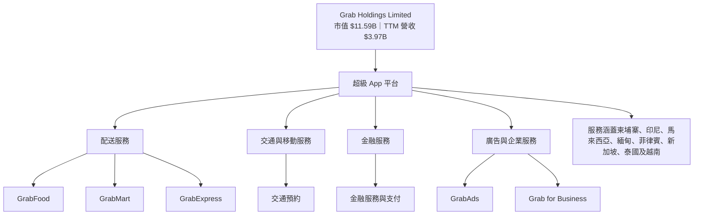
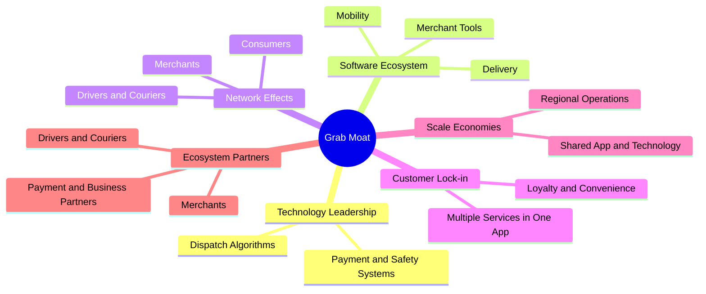
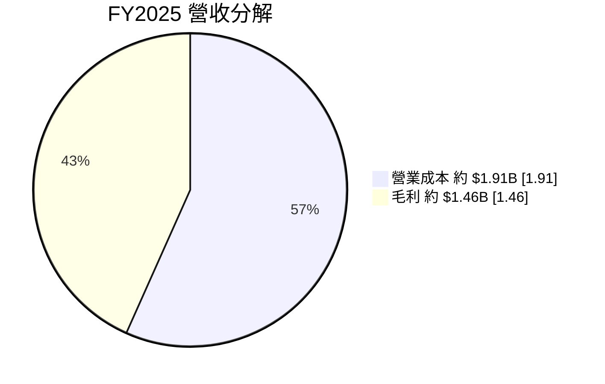
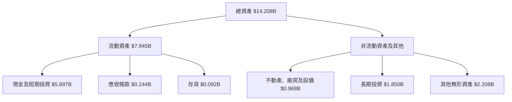
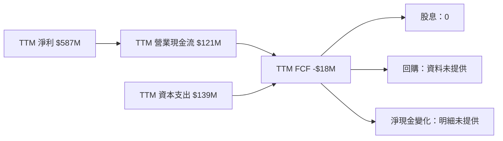
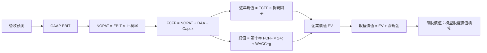
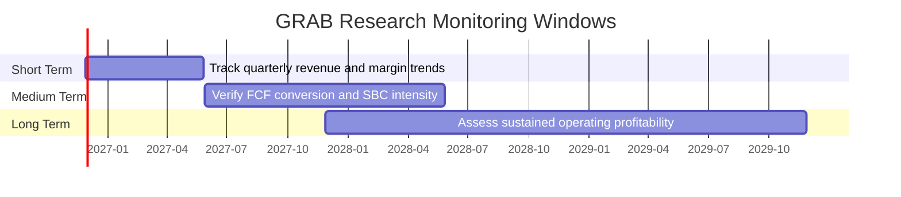
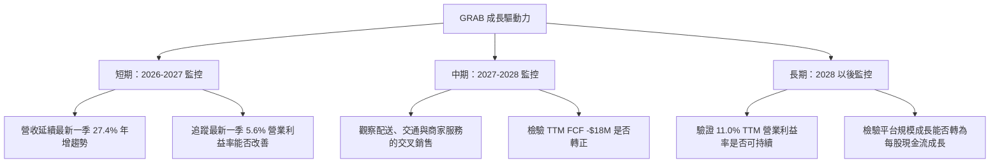
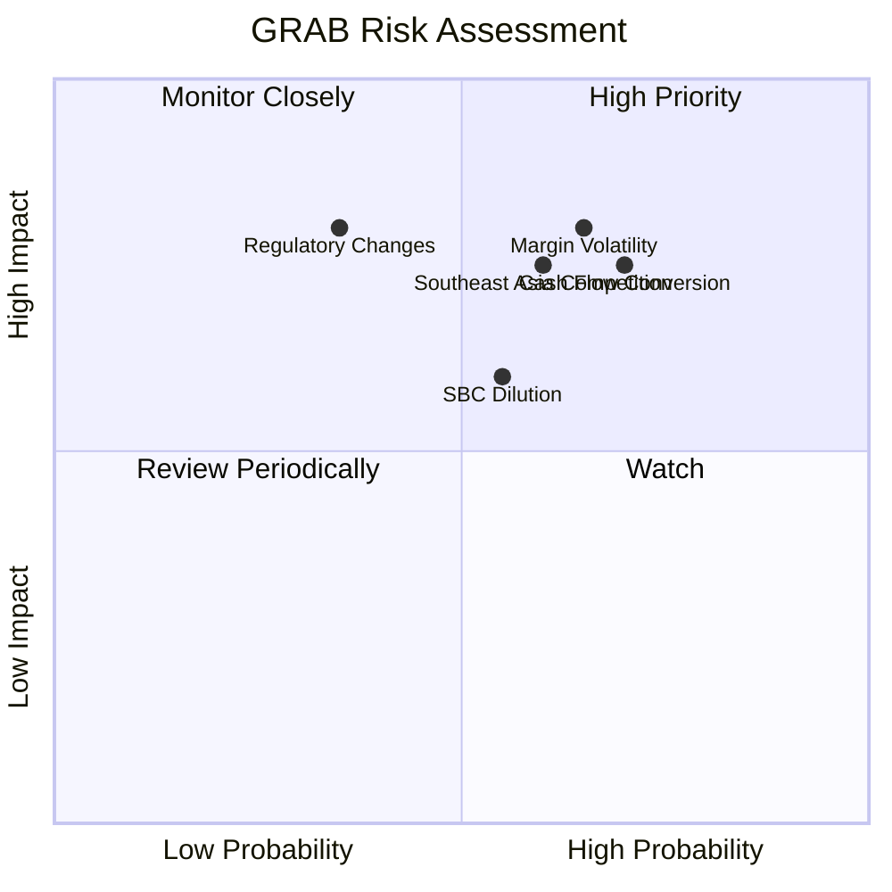
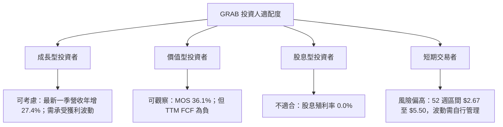

# GRAB 基本面深度分析報告
> **報告日期**：2026-11-28 ｜ **語言**：繁體中文 ｜ **數據來源**：Yahoo Finance、Finviz、StockAnalysis、Roic.ai ｜ **分析師**：CFA 級機構研究

## 目錄

| # | 章節 | 核心結論 |
|---|------|----------|
| 1 | 執行摘要 | 買入；加權合理價值 $4.49；MOS 36.1% |
| 2 | 公司概覽與商業模式 | 多邊平台具網路效應，但分部營收占比未提供 |
| 3 | 損益表深度分析 | TTM 營收 $3.97B；最新一季年增 27.4%，但季度獲利波動 |
| 4 | 資產負債表分析 | 淨現金 $3.83B；流動比率 1.384 |
| 5 | 現金流量深度分析 | TTM FCF -$18.00M，FCF Yield -0.16% |
| 6 | 獲利能力與資本效率 | ROIC N/A，無法可靠判斷是否高於 WACC 8.34% |
| 7 | 相對估值分析 | Forward P/E 18.28x；高於 UBER、SE，低於 DASH |
| 8 | DCF 內在價值評估 | 基準 DCF $6.18；加權合理價值 $4.49 |
| 9 | 成長催化劑 | 最新一季營收年增 27.4%；TAM 數據未提供 |
| 10 | 風險矩陣 | 獲利波動、FCF 轉換及競爭是前三大風險 |
| 11 | 投資建議 | 買入；參考買入區間 $2.67–$4.04，並以營運指標確認 |

---

## 1. 執行摘要

GRAB 2026-11-27 收盤價為 **$2.87**，加權合理價值為 **$4.49**，安全邊際 MOS 為 **36.1%**，依估值門檻屬買入。這一結論由幾項相互拉扯的證據得出：TTM 營收 $3.97B、最新一季年增 27.4%，且現金及短期投資 $5.90B、淨現金 $3.83B；但 TTM FCF 為 -$18.00M、FCF Yield -0.16%，最新一季營業利益率 5.6% 低於 TTM 11.0%。ROIC 未提供，故不能確認公司是否以高於 8.34% 的 WACC 創造經濟價值。

### 1.0 一頁式投資儀表板（Portfolio Manager 30 秒速讀）

| 項目 | 內容 |
|------|------|
| **投資論點（3 句）** | ① 最新一季營收年增 27.4%，顯示平台需求仍在擴張。② 現金及短期投資 $5.90B、淨現金 $3.83B，提供資金緩衝。③ 加權合理價值 $4.49 高於現價 $2.87，但 TTM FCF -$18.00M，使現金獲利轉換仍需驗證。 |
| **綜合評分** | **6.8/10**（引用 1.1 評分卡） |
| **財務健康** | 🟢 淨現金 $3.83B、流動比率 1.384；但最新 TTM 現金及短期投資較 FY2025 下降 14.0% |
| **ROIC vs WACC** | ROIC：N/A；WACC：8.34%。資料不足，無法判定創造或摧毀價值 |
| **FCF 趨勢** | TTM FCF -$18.00M；FCF Yield -0.16%。2024 年 FCF 為 $739M、2025 年為 -$44M，現金流呈高波動 |
| **估值** | Forward P/E 18.28x ｜ EV/EBITDA 18.435x ｜ FCF Yield -0.16% |
| **DCF 內在價值（基準）** | $6.18 ｜ 現價相對 DCF 折價 53.6%（折溢價 = $2.87 ÷ $6.18 − 1） |
| **安全邊際（MOS）** | **36.1%**＝($4.49 − $2.87) ÷ $4.49，基準為 8.8 加權合理價值｜🟢 >25% |
| **預期報酬（基準情境 12M）** | +115.2%（DCF MODEL 基準情境所列；模型情境價值 $6.18） |
| **關鍵風險（前二）** | TTM FCF 為負；最新一季 EPS 年增 -32.2%、營業利益率較 TTM 明顯偏低 |
| **評級 + 信心度** | 🟢 **買入** ｜ 信心：中低（估值折價明顯，但 ROIC、FCF 持續性及 EPS 預期差資料不足） |

> 依 MOS 36.1% 且 ROIC 未能證明高於 WACC，依規則 20 採用「買入」，不另作級別調整。

### 1.1 綜合評分卡（全報告唯一）

| 維度 | 評分（1–10） | 主要依據（引用數字與其來源章節） |
|------|--------------|----------------------------------|
| 成長性 | 7.5 | 最新一季營收年增 27.4%；TTM 成長率 N/A（第 3 章） |
| 獲利能力 | 5.5 | TTM 營業利益率 11.0%，但最新一季 5.6%；ROIC、F-Score N/A（第 3、6 章） |
| 財務健康 | 7.5 | 淨現金 $3.83B、流動比率 1.384、CCC -182 天（第 4 章） |
| 估值 | 8.0 | MOS 36.1%；DCF $6.18 與相對估值 $2.37–$3.56 分歧（第 7、8 章） |
| 護城河 | 7.0 | 超級 App 涵蓋多國、多項服務；但市場份額與分部營收數據未提供（第 2 章） |
| 管理層與資本配置 | 5.5 | FY2025 SBC $241M，FY2025 FCF -$44M；股息為零（第 3、5 章） |
| **綜合評分** | **6.8** | 六項算術平均：(7.5 + 5.5 + 7.5 + 8.0 + 7.0 + 5.5) ÷ 6 = 6.83，四捨五入至一位小數 |

### 1.2 五大投資論點 + 三大核心風險

| 類型 | 項目 | 具體依據 | 信心度 |
|------|------|----------|--------|
| 🟢 **投資論點①** | 平台營收仍在擴張 | 最新一季營收 $1.112B，年增 27.4%；可能反映配送、交通及商家服務需求增加，但分部數據未提供，無法拆分各業務貢獻 | 🟢 高 |
| 🟢 **投資論點②** | 現金緩衝提供抗風險能力 | 現金及短期投資 $5.90B，總債務 $2.07B，淨現金 $3.83B | 🟢 高 |
| 🟢 **投資論點③** | 估值方法加權後有折價 | 加權合理價值 $4.49，較現價 $2.87 高 56.4%；MOS 36.1% | 🟡 中 |
| 🟢 **投資論點④** | 歷史營業獲利已由負轉正 | 年度營業收入由 2024 年 -$55M 改善至 2025 年 $222M；規模增加可能帶來營運槓桿 | 🟡 中 |
| 🟢 **投資論點⑤** | 多邊服務具交叉銷售條件 | GrabFood、GrabMart、交通、快遞及廣告等服務共用平台；使用者及商戶交叉銷售可能提升留存，實際分部效益未提供 | 🟡 中 |
| 🟡 **風險①** | 現金流轉換不足 | TTM OCF $121M、Capex $139M，依定義 FCF -$18M；若資本支出與營運資金需求持續上升，估值對遠期現金流假設更敏感 | 🟡 中 |
| 🔴 **風險②** | 單季獲利不穩 | 最新一季淨利 $27M，較前季 $253M 下滑；EPS 最新一季年增 -32.2%，單季獲利不宜直接外推 | 🔴 高衝擊 |
| 🔴 **風險③** | SBC 與稀釋侵蝕股東報酬 | FY2025 SBC $241M，約為當年營收 $3.37B 的 7.2%；TTM SBC 約 $234M，已超過 TTM OCF $121M | 🔴 高衝擊 |

### 1.3 快速統計卡片

| 指標 | 公司實際值（期間） | 同業中位數 | 狀態 |
|------|--------------------|------------|------|
| 營收成長（TTM） | **N/A** | — | 🟡 |
| 營收成長（最新一季年增） | **27.4%** | 34.0% | 🟡 |
| 毛利率（TTM） | **41.4%** | 45.0% | 🟡 |
| 營業利益率（TTM） | **11.0%** | — | 🟢 |
| ROIC（TTM） | **N/A** | — | 🟡 |
| Forward P/E | **18.28x** | 15.1x | 🟡 |
| FCF Yield（TTM） | **-0.16%** | — | 🔴 |
| Piotroski F-Score | **N/A** | — | 🟡 |

*同業中位數按提供的同業數據計算；Forward P/E 中位數為 UBER 15.1x、SE 14.5x、DASH 22.0x 的中位數 15.1x。*

### 1.4 投資結論

```text
╔══════════════════════════════════════════════════════════════════╗
║                    📊 投資結論摘要                               ║
╠══════════════════════════════════════════════════════════════════╣
║  評級：買入（依 8.8 MOS 36.1%；ROIC 未能證明高於 WACC）          ║
║  價格（2026-11-27 收盤）：$2.87                                 ║
║  DCF 內在價值（基準）：$6.18（現價折價 53.6%）                  ║
║  安全邊際 MOS：36.1%（＝(加權合理價值−現價)÷加權合理價值）      ║
║  加權合理價值（8.8）：$4.49                                     ║
║  DCF 情境價值：                                                   ║
║    悲觀情境：$3.18（+10.9%）                                     ║
║    基準情境：$6.18（+115.2%）                                    ║
║    樂觀情境：$12.83（+347.1%）                                   ║
║  綜合評分：6.8/10（引用 1.1）                                    ║
║  適合投資人：能承受波動、重視平台成長並願意追蹤現金流的投資人    ║
╚══════════════════════════════════════════════════════════════════╝
```

---

## 2. 公司概覽與商業模式

### 2.1 業務結構與收入來源



各業務板塊營收、占比及軟體收入金額未提供，故不以估算比例呈現。Grab 的平台模式把消費者、司機、外送人員及商家連接在同一 App；若各服務可共享使用者及商戶關係，理論上可降低獲客成本並增加交叉銷售，但需以分部貢獻及單位經濟數據驗證。

### 2.2 市場份額

市場份額的可引用數字及年份未提供，因此不繪製市場份額圖。從相對規模看，GRAB TTM 營收為 $3.97B，最新一季年增 27.4%；同業 UBER、SE、DASH 最新一季營收年增分別為 9.6%、43.4%、34.0%。GRAB 成長高於 UBER、低於 SE 與 DASH，但業務地區及口徑不完全相同，不應直接視為市場份額排名。

### 2.3 競爭護城河分析



### 2.4 護城河強度

| 護城河項目 | 強度（強／中／弱） | 證據（引用數字或事實） | 會削弱它的情況 |
|------------|--------------------|------------------------|----------------|
| 技術與派單能力 | 中 | 平台在 8 個東南亞國家營運，員工 12,012 人；技術投入需持續維護 | 技術差異不足、競爭者補貼或服務品質改善 |
| 軟體生態系統 | 中 | App 涵蓋配送、交通、快遞、廣告及企業服務，實際分部營收占比未提供 | 使用者只使用單一服務，跨服務轉換未改善 |
| 網路效應 | 中 | 消費者、商戶及司機/外送人員有互相吸引的潛在效應；缺少活躍用戶與交易量數據 | 供給端不足、等待時間上升或價格競爭 |
| 客戶鎖定 | 中偏弱 | 多服務整合可能提高便利性；未提供留存率、訂閱數或轉換成本 | 使用者多平台比價，商家可低成本多平台經營 |
| 規模效應 | 中 | TTM 營收 $3.97B、最新一季年增 27.4% | 交易補貼及營運成本隨規模同步增加 |
| 生態夥伴 | 中 | 業務需仰賴商戶及司機/外送人員供給 | 合作方議價能力提高、監管限制或供給流失 |

1.1 護城河評分為 **7.0/10**：業務互補和多國平台提供結構性優勢，但缺乏市場份額、使用者留存及分部獲利等可量化證據。

---

## 3. 損益表深度分析

### 3.1 年度收入成長趨勢（近 4 年）

年度營收（2022–2025）分別為 $1.43B、$2.36B、$2.80B、$3.37B。YoY 以公布金額計算並四捨五入；2022 年相較 2021 年的數字未在年度表中同口徑列示，因此不補算。

```text
╔══════════════════════════════════════════════════════════════════╗
║                  Grab 年度收入趨勢（FY2022-FY2025）              ║
╠══════════════════════════════════════════════════════════════════╣
║  FY2022  $1.43B  ████████░░░░░░░░░░░░░░░░  YoY：N/A             ║
║  FY2023  $2.36B  ██████████████░░░░░░░░░░  YoY：約 +65.0%       ║
║  FY2024  $2.80B  █████████████████░░░░░░░  YoY：約 +18.6%       ║
║  FY2025  $3.37B  ████████████████████░░░░  YoY：約 +20.4%       ║
║                                                                  ║
║  FY2022–FY2025 營收 CAGR：約 33.1%                               ║
╚══════════════════════════════════════════════════════════════════╝
```

2023 年增幅較大，2024–2025 年仍有約 19%–20% 成長。這顯示公司收入基礎持續擴大，但不能把 FY2023 的高成長率直接外推為未來常態。上述年度數字由年度財務表計算；TTM Revenue growth (TTM vs prior TTM) 在資料中為 **N/A**，不可與單季年增率混用。

### 3.2 季度收入趨勢分析

| 季度 | 營收 | QoQ 成長 | YoY 成長 | 備註 |
|------|------|----------|----------|------|
| 2025 Q4 | $906M | 約 +3.8% | 18.59% | 相較 2025 Q3 營收 $873M |
| 2026 Q1 | $955M | 約 +5.4% | 23.54% | 年增加速至 20% 以上 |
| 2026 Q2 | $998M | 約 +4.5% | 21.86% | 季增維持正值 |
| 2026 Q3 | $1.112B | 約 +11.4% | 27.4% | 單季年增率，不是 TTM 成長率 |

2026 Q3 營收加速可能來自交易量、價格/產品組合或新服務貢獻；由於分部營收與交易量資料未提供，無法把成長歸因於特定業務。QoQ 比較受季節性影響，應優先觀察 YoY 及其連續性。

### 3.3 利潤率演變分析

| 利潤率指標 | FY2022 | FY2023 | FY2024 | FY2025 | 趨勢 | 評估 |
|------------|--------|--------|--------|--------|------|------|
| **毛利率** | 約 5.4% | 約 36.4% | 約 41.8% | 約 43.3% | ↗️ 明顯改善 | 🟢 |
| **營業利益率** | 約 -90.2% | 約 -16.4% | 約 -2.0% | 約 6.6% | ↗️ 由負轉正 | 🟢 |
| **淨利率** | 約 -117.5% | 約 -18.4% | 約 -3.8% | 約 8.0% | ↗️ 但受非營業項目影響 | 🟡 |

年度比率以年度損益表營收、毛利、營業利益及淨利計算。另有 TTM 淨利率 14.8%、營業利益率 11.0%，以及最新一季營業利益率 5.6%；不同期間及資料來源的口徑不應混為一談。FY2025 年度數據與 TTM 指標不一致，且最新季度報表部分欄位與交叉資料存在差異，本報告對 TTM 及最新季度比率優先採用指定口徑。

**利潤率演變深度解析：**2022–2025 毛利及營業利益改善，與收入擴張、過去高額虧損收斂相符；可能反映平台規模增加後固定成本攤薄，以及業務組合改善。然而，最新一季營業利益率 5.6% 低於 TTM 11.0%，說明利潤率並非單向提升。若成長依賴促銷、司機激勵或高成本獲客，營收成長不一定能轉化為利潤率擴張。

### 3.4 費用結構分析

分部費用明細不足，不能製作完整營運費用組成圖。以下僅以 FY2025 營收及毛利拆出營業成本與毛利，不代表完整費用結構。營業成本為 $3.37B − $1.46B = 約 $1.91B。



FY2025 研發費用 $428M，約為當年營收的 12.7%（$428M ÷ $3.37B）；研發支出可支持產品、平台及自動化能力，但是否帶來可持續回報需以後續獲客成本、留存及利潤率驗證。

### 3.5 季度 EPS 趨勢與盈餘品質（Quality of Earnings）

| 季度 | EPS 實際值 | EPS 年增 | 預期 EPS / surprise | 評估 |
|------|------------|---------|--------------------|------|
| 2025 Q4 | $0.04 | N/A | N/A | 無分析師預期值，無法判斷是否超預期 |
| 2026 Q1 | -$0.01 | N/A | N/A | 同上；單季轉負 |
| 2026 Q2 | $0.06 | N/A | N/A | 同上；單季改善 |
| 2026 Q3 | $0.01 | -32.2% | N/A | 同上；EPS 年減 |

過去四季 EPS estimate 為 nan，實際盈餘 surprise 均無有效資料。因此不能把任何一季判定為超預期或不及預期；原因分析限於已披露的季度 EPS、淨利及營收變化。

| 盈餘品質項目 | 數值/佔比 | 評估 |
|--------------|-----------|------|
| 股權薪酬 SBC / 營收 | TTM SBC 約 $234M ÷ $3.97B = 約 5.9% | 🔴 SBC 是實質股東成本；若持續以股權支付，會透過股數稀釋削弱每股經濟價值 |
| SBC / 營業現金流 | $234M ÷ $121M = 約 193.4% | 🔴 SBC 高於 TTM OCF，需關注現金流與股權薪酬的相對規模 |
| FCF / 淨利（現金轉換率） | -$18M ÷ $587M = 約 -3.1% | 🔴 淨利為正但按指定 FCF 定義為負，現金轉換偏弱 |
| 一次性/非經常性損益 | N/A（明細未提供） | 🟡 無法量化一次性項目對淨利的影響 |
| 有效稅率異常 | 25.7%（最新年度有效稅率） | 🟡 稅務明細不足，無法判定是否由一次性稅務利益推升 |
| 資本化支出 vs 費用化 | TTM Capex $139M；資本化政策明細 N/A | 🟡 無法判斷是否有成本資本化造成當期獲利偏高 |

**盈餘品質結論：**GAAP 營業利益率及淨利率已轉正，但 TTM FCF 為負、SBC 約為營收 5.9%，且 SBC 約為 OCF 的 193.4%。因此，GAAP 淨利不能直接等同於可分配給股東的現金盈餘。估值需同時折衷採用現金流模型與同業倍數，並持續追蹤 FCF 轉正的品質。

---

## 4. 資產負債表分析

### 4.1 資產結構分解

以下為 2026-09-30 資產負債表資料；個別項目與總計的資料來源口徑可能存在差異，圖中照列所提供數字，不將未列細項反推補足。



### 4.2 流動性與營運資金分析

| 指標 | 最新值 | 歷史趨勢 | 評估 |
|------|--------|----------|------|
| 現金及短期投資 | $5.90B | FY2025 $6.86B | 🟡 較 FY2025 減少約 14.0%，但仍高於總債務 |
| 淨現金 | $3.83B | N/A | 🟢 淨現金提供財務緩衝 |
| 流動比率 | 1.384 | FY2025 約 1.75（$8.08B ÷ $4.63B） | 🟡 高於 1，但較 FY2025 低 |
| 速動比率 | 1.07 | N/A | 🟡 短期償債能力尚可，仍需觀察營運現金流 |
| DSO 應收帳款天數 | 22 天 | N/A | N/A |
| DIO 存貨天數 | 15 天 | N/A | N/A |
| DPO 應付帳款天數 | 219 天 | N/A | N/A |
| CCC 現金轉換週期 | -182 天 | N/A | N/A |

營運資金天數依品質指標原值列示；一年前比較值未提供，因此不計算變化。CCC 為 -182 天，數學上主要由 219 天 DPO 高於 DSO 與 DIO 合計所致，可能反映商業模式的支付與結算時點優勢；但若供應商付款條件收緊，現金轉換週期可能快速逆轉。不能僅以負 CCC 推斷議價能力持續增強。

### 4.3 債務結構分析

```text
╔══════════════════════════════════════════════════════════════════╗
║                    GRAB 債務健康診斷                             ║
╠══════════════════════════════════════════════════════════════════╣
║  總債務：          $2.07B   ███████░░░░░░░░░░░░░  🟡            ║
║  現金及短期投資：  $5.90B   ████████████████████  🟢            ║
║  淨現金：          $3.83B   █████████████░░░░░░░  🟢            ║
║                                                                  ║
║  Debt/EBITDA：N/A（未提供同口徑計算基礎）                         ║
║  Interest Coverage：N/A（利息費用明細未提供）                    ║
║  近期總債務較 FY2025 $2.05B 略高，需觀察短期借款到期與再融資    ║
╚══════════════════════════════════════════════════════════════════╝
```

雖然淨現金為 $3.83B，但 FY2025 年末總債務 $2.05B、2026 最新數值 $2.07B；其中短期與長期債務期限分布未提供，故不能以總淨現金替代到期風險分析。

### 4.4 股東權益趨勢

```text
╔══════════════════════════════════════════════════════════════════╗
║                  GRAB 股東權益變化                               ║
╠══════════════════════════════════════════════════════════════════╣
║  FY2022  $6.60B  ████████████████████  🟢                       ║
║  FY2023  $6.45B  ████████████████████  🟡                       ║
║  FY2024  $6.40B  ███████████████████  🟡                        ║
║  FY2025  $6.73B  █████████████████████  🟢                      ║
║  2026-09-30：年度股東權益 N/A                                     ║
╚══════════════════════════════════════════════════════════════════╝
```

FY2022–FY2025 權益總體平穩，FY2025 回升至 $6.73B。權益變動與累積盈虧、股份發行及其他綜合損益的分項未提供，無法將變化全部歸因於營運獲利。

---

## 5. 現金流量深度分析

### 5.1 現金流量瀑布圖

淨利到 OCF 的調節項及淨現金變化明細未提供，以下圖示僅呈現可確認的 TTM 現金流關係；沒有數值的股息、回購或現金變化不補造。



### 5.2 FCF 轉換率趨勢

| 年度 | FCF | 淨利 | FCF / 淨利 | 解讀 |
|------|-----|------|------------|------|
| 2022 | -$872M | -$1.68B | 約 51.9% | FCF 與淨利皆負，轉換率不適宜單獨解讀 |
| 2023 | -$6M | -$434M | 約 1.4% | FCF 接近損益兩平，但淨利仍虧損 |
| 2024 | $739M | -$105M | 約 -704% | FCF 大幅為正而淨利為負，可能受營運資金及非現金項目影響；需調節表驗證 |
| 2025 | -$44M | $268M | 約 -16.4% | 獲利未轉為正 FCF |
| TTM 至 2026-09-30 | -$18M | $587M | 約 -3.1% | TTM 淨利轉正但 FCF 仍負 |

FCF 定義固定為 OCF − Capex。年度數據波動很大，現階段不宜把 FY2024 的 $739M 單年 FCF 當成持續性基準。

### 5.3 自由現金流趨勢

```text
╔══════════════════════════════════════════════════════════════════╗
║                  GRAB 自由現金流趨勢                             ║
╠══════════════════════════════════════════════════════════════════╣
║  FY2022  -$872M  ◀████████████████████░  FCF Yield：N/A          ║
║  FY2023    -$6M  ◀░░░░░░░░░░░░░░░░░░░░  FCF Yield：N/A          ║
║  FY2024  +$739M  ████████████████████░  FCF Yield：N/A          ║
║  FY2025   -$44M  ◀█░░░░░░░░░░░░░░░░░░░  FCF Yield：N/A          ║
║  TTM      -$18M  ◀░░░░░░░░░░░░░░░░░░░░  FCF Yield：-0.16%       ║
╚══════════════════════════════════════════════════════════════════╝
```

歷史 FCF Yield 未提供，僅列明確提供的 TTM FCF Yield -0.16%。

### 5.4 資本配置評估

FY2025 股息支付 $0，2022–2025 年度股息均為 $0；回購金額及分項投資配置未提供，因此不繪製資本配置圓餅圖。

| 資本配置項目 | 可用數據 | 評估 |
|--------------|----------|------|
| 資本支出 | FY2025 $123M；TTM $139M | 投入資本設備與平台，資本支出與 FCF 波動需共同追蹤 |
| 股息 | FY2025 $0；股息殖利率 0.0% | 不以現金股息回饋股東 |
| 回購 | N/A | 不對回購效率作判斷 |
| 股權薪酬 | FY2025 $241M；TTM 約 $234M | 金額顯著，需在評估每股價值時納入稀釋成本 |
| 留存與投資 | 明細 N/A | 無法拆分營運投資、併購或其他用途 |

---

## 6. 獲利能力與資本效率

### 6.1 ROE / ROA / ROIC 趨勢

| 指標 | 可用數值 | 評估 |
|------|----------|------|
| ROE（TTM） | 7.6% | 🟡 正值，但缺乏一致年度序列 |
| ROA（TTM） | 1.1% | 🟡 資產基礎下的會計獲利偏低 |
| ROIC（TTM） | N/A | 🟡 缺少可直接引用的 ROIC 數值及投入資本口徑 |
| 行業均值對比 | N/A | 數據未提供，故不列行業均值 |

### 6.2 ROIC vs WACC 分析（核心價值創造判斷）

```text
╔══════════════════════════════════════════════════════════════════╗
║                ROIC vs WACC 深度分析                            ║
╠══════════════════════════════════════════════════════════════════╣
║  WACC 採用值：8.34%                                               ║
║  ├── 無風險利率 Rf（10Y 美債）：4.94%                            ║
║  ├── 股權風險溢酬 ERP：5.00%                                     ║
║  ├── 原始 Beta：0.83；調整 Beta：0.89                            ║
║  ├── 股權成本 Ke（資料來源值）：9.38%                            ║
║  ├── 稅前債務成本：3.43%；有效稅率：25.7%                        ║
║  ├── 股權／債務權重：84.8%／15.2%                                ║
║  └── WACC：8.34%                                                  ║
║                                                                  ║
║  ROIC：N/A（資料未提供，且品質指標列為 N/A）                      ║
║  EVA = ROIC − WACC：N/A                                           ║
║  結論：無法確認 ROIC 是否高於 WACC，亦不能宣稱已創造經濟價值      ║
╚══════════════════════════════════════════════════════════════════╝
```

WACC 各組成沿用資本成本數據。調整 Beta 依來源公式為 ⅔ × 0.83 + ⅓，結果列示為 0.89。來源列示 Ke 9.38%；以已四捨五入的 Rf、Beta 與 ERP 直接重算會有 0.01 個百分點的四捨五入差異，因此本報告採用來源列示值，不另改寫。

ROIC 資料缺失，不能以 ROE 或 ROA 代替 ROIC。因此，投資論點的核心驗證之一是未來取得一致口徑投入資本與 NOPAT 資料，並檢查 ROIC 是否持續高於 8.34%。

### 6.3 杜邦三因素分解

| 因素 | 數值（TTM） | 解讀 |
|------|-------------|------|
| 淨利率 | N/A | QUALITY FIGURES 因缺少所需一致資料而列 N/A |
| 資產週轉率 | N/A | 同上 |
| 權益乘數 | N/A | 同上 |
| **ROE** | **N/A** | 杜邦三因素整體 N/A；不得自行重算或以其他期間數據替代 |

### 6.4 財務體質：Piotroski F-Score

**N/A（資料需求說明：需具備相隔一年的兩期 SEC 申報資料；目前交叉資料為 Yahoo 季度報表，無法判定 F-Score 及九項測試結果。）**因此不列九項測試的推測分數。

---

## 7. 相對估值分析

### 7.1 同業估值比較表格

| 估值指標 | **GRAB** | **UBER** | **SE** | **DASH** | 本公司評估 |
|----------|---------|---------|---------|---------|-----------|
| **Trailing P/E** | 28.7x | 39.2x | 24.9x | 69.7x | 🟡 位於 UBER 與 DASH 之下、SE 之上 |
| **Forward P/E** | 18.28x | 15.1x | 14.5x | 22.0x | 🟡 高於三家同業中位數 15.1x |
| **P/S Ratio** | 2.918x | 2.4x | 1.4x | 4.3x | 🟡 高於 UBER、SE，低於 DASH |
| **EV/EBITDA** | 18.435x | 18.5x | 13.5x | 41.2x | 🟡 接近 UBER，較 SE 高，低於 DASH |
| **最新一季營收年增** | 27.4% | 9.6% | 43.4% | 34.0% | 🟢 高於 UBER；低於 SE、DASH |
| **毛利率（TTM）** | 41.4% | 41.4% | 45.0% | 52.7% | 🟡 低於 SE、DASH；與 UBER 相同 |

同業倍數採 Yahoo 提供值。GRAB 的成長率高於 UBER，但 Forward P/E 亦高於三家同業中位數，故估值並非相對同業顯著便宜。P/S、EV/EBITDA 的差異也受業務組合與資本結構影響，不能單看倍數作結論。

### 7.2 歷史估值區間分析

```text
╔══════════════════════════════════════════════════════════════════╗
║                  GRAB 歷史估值位置                               ║
╠══════════════════════════════════════════════════════════════════╣
║  歷史 P/E 區間及估值百分位：N/A                                  ║
║  原因：未提供 Valuation vs own history 的歷史估值區間資料        ║
║                                                                  ║
║  價格歷史參考：2024-11 月收盤 $5.00；2026-11 月 $2.87            ║
║  這是股價序列，不等同歷史 P/E 或 P/S 估值百分位                  ║
╚══════════════════════════════════════════════════════════════════╝
```

### 7.3 情境價值（Bear / Base / Bull，照抄 DCF MODEL 的 Scenarios）

| 情境 | 第 1 年營收成長 | 期末營業利潤率 | WACC | 每股價值 | 相對現價 | 機率 | 會發生的條件 |
|------|----------------|----------------|------|----------|----------|------|--------------|
| 🔴 悲觀 | 13.7% | 9.3% | 9.34% | $3.18 | +10.9% | 25% | 成長較基準低、長期利潤率低於基準，資本成本上升 |
| 🟡 基準 | 27.4% | 11.0% | 8.34% | $6.18 | +115.2% | 50% | 最新一季成長延續一段時間，之後逐步降至模型長期成長假設 |
| 🟢 樂觀 | 41.1% | 12.0% | 7.34% | $12.83 | +347.1% | 25% | 成長高於最新一季年增、利潤率提升且折現率下降 |

情境價值及機率均照列模型。基準情境上行百分比與估值方法表中 +115.3% 有 0.1 個百分點的來源四捨五入差異，本報告在此沿用情境表的 +115.2%。

### 7.4 相對估值隱含價格區間

```text
╔══════════════════════════════════════════════════════════════════╗
║                相對估值與市場價格參考                             ║
╠══════════════════════════════════════════════════════════════════╣
║  $2.37 ───── $2.87 ───── $3.56 ───── $5.39 ───── $6.18          ║
║  Forward P/E   現價       EV/EBITDA   分析師均值   基準 DCF       ║
╚══════════════════════════════════════════════════════════════════╝
```

- **同業 Forward P/E：$2.37**；同業中位數 15.1x × GRAB Forward EPS $0.16，按來源模型值列示。
- **同業 EV/EBITDA：$3.56**；同業中位數 16.0x（UBER、SE）乘以 GRAB TTM EBITDA，再加回淨現金；每股價值按來源模型列示。
- **分析師共識目標價：$5.39**；22 位分析師平均目標價，屬參考值，不等於模型基本面估值。
- **基準 DCF：$6.18**；詳見第 8 章。

相對估值法反映的價值區間分散，Forward P/E 價值低於現價，而 EV/EBITDA、共識目標價與 DCF 高於現價，代表估值結論高度依賴所選指標及遠期獲利實現度。

---

## 8. DCF 內在價值評估（Discounted Cash Flow）

> 本節逐項照列 DCF 模型提供的假設、逐年現金流、終值、敏感度及情境。模型金額以美元十億為單位；由於模型表格只提供兩位小數，部分算式使用未四捨五入的內部數值，無法僅由展示後的四捨五入數字完全重建。此限制於 8.10 明確揭露，不自行改動模型值。

### 8.0 估值推理鏈（Thinking Logic）

**Step 1 — 價值來源與主導變數**

GRAB 的 DCF 價值由現有平台收入與營業利益、營收成長路徑，以及期末現金流終值構成。模型未提供各服務營收占比，因此不能將主業與新業務分別估值；整體 TTM 營收基礎為 $3.97B。對估值最敏感的是 WACC 與永續成長率 g：終值現值占企業價值 67.1%，因此長期成長及折現率變動會主導估值。

**Step 2 — 模型選擇**

| 決策點 | 本報告採用 | 理由（含數字） | 曾考慮但否決 | 否決理由 |
|--------|-----------|----------------|--------------|----------|
| 現金流定義 | FCFF | 以 WACC 8.34% 折現，先得 EV，再加淨現金 | FCFE | 公司債務與現金均重要，FCFF 與企業價值橋接相符 |
| 預測期 N | 10 年 | 模型固定 10 年，收入成長由 27.4% 線性降至 3.0% | 5 年 | 會縮短已指定模型期間，且不得替代來源模型 |
| 終值方法 | Gordon Growth | 模型採 g 3.0%，WACC 8.34%，且 WACC > g | 退出倍數 | DCF MODEL 未提供退出倍數終值，不能自行補建 |
| EBIT 基礎 | GAAP EBIT | 模型明確標示 GAAP EBIT | 非 GAAP EBIT | 會加回 SBC，與模型口徑不符 |

**Step 3 — 關鍵假設推導鏈**

- **營收成長路徑**：錨點＝最新一季營收年增 27.4%；調整＝模型將該單季成長率作為第一年起點，並線性降至第十年 3.0%；**採用模型既定路徑，非 TTM CAGR**；替代值＝直接以 27.4% 維持十年，否決理由＝模型設定明確逐年衰減，且長期維持單季高增長會高估成熟期收入。
- **營業利潤率**：錨點＝TTM 營業利益率 11.0%，最新一季 5.6%；調整＝模型把 11.0% 固定維持十年；**採用 11.0%**；替代值＝以最新單季 5.6% 為十年期基準，否決理由＝會改動既定模型，但最新單季低於 TTM 也構成基準模型的下行風險。
- **永續成長率 g**：錨點＝模型採 3.0%，且長期值低於 WACC 8.34%；調整＝沒有額外宏觀或管理層預測供獨立上調；**採用 3.0%**；替代值＝4.0%，否決理由＝缺少支持更高長期成長的可引用資料，且會提高終值占比。
- **預測期 N**：錨點＝模型固定 10 年；調整＝無獨立資料支持縮短或延長；**採用 10 年**；替代值＝5 年，否決理由＝違反來源模型固定預測期。
- **Capex / 營收**：錨點＝TTM Capex/營收模型值 3.5%；調整＝模型維持 3.5%，不高於其指定 D&A 關聯調整條件；**採用 3.5%**；替代值＝Capex 大幅低於 D&A，否決理由＝缺少支撐資本支出快速下滑的數據。
- **EBIT 基礎與 SBC**：錨點＝採 GAAP EBIT；調整＝GAAP EBIT 已列入 SBC 費用；**採用組合 (A)：GAAP EBIT、不再扣 SBC、固定股數**；替代值＝再扣 SBC 或再增加稀釋，否決理由＝會重複計入同一股權薪酬成本。
- **年稀釋率**：錨點＝組合 (A) 的處理規則為 0%；調整＝SBC 費用已在 GAAP EBIT 中計入；**採用 0% 額外年稀釋**；替代值＝再對股數逐年稀釋，否決理由＝與組合 (A) 不相容。
- **終值方法**：錨點＝模型採 Gordon Growth，終值現值占 EV 67.1%；調整＝以模型 g 3.0% 及 WACC 8.34% 計算；**採用 Gordon Growth**；替代值＝退出倍數終值，否決理由＝模型未提供該終值的數值或假設來源。
- **WACC**：錨點＝資本成本模型所列 8.34%；調整＝直接採用，不另行替換；**採用 8.34%**；替代值＝以其他 Beta 或不同 ERP 重算，否決理由＝會違反指定成本資本輸入。

有效稅率 25.7% 為資料所列最新年度值；D&A/營收採模型值 5.6%。營運資金不在模型中建模，並非估為零。

**Step 4 — 最脆弱環節**

最脆弱的一環是營業利益率維持 11.0% 的假設，因最新一季只有 5.6%；若利潤率下滑，價值將低於基準，具體敏感性數字未提供，不能自行重算。

**Step 5 — 計算路徑圖**



### 8.1 模型假設總表（Model Inputs）

| 假設項目 | 採用值 | 依據 / 來源 | 敏感度 |
|----------|--------|-------------|--------|
| 預測期長度 N | 10 年 | DCF MODEL 固定預測期 | 🟡 中 |
| 營收成長 | 第 1 年 27.4% 線性降至第 10 年 3.0% | 起點為最新一季 YoY 27.4%；TTM 成長率 N/A | 🔴 高 |
| 營業利潤率 | GAAP EBIT 11.0% 維持第 1 至第 10 年 | TTM 營業利益率 11.0%；最新一季 5.6% | 🔴 高 |
| 有效稅率 | 25.7% | 最新年度有效稅率 | 🟢 低 |
| Capex / 營收 | 3.5% | DCF MODEL 的 TTM 模型假設 | 🟡 中 |
| D&A / 營收 | 5.6% | DCF MODEL 的 TTM 模型假設 | 🟢 低 |
| 營運資金變動 | 未建模 | 模型註明 Working capital is not modelled | 🟢 低 |
| EBIT 基礎 | GAAP | DCF MODEL | 🟡 中 |
| SBC 處理 | 組合 (A)：GAAP EBIT 已含 SBC，不另減 SBC | DCF MODEL 明確指定 | 🟡 中 |
| 年稀釋率 | 0% 額外稀釋 | 組合 (A)；不再增加股數 | 🟡 中 |
| 永續成長率 g | 3.0% | DCF MODEL | 🔴 高 |
| 終值方法 | Gordon Growth | DCF MODEL 已提供終值；未提供退出倍數終值 | 🔴 高 |
| WACC | 8.34% | Cost of capital 輸入 | 🔴 高 |

**FCFF 定義：**FCFF = NOPAT + D&A − Capex。營運資金變動未建模，不能將未提供項目自行反推或視作已完整計入。

### 8.2 折現率推導（WACC）

```text
╔══════════════════════════════════════════════════════════════════╗
║                    WACC 推導（折現率）                           ║
╠══════════════════════════════════════════════════════════════════╣
║  股權成本 Ke（CAPM，來源列示）：9.38%                            ║
║  ├── 無風險利率 Rf（10Y 美債）：4.94%                            ║
║  ├── 市場風險溢酬 ERP：5.00%                                     ║
║  ├── 原始 Beta：0.83；調整 Beta：0.89                            ║
║  └── Ke 採成本資本數據列示值：9.38%                              ║
║                                                                  ║
║  債務成本 Kd：                                                    ║
║  ├── 稅前 Kd：3.43%                                               ║
║  ├── 有效稅率：25.7%                                              ║
║  └── 稅後 Kd = 3.43% × (1 − 25.7%) = 約 2.55%                   ║
║                                                                  ║
║  資本結構：                                                       ║
║  ├── 股權 E：市值 $11.59B；權重 84.8%                           ║
║  ├── 債務 D：$2.07B；權重 15.2%                                 ║
║  └── WACC = 84.8% × 9.38% + 15.2% × 2.55% = 約 8.34%           ║
╚══════════════════════════════════════════════════════════════════╝
```

**逐步演算（WACC）：**

1. **Ke（CAPM）**：成本資本數據列示 Ke = **9.38%**。以已四捨五入輸入試算：4.94% + 0.89 × 5.00% = 9.39%；與來源列示值差 0.01 個百分點，屬輸入及輸出四捨五入差異，本報告按要求採用來源 Ke 9.38%。
2. **稅前 Kd**：來源列示為 **3.43%**（利息費用／債務）。利息費用分子及平均計息負債明細未提供，因此不能獨立重建。
3. **稅後 Kd**：3.43% × (1 − 25.7%) = 3.43% × 0.743 = 2.54949% ≈ **2.55%**。
4. **權重**：股權權重 84.8%；債務權重 15.2%；84.8% + 15.2% = **100.0%**。來源市值與債務分別為 $11.59B、$2.07B，惟權重依成本資本數據原值採用。
5. **WACC**：84.8% × 9.38% + 15.2% × 2.55% = 7.95424% + 0.38760% = **8.34184% ≈ 8.34%**。

WACC 與第 6.2 節一致。Kd 的基礎債務範圍與平均債務明細無法從現有資料完整核對，因此保留來源 WACC，不自行建立替代值。

### 8.3 逐年自由現金流預測（基準情境）

金額單位為 **$B**。下表逐年照列 DCF MODEL；折現因子保留三位小數。

| 年度 | FY+1 | FY+2 | FY+3 | FY+4 | FY+5 | FY+6 | FY+7 | FY+8 | FY+9 | FY+10 |
|------|------|------|------|------|------|------|------|------|------|-------|
| 營收 | 5.06 | 6.31 | 7.69 | 9.18 | 10.70 | 12.18 | 13.53 | 14.67 | 15.51 | 15.98 |
| 營收 YoY | 27.4% | 24.7% | 22.0% | 19.3% | 16.6% | 13.8% | 11.1% | 8.4% | 5.7% | 3.0% |
| 營業利潤率 | 11.0% | 11.0% | 11.0% | 11.0% | 11.0% | 11.0% | 11.0% | 11.0% | 11.0% | 11.0% |
| EBIT（GAAP） | 0.55 | 0.69 | 0.84 | 1.01 | 1.17 | 1.33 | 1.48 | 1.61 | 1.70 | 1.75 |
| − 稅 | (0.14) | (0.18) | (0.22) | (0.26) | (0.30) | (0.34) | (0.38) | (0.41) | (0.44) | (0.45) |
| NOPAT | 0.41 | 0.51 | 0.63 | 0.75 | 0.87 | 0.99 | 1.10 | 1.20 | 1.26 | 1.30 |
| + D&A | 0.28 | 0.35 | 0.43 | 0.52 | 0.60 | 0.68 | 0.76 | 0.82 | 0.87 | 0.90 |
| − Capex | (0.18) | (0.22) | (0.27) | (0.32) | (0.37) | (0.43) | (0.47) | (0.51) | (0.54) | (0.56) |
| **FCFF** | **0.52** | **0.65** | **0.79** | **0.94** | **1.10** | **1.25** | **1.39** | **1.51** | **1.59** | **1.64** |
| 折現因子 @ 8.34% | 0.923 | 0.852 | 0.786 | 0.726 | 0.670 | 0.618 | 0.571 | 0.527 | 0.486 | 0.449 |
| **FCFF 現值 PV** | **0.48** | **0.55** | **0.62** | **0.68** | **0.74** | **0.77** | **0.79** | **0.79** | **0.77** | **0.74** |

模型提供的預測期現值合計為 **$6.94B**。以表內已四捨五入的 PV 加總：$0.48 + $0.55 + $0.62 + $0.68 + $0.74 + $0.77 + $0.79 + $0.79 + $0.77 + $0.74 = **$6.93B**；與模型 $6.94B 差 $0.01B，差異約 0.14%，在模型內部未四捨五入數值及 1% 容許尾差範圍內。

**逐步演算（FY+1，按模型展示值）：**

1. **營收** = $3.97B × (1 + 27.4%) = $3.97B × 1.274 = **$5.06B**（四捨五入）。
2. **EBIT** = $5.06B × 11.0% ≈ **$0.55B**（模型列示；採內部未四捨五入值）。
3. **稅** = EBIT × 25.7% ≈ **$0.14B**。
4. **NOPAT** = EBIT − 稅 ≈ $0.55B − $0.14B = **$0.41B**。
5. **D&A** = $5.06B × 5.6% ≈ **$0.28B**。
6. **Capex** = $5.06B × 3.5% ≈ **$0.18B**。
7. **ΔWC**：模型未建模，故沒有扣除項。
8. **FCFF** = NOPAT + D&A − Capex；模型列示 **$0.52B**。以表中已四捨五入數字計算為 $0.41B + $0.28B − $0.18B = $0.51B；模型內部未四捨五入數值與表面兩位小數造成差異，無法以展示值完全重建。
9. **折現因子** = 1 ÷ (1 + 8.34%)¹ ≈ **0.923**；PV = 模型內部 FCFF × 0.923 = **$0.48B**。

**合理性自檢：**

- 預測 FCFF CAGR：模型未提供精確 CAGR；歷史 FCF 高度波動（FY2022 -$872M、FY2023 -$6M、FY2024 $739M、FY2025 -$44M），因此無法以穩定歷史 CAGR 作可靠對照。
- FY+10 FCF 利潤率：$1.64B ÷ $15.98B ≈ **10.3%**；目前 TTM FCF 利潤率為 -$18M ÷ $3.97B ≈ **-0.5%**。同業最佳 FCF 利潤率未提供，不比較。
- 預測年度 FCFF 均為正；其合理性取決於 11.0% 營業利潤率能否維持以及營運資金需求是否不會明顯惡化。

```text
╔══════════════════════════════════════════════════════════════════╗
║            自由現金流：歷史實際 vs 模型預測                      ║
╠══════════════════════════════════════════════════════════════════╣
║  FY2023（實）  -$0.006B  ◀░░░░░░░░░░░░░░░░░░░░                   ║
║  FY2024（實）  +$0.739B  █████████░░░░░░░░░░░░                   ║
║  FY2025（實）  -$0.044B  ◀█░░░░░░░░░░░░░░░░░░░                    ║
║  FY+1（預）    +$0.52B    ███████░░░░░░░░░░░░░                   ║
║  FY+10（預）   +$1.64B    ████████████████████                   ║
╠══════════════════════════════════════════════════════════════════╣
║  ⚠️ 歷史現金流波動大；模型以未來正 FCFF 作為長期估值基礎         ║
╚══════════════════════════════════════════════════════════════════╝
```

### 8.4 終值計算（Terminal Value）

**適用性檢查：**WACC 8.34% vs g 3.0% → **WACC > g？✅**

| 方法 | 計算式 | 終值 TV | TV 現值 | 佔總 EV 比重 |
|------|--------|---------|---------|--------------|
| Gordon Growth | FCFF(FY+10) × (1+g) ÷ (WACC − g) | $31.59B | $14.17B | 67.1% |
| 退出倍數法 | DCF MODEL 未提供退出倍數終值 | N/A | N/A | N/A |

**逐步演算（終值）：**

1. FY+10 FCFF = **$1.64B**（模型列示）。
2. 分子 = FCFF × (1 + g)；按模型未四捨五入值計算，模型終值列示 **$31.59B**。
3. 分母 = WACC − g = 8.34% − 3.0% = **5.34%**；來源模型列示計算式為 `$1.64 × 1.03 ÷ (8.34% − 3.0%)`，終值結果 **$31.59B**。使用展示後兩位小數重算可能有小幅尾差，故以模型終值原值為準。
4. PV(TV) = 模型終值 $31.59B × FY+10 折現因子 0.449；模型列示 **$14.17B**。
5. 終值占比 = $14.17B ÷ $21.11B = **67.1%**。

終值現值占 EV 67.1%，未超過 75% 警示門檻，但仍占價值重要部分。DCF MODEL 未提供第二種退出倍數終值，故不自行補算交叉驗證。

### 8.5 企業價值 → 每股內在價值（Bridge）

```text
╔══════════════════════════════════════════════════════════════════╗
║              企業價值 → 每股內在價值 橋接表                      ║
╠══════════════════════════════════════════════════════════════════╣
║  預測期 FCF 現值合計             +$6.94B                         ║
║  終值現值 PV(TV)                 +$14.17B                        ║
║  ─────────────────────────────────────────────                  ║
║  = 企業價值 EV                    $21.11B                        ║
║  + 淨現金                         +$3.83B                         ║
║  = 股權價值                       $24.94B                        ║
║  ÷ 股數／市值代理                  模型採用橋接換算               ║
║  ★ 每股內在價值                    $6.18                          ║
║  當前股價                         $2.87（2026-11-27 收盤）        ║
║  折溢價（現價÷DCF價值−1）          -53.6%（折價）                 ║
╚══════════════════════════════════════════════════════════════════╝
```

**逐步演算（橋接）：**

1. **EV** = 預測期 PV $6.94B + PV(TV) $14.17B = **$21.11B**。
2. **股權價值** = EV $21.11B + 淨現金 $3.83B = **$24.94B**。
3. **每股內在價值** = DCF MODEL 列示的股權價值橋接換算式 `$24.94B × $2.87 ÷ $11.59B` ≈ **$6.18**。這是來源模型的每股值計算方法，不另改成以其他來源股數替代。
4. **折溢價** = $2.87 ÷ $6.18 − 1 = **-53.6%**，表示現價相對 DCF 基準價折價約 53.6%。
5. **本節不計算 MOS**：安全邊際只以 8.8 加權合理價值作分母，本節只計算相對 DCF 基準價的折溢價。

現金與債務橋接採來源模型淨現金 $3.83B，與 2026 最新現金及短期投資 $5.90B、總債務 $2.07B 相符。模型未提供獨立稀釋股數輸入及少數股東權益調整列；組合 (A) 不另計年稀釋，故按 DCF MODEL 已列每股價值照抄。

### 8.6 敏感性分析（WACC × 永續成長率）

| g（列）／WACC（欄） | 6.34% | 7.34% | **8.34%（基準）** | 9.34% | 10.34% |
|-----------|------:|------:|------------------:|------:|-------:|
| **2.0%** | $8.02（+179.4%） | $6.58（+129.3%） | $5.60（+95.1%） | $4.88（+70.0%） | $4.35（+51.6%） |
| **2.5%** | $8.72（+203.8%） | $6.99（+143.6%） | $5.86（+104.2%） | $5.07（+76.7%） | $4.48（+56.1%） |
| **3.0%** | $9.63（+235.5%） | $7.50（+161.3%） | **$6.18（+115.3%）** | $5.27（+83.6%） | $4.62（+60.9%） |
| **3.5%** | $10.85（+278.0%） | $8.14（+183.6%） | $6.56（+128.6%） | $5.52（+92.3%） | $4.79（+67.0%） |
| **4.0%** | $12.60（+339.0%） | $8.98（+212.9%） | $7.03（+145.0%） | $5.81（+102.4%） | $4.98（+73.5%） |

*上行空間按各格價值相對現價 $2.87 計算並四捨五入；矩陣每股價值照列來源數值。基準格上行百分比與其他模型表格可能因四捨五入有 0.1 個百分點差異。*

**逐步演算（有效非基準格）：**所選格 **WACC 9.34% > g 3.0% ✅**

1. 新 WACC 下的預測期 PV 合計：矩陣未提供該格分項 PV 合計，故 **N/A（模型只提供每股敏感度結果）**。
2. 新 TV：FCFF、折現因子及完整股權橋接未按敏感度格逐項提供，故不能以模型外數字補算。
3. 該格 DCF MODEL 結果為 **$5.27/股**；與矩陣 9.34%、g 3.0% 格一致。

**三情境 DCF：**

| 情境 | 營收成長假設 | 期末營業利潤率 | g | WACC | 每股價值 | 相對現價 | 主觀機率 |
|------|--------------|----------------|---|------|----------|----------|----------|
| 🔴 悲觀 | 第 1 年 13.7% | 9.3% | 3.0%（模型其餘假設未列變動） | 9.34% | $3.18 | +10.9% | 25% |
| 🟡 基準 | 第 1 年 27.4% | 11.0% | 3.0% | 8.34% | $6.18 | +115.2% | 50% |
| 🟢 樂觀 | 第 1 年 41.1% | 12.0% | 3.0%（模型其餘假設未列變動） | 7.34% | $12.83 | +347.1% | 25% |
| **機率加權** | — | — | — | — | **$7.09** | **+147.1%** | 100% |

模型沒有列出各情境逐年營收、FY+10 FCFF 與 TV，因此不得自行補作完整情境推導鏈。可核對的加權算式為：

`$3.18 × 25% + $6.18 × 50% + $12.83 × 25% = $0.795 + $3.090 + $3.2075 = $7.0925 ≈ $7.09`

**敏感度結論：**

- **g 上升 1 個百分點**：同一 WACC 8.34% 下，價值由 $6.18 升至 $7.03，增加 **$0.85**，約 **13.8%**。
- **WACC 上升 1 個百分點**：同一 g 3.0% 下，價值由 $6.18 降至 $5.27，減少 **$0.91**，約 **14.7%**。
- **期末營業利潤率每上升 1 個百分點**：單變數敏感度未提供，**N/A**。
- 以已有矩陣可比較的兩項而言，WACC 變動的絕對估值影響略大於 g 變動；這與 8.0 指出的「折現率與長期成長共同主導終值」一致。營業利潤率的重要性仍高，但缺乏單變數矩陣不能量化。

### 8.7 反推 DCF（Reverse DCF：市場在預期什麼）

基準固定輸入：WACC 8.34%、稅率 25.7%、Capex/營收 3.5%、營運資金不建模、預測期 10 年，其他輸入依 DCF MODEL。來源模型只解出兩個變數，其他變數不推算。

| 求解的變數（一次一個） | 其餘變數設定 | 市場隱含值（令 DCF = 現價） | 公司歷史實際 | 判斷 |
|------------------------|--------------|------------------------------|--------------|------|
| 第 1 年營收成長 | 利潤率、g 及其他基準假設固定 | 2.7% | 最新一季年增 27.4%；TTM 成長率 N/A | 🟢 相對基準假設偏保守 |
| 固定營業利潤率 | 營收成長、g 及其他基準假設固定 | 2.2% | TTM 11.0%；最新一季 5.6% | 🟢 隱含假設低於目前指標 |
| 永續成長率 g | N/A | 未計算 | — | N/A |
| 預測期長度 N | N/A | 未計算 | — | N/A |

來源模型列示的反推結果直接照抄；其數值反映「每次只調整一項，其餘維持基準」的模型解，不代表實際市場投資人一致預期。以營收成長而言，市場價對應的模型成長率 2.7%，遠低於基準的 27.4%；但單一反推結果無法證明股價必然低估，因為利潤率、資本成本、現金流轉換及模型外風險同樣影響價格。

### 8.8 估值三角驗證與安全邊際

| 估值方法 | 隱含每股價值 | 上行空間（÷現價） | 權重 | 說明 |
|----------|--------------|-------------------|------|------|
| DCF（基準） | $6.18 | +115.3% | 40% | 10 年 FCFF、WACC 8.34%、g 3.0% |
| 同業 Forward P/E | $2.37 | -17.4% | 25% | 同業中位數 15.1x × Forward EPS $0.16 |
| 同業 EV/EBITDA | $3.56 | +24.0% | 25% | UBER、SE 中位數 16.0x × TTM EBITDA，再加淨現金 |
| 分析師共識目標價 | $5.39 | +87.8% | 10% | 22 位分析師平均目標價 |
| **加權合理價值** | **$4.49** | **+56.4%** | **100%** | 買入門檻由 MOS 決定 |

**逐步演算（權重外顯）：**

`$6.18 × 40% + $2.37 × 25% + $3.56 × 25% + $5.39 × 10%`
`= $2.472 + $0.5925 + $0.890 + $0.539`
`= $4.4935 ≈ $4.49`

權重依公司類型 **profitable** 固定。來源方法共四項，沒有方法被剔除；此處不增加其他估值方法。

```text
╔══════════════════════════════════════════════════════════════════╗
║                  估值區間與安全邊際                              ║
╠══════════════════════════════════════════════════════════════════╣
║  $3.18 ───── $2.87 ───── [$4.49] ───── $6.18 ───── $12.83       ║
║  悲觀 DCF      現價       加權合理值    基準 DCF    樂觀 DCF      ║
║                                                                  ║
║  MOS = ($4.49 − $2.87) ÷ $4.49 = 36.1%                          ║
║  MOS 評估：🟢 >25% 充足                                           ║
║  上行空間 = ($4.49 − $2.87) ÷ $2.87 = 56.4%                     ║
║                                                                  ║
║  建議買入區間：$2.67 – $4.04                                    ║
║  合理持有區間：$4.04 – $4.94                                    ║
║  減碼考慮區間：高於 $12.83，須重新檢驗遠期基本面                 ║
╚══════════════════════════════════════════════════════════════════╝
```

買入區間上限 $4.04 以加權合理價值乘以 90% 計算：$4.49 × 90% = $4.041，四捨五入為 $4.04；下限參照 52 週低點 $2.67，並非內在價值下限。MOS 與執行摘要一致，均以加權合理價值為分母；DCF 折溢價則固定以 $6.18 為基準。

> 🔎 **程式複算（Python，依本節各項自動重算）**
>
> 加權合理價值 = $6.18 × 40% + $2.37 × 25% + $3.56 × 25% + $5.39 × 10% = **$4.49**（權重合計 100%）
>
> 以價格 $2.87 計：MOS = **+36.1%**，上行空間 = **+56.4%**
>
> ✅ 與本節所寫數值一致。

### 8.9 DCF 模型的局限與失效條件

- **終值依賴度：**終值現值占 EV 67.1%，代表估值重要部分取決於第十年之後的假設。
- **最脆弱假設：**① 營業利益率由 TTM 11.0% 維持十年，但最新一季為 5.6%；② 最新一季 27.4% 年增被用作第一年營收成長起點。若這兩項低於假設，模型價值將下行；具體情境價值以悲觀 DCF $3.18 作參照。
- **適用性：**GRAB TTM FCF 為 -$18M、歷史年度 FCF 波動大，傳統 DCF 的可靠度低於成熟穩定現金流公司。應同時追蹤 EV/Sales、同業倍數、現金流轉換及服務分部單位經濟性；分部數據不足，不能自建 SOTP。
- **風險連結：**價格戰會壓低營業利潤率；供應商付款條件收緊會影響營運資金；資本市場利率上升會推高 WACC；這些因素都可能使 DCF 低於基準情境。

### 8.10 複算檢核表（Audit Trail）

| # | 檢核項目 | 檢查方式 | 結果 |
|---|----------|----------|------|
| 1 | 所有高／中敏感度輸入有推導 | 對照 8.0 Step 3 及 8.1 | ✅ 已列出；受限於來源假設有限，替代假設以拒絕改動來源模型說明 |
| 2 | 每個假設都有來歷 | 檢查 8.1 依據欄 | ✅ |
| 3 | WACC 五步及權重 | 84.8% + 15.2% = 100%；WACC 重算約 8.34% | ✅，Ke 0.01pp 差異為顯示精度 |
| 4 | Kd 分母與權重的 D 範圍一致 | 檢查利息費用、平均計息債務明細 | ⚠️ 資料未提供，無法獨立核對；採用指定 WACC |
| 5 | WACC 與第 6.2 節同值 | 比對 | ✅ 8.34% |
| 6 | 逐年表格年度數等於 N | FY+1 至 FY+10 | ✅ |
| 7 | FY+1 算式可由展示數字精確重建 | 以兩位小數計算 FCFF | ⚠️ 展示值有四捨五入差異；模型內部未四捨五入數字不可見 |
| 8 | PV 逐項加總 | 表內 PV 合計 $6.93B；模型列示 $6.94B | ✅ 差 $0.01B，約 0.14% |
| 9 | WACC > g | 8.34% > 3.0% | ✅ |
| 10 | 終值基於 FY+N 並折現 N 期 | FY+10、折現因子 0.449 | ✅ |
| 11 | EV、股權價值及每股橋接 | $6.94B + $14.17B = $21.11B；加 $3.83B = $24.94B | ✅ |
| 12 | SBC 組合相容 | GAAP EBIT；不另扣 SBC；不另計年稀釋 | ✅ 組合 (A) |
| 13 | 敏感度基準格等於基準 DCF | g 3.0%、WACC 8.34% 對應 $6.18 | ✅ |
| 14 | 敏感度格有效性 | 所列矩陣均為 WACC > g | ✅ |
| 15 | 三情境機率與加權值 | 25% + 50% + 25% = 100%；加權約 $7.09 | ✅ |
| 16 | 反推每列只放開一項 | 來源只提供營收成長及營業利潤率解 | ✅；其餘不自算 |
| 17 | MOS 與折溢價基準正確 | MOS 用 $4.49；折溢價用 $6.18 | ✅ |
| 18 | 報告至第 11 章 | 章節檢查 | ✅ |
| 19 | 加權合理價值等於方法加權和 | 四項加權得 $4.4935 ≈ $4.49 | ✅ |
| 20 | 評級符合 MOS 門檻 | MOS 36.1%、ROIC N/A；來源評級為買入 | ✅ |

需注意：模型展示值有四捨五入誤差，尤其 FY+1 FCFF 不能由已顯示的兩位小數完全重建；本報告保留模型原值，不以自行重算值替換。

---

## 9. 成長催化劑

### 9.1 催化劑時間軸

公司已公告的具體催化劑及日期未提供。以下為研究監控時間窗，不代表公司已公告的計畫或承諾。



### 9.2 TAM 市場規模分析

**N/A（TAM 數據未提供）。**目前可確認 GRAB TTM 營收 $3.97B，最新一季營收年增 27.4%，營收規模及增速顯示仍有擴張，但沒有可引用的市場總額、滲透率與分部營收，不能量化市場空間。

### 9.3 成長驅動力結構圖



---

## 10. 風險矩陣

### 10.1 風險評分矩陣

下圖機率及衝擊座標為研究團隊質化判斷，並非公司財務數據；具體風險在下表說明。



### 10.2 風險清單詳細分析

| # | 風險項目 | 發生機率 | 財務衝擊 | 風險評分 | 緩解措施 |
|---|----------|----------|----------|----------|----------|
| 1 | 🔴 **FCF 轉換與現金流波動** | 中高（研究估計） | 高；TTM FCF -$18M，FY2024 $739M、FY2025 -$44M | 🔴 8/10（研究評估） | 每季追蹤 OCF、Capex、營運資金、FCF；若連續兩季 FCF 為負且擴大，重估 DCF |
| 2 | 🔴 **利潤率回落與競爭補貼** | 中高（研究估計） | 高；最新一季營業利益率 5.6%，低於 TTM 11.0% | 🔴 8/10（研究評估） | 觀察營收成長與營業利益率是否同時改善，避免只追求交易量 |
| 3 | 🔴 **市場競爭與平台補貼** | 中（研究估計） | 高；同業最新季度營收年增 9.6%–43.4%，競爭強度高 | 🔴 7/10（研究評估） | 追蹤服務品質、客戶留存、商戶供給與激勵支出；數據不足時不以市占率推論 |
| 4 | 🟡 **股權薪酬與稀釋** | 中（研究估計） | 中高；TTM SBC 約 $234M，約為 OCF 的 193.4% | 🟡 7/10（研究評估） | 追蹤 SBC/營收、稀釋股數及每股 FCF，而非只看總營收 |
| 5 | 🟡 **監管及跨國營運風險** | 中低（研究估計） | 高；公司在 8 個東南亞國家營運，監管變化可能影響費率及供給 | 🟡 6/10（研究評估） | 監控各市場法規、勞動分類、支付與資料監管；地區曝險金額未提供 |
| 6 | 🟡 **融資成本與資本成本變化** | 中（研究估計） | 中；WACC 8.34%，敏感度顯示 WACC 上升 1pp，估值由 $6.18 降至 $5.27 | 🟡 6/10（研究評估） | 追蹤利率、債務期限與再融資成本；到期表未提供 |

---

## 11. 投資建議

### 11.1 最終評級與評分

依 8.8 的加權合理價值 $4.49 與現價 $2.87，MOS 為 36.1%；ROIC 未提供，無法證明 ROIC 高於 WACC，因此評級採 **買入**，沒有額外調整級別。1.1 綜合評分為 **6.8/10**，六項分數依序為成長性 7.5、獲利能力 5.5、財務健康 7.5、估值 8.0、護城河 7.0、管理層與資本配置 5.5。

### 11.2 合理價值與隱含報酬率

| 估值參考 | 每股價值 | 機率 | 相對現價 $2.87 |
|----------|----------|------|----------------|
| 加權合理價值 | $4.49 | — | +56.4% |
| 🔴 悲觀 DCF | $3.18 | 25% | +10.9% |
| 🟡 基準 DCF | $6.18 | 50% | +115.2% |
| 🟢 樂觀 DCF | $12.83 | 25% | +347.1% |
| DCF 機率加權值 | $7.09 | 100% | +147.1% |

情境報酬照 DCF MODEL 列值；加權合理價值 $4.49 是估值方法加權結果，不是 DCF 情境機率加權值 $7.09，兩者用途不同。

### 11.3 買入時機與觸發因素

```text
╔══════════════════════════════════════════════════════════════════╗
║                  ✅ 買入觸發因素 Checklist                       ║
╠══════════════════════════════════════════════════════════════════╣
║  分批建立部位前建議確認：                                         ║
║  ✅ 股價低於加權合理價值 $4.49，且 MOS 維持在 10% 以上            ║
║  ✅ 營收保持正成長，最新一季年增 27.4% 能在後續季度延續            ║
║  ✅ FCF 由 TTM -$18M 改善並轉正，且不是單靠營運資金一次性變動      ║
║                                                                  ║
║  加碼觸發條件：                                                   ║
║  ☐ TTM FCF 轉正並持續改善                                         ║
║  ☐ 最新一季營業利益率由 5.6% 回升，且收入仍維持正成長             ║
║  ☐ SBC/營收相對 TTM 約 5.9% 持續下降                              ║
║                                                                  ║
║  減碼／重新檢視條件：                                             ║
║  ☐ 連續兩季營收年增低於 10%（研究警戒門檻）                      ║
║  ☐ 營業利益率連續兩季低於 5.6%                                   ║
║  ☐ FCF 明顯轉負且淨現金 $3.83B 快速下降                           ║
║  ☐ 估值超過基準 DCF $6.18 後，營運表現未跟上                       ║
╚══════════════════════════════════════════════════════════════════╝
```

上述百分比門檻屬分析師監控規則，不是公司財測。買入區間參考 $2.67–$4.04；下限以 52 週低點作觀察錨點，上限以加權合理價值的 90% 計算。

### 11.4 投資人適配度分析



### 11.5 每季財報監控清單（Quarterly Watch List）

| 監控指標 | 目前參考值 | 加碼觀察門檻 | 減碼／重新評估門檻 |
|----------|------------|--------------|--------------------|
| 營收成長 | 最新一季年增 27.4% | 維持雙位數且趨勢穩定 | 連續兩季低於 10%（研究警戒值） |
| 營業利益率 | TTM 11.0%；最新一季 5.6% | 最新季回升並逐步接近 TTM 水準 | 連續兩季低於 5.6% |
| OCF | TTM $121M | OCF 成長且與淨利方向一致 | OCF 轉負或持續下滑 |
| Capex | TTM $139M | Capex 投入帶來收入及現金流回報 | Capex 上升而營收、FCF 未改善 |
| FCF | TTM -$18M；Yield -0.16% | FCF 轉正並連續兩季改善 | FCF 擴大為負 |
| SBC | TTM 約 $234M；約占營收 5.9% | SBC/營收下降或每股指標改善 | SBC 占比上升、稀釋加快 |
| 淨現金 | $3.83B | 維持正淨現金並支持營運 | 淨現金快速消耗或債務大增 |
| 庫存／應收／應付天數 | DIO 15 天、DSO 22 天、DPO 219 天 | CCC 保持可控，沒有付款條件惡化 | DSO 或 DIO 持續增加、DPO 快速縮短 |
| 分析師預期與 EPS | 預期 EPS 數據 N/A | 取得一致預期資料後追蹤 surprise | 不以缺失預期數據判斷 beat/miss |

### 11.6 反面論證：什麼會證明論點錯誤（What Would Change My Mind）

```text
╔══════════════════════════════════════════════════════════════════╗
║              ⚠️ 論點失效條件（Disconfirming Evidence）           ║
╠══════════════════════════════════════════════════════════════════╣
║  ☐ 營收年增連續兩季低於 10%，顯示成長動能明顯降速                 ║
║  ☐ 最新季度營業利益率連續兩季低於 5.6%，且未見成本改善            ║
║  ☐ TTM FCF 持續為負，或低於目前 -$18M 且現金餘額加速下降          ║
║  ☐ SBC/營收持續高於目前約 5.9%，而每股 FCF 或每股獲利未改善       ║
║  ☐ 取得可靠 ROIC 後，若 ROIC 持續低於 WACC 8.34%，應重估價值創造  ║
║  ☐ 淨現金 $3.83B 大幅收縮，且債務上升並未換來可驗證的獲利成長    ║
║  ☐ 主要市場監管或供給端變化，使服務品質、商戶供給或收入受損      ║
╚══════════════════════════════════════════════════════════════════╝
```

> **免責聲明**：本報告為 AI 自動生成，僅供研究參考，不構成投資建議。投資有風險，入市需謹慎。

---

## 資料與來源

| 項目 | 內容 |
|------|------|
| 價格 | 2.87 USD，2026-11-27 收盤（Yahoo Finance 日線） |
| 財務報表 | Yahoo quarterly statements (no SEC filing data)，最新季度 2026-09-30（TTM = four quarters to this date） |
| 有回應的資料來源 | Yahoo Finance、Finviz、StockAnalysis、Roic.ai |
| 未回應的資料來源 | SEC 申報資料 (XBRL) |
| 由程式計算 | TTM 數字、WACC、DCF 模型、估值方法與權重、加權合理價值、MOS、評級門檻、F-Score、杜邦分解、營運資金天數、綜合評分 |
| 撰寫模型 | openai / gpt-6-luna |

> 本區塊由產生報告的程式依實際取得的資料填寫，非模型撰寫。「由程式計算」的數字不是模型的估計；其餘判斷（評分、情境、策略）是模型的分析。
