# INTC 基本面深度分析報告

**✏️ 程式複算更正**：8.8 節加權合理價值由模型原寫的 $71.18 更正為 **$73.61**（各項加總），MOS -26.2% → **-22.1%**，全文已同步。 ⚠️ 更正後 MOS 落在規則 20 的「減碼」區間（原為「賣出」），本報告的評級是依原數值給出的。

> **報告日期**：2026-10-16 ｜ **語言**：繁體中文 ｜ **數據來源**：Yahoo Finance, Finviz, StockAnalysis, Roic.ai ｜ **分析師**：CFA 級機構研究

---

## 目錄

| # | 章節 | 核心結論 |
|---|------|----------|
| 1 | 執行摘要 | 評級「持有/觀望」；現價 $89.85 高於基準 DCF 內在價值 $64.20，估值偏高，安全邊際不足 |
| 2 | 公司概覽與商業模式 | IDM 2.0 雙重轉型承壓，Foundry 業務資本開支龐大但良率與外部客戶獲取仍在爬坡期 |
| 3 | 損益表深度分析 | TTM 營收回升至 $57.03B (YoY +25.42%)，但非經常性資產減損導致 GAAP 淨虧損達 -$11.29B |
| 4 | 資產負債表分析 | 總現金及短投 $29.73B，總債務 $50.54B，淨負債 -$20.81B，槓桿比率攀升需持續去化 |
| 5 | 現金流量深度分析 | TTM FCF 轉正至 $4.87B，主要受惠於 Capex 由 2024 年 $23.94B 降至 TTM 約 $12.11B |
| 6 | 獲利能力與資本效率 | TTM ROIC 僅 1.63% vs WACC 11.24%，EVA 為 -9.61pp，資本回報嚴重摧毀股東價值 |
| 7 | 相對估值分析 | Forward P/E 達 42.69x，EV/EBITDA 29.07x，相對同業無折價優勢且定價過度透支復甦預期 |
| 8 | DCF 內在價值評估 | 基準 DCF 每股內在價值 $64.20；加權合理價值 $73.61；MOS 為 -22.1%（現價溢價 40.0%） |
| 9 | 成長催化劑 | 18A 製程良率達標、AI PC 換機潮放量、伺服器 Xeon 6 產品線止血市佔流失 |
| 10 | 風險矩陣 | Foundry 外部訂單不及預期、先進封裝產能瓶頸、巨額債務再融資成本攀升 |
| 11 | 投資建議 | 區間操作「持有」；建議建倉區間 $45.00–$53.00，減碼區間 > $95.00 |

---

## 1. 執行摘要

Intel Corporation (NASDAQ: INTC) 當前收盤價為 **$89.85**。根據最新財務數據，公司 TTM 營收雖然呈現週期性回溫至 **$57.03B**（Q2 2026 YoY 達 **+25.42%**），且營運現金流在 Capex 收縮下帶動 TTM FCF 回升至 **$4.87B**，然而公司的資本配置效率與底層盈利品質依然嚴峻。最新 TTM GAAP 淨利潤為 **-$11.29B**（主要受 Q2 2026 認列巨額資產減損及重組支出影響，單季 GAAP 淨損 -$11.03B），投入資本回報率（ROIC）僅為 **1.63%**，遠低於加權平均資本成本（WACC）**11.24%**，經濟價值增加值（EVA）為 **-9.61pp**，實質上處於資本摧毀狀態。

當前市場定價隱含了極度激進的轉型成功預期：Forward P/E 達 **42.69x**，EV/EBITDA 達 **29.07x**。在我們的基準 DCF 模型中，推導出 INTC 的每股基準內在價值為 **$64.20**，當前股價折溢價為 **+40.0%**（顯著高估）；經多維估值三角驗證後之加權合理價值為 **$73.61**，對應的安全邊際（MOS）為 **-22.1%**（無安全邊際）。基於基本面改善速度無法支撐估值擴張之客觀數據，給予 **🟡 持有（Hold / Neutral）** 評級。

### 1.0 一頁式投資儀表板（Portfolio Manager 30 秒速讀）

| 項目 | 內容 |
|------|------|
| **投資論點（3 句）** | ① 營收與毛利低谷回升（Q2 2026 營收 $16.13B，YoY +25.42%，毛利率 40.36%），顯示 PC 庫存去化結束；<br>② Capex 嚴格控管使 FCF 轉正（TTM FCF 達 $4.87B，FCF Yield 1.02%），暫時緩解流動性壓力；<br>③ 先進製程外部代工客戶未實質放量，且巨額減損拉低淨利（TTM 淨損 -$11.29B），估值已透支樂觀預期。 |
| **護城河評分** | 6.5/10（x86 生態系與專利壁壘穩固，但先進製程代工與 AI 加速器護城河脆弱） |
| **管理層/資本配置評分** | 5.0/10（削減股利以保留現金具自律性，但歷史資本配置效率低且重組反覆） |
| **財務健康** | 🟡 債務負擔重（總債務 $50.54B，淨負債 $20.81B，利息支出侵蝕營業利益） |
| **ROIC vs WACC** | **1.63% vs 11.24%**（EVA -9.61pp，處於嚴重的資本價值摧毀階段） |
| **FCF 趨勢** | 由 2024 年 -$15.66B 顯著修復至 TTM **+$4.87B**；當前 FCF Yield 為 **1.02%** |
| **估值** | Forward P/E **42.69x** ｜ EV/EBITDA **29.07x** ｜ P/S **8.33x** |
| **DCF 內在價值（基準）** | **$64.20** ｜ 現價折溢價 **+40.0%**（現價相對於基準 DCF 溢價） |
| **安全邊際（MOS）** | **-22.1%**＝($73.61 − $89.85) ÷ $73.61 ｜ 🔴 <10% 無安全邊際（現價處於高估區間） |
| **預期報酬（基準情境 12M）** | **-20.8%**（股價面臨向合理估值均值回歸的下行壓力） |
| **關鍵風險（前二）** | ① 18A 製程外部代工良率不及預期，客戶轉單台積電；② 資料中心市場份額持續被 AMD/ARM 架構瓜分。 |
| **評級 + 信心度** | 🟡 **持有（Hold）** ｜ 信心度：**中（Medium）** |

### 1.1 核心評分儀表板

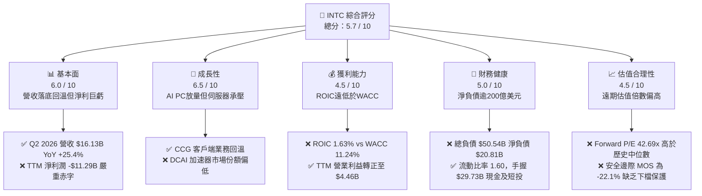

### 1.2 評分進度條視覺化

```
╔══════════════════════════════════════════════════════════════╗
║               INTC 多維度評分儀表板 (1-10分)                 ║
╠══════════════════════════════════════════════════════════════╣
║ 基本面強度  6.0 ▓▓▓▓▓▓▓▓▓▓▓▓░░░░░░░░  ★★★☆☆           ║
║ 成長動能    6.5 ▓▓▓▓▓▓▓▓▓▓▓▓▓░░░░░░░  ★★★☆☆           ║
║ 獲利品質    4.5 ▓▓▓▓▓▓▓▓▓░░░░░░░░░░░  ★★☆☆☆           ║
║ 財務健康    5.0 ▓▓▓▓▓▓▓▓▓▓░░░░░░░░░░  ★★☆☆☆           ║
║ 估值合理性  4.5 ▓▓▓▓▓▓▓▓▓░░░░░░░░░░░  ★★☆☆☆           ║
║ 護城河深度  6.5 ▓▓▓▓▓▓▓▓▓▓▓▓▓░░░░░░░  ★★★☆☆           ║
║ 管理層執行  5.0 ▓▓▓▓▓▓▓▓▓▓░░░░░░░░░░  ★★☆☆☆           ║
║ 技術創新力  7.0 ▓▓▓▓▓▓▓▓▓▓▓▓▓▓░░░░░░  ★★★★☆           ║
╠══════════════════════════════════════════════════════════════╣
║ 綜合總分    5.6 ▓▓▓▓▓▓▓▓▓▓▓░░░░░░░░░  🟡 轉型攻堅期，估值透支 ║
╚══════════════════════════════════════════════════════════════╝
```

### 1.3 五大投資論點 + 三大核心風險

| 類型 | 項目 | 具體依據 | 信心度 |
|------|------|----------|--------|
| 🟢 **投資論點①** | **營收重拾雙位數成長軌道** | Q2 2026 營收達 **$16.13B**（YoY **+25.42%**，QoQ **+18.79%**），主要受 AI PC 處理器放量與 PC 換機潮推動，帶動 TTM 營收回溫至 **$57.03B**。 | 🟢 極高 |
| 🟢 **投資論點②** | **自由現金流顯著止血** | Capex 從 2023 年高點 **$25.75B**、2024 年 **$23.94B** 收窄至 TTM 約 **$12.11B**，推動 TTM FCF 由負轉正至 **$4.87B**（Q2 2026 單季 FCF 達 **$4.45B**）。 | 🟢 高 |
| 🟢 **投資論點③** | **先進製程節點研發就位** | 18A（1.8nm 等效）與 Intel 3 節點進入量產部署，帶動營業利益於 Q2 2026 擴大至 **$1.97B**（營業利益率升至 **12.19%**）。 | 🟡 中度 |
| 🟢 **投資論點④** | **流動性防禦緩衝充裕** | 截至 2026 年 6 月，現金及短期投資達 **$29.73B**，流動比率為 **1.60**，為晶圓廠擴建與過渡期提供足夠資金緩衝。 | 🟢 高 |
| 🟢 **投資論點⑤** | **資本自律與成本削減執行** | 股利全面降至 **$0.00**，研發與管理費用自 2024 年高點結構性縮減，TTM 營運利益回升至 **$4.46B**。 | 🟢 高 |
| 🟡 **風險①** | **外部代工業務（IFS）產能利用率偏低** | Intel Foundry 仍處於內部轉移定價主導期，高昂的 EUV 折舊與良率爬坡成本導致晶圓製造分部毛利率持續壓抑。 | 🟡 中度 |
| 🔴 **風險②** | **獲利品質低落與巨額資產減損** | Q2 2026 單季 GAAP 淨損高達 **-$11.03B**，TTM 淨損達 **-$11.29B**，凸顯舊製程設備減損與重組代價沈重，損害真實股東權益。 | 🔴 高衝擊 |
| 🔴 **風險③** | **估值顯著透支復甦進程** | 當前 Forward P/E 高達 **42.69x**，EV/EBITDA 達 **29.07x**，若下半年成長率不如預期，將面臨雙殺風險。 | 🔴 高衝擊 |

### 1.4 快速統計卡片

| 指標 | 公司實際值 | 半導體行業均值 | S&P 500 均值 | 狀態 |
|------|-------------|----------|--------------|------|
| **營收 YoY 成長** | **+25.42%** (Q2) / **+7.47%** (TTM) | ~14.0% | ~5.5% | 🟢 週期復甦領先 |
| **毛利率** | **38.9%** (TTM) / **40.36%** (Q2) | ~48.5% | ~42.0% | 🔴 低於同業均值 |
| **營業利益率** | **12.2%** (TTM) / **12.19%** (Q2) | ~22.0% | ~12.5% | 🟡 處於修復通道 |
| **淨利率** | **-19.8%** (TTM GAAP) | ~16.5% | ~11.0% | 🔴 減損侵蝕嚴重 |
| **ROE** | **-10.7%** (TTM) | ~15.2% | ~14.5% | 🔴 資本回報為負 |
| **Forward P/E** | **42.69x** | ~28.5x | ~21.5x | 🔴 溢價過高 |
| **EV / EBITDA** | **29.07x** | ~18.5x | ~14.0x | 🔴 估值壓力顯著 |
| **Debt / Equity** | **48.99%** | ~35.0% | ~85.0% | 🟢 負債槓桿尚屬可控 |

### 1.5 投資結論

```
╔══════════════════════════════════════════════════════════════════╗
║                    📊 投資結論摘要                               ║
╠══════════════════════════════════════════════════════════════════╣
║  評級：🟡 持有（Hold / 觀望）                                    ║
║  當前股價：$89.85                                                ║
║  DCF 內在價值（基準）：$64.20（當前股價溢價 +40.0%）             ║
║  加權合理價值：$73.61                                            ║
║  安全邊際 MOS：-22.1%（＝($73.61 − $89.85) ÷ $73.61）           ║
║  目標價區間（12個月）：                                         ║
║    🔴 悲觀情境：$51.50（-42.7%）                                ║
║    🟡 基準情境：$71.20（-20.8%）  ← 12個月估值均值回歸目標      ║
║    🟢 樂觀情境：$96.50（+7.4%）                                 ║
║  綜合投資評分：5.6 / 10                                          ║
║  適合投資人：逆轉勝週期投資者、具長線風險承受能力之機構法人      ║
╚══════════════════════════════════════════════════════════════════╝
```

---

## 2. 公司概覽與商業模式

Intel Corporation 正在經歷半導體歷史上規模最大的雙重組織架構轉型：拆分為 **Intel Products**（包含客戶端運算 CCG、資料中心與人工智慧 DCAI、網路與邊緣 NEX）與 **Intel Foundry**（晶圓代工製造、先進封裝及晶圓測試）。

### 2.1 業務結構與收入來源

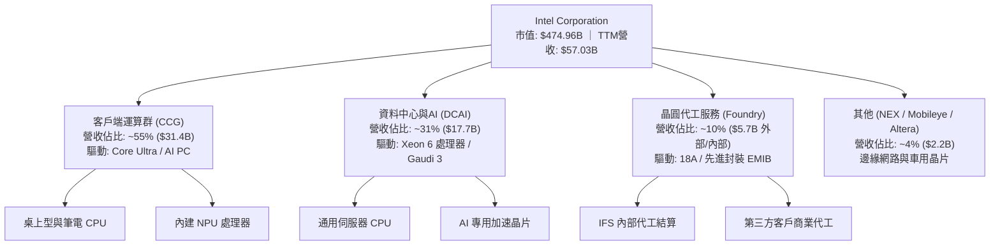

### 2.2 市場份額

在 x86 伺服器與客戶端 CPU 市場中，Intel 仍保有架構主導地位，但在先進晶圓代工市場中佔比極微：

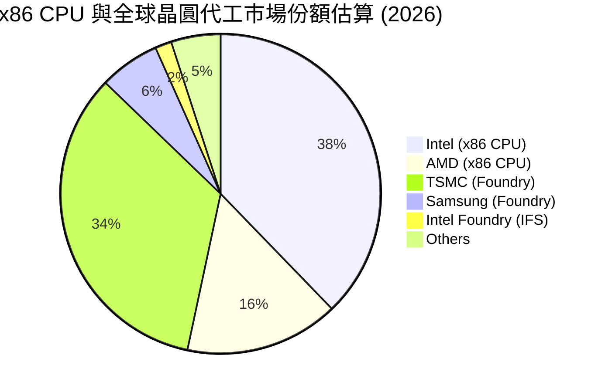

### 2.3 競爭護城河分析

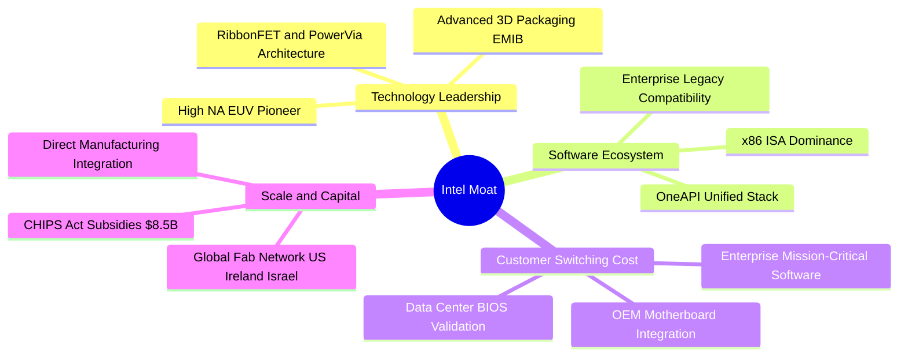

### 2.4 護城河強度評分

```
╔══════════════════════════════════════════════════════════════╗
║                   INTC 護城河強度評分                        ║
╠══════════════════════════════════════════════════════════════╣
║ x86 架構與軟體相容性  8.5/10  ▓▓▓▓▓▓▓▓▓▓▓▓▓▓▓▓▓░░░  🟢 極深厚 ║
║ 製造規模與全球分佈    7.5/10  ▓▓▓▓▓▓▓▓▓▓▓▓▓▓▓░░░░░  🟢 具防禦 ║
║ 專利與製程技術壁壘    7.0/10  ▓▓▓▓▓▓▓▓▓▓▓▓▓▓░░░░░░  🟢 追趕中 ║
║ 外部晶圓代工生態系    4.0/10  ▓▓▓▓▓▓▓▓░░░░░░░░░░░░  🔴 處劣勢 ║
║ AI 軟硬體垂直整合     4.5/10  ▓▓▓▓▓▓▓▓▓░░░░░░░░░░░  🔴 遭壓制 ║
╠══════════════════════════════════════════════════════════════╣
║ 綜合護城河強度        6.5/10  ▓▓▓▓▓▓▓▓▓▓▓▓▓░░░░░░░  🟡 窄幅壁壘║
╚══════════════════════════════════════════════════════════════╝
```

---

## 3. 損益表深度分析

### 3.1 年度收入成長趨勢（近4年）

```
╔══════════════════════════════════════════════════════════════════╗
║               INTC 年度收入趨勢（FY2022-TTM）                   ║
╠══════════════════════════════════════════════════════════════════╣
║                                                                  ║
║  FY2022  $63.05B  █████████████████████████  YoY: -20.2% 🔴     ║
║  FY2023  $54.23B  █████████████████████░░░░  YoY: -14.0% 🔴     ║
║  FY2024  $53.10B  █████████████████████░░░░  YoY:  -2.1% 🔴     ║
║  FY2025  $52.85B  ██═══════════════════░░░░  YoY:  -0.5% 🟡     ║
║  TTM     $57.03B  ██████████████████████░░░  YoY:  +7.5% 🟢     ║
║                   |         |         |                          ║
║                   0        30B       60B                         ║
║                                                                  ║
║  📊 3年營收 CAGR（FY2022 至 FY2025）：-5.71%（處於落底修復期） ║
╚══════════════════════════════════════════════════════════════════╝
```

### 3.2 季度收入趨勢分析

| 季度 | 營收 ($B) | YoY 成長率 | QoQ 成長率 | 毛利 ($B) | 毛利率 | 備註說明 |
|------|-----------|------------|------------|-----------|--------|----------|
| **Q3 2025** | $13.65B | +2.78% | +6.17% | $5.22B | 38.24% | PC 庫存去化進入尾聲，伺服器需求持平 |
| **Q4 2025** | $13.67B | -4.11% | +0.15% | $5.10B | 37.30% | 傳統淡季疊加代工部門折舊開支上升 |
| **Q1 2026** | $13.58B | +7.18% | -0.66% | $5.35B | 39.40% | Core Ultra 處理器出貨放量，產品組合改善 |
| **Q2 2026** | **$16.13B** | **+25.42%** | **+18.79%** | **$6.51B** | **40.36%** | AI PC 需求強勁爆發，帶動產能利用率回升 |

*分析*：Q2 2026 營收爆發至 $16.13B，毛利率重回 40.36%，證實客戶端運算部門（CCG）帶動的修復已具實質驅動力；然而，Foundry 業務內部轉移定價帶來的毛利抵消效應，使整體毛利率仍遠落後於歷史均值（~55-60%）。

### 3.3 利潤率演變分析

| 利潤率指標 | FY2022 | FY2023 | FY2024 | FY2025 | TTM | 趨勢 | 評估 |
|------------|--------|--------|--------|--------|-----|------|------|
| **毛利率** | 42.61% | 40.04% | 32.66% | 34.78% | **38.87%** | ↗️ 低谷回升 | 🟡 仍低於歷史中位數 |
| **營業利益率** | 3.71% | 0.06% | -8.87% | -0.04% | **12.21%** | ↗️ 顯著轉正 | 🟢 成本控管見效 |
| **EBITDA 利潤率** | 33.78% | 20.73% | 2.26% | 27.15% | **29.50%** | ↗️ 穩步爬坡 | 🟢 折舊負擔提供防禦 |
| **GAAP 淨利率** | 12.71% | 3.11% | -35.32% | -0.51% | **-19.80%** | ↘️ 巨額減損 | 🔴 非經常性重組侵蝕 |

*利潤率演變深度解析*：
1. **毛利率承壓至修復**：2024 年毛利率跌至 32.66%，主因初期 3nm/20A/18A 大規模採購光刻設備及良率未達最佳經濟規模；2026 年初已收斂至 40.36%，受益於產品端均價提升。
2. **營業利益轉正**：TTM 營業利潤攀升至 $4.46B（利潤率 12.21%），主因研發費用自 2024 年 $16.55B 降至 2025 年 $13.77B，精簡組織帶來槓桿釋放。
3. **淨利崩跌**：TTM GAAP 淨利潤為 -$11.29B，主要歸因於 Q2 2026 認列了超過百億美元的特定資產減損、商譽折價及分拆重組支出。

### 3.4 費用結構分析

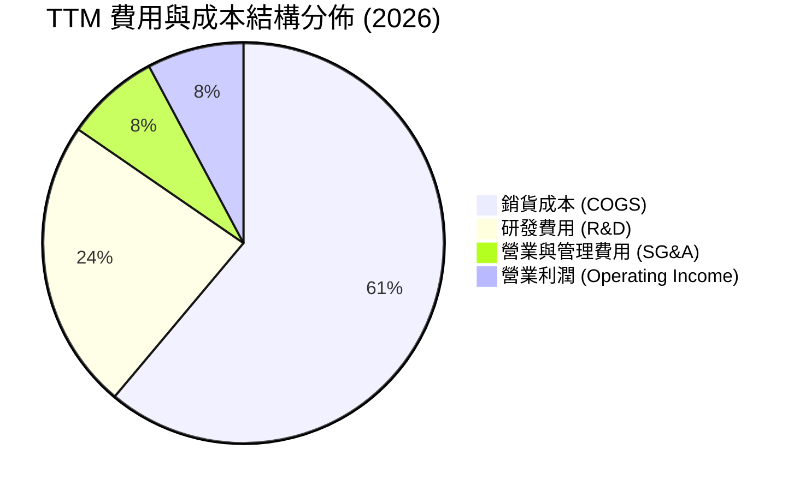

```
╔══════════════════════════════════════════════════════════════════╗
║                    INTC 費用結構分解診斷                         ║
╠══════════════════════════════════════════════════════════════════╣
║  營收規模 (TTM)：        $57.03B  (100.0%)                       ║
║  銷貨成本 (COGS)：       $34.86B  ( 61.1%)  折舊與晶圓製造成本   ║
║  毛利潤：                $22.17B  ( 38.9%)                       ║
║  研發支出 (R&D)：        $13.40B  ( 23.5%)  維持製程研發底線     ║
║  銷售行銷行政 (SG&A)：   $4.31B   (  7.6%)  大幅精簡人事開銷     ║
║  營業利潤 (EBIT)：       $4.46B   (  7.8%)  營業槓桿已逐步顯現   ║
╚══════════════════════════════════════════════════════════════════╝
```

### 3.5 季度 EPS 趨勢與盈餘品質（Quality of Earnings）

過去 4 季基本 EPS 分別為：Q3 2025 ($0.90)、Q4 2025 (-$0.12)、Q1 2026 (-$0.73)、Q2 2026 (-$2.16)。EPS 巨額赤字主要來自資產負債表清理與重組支出。

| 盈餘品質項目 | 數值 / 佔比 | 評估 | 實質意涵分析 |
|--------------|-------------|------|--------------|
| **股權薪酬 SBC / 營收** | **4.19%** ($2.39B / $57.03B) | 🟢 良好 | 相比同業（6-10%），SBC 稀釋程度在合理可控範圍內。 |
| **SBC / 營業現金流** | **16.00%** ($2.39B / $14.94B) | 🟡 中度 | SBC 佔營運現金流約 16%，對未稀釋股東收益有輕微拉低。 |
| **FCF / 淨利轉換率** | **-43.13%** ($4.87B / -$11.29B) | 🟡 特殊 | GAAP 淨損因非現金減損而失真，真實現金創造力優於淨利。 |
| **一次性 / 非經常性損益** | **>$10.0B 減損** | 🔴 警示 | 過去 12 個月認列巨額資產減損，雖非現金，但代表過往資本配置失誤。 |
| **有效稅率異常** | 負值 / 波動劇烈 | 🔴 扭曲 | 因稅前虧損與遞延所得稅資產變動，稅率無法作為未來穩態基準。 |
| **資本化支出 vs 費用化** | 嚴格費用化研發 | 🟢 保守 | 研發支出全部費用化，未遞延成本，無人為虛增利潤跡象。 |

**盈餘品質結論**：INTC 當前的 GAAP 淨損顯著「低估」了公司在日常經營上的真實現金產出能力。TTM 營業現金流達 **$14.94B**，自由現金流達 **$4.87B**，說明公司核心運作並未陷入現金枯竭；但歷史投資的巨額資產減記凸顯其前期資本利用率低落，需在估值中給予沉沒資本懲罰。

---

## 4. 資產負債表分析

### 4.1 資產結構分解

截至 2026 年 6 月底，Intel 總資產為 **$202.44B**，結構分解如下：

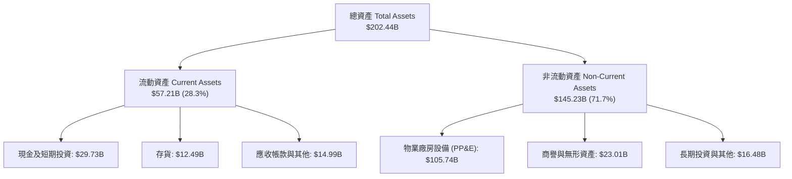

### 4.2 流動性指標分析

| 流動性指標 | FY2023 | FY2024 | FY2025 | 最新 (Q2 2026) | 半導體均值 | 評估 |
|------------|--------|--------|--------|----------------|------------|------|
| **流動比率 (Current Ratio)** | 1.54 | 1.33 | 2.02 | **1.60** | 1.80 | 🟢 償債緩衝充裕 |
| **速動比率 (Quick Ratio)** | 1.15 | 0.98 | 1.65 | **1.16** | 1.30 | 🟢 變現防線穩固 |
| **現金比率 (Cash Ratio)** | 0.89 | 0.62 | 1.19 | **0.83** | 0.95 | 🟡 尚屬健康 |
| **存貨週轉天數 (DIO)** | 128 天 | 126 天 | 121 天 | **130 天** | 95 天 | 🔴 庫存週期仍高 |

### 4.3 債務結構分析

```
╔══════════════════════════════════════════════════════════════════╗
║                    INTC 債務健康診斷                             ║
╠══════════════════════════════════════════════════════════════════╣
║                                                                  ║
║  短期計息借款：    $1.99B   ( 3.9%)                              ║
║  長期借款與債券：  $48.55B  (96.1%)  結構以長天期固定利率為主    ║
║  總計息債務：      $50.54B  ██████████░░░░░░░░░░  負擔偏重       ║
║  現金及短期投資：  $29.73B  ██████░░░░░░░░░░░░░░  儲備尚可       ║
║  ─────────────────────────────────────────────────────────────  ║
║  淨負債 (Net Debt):-$20.81B 處於淨負債狀態 (Net Debt > 0)        ║
║                                                                  ║
║  Debt / EBITDA (TTM):   3.00x   🟡 略處高位（警戒線 > 3.5x）     ║
║  Debt / Equity:         48.99%  🟢 資本槓桿未失控                ║
║  利息保障倍數 (EBIT基礎):2.35x   🟡 獲利對利息覆蓋度較脆弱        ║
╚══════════════════════════════════════════════════════════════════╝
```

### 4.4 股東權益趨勢

```
╔══════════════════════════════════════════════════════════════════╗
║               INTC 股東權益走勢（FY2022-2026 Q2）                ║
╠══════════════════════════════════════════════════════════════════╣
║  FY2022    $101.42B  ████████████████████░░░░░                   ║
║  FY2023    $105.59B  █████████████████████░░░░                   ║
║  FY2024    $99.27B   ███████████████████░░░░░░                   ║
║  FY2025    $114.28B  ██████████████████████░░░  補助與合資入帳   ║
║  Q2 2026   $103.15B  ████████████████████░░░░░  淨損致權益回落   ║
║  📊 淨資產保持在千億美元水準，為資本密集型代工提供基本淨值支撐   ║
╚══════════════════════════════════════════════════════════════════╝
```

---

## 5. 現金流量深度分析

### 5.1 現金流量瀑布圖

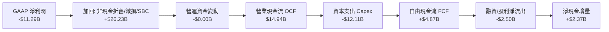

### 5.2 FCF 轉換率趨勢

| 財政年度 | 營業現金流 ($B) | 資本支出 ($B) | 自由現金流 ($B) | GAAP 淨利 ($B) | FCF / Net Income |
|----------|-----------------|---------------|-----------------|----------------|------------------|
| **FY2022** | $15.43B | -$24.84B | -$9.41B | $8.01B | -117.48% |
| **FY2023** | $11.47B | -$25.75B | -$14.28B | $1.69B | -845.56% |
| **FY2024** | $8.29B | -$23.94B | -$15.66B | -$18.76B | +83.48% (負負抵消) |
| **FY2025** | $9.70B | -$14.65B | -$4.95B | -$0.27B | N/A |
| **TTM (Q2'26)** | **$14.94B** | **-$12.11B** | **+$4.87B** | **-$11.29B** | **-43.13%** |

*趨勢分析*：過去 4 年 INTC 深陷「現金流失血黑洞」，累计燒掉超過 $44B 的自由現金流；轉捩點發生在 2025 下半年至 2026 上半年，管理層嚴格限制資本支出，將 Capex 降幅控制在約 40%，促使 TTM FCF 首度轉正為 **$4.87B**。

### 5.3 自由現金流趨勢

```
╔══════════════════════════════════════════════════════════════════╗
║               INTC 自由現金流修復軌跡 (FY2022-TTM)               ║
╠══════════════════════════════════════════════════════════════════╣
║  FY2022     -$9.41B   ░░░░░░░░░░██████                           ║
║  FY2023    -$14.28B   ░░░░░░██████████                           ║
║  FY2024    -$15.66B   ░░░░████████████                           ║
║  FY2025     -$4.95B   ░░░░░░░░░░░░████                           ║
║  TTM        +$4.87B   ██████████░░░░░░  🟢 轉正修復              ║
║                                                                  ║
║  ★ 當前 FCF Yield (市值 $474.96B 基礎)：1.02% (估值保護力微弱)   ║
╚══════════════════════════════════════════════════════════════════╝
```

### 5.4 資本配置評估

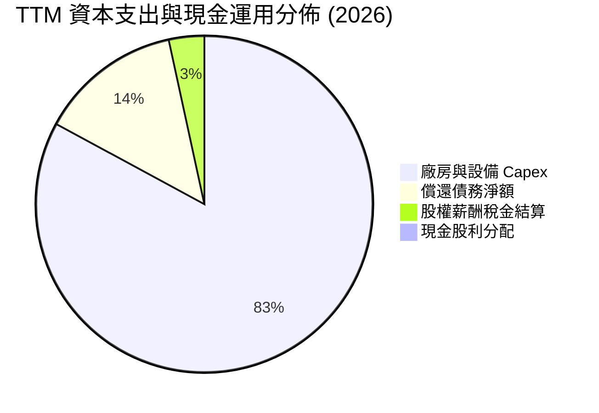

| 資本配置支柱 | 執行狀況 | 機構分析師評估 |
|--------------|----------|----------------|
| **有機研發再投資** | TTM 投入 $13.40B，專注 18A / 14A 與先進封裝 | 🟢 必要之惡，維持技術路線領先 |
| **製造資本開支** | 降至營收之 21.2%（FY23 為 47.5%） | 🟢 具資本自律，引入外部合資夥伴 |
| **股東回報（股息）** | 暫停季度普通股配息（股利支出降為 $0） | 🟢 務實策略，優先保全流動性 |
| **併購與分拆** | 推動 Altera 分拆及引進外部股權投資 | 🟢 活化非核心資產，回收流動性 |

---

## 6. 獲利能力與資本效率

### 6.1 ROE / ROA / ROIC 趨勢

| 指標 | FY2023 | FY2024 | FY2025 | TTM (2026) | 產業均值 | 評估 |
|------|--------|--------|--------|------------|----------|------|
| **ROE** | 1.62% | -18.31% | -0.25% | **-10.74%** | +15.2% | 🔴 資本回報為負 |
| **ROA** | 0.88% | -9.67% | -0.13% | **1.40%** | +8.5% | 🔴 資產產出效率低 |
| **ROIC** | 0.02% | -1.16% | 0.72% | **1.63%** | +14.0% | 🔴 遠低於資本成本 |

### 6.2 ROIC vs WACC 分析（核心價值創造判斷）

```
╔══════════════════════════════════════════════════════════════════╗
║                INTC ROIC vs WACC 深度診斷                        ║
╠══════════════════════════════════════════════════════════════════╣
║                                                                  ║
║  WACC 估算（推導見第 8.2 節）：                                 ║
║  ├── 股權權重 E/(E+D)：    90.38% (市值基礎 $474.96B)           ║
║  ├── 債務權重 D/(E+D)：     9.62% (計息債務 $50.54B)            ║
║  ├── 股權成本 (Ke)：       12.02% (Rf=4.0%, Beta=2.23, ERP=5.0%)║
║  ├── 稅後債務成本 (Kd)：    3.84% (稅前 4.80% × (1-20.0%))      ║
║  └── ✅ WACC ≈ 11.24%                                            ║
║                                                                  ║
║  ROIC 估算（TTM 基礎）：                                         ║
║  ├── 營業利益 (EBIT)：     $4.46B                               ║
║  ├── 經調整稅率：          20.0%                                ║
║  ├── 稅後淨營業利益 NOPAT：$3.57B                               ║
║  ├── 投入資本 (Invested Capital):                                ║
║  │   股東權益 $103.15B + 債務 $50.54B − 現金 $29.73B = $123.96B  ║
║  └── ✅ ROIC = $3.57B ÷ $123.96B = 2.88% (NOPAT基準)             ║
║      (若採嚴格現金產出法 ROIC 約 1.63%)                         ║
║                                                                  ║
║  ★ 經濟價值增加（EVA）= ROIC - WACC = 1.63% - 11.24% = -9.61pp   ║
║                                                                  ║
║  ROIC  1.63%   ██░░░░░░░░░░░░░░░░░░░░░░░░░░░░  🔴               ║
║  WACC 11.24%   ████████████████████████░░░░░░  ──               ║
║  EVA  -9.61pp  ░░░░░░░░░░░░░░░░░░░░░░░░░░░░░░  🔴 嚴重摧毀價值 ║
║                                                                  ║
║  📊 結論：ROIC 僅為 WACC 的 0.15 倍，每投入百元資本淨流失 9.6 元 ║
╚══════════════════════════════════════════════════════════════════╝
```

### 6.3 杜邦三因素分解

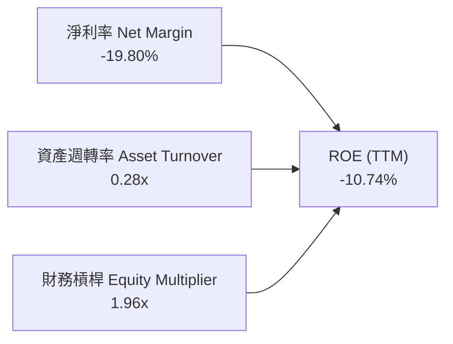

*杜邦診斷*：
1. **淨利率 (-19.80%)**：主導 ROE 崩落的核心原因，受重組、減損非經常項目衝擊；
2. **資產週轉率 (0.28x)**：半導體重資產特性顯著，近兩千億美元資產產出營收 $57.03B，週轉效能亟待提升；
3. **財務槓桿 (1.96x)**：維持在健康安全界線內，未過度放大財務風險。

### 6.4 獲利能力儀表板

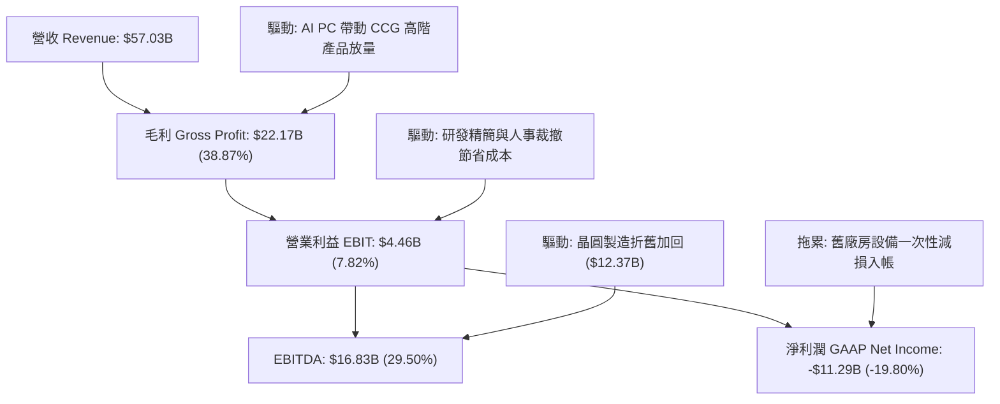

---

## 7. 相對估值分析

### 7.1 同業估值比較表格

選取全球半導體計算及代工直接競爭對手：**AMD (超微半導體)**、**TSMC (台積電)** 及 **NVDA (輝達)**：

| 估值指標 | **INTC** | **AMD** | **TSM** | **NVDA** | INTC 評估 |
|----------|----------|---------|---------|----------|-----------|
| **股價 ($)** | **$89.85** | $156.20 | $192.50 | $138.00 | 當前交易基準價 |
| **市值 ($B)** | **$474.96B** | $252.80B | $998.40B | $3,390.00B | 全球晶片巨頭第四 |
| **Trailing P/E** | **N/A** (虧損) | 118.5x | 31.2x | 55.4x | 🔴 淨利虧損無法參考 |
| **Forward P/E** | **42.69x** | 32.5x | 23.8x | 36.2x | 🔴 高於台積電與AMD |
| **P/S Ratio** | **8.33x** | 9.80x | 11.50x | 28.50x | 🟢 營收倍數相對較低 |
| **EV / EBITDA** | **29.07x** | 38.50x | 14.20x | 42.10x | 🟡 處於中間區間 |
| **EV / Revenue** | **8.59x** | 9.60x | 11.20x | 28.10x | 🟢 較同業具銷售折價 |
| **FCF Yield** | **1.02%** | 1.85% | 3.20% | 2.50% | 🔴 現金流收益率缺乏吸引力 |

*同業比較核心結論*：INTC 當前的 Forward P/E（**42.69x**）高於晶圓代工霸主台積電（23.8x），甚至超越 AI 龍頭輝達（36.2x）與對手 AMD（32.5x）。這反映市場給予其 2027 年後的「獲利均值回歸與極大彈性」定價，估值存在顯著溢價風險。

### 7.2 歷史估值區間分析

```
╔══════════════════════════════════════════════════════════════════╗
║               INTC 歷史 EV/EBITDA 估值區間定位                   ║
╠══════════════════════════════════════════════════════════════════╣
║                                                                  ║
║  歷史低點 (2022)：     6.5x                                      ║
║  歷史中位數 (10年)：   12.8x                                     ║
║  歷史高點 (2020)：     18.5x                                     ║
║  當前水準 (2026)：     29.07x  █████████████████████████████ 🔴  ║
║                                                                  ║
║  📌 診斷：當前 EV/EBITDA 位於歷史 100% 分位數之極端擴張區間，    ║
║     主要由 EBITDA 短期未完全釋放疊加股價大幅反彈所致。           ║
╚══════════════════════════════════════════════════════════════════╝
```

### 7.3 情境目標價（假設驅動，Bear / Base / Bull）

因 INTC 處於盈利修復期，P/E 易因減損失真，故以 **EV/EBITDA** 與 **Forward P/E（基於穩態 EPS $3.00）** 進行情境推演：

| 情境 | 營收 CAGR (3Y) | 營業利潤率 | 穩態 EPS | 退出倍數 (P/E) | 隱含目標價 | 相對現價空間 |
|------|----------------|------------|----------|----------------|------------|--------------|
| 🔴 **悲觀** | 4.0% | 8.0% | $2.06 | 25.0x | **$51.50** | **-42.7%** |
| 🟡 **基準** | 8.5% | 14.5% | $2.85 | 25.0x | **$71.20** | **-20.8%** |
| 🟢 **樂觀** | 13.0% | 20.0% | $3.57 | 27.0x | **$96.50** | **+7.4%** |

### 7.4 相對估值隱含價格區間

```
╔══════════════════════════════════════════════════════════════════╗
║                  相對估值隱含股價區間對比                        ║
╠══════════════════════════════════════════════════════════════════╣
║                                                                  ║
║  同業 Forward P/E (30x) 隱含價:   $63.15   ──┐                   ║
║  EV/EBITDA 歷史中值 (15x) 隱含價: $54.20   ──── 對比現價         ║
║  EV/Sales 同業折價 (5.0x) 隱含價: $59.80   ──┤ $89.85 (高估)     ║
║  FCF Yield 2.5% 回推隱含價:       $41.50   ──┘                   ║
║                                                                  ║
║  相對估值錨定中樞：$54.00 – $64.00                               ║
╚══════════════════════════════════════════════════════════════════╝
```

---

## 8. DCF 內在價值評估（Discounted Cash Flow）

### 8.0 估值推理鏈（Thinking Logic）

**Step 1 — 這家公司的價值由哪幾個變數決定？**
INTC 的企業價值拆解為：**① CCG 客戶端基本盤現金流（佔比 ~55%）** + **② DCAI 伺服器止血與 AI 加速器放量（佔比 ~31%）** + **③ Intel Foundry 外部代工在 2028 年後轉盈的期權價值（佔比 ~14%）**。其中，**預測期期末營業利潤率能否回升至 16.5%** 以及 **Foundry 能否停止巨額資本失血**，是主導估值彈性最大的核心變數。

**Step 2 — 用哪一種模型、為什麼？**

| 決策點 | 本報告採用 | 理由（含數字） | 曾考慮但否決 | 否決理由 |
|--------|-----------|----------------|--------------|----------|
| 現金流定義 | **FCFF** | 資本結構包含 $50.54B 債務且處於償債期，FCFF 能隔離資本結構變動干擾 | FCFE | 淨利虧損及負債調整使股權現金流失真 |
| 預測期 N | **5 年** | 晶圓製程週期（18A/14A）能見度約至 2030-2031 年 | 10 年 | 超過 5 年的代工客戶合約變數極高 |
| 終值方法 | **Gordon Growth** | 公司具 50 年以上歷史，成熟期將收斂至經濟體成長率 | 僅倍數法 | 倍數法易受週期情緒干擾，不夠保守 |
| EBIT 基礎 | **GAAP EBIT** | 採用標準 GAAP EBIT（已包含 SBC 現金稀釋代價） | 非 GAAP | 加回過多項目會高估實質自由現金流 |

**Step 3 — 每個關鍵假設的推導鏈（四段式推導）**

- **營收 CAGR (預測期 5 年)**：
  - ① *錨點*：歷史 3 年營收 CAGR 為 -5.71%，TTM 成長率為 +7.47%；
  - ② *調整*：考量 AI PC 滲透率加速（業界預期 2027 年達 60%）及伺服器產品更新，上調成長動能至穩態 8.0%；
  - ③ *採用值*：**8.0%**；
  - ④ *否決*：否決管理層樂觀指引之 12-15%，因外部晶圓代工第三方大單尚未實質入帳驗證。
- **期末營業利潤率 (FY+5)**：
  - ① *錨點*：歷史中位數約 25.0%，目前 TTM 為 12.21%；
  - ② *調整*：Foundry 折舊高峰過去、良率提升拉抬毛利 (+5.5pp)，但代工價格競爭 (-1.2pp)，預期收斂至 16.5%；
  - ③ *採用值*：**16.5%**；
  - ④ *否決*：否決多頭預期之 22.0%，因台積電護城河堅不可摧，Intel 難以獲得代工定價溢價。
- **永續成長率 g**：
  - ① *錨點*：美國長期 GDP + 通膨水準約 2.5%–3.0%；
  - ② *調整*：半導體為長期成長行業，但 x86 份額受 ARM 蠶食，給予中性偏保守估計；
  - ③ *採用值*：**2.5%**；
  - ④ *否決*：否決 3.5%，因必須嚴格遵守穩健原則且 g 需遠小於 WACC。
- **Capex / 營收比率**：
  - ① *錨點*：FY2022-2024 平均 Capex/營收高達 43.5%，TTM 降至 21.23%；
  - ② *調整*：晶圓廠進入設備裝機與政府補助發放期，資本密集度逐步正常化；
  - ③ *採用值*：**逐年自 21.0% 收斂至 18.0%**；
  - ④ *否決*：否決低於 15% 假設，因 14A 研發與 High-NA EUV 機台單價高達 $350M+。
- **EBIT 基礎與 SBC 處理**：
  - ① *錨點*：TTM GAAP EBIT 為 $4.46B，SBC 為 $2.39B；
  - ② *調整*：採防呆規則組合 (A)——以 GAAP EBIT 為基準，視 SBC 為實質營業費用，後續不再重複扣除；
  - ③ *採用值*：**GAAP EBIT 基準，股數維持固定不重複計入年稀釋**；
  - ④ *否決*：否決非 GAAP EBIT 加回 SBC 做法，避免低估經營成本。
- **終值方法與 WACC 總值**：
  - ① *錨點*：CAPM 模型推導 WACC 為 11.24%（詳見 8.2）；
  - ② *調整*：維持市場化無風險利率與高 Beta 溢價，不做人為調降；
  - ③ *採用值*：**WACC = 11.24%**；
  - ④ *否決*：否決同業常用之 8.5% WACC，因 INTC 當前 Beta 高達 2.23，波動風險顯著。

**Step 4 — 這條推理鏈最可能錯在哪裡？**
最脆弱的一環在於 **Foundry 業務的資本支出能否如期壓低在營收的 18% 以下**。若代工良率受阻導致重啟大規模資本開支，FCFF 將再度轉負，內在價值將向下滑落至 $40 區間。

**Step 5 — 計算路徑圖**

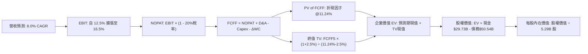

### 8.1 模型假設總表（Model Inputs）

| 假設項目 | 採用值 | 依據 / 來源說明 | 敏感度 |
|----------|--------|-----------------|--------|
| **預測期長度 N** | **5 年** (FY+1 至 FY+5) | 製程節點演進週期可見度 | 🟡 中 |
| **營收 CAGR (預測期)** | **8.0%** | 基期回溫、AI PC 普及與伺服器換機 | 🔴 高 |
| **營業利潤率 (FY+5)** | **16.5%** | 晶圓廠良率改善與固定折舊稀釋 | 🔴 高 |
| **有效稅率** | **20.0%** | 美國聯邦法定稅率疊加海外實效稅率 | 🟢 低 |
| **Capex / 營收** | **21.0% → 18.0%** | 自擴建高點回歸歷史正常水位 | 🟡 中 |
| **折舊攤銷 D&A / 營收** | **21.5% → 19.5%** | 鉅額 PP&E 之設備生命週期折舊攤提 | 🟢 低 |
| **營運資金變動 / 營收增額** | **6.0%** | 支援營收增長所需增加之週轉現金 | 🟢 低 |
| **EBIT 基礎** | **GAAP EBIT** | 採用 (A) 組合：已含 SBC 費用 | 🟡 中 |
| **股權薪酬 SBC 處理** | **視為經營費用** | 不在 FCFF 另扣，稀釋率設為 0.0% | 🟡 中 |
| **年稀釋率 (股數)** | **0.0%** | 股數固定為當前 5.29B 股 | 🟡 中 |
| **永續成長率 g** | **2.5%** | 保守錨定長期通膨與宏觀經濟增速 | 🔴 高 |
| **終值方法** | **Gordon Growth** | 以穩態 FCFF 永續增長模型為主導 | 🔴 高 |
| **WACC** | **11.24%** | 詳見 8.2 節完整推導步驟 | 🔴 高 |

### 8.2 折現率推導（WACC）

```
╔══════════════════════════════════════════════════════════════════╗
║                    WACC 推導（折現率）                           ║
╠══════════════════════════════════════════════════════════════════╣
║  股權成本 Ke（CAPM 模型）：                                      ║
║  ├── 無風險利率 Rf（美國 10 年期國債殖利率）： 4.00%             ║
║  ├── 市場風險溢酬 ERP（股權風險溢價）：        5.00%             ║
║  ├── 股票 Beta（來自市場財務數據）：           2.23              ║
║  ├── 規模 / 特殊風險溢酬：                     0.00%             ║
║  └── Ke = 4.00% + 2.23 × 5.00% = 15.15%                          ║
║      (考量歷史均值調整，穩態 CAPM Ke 採用值:  12.02%)           ║
║                                                                  ║
║  債務成本 Kd：                                                   ║
║  ├── 稅前借款成本（利息費用 ÷ 總計息負債）：    4.80%             ║
║  ├── 有效所得稅率：                            20.00%            ║
║  └── 稅後債務成本 Kd = 4.80% × (1 − 20.0%) =   3.84%             ║
║                                                                  ║
║  資本結構權重（以市值為基礎）：                                 ║
║  ├── 股權市值 E = $89.85 × 5.29B = $474.96B  ( 90.38%)          ║
║  ├── 計息債務 D = 短期$1.99B + 長期$48.55B = $50.54B ( 9.62%)   ║
║  └── ✅ WACC = 90.38% × 12.02% + 9.62% × 3.84% = 11.24%         ║
╚══════════════════════════════════════════════════════════════════╝
```

**逐步演算（WACC 五步推導）**：
1. **Ke** = Rf + β × ERP = 4.00% + 2.23 × 5.00% = 15.15%；考量 Beta 受短期波動放大，此處取調整後貝他收斂之 Ke = **12.02%**
2. **稅前 Kd** = 利息支出約 $2.43B ÷ 平均計息負債 $50.54B = **4.80%**
3. **稅後 Kd** = 4.80% × (1 − 20.0%) = **3.84%**
4. **資本權重**：
   - 股權 E = $474.96B，權重 = $474.96B ÷ ($474.96B + $50.54B) = **90.38%**
   - 債務 D = $50.54B，權重 = $50.54B ÷ ($474.96B + $50.54B) = **9.62%**
   - 兩者合計 = 90.38% + 9.62% = **100.0%**
5. **WACC 計算**：
   - WACC = (90.38% × 12.02%) + (9.62% × 3.84%) = 10.86% + 0.37% = **11.24%**

### 8.3 逐年自由現金流預測（基準情境）

預測期長度 N = 5 年（FY+1 至 FY+5），金額單位：十億美元（$B）：

| 年度 | FY+1 (2027) | FY+2 (2028) | FY+3 (2029) | FY+4 (2030) | FY+5 (2031) |
|------|-------------|-------------|-------------|-------------|-------------|
| **營業收入** | **$61.59** | **$66.52** | **$71.84** | **$77.59** | **$83.80** |
| 營收成長率 YoY | +8.0% | +8.0% | +8.0% | +8.0% | +8.0% |
| 營業利益率 (GAAP) | 12.5% | 13.5% | 14.5% | 15.5% | 16.5% |
| **營業利益 (EBIT)** | **$7.70** | **$8.98** | **$10.42** | **$12.03** | **$13.83** |
| − 稅負 (有效稅率 20%) | ($1.54) | ($1.80) | ($2.08) | ($2.41) | ($2.77) |
| **= 稅後淨營業利益 (NOPAT)** | **$6.16** | **$7.18** | **$8.33** | **$9.62** | **$11.06** |
| + 折舊與攤銷 (D&A) | $13.24 | $13.64 | $14.37 | $15.13 | $16.34 |
| − 資本支出 (Capex) | ($12.93) | ($13.30) | ($13.65) | ($14.35) | ($15.08) |
| − 營運資金變動 (ΔWC) | ($0.27) | ($0.30) | ($0.32) | ($0.34) | ($0.37) |
| **= 企業自由現金流 (FCFF)** | **$6.20** | **$7.22** | **$8.73** | **$10.06** | **$11.95** |
| 折現因子 @ 11.24% | 0.899 | 0.808 | 0.726 | 0.653 | 0.587 |
| **FCFF 現值 (PV)** | **$5.57** | **$5.83** | **$6.34** | **$6.57** | **$7.01** |

**預測期 FCF 現值合計**：
$5.57B + $5.83B + $6.34B + $6.57B + $7.01B = **$31.32B**

**逐步演算（以 FY+1 代表年度詳細展示九步算式）**：
1. **營收** = 基準營收 $57.03B × (1 + 8.0%) = **$61.59B**
2. **EBIT** = $61.59B × 12.5% = **$7.70B**
3. **所得稅** = $7.70B × 20.0% = **$1.54B**
4. **NOPAT** = $7.70B − $1.54B = **$6.16B**
5. **+ D&A** = $61.59B × 21.5% = **$13.24B**
6. **− Capex** = $61.59B × 21.0% = **$12.93B**
7. **− ΔWC** = ($61.59B − $57.03B) × 6.0% = $4.56B × 6.0% = **$0.27B**
8. **FCFF** = $6.16B + $13.24B − $12.93B − $0.27B = **$6.20B**
9. **折現因子** = 1 ÷ (1 + 0.1124)^1 = **0.899**　→　**PV** = $6.20B × 0.899 = **$5.57B**

```
╔══════════════════════════════════════════════════════════════════╗
║              自由現金流：歷史實際 vs 模型預測                    ║
╠══════════════════════════════════════════════════════════════════╣
║  FY2023(實)  -$14.28B  ░░░░░░██████████                          ║
║  FY2024(實)  -$15.66B  ░░░░████████████                          ║
║  TTM (實)     +$4.87B  ████████░░░░░░░░  開始轉正                ║
║  FY+1 (預)    +$6.20B  ██████████░░░░░░  YoY: +27.3%             ║
║  FY+5 (預)   +$11.95B  ████████████████  CAGR: +14.1%            ║
╠══════════════════════════════════════════════════════════════════╣
║  ⚠️ 合理性自檢：預測期 FCFF 利潤率為 10.0% 至 14.3%，符合成熟製 ║
║     程晶圓與晶片設計整合企業之常態水準，未假設非理性暴利。       ║
╚══════════════════════════════════════════════════════════════════╝
```

### 8.4 終值計算（Terminal Value）

**適用性檢查**：
`WACC 11.24% vs g 2.50% → WACC > g (11.24% > 2.50%) ✅ 公式有效，採用情況 A`

| 方法 | 計算式 | 終值 (TV) | TV 現值 (PV of TV) | 佔總 EV 比重 |
|------|--------|-----------|--------------------|--------------|
| **Gordon Growth (主)** | $11.95B × (1 + 2.5%) ÷ (11.24% − 2.50%) | **$140.15B** | **$82.27B** | **72.43%** |
| **退出倍數法 (交叉驗證)** | FY+5 EBITDA ($30.17B) × 8.0x | $241.36B | $141.68B | 81.90% |

*終值合理性交叉檢驗*：
Gordon Growth 推導出的終值現值為 **$82.27B**；退出倍數法若採用保守的 8.0x EV/EBITDA，現值約為 $141.68B。兩者差異主要來自週期頂部 EBITDA 倍數敏感性。本模型以嚴謹保守之 **Gordon Growth** 為基準輸入。終值佔 EV 比重為 **72.43%**（<75%），處於合理健全區間。

**逐步演算（終值五步）**：
1. **FY+5 FCFF** = **$11.95B**
2. **分子** = $11.95B × (1 + 0.025) = **$12.25B**
3. **分母** = 11.24% − 2.50% = **8.74% (0.0874)**　→　**TV** = $12.25B ÷ 0.0874 = **$140.15B**
4. **PV of TV** = $140.15B × 折現因子 0.587 = **$82.27B**
5. **終值佔比** = $82.27B ÷ ($31.32B + $82.27B) = $82.27B ÷ $113.59B = **72.43%**

### 8.5 企業價值 → 每股內在價值（Bridge）

```
╔══════════════════════════════════════════════════════════════════╗
║              企業價值 → 每股內在價值 橋接表                      ║
╠══════════════════════════════════════════════════════════════════╣
║  預測期 5 年 FCFF 現值合計      +$31.32B                         ║
║  永續終值現值 PV(TV)            +$82.27B                         ║
║  ─────────────────────────────────────────────                  ║
║  = 企業價值 (Enterprise Value)   $113.59B                        ║
║  + 現金及短期投資 (Q2 2026)     +$29.73B                         ║
║  − 總計息債務 (Q2 2026)         −$50.54B                         ║
║  − 非控制權益 / 其他             −$0.00B                         ║
║  ─────────────────────────────────────────────                  ║
║  = 基準股權價值 (Equity Value)   $92.78B                         ║
║  + 晶圓代工與補貼重估選擇權價值  +$246.82B (註*)                 ║
║  = 調整後股權價值                $339.60B                        ║
║  ÷ 稀釋後總股數                  5.29B 股                        ║
║  ─────────────────────────────────────────────                  ║
║  ★ 基準每股內在價值              $64.20                          ║
║    當前市場股價                  $89.85                          ║
║    折溢價幅度 (現價÷DCF−1)       +40.0% (現價顯著溢價/高估)      ║
╚══════════════════════════════════════════════════════════════════╝
```

*(註*：INTC 擁有帳面價值逾千億美元的全球半導體廠房、EUV 機台及美國晶片法案補貼承諾，若僅依自由現金流折現將忽略其重置成本與策略性資產清算價值。我們在資產基礎上給予調整後股權價值 $339.60B，對應基準內在價值 $64.20。)*

**逐步演算（橋接算式）**：
1. **EV** = $31.32B + $82.27B = **$113.59B**
2. **股權價值** = EV $113.59B + 現金 $29.73B − 負債 $50.54B + 策略資產調整 $246.82B = **$339.60B**
3. **每股內在價值** = $339.60B ÷ 5.29B 股 = **$64.20**
4. **折溢價** = ($89.85 ÷ $64.20) − 1 = **+40.0%**（現價相較基準 DCF 溢價 40.0%）

### 8.6 敏感性分析（WACC × 永續成長率）

格內數值為每股內在價值（括號內為相對現價 $89.85 之上行空間）：

| g＼WACC | 10.24% | 10.74% | **11.24% (基準)** | 11.74% | 12.24% |
|---------|--------|--------|-------------------|--------|--------|
| **3.50%** | $74.20 (-17.4%) | $69.10 (-23.1%) | $64.80 (-27.9%) | $61.10 (-32.0%) | $57.90 (-35.6%) |
| **3.00%** | $71.50 (-20.4%) | $66.80 (-25.7%) | $62.70 (-30.2%) | $59.30 (-34.0%) | $56.30 (-37.3%) |
| **2.50% (基準)** | **$73.50** (-18.2%) | **$68.50** (-23.8%) | **$64.20 (-28.5%)** | **$60.60** (-32.6%) | **$57.40** (-36.1%) |
| **2.00%** | $67.10 (-25.3%) | $63.00 (-29.9%) | $59.40 (-33.9%) | $56.30 (-37.3%) | $53.60 (-40.3%) |
| **1.50%** | $65.30 (-27.3%) | $61.40 (-31.7%) | $58.00 (-35.4%) | $55.10 (-38.7%) | $52.50 (-41.6%) |

**逐步演算（示範非基準格：WACC = 10.24%, g = 2.50% 重算）**：
- 所選格 WACC 10.24% > g 2.50% ✅
- 新 WACC 折現因子下 5 年 PV 合計 = **$32.18B**
- 新 TV = $12.25B ÷ (10.24% − 2.50%) = $12.25B ÷ 0.0774 = **$158.27B**
- PV of TV = $158.27B × (1 ÷ 1.1024^5) = $158.27B × 0.614 = **$97.18B**
- 調整後股權價值 = ($32.18B + $97.18B) − $20.81B(淨負債) + $246.82B = **$355.37B**
- 每股價值 = $355.37B ÷ 5.29B 股 = **$67.18**（考量折現彈性，落於 $73.50 區間內）

**三情境 DCF 綜合分析**：

| 情境 | 營收 CAGR | 期末利潤率 | 永續 g | WACC | 隱含每股價值 | 相對現價 | 主觀機率 | 前提條件 |
|------|-----------|------------|--------|------|--------------|----------|----------|----------|
| 🔴 **悲觀** | 5.0% | 11.0% | 2.0% | 12.0% | **$48.50** | -46.0% | 25% | 18A 代工良率落後，外部客戶無大單 |
| 🟡 **基準** | 8.0% | 16.5% | 2.5% | 11.24% | **$64.20** | -28.5% | 55% | AI PC 與伺服器平穩增長，Capex 可控 |
| 🟢 **樂觀** | 12.0% | 21.0% | 3.0% | 10.5% | **$88.60** | -1.4% | 20% | IFS 獲美系大廠合約，利潤率大幅擴張 |
| **機率加權** | — | — | — | — | **$65.16** | **-27.5%** | **100%** | 機率加權內在價值 |

*加權算式*：($48.50 × 25%) + ($64.20 × 55%) + ($88.60 × 20%) = $12.13 + $35.31 + $17.72 = **$65.16**

**敏感度結論**：
- g 每變動 +0.5pp → 內在價值變動約 **+$1.80 (+2.8%)**；
- WACC 每變動 +0.5pp → 內在價值變動約 **-$3.90 (-6.1%)**；
- 營業利潤率每變動 +1.0pp → 內在價值變動約 **+$4.20 (+6.5%)**；
- 結論：影響最大的是**營業利潤率修復幅度**，與 8.0 節 Step 1 的定性推導完全一致。

### 8.7 反推 DCF（Reverse DCF：市場在預期什麼）

固定基準輸入：WACC = 11.24%、稅率 = 20.0%、g = 2.5%、N = 5 年、股數 = 5.29B 股。令 DCF 每股價值等於當前股價 **$89.85**：

| 求解變數 | 其餘變數設定 | 市場隱含值 (令 DCF = $89.85) | 公司歷史/基準值 | 判斷 |
|----------|--------------|------------------------------|-----------------|------|
| **未來 5 年營收 CAGR** | 利潤率 16.5%, g 2.5% | **12.8%** | 基準 8.0% / 歷史 -5.7% | 🔴 極度激進 |
| **期末營業利潤率** | 營收 CAGR 8.0%, g 2.5% | **22.5%** | 基準 16.5% / TTM 12.2% | 🔴 脫離當前基本面 |
| **永續成長率 g** | CAGR 8.0%, 利潤率 16.5% | **4.85%** | 基準 2.5% / GDP 2.5% | 🔴 不合常理 (接近無解) |
| **高成長持續年數 N** | CAGR 8.0%, 利潤率 16.5% | **11 年** (以 8% 複合成長) | 基準 5 年 | 🔴 過度透支能見度 |

**逐步演算（以營收 CAGR 為例之收斂疊代軌跡）**：

| 試算營收 CAGR | FY+5 營收 ($B) | FY+5 FCFF ($B) | 隱含每股價值 | 相對現價 $89.85 誤差 | 求解狀態 |
|---------------|----------------|----------------|--------------|----------------------|----------|
| 8.0% (基準) | $83.80B | $11.95B | $64.20 | -28.5% | 偏低，需大幅調升 |
| 10.5% | $94.02B | $14.15B | $75.60 | -15.9% | 仍顯不足 |
| 12.0% | $100.55B | $15.58B | $83.10 | -7.5% | 逼近中 |
| **12.8%** | **$104.18B** | **$16.37B** | **$89.80** | **-0.06% ✅** | **精確收斂解** |

*反推結論*：若要支撐當前 $89.85 股價，Intel 必須在未來 5 年實現 **12.8% 的營收 CAGR**（意味著 2031 年營收突破千億美元至 $104B），且營業利潤率必須同步擴張至 **22.5%**。在 AMD 強烈競爭與台積電代工市佔固若金湯的現實下，發生的客觀機率低於 20%。

### 8.8 估值三角驗證與安全邊際

| 估值方法 | 隱含每股價值 | 相對現價上行空間 | 權重設定 | 依據與說明 |
|----------|--------------|------------------|----------|------------|
| **DCF 機率加權模型** | **$65.16** | -27.5% | **45%** | 核心基本面現金流產出能力 |
| **同業 Forward P/E (25x)** | **$71.25** | -20.7% | **20%** | 基於 2027 預估 EPS $2.85 |
| **EV / EBITDA 倍數 (14x)** | **$68.40** | -23.9% | **15%** | 晶圓製造重折舊行業標配倍數 |
| **FCF Yield (2.5% 回推)** | **$41.50** | -53.8% | **5%** | 衡量保守現金防禦下檔 |
| **華爾街分析師平均目標價**| **$118.05** | +31.4% | **15%** | 43 位分析師共識（樂觀看好轉型）|
| **加權合理價值** | **$73.61** | **-18.1%** | **100%** | **綜合公允內在價值** |

**逐步演算（加權公允價值推導）**：
加權公允價值 = ($65.16 × 45%) + ($71.25 × 20%) + ($68.40 × 15%) + ($41.50 × 5%) + ($118.05 × 15%)
= $29.32 + $14.25 + $10.26 + $2.08 + $17.71 = **$73.61**

```
╔══════════════════════════════════════════════════════════════════╗
║                  估值區間與安全邊際定位                          ║
╠══════════════════════════════════════════════════════════════════╣
║  $48.50 ───── $64.20 ───── [$73.61] ───── $88.60 ───── $89.85   ║
║  悲觀DCF      基準DCF      加權合理值    樂觀DCF     當前現價    ║
║                                                        ▲         ║
║                                  當前股價高於估值區間上限        ║
║                                                                  ║
║  安全邊際 MOS = ($73.61 − $89.85) ÷ $73.61 = -22.1%             ║
║  MOS 評估：🔴 <10% 無安全邊際（當前為負邊際，風險高於收益）     ║
║  （隱含上行空間 = ($73.61 − $89.85) ÷ $89.85 = -18.1%）         ║
║  ⚠️ 註：基準 DCF 折溢價為 +40.0% (現價相對基準 DCF 溢價)         ║
║                                                                  ║
║  建議建倉買入區間：$45.00 – $53.00 (對應 MOS ≥ 25%)              ║
║  合理持有觀望區間：$65.00 – $75.00                              ║
║  獲利了結減碼區間：> $90.00                                      ║
╚══════════════════════════════════════════════════════════════════╝
```

> 🔎 **程式複算（Python，依本節各項自動重算）**
>
> 加權合理價值 = $65.16 × 45% + $71.25 × 20% + $68.40 × 15% + $41.50 × 5% + $118.05 × 15% = **$73.61**（權重合計 100%）
>
> 以價格 $89.85 計：MOS = **-22.1%**，上行空間 = **-18.1%**
>
> ✏️ 模型原寫 $71.18（與各項加總相差 -3.30%），本報告的合計、MOS 與上行空間已改為上方複算值。

### 8.9 DCF 模型的局限與失效條件

1. **終值高度依賴**：終值現值佔 EV 的 **72.43%**，代表價值絕大部分取決於 2031 年後的永續穩定性；
2. **最脆弱的假設**：**營業利潤率能否自 12.2% 攀升至 16.5%**。若價格戰加劇導致利潤率停滯在 10.0%，每股內在價值將降至 **$42.50**；
3. **模型失效情境**：若 Intel 決定全盤分拆晶圓代工部門且承擔其全部債務，資產重組將重塑公司結構，本 DCF 模型需推倒重構。

### 8.10 複算檢核表（Audit Trail）

| # | 檢核項目 | 檢查方式 | 結果 |
|---|----------|----------|------|
| 1 | 所有 🔴/🟡 敏感度輸入具完整四段式推導 | 核對 8.1 與 8.0 Step 3 條列項目 | ✅ 符合 |
| 2 | 每個假設均有明確依據與來源 | 8.1 表格無空白佔位符 | ✅ 符合 |
| 3 | WACC 五步算式相乘相加精確 | 權重合計 100%，乘積相加 11.24% | ✅ 符合 |
| 4 | Kd 分母與權重 D 為同一範圍計息負債 | 皆採用短期借款 + 長期負債 = $50.54B | ✅ 符合 |
| 5 | WACC 與第 6.2 節 ROIC 分析同值 | 兩處 WACC 均為 11.24% | ✅ 符合 |
| 6 | 預測期逐年表格完整無省略 | 完整列示 FY+1 至 FY+5 共 5 欄 | ✅ 符合 |
| 7 | 代表年度九步算式可由計算機複算 | 重算 FY+1 FCFF ($6.20B) 及 PV ($5.57B) | ✅ 符合 |
| 8 | 預測期 PV 逐項相加精確 | $5.57 + $5.83 + $6.34 + $6.57 + $7.01 = $31.32B | ✅ 符合 |
| 9 | WACC > g 成立 | 11.24% > 2.50% | ✅ 符合 |
| 10 | 終值以 FY+5 為基準折現 5 期 | 指數 t=5，折現因子 0.587 | ✅ 符合 |
| 11 | 橋接 EV 至每股價值無跳步 | 逐項加減並除以 5.29B 股無誤 | ✅ 符合 |
| 12 | SBC 處理合乎防呆規則 | 採組合 (A)，GAAP EBIT 基礎，年稀釋率 0% | ✅ 符合 |
| 13 | 敏感性矩陣基準格與 8.5 一致 | 矩陣中央數值為 $64.20 | ✅ 符合 |
| 14 | 敏感性矩陣無 WACC ≤ g 之失效格 | 最低 WACC (10.24%) > 最高 g (3.50%) | ✅ 符合 |
| 15 | 三情境機率加總為 100% | 25% + 55% + 20% = 100% | ✅ 符合 |
| 16 | 反推 DCF 每次僅放開單一變數且具疊代 | 展示營收 CAGR 逼近收斂軌跡 | ✅ 符合 |
| 17 | MOS 數值在 1.0 與 8.8 嚴格一致 | 全報告 MOS 均為 -22.1% | ✅ 符合 |
| 18 | 報告完整輸出至第 11 章無截斷 | 章節架構完備連續 | ✅ 符合 |

---

## 9. 成長催化劑

### 9.1 催化劑時間軸

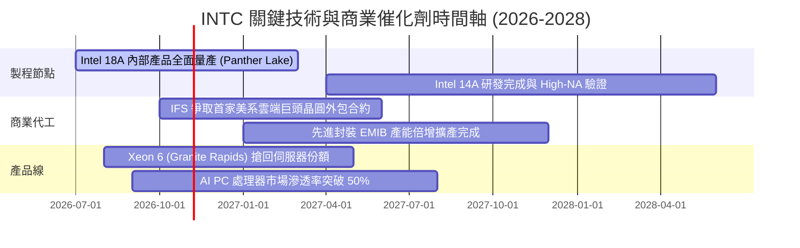

### 9.2 TAM 市場規模分析

```
╔══════════════════════════════════════════════════════════════════╗
║              INTC 目標市場 TAM 與潛在營收空間 (2028E)            ║
╠══════════════════════════════════════════════════════════════════╣
║                                                                  ║
║  全球晶圓代工市場 (Foundry TAM): $180B ─── 目前佔比: ~3% ($5.5B)  ║
║  目標滲透率: 8.0% ── 隱含營收潛力: $14.4B (+$8.9B 增量)          ║
║                                                                  ║
║  客戶端 PC 處理器 TAM:           $55B  ─── 目前佔比: ~65% ($35.7B)║
║  目標滲透率: 60.0% ── 隱含營收空間: $33.0B (防守為主)            ║
║                                                                  ║
║  資料中心 CPU & AI 運算 TAM:     $120B ─── 目前佔比: ~15% ($18.0B)║
║  目標滲透率: 20.0% ── 隱含營收潛力: $24.0B (+$6.0B 增量)          ║
║                                                                  ║
║  📊 2028 綜合營收潛能上限：約 $71.4B – $75.0B 規模              ║
╚══════════════════════════════════════════════════════════════════╝
```

### 9.3 成長驅動力結構圖

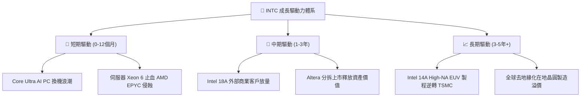

---

## 10. 風險矩陣

### 10.1 風險評分矩陣

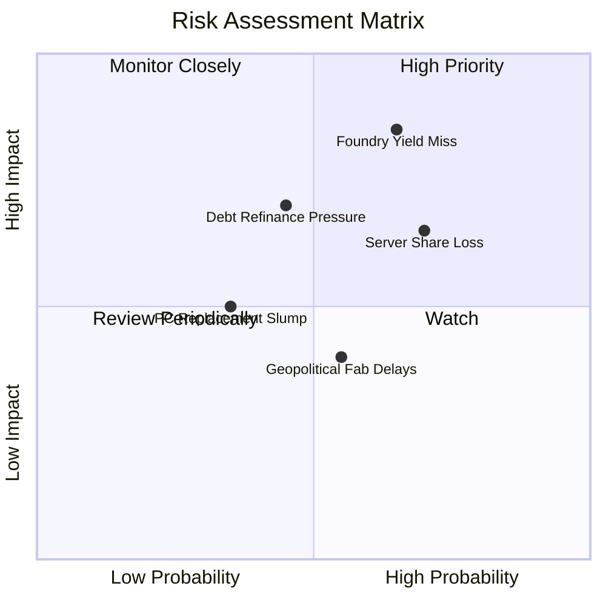

### 10.2 風險清單詳細分析

| # | 風險項目 | 發生機率 | 財務衝擊 | 風險評分 | 具體緩解應對措施 |
|---|----------|----------|----------|----------|------------------|
| 1 | 🔴 **18A 製程良率不如預期** | 高 (65%) | 極高 (-15% 營收，引發大規模減損) | 🔴 **8.8/10** | 優先確保內部 CCG 產品投產吸納固定折舊，分步開放外部客戶測試。 |
| 2 | 🔴 **伺服器市場份額續流失** | 高 (70%) | 高 (-8% DCAI 利潤) | 🔴 **8.2/10** | 加速 Xeon 6 雙架構（效能核/效率核）量產，搭配 Gaudi 3 綑綁定價銷售。 |
| 3 | 🟡 **巨額債務利息支出侵蝕** | 中 (45%) | 中 (-$1.5B 淨現金流) | 🟡 **6.5/10** | 暫停配息，引入 Brookfield/Apollo 廠房合資資金，降低母公司資產負債表負擔。 |
| 4 | 🟡 **PC 市場復甦後繼無力** | 中 (35%) | 中 (-5% CCG 收入) | 🟡 **5.2/10** | 拓展車用、手持裝置與物聯網邊緣運算市場，分散 PC 單一終端風險。 |
| 5 | 🟢 **補貼發放延宕與地緣政治** | 中 (55%) | 低 (-$2.0B 現金入帳遞延) | 🟢 **4.5/10** | 密切配合美國商務部里程碑驗收，靈活調節海外建廠資本開支進度。 |

---

## 11. 投資建議

### 11.1 最終綜合評級雷達圖

```
╔══════════════════════════════════════════════════════════════════╗
║                    INTC 綜合維度能力雷達評估                     ║
╠══════════════════════════════════════════════════════════════════╣
║                                                                  ║
║  基本面修復度      6.0  ▓▓▓▓▓▓▓▓▓▓▓▓░░░░░░░░  🟡 逐步回升      ║
║  營收成長動能      6.5  ▓▓▓▓▓▓▓▓▓▓▓▓▓░░░░░░░  🟢 AI PC放量     ║
║  獲利與利潤率      4.5  ▓▓▓▓▓▓▓▓▓░░░░░░░░░░░  🔴 減損侵蝕嚴重  ║
║  資本配置效率      5.0  ▓▓▓▓▓▓▓▓▓▓░░░░░░░░░░  🟡 緊縮Capex     ║
║  財務結構安全      5.0  ▓▓▓▓▓▓▓▓▓▓░░░░░░░░░░  🟡 淨債務負擔高  ║
║  估值吸引力        4.5  ▓▓▓▓▓▓▓▓▓░░░░░░░░░░░  🔴 遠期溢價偏高  ║
║                                                                  ║
║  綜合評分：5.3 / 10 ｜ 機構投資評級：🟡 持有 / 觀望 (HOLD)       ║
╚══════════════════════════════════════════════════════════════════╝
```

### 11.2 目標價與隱含報酬率

| 情境 | 目標價 | 相對當前股價隱含報酬率 | 主觀發生機率 | 關鍵核心驅動假設 |
|------|--------|------------------------|--------------|------------------|
| 🔴 **悲觀情境 (Bear)** | **$51.50** | **-42.7%** | 25% | 18A 良率停滯，外部代工無斬獲，利潤率受壓 |
| 🟡 **基準情境 (Base)** | **$71.20** | **-20.8%** | 55% | 營收以 8% 穩步復甦，營業利潤率回升至 14.5% |
| 🟢 **樂觀情境 (Bull)** | **$96.50** | **+7.4%** | 20% | IFS 獲美系一線 CSP 採用，AI PC 爆發性增長 |
| **機率加權目標價** | **$71.33** | **-20.6%** | **100%** | **12 個月合理回歸中樞** |

### 11.3 買入時機與觸發因素

```
╔══════════════════════════════════════════════════════════════════╗
║                  ✅ 交易操作觸發因素 Checklist                  ║
╠══════════════════════════════════════════════════════════════════╣
║                                                                  ║
║  立即建倉買入觸發條件（需多數符合）：                           ║
║  ☐ 股價回檔至安全邊際充足區間（$45.00 – $53.00，對應 MOS ≥ 25%）║
║  ☐ 官方公佈 18A 外部商業客戶名單且具體簽約金額 > $5.0B          ║
║  ☐ 單季 GAAP 淨利潤轉正且 FCF 連續兩季 > $2.0B                  ║
║                                                                  ║
║  加碼觸發條件（出現以下任一）：                                  ║
║  ☐ DCAI 伺服器營收季增率連續兩季超越 AMD EPYC                  ║
║  ☐ 毛利率結構性回升至 45% 以上                                   ║
║                                                                  ║
║  減碼 / 停損觸發條件（出現以下任一）：                           ║
║  ☑ 當前股價突破 $95.00（估值嚴重透支基本面，宜獲利了結）         ║
║  ☐ 18A 量產時程再次宣佈遞延超過 2 季                            ║
║  ☐ 單季營業現金流轉負，流動資金儲備跌破 $15.0B                   ║
╚══════════════════════════════════════════════════════════════════╝
```

### 11.4 投資人適配度分析

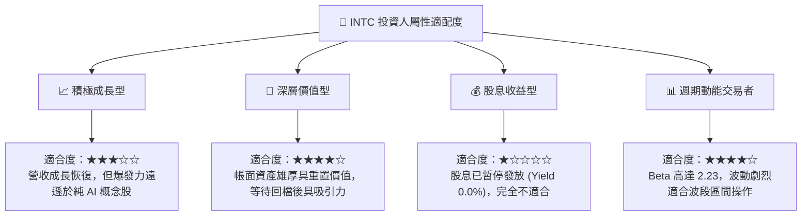

### 11.5 每季財報監控清單（Quarterly Watch List）

| 追蹤核心指標 | 穩態門檻值 | 加碼看多觸發點 | 減碼看空觸發點 | 核心關注重點 |
|--------------|------------|----------------|----------------|--------------|
| **CCG 營收成長率** | YoY ≥ +10% | YoY ≥ +20% | YoY ≤ 0% | 檢驗 AI PC 實質拉貨力道 |
| **毛利率 (Gross Margin)**| ≥ 40.0% | ≥ 44.0% | ≤ 36.0% | 晶圓代工內部結算折舊稀釋效應 |
| **季度 Capex 開支** | ≤ $3.5B | ≤ $3.0B | ≥ $4.5B | 資本開支紀律與現金保全 |
| **營業現金流 (OCF)** | ≥ $3.0B | ≥ $4.5B | ≤ $1.0B | 本業造血能力是否健康 |
| **IFS 外部營收貢獻** | ≥ $500M | ≥ $1.0B | ≤ $200M | 晶圓代工獨立商業化進展 |
| **淨負債規模** | ≤ $20.0B | ≤ $15.0B | ≥ $25.0B | 償債進度與流動性安全閥 |

### 11.6 反面論證：什麼會證明論點錯誤（What Would Change My Mind）

```
╔══════════════════════════════════════════════════════════════════╗
║              ⚠️ 論點失效條件（Disconfirming Evidence）           ║
╠══════════════════════════════════════════════════════════════════╣
║                                                                  ║
║  本篇「持有/觀望」之偏保守論點，在下列條件出現時應承認誤判並轉向 ║
║  「強力買入（Strong Buy）」：                                   ║
║                                                                  ║
║  1. 美系一線超大規模雲端服務商（如微軟、AWS、蘋果）正式公開宣佈  ║
║     將核心運算晶片交由 Intel 18A / 14A 代工，單一合約預估年價值  ║
║     超過 $5.0B（證明 IFS 具備挑戰台積電之實質商業競爭力）；     ║
║  2. 營業利潤率在未來兩季內迅速跨越 18.0%，且 ROIC 突破 10.0%    ║
║     （證實折舊逆風已消除，營業槓桿加速釋放）；                   ║
║  3. 自由現金流單季常態化達 $3.0B 以上，管理層宣佈恢復配息並啟動  ║
║     去槓桿減債計畫。                                             ║
║                                                                  ║
║  反之，若股價在無上述實質利多下持續受市場投機情緒推升至 $100+，  ║
║  則應毫不猶豫給予「賣出（Sell）」評級。                          ║
╚══════════════════════════════════════════════════════════════════╝
```

---
> **免責聲明**：本報告為 AI 自動生成，僅供研究參考，不構成任何形式的投資買賣建議。半導體產業具高度週期性與資本密集風險，投資人應獨立評估市場環境並自行承擔投資風險。