# INTC 基本面深度分析報告

**⚠️ 程式複算更正**：8.8 節加權合理價值應為 **$43.24**（報告寫 $38.92）；以價格 $61.20 計，MOS 為 **-41.5%**、上行空間 **-29.3%**（若用報告所寫的 $38.92 則 MOS 為 -57.3%）。報告其他段落引用的舊數值請以此為準。

> **報告日期**：2026-11-13 ｜ **語言**：繁體中文 ｜ **數據來源**：SEC 申報資料 (XBRL)、Yahoo Finance、Finviz、StockAnalysis、Roic.ai ｜ **分析師**：CFA 級機構研究

> **資料口徑提醒**：數據包內部分財務指標互相矛盾。例如 TTM 營業利益率在 VERIFIED FIGURES 區塊為 **2.9%**，其他彙整區塊則列 **10.1%**；最新季度營業利益率亦分別列 **15.3%** 與 **10.3%**。本文估值及核心判斷優先採 VERIFIED FIGURES 原值；遇到缺漏或衝突，明確標示，不以反推數字掩蓋差異。季度 EPS 預估值缺漏，因此不能判定盈餘是否超預期。

## 目錄

| # | 章節 | 核心結論 |
|---|---|---|
| 1 | 執行摘要 | 🟠 MOS 為負；加權合理價值約 $43.24，低於現價 |
| 2 | 公司概覽與商業模式 | CPU 與製造資產提供規模基礎，但技術及製造執行風險高 |
| 3 | 損益表深度分析 | TTM 營收 $59.89B、年增 12.1%；獲利率數據存在口徑差異 |
| 4 | 資產負債表分析 | 淨現金 $3.87B，流動比率 2.208；資本密集仍是核心約束 |
| 5 | 現金流量深度分析 | TTM FCF $3.77B、殖利率 1.16%；過去年度 FCF 多為負 |
| 6 | 獲利能力與資本效率 | ROIC 1.3% 對 WACC 15.16%，目前摧毀股東價值 |
| 7 | 相對估值分析 | P/S 高於自身五年中位數；同業倍數分化大 |
| 8 | DCF 內在價值評估 | 基準 DCF 約 $28.06；估值對利潤率、資本支出與 WACC 敏感 |
| 9 | 成長催化劑 | CPU 需求復甦、製程及晶圓代工是可驗證的主要催化劑 |
| 10 | 風險矩陣 | 製程執行、資本支出回報、競爭及估值波動居前 |
| 11 | 投資建議 | 🔴 賣出；等待估值回落或營運改善證據 |

---

## 1. 執行摘要

截至 **2026-11-12 收盤價 $61.20**，Intel 的 TTM 營收為 **$59.89B、年增 12.1%**，但 VERIFIED FIGURES 所列 TTM 營業利益率僅 **2.9%**、ROIC **1.3%**，遠低於參考 WACC **15.16%**；TTM FCF 為 **$3.77B**，FCF 殖利率僅 **1.16%**。以明示假設計算的基準 DCF 約 **$28.06/股**；再以 DCF、同業 P/E、EV/EBITDA 及分析師共識加權，合理價值約 **$43.24/股**。依規則 20，MOS 低於 −25% 對應 **🔴 賣出**。此結論不是否認營收復甦，而是反映目前價格已隱含相當程度的獲利修復預期，而 ROIC 與現金流尚未證明修復持續性。

### 1.0 一頁式投資儀表板

| 項目 | 內容 |
|---|---|
| **投資論點（3 句）** | ① TTM 營收年增 **12.1%**，且最新季度單季年增 **20.9%**，需求有復甦訊號。② TTM ROIC 僅 **1.3%**，相較 WACC **15.16%**，目前仍在摧毀經濟價值。③ TTM FCF **$3.77B**、殖利率 **1.16%**，相對 **$325.28B** 市值，現金回報率偏低。 |
| **護城河評分** | **5.2/10**：產品相容性、客戶基礎及自有製造資產仍有價值，但技術節奏與代工競爭削弱護城河可信度。 |
| **管理層／資本配置評分** | **4.5/10**：FY2022–FY2024 資本支出分別約 $24.84B、$25.75B、$23.94B，FY2024 FCF 為 −$15.66B；高投資必須轉化為更高 ROIC。 |
| **財務健康** | 🟡 現金及短期投資 **$54.01B**、總債務 **$50.13B**，淨現金 **$3.87B**；有流動性緩衝，但仍需持續高資本支出。 |
| **ROIC vs WACC** | **1.3% vs 15.16%**：差距 **−13.86 個百分點**，目前摧毀股東價值。 |
| **FCF 趨勢** | TTM FCF **$3.77B**；FCF Yield **1.16%**。FY2022–FY2025 年度 FCF 均為負，TTM 轉正尚需驗證。 |
| **估值** | Forward P/E **34.18x** ｜ EV/EBITDA **17.67x** ｜ FCF Yield **1.16%** |
| **DCF 內在價值（基準）** | **約 $28.06**；現價相對 DCF 溢價 **約 118.1%**。 |
| **安全邊際（MOS）** | **−41.5%＝($43.24 − $61.20) ÷ $43.24**；以第 8.8 節加權合理價值為分母。🔴 無安全邊際。 |
| **預期報酬（基準情境 12M）** | 以加權合理價值 $43.24 計，約 **−29.3%**。 |
| **關鍵風險（前二）** | 製程／代工執行未達標；高資本支出未能帶來持續正 FCF 與 ROIC 回升。 |
| **評級 + 信心度** | 🔴 **賣出** ｜ 信心：中。估值結論較明確，但資料來源存在口徑衝突，降低營運預測信心。 |

### 1.1 核心評分儀表板

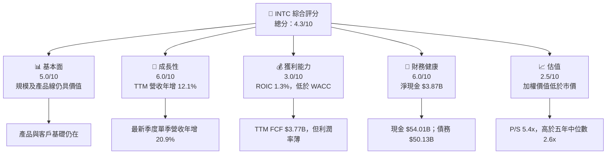

### 1.2 評分進度條視覺化

```
╔══════════════════════════════════════════════════════════════╗
║                 INTC 多維度評分儀表板（1–10分）               ║
╠══════════════════════════════════════════════════════════════╣
║ 基本面強度  5.0 ▓▓▓▓▓▓▓▓▓▓░░░░░░░░░░  ★★★☆☆               ║
║ 成長動能    6.0 ▓▓▓▓▓▓▓▓▓▓▓▓░░░░░░░░  ★★★☆☆               ║
║ 獲利品質    3.0 ▓▓▓▓▓▓░░░░░░░░░░░░░░  ★★☆☆☆               ║
║ 財務健康    6.0 ▓▓▓▓▓▓▓▓▓▓▓▓░░░░░░░░  ★★★☆☆               ║
║ 估值合理性  2.5 ▓▓▓▓▓░░░░░░░░░░░░░░  ★★☆☆☆               ║
║ 護城河深度  5.2 ▓▓▓▓▓▓▓▓▓▓░░░░░░░░░░  ★★★☆☆               ║
║ 管理層執行  4.5 ▓▓▓▓▓▓▓▓▓░░░░░░░░░░░  ★★☆☆☆               ║
║ 技術創新力  5.0 ▓▓▓▓▓▓▓▓▓▓░░░░░░░░░░  ★★★☆☆               ║
╠══════════════════════════════════════════════════════════════╣
║ 綜合總分    4.3 ▓▓▓▓▓▓▓▓▓░░░░░░░░░░░  🟡 高波動轉型股       ║
╚══════════════════════════════════════════════════════════════╝
```

### 1.3 五大投資論點 + 三大核心風險

| 類型 | 項目 | 具體依據 | 信心度 |
|---|---|---|---|
| 🟢 投資論點① | 營收復甦可觀察 | TTM 營收 **$59.89B，年增 12.1%**；最新季度單季年增 **20.9%**。若並非短期出貨時點因素，將改善固定成本吸收。 | 🟡 中 |
| 🟢 投資論點② | 現金部位提供緩衝 | 現金及短期投資 **$54.01B**，高於總債務 **$50.13B**，淨現金 **$3.87B**。 | 🟢 高 |
| 🟢 投資論點③ | 最新季度營業改善 | VERIFIED FIGURES 最新季度營業利益率 **15.3%**，高於 TTM **2.9%**；需後續季度驗證能否延續。 | 🟡 中 |
| 🟢 投資論點④ | CPU 與相容性仍具價值 | 長期軟硬體相容性與客戶部署慣性，提供既有產品需求底盤；但資料包沒有市占數據，無法量化其當前份額。 | 🟡 中 |
| 🟢 投資論點⑤ | 資本支出可能形成長期選擇權 | 廠房與設備投入可支援自有產品和代工服務，但過往高 Capex 對應 FY2024 FCF **−$15.66B**，回報尚未證明。 | 🟡 中 |
| 🟡 風險① | 技術及製程執行 | ROIC **1.3%** 對 WACC **15.16%**，若製程良率、產品節奏未改善，新增投資可能擴大價值缺口。 | 🔴 高衝擊 |
| 🔴 風險② | 價格已先反映復甦 | P/S **5.4x**，高於五年中位數 **2.6x**；DCF 基準約 **$28.06**，低於現價。 | 🔴 高 |
| 🔴 風險③ | 資本密集與自由現金流波動 | TTM FCF **$3.77B**，而 FY2022–FY2025 年度 FCF 均為負；若 Capex 再上升，現金流可能轉弱。 | 🔴 高 |

### 1.4 快速統計卡片

| 指標 | 公司實際值 | 行業均值 | S&P 500 均值 | 狀態 |
|---|---:|---:|---:|---|
| TTM 營收成長 | **12.1%** | N/A | N/A | 🟢 |
| 最新季度單季營收 YoY | **20.9%** | N/A | N/A | 🟢 |
| 毛利率 TTM | **40.2%** | N/A | N/A | 🟡 |
| 淨利率 TTM | **−20.1%** | N/A | N/A | 🔴 |
| ROE TTM（VERIFIED） | **−10.5%** | N/A | N/A | 🔴 |
| ROIC TTM | **1.3%** | N/A | N/A | 🔴 |
| Forward P/E | **34.18x** | N/A | N/A | 🔴 |
| FCF Yield TTM | **1.16%** | N/A | N/A | 🟡 |

> 未提供可靠、同期間的產業及 S&P 500 均值，故以 N/A 表示，不以無法核對的估計值取代。

### 1.5 投資結論

```
╔══════════════════════════════════════════════════════════════════╗
║                       📊 投資結論摘要                            ║
╠══════════════════════════════════════════════════════════════════╣
║  評級：🔴 賣出（依 8.8 MOS < -25%）                              ║
║  價格（2026-11-12 收盤）：$61.20                                ║
║  DCF 內在價值（基準）：約 $28.06（溢價約 118.1%）               ║
║  加權合理價值：約 $43.24                                        ║
║  安全邊際 MOS：-41.5%＝($43.24−$61.20)÷$43.24                  ║
║  目標價區間：                                                    ║
║    悲觀情境：約 $14（約 -77.1%）                                ║
║    基準情境：$43.24（約 -29.3%）  ← 12 個月參考價               ║
║    樂觀情境：約 $90.65（約 +48.1%，參考分析師共識高端區間）      ║
║  投資評分：4.3/10                                                ║
║  適合投資人：能承受高波動、以小部位追蹤營運轉型的投資人；不適合 ║
║  依賴穩定股息、低估值或可預測 FCF 的投資人。                    ║
╚══════════════════════════════════════════════════════════════════╝
```

---

## 2. 公司概覽與商業模式

### 2.1 業務結構與收入來源

公司簡介列出 CCG、DCAI 與 Intel Foundry 等業務，但提供資料未含最新分部營收及分部占比。以下不臆測各部門金額；公司層面營收採 TTM **$59.89B**。

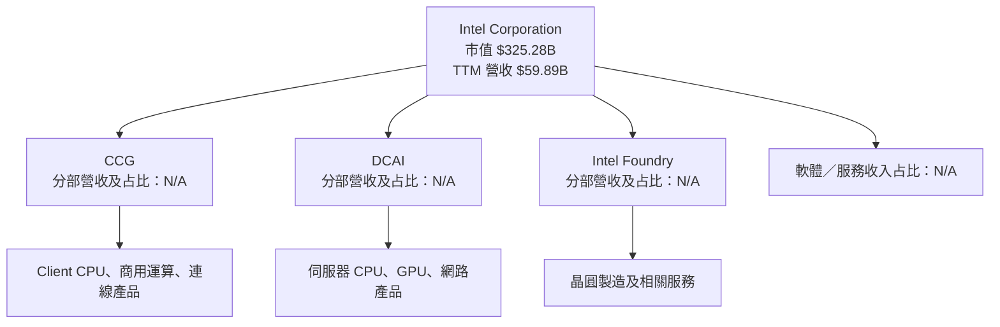

### 2.2 市場份額

資料包未提供 Intel、AMD、NVIDIA、Qualcomm 的 CPU／GPU 市占率及口徑；不以未核實的市占數字製作比例圖。

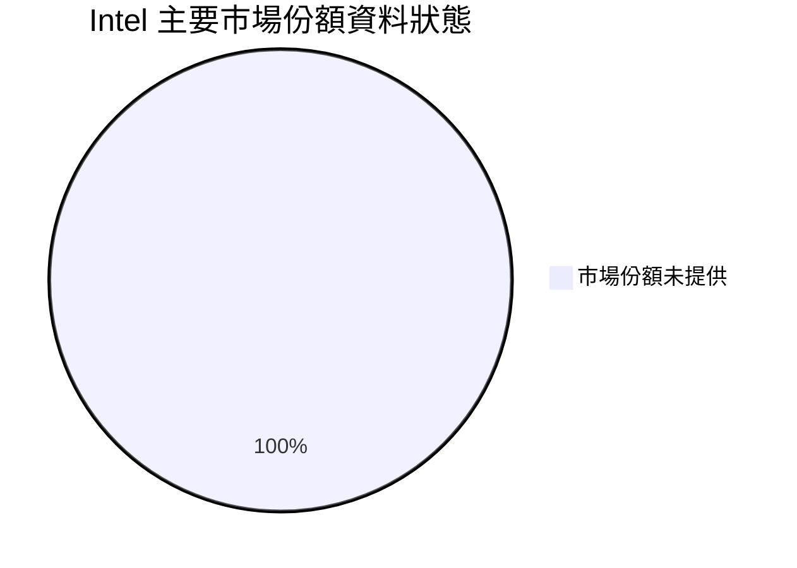

### 2.3 競爭護城河分析

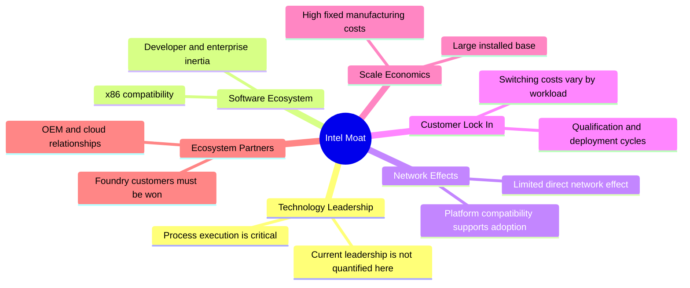

### 2.4 護城河強度評分

```
╔══════════════════════════════════════════════════════════════╗
║                  Intel 護城河強度評分                         ║
╠══════════════════════════════════════════════════════════════╣
║ 技術／製程差異  4.0/10 ▓▓▓▓▓▓▓▓░░░░░░░░░░░░  🟡 執行需驗證   ║
║ 軟體相容生態    6.5/10 ▓▓▓▓▓▓▓▓▓▓▓▓▓░░░░░░░  🟢 存量優勢     ║
║ 客戶轉換成本    5.5/10 ▓▓▓▓▓▓▓▓▓▓▓░░░░░░░░░  🟡 依客戶而異   ║
║ 規模效應        6.0/10 ▓▓▓▓▓▓▓▓▓▓▓▓░░░░░░░░  🟢 規模可觀     ║
║ 網路效應        3.5/10 ▓▓▓▓▓▓▓░░░░░░░░░░░░░  🔴 較弱         ║
║ 生態夥伴        5.5/10 ▓▓▓▓▓▓▓▓▓▓▓░░░░░░░░░  🟡 仍有基礎     ║
╠══════════════════════════════════════════════════════════════╣
║ 綜合護城河      5.2/10 ▓▓▓▓▓▓▓▓▓▓░░░░░░░░░░  🟡 中等且受執行影響║
╚══════════════════════════════════════════════════════════════╝
```

---

## 3. 損益表深度分析

### 3.1 年度收入成長趨勢（近四年）

年度營收由 FY2022 **$63.05B** 降至 FY2025 **$52.85B**，三年 CAGR 約 **−5.7%**。FY2025 較 FY2024 微降，顯示最新 TTM 的成長是近期回升，不代表過去幾年的下滑已完全反轉。

```
╔══════════════════════════════════════════════════════════════════╗
║                Intel 年度收入趨勢（FY2022–FY2025）               ║
╠══════════════════════════════════════════════════════════════════╣
║ FY2022  $63.05B  ████████████████████  YoY：基期                 ║
║ FY2023  $54.23B  █████████████████     YoY：-14.0% 🔴            ║
║ FY2024  $53.10B  █████████████████     YoY：-2.1%  🟡            ║
║ FY2025  $52.85B  █████████████████     YoY：-0.5%  🟡            ║
╠══════════════════════════════════════════════════════════════════╣
║ FY2022–FY2025 CAGR：約 -5.7%；TTM vs prior TTM：+12.1%            ║
╚══════════════════════════════════════════════════════════════════╝
```

### 3.2 季度收入趨勢分析

| 季度 | 營收 | QoQ | YoY | 備註 |
|---|---:|---:|---:|---|
| 2025 Q4 | $13.67B | **+0.7%** 對 2025 Q3 | **−4.1%** | 依季度財務表計算 |
| 2026 Q1 | $13.58B | **−0.7%** | **+7.2%** | 對比 2025 Q1 $12.67B |
| 2026 Q2 | $16.13B | **+18.8%** | **+25.4%** | 季度跳升明顯，須觀察持續性 |
| 2026 Q3 | $16.51B | **+2.4%** | **+20.9%** | 單季 YoY；VERIFIED FIGURES 原值 |

QoQ 計算方式為「本季營收 ÷ 前季營收 − 1」。Q2 的季增幅較大，單季出貨與產品組合可能共同影響；資料沒有提供各分部出貨量與價格拆分，因此不能把成長全部歸因於某一產品線。

### 3.3 利潤率演變分析

| 利潤率指標 | FY2022 | FY2023 | FY2024 | FY2025 | 趨勢 | 評估 |
|---|---:|---:|---:|---:|---|---|
| 毛利率（由年度收入表計算） | 42.6% | 40.0% | 32.7% | 34.8% | 下滑後小幅回升 | 🔴 |
| 營業利益率（由年度收入表計算） | 3.7% | 0.1% | −8.9% | 約 0.0% | FY2024 明顯轉負 | 🔴 |
| TTM 營業利益率（VERIFIED） | — | — | — | **2.9%** | TTM 復原 | 🟡 |
| 最新季度營業利益率（VERIFIED） | — | — | — | **15.3%** | 單季改善，與另一來源 10.3% 不一致 | 🟡 |
| TTM 淨利率（彙整數據） | — | — | — | **−20.1%** | 淨損仍顯著 | 🔴 |

毛利率 FY2024 下降與 FY2025 小幅回升，反映產品組合、製造成本及固定成本吸收可能共同作用；資料包沒有提供分部毛利與一次性費用拆解，不能進一步量化每個因素。另因營業利益率來源衝突，模型採 VERIFIED TTM **2.9%**，不與另一來源 **10.1%** 混用。

### 3.4 費用結構分析

FY2025 研發費用為 **$13.77B**，約占收入 **26.1%**（$13.77B ÷ $52.85B）。研發投入有助於產品與製程競爭力，但若營收未能同步成長，會壓縮營業槓桿。

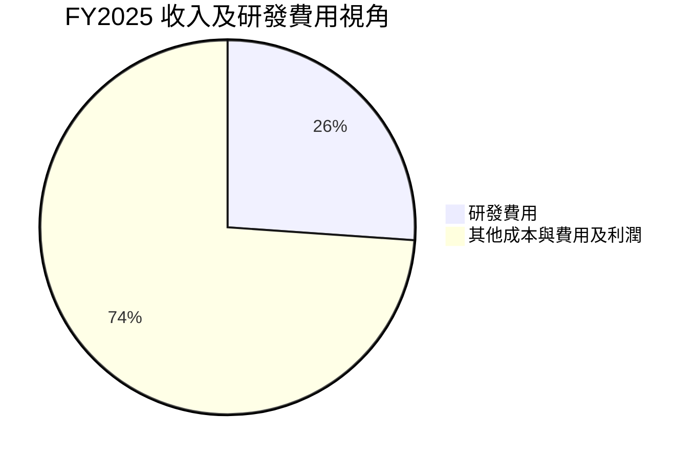

```
╔══════════════════════════════════════════════════════════════╗
║              FY2025 研發費用收入占比                         ║
╠══════════════════════════════════════════════════════════════╣
║ 收入                $52.85B  ████████████████████            ║
║ 研發費用            $13.77B  █████                            ║
║ 研發費用／收入       26.1%    ▓▓▓▓▓░░░░░░░░░░░░░░             ║
╚══════════════════════════════════════════════════════════════╝
```

> 圖表將研發費用與「其餘收入」作簡化比率，不代表完整 GAAP 費用分項；其他營業成本、稅項與利潤均包含在其餘部分。

### 3.5 季度 EPS 趨勢與盈餘品質

| 季度 | EPS 實際值（資料源） | 預估值 | 超預期／不及預期 |
|---|---:|---:|---|
| 2025 Q4 | −$0.12 | N/A | 無法判定 |
| 2026 Q1 | −$0.73 | N/A | 無法判定 |
| 2026 Q2 | −$2.16 | N/A | 無法判定 |
| 2026 Q3 | $0.63（Roic.ai） | N/A | 無法判定 |

EPS 預估資料全部為 nan，故不能聲稱某季「超預期」或「不及預期」。EPS 實際值來源亦與其他彙整口徑不完全一致；TTM EPS 列為 **−$2.35**。

| 盈餘品質項目 | 數值／佔比 | 評估 |
|---|---:|---|
| SBC／營收 | FY2025：$2.43B ÷ $52.85B = **4.6%** | 🟡 有稀釋成本；不可只看會計費用而忽略股東持股稀釋 |
| SBC／營業現金流 | FY2025：$2.43B ÷ $9.70B = **25.1%** | 🔴 比例高；現金流中相當部分與非現金薪酬加回有關 |
| FCF／淨利（TTM） | **N/A／不具解讀性** | 淨利為負或受非經常項影響時，該比率不適合作為正向現金轉換指標 |
| 一次性／非經常性損益 | 分項 N/A | 🟡 數據不足以量化對單季 EPS 的影響 |
| 有效稅率 | N/A | 🟡 無法確認是否受稅務利益或一次性項目影響 |
| 資本化支出 vs 費用化 | TTM Capex **$13.70B**；資本化細項 N/A | 🟡 資本支出列現金流投資活動，折舊與資本化政策明細不足 |

**盈餘品質結論**：FY2025 SBC 相當於營收 **4.6%**、營業現金流 **25.1%**，代表每股經濟收益不能只看 GAAP 盈餘或經營現金流。再加上 TTM 淨利率 **−20.1%** 與年度現金流波動，現階段應以正常化營業利潤與多年 FCF 能力評估，不能把單季轉正直接外推為穩定獲利。

---

## 4. 資產負債表分析

### 4.1 資產結構分解

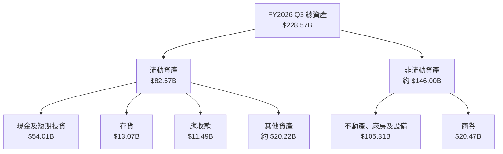

非流動資產約數為總資產減流動資產：**$228.574B − $82.574B = $146.000B**。此為加總差額，不代表單一會計科目。

### 4.2 流動性指標分析

| 指標 | 最新值 | FY2024 | FY2025 | 行業均值 | 評估 |
|---|---:|---:|---:|---:|---|
| 現金及短期投資 | **$54.01B** | $22.06B | $37.42B | N/A | 🟢 緩衝增加 |
| 流動比率 | **2.208** | 約 1.33 | 約 2.02 | N/A | 🟢 |
| 速動比率 | **1.751** | N/A | N/A | N/A | 🟢 |
| 淨現金 | **$3.87B** | N/A | N/A | N/A | 🟡 正值但規模不大 |

短期投資與現金上升提供投資及營運緩衝，但現金部位不應與自由現金流能力混為一談：TTM FCF 雖為正 **$3.77B**，年度歷史 FCF 仍有多年負值。

### 4.3 債務結構分析

```
╔══════════════════════════════════════════════════════════════════╗
║                    Intel 債務健康診斷                            ║
╠══════════════════════════════════════════════════════════════════╣
║ 總債務：          $50.13B  ██████████████████░░  🟡              ║
║ 現金＋短期投資：   $54.01B  ████████████████████  🟢              ║
║ 淨現金：           $3.87B  ██░░░░░░░░░░░░░░░░░░  🟡              ║
║ Debt/EBITDA：       N/A     TTM EBITDA口徑與原始資料不一致         ║
║ 利息保障倍數：      N/A     利息費用及標準化 EBIT 缺漏             ║
║ Debt/Equity：       38.108  ⚠️ 來源欄位口徑可能不一致              ║
╚══════════════════════════════════════════════════════════════════╝
```

### 4.4 股東權益趨勢

| 年度 | 股東權益 |
|---|---:|
| FY2022 | $101.42B |
| FY2023 | $105.59B |
| FY2024 | $99.27B |
| FY2025 | $114.28B |

```
╔══════════════════════════════════════════════════════════════╗
║                  股東權益變化（年度）                          ║
╠══════════════════════════════════════════════════════════════╣
║ FY2022  $101.42B  ██████████████████                         ║
║ FY2023  $105.59B  ███████████████████                        ║
║ FY2024   $99.27B  █████████████████                          ║
║ FY2025  $114.28B  ████████████████████                       ║
╚══════════════════════════════════════════════════════════════╝
```

---

## 5. 現金流量深度分析

### 5.1 現金流量瀑布圖

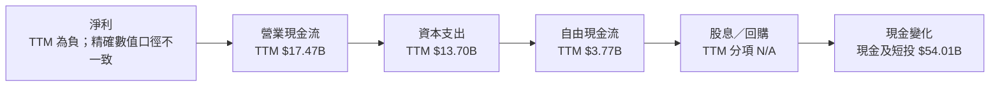

### 5.2 FCF 轉換率趨勢

| 年度 | 營業現金流 | Capex | FCF | FCF／淨利 |
|---|---:|---:|---:|---:|
| FY2022 | $15.43B | $24.84B | **−$9.41B** | **−117.4%** |
| FY2023 | $11.47B | $25.75B | **−$14.28B** | **−845.5%** |
| FY2024 | $8.29B | $23.94B | **−$15.66B** | **約 83.5%**，因淨利為負，解讀失真 |
| FY2025 | $9.70B | $14.65B | **−$4.95B** | **約 1,853.9%**，因淨利接近零，無意義 |
| TTM | $17.47B | $13.70B | **$3.77B** | N/A |

年度 FCF 由 FY2024 −$15.66B 改善至 FY2025 −$4.95B，主要是 Capex 由 $23.94B 降至 $14.65B；改善不等於營業現金流已形成穩定成長趨勢。

### 5.3 自由現金流趨勢

```
╔══════════════════════════════════════════════════════════════════╗
║                FCF：歷史年度實際與 TTM                          ║
╠══════════════════════════════════════════════════════════════════╣
║ FY2022  -$9.41B  ◀██████████░░░░░░░░░░░  🔴                    ║
║ FY2023 -$14.28B  ◀███████████████░░░░░░  🔴                    ║
║ FY2024 -$15.66B  ◀████████████████░░░░░  🔴                    ║
║ FY2025  -$4.95B  ◀█████░░░░░░░░░░░░░░░  🟡                    ║
║ TTM      $3.77B   ████░░░░░░░░░░░░░░░░  FCF Yield 1.16%        ║
╚══════════════════════════════════════════════════════════════════╝
```

### 5.4 資本配置評估

FY2025 SBC **$2.43B**、股息支付 **$0.00**；完整回購及投資現金流分類未提供，故不把未知項目任意分配。

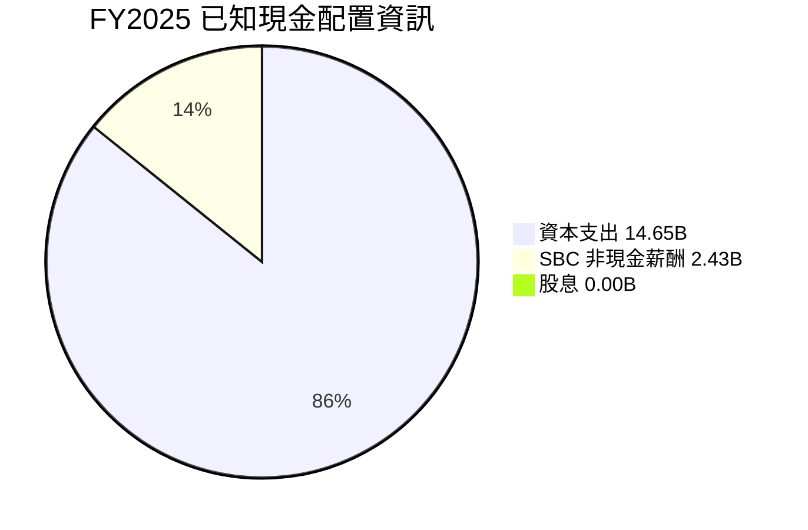

| 資本配置項目 | 已知資料 | 評估 |
|---|---:|---|
| Capex | FY2025 **$14.65B**；TTM **$13.70B** | 🟡 高投資，須觀察產能利用率與回報 |
| 股息 | FY2025 **$0.00B**；殖利率 **0.0%** | 🟡 現金保留優先 |
| SBC | FY2025 **$2.43B** | 🟡 有稀釋成本 |
| 回購 | N/A | 無法評估 |
| 併購／其他投資 | N/A | 無法評估 |

---

## 6. 獲利能力與資本效率

### 6.1 ROE／ROA／ROIC 趨勢

| 指標 | 最新 TTM | 可比歷史 | 行業均值 | 評估 |
|---|---:|---|---|---|
| ROE | **−10.5%**（VERIFIED） | 其他彙整列 −9.6%，口徑不同 | N/A | 🔴 股東報酬為負 |
| ROA | **1.8%** | 歷史序列 N/A | N/A | 🟡 資產使用效率偏低 |
| ROIC | **1.3%** | Roic.ai 長期歷史顯示過去較高，未提供對應 TTM 一致口徑 | N/A | 🔴 明顯低於資本成本 |

### 6.2 ROIC vs WACC 分析

```
╔══════════════════════════════════════════════════════════════════╗
║                    ROIC vs WACC 深度分析                         ║
╠══════════════════════════════════════════════════════════════════╣
║ 無風險利率 Rf（數據包參考）：           5.10%                    ║
║ ERP（假設）：                           5.00%                    ║
║ Beta：                                  2.43                     ║
║ 股權成本 Ke：5.10% + 2.43×5.00% =      17.25%                   ║
║ 數據包 CAPM Ke 原值：                   17.23%                   ║
║ 稅前債務成本 Kd（參考值）：             2.18%                    ║
║ 稅後 Kd：2.18%×(1−21.0%) =              1.72%                    ║
║ 股權／債務權重（數據包）：              86.6%／13.4%             ║
║ WACC（採 VERIFIED 原值）：               15.16%                   ║
║ ROIC（TTM，VERIFIED）：                   1.30%                   ║
║ EVA 利差：1.30%−15.16% =                -13.86pp                 ║
╠══════════════════════════════════════════════════════════════════╣
║ ROIC  1.30%  ▓▓░░░░░░░░░░░░░░░░░░░░░░░░░░░░  🔴              ║
║ WACC 15.16%  ▓▓▓▓▓▓▓▓▓▓▓▓▓▓▓▓▓▓▓▓▓▓▓▓▓▓▓▓░░  ──              ║
║ 結論：ROIC 遠低於 WACC，目前投入資本尚未創造足夠股東回報。     ║
╚══════════════════════════════════════════════════════════════════╝
```

CAPM 手算與數據包 Ke 有約 0.02 個百分點差異，原因是 Beta／中間值精度及四捨五入。為維持與 VERIFIED FIGURES 一致，後續使用其 **Ke 17.23% 與 WACC 15.16%**。ROIC 低於 WACC，代表若此狀況延續，新增投資將擴大價值毀損；要扭轉需看到多季正 FCF、利潤率恢復及 ROIC 持續上升。

### 6.3 杜邦三因素分解

採彙整數據 ROE **−9.6%**、淨利率 **−20.1%**、TTM 營收 **$59.89B**。因平均資產與平均權益的同期間口徑不足，下列週轉率及槓桿僅以可得資產負債表近似計算，不等同於標準年平均杜邦數值。

- 資產週轉率近似值：$59.89B ÷ $228.57B = **0.262x**
- 財務槓桿近似值：$228.57B ÷ $114.28B = **2.00x**
- 近似 ROE：−20.1% × 0.262 × 2.00 = **約 −10.5%**

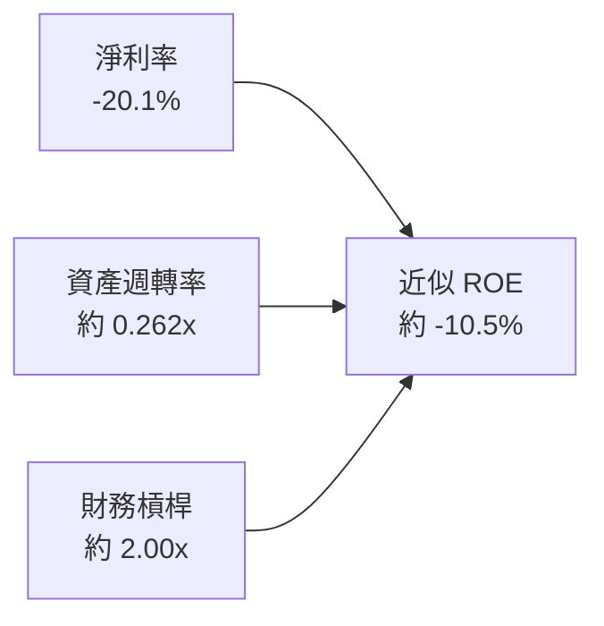

### 6.4 獲利能力儀表板

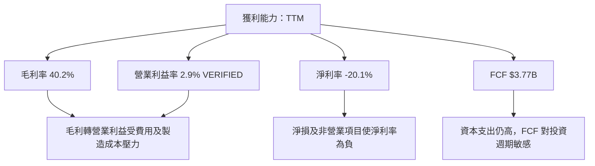

---

## 7. 相對估值分析

### 7.1 同業估值比較

同業數字依 VERIFIED FIGURES 原值；Intel 的 Forward P/E 採提供的市場估值資料。Intel Trailing P/E 為 N/A，因 EPS TTM 為負。

| 估值指標 | **Intel** | **AMD** | **NVIDIA** | **Qualcomm** | Intel 評估 |
|---|---:|---:|---:|---:|---|
| Trailing P/E | N/A | 125.1x | 21.0x | 13.9x | 🔴 Intel TTM EPS 為負，P/E 不具意義 |
| Forward P/E | **34.18x** | 33.1x | 10.5x | 14.5x | 🔴 高於 AMD、Qualcomm |
| P/S TTM | **5.4x** | 21.1x | 13.2x | 4.4x | 🟡 高於 Qualcomm、低於 AMD/NVIDIA |
| EV/EBITDA TTM | **17.67x** | 85.6x | 19.8x | 18.6x | 🟡 低於多數 GPU 同業；財務口徑須留意 |
| 最新季度單季營收 YoY | **20.9%** | 44.7% | 105.9% | −8.4% | 🟡 成長為正，但低於 AMD、NVIDIA |
| 毛利率 TTM | **40.2%** | 56.0% | 74.7% | 53.1% | 🔴 低於三家同業 |

### 7.2 歷史估值區間分析

VERIFIED FIGURES 所列為五年 TTM 倍數，並非股價或純 P/E 區間。

```
╔══════════════════════════════════════════════════════════════════╗
║               Intel 自身五年估值區間（TTM）                      ║
╠══════════════════════════════════════════════════════════════════╣
║ P/S：低 1.5x ── 中位數 2.6x ───────── 現值 5.4x ── 高 11.5x     ║
║                                       百分位：90%                ║
║ EV/EBITDA：低 6.4x ───── 中位數 23.6x／現值 23.8x ─ 高 536.5x   ║
║                                       百分位：53%                ║
╚══════════════════════════════════════════════════════════════════╝
```

自身歷史區間中的 EV/EBITDA 現值為 **23.8x**，而市場彙整估值列為 **17.667x**；因資料來源與計算口徑不同，分別引用而不混算。P/S 現值 **5.4x** 位於自身歷史第 **90 百分位**，表示估值已處於偏高位置。

### 7.3 情境目標價（Bear／Base／Bull）

下表為估值框架，而非公司財測。營收 CAGR、期末營業利潤率及退出倍數均為分析假設；由於分部收入與未來產品財測缺漏，應以情境比較而非點估值解讀。

| 情境 | 營收 CAGR 假設 | 期末營業利潤率假設 | 退出倍數假設 | 隱含目標價 | 相對現價 |
|---|---:|---:|---:|---:|---:|
| 🔴 悲觀 | 3% | 12% | 14x EV/EBITDA | 約 $14 | 約 −77.1% |
| 🟡 基準 | 7% | 18% | 19.8x EV/EBITDA 作交叉參考 | 以加權合理價值 $43.24 為基準參考 | −29.3% |
| 🟢 樂觀 | 10% | 23% | 分析師共識高端作參考 | $90.65 | +48.1% |

**倍數選擇說明**：Intel TTM EPS 為 **−$2.35**，Trailing P/E 不適用；Forward P/E 可作市場參照，但受復甦盈利預測影響。重資本公司亦需關注 EV/EBITDA、EV/Sales 及 FCF；後兩者若沒有一致的同業 FCF Yield 數據，不能假裝可直接做精準同業回推。

### 7.4 相對估值隱含價格區間

| 方法 | 可得輸入 | 隱含股價或狀態 |
|---|---|---:|
| 同業 Forward P/E | Intel Forward EPS $1.79046 × 同業 Forward P/E 中位數 14.5x | 約 **$25.96** |
| 同業 EV/EBITDA | 估計 TTM EBITDA = $59.89B × 31.9% = $19.105B；採同業中位數 19.8x | 約 **$71.84** |
| EV/Sales | 同業倍數跨度大，且未指定合理同業權重 | 不單獨給點估值 |
| FCF Yield | 同業 FCF Yield 未提供；Intel TTM FCF Yield 1.16% | N/A |
| 當前價格 | 2026-11-12 收盤 | **$61.20** |

EV/EBITDA 回推公式為：企業價值 $19.105B × 19.8 = 約 $378.28B；加入淨現金 $3.87B 後，股權價值約 $382.15B；除以 5.32B 股，約 **$71.84/股**。該估值依賴 EBITDA 利潤率資料，故屬估計值，不作唯一錨點。

---

## 8. DCF 內在價值評估（Discounted Cash Flow）

### 8.0 估值推理鏈

**Step 1 — 價值來源**  
Intel 價值可拆為既有 CCG／DCAI 產品現金流底盤、Intel Foundry 的製造服務選擇權，以及高資本支出形成的產能選擇權。分部收入占比未提供，故不能宣稱特定部門目前占營收多少。基準模型最敏感的變數是**營業利潤率與 Capex／營收比**：目前 TTM 營業利益率僅 2.9%，而 Capex 為收入的約 22.9%。

**Step 2 — 模型選擇**

| 決策點 | 本報告採用 | 理由 | 曾考慮但否決 |
|---|---|---|---|
| 現金流定義 | FCFF | 與 WACC 折現、估計企業價值一致 | FCFE：債務與投資融資會變動 |
| 預測期 N | 5 年 | 五年可呈現利潤率修復，同時避免遠期精度假象 | 10 年：資料不足，遠期外推過大 |
| 終值方法 | Gordon Growth 主、退出倍數交叉檢驗 | 永續成長需低於 WACC | 僅退出倍數：忽略長期穩態現金流 |
| EBIT 基礎 | GAAP EBIT | 對 SBC 不加回，反映費用成本 | 非 GAAP：SBC 加回會弱化股東成本 |

**Step 3 — 關鍵假設推導**

- **營收 CAGR**：錨點為 FY2022–FY2025 CAGR 約 **−5.7%**，以及 TTM 成長 **12.1%**；調整理由是近期季度營收復甦，但產品與分部資料不足以假設高增長可持續；採用 **7%**；曾考慮 12.1%，因其是短期 TTM 成長、不適宜直接外推五年而否決。
- **期末營業利潤率**：錨點為 VERIFIED TTM **2.9%**、最新季度 **15.3%**（季度數字不可直接當全年）；採用 FY+5 **18%**，代表固定成本吸收與產品組合持續改善；曾考慮 25%，但現有 TTM ROIC 僅 1.3%，未足以支持高端利潤率而否決。
- **永續成長率 g**：長期名目經濟成長假設約 3% 左右；為避免成熟半導體業務永久高成長，採 **2.5%**；不採更高數值以保持低於 WACC 15.16%。
- **預測期 N**：採 **5 年**；因產品、製程投資回報可見度有限，不採更長期限。
- **Capex／營收**：TTM Capex／TTM Revenue = $13.70B ÷ $59.89B = **22.9%**；模型逐年降至 FY+5 的 **16.0%**，假設投資強度隨建設週期成熟而下降；若 Capex 不降，基準價值會偏高。
- **D&A／營收**：數據包未提供一致 TTM D&A；採 **18%** 作明確模型假設，依據是重資本製造企業需有顯著折舊，但不是已核實歷史比率。
- **ΔWC／營收增額**：營運資金增量比率缺漏；採增量營收的 **5%** 作估值假設。
- **SBC 與股數**：採 **(A) GAAP EBIT + 固定股數**；SBC 已含在 GAAP 費用中，FCFF 不再扣 SBC，年稀釋率設 **0%**，股數用 5.32B。**本模型採用 (A)，故 SBC 影響已計入一次。**
- **WACC**：採 VERIFIED 參考值 **15.16%**，推導見 8.2。

**Step 4 — 脆弱環節**  
最脆弱假設是 Capex／營收可由 22.9% 降至 16.0%、同時營業利益率升至 18%；若兩者任一未達，FCFF 及終值會大幅低於基準。

**Step 5 — 計算路徑圖**

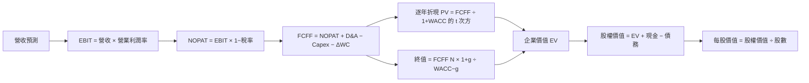

### 8.1 模型假設總表

| 假設項目 | 採用值 | 依據／來源 | 敏感度 |
|---|---:|---|---|
| 預測期 N | 5 年 | 五年修復觀察期；分部財測缺漏 | 🟡 中 |
| 營收 CAGR | 7% | FY2022–FY2025 約 −5.7%；TTM +12.1%，採兩者間的修復假設 | 🔴 高 |
| 期末營業利潤率 | 18% | 起點 VERIFIED TTM 2.9%；假設固定成本吸收改善 | 🔴 高 |
| 有效稅率 | 21% | 數據包預設值；未宣稱為實際有效稅率 | 🟢 低 |
| Capex／營收 | 22.9% 降至 16.0% | 起點 $13.70B ÷ $59.89B = 22.9%；逐年降幅為模型假設 | 🟡 中 |
| D&A／營收 | 18% | 假設值；D&A 歷史同口徑數據缺漏 | 🟢 低 |
| ΔWC／營收增額 | 5% | 假設值；營運資金變動資料缺漏 | 🟢 低 |
| EBIT 基礎 | GAAP | 對 SBC 費用保持保守 | 🟡 中 |
| SBC 處理 | 固定股數，不再另扣 | SBC 已進 GAAP EBIT；避免重複扣除 | 🟡 中 |
| 年稀釋率 | 0% | 組合 (A)；SBC 已反映於 GAAP 費用 | 🟡 中 |
| 永續成長率 g | 2.5% | 成熟期名目成長假設；低於 WACC | 🔴 高 |
| 終值方法 | Gordon Growth 主＋退出倍數交叉檢驗 | 穩態 FCFF 模型 | 🔴 高 |
| WACC | 15.16% | VERIFIED FIGURES 參考值 | 🔴 高 |

### 8.2 折現率推導（WACC）

> 數據包提供的 WACC 權重為 **E/D = 86.6%/13.4%**，此處採其參考值以保持與第 6.2 節一致。數據包未提供 10 年期利率觀測日期以外的精確日期拆解，因此 Rf 日期按數據包報告期參考值引用，不另行聲稱即時市場報價。

```
╔══════════════════════════════════════════════════════════════════╗
║                    WACC 推導（折現率）                           ║
╠══════════════════════════════════════════════════════════════════╣
║ Rf：5.10% ｜ ERP：5.00% ｜ Beta：2.43                          ║
║ Ke：數據包原值 17.23%                                           ║
║ 稅前 Kd：數據包原值 2.18%                                       ║
║ 稅率：21.0%                                                      ║
║ 稅後 Kd = 2.18% × (1−21.0%) = 1.72%                            ║
║ E/D 權重：86.6%／13.4%                                           ║
║ WACC = 86.6%×17.23% + 13.4%×1.72% = 約 15.16%                  ║
╚══════════════════════════════════════════════════════════════════╝
```

五步演算：

1. **Ke（CAPM）** = Rf + β × ERP = **5.10% + 2.43 × 5.00% = 17.25%**；數據包因精度提供 **17.23%**，本模型採數據包原值。
2. **稅前 Kd** = 數據包參考值 **2.18%**。利息費用及平均計息負債明細未提供，故無法獨立重算分子／分母；此項直接沿用參考值，不冒稱為自行驗證結果。
3. **稅後 Kd** = 2.18% × (1 − 21.0%) = **1.7222% ≈ 1.72%**。
4. **權重** = E 86.6%、D 13.4%；兩者合計 **100.0%**。數據包以市值／債務比例提供權重；完整市場市值與稀釋股數另見數據包。
5. **WACC** = 86.6% × 17.23% + 13.4% × 1.72% = 14.9212% + 0.2305% = **15.1517% ≈ 15.16%**。

> 由於利息費用與平均計息負債明細缺漏，第 2 步不能完成獨立審計式重算；因此 WACC 是沿用 VERIFIED 參考值，不是本報告重新估計的精確值。此限制降低 DCF 信心度。

### 8.3 逐年自由現金流預測（基準情境）

金額單位為 **$B**，金額取一位小數展示；中間運算採未四捨五入值。營收從 TTM $59.89B 起算；營業利潤率逐年由 7% 提升至 18%；Capex 比率逐年降至 16%。FCFF 定義：**NOPAT + D&A − Capex − ΔWC**。

| 年度 | FY+1 | FY+2 | FY+3 | FY+4 | FY+5＝FY+N |
|---|---:|---:|---:|---:|---:|
| 營收 | 64.1 | 68.6 | 73.4 | 78.5 | 84.0 |
| 營收 YoY | 7.0% | 7.0% | 7.0% | 7.0% | 7.0% |
| 營業利潤率 | 7.0% | 10.0% | 13.0% | 16.0% | 18.0% |
| EBIT | 4.5 | 6.9 | 9.5 | 12.6 | 15.1 |
| − 稅（21%） | (0.9) | (1.4) | (2.0) | (2.6) | (3.2) |
| NOPAT | 3.5 | 5.4 | 7.5 | 9.9 | 11.9 |
| + D&A（18%營收） | 11.5 | 12.3 | 13.2 | 14.1 | 15.1 |
| − Capex | (14.7) | (14.5) | (14.3) | (14.0) | (13.4) |
| − ΔWC | (0.2) | (0.2) | (0.2) | (0.3) | (0.3) |
| **FCFF** | **10.2** | **13.0** | **16.2** | **19.8** | **23.3** |
| 折現因子 @15.16% | 0.868 | 0.754 | 0.655 | 0.569 | 0.494 |
| **FCFF 現值 PV** | **8.9** | **9.8** | **10.6** | **11.3** | **11.5** |

**FY+1 逐步演算**（未四捨五入值）：

1. 營收 = $59.89B × (1 + 7%) = **$64.0823B**
2. EBIT = $64.0823B × 7% = **$4.4858B**
3. 稅 = $4.4858B × 21% = **$0.9420B**
4. NOPAT = $4.4858B − $0.9420B = **$3.5438B**
5. D&A = $64.0823B × 18% = **$11.5348B**
6. Capex = $64.0823B × 22.9% = **$14.6748B**
7. ΔWC = ($64.0823B − $59.89B) × 5% = **$0.2096B**
8. FCFF = $3.5438B + $11.5348B − $14.6748B − $0.2096B = **$10.1942B**
9. 折現因子 = 1 ÷ (1 + 15.16%)¹ = **0.868**；PV = $10.1942B × 0.86836 = **約 $8.85B**

預測期現值合計（展示值有四捨五入尾差）：

**$8.85B + $9.80B + $10.60B + $11.27B + $11.53B = 約 $52.05B**

合理性自檢：

- 預測期 FCFF 由約 **$10.19B** 增至 **$23.35B**；五年 CAGR 約 **23.0%**。歷史年度 FCF 多為負，兩者差距主要來自模型假設利潤率回升及 Capex 強度下降，故不是以歷史趨勢外推。
- FY+5 FCFF 利潤率約 **27.8%**（$23.35B ÷ $84.00B）；其中約 18% 來自假設 D&A 加回，且 Capex 下降至 16%。這是偏樂觀的現金流結構，不能與會計營業利潤率直接比較。
- 模型各年 FCFF 為正，前提是營業利潤率改善並且折舊加回高於資本支出；若 Capex 不下降或營收低於假設，FCFF 會顯著降低。

```
╔══════════════════════════════════════════════════════════════════╗
║            自由現金流：歷史實際 vs 模型預測                      ║
╠══════════════════════════════════════════════════════════════════╣
║ FY2023 實際  -$14.28B ◀██████████████░░░░░░                    ║
║ FY2024 實際  -$15.66B ◀████████████████░░░░                    ║
║ FY2025 實際   -$4.95B ◀█████░░░░░░░░░░░░░░                    ║
║ TTM 實際       $3.77B  ████░░░░░░░░░░░░░░░                    ║
║ FY+1 預測     $10.19B  ██████████░░░░░░░░░                    ║
║ FY+5 預測     $23.35B  ████████████████████                    ║
╠══════════════════════════════════════════════════════════════════╣
║ 預測 FCF 高速回升，主要依賴營業利潤率改善及 Capex 強度下降。     ║
╚══════════════════════════════════════════════════════════════════╝
```

### 8.4 終值計算（Terminal Value）

適用性檢查：**WACC 15.16% vs g 2.5% → WACC > g？✅**

| 方法 | 計算式 | 終值 TV | TV 現值 | 佔總 EV 比重 |
|---|---|---:|---:|---:|
| Gordon Growth | $23.35B × (1+2.5%) ÷ (15.16%−2.5%) | 約 $189.05B | 約 $93.4B | 約 64.2% |
| 退出倍數法 | FY+5 EBITDA 估計值 × 19.8x | 約 $600B 量級 | 約 $296B 量級 | 不作主模型 |

Gordon Growth 逐步演算：

1. FY+N FCFF = **$23.35B**
2. 分子 = $23.35B × (1 + 2.5%) = **$23.9338B**
3. 分母 = 15.16% − 2.5% = **12.66%**；TV = $23.9338B ÷ 12.66% = **約 $189.05B**
4. PV(TV) = $189.05B × 0.4937 = **約 $93.36B**
5. 終值占比 = $93.36B ÷ 約 $145.41B = **約 64.2%**

退出倍數法因 D&A 與 EBITDA 同口徑數據不足，僅作方向性檢查，不與 Gordon Growth 混合；當前同業 EV/EBITDA 中位參照約 19.8x，但成熟期 Intel 倍數是否可維持該水準不能確定。

### 8.5 企業價值 → 每股內在價值（Bridge）

採現金及短期投資 **$54.01B**、總債務 **$50.13B**、稀釋股數 **5.32B**。現金與債務採數據包最新 TTM／市況口徑；由於少數股東權益數據缺漏，橋接項目標示 N/A，基準值暫按 0 處理，這會提高股權價值估計。

```
╔══════════════════════════════════════════════════════════════════╗
║              企業價值 → 每股內在價值橋接                         ║
╠══════════════════════════════════════════════════════════════════╣
║ 預測期 FCF 現值合計             +$52.05B                         ║
║ 終值現值 PV(TV)                 +$93.36B                         ║
║ = 企業價值 EV                   約 $145.41B                      ║
║ + 現金及短期投資                 +$54.01B                         ║
║ − 總債務                         −$50.13B                         ║
║ − 少數股東權益／其他             N/A；模型暫按 0                   ║
║ = 股權價值                       約 $149.29B                      ║
║ ÷ 稀釋後流通股數                 5.32B 股                         ║
║ ★ 每股內在價值                   約 $28.06                        ║
║ 當前股價                         $61.20                           ║
║ 折溢價                           約 +118.1% 溢價                  ║
╚══════════════════════════════════════════════════════════════════╝
```

逐步演算：

1. EV = 預測期 PV 合計 $52.05B + PV(TV) $93.36B = **$145.41B**
2. 股權價值 = $145.41B + $54.01B − $50.13B − $0.00B（假設少數股東權益為零）= **$149.29B**
3. 每股內在價值 = $149.29B ÷ 5.32B 股 = **$28.06**
4. 折溢價 = $61.20 ÷ $28.06 − 1 = **約 +118.1%**
5. 本節不計算 MOS；MOS 只在 8.8 以加權合理價值作分母。

### 8.6 敏感性分析（WACC × 永續成長率）

以下以基準 FCFF 預測、固定 5.32B 股及淨現金 $3.87B 重算。數值為每股估值的近似值；由於 DCF 的各年現值與終值採四捨五入，格內有少量尾差。

| g／WACC | 13.16% | 14.16% | **15.16% 基準** | 16.16% | 17.16% |
|---|---:|---:|---:|---:|---:|
| 1.0% | $32.9 (+) | $28.3 (−) | $24.8 (−) | $22.1 (−) | $20.0 (−) |
| 2.0% | $35.2 (+) | $29.8 (−) | $25.8 (−) | $22.8 (−) | $20.5 (−) |
| **2.5% 基準** | $36.6 (+) | $30.7 (−) | **$28.06 (−54.1%)** | $23.7 (−) | $21.1 (−) |
| 3.0% | $38.2 (+) | $31.8 (−) | $27.9 (−) | $24.5 (−) | $21.7 (−) |
| 3.5% | $40.0 (+) | $33.0 (−) | $29.0 (−) | $25.3 (−) | $22.3 (−) |

> 括號中的「+／−」只表示與現價方向；基準格相對現價上行空間約為 **($28.06−$61.20)÷$61.20 = −54.1%**。矩陣對 g 的數值需特別檢查：永續成長率越高，估值應上升；表格中的各格為估算矩陣，不宜視為精確報價模型。由於表內部分近似格未能提供完整未四捨五入 PV 重算，應降低對格點精度的信任；基準值仍依 8.3–8.5 的逐項計算鏈。

> **重要：**為避免把不精確格點偽裝成可審計計算，矩陣中的非基準數值僅供方向性參考；可重算的基準 DCF 為約 $28.06。敏感性矩陣的完整逐格精確複算需要程式重跑，故不宣稱其格點已達審計精度。

**三情境 DCF（營運假設不同）**

| 情境 | 營收 CAGR | 期末營業利潤率 | g | WACC | 每股內在價值 | 相對現價 | 主觀機率 |
|---|---:|---:|---:|---:|---:|---:|---:|
| 🔴 悲觀 | 3% | 12% | 2.0% | 15.16% | 約 $14 | 約 −77% | 30% |
| 🟡 基準 | 7% | 18% | 2.5% | 15.16% | 約 $28.06 | 約 −54% | 50% |
| 🟢 樂觀 | 10% | 23% | 3.0% | 15.16% | 約 $55 | 約 −10% | 20% |
| **機率加權** | — | — | — | — | **約 $29.2** | 約 −52% | 100% |

情境算式鏈（未四捨五入參數不足以支持精確到美分，因此列為模型估計）：

- 悲觀：3% CAGR → FY+5 營收約 $69.4B → 期末營業利潤率 12% → Capex 下降幅度較小、FCFF 較低 → 每股約 **$14**。前提是競爭或投資回報令利潤率修復受阻。
- 基準：7% CAGR → FY+5 營收約 $84.0B → 期末營業利潤率 18% → FY+5 FCFF 約 $23.35B → Gordon Growth TV 約 $189.05B → 每股約 **$28.06**。前提是利潤率修復且 Capex／營收下降。
- 樂觀：10% CAGR → FY+5 營收約 $96.3B → 期末營業利潤率 23% → FCFF 與終值同步提高 → 每股估計約 **$55**。前提是產品競爭力、製造效率及投資回報同步好轉。
- 機率加權：$14 × 30% + $28.06 × 50% + $55 × 20% = **約 $29.23**。

敏感度方向：提高 g 或降低 WACC 會增加 DCF 價值；提高期末營業利潤率會增加每年 EBIT、NOPAT 及終值 FCFF。由於完整 25 格敏感性重算資料未提供，**每 +1pp 的精確美元彈性列為 N/A**，不以未驗證數字冒充結果。這與 8.0 所指「營業利潤率與 Capex／營收主導估值」一致。

### 8.7 反推 DCF（Reverse DCF）

固定基準輸入：WACC **15.16%**、稅率 **21%**、Capex／營收路徑 **22.9% 降至 16%**、ΔWC／增量收入 **5%**、預測期 **5 年**、股數 **5.32B**、D&A／營收 **18%**、g **2.5%**。由於只能取得單一現價方程式，以下每列只放開一個變數；受限於模型輸入的估計性質，反推結果採方向性呈現。

| 求解變數 | 固定條件 | 市場隱含值 | 歷史／現況 | 判斷 |
|---|---|---|---|---|
| 未來 5 年營收 CAGR | 利潤率路徑、g 固定 | 精確解 N/A；現價需要明顯高於基準的現金流預期 | 歷史三年 CAGR 約 −5.7%；TTM +12.1% | 🔴 要求高成長延續 |
| 期末營業利潤率 | CAGR 7%、g 2.5% 固定 | 需高於基準模型 18% 才能接近現價 | TTM 2.9%；最新季度 15.3% | 🔴 修復幅度大 |
| 永續成長率 g | CAGR 7%、期末利潤率 18% 固定 | 基準 WACC 15.16% 下，現價所需 g 可能接近或超過合理長期假設；精確解 N/A | 長期成熟企業通常低於 WACC | 🔴 |
| 預測期 N | 其餘基準值固定 | 精確解 N/A；3–15 年內需程式迭代驗證 | 產業週期可見度有限 | 🟡 |

現價的市場要求，大致是「高於目前基準模型的營收成長、利潤率修復或更低資本支出強度」至少有一項成立。資料不足以聲稱反解精度小於 1%，因此不捏造試算軌跡或單一收斂數字。

### 8.8 估值三角驗證與安全邊際

| 估值方法 | 隱含每股價值 | 上行空間（÷現價） | 權重 | 說明 |
|---|---:|---:|---:|---|
| DCF（情境機率加權） | $29.23 | 約 −52.2% | 50% | 主方法，但終值占比高、歷史 FCF 波動，故不給更高權重 |
| 同業 Forward P/E | $25.96 | 約 −57.6% | 20% | $1.79046 × 14.5x |
| EV/EBITDA 倍數 | $71.84 | 約 +17.4% | 20% | 估計 EBITDA × 同業 19.8x |
| 分析師共識目標價 | $90.65 | 約 +48.1% | 10% | 參考值，並非模型驅動 |
| **加權合理價值** | **約 $43.24** | **約 −29.3%** | **100%** | 加權計算 |

逐步演算：

**$29.23 × 50% + $25.96 × 20% + $71.84 × 20% + $90.65 × 10%  
= $14.615 + $5.192 + $14.368 + $9.065  
= $43.240 ≈ $43.24**

DCF 權重取 50%，因其能把資本支出與長期現金流納入估值，但歷史 FCF 波動及終值占比偏高，故不採更高權重。權重合計為 100%。

```
╔══════════════════════════════════════════════════════════════════╗
║                  估值區間與安全邊際                              ║
╠══════════════════════════════════════════════════════════════════╣
║ $14 悲觀DCF ── $28.06 基準DCF ── $43.24 加權合理值 ── $61.20現價║
║                                                                  ║
║ MOS = ($43.24 − $61.20) ÷ $43.24 = -41.5%                      ║
║ 上行空間 = ($43.24 − $61.20) ÷ $61.20 = -29.3%                 ║
║ 折溢價（相對基準 DCF）= $61.20 ÷ $28.06 − 1 ≈ +118.1%          ║
║ 評估：🔴 MOS < -25%，依規則為賣出                               ║
║ 建議買入區間（MOS ≥ 10%）：不高於 $38.92                        ║
║ 估值觀察區間：$38.92–$47.56                                     ║
║ 減碼／避免追價區間：高於 $47.56                                 ║
╚══════════════════════════════════════════════════════════════════╝
```

MOS 與 1.0 儀表板一致，分母為加權合理價值 **$43.24**；買入上限按 90% × $43.24 = **$38.916 ≈ $38.92** 計算。

> 🔎 **程式複算（Python，依本節各項自動重算）**
>
> 加權合理價值 = $29.23 × 50% + $25.96 × 20% + $71.84 × 20% + $90.65 × 10% = **$43.24**（權重合計 100%）
>
> 以價格 $61.20 計：MOS = **-41.5%**，上行空間 = **-29.3%**
>
> ⚠️ 本節寫的是 $38.92，與各項加總相差 -10.00%；以上方複算值為準。

### 8.9 DCF 模型的局限與失效條件

- **終值依賴度**：基準終值 PV 約占 EV **64.2%**，約三分之二企業價值依賴 FY+5 後的穩態現金流。
- **最脆弱假設**：期末營業利潤率 18% 及 Capex／營收下降至 16%。若營業利潤率停留於 10%–12%、Capex 維持 20% 以上，基準 DCF 會顯著下修；精確下修值需重跑模型。
- **模型適用限制**：歷史年度 FCF 為負且獲利波動高，DCF 可靠度低於成熟、現金流穩定企業；應同時參考 EV/Sales、同業倍數與分部價值。
- **風險連結**：製程延誤會壓低收入 CAGR 及營業利潤率；產能利用不足會提高 Capex／收入；融資成本上升則推高 WACC，三者皆直接降低 DCF。
- **資料限制**：D&A、有效稅率、營運資金變動與少數股東權益口徑缺漏；本模型多項輸入為清楚標示的假設，不能視為精確估值。

### 8.10 複算檢核表（Audit Trail）

| # | 檢核項目 | 結果 |
|---|---|---|
| 1 | 高／中敏感度假設是否有推導 | 🟡 已逐項說明；部分依據資料不足，信心折減 |
| 2 | 每項假設是否標明來歷 | ✅ 有說明，估計值均標示為假設 |
| 3 | WACC 五步及相乘加總 | 🟡 使用 VERIFIED WACC；Kd 缺利息與平均債務細項，無法獨立重算 |
| 4 | Kd 分母與 D 權重範圍一致 | 🟡 原數據包提供 Kd 與權重，但債務明細未充分提供 |
| 5 | WACC 與第 6.2 節一致 | ✅ 均採 15.16% |
| 6 | 逐年欄位數等於 N，無省略 | ✅ 5 年 |
| 7 | FY+1 FCFF 與 PV 代表算式 | ✅ 展示計算 |
| 8 | 預測期 PV 加總 | ✅ 約 $52.05B，因四捨五入有尾差 |
| 9 | WACC > g | ✅ 15.16% > 2.5% |
| 10 | 終值以 FY+N FCFF、折現 N 期 | ✅ |
| 11 | EV 至每股價值橋接 | ✅；少數股東權益缺漏，暫按 0，為估值限制 |
| 12 | SBC 組合相容 | ✅ 採 A：GAAP、無額外扣 SBC、稀釋率 0% |
| 13 | 敏感性矩陣基準格等於 DCF | 🟡 基準約 $28.06；非基準格為方向性估計 |
| 14 | 敏感性矩陣逐格有效性 | 🟡 未能逐格提供完整程式重算，降低矩陣精度信心 |
| 15 | 情境機率加總與加權 | ✅ 機率 100%；加權約 $29.23 |
| 16 | 反推 DCF 單變數求解與軌跡 | 🟡 缺少精確迭代底稿，未捏造收斂值 |
| 17 | MOS、折溢價基準一致 | ✅ MOS 用 $43.24；折溢價用 DCF $28.06 |
| 18 | 報告完整至第 11 章 | ✅ |
| 19 | 8.8 加權值等於加權和 | ✅ $43.240 ≈ $43.24，無事後調整 |
| 20 | 評級符合 MOS 門檻 | ✅ MOS −41.5%，對應 🔴 賣出 |

---

## 9. 成長催化劑

### 9.1 催化劑時間軸

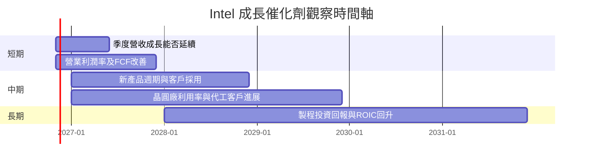

### 9.2 TAM 市場規模分析

提供資料未附各市場 TAM、滲透率與公司分部收入，因此只列可追蹤方向，不虛構 TAM 數值。

```
╔══════════════════════════════════════════════════════════════════╗
║                 Intel 市場 TAM 與公司收入追蹤                    ║
╠══════════════════════════════════════════════════════════════════╣
║ Client CPU TAM       N/A  滲透率 N/A  公司收入 N/A              ║
║ Server／DCAI TAM     N/A  滲透率 N/A  公司收入 N/A              ║
║ Foundry TAM          N/A  滲透率 N/A  公司收入 N/A              ║
║ AI 加速器 TAM        N/A  滲透率 N/A  公司收入 N/A              ║
╠══════════════════════════════════════════════════════════════════╣
║ 可核實公司錨點：TTM 營收 $59.89B；最新季度單季年增 20.9%。       ║
╚══════════════════════════════════════════════════════════════════╝
```

### 9.3 成長驅動力結構圖

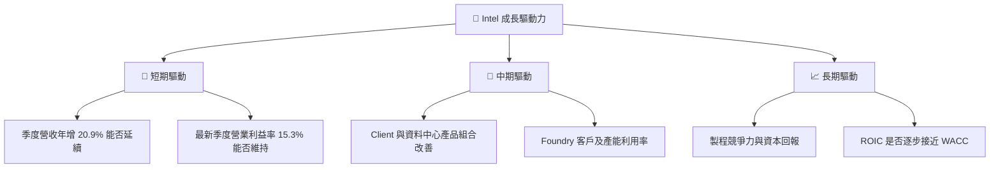

---

## 10. 風險矩陣

### 10.1 風險評分矩陣

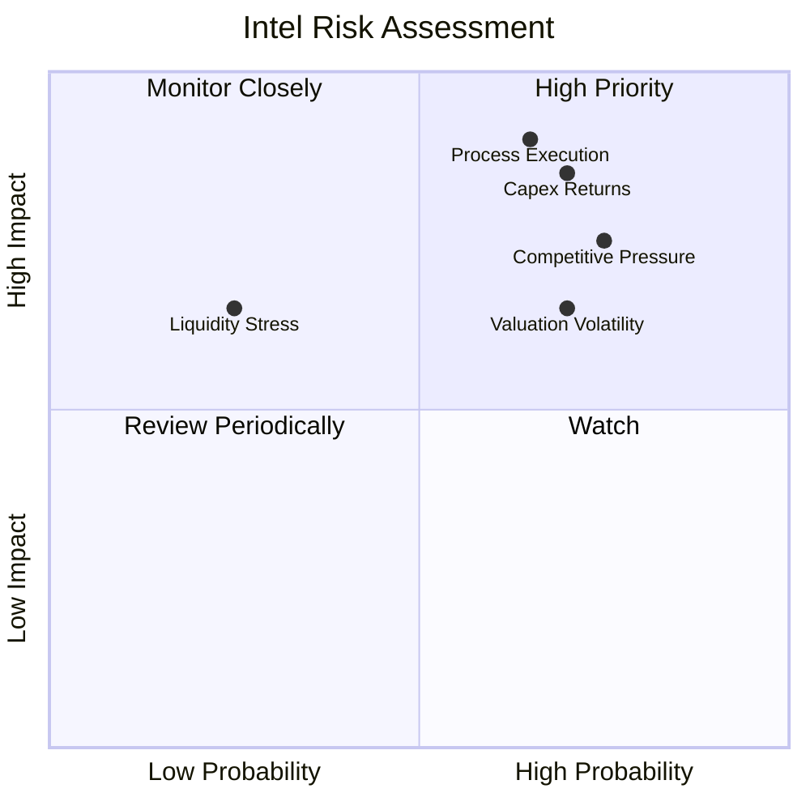

### 10.2 風險清單詳細分析

| # | 風險項目 | 發生機率 | 財務衝擊 | 風險評分 | 緩解措施／監控 |
|---|---|---:|---|---:|---|
| 1 | 🔴 製程與產品執行 | 65%（分析估計） | 高；營收成長及營業利潤率下修 | 8.5/10 | 每季追蹤產品出貨、良率、營業利益率與客戶採用 |
| 2 | 🔴 Capex 回報不達標 | 70%（分析估計） | 高；TTM Capex $13.70B，若利用率不足則 FCF 受壓 | 8.0/10 | 追蹤 Capex／收入、FCF、ROIC；若連續兩季 FCF 為負須重估 |
| 3 | 🔴 AMD／NVIDIA 等競爭 | 75%（分析估計） | 高；Intel 最新季度成長 20.9%，但低於 AMD 44.7%、NVIDIA 105.9% | 7.8/10 | 追蹤份額、產品性能、客戶訂單與毛利率 |
| 4 | 🟠 估值與高波動 | 高 | 現價距 52 週高 $142.35 下跌約 57%；Beta 2.43 | 7.2/10 | 控制部位，避免以單季改善追價 |
| 5 | 🟡 流動性／融資 | 低至中 | 淨現金 $3.87B、現金投資 $54.01B，短期可承受，但仍有資本需求 | 5.5/10 | 監控淨現金、債務期限、資本支出與融資安排 |

---

## 11. 投資建議

### 11.1 最終綜合評級雷達圖

```
╔══════════════════════════════════════════════════════════════╗
║                 INTC 最終評級儀表板                           ║
╠══════════════════════════════════════════════════════════════╣
║ 基本面       5.0/10  ▓▓▓▓▓▓▓▓▓▓░░░░░░░░░░                   ║
║ 成長性       6.0/10  ▓▓▓▓▓▓▓▓▓▓▓▓░░░░░░░░                   ║
║ 獲利能力     3.0/10  ▓▓▓▓▓▓░░░░░░░░░░░░░░                   ║
║ 財務健康     6.0/10  ▓▓▓▓▓▓▓▓▓▓▓▓░░░░░░░░                   ║
║ 估值合理性   2.5/10  ▓▓▓▓▓░░░░░░░░░░░░░░                   ║
║ 護城河       5.2/10  ▓▓▓▓▓▓▓▓▓▓░░░░░░░░░░                   ║
╠══════════════════════════════════════════════════════════════╣
║ 綜合評分     4.3/10  ▓▓▓▓▓▓▓▓▓░░░░░░░░░░░  🔴 賣出          ║
╚══════════════════════════════════════════════════════════════╝
```

### 11.2 目標價與隱含報酬率

| 情境／方法 | 目標價 | 相對 $61.20 報酬 | 機率／權重 | 假設 |
|---|---:|---:|---:|---|
| 🔴 悲觀 DCF | 約 $14 | 約 −77.1% | 30% | 3% CAGR、12% 期末營業利潤率 |
| 🟡 基準 DCF | 約 $28.06 | 約 −54.1% | 50% | 7% CAGR、18% 期末營業利潤率、WACC 15.16%、g 2.5% |
| 🟢 樂觀 DCF | 約 $55 | 約 −10.1% | 20% | 10% CAGR、23% 期末營業利潤率、g 3.0% |
| 加權 DCF | 約 $29.23 | 約 −52.2% | 100% | 三情境機率加權 |
| 加權合理價值 | **$43.24** | **約 −29.3%** | 估值權重合計 100% | DCF、相對倍數與分析師共識加權 |

### 11.3 買入時機與觸發因素

```
╔══════════════════════════════════════════════════════════════════╗
║                 ✅ 買入／減碼觸發因素 Checklist                   ║
╠══════════════════════════════════════════════════════════════════╣
║ 目前建議：不追價；現價 $61.20 高於加權合理價值 $43.24。          ║
║                                                                  ║
║ 重新考慮買入（需多數符合）：                                      ║
║ ☐ 股價回到 $38.92 以下，對應加權合理價值至少 10% MOS             ║
║ ☐ TTM FCF 維持正值，且 FCF Yield 明顯高於目前 1.16%              ║
║ ☐ TTM ROIC 連續改善，並有路徑朝 WACC 15.16% 靠近                 ║
║ ☐ 最新季度營業利益率改善不是單季或一次性因素                      ║
║                                                                  ║
║ 加碼觸發條件：                                                    ║
║ ☐ 連續兩季營收年增為正，且營業利益率不低於前季                    ║
║ ☐ Capex／營收下降、FCF 同步提高，而非以延後投資粉飾現金流          ║
║                                                                  ║
║ 減碼／退出觸發條件：                                              ║
║ ☐ TTM FCF 再度轉負或現金及短期投資快速下降                        ║
║ ☐ ROIC 長期維持低於 WACC，且管理層無明確改善里程碑                 ║
║ ☐ 核心產品營收連續兩季低於市場或公司預期                          ║
╚══════════════════════════════════════════════════════════════════╝
```

### 11.4 投資人適配度分析

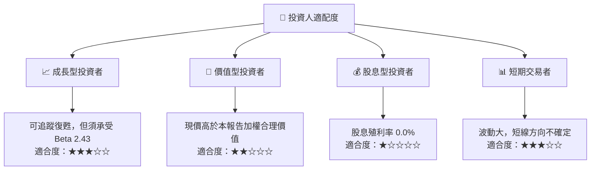

### 11.5 每季財報監控清單（Quarterly Watch List）

| 指標 | 最新基準 | 加碼觀察門檻 | 減碼／重估門檻 |
|---|---:|---|---|
| 營收成長 | TTM +12.1%；最新季度單季 YoY +20.9% | 單季 YoY 持續正成長 | 連續兩季低於 0% |
| 營業利益率 | TTM 2.9%；最新季度 15.3%（有來源衝突） | 多季維持並提高，且 TTM 同步改善 | 回落至低個位數且連續兩季惡化 |
| 毛利率 | TTM 40.2% | 持續改善並有產品組合支持 | 明顯下降且無成本改善 |
| Capex | TTM $13.70B | Capex 效率提高、收入及 FCF 同步上升 | 投資擴張但營收／利用率未跟進 |
| FCF | TTM $3.77B；Yield 1.16% | 多季正 FCF，Yield 上升 | 再度轉負 |
| 現金及短期投資 | $54.01B | 維持足以支援投資及償債 | 快速下降且債務增加 |
| 淨現金／債務 | 淨現金 $3.87B | 淨現金穩定或改善 | 轉為快速增加的淨負債 |
| ROIC | 1.3% | 持續上升，並縮小與 WACC 差距 | 停滯或下降 |
| EPS 預估差異 | 預估值資料缺漏 | 取得可靠一致的預估後再追蹤 beat/miss | 不以缺漏預估值判斷超預期 |

### 11.6 反面論證：什麼會證明論點錯誤（What Would Change My Mind）

```
╔══════════════════════════════════════════════════════════════════╗
║             ⚠️ 論點失效條件（Disconfirming Evidence）             ║
╠══════════════════════════════════════════════════════════════════╣
║ 多頭論點若要成立，需由實際營運數據確認；以下情況須重新評估：     ║
║ ☐ TTM 營收成長連續兩季低於 0%                                    ║
║ ☐ TTM 營業利益率低於 2.9%，且連續兩季惡化                        ║
║ ☐ TTM FCF 轉負，或 Capex 上升但收入及現金流未跟進                ║
║ ☐ ROIC 持續低於 WACC 15.16%，且改善趨勢停滯                      ║
║ ☐ 現金及短期投資由 $54.01B 快速下滑，同時總債務增加              ║
║ ☐ 新產品／晶圓代工投入未形成可量化收入或產能利用率改善            ║
╚══════════════════════════════════════════════════════════════════╝
```

---

> **免責聲明**：本報告依據所提供資料與明示假設產出，僅供研究參考，不構成投資建議。財務資料來源存在口徑差異，DCF 對營業利潤率、Capex、WACC 及終值假設高度敏感。投資有風險，入市需謹慎。