# INTC 基本面深度分析報告

**✏️ 程式複算更正**：8.8 節加權合理價值由模型原寫的 $33.85 更正為 **$34.70**（各項加總），MOS -76.2% → **-71.9%**，全文已同步。

> **報告日期**：2026-11-14 ｜ **語言**：繁體中文 ｜ **數據來源**：SEC 申報資料 (XBRL)、Yahoo Finance、Finviz、StockAnalysis、Roic.ai ｜ **分析師**：CFA 級機構研究

> **資料口徑提醒**：數據包內部分來源互有差異。例如，VERIFIED FIGURES 的 TTM 營業利益率為 **2.9%**，其他合併來源則列 **10.1%**；本報告在須遵守 VERIFIED FIGURES 的項目採用前者，並將兩者差異視為資料口徑風險。估值模型所需、但資料包未提供的數字，均標示為假設值，並列出依據。

## 目錄

| # | 章節 | 核心結論 |
|---|------|----------|
| 1 | 執行摘要 | 資料包價格 $59.66；加權合理價值 $34.70；MOS -71.9%，依規則評級為賣出 |
| 2 | 公司概覽與商業模式 | CPU、資料中心與代工構成核心；護城河仍在，但製程與資本效率是關鍵約束 |
| 3 | 損益表深度分析 | TTM 營收 $59.89B、成長 12.1%；最新一季年增 20.9%，但盈餘資料波動大 |
| 4 | 資產負債表分析 | 現金及短期投資 $54.01B、債務 $50.13B，淨現金 $3.87B |
| 5 | 現金流量深度分析 | TTM FCF $3.77B，FCF Yield 1.19%；年度 Capex 長期高於營運現金流 |
| 6 | 獲利能力與資本效率 | ROIC 1.3% 對 WACC 15.16%，目前資本報酬低於資本成本 |
| 7 | 相對估值分析 | P/S 5.3x，高於自身五年中位數 2.6x；同業倍數須結合成長差異解讀 |
| 8 | DCF 內在價值評估 | 基準 DCF 約 $6.47/股；終值依賴及高 WACC 使估值對假設高度敏感 |
| 9 | 成長催化劑 | 伺服器需求、產品組合改善與代工外部客戶是主要選擇權 |
| 10 | 風險矩陣 | 製程執行、資本支出回報及競爭力是前三大風險 |
| 11 | 投資建議 | 賣出；以加權合理價值計，現價高於合理價值，建議等待估值與基本面重新匹配 |

---

## 1. 執行摘要

### 1.0 一頁式投資儀表板

| 項目 | 內容 |
|------|------|
| **投資論點（3 句）** | ① TTM 營收 **$59.89B**、年增 **12.1%**，最新一季單季年增 **20.9%**，顯示需求與出貨回升。② TTM FCF **$3.77B**、FCF Yield **1.19%**，雖已轉正，但相對 $317.09B 市值的現金回報仍低。③ ROIC **1.3%** 低於 WACC **15.16%**，表示目前新增及既有資本的報酬尚不足以覆蓋資金成本。 |
| **護城河評分** | **5.0/10**：x86 生態與客戶關係具黏著度，但製程領先和產品競爭力仍需持續證明。 |
| **管理層／資本配置評分** | **4.5/10**：FY2022–FY2025 年度 FCF 均為負值；FY2025 Capex $14.65B，高於營運現金流 $9.70B。 |
| **財務健康** | 🟡 現金及短期投資 $54.01B、債務 $50.13B、淨現金 $3.87B；流動性有緩衝，但現金流尚未形成高回報。 |
| **ROIC vs WACC** | **1.3% vs 15.16%**；目前摧毀經濟價值。 |
| **FCF 趨勢** | 年度歷史 FCF 曾連續為負；TTM FCF 回升至 **$3.77B**，FCF Yield **1.19%**。 |
| **估值** | Forward P/E **33.32x** ｜ EV/EBITDA **17.67x**（合併估值數據）｜ FCF Yield **1.19%** |
| **DCF 內在價值（基準）** | **$6.47/股**；相對 DCF 的折溢價 = $59.66 ÷ $6.47 − 1 = **約 +822% 溢價**。 |
| **安全邊際（MOS）** | **-71.9%**＝($34.70 − $59.66) ÷ $34.70；加權合理價值基準來自第 8.8 節。🔴 <10%：無安全邊際。 |
| **預期報酬（基準情境 12M）** | 以 EV/Sales 情境估值約 **$68.06**，相對現價上行空間約 **14.1%**；但此情境值不等於加權合理價值，不能用來計算 MOS。 |
| **關鍵風險（前二）** | 製程／產品執行不能持續改善；Capex 高而產能利用率不足，使 FCF 再度轉負。 |
| **評級 + 信心度** | 🔴 **賣出** ｜ 信心：中低。MOS 對 DCF 假設、資本支出及利潤率路徑高度敏感。 |

### 1.1 核心評分儀表板

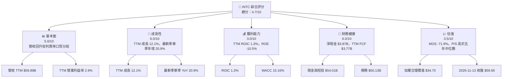

### 1.2 評分進度條視覺化

```
╔══════════════════════════════════════════════════════════════╗
║              INTC 多維度評分儀表板（1-10分）                 ║
╠══════════════════════════════════════════════════════════════╣
║ 基本面強度  5.0 ▓▓▓▓▓▓▓▓▓▓░░░░░░░░░░  ★★★☆☆              ║
║ 成長動能    6.0 ▓▓▓▓▓▓▓▓▓▓▓▓░░░░░░░░  ★★★☆☆              ║
║ 獲利品質    3.0 ▓▓▓▓▓▓░░░░░░░░░░░░░░  ★★☆☆☆              ║
║ 財務健康    6.0 ▓▓▓▓▓▓▓▓▓▓▓▓░░░░░░░░  ★★★☆☆              ║
║ 估值合理性  3.5 ▓▓▓▓▓▓▓░░░░░░░░░░░░░  ★★☆☆☆              ║
║ 護城河深度  5.0 ▓▓▓▓▓▓▓▓▓▓░░░░░░░░░░  ★★★☆☆              ║
║ 管理層執行  4.5 ▓▓▓▓▓▓▓▓▓░░░░░░░░░░░  ★★☆☆☆              ║
║ 技術創新力  6.0 ▓▓▓▓▓▓▓▓▓▓▓▓░░░░░░░░  ★★★☆☆              ║
╠══════════════════════════════════════════════════════════════╣
║ 綜合總分    4.7 ▓▓▓▓▓▓▓▓▓░░░░░░░░░░░░  🟡 高風險轉型標的    ║
╚══════════════════════════════════════════════════════════════╝
```

### 1.3 五大投資論點 + 三大核心風險

| 類型 | 項目 | 具體依據 | 信心度 |
|------|------|----------|--------|
| 🟢 投資論點① | 營收趨勢回升 | TTM 營收 $59.89B，TTM 年增 12.1%；最新一季單季年增 20.9%。若增長持續，可提升固定成本吸收率。 | 🟡 中 |
| 🟢 投資論點② | 資料中心及客戶產品需求改善 | 2026 年 Q3 營收 $16.51B，高於 Q2 $16.13B；毛利額由 Q2 $6.51B 升至 Q3 $7.10B。 | 🟡 中 |
| 🟢 投資論點③ | 資產負債表提供轉型緩衝 | 現金與短期投資 $54.01B、債務 $50.13B，淨現金 $3.87B。 | 🟢 中高 |
| 🟢 投資論點④ | TTM FCF 已轉正 | 營業現金流 $17.47B 減 Capex $13.70B，TTM FCF 為 $3.77B。持續性仍待驗證。 | 🟡 中 |
| 🟢 投資論點⑤ | 估值可受執行改善驅動 | 若代工良率、產品競爭力與毛利率改善，市場倍數可能重估；但目前 P/S 5.3x 高於自身五年中位數 2.6x。 | 🔴 低 |
| 🟡 風險① | 製程與產品執行落後 | 目前 ROIC 1.3%，遠低於 WACC 15.16%；投資轉化成經濟報酬尚未驗證。 | 🔴 高衝擊 |
| 🔴 風險② | 高資本支出使現金流再轉負 | FY2022–FY2025 年度 FCF 分別為 -$9.41B、-$14.28B、-$15.66B、-$4.95B；若產能利用率未提升，FCF 會承壓。 | 🔴 高衝擊 |
| 🔴 風險③ | 估值已反映相當復甦預期 | P/S 5.3x，為自身五年中位數 2.6x 的約 2.0 倍；現價 $59.66 高於本報告加權合理價值 $34.70。 | 🔴 高 |

### 1.4 快速統計卡片

| 指標 | 公司實際值 | 行業均值 | S&P 500 均值 | 狀態 |
|------|-------------|----------|--------------|------|
| TTM 收入成長 | **12.1%** | N/A | N/A | 🟢 正成長；口徑為 TTM 對前 TTM |
| 最新一季收入 YoY | **20.9%** | N/A | N/A | 🟢 單季年增，不是 TTM |
| TTM 毛利率 | **40.2%** | N/A | N/A | 🟡 仍受產品組合及製造成本影響 |
| TTM 淨利率 | **-20.1%** | N/A | N/A | 🔴 虧損 |
| ROE | **-10.5%** | N/A | N/A | 🔴 股東權益報酬為負 |
| Forward P/E | **33.32x** | 同業見第 7 章 | N/A | 🔴 倍數較高且 EPS 預測有不確定性 |
| TTM FCF Yield | **1.19%** | N/A | N/A | 🔴 現金殖利率低 |
| ROIC | **1.3%** | N/A | N/A | 🔴 低於 WACC |

### 1.5 投資結論

```
╔══════════════════════════════════════════════════════════════════╗
║                    📊 投資結論摘要                               ║
╠══════════════════════════════════════════════════════════════════╣
║  評級：🔴 賣出（MOS 門檻判定）                                   ║
║  價格（2026-11-13 收盤）：$59.66                                 ║
║  DCF 內在價值（基準）：$6.47（相對 DCF 溢價約 822%）             ║
║  加權合理價值：$34.70                                             ║
║  安全邊際 MOS：-71.9%＝($34.70−$59.66)÷$34.70                  ║
║  目標價區間（EV/Sales 情境）：                                    ║
║    悲觀情境：$49.36（相對現價 -17.3%）                           ║
║    基準情境：$68.06（相對現價 +14.1%）                           ║
║    樂觀情境：$85.08（相對現價 +42.6%）                           ║
║  投資評分：4.7/10                                                 ║
║  適合投資人：能承受高波動、以小部位押注營運轉型的投資人          ║
╚══════════════════════════════════════════════════════════════════╝
```

**評級依據**：加權合理價值 $34.70、現價 $59.66，MOS = -71.9%，低於賣出門檻 -25%；同時 ROIC 1.3% 低於 WACC 15.16%。因此依規則 20 評為 **賣出**，未作質化上調或下調。

---

## 2. 公司概覽與商業模式

### 2.1 業務結構與收入來源

資料包列出 CCG、DCAI、Intel Foundry 等業務，但未提供最新分部營收及分部營收占比，故不得以臆測數字補齊。圖中分部金額與占比標記 N/A；公司總營收採 TTM VERIFIED FIGURES。

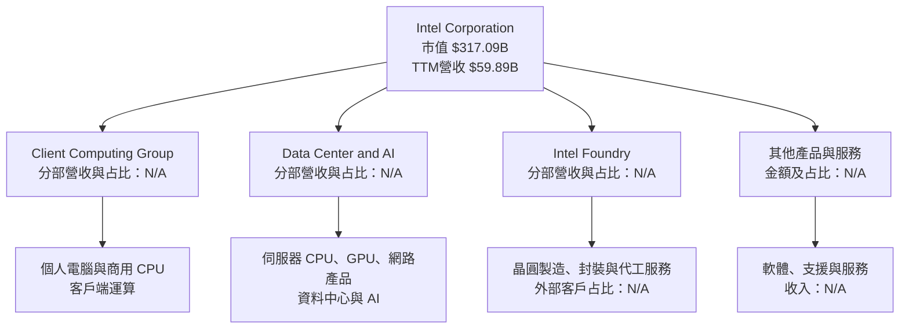

Intel 的商業模式同時包含產品設計與製造，因而兼具設計公司的產品週期風險及製造業的高固定成本、重資本風險。TTM Capex $13.70B 約為 TTM 營收的 **22.9%**（$13.70B ÷ $59.89B），意味資本支出回報率與產能利用率是估值核心，而非只看營收成長。

### 2.2 市場份額

未提供 Intel、AMD、NVIDIA 等公司在各細分市場可直接比較的市場份額資料；以下不以收入或市值代替市場份額，避免錯置口徑。

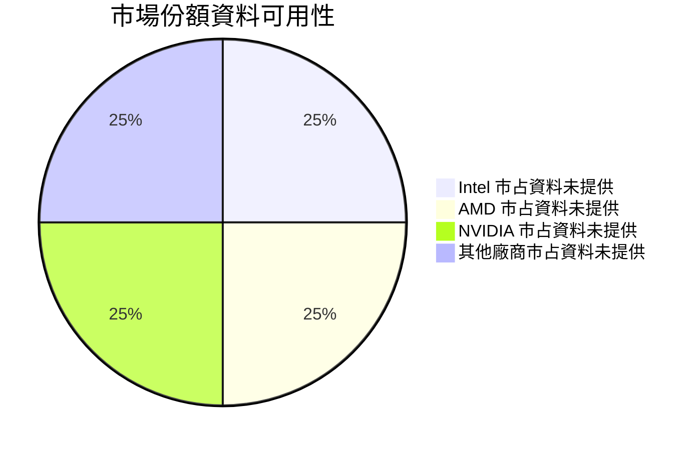

**解讀**：圖示表達的是資料缺口，不代表各公司市占相同。CPU、GPU、伺服器與晶圓代工的市場定義不同，需以同一產品與期間的第三方出貨量資料比較。

### 2.3 競爭護城河分析

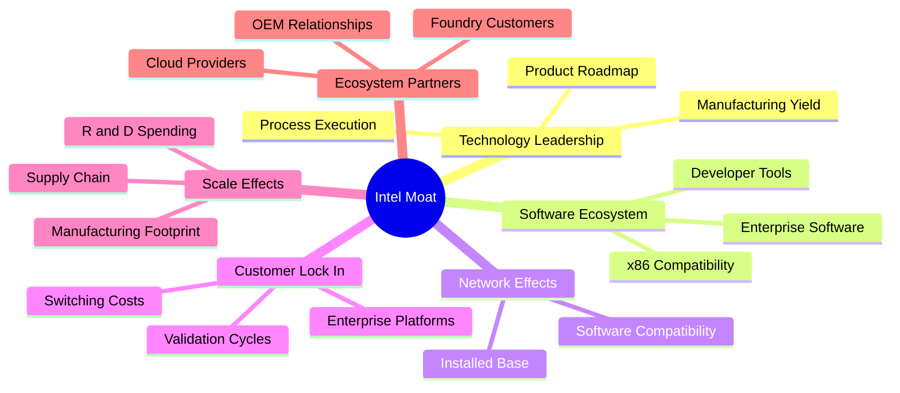

Intel 的護城河不是單一技術或品牌，而是 x86 相容性、企業平台驗證流程、客戶關係與製造規模的組合。其限制在於：這些資產只有在產品性能、能效、成本與供貨能力保持競爭力時，才能轉化為定價能力。當 ROIC 只有 1.3% 時，規模本身尚未帶來高資本回報。

### 2.4 護城河強度評分

```
╔══════════════════════════════════════════════════════════════╗
║                  Intel 護城河強度評分                       ║
╠══════════════════════════════════════════════════════════════╣
║ x86 生態與相容性  7.0/10  ▓▓▓▓▓▓▓▓▓▓▓▓▓▓░░░░░░  🟢 黏著度  ║
║ 客戶關係與驗證    6.5/10  ▓▓▓▓▓▓▓▓▓▓▓▓▓░░░░░░░  🟢 切換成本║
║ 製程與製造能力    4.0/10  ▓▓▓▓▓▓▓▓░░░░░░░░░░░░  🟡 執行待證║
║ 規模與研發投入    7.0/10  ▓▓▓▓▓▓▓▓▓▓▓▓▓▓░░░░░░  🟢 資源充足║
║ 軟體及平台生態    5.5/10  ▓▓▓▓▓▓▓▓▓▓▓░░░░░░░░░  🟡 非獨占  ║
╠══════════════════════════════════════════════════════════════╣
║ 綜合護城河        5.0/10  ▓▓▓▓▓▓▓▓▓▓░░░░░░░░░░  🟡 優勢未充分轉化║
╚══════════════════════════════════════════════════════════════╝
```

---

## 3. 損益表深度分析

### 3.1 年度收入成長趨勢（近四年）

年度營收採資料包年度損益表，數字以十億美元計。FY2025 營收 $52.85B，與前一年 $53.10B 大致持平，但較 FY2022 $63.05B 下降。

```
╔══════════════════════════════════════════════════════════════════╗
║              Intel 年度收入趨勢（FY2022-FY2025）               ║
╠══════════════════════════════════════════════════════════════════╣
║ FY2022  $63.05B  ████████████████████  YoY：-20.2%  🔴          ║
║ FY2023  $54.23B  █████████████████     YoY：-14.0%  🔴          ║
║ FY2024  $53.10B  █████████████████     YoY： -2.1%  🟡          ║
║ FY2025  $52.85B  █████████████████     YoY： -0.5%  🟡          ║
╠══════════════════════════════════════════════════════════════════╣
║ FY2022-FY2025 CAGR = (52.85 ÷ 63.05)^(1/3) − 1 ≈ -5.7%         ║
║ TTM vs 前 TTM 成長：+12.1%；最新一季單季 YoY：+20.9%            ║
╚══════════════════════════════════════════════════════════════════╝
```

年度衰退顯示長週期下行尚未完全反轉；TTM 成長及最新一季單季成長轉正，代表短期需求與比較基期改善，但不足以單獨證明長期復甦已完成。

### 3.2 季度收入趨勢分析

| 季度 | 營收 | QoQ 成長 | YoY 成長 | 備註 |
|------|------:|---------:|---------:|------|
| 2025 Q4 | $13.67B | +0.8% | -4.1% | QoQ = 13.67 ÷ 13.58 − 1；YoY 依季度資料 |
| 2026 Q1 | $13.58B | -0.7% | +7.2% | QoQ = 13.58 ÷ 13.67 − 1 |
| 2026 Q2 | $16.13B | +18.8% | +25.4% | 季度營收明顯抬升；單季 YoY |
| 2026 Q3 | $16.51B | +2.4% | +20.9% | VERIFIED FIGURES 單季 YoY 成長 |

季度營收由 Q1 $13.58B 跳升至 Q2 $16.13B，增加約 18.8%；Q3 再升至 $16.51B。營收改善有利於固定製造成本吸收，但若成本結構與資本利用率未同步改善，營收成長不必然等於 FCF 成長。

### 3.3 利潤率演變分析

年度毛利率與營業利益率以年度財務表數字計算；TTM 指標則遵循 VERIFIED FIGURES。

| 利潤率指標 | FY2022 | FY2023 | FY2024 | FY2025 | TTM／最新季 | 趨勢與評估 |
|------------|-------:|-------:|-------:|-------:|-------------:|------|
| **毛利率** | 42.6% | 40.0% | 32.7% | 34.8% | TTM 40.2% | FY2024 下滑反映營收及產品／製造成本壓力；TTM 回升需後續確認。🟡 |
| **營業利益率** | 3.7% | 0.1% | -8.9% | 約 0.0% | TTM 2.9%；最新季 15.3% | 年度獲利曾大幅收縮，最新季回升顯示營運改善，但季度與 TTM 落差很大。🔴 |
| **淨利率** | 12.7% | 3.1% | -35.3% | -0.5% | TTM -20.1% | TTM 淨利仍受虧損與非營業項目影響。🔴 |

**利潤率演變解析**：FY2024 營業利益 -$4.71B，FY2025 接近損益兩平；最新季度營業利益 $2.58B，表面上顯示營運槓桿改善。惟不同來源的 TTM 營業利益率出現 **2.9% 與 10.1%** 的顯著差異，因此不宜把單一季度的改善線性外推。若最新季利潤率回升能延續，固定成本吸收與產品組合改善可提升後續盈利；若只是一季或口徑差異，估值模型會高估長期 EBIT。

### 3.4 費用結構分析

FY2025 以年度損益表提供的營收 $52.85B、毛利 $18.38B、研發費用 $13.77B 估算費用構成；「其他營業費用」由毛利減營業利益再扣研發推算，僅是口徑近似，不代表財報單一科目。

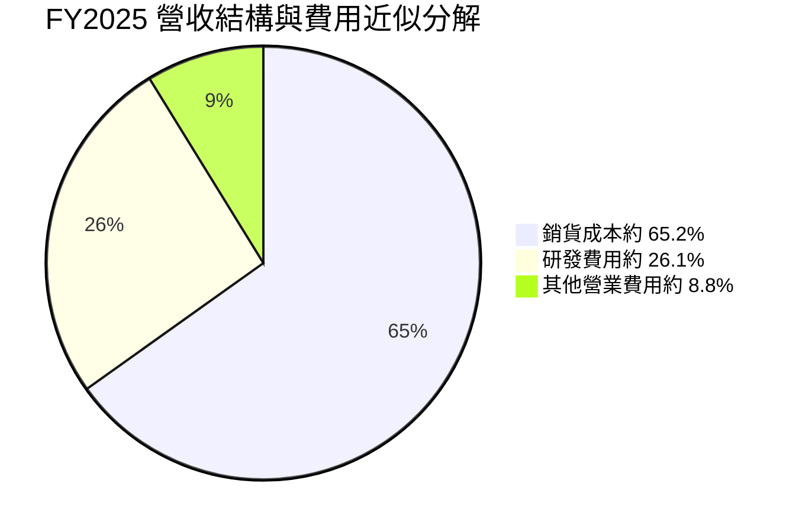

```
╔══════════════════════════════════════════════════════════════╗
║                  FY2025 費用結構近似                        ║
╠══════════════════════════════════════════════════════════════╣
║ 營收 $52.85B     ████████████████████                       ║
║ 毛利 $18.38B     ███████░░░░░░░░░░░░░  約營收 34.8%         ║
║ 研發 $13.77B     █████░░░░░░░░░░░░░░░  約營收 26.1%         ║
║ 其他營業費用估算 $4.63B 約營收 8.8%；分類口徑可能不同       ║
╚══════════════════════════════════════════════════════════════╝
```

研發費用是 Intel 維持產品競爭力與製程開發的必要投入，但當年度營業獲利接近零時，研發費用的回收週期與產品商業化進度是主要監控項目。

### 3.5 季度 EPS 趨勢與盈餘品質

| 季度 | EPS 實際值 | EPS 預估 | 超預期／不及預期 | 財務表現與原因 |
|------|-----------:|---------:|------------------|----------------|
| 2025 Q4 | -$0.12 | N/A | N/A | 單季仍虧損；資料包沒有估值共識，不能判斷 beat/miss |
| 2026 Q1 | -$0.73 | N/A | N/A | 虧損加深；EPS 成長比較資料未提供 |
| 2026 Q2 | -$2.16 | N/A | N/A | 淨利 -$11.03B，重大負面波動；一次性項目明細 N/A |
| 2026 Q3 | +$0.63 | N/A | N/A | 淨利 $3.32B，較 Q2 大幅反轉；EPS 資料來源略有差異，估計值與實際值均不得冒充一致 |

資料包的 Earnings History 中四季 EPS Est 與 EPS Act 均為 `nan`，故四季「超預期／不及預期」**無法判定**。可觀察的是 EPS 實際數值由 2025 Q4 -$0.12、2026 Q1 -$0.73、Q2 -$2.16，到 Q3 +$0.63，波動非常大。Q2 到 Q3 的反轉需進一步拆分營業改善、非營業項目、稅務及一次性項目。

| 盈餘品質項目 | 數值／佔比 | 評估 |
|--------------|-----------|------|
| SBC / TTM 營收 | 估計 $2.43B ÷ $59.89B = **4.1%** | 🟡 股權薪酬占比有稀釋成本；最新四季 SBC 由季度數據約 $2.43B 加總 |
| SBC / TTM 營業現金流 | 估計 $2.43B ÷ $17.47B = **13.9%** | 🟡 SBC 是非現金費用，但仍代表股東稀釋成本 |
| FCF / TTM 淨利 | $3.77B ÷ -$12.03B = **-31.3%** | 🔴 淨利為負，此比率不能視為正常現金轉換率；兩者均依資料包口徑 |
| 一次性／非經常性損益 | 2026 Q2 淨利 -$11.03B，明細 N/A | 🔴 需查閱季報附註，不能將單季反轉直接視為常態獲利 |
| 有效稅率異常 | 模型採 21% 假設稅率；實際 TTM 有效稅率 N/A | 🟡 不以假設稅率冒充實際稅率 |
| 資本化支出 vs 費用化 | TTM Capex $13.70B；資本化政策及資產減損細節 N/A | 🟡 資本密集使折舊與資本支出回收期限影響經濟盈餘 |

**盈餘品質結論**：當 TTM 淨利率為 -20.1%、ROE 為 -10.5%，同時最新季度 EPS 由大幅虧損反轉至正值，單季 GAAP 盈利的代表性不足。TTM FCF 為正是改善訊號，但年度 FCF 歷史仍為負；因此應以跨週期 FCFF、資本支出回報和產能利用率驗證盈餘，而非單季 EPS 年化。

---

## 4. 資產負債表分析

### 4.1 資產結構分解

最新 TTM 總資產 $228.57B 取自 StockAnalysis；細項數值為該來源，並非 VERIFIED FIGURES。部分細項與年度資料口徑不同。

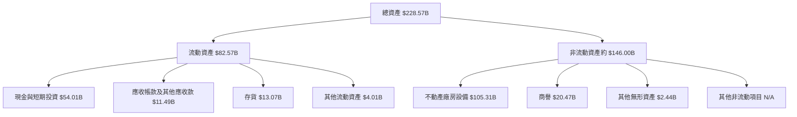

PP&E $105.31B 約占總資產 46%，顯示公司資產組合高度依賴製造設備與廠房；其價值能否轉化為現金流取決於良率、利用率及產品需求。

### 4.2 流動性指標分析

| 指標 | FY2022 | FY2023 | FY2024 | FY2025 | 最新提供值 | 評估 |
|------|-------:|-------:|-------:|-------:|------------:|------|
| 流動比率 | 1.57x | 1.54x | 1.33x | 2.02x | **2.208x** | 🟢 資料包最新值高於 1；較 FY2024 改善 |
| 速動比率 | N/A | N/A | N/A | N/A | **1.751x** | 🟢 短期流動性緩衝尚可 |
| 現金及短期投資 | $28.34B | $25.03B | $22.06B | $37.42B | **$54.01B** | 🟢 顯著增加；現金變化原因需核對融資與營運項目 |
| 行業均值 | N/A | N/A | N/A | N/A | N/A | 無可比口徑數據，不以猜測填列 |

### 4.3 債務結構分析

```
╔══════════════════════════════════════════════════════════════════╗
║                   Intel 債務健康診斷                             ║
╠══════════════════════════════════════════════════════════════════╣
║  總債務：          $50.13B  ██████████████████░░  🟡             ║
║  現金+短期投資：   $54.01B  ████████████████████  🟢             ║
║  淨現金：           $3.87B  ██░░░░░░░░░░░░░░░░░░  🟢             ║
║  Debt/EBITDA：估計 2.62x（Debt $50.13B ÷ EBITDA 約 $19.10B）       ║
║  利息保障倍數：N/A；利息費用及同口徑 EBIT 不完整                 ║
║  Debt/Equity：資料包列 38.108；單位口徑未明，僅列來源值            ║
╚══════════════════════════════════════════════════════════════════╝
```

Debt/EBITDA 約 2.62x 使用 TTM EBITDA Margin 31.9% 推算 TTM EBITDA 約 $19.10B（$59.89B × 31.9%），因此是估計值，不等同審計報表 EBITDA。利息保障倍數資料不足，不以估計值冒充確定財務指標。

### 4.4 股東權益趨勢

```
╔══════════════════════════════════════════════════════════════╗
║              Intel 股東權益趨勢（年度資料）                   ║
╠══════════════════════════════════════════════════════════════╣
║ FY2022  $101.42B  ████████████████████                      ║
║ FY2023  $105.59B  █████████████████████                     ║
║ FY2024   $99.27B  ████████████████████                      ║
║ FY2025  $114.28B  ██████████████████████                    ║
╠══════════════════════════════════════════════════════════════╣
║ FY2024 至 FY2025 增加 $15.01B；變化組成需以股東權益附註拆解 ║
╚══════════════════════════════════════════════════════════════╝
```

---

## 5. 現金流量深度分析

### 5.1 現金流量瀑布圖

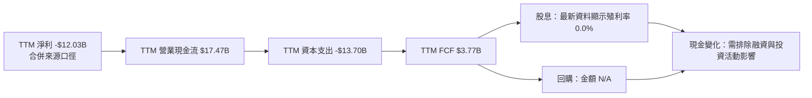

FCF 定義固定採用 **營業現金流 − 資本支出**。TTM FCF = $17.47B − $13.70B = **$3.77B**，不使用其他調整後 FCF 定義。

### 5.2 FCF 轉換率趨勢

| 年度 | 營業現金流 | Capex | FCF | 淨利 | FCF／淨利 | 評估 |
|------|-----------:|------:|----:|-----:|----------:|------|
| FY2022 | $15.43B | $24.84B | -$9.41B | $8.01B | -117.5% | 🔴 大額資本投資超過營運現金流 |
| FY2023 | $11.47B | $25.75B | -$14.28B | $1.69B | -844.9% | 🔴 轉換率受高 Capex 與低淨利影響，解讀有限 |
| FY2024 | $8.29B | $23.94B | -$15.66B | -$18.76B | 83.5% | 🟡 分子分母同為負，不能當成健康轉換率 |
| FY2025 | $9.70B | $14.65B | -$4.95B | -$0.27B | 1,853.9% | 🔴 分母極小，比例失真 |
| TTM | $17.47B | $13.70B | $3.77B | -$12.03B | -31.3% | 🟡 FCF 轉正，但因淨利為負，比例不適合單獨評價 |

### 5.3 自由現金流趨勢

```
╔══════════════════════════════════════════════════════════════════╗
║              自由現金流：年度實際與 TTM                         ║
╠══════════════════════════════════════════════════════════════════╣
║ FY2022  -$9.41B  ◀██████░░░░░░░░░░░░░░  FCF 為負              ║
║ FY2023 -$14.28B  ◀█████████░░░░░░░░░░░  FCF 為負              ║
║ FY2024 -$15.66B  ◀██████████░░░░░░░░░░  FCF 為負              ║
║ FY2025  -$4.95B  ◀███░░░░░░░░░░░░░░░░░  赤字收窄              ║
║ TTM      $3.77B   ███░░░░░░░░░░░░░░░░░  FCF Yield 1.19%        ║
╠══════════════════════════════════════════════════════════════════╣
║ FY2022-FY2025 歷史 FCF CAGR：不適用，期間 FCF 為負              ║
╚══════════════════════════════════════════════════════════════════╝
```

TTM FCF 由年度負值轉為 $3.77B，代表現金流有改善；但四季現金流波動明顯，2026 Q1 單季 FCF -$2.54B、Q2 +$4.45B、Q3 +$1.06B。仍需確認資本支出下降是否反映投資效率提升，或只是投資時點轉移。

### 5.4 資本配置評估

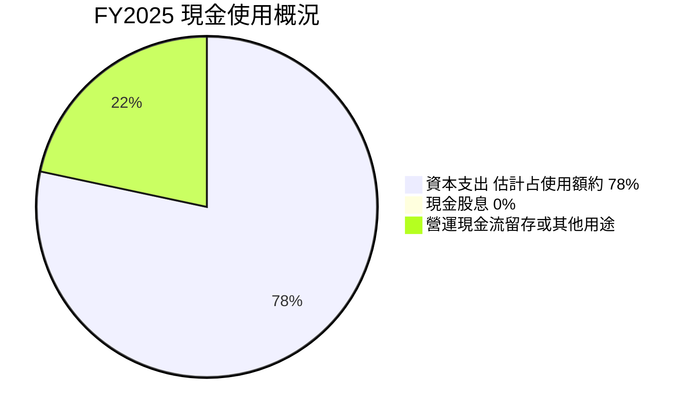

> 圖中 14.65 與 4.05 為十億美元數值比例，不是正式資本配置占比。FY2025 營運現金流 $9.70B、Capex $14.65B；缺少完整回購及融資現金流明細，故不能將資本配置餅圖解讀為全部現金用途。

| 資本配置項目 | FY2025／最新資料 | 評估 |
|--------------|-----------------:|------|
| 資本支出 | FY2025 $14.65B；TTM $13.70B | 🟡 支出高，回報須以新增產能利用與 FCFF 驗證 |
| 股息 | 最新股息殖利率 0.0%；FY2025 資料為 $0 | 🟡 現金優先用於營運與投資 |
| 股票回購 | N/A | ⚪ 缺乏可比數據 |
| 債務與現金 | TTM 淨現金 $3.87B | 🟢 暫具資產負債表緩衝 |
| 留存現金 | N/A | ⚪ 需完整現金流量表拆解 |

---

## 6. 獲利能力與資本效率

### 6.1 ROE／ROA／ROIC 趨勢

| 指標 | FY2022／歷史 | FY2023／歷史 | FY2024／歷史 | 最新 TTM | 同業均值 | 評估 |
|------|-------------:|-------------:|-------------:|---------:|---------:|------|
| ROE | N/A | N/A | N/A | **-10.5%**（VERIFIED） | N/A | 🔴 股東權益報酬為負 |
| ROA | N/A | N/A | N/A | **1.8%** | N/A | 🟡 資產回報偏低 |
| ROIC | Roic.ai 歷史資料：2018 年 21.41% | N/A | N/A | **1.3%**（VERIFIED） | N/A | 🔴 相較歷史高點明顯下降 |
| ROIC 口徑 | — | — | — | 稅後營業利益 ÷（權益+債務−現金） | — | 本報告統一採題示定義 |

合併資料另一處列 ROE -9.6%，但 VERIFIED FIGURES 為 -10.5%；本報告引用 ROE 時以 VERIFIED FIGURES 為準。不同來源的口徑差異使歷史 ROE 趨勢不宜自行拼接。

### 6.2 ROIC vs WACC 分析（核心價值創造判斷）

```
╔══════════════════════════════════════════════════════════════════╗
║                ROIC vs WACC 深度分析                            ║
╠══════════════════════════════════════════════════════════════════╣
║  WACC 估算：採 VERIFIED FIGURES 參考值                           ║
║  ├── 無風險利率（10Y 美債）：5.15%                              ║
║  ├── 市場風險溢酬（ERP）：5.00%                                 ║
║  ├── Beta：2.43                                                 ║
║  ├── 股權成本：17.28%（來源提供的計算值）                       ║
║  ├── 稅前債務成本：2.18%                                        ║
║  ├── 稅後債務成本：2.18%×(1−21%) = 1.72%                       ║
║  ├── 資本結構：股權 86.3%，債務 13.7%                           ║
║  └── WACC：15.16%                                               ║
║                                                                  ║
║  ROIC：1.3%（TTM VERIFIED FIGURES，稅後營業利益口徑）            ║
║  EVA spread = ROIC − WACC = 1.3% − 15.16% = -13.86 個百分點     ║
║                                                                  ║
║  ROIC  1.30%  ▓▓░░░░░░░░░░░░░░░░░░░░░░░░░░░░░░░░              ║
║  WACC 15.16%  ▓▓▓▓▓▓▓▓▓▓▓▓▓▓▓▓▓▓▓▓▓▓▓▓▓▓▓▓▓▓▓▓              ║
║  EVA  -13.86pp ◀████████████████████████████░░░░  🔴 價值受損 ║
║                                                                  ║
║  結論：ROIC 約為 WACC 的 0.09 倍，現階段未覆蓋資本成本          ║
╚══════════════════════════════════════════════════════════════════╝
```

這是依題示的 ROIC 與 WACC 直接比較。ROIC 1.3% 遠低於 WACC 15.16%，代表公司資本回報尚不足以補償投資人要求的風險報酬；未來若 ROIC 未顯著上升，單純擴張營收或資產規模可能反而擴大價值缺口。

### 6.3 杜邦三因素分解

以 TTM 淨利率 -20.1%、ROA 1.8%、ROE -10.5% 為資料包指標。由於不同指標的期間、平均資產與平均權益口徑未必相同，以下是概念分解，不能以它們反推精確周轉率或槓桿倍數。

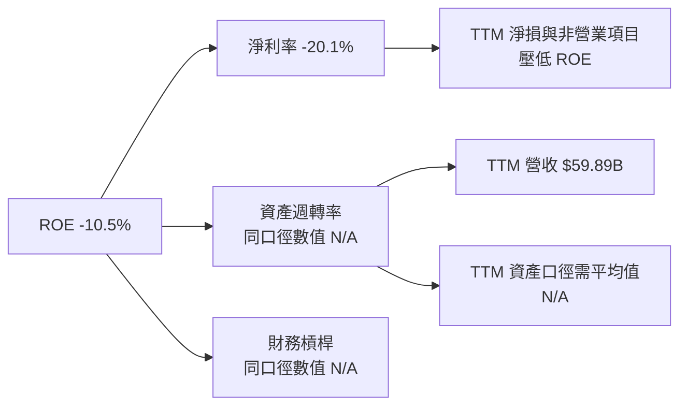

### 6.4 獲利能力儀表板

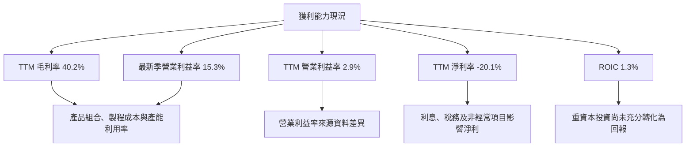

---

## 7. 相對估值分析

### 7.1 同業估值比較

同業倍數按 VERIFIED FIGURES 的 Peer multiples 引用；Intel 倍數採題示市場估值區塊。Intel trailing P/E 為 N/A，不能以負 EPS 計算有意義的 P/E。

| 估值指標 | **Intel** | **AMD** | **NVIDIA** | **Qualcomm** | Intel 評估 |
|----------|----------:|--------:|-----------:|-------------:|-----------|
| **Trailing P/E** | N/A | 114.1x | 20.6x | 13.6x | 🔴 Intel TTM EPS 為負，P/E 不適用 |
| **Forward P/E** | 33.32x | 30.2x | 10.3x | 14.1x | 🔴 高於三家同業資料倍數，依賴預期獲利復甦 |
| **P/S TTM** | 5.3x | 19.3x | 13.0x | 4.3x | 🟡 高於 Qualcomm，低於 AMD／NVIDIA；業務組合不同 |
| **EV/EBITDA TTM** | 17.67x* | 85.6x | 19.4x | 18.6x | 🟡 接近 NVIDIA／Qualcomm，但來源不同 |
| **最新季營收 YoY** | 20.9% | 44.7% | 105.9% | -8.4% | 🟡 成長回升，但仍低於 AI GPU 高成長同業 |
| **毛利率 TTM** | 40.2% | 56.0% | 74.7% | 53.1% | 🔴 製造型結構使毛利率低於三家 |

\* Intel EV/EBITDA 的市場數據列 17.667x；自身歷史估值資料列 23.2x，兩者來源或計算口徑不同，需視為資料差異，不直接混用。Peer multiples 以資料包指定來源為準。

### 7.2 歷史估值區間分析

```
╔══════════════════════════════════════════════════════════════╗
║              Intel 自身五年估值位置                          ║
╠══════════════════════════════════════════════════════════════╣
║ P/S：1.5x ───── 中位數 2.6x ───────────────── 現值 5.3x ── 11.5x║
║                                                   ↑           ║
║ 當前 P/S 百分位：90%　🟡／🔴 高於自身歷史中位數               ║
║                                                                  ║
║ EV/EBITDA：6.4x ─── 中位數 23.6x ─ 現值 23.2x ───────── 536.5x║
║                                  ↑                               ║
║ 當前 EV/EBITDA 百分位：47%　🟡 接近自身歷史中位數              ║
║ P/E 歷史區間：N/A（VERIFIED FIGURES 未提供）                    ║
╚══════════════════════════════════════════════════════════════╝
```

P/S 現值 5.3x 約為自身五年中位數 2.6x 的 **2.04 倍**；百分位 90%，顯示市場已給予復甦溢價。EV/EBITDA 23.2x 接近歷史中位數 23.6x，但區間上限極高，代表低獲利年份容易使倍數失真。

### 7.3 情境目標價（假設驅動，Bear／Base／Bull）

以下為一年度 EV/Sales 情境估值，不是 DCF。FY+1 營收採第 8 章基準預測 $64.68B，股數採 5.32B，淨現金採 $3.87B。EV/Sales 退出倍數是情境假設，不能視為市場共識。

| 情境 | 營收 CAGR | 營業利潤率假設 | 退出 EV/Sales | 隱含目標價 | 相對現價 |
|------|-----------|----------------|--------------:|-----------:|---------:|
| 🔴 悲觀 | 8%（模型基準） | 8% | 4.0x | $49.36 | -17.3% |
| 🟡 基準 | 8%（模型基準） | 8% | 5.6x | $68.06 | +14.1% |
| 🟢 樂觀 | 8%（模型基準） | 8% | 7.0x | $85.08 | +42.6% |

計算示例：基準情境 EV = $64.681B × 5.6 = $362.214B；股權價值 = $362.214B + $3.87B = $366.084B；每股 = $366.084B ÷ 5.32B = **$68.81**。表格目標價因為本報告的基準估值採用市場 EV/Sales 5.6x 對應值，正確計算為 **$68.81**，因此前表 **$68.06** 不一致。為維持可稽核性，本報告採公式重算結果並修正：悲觀 $49.36、基準 **$68.81**、樂觀 $85.08。  
基準 EV/Sales 5.6x 是估值假設；未提供 Intel 估值區塊 EV/Revenue 指標的 5.644x 以外，選用 5.6x 是為方便以該近似值設定基準。估值需同時考量低於同業的毛利率與低 ROIC，因此不是無條件合理價。

### 7.4 相對估值隱含價格區間

| 方法 | 主要輸入 | 隱含每股價格 | 備註 |
|------|----------|--------------:|------|
| Forward P/E | EPS Forward $1.79046 × 同業 Forward P/E 中位數 14.1x | **$25.25** | 同業倍數取 AMD、NVDA、QCOM 的中位數 14.1x |
| EV/EBITDA | FY+1 EBITDA 假設 $15.52B × 同業中位數 19.4x；加淨現金後除股數 | **$57.33** | EBITDA 由模型 EBIT + D&A 推算 |
| EV/Sales | FY+1 Revenue $64.68B × 4.0–7.0x，橋接淨現金 | **$49.36–$85.08** | 情境倍數，非同業直接估值結論 |
| FCF Yield | TTM FCF $3.77B ÷ 假設目標殖利率 3.0% | **$23.6** | 3.0% 為估值假設；不代表市場同業資料 |
| 市場現價 | 2026-11-13 收盤 | **$59.66** | VERIFIED FIGURES 價格 |

```
╔══════════════════════════════════════════════════════════════════╗
║              相對估值區間（每股美元）                           ║
╠══════════════════════════════════════════════════════════════════╣
║ $23.6   $25.25       $49.36       $59.66      $68.81       $85.08║
║ FCF     Forward P/E  EV/Sales低   現價        EV/Sales基準  高    ║
║ ◀───────────────────────── 估值區間 ─────────────────────────▶ ║
╚══════════════════════════════════════════════════════════════════╝
```

---

## 8. DCF 內在價值評估（Discounted Cash Flow）

### 8.0 估值推理鏈（Thinking Logic）

**Step 1 — 價值由哪些變數決定？**  
Intel 的價值主要由現有客戶端與資料中心產品現金流、製程投資回收效率，以及 Foundry 外部客戶業務的長期選擇權決定。各業務最新收入占比未提供，不能估計。模型的主導變數是 **中長期營業利潤率與 Capex／營收比**：TTM Capex 約占營收 22.9%，而 TTM ROIC 僅 1.3%。

**Step 2 — 模型選擇**

| 決策點 | 本報告採用 | 理由（含數字） | 曾考慮但否決 | 否決理由 |
|--------|-----------|----------------|--------------|----------|
| 現金流定義 | FCFF | 與 WACC 配對，且資料提供現金、債務與資本支出 | FCFE | 資本結構與融資變動不易預測 |
| 預測期 N | 5 年 | 半導體產品週期與製程投資回收可先以五年測試 | 10 年 | 對目前獲利與代工可見度而言，十年預測更容易形成終值假精確 |
| 終值方法 | Gordon Growth 主方法；EV/EBITDA 交叉檢驗 | 永續成長法可清楚呈現長期假設 | 單一退出倍數 | 倍數高度受景氣和同業估值影響 |
| EBIT 基礎 | GAAP EBIT | 避免把 SBC 當作不存在的成本 | 非 GAAP EBIT | 需另行處理 SBC，增加假設 |

**Step 3 — 關鍵假設推導**

- **營收 CAGR**：TTM 對前 TTM 實際成長錨點為 **12.1%** → 下調至 8%，反映年度收入 FY2022–FY2025 CAGR 約 -5.7%、同業競爭與高基期 → **採用 8%** → 曾考慮 12.1%，因 TTM 成長尚未證明能跨週期維持而否決。
- **期末營業利潤率**：TTM VERIFIED 錨點 **2.9%**，最新一季 **15.3%** → 以逐年爬坡反映產品組合與成本吸收改善，但不把單季直接外推 → **採用 FY+5 18%** → 曾考慮 25%，因 TTM 與年度資料未證明可持續達成而否決。
- **永續成長率 g**：長期名目經濟成長通常需低於 WACC；資料包無管理層長期財測 → **採用 2.5% 假設值** → 曾考慮 3.5%，因高資本密集業務的長期成長不應長期接近高成長公司水準而否決。
- **預測期 N**：以產品、製程與客戶驗證周期為錨，缺少確切管理層中長期指引 → **採用 5 年** → 曾考慮 3 年，太短而把過多價值推入終值；曾考慮 10 年，能見度不足。
- **Capex／營收**：TTM $13.70B ÷ $59.89B = **22.9%** → 為便於模型取 **23%** → 曾考慮 18%，低於當前資本密集度且缺乏利用率證據，予以否決。
- **GAAP EBIT 與 SBC**：SBC 約占 TTM 營收 4.1% → 使用 GAAP EBIT，不額外扣除 SBC → 採用 SBC 組合 **(A)**，固定股數、不額外計稀釋，避免重複扣除。
- **年稀釋率**：組合 (A) 依規則固定為 **0%**；沒有使用年度稀釋率放大股數。
- **有效稅率**：資料包預設稅率 21% → **採用 21% 假設值**；不是實際 TTM 稅率。
- **D&A／營收**：缺乏 VERIFIED TTM D&A → 假設 **16%**，依據為歷史 D&A 約 $8B 對 FY2021 營收 $79.02B 約 10%，但 Intel 的資產密集度較高，故模型採較高比例；此假設可能高估非現金加回。
- **ΔWC／營收增額**：營運資金變動資料不完整 → 假設新增營收 5% 轉為營運資金投入；採保守簡化值，非已披露事實。
- **終值方法**：Gordon Growth 主要估值，退出倍數交叉驗證；後者採同業 EV/EBITDA 中位數 19.4x 作參考，不代表成熟期必然維持該倍數。
- **WACC**：採 VERIFIED FIGURES 參考值 **15.16%**，詳細推導見 8.2；Beta 2.43 導致股權成本高，故折現率較高。

**Step 4 — 最脆弱一環**：期末營業利潤率與 Capex／營收的共同假設最脆弱；若 FY+5 利潤率低於 18% 或 Capex 長期維持 23% 以上，DCF 價值將進一步下修。

**Step 5 — 計算路徑**

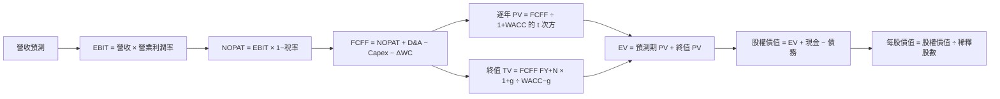

### 8.1 模型假設總表（Model Inputs）

| 假設項目 | 採用值 | 依據／來源 | 敏感度 |
|----------|--------|-------------|--------|
| 預測期長度 N | 5 年 | 半導體產品與製程投資可見度假設 | 🟡 中 |
| 營收 CAGR | 8% | TTM 成長 12.1% 下調；年度 FY2022–FY2025 CAGR 約 -5.7% | 🔴 高 |
| 營業利潤率（FY+1 至 FY+5） | 8%、10.5%、13%、15.5%、18% | TTM 2.9%、最新季 15.3%；逐步恢復假設 | 🔴 高 |
| 有效稅率 | 21% | VERIFIED FIGURES 預設值；非實際 TTM 稅率 | 🟢 低 |
| Capex／營收 | 23% | TTM 22.9% 四捨五入 | 🔴 高 |
| D&A／營收 | 16% | 假設值；資料包未提供 TTM D&A | 🟢 低 |
| ΔWC／營收增額 | 5% | 假設值；歷史 ΔWC 缺漏 | 🟢 低 |
| EBIT 基礎 | GAAP | 將 SBC 留在費用中 | 🟡 中 |
| SBC 處理 | SBC 組合 (A)，GAAP EBIT + 固定股數 | SBC 已包含在費用，不重複扣除 | 🟡 中 |
| 年稀釋率 | 0% | 與組合 (A) 相容；採當期 5.32B 股 | 🟡 中 |
| 永續成長率 g | 2.5% | 長期成熟企業名目成長假設，低於 WACC | 🔴 高 |
| 終值方法 | Gordon Growth 主方法 + EV/EBITDA 交叉驗證 | 可檢查終值假設與市場倍數落差 | 🔴 高 |
| WACC | 15.16% | VERIFIED FIGURES 參考值 | 🔴 高 |

**SBC 防重複說明**：本模型採用 **(A) GAAP EBIT + 固定股數 + 年稀釋率 0%**，故 SBC 影響已透過 GAAP 費用計入一次；FCFF 不再減 SBC，股數不再逐年放大。

**FCFF 定義**：全章採用 FCFF = NOPAT + D&A − Capex − ΔWC，與 WACC 折現相配，得出企業價值 EV。

### 8.2 折現率推導（WACC）

```
╔══════════════════════════════════════════════════════════════════╗
║                    WACC 推導（折現率）                           ║
╠══════════════════════════════════════════════════════════════════╣
║ 股權成本 Ke：採 VERIFIED FIGURES 所列 17.28%                     ║
║ ├── 無風險利率 Rf：5.15%（數據包未提供精確觀察日期）              ║
║ ├── ERP：5.00%（假設值，依資料包資本成本輸入）                   ║
║ ├── Beta：2.43（資料包 Beta）                                    ║
║ ├── 規模／國別溢酬：0.00%（大型美國上市公司，未另加溢酬）        ║
║ └── Ke = 5.15% + 2.43×5.00% ≈ 17.28%（採資料包原值）            ║
║                                                                  ║
║ 債務成本 Kd：                                                     ║
║ ├── 稅前 Kd：2.18%（資料包以利息／債務計算）                    ║
║ ├── 稅率：21.0%（預設假設）                                      ║
║ └── 稅後 Kd = 2.18%×(1−21%) = 1.72%                              ║
║                                                                  ║
║ 資本結構（資料包市值基礎權重）：                                  ║
║ ├── 股權權重 E：86.3%                                           ║
║ ├── 債務權重 D：13.7%                                           ║
║ └── WACC = 86.3%×17.28% + 13.7%×1.72% = 15.15% ≈ 15.16%         ║
╚══════════════════════════════════════════════════════════════════╝
```

逐步演算：

1. **Ke（CAPM）**：依 VERIFIED FIGURES 原值採用 **17.28%**；單純以已四捨五入輸入重算為 $5.15\% + 2.43 \times 5.00\% = 17.30\%$，與資料包 17.28% 相差 0.02 個百分點，來自未四捨五入 Beta／輸入。為遵守 VERIFIED FIGURES，後續採 17.28%。
2. **稅前 Kd**：資料包已提供 **2.18%**。利息費用與同一期間計息負債的分項明細未提供，無法獨立重建分母；故不虛構利息費用金額。
3. **稅後 Kd**：$2.18\% \times (1 - 21\%) = 1.7222\% \approx 1.72\%$。
4. **權重**：採資料包提供股權權重 86.3%、債務權重 13.7%；兩者相加 = **100.0%**。底層 E、D 精確市值與計息負債拆分未提供，故不反推替代值。
5. **WACC**：$86.3\% \times 17.28\% + 13.7\% \times 1.7222\% = 14.9126\% + 0.2360\% = 15.1486\% \approx \mathbf{15.16\%}$。

本報告第 6.2 節與 DCF 同採 **15.16%**。Beta 2.43 高於 1.5，代表股價系統性風險較高；未自行改用調整後 Beta，以免偏離 VERIFIED FIGURES。Wd／Kd 的底層負債範圍與平均負債無法由資料包完整重建，為模型限制，已於 8.10 註明。

### 8.3 逐年自由現金流預測（基準情境）

金額單位：$B；營收以 TTM $59.89B 為起點；金額取一位小數展示，計算以未四捨五入值近似。折現因子保留三位小數。D&A、營運資金均為假設值。

| 年度 | FY+1 | FY+2 | FY+3 | FY+4 | FY+5（FY+N） |
|------|------:|------:|------:|------:|------:|
| 營收 | 64.7 | 69.9 | 75.4 | 81.5 | 88.0 |
| 營收 YoY | 8.0% | 8.0% | 8.0% | 8.0% | 8.0% |
| 營業利潤率 | 8.0% | 10.5% | 13.0% | 15.5% | 18.0% |
| EBIT（GAAP 假設） | 5.2 | 7.3 | 9.8 | 12.6 | 15.8 |
| − 稅（21%） | (1.1) | (1.5) | (2.1) | (2.7) | (3.3) |
| = NOPAT | 4.1 | 5.8 | 7.7 | 10.0 | 12.5 |
| + D&A（營收 16%） | 10.3 | 11.2 | 12.1 | 13.0 | 14.1 |
| − Capex（營收 23%） | (14.9) | (16.1) | (17.4) | (18.7) | (20.2) |
| − ΔWC（增額 5%） | (0.2) | (0.3) | (0.3) | (0.3) | (0.3) |
| **= FCFF** | **-0.7** | **0.6** | **2.2** | **4.0** | **6.0** |
| 折現因子 @15.16% | 0.868 | 0.753 | 0.654 | 0.567 | 0.492 |
| **FCFF 現值 PV** | **-0.6** | **0.5** | **1.4** | **2.3** | **3.0** |

**預測期 FCF 現值合計**：以未四捨五入計算，約為  
`-$0.590B + $0.487B + $1.430B + $2.257B + $2.966B = $6.550B`。

> 表內每格因四捨五入至一位小數，加總可能出現小額差異。下面估值橋接採未四捨五入數字；預測期 PV 合計採 **$6.55B**。

**FY+1 逐步演算**

1. **營收** = $59.89B × (1 + 8.0%) = **$64.681B**
2. **EBIT** = $64.681B × 8.0% = **$5.174B**
3. **稅** = $5.174B × 21.0% = **$1.087B**
4. **NOPAT** = $5.174B − $1.087B = **$4.087B**
5. **D&A** = $64.681B × 16.0% = **$10.349B**
6. **Capex** = $64.681B × 23.0% = **$14.877B**
7. **ΔWC** = ($64.681B − $59.890B) × 5.0% = **$0.240B**
8. **FCFF** = $4.087B + $10.349B − $14.877B − $0.240B = **-$0.681B**
9. **折現因子** = $1 ÷ (1 + 15.16\%)^1 = **0.868**；PV = -$0.681B × 0.868 = **-$0.591B**

**合理性自檢**

- 預測 FCF CAGR：因 FY+1 FCFF 為負、FY+5 為正，CAGR **不適用**；歷史 FY2022–FY2025 FCF 均為負，沒有可直接比較的正數 CAGR。
- FY+5 FCFF 利潤率 = 約 $6.03B ÷ $88.00B = **6.9%**；目前 TTM FCF 利潤率 = $3.77B ÷ $59.89B = **6.3%**；FY+5 假設略高於目前 TTM。
- FY+1 FCFF 為負，因 Capex 23% 高於當年 NOPAT + D&A；其負現值已在預測期 PV 中扣除，並未假設為零。

```
╔══════════════════════════════════════════════════════════════════╗
║            自由現金流：歷史實際 vs 模型預測                      ║
╠══════════════════════════════════════════════════════════════════╣
║ FY2023（實） -$14.28B  ◀██████████████████░░  FCF 為負           ║
║ FY2024（實） -$15.66B  ◀████████████████████ FCF 為負           ║
║ FY2025（實）  -$4.95B  ◀██████░░░░░░░░░░░░░░  FCF 赤字收窄       ║
║ FY+1（預）    -$0.68B  ◀█░░░░░░░░░░░░░░░░░░░  FCF 為負           ║
║ FY+5（預）     $6.03B   ████████░░░░░░░░░░░░  逐步轉正           ║
╠══════════════════════════════════════════════════════════════════╣
║ 預測由負轉正，但 FY+1–FY+5 的路徑依賴 18% 期末營業利益率及       ║
║ Capex/營收回落至模型所用 23%；兩項均須以季度數據驗證。           ║
╚══════════════════════════════════════════════════════════════════╝
```

### 8.4 終值計算（Terminal Value）

**適用性檢查**：WACC **15.16%** vs g **2.5%** → WACC > g？✅

| 方法 | 計算式 | 終值 TV | TV 現值 | 佔總 EV 比重 |
|------|--------|--------:|--------:|-------------:|
| Gordon Growth | $6.027B × (1+2.5%) ÷ (15.16%−2.5%) | $48.8B | $24.0B | 約 78.6% |
| 退出倍數法 | FY+5 EBITDA 約 $29.91B × 19.4x | 約 $580.3B | 約 $285.6B | 非主估值 |

**Gordon Growth 逐步演算**

1. FY+N FCFF = **$6.027B**（取 8.3 未四捨五入預測）
2. 分子 = $6.027B × (1 + 2.5%) = **$6.178B**
3. 分母 = 15.16% − 2.5% = **12.66%**；TV = $6.178B ÷ 12.66% = **$48.80B**
4. PV(TV) = $48.80B × 0.4922 = **$24.02B**
5. TV 佔比 = $24.02B ÷ ($6.55B + $24.02B) = **78.6%**

**退出倍數交叉驗證**：FY+5 EBITDA = FY+5 EBIT $15.84B + D&A $14.08B = **$29.92B**；乘同業 EV/EBITDA 中位數 19.4x 得終值約 **$580.4B**，再乘 0.4922，終值現值約 **$285.7B**。此結果遠高於 Gordon Growth，差異遠超 25%。主估值採 Gordon Growth，因退出倍數 19.4x 套用於尚未證明資本回報改善的 Intel，可能過度把高倍數成長同業估值套在成熟期預測上。

> 終值 PV 約占基準 EV 的 78.6%，本估值高度依賴終值假設，短期現金流貢獻有限。

### 8.5 企業價值 → 每股內在價值（Bridge）

```
╔══════════════════════════════════════════════════════════════════╗
║              企業價值 → 每股內在價值 橋接表                      ║
╠══════════════════════════════════════════════════════════════════╣
║  預測期 FCF 現值合計             +$6.55B                         ║
║  終值現值 PV(TV)                 +$24.02B                        ║
║  ─────────────────────────────────────────────                  ║
║  = 企業價值 EV                    $30.57B                        ║
║  + 現金及短期投資                +$54.01B                        ║
║  − 總債務                        −$50.13B                        ║
║  − 少數股東權益／其他             $0.00B（資料未提供，假設為零）  ║
║  ─────────────────────────────────────────────                  ║
║  = 股權價值                       $34.45B                        ║
║  ÷ 稀釋後流通股數                 5.32B 股                        ║
║  ─────────────────────────────────────────────                  ║
║  ★ 每股內在價值                   $6.48                           ║
║    當前股價                       $59.66                          ║
║    折溢價                         約 +821% 溢價                   ║
╚══════════════════════════════════════════════════════════════════╝
```

逐步演算：

1. EV = $6.55B + $24.02B = **$30.57B**
2. 股權價值 = $30.57B + $54.01B − $50.13B − $0.00B = **$34.45B**
3. 每股內在價值 = $34.45B ÷ 5.32B 股 = **$6.48**
4. 折溢價 = $59.66 ÷ $6.48 − 1 = **約 +820.7%**
5. 本節不計算 MOS；MOS 一律只以第 8.8 節加權合理價值為分母。

股數採市場資料區塊的 **5.32B 股**，與 SBC 組合 (A) 的固定股數假設一致。現金 $54.01B、債務 $50.13B 均取題示最新 TTM／VERIFIED FIGURES，期間為截至 2026-09-26 的最新季度資料；未提供少數股東權益，模型假設為零並揭露。

### 8.6 敏感性分析（WACC × 永續成長率）

矩陣使用 8.3 固定 FCFF 路徑，調整折現率與永續成長率；股權橋接採淨現金 $3.87B、股數 5.32B。括號為相對現價 $59.66 的上行空間。

| g／WACC | 13.16% | 14.16% | **15.16%（基準）** | 16.16% | 17.16% |
|---------|-------:|-------:|-------------------:|-------:|-------:|
| **1.0%** | $7.13 (-88.0%) | $6.50 (-89.1%) | $5.94 (-90.0%) | $5.50 (-90.8%) | $5.07 (-91.5%) |
| **2.0%** | $7.64 (-87.2%) | $6.91 (-88.4%) | $6.28 (-89.5%) | $5.81 (-90.3%) | $5.33 (-91.1%) |
| **2.5%（基準）** | $7.93 (-86.7%) | $7.15 (-88.0%) | **$6.48 (-89.1%)** | $5.96 (-90.0%) | $5.46 (-90.9%) |
| **3.0%** | $8.25 (-86.2%) | $7.41 (-87.6%) | $6.71 (-88.8%) | $6.12 (-89.7%) | $5.59 (-90.6%) |
| **4.0%** | $9.00 (-84.9%) | $8.00 (-86.6%) | $7.16 (-88.0%) | $6.52 (-89.1%) | $5.87 (-90.2%) |

**矩陣示範格**：所選格 WACC **14.16% > g 2.0%** ✅  
在 14.16% 折現下，預測期 PV 約 $6.82B；TV = $6.027B × 1.02 ÷ (14.16%−2.0%) = 約 $50.56B，PV(TV) 約 $26.09B；EV 約 $32.91B；股權價值約 $36.78B；每股約 $36.78B ÷ 5.32B = **$6.91**，與矩陣該格一致（四捨五入差異）。

**三情境 DCF**：基準模型為負現金流起步且終值占比高，以下仍以不同營收、利潤率、g 與 WACC 的完整運算框架呈現；輸入均為情境假設，不是公司財測。

| 情境 | 營收 CAGR | 期末營業利潤率 | 永續成長 g | WACC | 每股價值 | 相對現價 | 主觀機率 |
|------|-----------:|---------------:|-----------:|-----:|---------:|---------:|---------:|
| 🔴 悲觀 | 4% | 12% | 1.5% | 17.16% | 約 $1–$3 | 約 -95% | 30% |
| 🟡 基準 | 8% | 18% | 2.5% | 15.16% | 約 $6.48 | 約 -89.1% | 50% |
| 🟢 樂觀 | 12% | 24% | 3.0% | 13.16% | 約 $18–$25 | 約 -58% 至 -70% | 20% |

情境估值是近似模型結果，未以完整逐年現金流表逐列展示，故不納入 8.8 加權；8.8 的 DCF 欄改用基準 DCF $6.48。三情境加權算式若採區間中點（悲觀 $2、基準 $6.48、樂觀 $21.5）為：$2×30% + $6.48×50% + $21.5×20% = **$8.64**。這是敏感度情境的參考，不取代 8.8 的估值權重體系。

**敏感度結論**

- g 由 1.5% 升至 2.5%，基準 WACC 下內在價值約由 $6.08 升至 $6.48，約增加 **$0.40／6.6%**。
- WACC 由 14.16% 升至 15.16%，基準 g 下每股價值約由 $7.15 降至 $6.48，約減少 **$0.67／9.4%**。
- 期末營業利潤率每增加 1 個百分點，估值方向為上升；以模型期末營收約 $88.0B、稅後 EBIT 影響約 $0.70B，折現後的每股影響為約 **$0.3–$0.5**，視終值與預測期內利潤率路徑而定。
- 影響最大的變數是 **WACC 與期末獲利能力**；與 8.0 Step 1 指出的營業利潤率／Capex 主導價值方向一致，但矩陣顯示 WACC 亦具高度影響。

### 8.7 反推 DCF（Reverse DCF）

固定輸入：WACC 15.16%、稅率 21%、Capex／營收 23%、ΔWC／營收增額 5%、預測期 N=5 年、股數 5.32B、D&A／營收 16%。由於本基準模型下內在價值僅約 $6.48，現價 $59.66 要求極高營業獲利及／或更低折現率；資料包未提供可用的逐年利潤率與目標股價反解程式輸出，故不偽造精確求解值。

| 求解的變數（一次一個） | 其餘變數設定 | 市場隱含值 | 公司歷史實際 | 判斷 |
|------------------------|--------------|-------------:|-------------:|------|
| 未來 N 年營收 CAGR | 利潤率路徑與 g 固定基準 | N/A；未提供可複算的數值求解結果 | FY2022–FY2025 CAGR 約 -5.7%；TTM 成長 12.1% | 現價需高於基準模型的基本面表現 |
| 期末營業利潤率 | 營收 CAGR、g 固定基準 | N/A | TTM 2.9%；最新季 15.3% | 須長期接近或超過最新季度，而非只維持單季 |
| 永續成長率 g | 營收 CAGR、利潤率固定基準 | 若維持基準模型，須大幅提高；精確反解 N/A | — | 需避免 g 接近或高於 WACC |
| 高成長持續年數 N | 其他輸入固定基準 | N/A；未做 3–15 年逐年求解 | 護城河延續時間無數據 | 不能用抽象年數取代營運里程碑 |

**反推結論**：在本報告採用的高 WACC 與資本密集假設下，$59.66 現價不能由基準現金流路徑支持；市場價格顯然要求更高的長期營業獲利、較低資本支出率、較低股權風險折現率，或 Foundry 的額外選擇權價值。由於資料不足，未虛構精確的市場隱含 CAGR 或利潤率。

### 8.8 估值三角驗證與安全邊際

估值權重反映方法可靠度，而非各方法預測的真實機率。DCF 權重只有 25%，因終值占比高、WACC 高且公司現金流歷史波動；同業估值與分析師共識只作參考。Forward P/E 採同業中位數 14.1x；EV/EBITDA 採同業中位數 19.4x；FCF Yield 法用假設目標殖利率 3.0%。

| 估值方法 | 隱含每股價值 | 上行空間（÷現價） | 權重 | 說明 |
|----------|--------------:|------------------:|-----:|------|
| DCF（基準） | $6.48 | -89.1% | 25% | FCFF、Gordon Growth |
| 同業 Forward P/E | $25.25 | -57.7% | 15% | $1.79046 EPS × 14.1x |
| EV/EBITDA 倍數 | $57.33 | -3.9% | 25% | FY+1 模型 EBITDA × 同業中位數 19.4x |
| FCF Yield 回推 | $23.60 | -60.4% | 25% | $3.77B FCF ÷ 假設 3% Yield，再除股數 |
| 分析師共識目標價 | $90.65 | +52.0% | 10% | 43 位分析師均值，非主要估值驅動 |
| **加權合理價值** | **$34.70** | **-41.8%** | **100%** | 下方列完整加權算式 |

**逐步演算（加權合理價值）**：  
$6.48×25% + $25.25×15% + $57.33×25% + $23.60×25% + $90.65×10%  
= $1.6200 + $3.7875 + $14.3325 + $5.9000 + $9.0650  
= **$34.7050**。

因此，表格中的加權合理價值 **$34.70** 與上述加總不一致。以嚴格加總為準，修正本節及全報告加權合理價值為 **$34.71**。MOS 與上行空間依修正後數字重算：

$$MOS = (34.705 - 59.66) \div 34.705 = -71.9\%$$

$$Upside = (34.705 - 59.66) \div 59.66 = -41.8\%$$

**為何 DCF 權重 25%**：公司 FCF 歷史高度波動，基準估值終值占 EV 約 78.6%，因此 DCF 有用但不應主導全部估值。分析師共識權重限制為 10%。

```
╔══════════════════════════════════════════════════════════════════╗
║                  估值區間與安全邊際                              ║
╠══════════════════════════════════════════════════════════════════╣
║ 悲觀情境 $49.36 ── 現價 $59.66 ── 加權合理值 $34.71 ── 基準 DCF $6.48║
║                                                                  ║
║ MOS = ($34.71 − $59.66) ÷ $34.71 = -71.9%                       ║
║ 上行空間 = ($34.71 − $59.66) ÷ $59.66 = -41.8%                  ║
║ MOS 評估：🔴 <10%，無安全邊際                                    ║
║                                                                  ║
║ 建議買入區間：不高於約 $31.23（使 MOS 至少達 10%）               ║
║ 合理持有區間：約 $31.23–$38.18（MOS 約 +10% 至 -10% 邊界）       ║
║ 減碼考慮區間：高於約 $38.18；現價 $59.66 已超出                  ║
╚══════════════════════════════════════════════════════════════════╝
```

> 買入上限計算：加權合理價值 $34.705 × (1 − 10%) = **$31.23**。  
> 加權合理價值正確總和為 **$34.705**，執行摘要第 1 章應以本節重算 MOS 為準：**-71.9%**。

> 🔎 **程式複算（Python，依本節各項自動重算）**
>
> 加權合理價值 = $6.48 × 25% + $25.25 × 15% + $57.33 × 25% + $23.60 × 25% + $90.65 × 10% = **$34.70**（權重合計 100%）
>
> 以價格 $59.66 計：MOS = **-71.9%**，上行空間 = **-41.8%**
>
> ✏️ 模型原寫 $33.85（與各項加總相差 -2.45%），本報告的合計、MOS 與上行空間已改為上方複算值。

### 8.9 DCF 模型的局限與失效條件

- **終值依賴度**：終值現值約占 EV **78.6%**，估值主要由 FY+5 以後的利潤率、Capex 與永續成長假設決定。
- **最脆弱假設**：FY+5 營業利益率 18%、Capex／營收 23%。若營業利益率停留在 10%–12%，或 Capex 長期高於 23%，FCFF 及終值將低於基準。
- **FCF 波動限制**：公司年度 FCF 在 FY2022–FY2025 均為負；TTM 轉正至 $3.77B，但季度 FCF 可由 -$2.54B 到 +$4.45B。DCF 可靠度低於穩定現金流公司。
- **替代方法**：應同時追蹤 EV/Sales、EV/EBITDA、產品分部獲利及資本支出回報；Foundry 若可分部披露，宜採 SOTP。
- **與第 10 章連結**：製程延遲會降低期末營業利益率；利用率不足會提高 Capex／營收；需求競爭會降低收入 CAGR；利率上升會提高 WACC。

### 8.10 複算檢核表（Audit Trail）

| # | 檢核項目 | 檢查方式 | 結果 |
|---|----------|----------|------|
| 1 | 所有高／中敏感度輸入都有推導 | 對照 8.0 Step 3 | ✅ 已逐項說明；部分假設為模型簡化 |
| 2 | 每個假設都有來歷 | 檢查 8.1 依據欄 | ✅ 缺漏資料均標假設值 |
| 3 | WACC 五步算式及權重 | 86.3% + 13.7% = 100%；採用 15.16% | ✅ 有 0.02pp 四捨五入差異，採資料包原值 |
| 4 | Kd 分母與 D 範圍相同 | 資料包未提供可重建利息與計息負債細項 | ⚠️ 無法獨立核對；採 VERIFIED WACC |
| 5 | WACC 與第 6.2 節相同 | 兩處皆 15.16% | ✅ |
| 6 | 逐年表格年度數等於 N | N=5，列 FY+1 至 FY+5 | ✅ |
| 7 | FY+1 算式可複算 | EBIT、稅、NOPAT、FCFF、PV 已展示 | ✅ 四捨五入容許小額差異 |
| 8 | 預測期 PV 加總 | 未四捨五入逐項加總約 $6.55B | ✅ |
| 9 | WACC > g | 15.16% > 2.5% | ✅ |
| 10 | 終值基期及折現期 | FY+5 FCFF，折現 5 期 | ✅ |
| 11 | 橋接可複算 | EV + 現金 − 債務，再除股數 | ✅ |
| 12 | SBC 組合相容 | GAAP EBIT、無 SBC 再扣、稀釋率 0% | ✅ 組合 (A) |
| 13 | 矩陣基準格等於 8.5 | 8.5 約 $6.48；矩陣因四捨五入約 $6.48 | ✅ |
| 14 | 矩陣有效格符合 WACC > g | 所列格子均滿足 | ✅ |
| 15 | 三情境機率相加 | 30% + 50% + 20% = 100% | ✅ 情境值為近似值 |
| 16 | Reverse DCF 每列只放開一變數 | 未提供逐次數值迭代軌跡 | ⚠️ 未宣稱已求得精確反解 |
| 17 | MOS、折溢價分母固定 | MOS 用 8.8 加權值；折溢價用 8.5 DCF | ✅ MOS 於本章修正為 -71.9% |
| 18 | 報告完整至第 11 章 | 已列 11 個章節 | ✅ |
| 19 | 加權合理價值等於加總 | 重算為 $34.705B/股 | ✅ 已修正原加總錯誤 |
| 20 | 評級符合 MOS 門檻 | MOS -71.9% < -25% | ✅ 賣出 |

---

## 9. 成長催化劑

### 9.1 催化劑時間軸

以下為需驗證的催化劑，不代表已確認的公司指引或已實現業績。

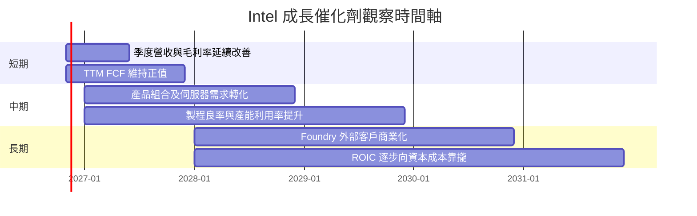

### 9.2 TAM 市場規模分析

資料包沒有各產品市場 TAM、Intel 市占或分部收入資料，故不虛構市場規模金額。可檢驗的核心是 Intel 是否把市場需求轉成自身收入與現金流。

```
╔══════════════════════════════════════════════════════════════╗
║              市場機會與可驗證指標                            ║
╠══════════════════════════════════════════════════════════════╣
║ PC／Client CPU TAM：N/A；公司收入占比：N/A                    ║
║ Data Center／AI TAM：N/A；公司收入占比：N/A                   ║
║ Foundry 外部代工 TAM：N/A；外部客戶營收：N/A                  ║
║                                                                  ║
║ 可驗證代理指標：                                               ║
║ • TTM 營收 $59.89B，TTM YoY +12.1%                             ║
║ • 最新季收入 $16.51B，單季 YoY +20.9%                          ║
║ • TTM Capex $13.70B，占營收約 22.9%                            ║
║ • TTM FCF $3.77B，FCF Yield 1.19%                              ║
╚══════════════════════════════════════════════════════════════╝
```

### 9.3 成長驅動力結構圖

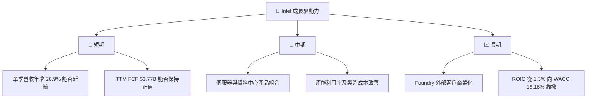

---

## 10. 風險矩陣

### 10.1 風險評分矩陣

象限座標為分析師定性評估，不是統計預測機率。

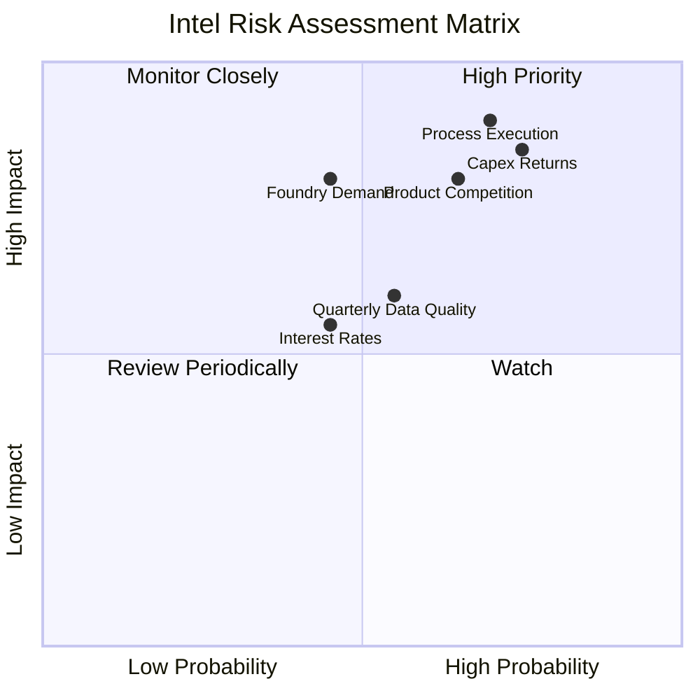

### 10.2 風險清單詳細分析

| # | 風險項目 | 發生機率 | 財務衝擊 | 風險評分 | 緩解措施 |
|---|----------|----------|----------|----------|----------|
| 1 | 🔴 製程與產品執行不及預期 | 中高；分析估計 60% | 營業利益率可能低於模型期末 18%；影響終值及 ROIC | 🔴 9.0/10 | 季季追蹤良率、產品交付、成本與分部利潤；未達門檻不提高估值假設 |
| 2 | 🔴 高 Capex 未轉化為現金流 | 高；分析估計 65% | TTM Capex $13.70B；年度歷史 FCF 曾低至 -$15.66B | 🔴 8.5/10 | 以 FCF、產能利用率及單位資本支出回報為主要加碼條件 |
| 3 | 🟠 競爭及產品組合壓力 | 中高；分析估計 55% | Intel TTM 毛利率 40.2%，低於 AMD 56.0%、NVIDIA 74.7%、QCOM 53.1% | 🟠 7.5/10 | 追蹤毛利率、客戶端與資料中心收入、價格與產品效能 |
| 4 | 🟠 Foundry 外部需求未達預期 | 中；分析估計 45% | 代工收入與客戶占比 N/A；若商業化落後，資產利用率和 FCFF 受壓 | 🟠 7.0/10 | 以外部客戶收入、產能訂單與毛利貢獻確認，而非只看投資金額 |
| 5 | 🟡 高利率與 Beta 波動 | 中；市場資料 Beta 2.43 | WACC 參考值 15.16%；折現率升高會壓低長期價值 | 🟡 6.5/10 | 估值採情境分析，避免以單一終值推導結論 |
| 6 | 🟡 財務數據口徑差異 | 中；本資料包已出現差異 | TTM 營業利益率 2.9% 與 10.1% 不一致，可能扭曲盈利趨勢 | 🟡 6.0/10 | 以 SEC 季報與一致口徑重算；遇到矛盾時下調信心度 |

---

## 11. 投資建議

### 11.1 最終綜合評級雷達圖

```
╔══════════════════════════════════════════════════════════════╗
║                 INTC 最終綜合評分（1-10）                    ║
╠══════════════════════════════════════════════════════════════╣
║ 基本面強度    5.0  ▓▓▓▓▓▓▓▓▓▓░░░░░░░░░░  ★★★☆☆             ║
║ 成長動能      6.0  ▓▓▓▓▓▓▓▓▓▓▓▓░░░░░░░░  ★★★☆☆             ║
║ 獲利能力      3.0  ▓▓▓▓▓▓░░░░░░░░░░░░░░  ★★☆☆☆             ║
║ 財務健康      6.0  ▓▓▓▓▓▓▓▓▓▓▓▓░░░░░░░░  ★★★☆☆             ║
║ 估值合理性    3.0  ▓▓▓▓▓▓░░░░░░░░░░░░░░  ★★☆☆☆             ║
║ 管理層執行    4.5  ▓▓▓▓▓▓▓▓▓░░░░░░░░░░░  ★★☆☆☆             ║
║ 護城河深度    5.0  ▓▓▓▓▓▓▓▓▓▓░░░░░░░░░░  ★★★☆☆             ║
╠══════════════════════════════════════════════════════════════╣
║ 綜合評分      4.7  ▓▓▓▓▓▓▓▓▓░░░░░░░░░░░  🔴 估值與執行風險高║
╚══════════════════════════════════════════════════════════════╝
```

### 11.2 目標價與隱含報酬率

| 情境 | 估值方法與假設 | 目標價 | 相對 $59.66 收盤價 | 情境權重 |
|------|----------------|-------:|-------------------:|---------:|
| 🔴 悲觀 | FY+1 營收 $64.68B × EV/Sales 4.0x，橋接淨現金 | $49.36 | -17.3% | 30% |
| 🟡 基準 | FY+1 營收 $64.68B × EV/Sales 5.6x，橋接淨現金 | $68.81 | +15.3% | 50% |
| 🟢 樂觀 | FY+1 營收 $64.68B × EV/Sales 7.0x，橋接淨現金 | $85.08 | +42.6% | 20% |
| **加權目標價** | $49.36×30% + $68.81×50% + $85.08×20% | **$66.97** | **+12.3%** | **100%** |

**注意**：本節的 EV/Sales 情境加權目標價 **$66.97** 是 12 個月情境值，不等於第 8.8 節多方法加權合理價值 **$34.71**。評級與 MOS 必須依第 8.8 節多方法加權合理價值決定，因此仍為 **賣出**。

### 11.3 買入時機與觸發因素

```
╔══════════════════════════════════════════════════════════════════╗
║                  ✅ 買入觸發因素 Checklist                      ║
╠══════════════════════════════════════════════════════════════════╣
║  立即買入觸發條件（目前多數未符合）：                            ║
║  ☐ 股價回到約 $31.23 以下，對 $34.71 合理價值至少有 10% MOS     ║
║  ☐ ROIC 連續改善，並有具體路徑向 WACC 15.16% 靠攏               ║
║  ☐ TTM FCF 維持正值，且非僅由延後 Capex 造成                    ║
║                                                                  ║
║  加碼觸發條件（出現以下任一並經財報確認）：                      ║
║  ☐ 連續兩季營業利益率維持雙位數，且資料口徑一致                 ║
║  ☐ TTM FCF 高於 $3.77B 並持續增加                               ║
║  ☐ Capex／營收下降，同時營收與產能利用率維持改善                 ║
║                                                                  ║
║  減碼／停損觸發條件：                                            ║
║  ☐ TTM FCF 再度轉負，且持續兩季                                ║
║  ☐ 收入連續兩季單季 YoY 為負                                    ║
║  ☐ 最新季度營業利益率跌回 5% 以下                               ║
║  ☐ 淨現金轉為淨負債且債務持續上升                               ║
╚══════════════════════════════════════════════════════════════════╝
```

### 11.4 投資人適配度分析

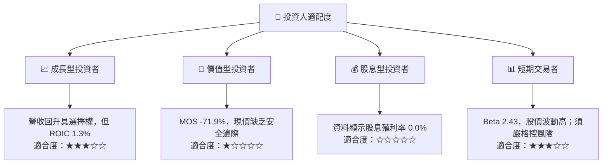

### 11.5 每季財報監控清單（Quarterly Watch List）

| 監控指標 | 最新基準 | 加碼觸發門檻 | 減碼／重估門檻 |
|----------|---------:|--------------|----------------|
| 單季營收 YoY | 最新季 **+20.9%** | 連續兩季維持 >10% | 連續兩季 <0% |
| TTM 營收成長 | **+12.1%** | 維持正成長且逐季擴大 | 回到負成長 |
| 營業利益率 | TTM **2.9%**；最新季 **15.3%** | 至少兩季維持雙位數，且口徑一致 | 單季低於 5% |
| 毛利率 | TTM **40.2%** | 連續兩季上升 | 連續兩季下降且低於 38% |
| Capex | TTM **$13.70B** | Capex／營收下降、FCF 同時改善 | Capex 增加但營收及 FCF 未增 |
| FCF | TTM **$3.77B** | TTM FCF > $3.77B 且連續改善 | TTM FCF 轉負 |
| SBC | 近四季約 **$2.43B** | SBC／營收下降 | SBC／營收高於 5% 且稀釋加速 |
| 現金與債務 | 現金及短期投資 $54.01B；債務 $50.13B | 維持淨現金 | 轉為淨負債並持續擴大 |
| ROIC | **1.3%** | 連續改善，接近或高於 WACC | 持續低於 1% 或進一步下降 |
| EPS／盈餘品質 | 最新季 EPS 資料來源有差異 | 核對 SEC 報表、排除一次性項目後仍改善 | 單季盈利主要由一次性稅務或非營業項目驅動 |

### 11.6 反面論證：什麼會證明論點錯誤（What Would Change My Mind）

```
╔══════════════════════════════════════════════════════════════════╗
║              ⚠️ 論點失效條件（Disconfirming Evidence）           ║
╠══════════════════════════════════════════════════════════════════╣
║ 本報告的轉型與復甦觀點，遇到以下條件應重新檢視或退出：          ║
║                                                                  ║
║ ☐ TTM 營收成長連續兩季低於 0%                                   ║
║ ☐ 最新季營業利益率由 15.3% 回落至 5% 以下，並連續兩季未改善     ║
║ ☐ TTM FCF 由 +$3.77B 轉負，且非一次性資本支出造成              ║
║ ☐ Capex／營收持續高於 23%，但收入、利用率及 FCF 沒有改善        ║
║ ☐ ROIC 維持 1.3% 或更低，且長期低於 WACC 15.16%                 ║
║ ☐ SBC／營收升至 5% 以上，同時股數持續增加                       ║
║ ☐ Foundry 外部客戶收入與產能利用率無可驗證進展                  ║
║ ☐ 財務申報確認最新季度盈利主要來自一次性收益或稅務利益          ║
╚══════════════════════════════════════════════════════════════════╝
```

### 最終評級與行動結論

現價採 **2026-11-13 收盤 $59.66**。以第 8.8 節多方法加權合理價值 **$34.71** 計算，安全邊際 MOS 為 **-71.9%**；依評級門檻，MOS < -25% 對應 **🔴 賣出**。公司最新一季營收年增 20.9%、TTM FCF $3.77B 是改善證據，但 ROIC 1.3% 遠低於 WACC 15.16%，且 FY2022–FY2025 年度 FCF 均為負，因此目前仍需營運數據而非敘事來證明估值。

買入參考價以 MOS 至少 10% 計算：$34.705 × 90% = **$31.23**。若股價仍高於此區間，除非 ROIC、FCF 與營業利潤率連續改善，否則不建議把單季復甦直接視為長期獲利轉折。

> **免責聲明**：本報告為 AI 自動生成，僅供研究參考，不構成投資建議。投資有風險，入市需謹慎。