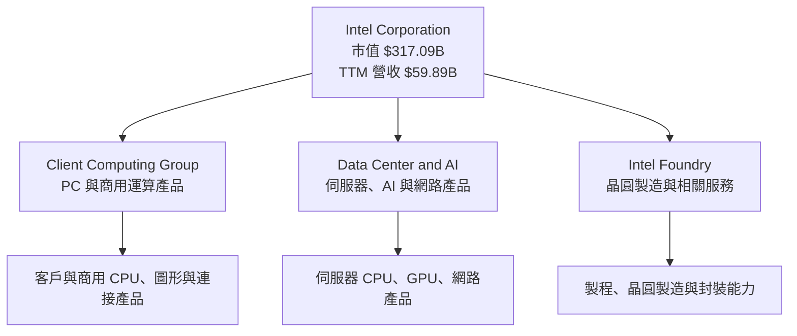
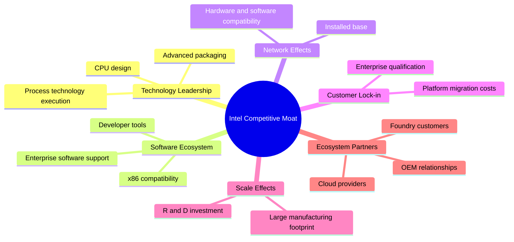
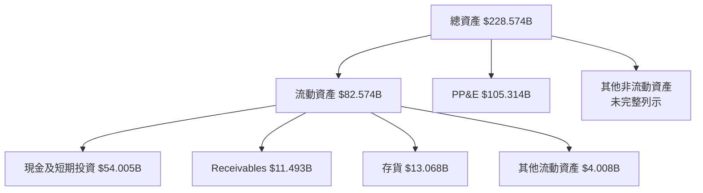
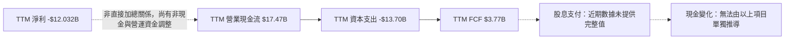
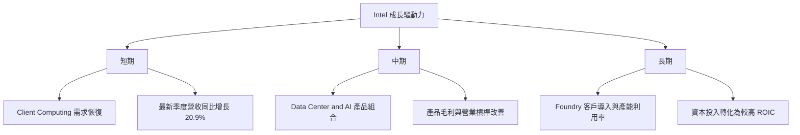
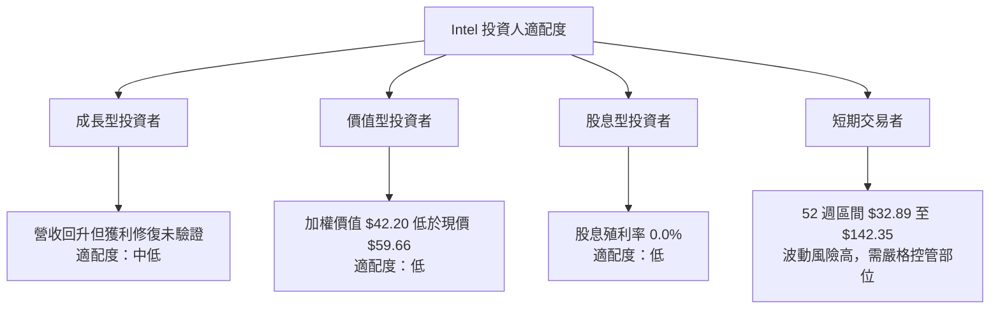

# INTC 基本面深度分析報告
> **報告日期**：2026-11-15 ｜ **語言**：繁體中文 ｜ **數據來源**：SEC 申報資料 (XBRL)、Yahoo Finance、Finviz、StockAnalysis、Roic.ai ｜ **分析師**：CFA 級機構研究

## 目錄

| # | 章節 | 核心結論 |
|---|------|----------|
| 1 | 執行摘要 | 賣出；加權合理價值 $42.20；MOS -41.4% |
| 2 | 公司概覽與商業模式 | 具製造、產品與軟體生態基礎，但競爭與執行風險削弱護城河 |
| 3 | 損益表深度分析 | TTM 營收 $59.89B、成長 12.1%；獲利與季度趨勢分化 |
| 4 | 資產負債表分析 | 淨現金 $3.87B；流動性尚可，營運週期惡化 |
| 5 | 現金流量深度分析 | TTM FCF $3.77B、FCF Yield 1.19%；歷年資本支出仍高 |
| 6 | 獲利能力與資本效率 | ROIC 1.3% 明顯低於 WACC 13.11%，目前摧毀股東價值 |
| 7 | 相對估值分析 | 相對同業 Forward P/E 偏高；P/S 位於自身五年區間第 90 百分位 |
| 8 | DCF 內在價值評估 | DCF 為 N/A；依指定估值方法加權價值 $42.20 |
| 9 | 成長催化劑 | 產品復甦、AI／資料中心需求與晶圓代工執行是主要觀察方向 |
| 10 | 風險矩陣 | 獲利修復、資本密集度與高估值回落為主要風險 |
| 11 | 投資建議 | 依 MOS 評級賣出；關注現金流、毛利與製程／代工進度 |

---

## 1. 執行摘要

Intel 的 TTM 營收為 **$59.89B**，同比成長 **12.1%**，最新一季營收同比成長 **20.9%**；但 TTM ROIC 僅 **1.3%**，低於 **13.11% WACC**，TTM 淨利率為 **-20.1%**，而 TTM FCF 雖回正至 **$3.77B**，FCF Yield 仍只有 **1.19%**。估值方面，指定方法得出的加權合理價值為 **$42.20**，低於 2026-11-13 收盤價 **$59.66**；依此計算 MOS 為 **-41.4%**，符合規則 20 的**賣出**門檻。即使季度營收改善，現價仍預先反映相當多的修復預期，而資本報酬尚未證明可覆蓋資金成本。

### 1.0 一頁式投資儀表板（Portfolio Manager 30 秒速讀）

| 項目 | 內容 |
|------|------|
| **投資論點（3 句）** | ① TTM 營收 **$59.89B**、成長 **12.1%**，最新一季同比成長 **20.9%**，顯示營收動能回升。② TTM FCF **$3.77B**、FCF Yield **1.19%**，但歷年資本支出仍高，現金流改善尚待延續。③ ROIC **1.3%** 對比 WACC **13.11%**，估值方法加權價值 **$42.20** 低於收盤價 **$59.66**。 |
| **綜合評分** | **4.8/10**（引用 1.1 評分卡） |
| **財務健康** | 🟡 現金及短期投資 **$54.01B**、總債務 **$50.13B**、淨現金 **$3.87B**；但 CCC 一年增加 **33 天**至 **68 天**。 |
| **ROIC vs WACC** | **1.3% vs 13.11%**：目前未覆蓋資金成本，摧毀股東價值。 |
| **FCF 趨勢** | 由 FY2025 **-$4.95B**轉為 TTM **+$3.77B**；TTM FCF Yield **1.19%**。 |
| **估值** | Forward P/E **33.321045x** ｜ EV/EBITDA（自身歷史比較口徑）**23.2x** ｜ FCF Yield **1.19%** |
| **DCF 內在價值（基準）** | **N/A**；DCF 模型未能計算，故無法計算現價相對 DCF 的折溢價。 |
| **安全邊際（MOS）** | **-41.4%**＝(**加權合理價值 $42.20 − 現價 $59.66**) ÷ $42.20 ｜ 🔴 無安全邊際 |
| **預期報酬（基準情境 12M）** | DCF 基準情境 N/A；以加權合理價值衡量，隱含上行空間 **-29.3%**，不是保證的 12 個月報酬預測。 |
| **關鍵風險（前二）** | ROIC 長期低於 WACC；高資本支出與製程／代工投入使 FCF 改善可能反覆。 |
| **評級 + 信心度** | 🔴 **賣出** ｜ 信心：中（估值方法明確，但公司修復路徑仍具不確定性） |

### 1.1 綜合評分卡（全報告唯一）

| 維度 | 評分（1–10） | 主要依據（引用數字與其來源章節） |
|------|--------------|----------------------------------|
| 成長性 | 6.5 | TTM 營收成長 **12.1%**、最新一季同比成長 **20.9%**，但年度營收 2022–2025 CAGR 約 **-5.7%**（第 3 章）。 |
| 獲利能力 | 3.0 | TTM ROIC **1.3%** 對比 WACC **13.11%**；Piotroski **6/9**，TTM 淨利率 **-20.1%**（第 3、6 章）。 |
| 財務健康 | 6.5 | 淨現金 **$3.87B**、流動比率 **2.208**；但 CCC 由 **35 天**增至 **68 天**（第 4 章）。 |
| 估值 | 2.0 | 加權合理價值 **$42.20**，MOS **-41.4%**；P/S 為自身五年中位數的約 **2.0 倍**且處第 **90 百分位**（第 7、8 章）。 |
| 護城河 | 6.0 | CPU 產品、x86 軟體相容性及自有製造能力形成門檻；但 AMD、NVIDIA 等競爭者成長與毛利數據較強（第 2、7 章）。 |
| 管理層與資本配置 | 4.5 | FY2025 SBC **$2.43B**，稀釋股數測試未通過；過往年度 FCF 連續為負，資本支出回報仍待驗證（第 3、5、6 章）。 |
| **綜合評分** | **4.8** | 六項算術平均：(6.5 + 3.0 + 6.5 + 2.0 + 6.0 + 4.5) ÷ 6 = **4.75 ≈ 4.8**。 |

### 1.2 五大投資論點 + 三大核心風險

| 類型 | 項目 | 具體依據 | 信心度 |
|------|------|----------|--------|
| 🟢 **投資論點①** | 營收動能回升 | TTM 營收 **$59.89B**、同比成長 **12.1%**；最新一季同比成長 **20.9%**。若由主要產品需求與產品組合帶動，而非單季因素，將有助改善固定成本吸收。 | 🟡 中 |
| 🟢 **投資論點②** | 最新季度營業獲利改善 | 最新一季營業利益率（指定口徑）為 **15.3%**，高於 TTM **2.9%**，顯示近期營運槓桿改善；但不能直接視為全年可持續水準。 | 🟡 中 |
| 🟢 **投資論點③** | 現金儲備提供轉型緩衝 | 現金及短期投資 **$54.01B**，總債務 **$50.13B**，淨現金 **$3.87B**，可支應部分高資本投入。 | 🟡 中 |
| 🟢 **投資論點④** | FCF 由負轉正 | FY2025 FCF **-$4.95B**，TTM FCF **+$3.77B**；若營業現金流改善持續且資本支出受控，財務彈性可上升。 | 🟡 中 |
| 🟢 **投資論點⑤** | 具備整合式產品與製造資產 | Intel 同時設計處理器並經營晶圓製造；製造能力與 PC／伺服器產品可形成策略選擇權，但目前尚未由 ROIC 證明其經濟回報。 | 🟡 中 |
| 🟡 **風險①** | 資本報酬不足 | ROIC **1.3%**、WACC **13.11%**，負利差 **11.81 個百分點**；若長期不改善，擴大投資會增加價值損失。 | 🔴 高衝擊 |
| 🔴 **風險②** | 現價包含較高修復預期 | 加權合理價值 **$42.20**，現價 **$59.66**；MOS **-41.4%**。若盈餘恢復慢於市場預期，估值可能向同業估值法回推。 | 🔴 高衝擊 |
| 🟡 **風險③** | 營運資金占用上升 | CCC 一年由 **35 天**升至 **68 天**，主要由 DIO 增加 **11 天**及 DPO 減少 **19 天**帶動，可能削弱現金流轉換。 | 🟡 中高 |

### 1.3 快速統計卡片

| 指標 | 公司實際值（期間） | 同業中位數 | 狀態 |
|------|--------------------|------------|------|
| 營收成長（TTM） | **12.1%** | — | 🟢 |
| 營收成長（最新一季年增） | **20.9%** | **44.7%** | 🟡 |
| 毛利率（TTM） | **40.2%** | **56.0%** | 🔴 |
| 營業利益率（TTM） | **2.9%** | — | 🔴 |
| ROIC（TTM） | **1.3%** | — | 🔴 |
| Forward P/E | **33.321045x** | **14.1x** | 🔴 |
| FCF Yield（TTM） | **1.19%** | — | 🟡 |
| Piotroski F-Score | **6 / 9** | — | 🟡 |

### 1.4 投資結論

```text
╔══════════════════════════════════════════════════════════════════╗
║                    📊 投資結論摘要                               ║
╠══════════════════════════════════════════════════════════════════╣
║  評級：🔴 賣出（依 MOS -41.4%，低於 -25% 門檻）                  ║
║  價格（2026-11-13 收盤）：$59.66                                 ║
║  DCF 內在價值（基準）：N/A（模型無法計算）                       ║
║  安全邊際 MOS：-41.4%（=(加權合理價值−現價)÷加權合理價值）      ║
║  加權合理價值（8.8）：$42.20                                     ║
║  綜合評分：4.8/10（引用 1.1）                                    ║
║  適合投資人：能承受高波動、願意追蹤轉型執行的投資人；不適合     ║
║              以現金流穩定或股息為首要目標的投資人                ║
╚══════════════════════════════════════════════════════════════════╝
```

---

## 2. 公司概覽與商業模式

### 2.1 業務結構與收入來源

Intel 設計、開發、製造及銷售運算相關產品，主要包括 Client Computing Group（CCG）、Data Center and AI（DCAI）及 Intel Foundry。各部門營收及收入占比未提供，因此不推估分部金額或百分比。



軟體與服務收入的金額及占比未提供。公司採取設計與製造並行的模式，理論上可增加供應鏈掌控與製程整合能力，但也帶來較高資本支出與產能利用率風險。

### 2.2 市場份額

市場份額數據未提供，故不提供份額比例。以營收規模看，Intel TTM 營收為 **$59.89B**，最新一季同比成長 **20.9%**；但同業最新一季同比成長數據分化明顯：AMD **44.7%**、NVIDIA **105.9%**、Qualcomm **-8.4%**。成長速度並非衡量市場份額的直接替代值，應搭配分部收入與出貨資料持續追蹤。

### 2.3 競爭護城河分析



### 2.4 護城河強度

| 護城河項目 | 強度（強／中／弱） | 證據（引用數字或事實） | 會削弱它的情況 |
|------------|--------------------|------------------------|----------------|
| 技術與製造 | 中 | 公司同時設計產品並持有製造資產；TTM 資本支出 **$13.70B**，反映產能與技術投入規模。 | 製程進度延遲、良率不足、成本高於外部代工。 |
| 軟體生態系統 | 中 | x86 相容性與企業軟體支援有助維持既有平台；缺乏可比的軟體收入與留存數據量化其經濟價值。 | 客戶工作負載轉向其他架構、軟體移植成本降低。 |
| 網路效應 | 弱至中 | 安裝基礎與相容性可提高切換摩擦；但硬體採購仍受性能、能耗及總持有成本影響。 | 競品性能／能效優勢擴大，平台遷移成本下降。 |
| 客戶鎖定 | 中 | 企業平台更新及驗證週期形成一定切換成本；財務數據未提供客戶留存率。 | 客戶採多來源策略，或更換平台的成本低於性能收益。 |
| 規模效應 | 中 | TTM 營收 **$59.89B**、員工 **81,100**，具研發與製造規模。 | 產能利用率偏低、資本投入回報不足，規模反成固定成本負擔。 |
| 生態夥伴 | 中 | 長期 OEM、雲端與供應鏈合作關係有助產品部署。 | 主要客戶自行設計晶片或擴大採購競爭平台。 |

**1.1 護城河評分為 6.0/10**：平台相容性、製造資產和規模提供結構性優勢，但缺乏可量化的分部市占與客戶鎖定數據，且 ROIC 遠低於資金成本，顯示護城河尚未轉化為足夠經濟租金。

---

## 3. 損益表深度分析

### 3.1 年度收入成長趨勢（近 4 年）

年度營收採年度損益表數據；同比成長參考 StockAnalysis 歷史序列。視覺條長僅作相對呈現，收入數字為原始財務數據。

```text
╔══════════════════════════════════════════════════════════════════╗
║              Intel 年度收入趨勢（FY2022–FY2025）                ║
╠══════════════════════════════════════════════════════════════════╣
║  FY2022  $63.05B  █████████████████████████  基期               ║
║  FY2023  $54.23B  ██████████████████████     YoY: -14.0% 🔴     ║
║  FY2024  $53.10B  █████████████████████      YoY:  -2.1% 🔴     ║
║  FY2025  $52.85B  █████████████████████      YoY:  -0.5% 🟡     ║
╠══════════════════════════════════════════════════════════════════╣
║  FY2022–FY2025 三年 CAGR：約 -5.7%                               ║
╚══════════════════════════════════════════════════════════════════╝
```

CAGR 算式：\((52.85 ÷ 63.05)^{1/3} - 1 ≈ -5.7\%\)。營收由 FY2022 的 **$63.05B**降至 FY2025 的 **$52.85B**，反映前期需求下行及競爭壓力；近年轉為負成長幅度收窄，TTM 回升則顯示復甦跡象，但尚未抹去多年營收收縮。

### 3.2 季度收入趨勢分析

| 季度 | 營收 | QoQ 成長 | YoY 成長 | 備註 |
|------|------:|---------:|---------:|------|
| 2025 Q4 | $13.674B | +0.15% | -4.11% | QoQ 相對持平；同比仍負成長。 |
| 2026 Q1 | $13.577B | -0.71% | +7.18% | 營收略低於前季，但同比轉正。 |
| 2026 Q2 | $16.128B | +18.79% | +25.42% | 季度跳升；應持續確認是否由需求、產品組合或時點因素帶動。 |
| 2026 Q3 | $16.513B | +2.39% | +20.9% | 同比增長延續，QoQ 增速較 Q2 放緩。 |

QoQ 依相鄰季度營收計算；YoY 採同季比較數據。Q3 2026 YoY **20.9%**是單季年增率，不是 TTM 成長率。TTM 營收成長率為 **12.1%**。

### 3.3 利潤率演變分析

年度數據來源在合併財務資料中存在差異：年度損益表所列營業利益與 StockAnalysis 歷史 TTM 序列不完全一致。下表依同一年度損益表的營收、毛利及營業利益計算；TTM 與最新季度則以指定財務指標為準。

| 利潤率指標 | FY2022 | FY2023 | FY2024 | FY2025 | 趨勢 | 評估 |
|------------|-------:|-------:|-------:|-------:|------|------|
| **毛利率** | 42.6% | 40.0% | 32.7% | 34.8% | 2024 下滑後回升 | 🔴 |
| **營業利益率** | 3.7% | 0.1% | -8.9% | -0.04% | 2024 大幅轉負，2025 接近損益兩平 | 🔴 |
| **TTM 營業利益率** | — | — | — | **2.9%** | 指定 TTM 口徑 | 🔴 |
| **最新季度營業利益率** | — | — | — | **15.3%** | 單季高於 TTM，不能外推為全年 | 🟡 |

毛利率 FY2024 下滑與製造成本、產品組合及產能吸收壓力相符；FY2025 回升顯示邊際改善，但仍低於 FY2022。最新季度營業利益率高於 TTM，代表近期營業槓桿有改善跡象；然而單季改善可能受季度產品組合、費用時點或一次性因素影響，須由後續季度驗證。不同資料來源的營業利益率口徑並不完全一致，本報告在 TTM、單季指標上優先採用 SEC 申報計算的指定數值。

### 3.4 費用結構分析

年度 R&D 費用有提供，其他費用分類及同期間完整費用明細不足，故不以不完整數據繪製費用圓餅圖。FY2025 R&D 為 **$13.77B**，FY2024 為 **$16.55B**，同比下降約 **16.8%**；若研發費用下降源自效率提升，有利於利潤率，但若削減影響產品競爭力，則可能損及中長期營收。

### 3.5 季度 EPS 趨勢與盈餘品質（Quality of Earnings）

季度 EPS 預估值在分析師驚喜資料中為 N/A，因此不能判定各季盈餘是否超預期或不及預期；可核實的實際 EPS、淨利及營收趨勢如下。

| 季度 | 實際 EPS | 淨利 | 營收 | EPS 超預期／不及預期 |
|------|---------:|------:|------:|----------------------|
| 2025 Q4 | -$0.12 | -$0.591B | $13.674B | N/A：預估值未提供 |
| 2026 Q1 | -$0.73 | -$3.728B | $13.577B | N/A：預估值未提供 |
| 2026 Q2 | -$2.16 | -$11.033B | $16.128B | N/A：預估值未提供 |
| 2026 Q3 | $0.60 | $3.320B | $16.513B | N/A：預估值未提供 |

| 盈餘品質項目 | 數值／佔比 | 評估 |
|--------------|-----------|------|
| 股權薪酬 SBC / 營收 | TTM SBC **$2.432B** ÷ TTM 營收 **$59.892B** = **4.1%** | 🔴 SBC 規模顯著；代表經濟成本，並會透過稀釋降低每股股東回報。 |
| SBC / 營業現金流 | **$2.432B ÷ $17.47B = 13.9%** | 🟡 SBC 占營業現金流一成以上，觀察時不宜只看未扣除 SBC 的現金流表現。 |
| FCF / 淨利（現金轉換率） | **$3.77B ÷ -$12.032B = -31.3%** | 🔴 因 TTM 淨利為負，此比率不宜作正向轉換率解讀；現金流轉正尚未代表 GAAP 盈餘穩定。 |
| 一次性／非經常性損益 | N/A：未提供可一致量化的 TTM 調整項目明細 | 無法判斷特定一次性項目對本期淨利的量化影響。 |
| 有效稅率異常 | N/A：缺少可一致核對的 TTM 稅前損益與所得稅費用 | 不推算有效稅率，避免將異常稅務項目錯當常態。 |
| 資本化支出 vs 費用化 | TTM 資本支出 **$13.70B**；資本化項目與費用化的完整對照 N/A | 高資本投入會以折舊、產能利用率及未來現金回收影響經濟盈餘。 |

**盈餘品質結論**：TTM 淨利為負，FCF 為正，表面上現金流優於會計盈餘，但其中有高額資本支出，且 SBC 對營收占比約 **4.1%**。本期季度淨利轉正不足以確認正常化盈餘；估值宜以可持續現金流及資本回報改善為前提，不應直接將單季盈利年化。

---

## 4. 資產負債表分析

### 4.1 資產結構分解

最新 TTM 資產總額為 **$228.574B**（StockAnalysis）；流動資產 **$82.574B**、PP&E **$105.314B**。流動資產細項包含現金與短期投資、應收款、存貨及其他流動資產。此處只展示有來源數字的項目，非流動資產未提供完整可加總明細，故不繪製資產占比圓餅圖。



### 4.2 流動性與營運資金分析

| 指標 | 最新 TTM | 一年前 TTM | 變化 | 解讀 |
|------|----------:|-----------:|------:|------|
| DSO 應收帳款天數 | 25 天 | 22 天 | +3 天 | 回款天數增加，可能反映收款節奏變慢或客戶／產品組合變化；需觀察應收帳款與營收是否同步。 |
| DIO 存貨天數 | 133 天 | 122 天 | +11 天 | 庫存占用增加，可能源於備貨、產品轉換或需求與供應錯配，增加減值與現金占用風險。 |
| DPO 應付帳款天數 | 90 天 | 109 天 | -19 天 | 延後付款天數減少，供應商融資貢獻降低；可能增加短期營運資金需求。 |
| CCC 現金轉換週期 | 68 天 | 35 天 | +33 天 | 資金由採購到收現的週期拉長，方向不利現金流轉換。 |

流動性指標包括流動比率 **2.208**、速動比率 **1.751**；短期償付能力尚可。但營運資金天數顯示現金轉換效率惡化，若庫存上升並非有效需求支持，可能使後續營業現金流承壓。

### 4.3 債務結構分析

```text
╔══════════════════════════════════════════════════════════════════╗
║                   Intel 債務健康診斷                             ║
╠══════════════════════════════════════════════════════════════════╣
║  總債務：        $50.13B     有息債務負擔需配合現金流檢視        ║
║  現金+短期投資： $54.01B     高於總債務                          ║
║  淨現金：         $3.87B     🟡 有緩衝，但相對資產規模有限        ║
║  流動比率：       2.208      🟢 流動資產覆蓋短期負債              ║
║  速動比率：       1.751      🟢 不含存貨仍有流動性緩衝            ║
║  Debt/EBITDA：    N/A        不以不一致口徑自行反推                ║
║  Interest Coverage：N/A      利息費用與同口徑 EBIT 未提供          ║
╚══════════════════════════════════════════════════════════════════╝
```

公司有 **$3.87B** 淨現金，且現金及短期投資由 FY2025 年底 **$37.416B**升至最新 **$54.005B**。但現金增加不能單獨視為營運改善：仍須核對資產變動來源、融資或資產交易，以及高資本支出下的後續現金消耗。債務／EBITDA與利息保障倍數因缺少一致計算輸入，不填估計值。

### 4.4 股東權益趨勢

```text
╔══════════════════════════════════════════════════════════════════╗
║                   Intel 股東權益趨勢                             ║
╠══════════════════════════════════════════════════════════════════╣
║  FY2022  $101.42B  ████████████████████                          ║
║  FY2023  $105.59B  █████████████████████                         ║
║  FY2024   $99.27B  ███████████████████                           ║
║  FY2025  $114.28B  ███████████████████████                       ║
╚══════════════════════════════════════════════════════════════════╝
```

FY2025 股東權益回升至 **$114.28B**，但權益增加並不自動代表股東價值創造；TTM ROE 為 **-10.5%**，需搭配投資回報與盈利改善判斷。

---

## 5. 現金流量深度分析

### 5.1 現金流量瀑布圖

季度與年度資料沒有提供可一致接續的「淨利至現金變化」完整橋接項目，因此不臆測中間調整額；圖中僅標示可核實的 TTM 現金流項目。



### 5.2 FCF 轉換率趨勢

| 期間 | FCF | 淨利 | FCF / 淨利 | 解讀 |
|------|----:|----:|-----------:|------|
| FY2022 | -$9.41B | $8.01B | -117.5% | 高資本支出使 FCF 為負，會計盈餘未轉化成正自由現金流。 |
| FY2023 | -$14.28B | $1.69B | -844.9% | 低淨利與高投資並存，比例受小分母放大。 |
| FY2024 | -$15.66B | -$18.76B | 83.5% | 分子、分母皆負，比例不代表健康轉換。 |
| FY2025 | -$4.95B | -$0.267B | 1,853.9% | 淨利接近零令比率失真；絕對 FCF 仍為負。 |
| TTM 至 2026-09-26 | $3.77B | -$12.032B | -31.3% | 淨利為負，轉換率不適合用作常態盈餘品質指標。 |

**計算口徑提示**：FY2022–FY2025 以年度資料中 FCF 與淨利計算；TTM 採指定 TTM FCF 與 StockAnalysis TTM 淨利。當淨利接近零或為負時，比率容易失真，應以 FCF 絕對額及資本支出需求為主。

### 5.3 自由現金流趨勢

```text
╔══════════════════════════════════════════════════════════════════╗
║                自由現金流（FCF）年度趨勢                         ║
╠══════════════════════════════════════════════════════════════════╣
║  FY2022  -$9.41B  ◀█████████                                     ║
║  FY2023 -$14.28B  ◀██████████████                                ║
║  FY2024 -$15.66B  ◀████████████████                              ║
║  FY2025  -$4.95B  ◀█████                                         ║
║  TTM     +$3.77B  ████▶         FCF Yield：1.19%                  ║
╠══════════════════════════════════════════════════════════════════╣
║  FCF = 營業現金流 − 資本支出；TTM = $17.47B − $13.70B = $3.77B   ║
╚══════════════════════════════════════════════════════════════════╝
```

FCF 由 FY2024 **-$15.66B**改善至 FY2025 **-$4.95B**，最新 TTM 轉正至 **$3.77B**。這是重要改善，但年度 FCF 曾連續為負，且目前 FCF Yield **1.19%**，代表現價相對可分配現金流仍不便宜。後續需要檢查 FCF 是否來自持續性的營業現金流提升，而非資本支出延後或營運資金短期釋放。

### 5.4 資本配置評估

回購、資本投資、股息及留存現金的完整同期間分配數據未提供，不繪製資本配置圓餅圖。

| 項目 | 可核實數據 | 評估 |
|------|------------|------|
| 資本支出 | TTM **$13.70B**；FY2025 **$14.65B** | 投入規模高，回報需以利用率、毛利與 ROIC 驗證。 |
| 股息 | 最新殖利率 **0.0%**；FY2025 股息支付 **$0.00** | 現階段未向股東支付現金股息。 |
| SBC | FY2025 **$2.43B**；TTM 約 **$2.432B** | 對既有股東形成稀釋，應納入經濟成本。 |
| 回購 | 最新可比回購數據未提供 | N/A；不推測回購規模。 |
| 留存／淨現金變化 | 最新淨現金 **$3.87B** | 需結合融資、資產交易和營運現金流解讀。 |

---

## 6. 獲利能力與資本效率

### 6.1 ROE / ROA / ROIC 趨勢

| 指標 | 最新值 | 歷史或補充數據 | 評估 |
|------|--------:|-----------------|------|
| ROE（TTM） | -10.5% | 另一合併資料來源列示 -9.6%；此處採品質指標計算值 | 🔴 負報酬，與 TTM 淨利率 -20.1%一致。 |
| ROA（TTM） | 1.8%（合併市場數據） | Piotroski 測試顯示 ROA 未高於零，與另一來源口徑不一致 | 🟡／🔴 來源口徑不一致，不以單一 ROA 值下強結論。 |
| ROIC（TTM） | 1.3% | after-tax operating income ÷（equity + debt − cash） | 🔴 顯著低於 WACC。 |

ROE、ROA 在合併資料來源存在差異；ROIC 使用指定品質指標值。報酬指標的共同訊號是盈利尚不穩定，不能只憑最近一季淨利轉正判定資本效率已正常化。

### 6.2 ROIC vs WACC 分析（核心價值創造判斷）

```text
╔══════════════════════════════════════════════════════════════════╗
║                ROIC vs WACC 深度分析                            ║
╠══════════════════════════════════════════════════════════════════╣
║  資本成本輸入（採用 Cost of capital 指定值）：                   ║
║  ├── 無風險利率（10Y 美債）：          5.15%                    ║
║  ├── 市場風險溢酬 ERP：                 5.00%                    ║
║  ├── 原始 Beta：                        2.43                     ║
║  ├── 調整後 Beta：                      1.95                     ║
║  ├── 股權成本 Ke：                     14.91%                   ║
║  ├── 稅前債務成本：                     2.18%                    ║
║  ├── 稅率假設：                         21.0%                    ║
║  ├── 股權／債務權重：                   86.3% / 13.7%             ║
║  └── 採用 WACC：                        13.11%                   ║
║                                                                  ║
║  ROIC：                                     1.30%                 ║
║  ROIC − WACC：                             -11.81 個百分點        ║
║                                                                  ║
║  ROIC  1.30%  ▓▓░░░░░░░░░░░░░░░░░░░░░░░░░░                     ║
║  WACC 13.11%  ▓▓▓▓▓▓▓▓▓▓▓▓▓▓▓▓▓▓▓▓▓▓▓▓                         ║
║                                                                  ║
║  結論：目前 ROIC 未覆蓋資金成本，摧毀而非創造股東價值。         ║
╚══════════════════════════════════════════════════════════════════╝
```

股權成本公式依指定輸入：**Rf 5.15% + 調整後 Beta 1.95 × ERP 5.00% = 14.90%**，資料區塊列示 **14.91%**，差異來自未四捨五入輸入。Beta 調整公式為 **⅔ × 2.43 + ⅓ = 1.953 ≈ 1.95**。稅後債務成本按指定值計算：**2.18% × (1 − 21.0%) = 1.7222%**。由於權重及個別輸入在來源中已四捨五入，採用給定 WACC **13.11%**，不以重算後的微小差異替換。10Y 美債日期、利息費用的完整絕對額及計息債務平均餘額未提供，故不另行聲稱已獨立驗證其來源日期與底層明細。

按指定 ROIC **1.3%**與 WACC **13.11%**計算，利差為 **1.30% − 13.11% = -11.81 個百分點**。若 ROIC 長期維持此水準，新增資本投資即使增加收入，也可能降低企業經濟價值。

### 6.3 杜邦三因素分解

| 因素 | 數值（TTM） | 解讀 |
|------|-------------|------|
| 淨利率 | -20.1% | 淨利為負是 ROE 為負的主要來源。 |
| 資產週轉率 | 0.26 | 每單位資產創造的營收偏低，符合半導體製造資產密集特徵。 |
| 權益乘數 | 1.99 | 槓桿提高資產相對權益倍數，但不是 ROE 負值的根本原因。 |
| **ROE** | **-10.5%** | 指定 DuPont 數據：**-20.1% × 0.26 × 1.99 = -10.5%**（四捨五入）。 |

### 6.4 財務體質：Piotroski F-Score

Piotroski F-Score 為 **6 / 9**。以下各項照列品質指標結果；未通過項目意味盈餘、資產效率或股本變化仍有待改善。

| 測試 | 結果 | 解讀 |
|------|------|------|
| ROA > 0 | ❌ 未通過 | 依該測試口徑，盈利資產回報未達正值。 |
| 營業現金流 > 0 | ✅ 通過 | TTM 營業現金流為 **$17.47B**。 |
| ROA 高於一年前 | ❌ 未通過 | 盈利資產回報未顯示同比改善。 |
| 營業現金流 > 淨利（應計品質） | ✅ 通過 | TTM 現金流高於淨利，部分緩和會計盈餘品質疑慮。 |
| 長期負債 ÷ 總資產低於一年前 | ✅ 通過 | 槓桿相對資產比率測試改善。 |
| 流動比率高於一年前 | ✅ 通過 | 短期流動性較一年前提升。 |
| 稀釋股數未增加 | ❌ 未通過 | 股數增加會稀釋既有股東每股權益。 |
| 毛利率高於一年前 | ✅ 通過 | 毛利率方向改善，但 TTM 毛利率仍低於同業中位數。 |
| 資產週轉率高於一年前 | ✅ 通過 | 資產使用效率指標改善。 |

總分 **6/9**代表多項資產負債表與營運指標轉好，但盈利能力、ROA與股數稀釋仍是扣分項。該分數是歷史財務訊號，不等於未來營收或自由現金流保證。

---

## 7. 相對估值分析

### 7.1 同業估值比較表格

同業倍數採 Yahoo Finance 同業比較數據；Intel 本身依給定市場估值欄位。Intel EV/EBITDA 的市場數據顯示 **17.239x**，而自身歷史比較區塊列示 **23.2x**；因來源及計算時點可能不同，本表採市場估值欄位並在自身歷史章節另列歷史比較口徑。Trailing P/E 因 TTM EPS 為負而不具經濟解讀。

| 估值指標 | **Intel** | **AMD** | **NVIDIA** | **Qualcomm** | Intel 評估 |
|----------|----------:|-------:|-----------:|-------------:|-------------|
| **Trailing P/E** | N/A（TTM EPS -$2.35） | 114.1x | 20.6x | 13.6x | 🔴 Intel 目前 TTM 虧損，P/E 不適用。 |
| **Forward P/E** | **33.321045x** | 30.2x | 10.3x | 14.1x | 🔴 高於三家同業中位數 **14.1x**。 |
| **P/S Ratio** | **5.2944117x** | 19.3x | 13.0x | 4.3x | 🟡 低於 AMD、NVIDIA，但高於 Qualcomm。 |
| **EV/EBITDA** | **17.239x** | 78.0x | 19.4x | 18.2x | 🟡 低於 AMD、接近另兩家；需留意 EV/EBITDA 受 EBITDA 口徑影響。 |
| **最新一季營收 YoY** | **20.9%** | 44.7% | 105.9% | -8.4% | 🟡 成長快於 Qualcomm，但低於 AMD、NVIDIA。 |
| **毛利率（TTM）** | **40.2%** | 56.0% | 74.7% | 53.1% | 🔴 低於三家同業，反映成本結構與產品組合仍有差距。 |

同業中位數依三家公司數據排序計算：Forward P/E **14.1x**、P/S **13.0x**、EV/EBITDA **19.4x**、單季營收成長 **44.7%**、毛利率 **56.0%**。估值差異需考慮同業商業模式、盈利階段與成長結構，不能只依單一倍數判定高低。

### 7.2 歷史估值區間分析

```text
╔══════════════════════════════════════════════════════════════════╗
║                  Intel 自身歷史估值比較                          ║
╠══════════════════════════════════════════════════════════════════╣
║  P/S：        1.5x ───── 中位數 2.6x ───────── 現值 5.3x ─ 11.5x║
║  現值百分位：90%（位於自身五年區間偏高位置）                     ║
║                                                                  ║
║  EV/EBITDA：  6.4x ───────── 中位數 23.6x ─ 現值 23.2x ─ 536.5x║
║  現值百分位：47%（接近五年中位數）                               ║
╚══════════════════════════════════════════════════════════════════╝
```

P/S **5.3x**高於自身五年中位數 **2.6x**，且處於 **90 百分位**，表示市場對營收恢復已給予較高估值。EV/EBITDA **23.2x**接近中位數 **23.6x**、位於 **47 百分位**；但該歷史區間極寬（上限 **536.5x**），且 EBITDA 在盈利波動期間易受分母變化影響，參考價值有限。

### 7.3 情境價值（Bear / Base / Bull）

**N/A（DCF 無法計算：預測期最後一年自由現金流不為正，因資本支出高於營業利益與折舊攤銷；指定模型未提供可用的 DCF 情境價值。）**

### 7.4 相對估值隱含價格區間

```text
╔══════════════════════════════════════════════════════════════════╗
║                 相對估值方法與現價位置                           ║
╠══════════════════════════════════════════════════════════════════╣
║  $25.30 ───────── $48.34 ───────── 現價 $59.66 ───── 共識 $90.65║
║  Forward P/E       EV/EBITDA        2026-11-13       分析師共識   ║
╚══════════════════════════════════════════════════════════════════╝
```

| 估值方法 | 每股價值 | 相對現價 | 計算依據 |
|----------|---------:|---------:|----------|
| 同業 Forward P/E | **$25.30** | **-57.6%** | AMD、NVIDIA、Qualcomm 的 Forward P/E 中位數 **14.1x** × Intel Forward EPS **$1.79**。 |
| 同業 EV/EBITDA | **$48.34** | **-19.0%** | NVIDIA、Qualcomm 中位數 **18.8x** × Intel TTM EBITDA，再加淨現金；每股價值照指定估值方法數據。 |
| 分析師共識目標價 | **$90.65** | **+51.9%** | 43 位分析師平均目標價；僅作參考，不等同可驗證內在價值。 |

三個方法的估值差距很大，反映分析師共識對未來修復的預期較高，而同業倍數法對當前盈利基礎較保守。指定估值權重將 Forward P/E 與 EV/EBITDA 各配置 **45%**，分析師共識配置 **10%**。

---

## 8. DCF 內在價值評估（Discounted Cash Flow）

> **模型狀態：N/A。** SEC 財務資料所支持的預測最後一年自由現金流不為正，原因是資本支出高於營業利益與折舊攤銷。依估值模型規則，不建立替代 DCF、不自行補入缺漏假設，也不提供 DCF 每股價值、敏感度矩陣或 DCF 情境目標價。可用估值方法僅為第 7.4 與 8.8 節列示的相對估值及分析師共識。

### 8.0 估值推理鏈（Thinking Logic）

**Step 1 — 價值來源與主導變數**

Intel 的價值主要取決於既有客戶與資料中心產品現金流、Intel Foundry 的製造投資回報，以及新產品需求能否改善營運槓桿。分部營收與營收占比未提供，無法量化三者目前各自的營收份額。對估值最具主導性的變數是**資本投資能否轉化為可持續正 FCF 與較高 ROIC**：目前 TTM ROIC **1.3%**低於 WACC **13.11%**，而 TTM FCF **$3.77B**與 FCF Yield **1.19%**尚不足以支持可稽核的長期現金流預測。

**Step 2 — 模型選擇**

| 決策點 | 本報告採用 | 理由（含數字） | 曾考慮但否決 | 否決理由 |
|--------|-----------|----------------|--------------|----------|
| 現金流定義 | FCFF（若模型可計算） | 公司有債務且資本結構重要，理論上以 WACC 折現 FCFF 合適。 | FCFE | 預測期 FCF 不符合模型有效條件，改用 FCFE 也不能消除營運預測缺口。 |
| 預測期 N | N/A | DCF 模型沒有有效預測期。 | 自行假設 5–10 年 | 缺少可驗證營業預測與有效終年 FCFF。 |
| 終值方法 | N/A | 無有效正值終年 FCF，不能推導可靠終值。 | Gordon Growth／退出倍數 | 以不成立現金流為基礎會形成黑箱估值。 |
| EBIT 基礎 | N/A | 不建立 DCF。 | GAAP EBIT 預測 | 缺少模型逐年預測與可核實終年 EBIT。 |

**Step 3 — 關鍵假設推導鏈**

本節不建立 DCF，因此不對營收 CAGR、期末營業利潤率、永續成長率、Capex／營收、D&A／營收、營運資金、稀釋率或終值倍數設定假設。若任意補入這些數字，將與已指定的 DCF 模型結果不一致。

**Step 4 — 最脆弱環節**

最脆弱的估值鏈是資本支出下降與製造資產回報改善的時間及幅度；目前 ROIC **1.3%**、WACC **13.11%**、TTM FCF Yield **1.19%**顯示改善尚未足以驗證高估值所需的長期現金流。

**Step 5 — 計算路徑圖**

因 DCF 模型無有效預測，不繪製可能造成「模型已計算」誤解的數值流程圖。

### 8.1 模型假設總表（Model Inputs）

**N/A（DCF 模型未計算：預測期最後一年 FCF 不為正，因資本支出高於營業利益與折舊攤銷。）**不提供預測期、營收 CAGR、期末利潤率、稅率、Capex、D&A、營運資金變動、SBC 處理、股數稀釋率、永續成長率或終值假設；以上均不以分析師自行估計替代。

### 8.2 折現率推導（WACC）

DCF 不可計算，但資本成本資料區塊提供了 ROIC 對照所需 WACC。以下只列示原始資本成本輸入，不視為自建 DCF。

```text
╔══════════════════════════════════════════════════════════════════╗
║                資本成本輸入（供 ROIC 比較）                      ║
╠══════════════════════════════════════════════════════════════════╣
║  無風險利率 Rf：                 5.15%                           ║
║  ERP：                           5.00%                           ║
║  原始 Beta：                     2.43                            ║
║  調整後 Beta：                   1.95                            ║
║  股權成本 Ke：                   14.91%                          ║
║  稅前債務成本：                  2.18%                           ║
║  稅率：                          21.0%                           ║
║  股權／債務權重：                86.3% / 13.7%                    ║
║  採用 WACC：                     13.11%                          ║
╚══════════════════════════════════════════════════════════════════╝
```

Beta 調整為 **⅔ × 2.43 + ⅓ = 1.953 ≈ 1.95**。資本成本區塊列示的股權成本為 **14.91%**、WACC 為 **13.11%**；由於原始價格、股權市值、債務權重與各輸入均有四捨五入，報告直接採用給定 WACC，不另建一個替代 WACC。10Y 美債的精確觀察日期、利息費用明細及計息債務平均餘額未提供，不能完整重建五步獨立 WACC 試算。

### 8.3 逐年自由現金流預測（基準情境）

**N/A（DCF 模型未計算）。**沒有有效預測期各年的營收、EBIT、NOPAT、D&A、Capex、ΔWC、FCFF、折現因子與現值；不自建逐年模型或加入未提供假設。

### 8.4 終值計算（Terminal Value）

**N/A（DCF 模型未計算）。**預測期最後一年 FCF 不為正，不能根據指定模型計算 Gordon Growth 或退出倍數終值；因此不報告 WACC 與永續成長率的終值比較。

### 8.5 企業價值 → 每股內在價值（Bridge）

**N/A（DCF 模型未計算）。**預測期 FCFF 現值及終值現值無有效數值，無法推導企業價值、股權價值或 DCF 每股內在價值。現金、債務及股數雖有部分資料，但不足以替代缺失的企業價值。

**DCF 折溢價：N/A。**依定義需以現價除以 DCF 基準內在價值減一；DCF 基準內在價值未計算，故不做此項比率。此處不計算 MOS；本報告 MOS 僅在 8.8 以加權合理價值為分母計算一次。

### 8.6 敏感性分析（WACC × 永續成長率）

**N/A（DCF 模型未計算）。**沒有有效的 FCFF 預測及基準內在價值，因此不製作 WACC × 永續成長率矩陣、非基準格複算或三情境 DCF。

### 8.7 反推 DCF（Reverse DCF：市場在預期什麼）

**N/A（DCF 模型未計算）。**缺少可用的正值預測期 FCF 與基準 DCF，無法以現價反推出唯一營運變數。現價 **$59.66**高於加權合理價值 **$42.20**，可確定市場定價包含高於相對估值加權結果的修復預期，但不能把這個差距誤稱為反推 DCF 的具體營收或利潤假設。

### 8.8 估值三角驗證與安全邊際

下表列出指定估值方法及權重；DCF 因無法計算而未納入，權重由指定方法分配給其餘項目。金額計算保留至美分、MOS 與上行空間取一位小數。

| 估值方法 | 隱含每股價值 | 上行空間（÷現價） | 權重 | 說明 |
|----------|--------------:|-------------------:|------:|------|
| 同業 Forward P/E | $25.30 | -57.6% | 45% | 同業中位數 Forward P/E **14.1x** × Intel Forward EPS **$1.79**。 |
| 同業 EV/EBITDA | $48.34 | -19.0% | 45% | 指定同業中位數倍數 **18.8x**，加回淨現金後推算。 |
| 分析師共識目標價 | $90.65 | +51.9% | 10% | 43 位分析師平均目標價，作為參考項。 |
| **加權合理價值** | **$42.20** | **-29.3%** | **100%** | 以三項方法及固定權重加權。 |

逐步演算：

- 加權價值原始合計  
  **$25.30 × 45% + $48.34 × 45% + $90.65 × 10%**  
  **= $11.385 + $21.753 + $9.065 = $42.203 ≈ $42.20**
- 權重合計：**45% + 45% + 10% = 100%**。
- MOS：\((\$42.20 - \$59.66) ÷ \$42.20 = -\$17.46 ÷ \$42.20 = -41.4\%\)。
- 上行空間：\((\$42.20 - \$59.66) ÷ \$59.66 = -\$17.46 ÷ \$59.66 = -29.3\%\)。

公司類型為獲利型，故依指定固定權重使用同業 Forward P/E、同業 EV/EBITDA及分析師共識；DCF 因無法計算而剔除，不改動其餘方法權重。

```text
╔══════════════════════════════════════════════════════════════════╗
║                  估值區間與安全邊際                              ║
╠══════════════════════════════════════════════════════════════════╣
║  $25.30 ─── $42.20 ─── 現價 $59.66 ─── 共識 $90.65              ║
║  同業 P/E    加權合理值       2026-11-13       分析師共識         ║
║                                                                  ║
║  安全邊際 MOS = (加權合理價值 − 現價) ÷ 加權合理價值 = -41.4%  ║
║  MOS 評估：🔴 無安全邊際                                        ║
║  上行空間 = (合理價值 − 現價) ÷ 現價 = -29.3%                  ║
║                                                                  ║
║  MOS ≥ 10% 對應價格：$42.20 × (1 − 10%) = $37.98                 ║
║  這是估值門檻，不是 DCF 目標價；現價高於該門檻。                  ║
╚══════════════════════════════════════════════════════════════════╝
```

> 🔎 **程式複算（Python，依本節各項自動重算）**
>
> 加權合理價值 = $25.30 × 45% + $48.34 × 45% + $90.65 × 10% = **$42.20**（權重合計 100%）
>
> 以價格 $59.66 計：MOS = **-41.4%**，上行空間 = **-29.3%**
>
> ✅ 與本節所寫數值一致。

### 8.9 DCF 模型的局限與失效條件

- **終值依賴度**：N/A；沒有有效 DCF，不能計算終值占 EV 比率。
- **最脆弱假設**：本報告未提供自建 DCF 假設，因此不虛構 DCF 敏感度。基本面最脆弱環節是 ROIC 能否由 **1.3%**持續提升並接近或超越 **13.11% WACC**。
- **不適用情境說明**：當預測期 FCF 不為正、資本支出高於營業利益與折舊攤銷時，標準 DCF 的終值推導缺乏穩定基礎。此時應更多參考同業 EV/EBITDA、P/S、分部估值及營運資產回報；本報告依指定方法採相對估值。
- **與第 10 章風險矩陣的連結**：製程及產能投資回報若延後，將壓低未來營業利潤率與 FCFF；需求或毛利低於預期會影響 Forward EPS，進而降低同業 P/E 估值；資本支出反彈會直接壓低 FCF。

### 8.10 複算檢核表（Audit Trail）

因 DCF 被判定為 N/A，下表不把未計算項目標示為已驗證；MOS、估值加權與評級仍按可用數字核對。

| # | 檢核項目 | 檢查方式 | 結果 |
|---|----------|----------|------|
| 1 | DCF 高／中敏感度輸入四段式推導 | DCF 未建立，無模型假設 | N/A |
| 2 | DCF 假設均有來歷 | 未設定預測假設 | N/A |
| 3 | WACC 五步獨立重建 | 採用資本成本資料列示 WACC **13.11%**；底層未四捨五入項目不足以獨立重建 | ⚠️ 僅採用指定值 |
| 4 | Kd 與債務權重範圍一致 | 未用零散資料自行重建 WACC | N/A |
| 5 | WACC 與第 6.2 節一致 | 兩處均為 **13.11%** | ✅ |
| 6 | 逐年 DCF 表格年度數等於 N | 無 DCF 預測表 | N/A |
| 7 | FY+1 FCFF 與 PV 演算 | 模型未計算 | N/A |
| 8 | 預測期 PV 加總 | 模型未計算 | N/A |
| 9 | WACC > g | 未設定 g | N/A |
| 10 | 終值以 FY+N FCFF 為基礎 | 模型未計算 | N/A |
| 11 | EV 至每股價值橋接 | DCF 橋接未計算 | N/A |
| 12 | SBC 處理與股數組合相容 | 未建 DCF，未混用 SBC 或預測股數 | N/A |
| 13 | 敏感性矩陣基準格等於 DCF | 無矩陣 | N/A |
| 14 | 矩陣有效格及示範格 | 無矩陣 | N/A |
| 15 | 三情境機率相加 | DCF 情境未提供 | N/A |
| 16 | 反推 DCF 僅放開一個變數 | 未建立反推模型 | N/A |
| 17 | MOS 與折溢價分母一致性 | MOS 以 $42.20 加權價值計算；DCF 折溢價 N/A | ✅ |
| 18 | 報告完整至第 11 章 | 已輸出第 1–11 章 | ✅ |
| 19 | 加權合理價值等於估值方法加權和 | **$25.30×45% + $48.34×45% + $90.65×10% = $42.203 ≈ $42.20** | ✅ |
| 20 | 評級符合 MOS 門檻 | MOS **-41.4% < -25%**，賣出 | ✅ |

---

## 9. 成長催化劑

### 9.1 催化劑時間軸

財務數據與新聞摘要沒有提供能核實的產品上市日期、製程里程碑日期或具體財務目標，因此不製作帶有臆測日期的甘特圖。以下按短、中、長期列出可追蹤事項，時間區間為分析框架而非公司公布指引。

| 時間範圍 | 催化劑 | 可核實的觀察起點 | 關鍵確認信號 |
|---------|--------|------------------|--------------|
| 短期：未來數季 | PC 與客戶運算需求延續 | 最新一季營收 **$16.513B**，同比 **+20.9%** | 後續季度營收能否維持正同比，且毛利率與營業利益率同步改善。 |
| 短至中期 | 資料中心及 AI 相關產品需求 | 公司有 DCAI 產品線；分部收入與成長數據未提供 | 追蹤分部營收、產品組合、主要客戶採用及單位經濟性。 |
| 中期 | Foundry 產能與客戶導入 | TTM 資本支出 **$13.70B**；專屬客戶與產能利用率數據未提供 | 產能利用率、外部客戶營收、良率及毛利貢獻。 |
| 長期 | 製程與封裝投資轉化為資本回報 | ROIC **1.3%**、WACC **13.11%** | ROIC 持續上升並縮小與 WACC 差距；FCF 在高投資後維持正值。 |

### 9.2 TAM 市場規模分析

**N/A（TAM 數據未提供）。**公司及新聞資料沒有提供可引用的市場規模、來源與年份，因此不填 TAM 或市場滲透率。Intel TTM 營收 **$59.89B**、同比成長 **12.1%**，最新一季同比成長 **20.9%**，反映營收回升；成長是否可持續需由各分部營收、客戶採用和獲利貢獻證實。

### 9.3 成長驅動力結構圖



---

## 10. 風險矩陣

### 10.1 風險評分矩陣

發生機率與衝擊金額沒有可直接核實的量化資料，因此不以估計座標繪製象限圖；下表以定性機率和可核實財務指標說明風險。

### 10.2 風險清單詳細分析

| # | 風險項目 | 發生機率 | 財務衝擊 | 風險評估 | 緩解措施／投資人監控 |
|---|----------|----------|----------|----------|-----------------------|
| 1 | 🔴 **ROIC 持續低於 WACC** | 高 | 目前利差 **-11.81 個百分點**；長期將削弱資本投資價值 | 🔴 高 | 觀察 ROIC、營業利潤率與資本支出回報；若 ROIC 長期無上升，應重新評估轉型估值。 |
| 2 | 🔴 **高資本支出壓低 FCF** | 中高 | TTM Capex **$13.70B**；TTM FCF **$3.77B**，FCF Yield **1.19%** | 🔴 高 | 每季核對 Capex、營業現金流與 FCF；若 FCF 再度轉負且非短期投資時點，應下修現金流預期。 |
| 3 | 🔴 **營收復甦不及估值預期** | 中 | TTM 成長 **12.1%**、最新一季 **20.9%**，但 Forward P/E **33.321045x** | 🔴 高 | 追蹤連續季度營收成長、Forward EPS 修正及毛利率，勿僅依單季跳升外推。 |
| 4 | 🟡 **毛利率及成本競爭力不足** | 中高 | TTM 毛利率 **40.2%**，低於 AMD、NVIDIA、Qualcomm 同業中位數 **56.0%** | 🟠 中高 | 關注產品組合、良率、製造成本和單位毛利。 |
| 5 | 🟡 **庫存與營運資金惡化** | 中 | DIO **133 天**、CCC **68 天**；CCC 一年增加 **33 天** | 🟠 中高 | 檢查庫存天數、存貨減值、應收帳款與應付帳款趨勢。 |
| 6 | 🟡 **股權薪酬稀釋** | 中 | FY2025 SBC **$2.43B**；Piotroski 稀釋股數測試未通過 | 🟡 中 | 追蹤稀釋後股數、SBC 占營收比與員工股權費用。 |
| 7 | 🟡 **估值回落風險** | 中高 | P/S **5.3x**，高於自身五年中位數 **2.6x**，位於 **90 百分位** | 🔴 高 | 將股價與 EPS、FCF、毛利率變化一起檢視；估值倍數收縮可能放大基本面波動。 |

---

## 11. 投資建議

### 11.1 最終評級與評分

依 8.8 加權合理價值 **$42.20**與 2026-11-13 收盤價 **$59.66**計算，MOS 為 **-41.4%**，低於規則 20 的 **-25%**門檻，故評級為**賣出**，未作質化上調或下調。公司綜合評分為 **4.8/10**；六項分數為成長性 **6.5**、獲利能力 **3.0**、財務健康 **6.5**、估值 **2.0**、護城河 **6.0**、管理層與資本配置 **4.5**，引用第 1.1 節。

### 11.2 合理價值與隱含報酬率

| 方法 | 每股價值 | 相對 2026-11-13 收盤價 | 說明 |
|------|---------:|-------------------------:|------|
| 同業 Forward P/E | $25.30 | -57.6% | 同業中位數倍數乘以 Intel Forward EPS。 |
| 同業 EV/EBITDA | $48.34 | -19.0% | 同業中位數倍數估值並加回淨現金。 |
| 分析師共識目標價 | $90.65 | +51.9% | 43 位分析師平均值，與相對估值結果差異大。 |
| **加權合理價值** | **$42.20** | **-29.3%** | 按 **45%／45%／10%**權重計算。 |
| DCF 悲觀／基準／樂觀情境 | N/A | N/A | DCF 模型未計算，不提供情境目標價。 |

若以 **$42.20**為加權合理價值，達到至少 **10% MOS**的價格門檻為 **$42.20 × (1 − 10%) = $37.98**。這是按 MOS 定義推導的估值門檻，不代表股價必然回落至該處，也不是 DCF 目標價。

### 11.3 買入時機與觸發因素

```text
╔══════════════════════════════════════════════════════════════════╗
║                  ✅ 投資觸發因素 Checklist                       ║
╠══════════════════════════════════════════════════════════════════╣
║  重新考慮買入（建議多數條件成立）：                              ║
║  ☐ 股價降至 $37.98 或以下，對應加權價值至少 10% MOS              ║
║  ☐ TTM FCF 持續為正，且非單靠營運資金短期釋放                    ║
║  ☐ ROIC 連續改善，並縮小與 13.11% WACC 的差距                   ║
║  ☐ 毛利率連續改善，且營業利益率不是單季尖峰                      ║
║                                                                  ║
║  加碼觸發條件（出現以下任一並經確認）：                          ║
║  ☐ CCC 由 68 天下降，主要由庫存天數下降而非延後付款造成          ║
║  ☐ 最新季度營收成長延續，並伴隨 FCF 與毛利率改善                 ║
║  ☐ 外部 Foundry 收入、產能利用率與客戶導入取得可驗證進展         ║
║                                                                  ║
║  減碼／退出觸發條件：                                             ║
║  ☐ TTM FCF 再度轉負且支出無對應可量化回報                        ║
║  ☐ 營收成長轉負或毛利率重新下滑                                   ║
║  ☐ ROIC 長期停留在遠低於 WACC 的水準                              ║
║  ☐ 庫存天數或 CCC 持續上升，顯示現金轉換惡化                      ║
╚══════════════════════════════════════════════════════════════════╝
```

### 11.4 投資人適配度分析



### 11.5 每季財報監控清單（Quarterly Watch List）

| 監控指標 | 最新基準 | 觸發加碼／改善信號 | 觸發減碼／風險信號 |
|----------|---------:|-------------------|-------------------|
| 營收同比成長 | 最新一季 **20.9%** | 成長延續，並由主要產品需求支持 | 連續兩季同比轉負 |
| 營業利益率 | 最新季度 **15.3%**；TTM **2.9%** | 單季改善轉為多季趨勢，且 TTM 持續提升 | 單季高點後快速回落，TTM 利潤率未改善 |
| 毛利率 | TTM **40.2%** | 連續改善並縮小與同業差距 | 降至低於目前 TTM 水準且未見成本改善 |
| 營業現金流 | TTM **$17.47B** | 維持正值並支持投資支出 | 顯著走弱，且無法由營運資金時點解釋 |
| 資本支出 | TTM **$13.70B** | Capex 對應利用率、外部客戶或毛利提升 | Capex 高企但營收、FCF及ROIC未改善 |
| FCF | TTM **$3.77B** | 保持正值並擴大，FCF Yield 高於目前 **1.19%** | FCF 轉負且缺乏明確的短期投資解釋 |
| 存貨天數／CCC | DIO **133 天**；CCC **68 天** | DIO、CCC 逐季下降 | CCC 高於 **68 天**且庫存持續增長 |
| ROIC | TTM **1.3%** | 持續上升並縮小與 WACC 差距 | ROIC 停滯或下降，且長期低於 **13.11% WACC** |
| 稀釋股數與 SBC | FY2025 SBC **$2.43B**；稀釋股數測試未通過 | SBC 占營收比下降、股數增速放緩 | SBC 占比上升或稀釋股數加速增加 |
| Forward EPS／財測 | Forward EPS **$1.79046** | 財測上修且由營運現金流支持 | EPS 下修、但股價估值仍高於同業倍數基準 |

### 11.6 反面論證：什麼會證明論點錯誤（What Would Change My Mind）

```text
╔══════════════════════════════════════════════════════════════════╗
║              ⚠️ 論點失效條件（Disconfirming Evidence）           ║
╠══════════════════════════════════════════════════════════════════╣
║  以下條件若出現，應重新檢視本報告對復甦與估值的判斷：            ║
║  ☐ 營收同比連續兩季轉負，且 TTM 成長由目前 12.1% 明顯下滑        ║
║  ☐ TTM 營業利益率低於目前 2.9%，或最新季度改善無法延續           ║
║  ☐ TTM FCF 由 $3.77B 轉負，且資本支出未同步帶來收益改善          ║
║  ☐ ROIC 長期維持約 1.3%，未能縮小與 13.11% WACC 的差距           ║
║  ☐ CCC 高於目前 68 天並伴隨 DIO 高於 133 天                        ║
║  ☐ SBC / 營收高於目前約 4.1%，或稀釋股數繼續顯著增加             ║
║  ☐ 即使基本面改善，估值仍高於加權合理價值 $42.20 而盈利未上修    ║
╚══════════════════════════════════════════════════════════════════╝
```

> **免責聲明**：本報告為 AI 自動生成，僅供研究參考，不構成投資建議。投資有風險，入市需謹慎。

---

## 資料與來源

| 項目 | 內容 |
|------|------|
| 價格 | 59.66 USD，2026-11-13 收盤（Yahoo Finance 日線） |
| 財務報表 | SEC 10-Q filed 2026-10-30，最新季度 2026-09-26（FY2026 Q3） |
| 有回應的資料來源 | SEC 申報資料 (XBRL)、Yahoo Finance、Finviz、StockAnalysis、Roic.ai |
| 由程式計算 | TTM 數字、WACC、DCF 模型、估值方法與權重、加權合理價值、MOS、評級門檻、F-Score、杜邦分解、營運資金天數、綜合評分 |
| 撰寫模型 | openai / gpt-6-luna |

> 本區塊由產生報告的程式依實際取得的資料填寫，非模型撰寫。「由程式計算」的數字不是模型的估計；其餘判斷（評分、情境、策略）是模型的分析。
