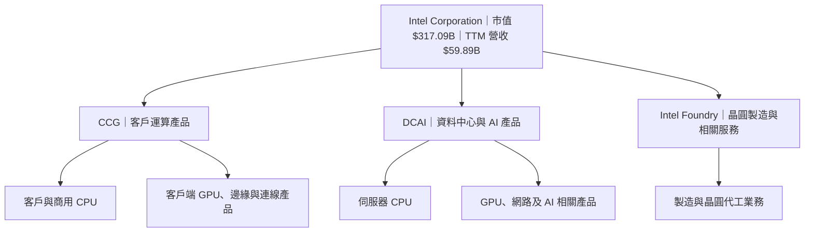
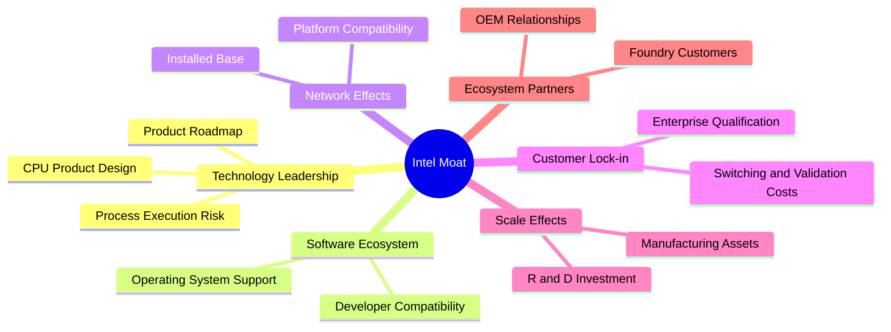
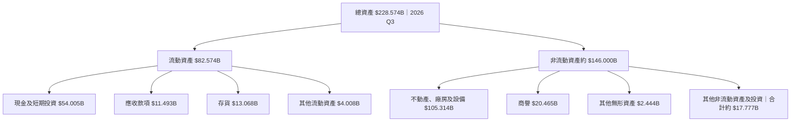
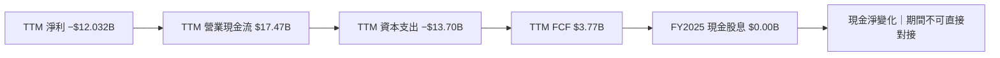
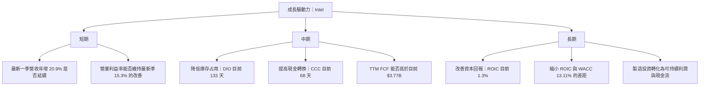
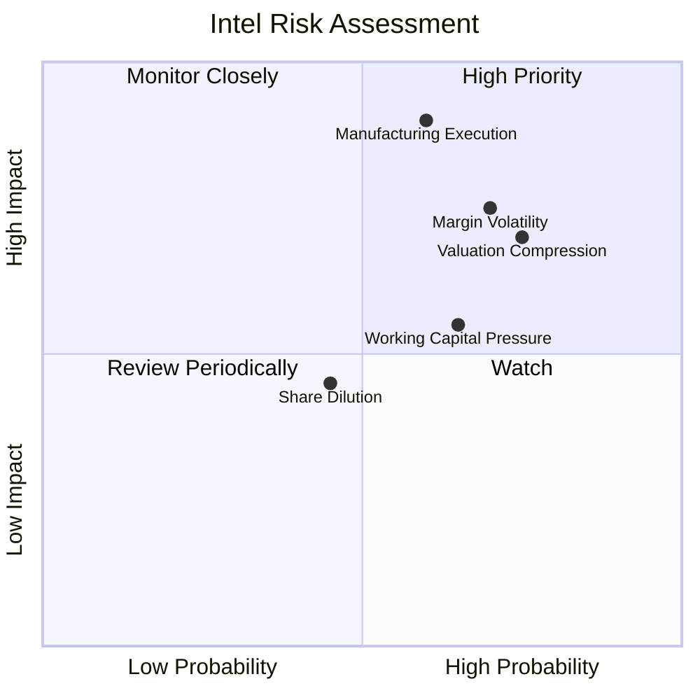
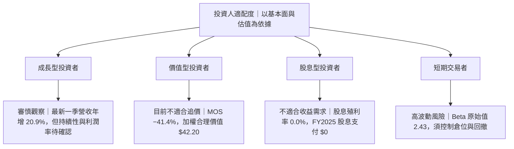

# INTC 基本面深度分析報告
> **報告日期**：2026-11-16 ｜ **語言**：繁體中文 ｜ **數據來源**：SEC 申報資料 (XBRL)、Yahoo Finance、Finviz、StockAnalysis、Roic.ai ｜ **分析師**：CFA 級機構研究

## 目錄

| # | 章節 | 核心結論 |
|---|------|----------|
| 1 | 執行摘要 | 賣出；加權合理價值 $42.20，MOS −41.4% |
| 2 | 公司概覽與商業模式 | 有製造規模、客戶與軟體生態，但製程競爭力與執行仍待驗證 |
| 3 | 損益表深度分析 | TTM 營收 $59.89B、年增 12.1%；TTM 營業利益率 2.9% |
| 4 | 資產負債表分析 | 淨現金 $3.87B；流動比率 2.208，營運資金週期拉長 |
| 5 | 現金流量深度分析 | TTM FCF $3.77B、FCF Yield 1.19%；資本支出仍高 |
| 6 | 獲利能力與資本效率 | ROIC 1.3% 明顯低於 WACC 13.11%，目前摧毀股東價值 |
| 7 | 相對估值分析 | 市價高於加權合理價值；自家 P/S 位於五年歷史第 90 百分位 |
| 8 | DCF 內在價值評估 | DCF 無法計算：預測期末 FCF 不為正；以相對估值加權結果為主 |
| 9 | 成長催化劑 | 最新一季營收年增 20.9%，但持續性及利潤轉化仍待驗證 |
| 10 | 風險矩陣 | 製造轉型、毛利／獲利波動與高估值為主要風險 |
| 11 | 投資建議 | 賣出；以 $42.20 為加權合理價值，附條件關注 $37.98 以下 |

---

## 1. 執行摘要

Intel 的 TTM 營收為 **$59.89B**，較前一 TTM 成長 **12.1%**，最新一季營收年增 **20.9%**；但 TTM 營業利益率僅 **2.9%**，TTM ROIC **1.3%**，低於 **13.11% WACC**。TTM FCF 為 **$3.77B**、FCF Yield **1.19%**，而同業 Forward P/E 法及 EV/EBITDA 法分別指向 **$25.30**、**$48.34**。按固定權重計算，加權合理價值為 **$42.20**；以 2026-11-13 收盤價 **$59.66** 計算，MOS **−41.4%**，故依規則 20 評級為 **賣出**，不作質化上調。

### 1.0 一頁式投資儀表板

| 項目 | 內容 |
|------|------|
| **投資論點（3 句）** | ① TTM 營收年增 12.1%、最新一季年增 20.9%，顯示營收回升，但不能直接等同持續性復甦。② TTM 營業利益率 2.9%、ROIC 1.3% 對比 WACC 13.11%，目前資本報酬不足以覆蓋資金成本。③ TTM FCF $3.77B、FCF Yield 1.19%，而加權合理價值 $42.20 低於現價 $59.66。 |
| **綜合評分** | **4.2/10**（引用 1.1；六項算術平均） |
| **財務健康** | 🟡 現金及短期投資 $54.01B，總債務 $50.13B，淨現金 $3.87B；但 CCC 由 35 天增至 68 天。 |
| **ROIC vs WACC** | **1.3% vs 13.11%**；負利差表示現階段摧毀股東價值。 |
| **FCF 趨勢** | 年度 FCF 由 FY2022–FY2024 負值改善至 FY2025 −$4.95B，TTM 轉正至 $3.77B；FCF Yield **1.19%**。 |
| **估值** | Forward P/E **33.32x** ｜ EV/EBITDA（公司估值資料）**17.239x**；歷史估值區塊 EV/EBITDA 為 23.2x ｜ FCF Yield **1.19%**。來源口徑有別，不混為同一數字。 |
| **DCF 內在價值（基準）** | **N/A**；DCF 模型未能計算，故 DCF 折溢價亦為 N/A。 |
| **安全邊際（MOS）** | **−41.4%＝($42.20 − $59.66) ÷ $42.20**；基準為第 8.8 節加權合理價值。🔴 |
| **預期報酬（基準情境 12M）** | N/A；DCF 情境未提供，不能將加權估值差額冒充 12 個月報酬預測。 |
| **關鍵風險（前二）** | 製造／製程轉型投入未形成足夠回報；當前估值高於加權合理價值。 |
| **評級 + 信心度** | 🔴 **賣出** ｜ 信心：中；估值與 ROIC 指標清楚，但業務復甦速度仍有不確定性。 |

### 1.1 綜合評分卡

| 維度 | 評分（1–10） | 主要依據（引用數字與其來源章節） |
|------|--------------|----------------------------------|
| 成長性 | 5.0 | TTM 營收成長 12.1%、最新一季年增 20.9%；年度營收 2022–2025 整體下滑，見 3.1–3.2。 |
| 獲利能力 | 3.0 | TTM 營業利益率 2.9%、ROIC 1.3% 對 WACC 13.11%；F-Score 6/9，見第 6 章。 |
| 財務健康 | 6.0 | 淨現金 $3.87B、流動比率 2.208；CCC 68 天，高於一年前 35 天，見第 4 章。 |
| 估值 | 2.0 | MOS −41.4%；P/S 5.3x 對五年中位數 2.6x，位於第 90 百分位，見第 7–8 章。 |
| 護城河 | 6.0 | CPU 產品、製造資產及軟體／客戶生態仍具價值，但近期獲利與資本回報未證明競爭優勢足以轉化為高報酬，見第 2 章。 |
| 管理層與資本配置 | 3.0 | FY2022–FY2024 年度 FCF 分別為 −$9.41B、−$14.28B、−$15.66B；2025 年 SBC $2.43B，稀釋股數測試未通過，見第 5–6 章。 |
| **綜合評分** | **4.2** | 六項算術平均： (5.0 + 3.0 + 6.0 + 2.0 + 6.0 + 3.0) ÷ 6 = 4.1667，四捨五入至一位小數。 |

### 1.2 五大投資論點 + 三大核心風險

| 類型 | 項目 | 具體依據 | 信心度 |
|------|------|----------|--------|
| 🟢 **投資論點①** | 營收動能回升 | TTM 營收年增 12.1%；最新一季營收年增 20.9%，高於前幾季公布的增長節奏，但仍須觀察能否延續。 | 🟡 中 |
| 🟢 **投資論點②** | 流動性緩衝 | 現金及短期投資 $54.01B、債務 $50.13B，淨現金 $3.87B，短期財務彈性尚可。 | 🟢 高 |
| 🟢 **投資論點③** | 現金流近期轉正 | TTM FCF $3.77B，較 FY2025 −$4.95B 改善；仍須確認轉正是否能抵銷長期高資本支出。 | 🟡 中 |
| 🟢 **投資論點④** | 產業資產與客戶基礎 | 公司經營客戶運算、資料中心及晶圓代工相關業務；既有製造與產品平台提供復甦的可能性，但分部營收資料未提供。 | 🟡 中 |
| 🟢 **投資論點⑤** | 最新季營業獲利轉正 | 最新一季營業利益率為 15.3%，高於 TTM 2.9%；單季改善尚不足以代表已形成穩定全年獲利。 | 🟡 中 |
| 🟡 **風險①** | 估值與基本面脫節 | 加權合理價值 $42.20，現價 $59.66；MOS −41.4%。 | 🟢 高 |
| 🔴 **風險②** | 資本回報低於資金成本 | ROIC 1.3% 對 WACC 13.11%，利差 −11.81 個百分點；若無法改善，投資與擴產將持續稀釋經濟價值。 | 🟢 高 |
| 🔴 **風險③** | 高資本需求與營運資金壓力 | TTM Capex $13.70B；CCC 由 35 天增加至 68 天，庫存天數由 122 天升至 133 天。 | 🟡 中 |

### 1.3 快速統計卡片

| 指標 | 公司實際值（期間） | 同業中位數 | 狀態 |
|------|--------------------|------------|------|
| 營收成長（TTM） | **12.1%** | — | 🟢 |
| 營收成長（最新一季年增） | **20.9%** | **44.7%** | 🟡 |
| 毛利率（TTM） | **40.2%** | **56.0%** | 🔴 |
| 營業利益率（TTM） | **2.9%** | — | 🔴 |
| ROIC（TTM） | **1.3%** | — | 🔴 |
| Forward P/E | **33.32x** | **14.1x** | 🔴 |
| FCF Yield（TTM） | **1.19%** | — | 🟡 |
| Piotroski F-Score | **6 / 9** | — | 🟡 |

> 同業中位數欄只列有完整同業數據的項目。最新一季營收成長中位數按 AMD 44.7%、NVIDIA 105.9%、Qualcomm −8.4% 取中位數；毛利率中位數按 56.0%、74.7%、53.1% 取中位數；Forward P/E 中位數按 30.2x、10.3x、14.1x 取中位數，為 14.1x。

### 1.4 投資結論

```text
╔══════════════════════════════════════════════════════════════════╗
║                    📊 投資結論摘要                               ║
╠══════════════════════════════════════════════════════════════════╣
║  評級：🔴 賣出（MOS −41.4%，依規則 20）                          ║
║  價格（2026-11-13 收盤）：$59.66                                 ║
║  DCF 內在價值（基準）：N/A（DCF 模型未能計算）                   ║
║  安全邊際 MOS：−41.4%＝($42.20−$59.66)÷$42.20                   ║
║  加權合理價值（8.8）：$42.20                                     ║
║  綜合評分：4.2/10（引用 1.1）                                    ║
║  適合投資人：能承受高波動、並願意等待製造與獲利轉型驗證的投資人  ║
╚══════════════════════════════════════════════════════════════════╝
```

---

## 2. 公司概覽與商業模式

### 2.1 業務結構與收入來源

公司概覽列示 Intel 經營 CCG、DCAI、Intel Foundry 等業務，但沒有提供各分部營收、占比及軟體／服務收入數字，因此不推估分部占比。



### 2.2 市場份額

市場份額數字未提供，因此不繪製市占率圖。Intel 的 TTM 營收為 $59.89B，最新一季年增 20.9%；同業資料顯示 AMD 最新一季年增 44.7%、NVIDIA 105.9%、Qualcomm −8.4%。這些公司產品組合並不完全相同，營收增速可作相對背景，不能直接解讀為 CPU 或晶圓代工市占變化。

### 2.3 競爭護城河分析



### 2.4 護城河強度

| 護城河項目 | 強度（強／中／弱） | 證據（引用數字或事實） | 會削弱它的情況 |
|------------|--------------------|------------------------|----------------|
| 技術與產品平台 | 中 | TTM 營收 $59.89B，覆蓋客戶運算及資料中心等產品；但 TTM 營業利益率僅 2.9%，代表技術資產尚未充分轉化為利潤。 | 產品性能、能效或上市節奏落後競爭對手。 |
| 軟體生態 | 中 | 既有 x86 相容性與企業部署形成一定轉換成本；量化客戶留存及軟體收入未提供。 | 客戶轉向替代架構、軟體相容成本降低。 |
| 網路效應 | 弱至中 | 平台相容與開發者支持具間接網路效應，但未提供活躍開發者、裝置數或生態營收數據。 | 軟硬體生態碎片化，競爭平台相容性提升。 |
| 客戶鎖定 | 中 | 企業產品驗證、系統整合通常具有轉換成本；客戶集中度及續約指標未提供。 | 大型客戶多來源採購或改用其他架構。 |
| 規模效應 | 中 | 2025 年研發費用 $13.77B，TTM Capex $13.70B，代表公司持續投入研發及製造資產；ROIC 僅 1.3%，顯示目前規模尚未帶來足夠資本回報。 | 產能利用率不足、資本成本高於投資回報。 |
| 生態夥伴 | 中 | 公司面向 OEM、企業及製造客戶；客戶與合作夥伴營收分布未提供。 | 客戶將關鍵產品轉向競爭供應商或自研方案。 |

護城河評分理由：1.1 給予 **6.0/10**，反映 Intel 仍有平台、客戶與製造資產，但 2.9% TTM 營業利益率與 1.3% ROIC 顯示護城河的經濟成果尚未充分體現。

---

## 3. 損益表深度分析

### 3.1 年度收入成長趨勢（近 4 年）

| 財年 | 營收 | YoY | 視覺化 |
|------|------|-----|--------|
| FY2022 | $63.05B | — | █████████████████████████ |
| FY2023 | $54.23B | −14.0% | ██████████████████████ |
| FY2024 | $53.10B | −2.1% | █████████████████████ |
| FY2025 | $52.85B | −0.5% | █████████████████████ |

```text
╔══════════════════════════════════════════════════════════════════╗
║              Intel 年度收入趨勢（FY2022–FY2025）                 ║
╠══════════════════════════════════════════════════════════════════╣
║  FY2022  $63.05B  █████████████████████████  YoY：基期          ║
║  FY2023  $54.23B  ██████████████████████     YoY：−14.0% 🔴     ║
║  FY2024  $53.10B  █████████████████████      YoY：−2.1%  🔴     ║
║  FY2025  $52.85B  █████████████████████      YoY：−0.5%  🟡     ║
║  2022–2025 三年營收 CAGR：約 −5.7%                               ║
╚══════════════════════════════════════════════════════════════════╝
```

FY2022 至 FY2025 營收由 $63.05B 降至 $52.85B，三年 CAGR 約 **−5.7%**。近兩年降幅收窄，顯示收入下滑趨勢較前期緩和；TTM 成長轉正至 12.1%，但單一 TTM 數字包含近期較強季度，尚不能證明結構性復甦已完成。

### 3.2 季度收入趨勢分析

| 季度 | 營收 | QoQ | YoY | 備註 |
|------|------|-----|-----|------|
| 2025 Q4 | $13.67B | +0.2% | −4.1% | 與 2025 Q3 的 $13.65B 相比；同比仍低於 2024 Q4。 |
| 2026 Q1 | $13.58B | −0.7% | +7.2% | 由 2025 Q4 小幅回落，但高於 2025 Q1 的 $12.67B。 |
| 2026 Q2 | $16.13B | +18.8% | +25.4% | 季度營收明顯放大；可能反映需求、產品組合或交付時點，單季尚不足以確認持續性。 |
| 2026 Q3 | $16.51B | +2.4% | +20.9% | 延續高於去年同期的營收水平，但 QoQ 增速低於 Q2。 |

計算口徑為：QoQ＝本季營收 ÷ 前季營收 − 1；YoY＝本季營收 ÷ 去年同期營收 − 1。百分比依所列季度財務資料計算並四捨五入至一位小數。

### 3.3 利潤率演變分析

| 利潤率指標 | FY2022 | FY2023 | FY2024 | FY2025 | 趨勢 | 評估 |
|------------|--------|--------|--------|--------|------|------|
| **毛利率** | 42.6% | 40.0% | 32.6% | 34.8% | 2024 明顯收縮，2025 回升約 2.1 個百分點 | 🔴 |
| **營業利益率** | 3.7% | 0.1% | −8.9% | −0.04% | 2024 惡化，2025 接近損益兩平 | 🔴 |
| **淨利率（TTM）** | — | — | — | — | TTM −20.1% | 🔴 |
| **營業利益率（TTM，核實值）** | — | — | — | — | **2.9%** | 🔴 |

年度毛利率及營業利益率是以年度損益表中的毛利、營業利益除以營收計算。TTM 營業利益率採核實財務數字 **2.9%**；其他合併資料來源另列 10.1%，口徑相互不一致，因此不以較高值取代核實值。最新一季營業利益率為 **15.3%**，與低 TTM 值的差距反映近期季度獲利改善，但其持續性仍需觀察。

利潤率變化可能受產品組合、製造成本、產能利用率、折舊及研發支出共同影響；提供資料不足以把年度利潤率變化精確拆解到各項因素。FY2025 毛利率較 FY2024 回升，尚未恢復 FY2022 水準；營業利益率仍接近零，也說明毛利改善沒有完全轉化為營業獲利。

### 3.4 費用結構分析

完整費用結構資料不足，無法在不推估其他費用項目的情況下繪製比例圓餅圖。可確認的數據為：FY2025 研發費用 **$13.77B**；FY2025 營業利益 **−$0.023B**。研發投入有助維持產品與製程競爭力，但在營業利益接近損益兩平時，投入能否產生增量毛利及資本回報是估值關鍵。

### 3.5 季度 EPS 趨勢與盈餘品質（Quality of Earnings）

EPS 預期及實際驚喜數據為 N/A：最近四季 EPS estimate 欄位均缺值，不能可靠判斷盈餘超預期或不及預期。可取得的季度 EPS 實際值如下；來源間季度數字有差異，故只作趨勢參考，不自行補算 surprise：

| 季度 | EPS 實際值（可取得資料） | 預期差異 | 營運觀察 |
|------|--------------------------|----------|----------|
| 2025 Q4 | −$0.12 | N/A（估值與實際 EPS 欄缺值） | 仍為虧損。 |
| 2026 Q1 | −$0.73 | N/A | 虧損擴大。 |
| 2026 Q2 | −$2.16 | N/A | 淨利資料顯示虧損；一次性項目明細未提供。 |
| 2026 Q3 | $0.63（另一資料列示淨利 $3.32B） | N/A | 單季轉正，但估計值缺失，無法判斷是否超預期。 |

| 盈餘品質項目 | 數值／佔比 | 評估 |
|--------------|-----------|------|
| 股權薪酬 SBC / 營收 | 約 **4.1%**（TTM SBC $2.432B ÷ TTM 營收 $59.89B） | 🟡 SBC 為顯著股東成本，且 F-Score 的稀釋股數測試未通過。 |
| SBC / 營業現金流 | 約 **13.9%**（$2.432B ÷ $17.47B） | 🟡 佔營業現金流比重不低；SBC 雖非當期現金支出，仍可能透過股數稀釋轉嫁成本。 |
| FCF / 淨利（現金轉換率） | 約 **−31.3%**（$3.77B ÷ TTM 淨利 −$12.032B） | 🔴 淨利為負時此比率不宜作一般現金轉換率解讀；正 FCF 與負會計獲利並存，須追蹤非現金項目及營運資金。 |
| 一次性／非經常性損益 | N/A（資料未提供完整項目明細） | 無法判定本季轉正是否受一次性項目影響。 |
| 有效稅率異常 | N/A（未提供可核對的 TTM 稅前利潤與稅費） | 不能量化稅務利益是否影響盈餘。 |
| 資本化支出 vs 費用化 | TTM Capex $13.70B；研發費用 FY2025 $13.77B | 資本支出金額重大，但資本化明細不足，不能判定是否有成本遞延或資產減損風險。 |

**盈餘品質結論**：TTM 淨利率為 −20.1%，但 TTM FCF 為正 $3.77B，顯示盈餘與現金流存在顯著差異。因缺少完整一次性損益、稅費與資產減損明細，不宜把單季轉正視為可持續獲利。SBC 約占 TTM 營收 4.1%，會稀釋每股經濟價值；估值應以可持續現金流和正常化利潤率為重，而非單季 EPS。

---

## 4. 資產負債表分析

### 4.1 資產結構分解

最近季度資產總額為 $228.574B；流動資產 $82.574B，已列明的主要非流動資產包含 PPE $105.314B、商譽 $20.465B、無形資產 $2.444B 等。



非流動資產分類為總資產減流動資產，約 $146.000B；「其他非流動資產及投資」為扣除已列示項目後的合計，不代表單一報表項目。

### 4.2 流動性與營運資金分析

| 指標 | 最新 TTM | 一年前 TTM | 變化 | 解讀 |
|------|----------|------------|------|------|
| 流動比率 | 2.208 | N/A | N/A | 流動資產約為流動負債的 2.2 倍，短期償債緩衝尚可。 |
| 速動比率 | 1.751 | N/A | N/A | 排除存貨後仍高於 1，流動性不完全依賴存貨變現。 |
| DSO 應收帳款天數 | 25 天 | 22 天 | +3 天 | 收款週期略延長；可能反映客戶組合或收款時點變化，應追蹤應收帳款增速。 |
| DIO 存貨天數 | 133 天 | 122 天 | +11 天 | 存貨週期拉長，可能增加庫存跌價及現金占用風險。 |
| DPO 應付帳款天數 | 90 天 | 109 天 | −19 天 | 付款天數下降，供應商融資對現金流的支持減少。 |
| CCC 現金轉換週期 | 68 天 | 35 天 | +33 天 | 現金被營運資金占用的時間明顯增加；CCC＝25+133−90＝68 天。 |

### 4.3 債務結構分析

```text
╔══════════════════════════════════════════════════════════════════╗
║                   Intel 債務健康診斷                             ║
╠══════════════════════════════════════════════════════════════════╣
║  總債務：           $50.13B  ████████████████████                 ║
║  現金+短期投資：    $54.01B  ██████████████████████               ║
║  淨現金：            $3.87B  ██                                   ║
║                                                                  ║
║  流動比率：          2.208x  🟢                                   ║
║  速動比率：          1.751x  🟢                                   ║
║  Debt/EBITDA：       N/A（核實區塊未列可直接使用的 TTM EBITDA）   ║
║  利息保障倍數：      N/A（利息費用與一致口徑 EBIT 未提供）        ║
╚══════════════════════════════════════════════════════════════════╝
```

截至 2026 Q3，現金及短期投資 $54.01B 高於債務 $50.13B，淨現金 $3.87B。這提供一定資金緩衝，但考量 TTM Capex $13.70B 與 WACC 13.11%，仍需關注現金是否足以支持製造投資、營運資金需求及債務到期安排；到期表未提供。

### 4.4 股東權益趨勢

```text
╔══════════════════════════════════════════════════════════════════╗
║                  Intel 歷年股東權益變化                          ║
╠══════════════════════════════════════════════════════════════════╣
║  FY2022  $101.42B  ████████████████████                          ║
║  FY2023  $105.59B  █████████████████████                         ║
║  FY2024   $99.27B  ███████████████████                           ║
║  FY2025  $114.28B  ███████████████████████                       ║
╚══════════════════════════════════════════════════════════════════╝
```

FY2025 股東權益較 FY2024 增加至 $114.28B，但股東權益帳面增長不等同於資本回報改善；ROE TTM 為 −10.5%，且 ROIC 僅 1.3%。

---

## 5. 現金流量深度分析

### 5.1 現金流量瀑布圖

下圖以 TTM 營業現金流減資本支出計算 FCF；淨利採 TTM 資料。股息資料為年度口徑，不將不同期間數字誤畫成同一期現金流橋接。



營業現金流與淨利之間的完整調節項目未在摘要資料中列示，因此圖中不是淨利逐項加回至營業現金流的完整會計橋接。

### 5.2 FCF 轉換率趨勢

| 財年／期間 | FCF | 淨利 | FCF / 淨利 | 解讀 |
|------------|-----|------|-----------|------|
| FY2022 | −$9.41B | $8.01B | −117.5% | 高額資本支出使現金流低於帳面獲利。 |
| FY2023 | −$14.28B | $1.69B | −845.0% | 分母較小且 FCF 為負，比例易被放大；反映大額投資消耗現金。 |
| FY2024 | −$15.66B | −$18.76B | 83.5% | FCF 與淨利皆為負，比例不代表正向現金轉換。 |
| FY2025 | −$4.95B | −$0.267B | 1,853.9% | 淨利接近零，比例失真；絕對 FCF 仍為負。 |
| TTM 至 2026 Q3 | $3.77B | −$12.032B | −31.3% | 正 FCF 對比負淨利，需進一步核對非現金項目、資產處分及營運資金。 |

因為分母在多個期間接近零或為負，FCF／淨利率不適合單獨解讀；比較 FCF 絕對值、資本支出及營業現金流趨勢較合理。

### 5.3 自由現金流趨勢

```text
╔══════════════════════════════════════════════════════════════════╗
║                自由現金流：歷史實際                              ║
╠══════════════════════════════════════════════════════════════════╣
║  FY2022  −$9.41B   ◀██████████                                  ║
║  FY2023 −$14.28B   ◀███████████████                             ║
║  FY2024 −$15.66B   ◀████████████████                            ║
║  FY2025  −$4.95B   ◀█████                                       ║
║  TTM     +$3.77B    ████▶                                       ║
╠══════════════════════════════════════════════════════════════════╣
║  TTM FCF Yield：1.19%｜TTM FCF＝營業現金流 $17.47B−Capex $13.70B ║
╚══════════════════════════════════════════════════════════════════╝
```

FY2022–FY2025 年度 FCF 均為負，近 TTM 轉正至 $3.77B。這一改善值得關注，但年度與 TTM 期間不同；若資本支出重新上升或 CCC 持續延長，FCF 轉正可能不具持續性。

### 5.4 資本配置評估

沒有可完整核對的買回、投資、股息、留存等同期間資本配置總額，因此不繪製比例圓餅圖。

| 資本配置項目 | 已知數字 | 評估 |
|--------------|----------|------|
| Capex | TTM $13.70B；FY2025 年度 $14.65B | 大量投入製造與資產，資本回收取決於產能利用率與利潤率改善。 |
| 研發 | FY2025 $13.77B | 維持產品與製程研發能力；需以後續營收、毛利與 ROIC 驗證回報。 |
| 現金股息 | FY2025 $0.00B | FY2024 為 $1.60B，FY2023 為 $3.09B；FY2025 已停止支付。 |
| 股票回購 | N/A（數據未提供完整回購金額） | 不以股數變化反推回購金額。 |
| SBC | FY2025 $2.43B | 對員工激勵有用，但會造成股東稀釋；需與現金薪酬及營運成果一起評估。 |

---

## 6. 獲利能力與資本效率

### 6.1 ROE / ROA / ROIC 趨勢

| 指標 | FY2022 | FY2023 | FY2024 | FY2025／TTM | 評估 |
|------|--------|--------|--------|-------------|------|
| ROE | N/A | N/A | N/A | −10.5%（TTM 核實值） | 股東權益報酬為負；其他資料來源列 −9.6%，此處採核實值。 |
| ROA | N/A | N/A | N/A | N/A（品質指標判定 ROA > 0 未通過；其他來源口徑不同） | 數據來源口徑衝突，不混用。 |
| ROIC | N/A | N/A | N/A | **1.3%（TTM）** | 明顯低於資本成本。 |
| 行業均值 | — | — | — | 未提供可比口徑 | 不列未核實數據。 |

### 6.2 ROIC vs WACC 分析（核心價值創造判斷）

ROIC 為 **1.3%**，WACC 為 **13.11%**，差額為 **−11.81 個百分點**。此比較顯示目前投入資本的經營回報低於資金成本；若只看最新季度獲利改善，仍不足以推翻 TTM 資本回報偏低的結論。

```text
╔══════════════════════════════════════════════════════════════════╗
║                ROIC vs WACC 深度分析                            ║
╠══════════════════════════════════════════════════════════════════╣
║  資本成本輸入（程式計算與 Yahoo Finance）：                      ║
║  ├── 無風險利率（10Y 美債）：       5.15%                         ║
║  ├── 市場風險溢酬 ERP：             5.00%                         ║
║  ├── 原始 Beta：                    2.43                          ║
║  ├── 調整後 Beta：                  1.95                          ║
║  ├── 股權成本 Ke：                 14.91%                         ║
║  ├── 稅前債務成本：                  2.18%                         ║
║  ├── 股權／債務權重：              86.3%／13.7%                   ║
║  └── WACC（核實採用）：             13.11%                        ║
║                                                                  ║
║  ROIC（TTM）：                       1.30%                        ║
║  EVA spread＝ROIC−WACC：            −11.81 個百分點               ║
║                                                                  ║
║  ROIC  1.30%  ▓▓░░░░░░░░░░░░░░░░░░░░░░░░░░░░                   ║
║  WACC 13.11%  ▓▓▓▓▓▓▓▓▓▓▓▓▓▓▓▓▓▓▓▓▓▓▓▓▓▓▓▓                     ║
║  結論：🔴 ROIC 低於 WACC，目前未覆蓋資金成本                     ║
╚══════════════════════════════════════════════════════════════════╝
```

**價值判斷**：ROIC − WACC＝1.30% − 13.11%＝**−11.81 個百分點**。此為負向經濟利差，代表在目前 TTM 回報水準下，新增投入資本的經濟價值不足。WACC 組成詳見第 8.2 節；本節一致採用核實 WACC 13.11%。

### 6.3 杜邦三因素分解

| 因素 | 數值（TTM） | 解讀 |
|------|-------------|------|
| 淨利率 | −20.1% | 負淨利率是 ROE 為負的主要原因。 |
| 資產週轉率 | 0.26 | 每單位資產對應的收入有限，反映資產密集型製造模式。 |
| 權益乘數 | 1.99 | 槓桿提高資產對權益的倍數，但不足以扭轉負淨利率。 |
| **ROE** | **−10.5%** | −20.1% × 0.26 × 1.99 ≈ −10.5%；ROE 主要由負淨利率驅動，並非靠高槓桿掩蓋。 |

以上數字照錄品質指標資料；原始數字乘積會因四捨五入略有差異。

### 6.4 財務體質：Piotroski F-Score

Piotroski F-Score 為 **6 / 9**。九項測試均有判定結果：

| 測試 | 結果 | 解讀 |
|------|------|------|
| ROA > 0 | ❌ 未通過 | 依品質指標口徑，盈利資產回報未達正值。 |
| 營業現金流 > 0 | ✅ 通過 | TTM 營業現金流為 $17.47B。 |
| ROA 高於一年前 | ❌ 未通過 | 資產獲利改善未獲該測試確認。 |
| 營業現金流 > 淨利（應計品質） | ✅ 通過 | 現金流高於會計淨利，惟淨利為負時仍須審視調節項目。 |
| 長期負債 ÷ 總資產低於一年前 | ✅ 通過 | 指標改善，但債務總額仍為 $50.13B。 |
| 流動比率高於一年前 | ✅ 通過 | 最新流動比率 2.208。 |
| 稀釋股數未增加 | ❌ 未通過 | 股數增加可能削弱每股價值增長。 |
| 毛利率高於一年前 | ✅ 通過 | TTM 毛利率高於比較期。 |
| 資產週轉率高於一年前 | ✅ 通過 | 資產使用效率較比較期改善。 |

F-Score 6/9 表示現金流、流動性及部分營運趨勢有改善，但 ROA 與稀釋股數未通過，且 ROIC 仍低於 WACC，不能單憑 F-Score 推論價值創造已恢復。

---

## 7. 相對估值分析

### 7.1 同業估值比較

同業倍數採 Yahoo Finance peer multiples。Intel Forward P/E、P/S 採估值資料；Intel EV/EBITDA 以核實的自身歷史估值區塊列示 23.2x，其他估值資料另列 17.239x，存在口徑差異。

| 估值指標 | **Intel** | **AMD** | **NVIDIA** | **Qualcomm** | Intel 評估 |
|----------|-----------|---------|------------|--------------|-----------|
| **Trailing P/E** | N/A（TTM EPS −$2.35） | 114.1x | 20.6x | 13.6x | 🔴 Intel TTM 虧損，P/E 無可比性。 |
| **Forward P/E** | 33.32x | 30.2x | 10.3x | 14.1x | 🔴 Intel 高於三家同業中位數 14.1x。 |
| **P/S Ratio** | 5.3x | 19.3x | 13.0x | 4.3x | 🟡 高於 Qualcomm、低於 AMD 與 NVIDIA。 |
| **EV/EBITDA（TTM）** | 23.2x（歷史估值資料） | 78.0x | 19.4x | 18.2x | 🟡 高於 NVIDIA、Qualcomm；低於 AMD。 |

Intel 最新一季營收成長 20.9%，低於 AMD 44.7% 及 NVIDIA 105.9%，但高於 Qualcomm −8.4%；Intel TTM 毛利率 40.2%，低於三家同業各自 56.0%、74.7%、53.1%。不同公司產品組合及盈利階段不同，估值倍數只能作相對參考。

### 7.2 歷史估值區間分析

```text
╔══════════════════════════════════════════════════════════════════╗
║              Intel 自身歷史估值（五年 TTM）                      ║
╠══════════════════════════════════════════════════════════════════╣
║  P/S：       1.5x ├────────中位數 2.6x──────────┤ 11.5x         ║
║  當前 P/S：   5.3x｜歷史百分位第 90 百分位 🔴                    ║
║                                                                  ║
║  EV/EBITDA：  6.4x ├────────中位數 23.6x─────────┤ 536.5x       ║
║  當前：      23.2x｜歷史百分位第 47 百分位 🟡                    ║
╚══════════════════════════════════════════════════════════════════╝
```

P/S 5.3x 明顯高於五年中位數 2.6x，且位於自身歷史第 90 百分位。EV/EBITDA 23.2x 接近五年中位數 23.6x、位於第 47 百分位；但歷史區間上限 536.5x 顯示盈利週期曾使此倍數高度失真，解讀須審慎。

### 7.3 情境價值（Bear / Base / Bull）

N/A（DCF 無法計算：預測期末 FCF 不為正，資本支出高於營業利益及折舊攤銷；依規定不自行建模或設定情境目標價。）

### 7.4 相對估值隱含價格區間

```text
╔══════════════════════════════════════════════════════════════════╗
║                 相對估值隱含每股價值                             ║
╠══════════════════════════════════════════════════════════════════╣
║  $25.30 ───────── $42.20 ───────── $48.34 ── $59.66 ── $90.65   ║
║  Forward P/E      加權合理值       EV/EBITDA   現價     共識目標 ║
╚══════════════════════════════════════════════════════════════════╝
```

- **同業 Forward P/E：$25.30**＝同業中位數 **14.1x** × Intel Forward EPS **$1.79**。採用 AMD、NVIDIA、Qualcomm 的同業中位倍數。
- **同業 EV/EBITDA：$48.34**＝同業中位數 **18.8x** × Intel TTM EBITDA，並加回淨現金。採用 NVIDIA、Qualcomm 的中位數倍數。
- **分析師共識目標價：$90.65**＝43 位分析師平均目標價。該數字為市場參考，不等同本報告獨立模型估值。
- **加權合理價值：$42.20**，權重及算式詳見第 8.8 節。

---

## 8. DCF 內在價值評估（Discounted Cash Flow）

> **DCF 結果：N/A。**程式模型判定預測期最後一年自由現金流不為正，原因為資本支出高於營業利益及折舊攤銷。因此依要求不建立替代 DCF，也不填寫 DCF 基準價、敏感度矩陣、三情境或反推 DCF。相對估值加權結果另見 8.8 節。

### 8.0 估值推理鏈（Thinking Logic）

**Step 1 — 價值由哪些變數決定？**  
Intel 的估值主要取決於既有客戶運算與資料中心業務的可持續營收及利潤率，以及晶圓製造投資能否提高產能回報；各分部營收占比未提供，不能以猜測比例拆分。以目前 TTM 營收 $59.89B、營業利益率 2.9%、ROIC 1.3% 觀察，利潤率與資本回報改善是關鍵變數。

**Step 2 — 模型選擇**

| 決策點 | 本報告採用 | 理由 | 曾考慮但否決 | 否決理由 |
|--------|-----------|------|--------------|----------|
| 現金流定義 | FCFF 只作核實模型輸出 | DCF 模型狀態為 N/A，未提供可複核現金流預測。 | 自行建立 FCFF | 違反 DCF MODEL N/A 時不得另建模型的規則。 |
| 預測期 N | N/A | 未提供可用 DCF 預測期。 | 自行設定 5–10 年 | 缺乏模型輸入且可能掩蓋現金流不為正。 |
| 終值方法 | N/A | DCF 未能計算。 | Gordon Growth／退出倍數 | 沒有可用的預測期末 FCF 作為基礎。 |
| EBIT 基礎 | N/A | DCF 不適用。 | GAAP／非 GAAP 自行選擇 | 缺少可核實模型預測。 |

**Step 3 — 關鍵假設推導**：營收 CAGR、期末營業利潤率、g、預測期、Capex、D&A、營運資金、SBC 及稀釋率均為 N/A，因模型未能計算，不以未提供資料自行填值。

**Step 4 — 最脆弱環節**：現有資料不能證明未來現金流可在資本支出後持續為正；因此不能從目前 FCF 轉正直接推導長期內在價值。

**Step 5 — 計算路徑**：因模型不適用，不繪製會暗示存在預測輸入的數值路徑圖。

### 8.1 模型假設總表（Model Inputs）

N/A（資料未提供可用 DCF 模型輸入；DCF 模型判定預測期末 FCF 不為正，不能建立逐年 FCFF 預測。）

### 8.2 折現率推導（WACC）

DCF 計算為 N/A；以下保留用於 ROIC 比較及資本成本參考的核實 WACC 數據。Beta 使用調整後 Beta **1.95**，其調整方式為 ⅔ × 原始 Beta 2.43 + ⅓ × 1.00。10Y 美債利率日期未提供，因此不另行補上日期。沒有額外規模或國別溢酬。

```text
╔══════════════════════════════════════════════════════════════════╗
║                WACC 輸入（核實值；DCF 本身為 N/A）               ║
╠══════════════════════════════════════════════════════════════════╣
║  無風險利率 Rf：                     5.15%                       ║
║  股權風險溢酬 ERP：                   5.00%                       ║
║  原始 Beta：                          2.43                       ║
║  調整後 Beta：                        1.95                       ║
║  調整方式：2/3×2.43 + 1/3×1.00 = 1.9533，列示 1.95             ║
║  股權成本（資料列示）：              14.91%                       ║
║  稅前債務成本：                        2.18%                       ║
║  稅率（預設）：                       21.0%                       ║
║  E / D 權重：                         86.3% / 13.7%               ║
║  WACC（核實採用）：                   13.11%                      ║
╚══════════════════════════════════════════════════════════════════╝
```

**核實輸入算式及限制**：

1. Beta 調整：⅔ × 2.43 + ⅓ × 1.00 = 1.9533，按資料列示為 **1.95**。
2. CAPM 的未四捨五入值按輸入約為 5.15% + 1.95 × 5.00% = 14.90%；資料列示股權成本 **14.91%**，本報告引用該核實值，不以重新四捨五入取代。
3. 稅後債務成本：2.18% × (1 − 21.0%) = 1.7222%，約 **1.72%**。
4. 權重核對：86.3% + 13.7% = **100.0%**。
5. 核實採用 WACC 為 **13.11%**。由於精確未四捨五入權重與各輸入未全部列示，本文不另以四捨五入數重算並替代 WACC。

利息費用、平均計息負債、期末計息負債範圍與債券市值未提供，因此不重建債務成本及權重。此處採用程式計算的 Cost of capital 結果，並與第 6.2 節一致。

### 8.3 逐年自由現金流預測（基準情境）

N/A（沒有可用逐年預測表；模型判定預測期末 FCF 不為正，依規則不得自行建立預測。）

### 8.4 終值計算（Terminal Value）

N/A（未能取得可用的預測期末 FCFF，故 Gordon Growth 與退出倍數法均不適用。）

### 8.5 企業價值 → 每股內在價值（Bridge）

N/A（DCF 企業價值與每股內在價值未能計算；不以相對估值值替代 DCF。）

### 8.6 敏感性分析（WACC × 永續成長率）

N/A（沒有 DCF 基準現金流、終值及 WACC × g 敏感度矩陣；不自行估算敏感度或三情境。）

### 8.7 反推 DCF（Reverse DCF：市場在預期什麼）

N/A（沒有可用 DCF 模型；現價無法在缺少現金流模型輸入時反解單一營運變數。）

### 8.8 估值三角驗證與安全邊際

| 估值方法 | 隱含每股價值 | 上行空間（÷現價） | 權重 | 說明 |
|----------|--------------|-------------------|------|------|
| 同業 Forward P/E | $25.30 | −57.6% | 45% | 同業中位數 14.1x × Intel Forward EPS $1.79。 |
| 同業 EV/EBITDA | $48.34 | −19.0% | 45% | 同業中位數 18.8x，按公司 TTM EBITDA 及淨現金橋接。 |
| 分析師共識目標價 | $90.65 | +51.9% | 10% | 43 位分析師平均目標價，作為參考而非主要估值依據。 |
| **加權合理價值** | **$42.20** | **−29.3%** | **100%** | 公司類型為盈利型；DCF 基準因無法計算而剔除，其權重依程式規則在可用方法間分配。 |

**加權計算**：  
$25.30 × 45% + $48.34 × 45% + $90.65 × 10%  
= $11.385 + $21.753 + $9.065  
= $42.203  
= **$42.20**（四捨五入至美分）。

- **MOS**＝(加權合理價值 − 現價) ÷ 加權合理價值  
  = ($42.20 − $59.66) ÷ $42.20  
  = −$17.46 ÷ $42.20  
  = **−41.4%**。
- **上行空間**＝(加權合理價值 − 現價) ÷ 現價  
  = ($42.20 − $59.66) ÷ $59.66  
  = −$17.46 ÷ $59.66  
  = **−29.3%**。
- **折溢價相對 DCF**：N/A，因 DCF 基準價不存在。

```text
╔══════════════════════════════════════════════════════════════════╗
║                  估值區間與安全邊際                              ║
╠══════════════════════════════════════════════════════════════════╣
║  $25.30 ─────── $42.20 ─────── $59.66 ─────── $90.65            ║
║  Forward P/E    加權合理值       現價          分析師共識         ║
║                                                                  ║
║  MOS = ($42.20−$59.66)÷$42.20 = −41.4%                          ║
║  上行空間 = ($42.20−$59.66)÷$59.66 = −29.3%                     ║
║  MOS 評估：🔴 MOS < 0，市價高於加權合理價值                     ║
║  DCF 基準、悲觀／基準／樂觀 DCF 情境：N/A                        ║
║  條件式關注價：加權價值的 90%＝$42.20×90%＝$37.98                 ║
╚══════════════════════════════════════════════════════════════════╝
```

在 MOS ≥ 10% 時，價格上限為 $42.20 × (1 − 10%)＝**$37.98**。此為按加權合理價值推導的估值門檻，不是 DCF 買入目標價。

> 🔎 **程式複算（Python，依本節各項自動重算）**
>
> 加權合理價值 = $25.30 × 45% + $48.34 × 45% + $90.65 × 10% = **$42.20**（權重合計 100%）
>
> 以價格 $59.66 計：MOS = **-41.4%**，上行空間 = **-29.3%**
>
> ✅ 與本節所寫數值一致。

### 8.9 DCF 模型的局限與失效條件

- **終值依賴度**：N/A；DCF 模型未計算，沒有可引用的終值占比。
- **最脆弱的假設**：無可用 DCF 假設可供量化；本報告認為實際脆弱環節是營業利潤率及 Capex 轉化為正向現金流的能力。
- **不適用情境說明**：模型原因為預測期末 FCF 不為正，且 Intel 處於高資本需求、獲利波動階段。現階段相對估值、EV/Sales、資產及分部估值交叉檢查較有參考性，但分部數據不足，未提供 SOTP 估值。
- **與第 10 章連結**：若製造投資回報延遲，Capex／FCF 假設惡化；若競爭導致降價或產品延遲，營收與利潤率假設下修；若 CCC 繼續擴大，現金流品質可能轉弱。

### 8.10 複算檢核表（Audit Trail）

| # | 檢核項目 | 檢查方式 | 結果 |
|---|----------|----------|------|
| 1 | 所有高／中敏感度輸入有四段式推導 | DCF 為 N/A，未列模型假設 | ✅（不適用，未自建假設） |
| 2 | 每個假設有來歷 | 未建立 DCF 輸入 | ✅（不適用） |
| 3 | WACC 五步算式齊全且可複算 | 採用核實 WACC；原始輸入不完整，未重算替代 | ✅（明示資料限制） |
| 4 | Kd 分母與權重 D 範圍一致 | 計息負債平均／期末細項未提供，未自行推導 | ✅（未以不一致範圍建模） |
| 5 | WACC 與第 6.2 節相同 | 兩處均為 13.11% | ✅ |
| 6 | 逐年預測數量與 N 一致、無省略 | DCF 預測表 N/A | ✅（不適用） |
| 7 | FY+1 九步算式可複算 | 無 FY+1 預測輸入 | ✅（不適用） |
| 8 | 預測期 PV 合計可複算 | 無 DCF 預測期 PV | ✅（不適用） |
| 9 | WACC > g | 沒有適用的 g | ✅（不適用） |
| 10 | 終值以 FY+N FCF 為基礎 | 無可用 FY+N FCF | ✅（不適用） |
| 11 | EV 到每股內在價值橋接 | DCF 橋接 N/A | ✅（不適用） |
| 12 | SBC 三要素相容 | 未建立 EBIT、SBC 或稀釋率模型 | ✅（未建模） |
| 13 | 敏感度矩陣基準格與 DCF 價值一致 | 無矩陣 | ✅（不適用） |
| 14 | 矩陣格有效性 | 無矩陣 | ✅（不適用） |
| 15 | 三情境機率相加 | 未提供 DCF 情境 | ✅（不適用） |
| 16 | 反推 DCF 每列只放開一個變數 | 無反推模型 | ✅（不適用） |
| 17 | MOS 與折溢價使用正確基準 | MOS 以 $42.20；DCF 折溢價 N/A | ✅ |
| 18 | 報告完整至第 11 章 | 已完成第 11 章 | ✅ |
| 19 | 加權合理價值等於逐項加權總和 | 算式為 $42.203，列示 $42.20 | ✅ |
| 20 | 評級符合 MOS 規則 | MOS −41.4% 對應賣出 | ✅ |

---

## 9. 成長催化劑

### 9.1 催化劑時間軸

財務資料與新聞摘錄沒有提供可核實的產品上市、製程量產或客戶導入日期，因此不繪製帶有虛構日期的 Gantt 圖。可追蹤的時間框架如下：

| 時間框架 | 觀察項目 | 量化基準 |
|----------|----------|----------|
| 短期：未來數季 | 最新營收增長是否延續、營業利益率是否維持改善 | 最新季度營收年增 20.9%；營業利益率 15.3%，須觀察是否延續。 |
| 中期：未來 1–3 年 | 資本支出是否形成持續 FCF、庫存週期是否回落 | TTM Capex $13.70B；DIO 133 天、CCC 68 天。 |
| 長期：依產品與製程週期 | Foundry、產品路線與資本回報能否改善 | ROIC 需從 1.3% 向 WACC 13.11% 收斂；目前差距 11.81 個百分點。 |

### 9.2 TAM 市場規模分析

N/A（TAM 市場規模數據未提供）。公司 TTM 營收 $59.89B、年增 12.1%，最新一季營收年增 20.9%；市場空間可能來自客戶運算、資料中心、AI 及製造服務，但缺少可引用的市場規模與滲透率，故不估算 TAM。

### 9.3 成長驅動力結構圖



---

## 10. 風險矩陣

### 10.1 風險評分矩陣

以下座標為分析師主觀風險評估，不是公司財務報表數字；風險事件的財務衝擊缺少量化資料時，以質化描述，不假裝為已核實預測。



### 10.2 風險清單詳細分析

| # | 風險項目 | 發生機率 | 財務衝擊 | 風險評分 | 緩解措施 |
|---|----------|----------|----------|----------|----------|
| 1 | 🔴 估值收縮 | 中高（分析師估計 65%） | 中高：現價 $59.66 高於加權合理價值 $42.20；估值回歸可能造成價格下行 | 🔴 8/10（分析師判斷） | 不以單一季度營收增長追價；以估值與營業獲利共同設定持倉門檻。 |
| 2 | 🔴 製造與資本回報未達預期 | 中高（分析師估計 60%） | 高：ROIC 1.3% 對 WACC 13.11%，差距 −11.81 個百分點；若延續，新增資本可能無法覆蓋成本 | 🔴 9/10（分析師判斷） | 追蹤 ROIC、Capex、產能利用及 FCF；對長期投資採分階段資金紀律。 |
| 3 | 🔴 利潤率波動 | 高（分析師估計 70%） | 高：TTM 營業利益率 2.9%，最新季 15.3%，期間差異大；若近期改善不延續，獲利預期將下修 | 🔴 8/10（分析師判斷） | 以連續季度毛利與營業利益率確認，不依單季高點外推。 |
| 4 | 🟡 營運資金占用 | 中高（分析師估計 65%） | 中：CCC 由 35 天升至 68 天，DIO 增加 11 天至 133 天 | 🟡 6/10（分析師判斷） | 監控庫存、應收及應付天數，若 CCC 持續擴大則下修現金流預期。 |
| 5 | 🟡 股數稀釋 | 中（分析師估計 45%） | 中：F-Score 稀釋股數測試未通過；SBC 約為 TTM 營收 4.1% | 🟡 5/10（分析師判斷） | 追蹤稀釋股數及 SBC／營收比率，評估每股而非僅公司層級獲利。 |

---

## 11. 投資建議

### 11.1 最終評級與評分

依加權合理價值 $42.20、現價 $59.66 計算，MOS 為 −41.4%，依規則 20 評級為 **賣出**；沒有因質化因素調整評級。綜合評分為 **4.2/10**，引用第 1.1 節六項分數：成長性 5.0、獲利能力 3.0、財務健康 6.0、估值 2.0、護城河 6.0、管理層與資本配置 3.0。

### 11.2 合理價值與隱含報酬率

| 估值項目 | 每股價值 | 相對現價 | 機率／權重 | 備註 |
|----------|----------|----------|------------|------|
| 加權合理價值 | **$42.20** | **−29.3%** | 100%（方法權重合計） | MOS −41.4%；相對價格下行與 MOS 分母不同。 |
| 悲觀 DCF 情境 | N/A | N/A | N/A | DCF 模型未能計算。 |
| 基準 DCF 情境 | N/A | N/A | N/A | DCF 模型未能計算。 |
| 樂觀 DCF 情境 | N/A | N/A | N/A | DCF 模型未能計算。 |

### 11.3 買入時機與觸發因素

```text
╔══════════════════════════════════════════════════════════════════╗
║                  ✅ 買入觸發因素 Checklist                       ║
╠══════════════════════════════════════════════════════════════════╣
║  立即買入觸發條件（目前未符合）：                                ║
║  ☐ 股價回落至 $37.98 以下，對 $42.20 加權價值至少有 10% MOS     ║
║  ☐ 連續季度營業利潤率改善，且不只由單季波動帶動                 ║
║                                                                  ║
║  加碼觸發條件：                                                  ║
║  ☐ TTM FCF 持續為正且高於目前 $3.77B                            ║
║  ☐ ROIC 持續上升並逐步接近 WACC 13.11%                          ║
║  ☐ CCC 從目前 68 天回落，且 DIO 不再高於 133 天                  ║
║                                                                  ║
║  減碼／停損觸發條件：                                            ║
║  ☐ TTM FCF 再度轉負                                              ║
║  ☐ 最新一季營業利益率改善無法延續、TTM 利潤率再度下滑            ║
║  ☐ 稀釋股數持續增加，SBC／營收高於目前約 4.1%                   ║
║  ☐ 股價高於加權合理價值 $42.20 且基本面未同步改善                ║
╚══════════════════════════════════════════════════════════════════╝
```

**建議買入區間的估值依據**：目前評級為賣出，故不建議在現價建立新倉。若基本面仍符合監控條件，$37.98 以下可作為重新評估區間上限，其算式為 $42.20 × (1 − 10%)＝$37.98；這不是保證價格底部，也不是 DCF 目標價。

### 11.4 投資人適配度分析



### 11.5 每季財報監控清單（Quarterly Watch List）

| 監控指標 | 目前基準 | 觸發加碼／改善訊號 | 觸發減碼／惡化訊號 |
|----------|----------|-------------------|-------------------|
| 營收成長 | TTM +12.1%；最新季 YoY +20.9% | 最新季 YoY 維持正增且不連續兩季減速 | 連續兩季 YoY 低於 0% |
| 營業利益率 | TTM 2.9%；最新季 15.3% | TTM 利潤率連續改善並伴隨正 FCF | TTM 利潤率回落至 0% 以下 |
| 毛利率 | TTM 40.2% | 高於目前水平且產品收入增長伴隨改善 | 低於目前水平並持續收縮 |
| Capex | TTM $13.70B | Capex 支出有相應營收與現金流回報 | Capex 維持高位但 FCF 再度轉負 |
| FCF | TTM $3.77B；Yield 1.19% | TTM FCF 保持正值且高於基準 | TTM FCF 轉負 |
| 庫存／營運資金 | DIO 133 天；CCC 68 天 | DIO、CCC 連續下降 | CCC 高於 68 天且持續擴大 |
| ROIC 與資本成本 | ROIC 1.3%；WACC 13.11% | ROIC 持續向 WACC 收斂 | ROIC 停滯或回落，利差擴大 |
| 股數與 SBC | SBC／TTM 營收約 4.1%；稀釋股數測試未通過 | SBC 占營收下降、稀釋股數穩定 | 稀釋股數持續增加或 SBC 占比上升 |
| 公司財測 | 未提供可核實的未來指引數字 | 財測與實際營收、利潤率連續達成 | 下修營收或利潤率指引 |

### 11.6 反面論證：什麼會證明論點錯誤（What Would Change My Mind）

```text
╔══════════════════════════════════════════════════════════════════╗
║              ⚠️ 論點失效條件（Disconfirming Evidence）           ║
╠══════════════════════════════════════════════════════════════════╣
║  下列條件若出現，應重新檢視賣出評級與投資假設：                  ║
║  ☐ TTM 營收成長轉負，或最新季度連續兩季年增低於 0%              ║
║  ☐ TTM 營業利益率跌至 0% 以下且連續兩季未改善                    ║
║  ☐ TTM FCF 由目前 +$3.77B 轉為負值                              ║
║  ☐ CCC 高於目前 68 天並持續上升，或 DIO 高於 133 天              ║
║  ☐ ROIC 未能改善且長期維持低於 WACC 13.11%                       ║
║  ☐ SBC／營收高於目前約 4.1%，同時稀釋股數繼續增加               ║
║  ☐ 即使營運改善，股價仍高於加權合理價值 $42.20 且估值倍數擴張    ║
╚══════════════════════════════════════════════════════════════════╝
```

> **免責聲明**：本報告為 AI 自動生成，僅供研究參考，不構成投資建議。投資有風險，入市需謹慎。

---

## 資料與來源

| 項目 | 內容 |
|------|------|
| 價格 | 59.66 USD，2026-11-13 收盤（Yahoo Finance 日線） |
| 財務報表 | SEC 10-Q filed 2026-10-30，最新季度 2026-09-26（FY2026 Q3） |
| 有回應的資料來源 | SEC 申報資料 (XBRL)、Yahoo Finance、Finviz、StockAnalysis、Roic.ai |
| 由程式計算 | TTM 數字、WACC、DCF 模型、估值方法與權重、加權合理價值、MOS、評級門檻、F-Score、杜邦分解、營運資金天數、綜合評分 |
| 撰寫模型 | openai / gpt-6-luna |

> 本區塊由產生報告的程式依實際取得的資料填寫，非模型撰寫。「由程式計算」的數字不是模型的估計；其餘判斷（評分、情境、策略）是模型的分析。
