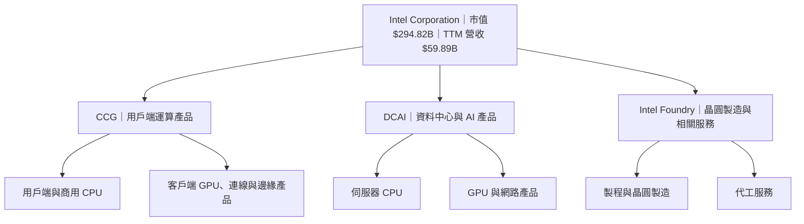
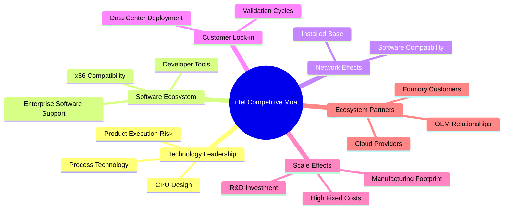
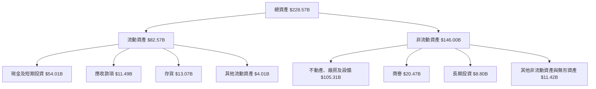
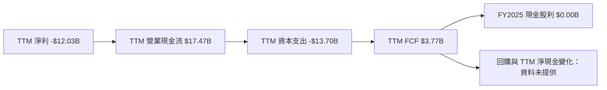
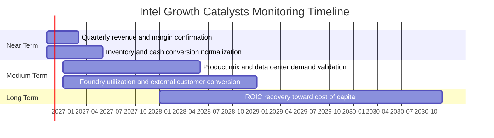
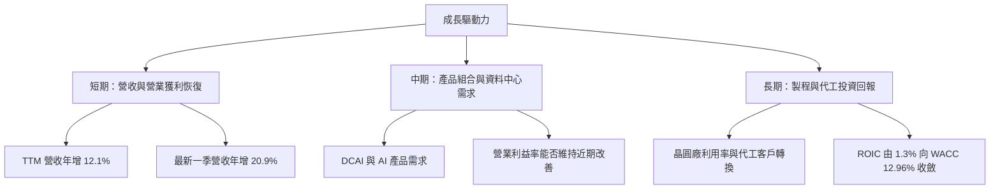
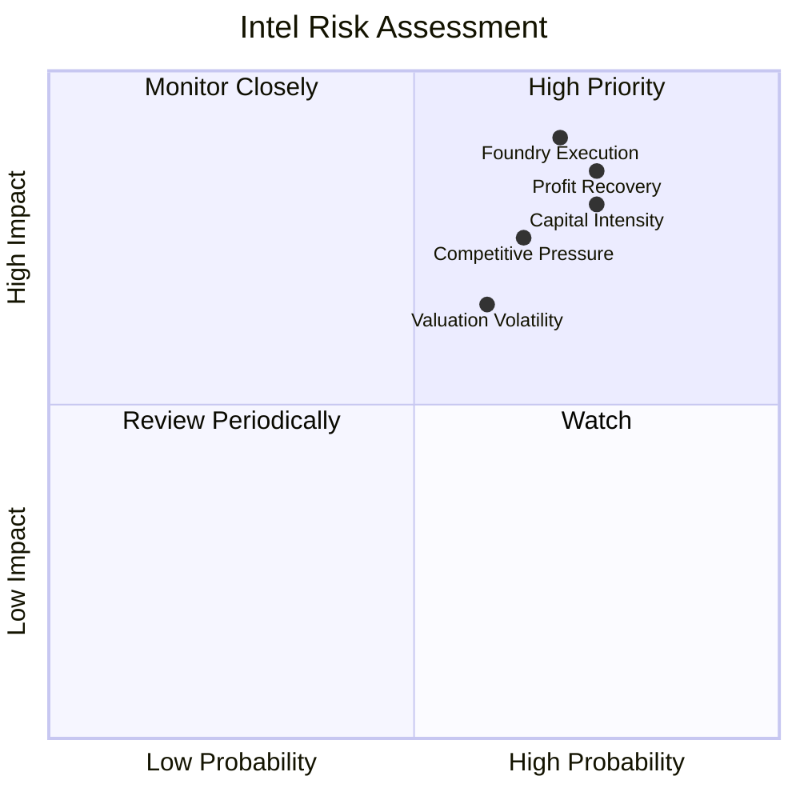
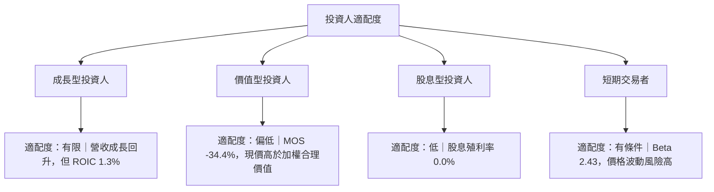

# INTC 基本面深度分析報告
> **報告日期**：2026-11-17 ｜ **語言**：繁體中文 ｜ **數據來源**：SEC 申報資料 (XBRL)、Yahoo Finance、Finviz、StockAnalysis、Roic.ai ｜ **分析師**：CFA 級機構研究

## 目錄

| # | 章節 | 核心結論 |
|---|------|----------|
| 1 | 執行摘要 | 賣出；加權合理價值 $41.26；MOS -34.4% |
| 2 | 公司概覽與商業模式 | CPU 與製造能力具戰略價值，但護城河面臨競爭及執行挑戰 |
| 3 | 損益表深度分析 | TTM 營收 $59.89B、年增 12.1%；最近一季營業利益率改善，但季度盈餘波動大 |
| 4 | 資產負債表分析 | 淨現金 $3.87B；流動性充足，但庫存天數與 CCC 上升 |
| 5 | 現金流量深度分析 | TTM FCF $3.77B，FCF Yield 1.28%；歷年資本支出造成現金流波動 |
| 6 | 獲利能力與資本效率 | ROIC 1.3% 低於 WACC 12.96%，目前仍在摧毀股東價值 |
| 7 | 相對估值分析 | 部分倍數低於成長型同業，但相對自身 P/S 歷史偏高 |
| 8 | DCF 內在價值評估 | DCF 不適用：最近年度預測 FCF 不為正，不能可靠計算 |
| 9 | 成長催化劑 | 產品組合改善與製程執行是關鍵；缺乏可引用的 TAM 數據 |
| 10 | 風險矩陣 | 製程／晶圓廠執行、獲利復原與高估值波動為主要風險 |
| 11 | 投資建議 | 依 MOS 評級為賣出；觀察獲利、FCF、ROIC 與估值再評估 |

---

## 1. 執行摘要

### 1.0 一頁式投資儀表板（Portfolio Manager 30 秒速讀）

截至 2026-11-16 收盤價為 **$55.47**。Intel TTM 營收 **$59.89B**、TTM 年增 **12.1%**，最近一季營收年增 **20.9%**；但 TTM ROIC 僅 **1.3%**，低於 **12.96%** WACC，顯示營收復甦尚未轉化為足夠資本報酬。估值方法加權後合理價值為 **$41.26**，MOS **-34.4%**，因此依規則 20 評級為賣出。

| 項目 | 內容 |
|------|------|
| **投資論點（3 句）** | ① TTM 營收 $59.89B、成長 12.1%，近季年增 20.9%，營收動能正在改善。② TTM FCF $3.77B、FCF Yield 1.28%，仍低於資本密集型轉型所需的現金回報。③ ROIC 1.3% 對比 WACC 12.96%，估值法加權價值 $41.26，低於股價 $55.47。 |
| **綜合評分** | **4.2/10**（引用 1.1 評分卡） |
| **財務健康** | 🟡 現金及短期投資 $54.01B、總債務 $50.13B，淨現金 $3.87B；但現金轉換週期升至 68 天。 |
| **ROIC vs WACC** | **1.3% vs 12.96%**：目前摧毀股東價值。 |
| **FCF 趨勢** | 最近 TTM 為正；FCF Yield **1.28%**，歷年 FCF 曾連續為負，持續性仍待驗證。 |
| **估值** | Forward P/E **30.98x** ｜ EV/EBITDA **16.07x**（市場估值資料）｜ FCF Yield **1.28%** |
| **DCF 內在價值（基準）** | **N/A**（DCF MODEL 不可計算；非 $0，也不代表沒有價值）｜折溢價 N/A |
| **安全邊際（MOS）** | **-34.4%**＝（加權合理價值 $41.26 − 現價 $55.47）÷ $41.26 ｜ 🔴 <10% 無 |
| **預期報酬（基準情境 12M）** | DCF 情境為 N/A；以加權合理價值作為估值參考，上行空間 **-25.6%**，不等同於獨立 12 個月預測。 |
| **關鍵風險（前二）** | 晶圓廠／製程投資未能轉化為報酬；獲利復原速度不及市場預期。 |
| **評級 + 信心度** | 🔴 **賣出** ｜信心：中；估值依據明確，但公司轉型結果不確定性高。 |

### 1.1 綜合評分卡（全報告唯一）

| 維度 | 評分（1–10） | 主要依據（引用數字與其來源章節） |
|------|--------------|----------------------------------|
| 成長性 | 5.0 | TTM 營收成長 12.1%、最近一季年增 20.9%；但年度營收 2022–2025 仍下滑，見第 3 章。 |
| 獲利能力 | 2.5 | TTM ROIC 1.3% 對比 WACC 12.96%；Piotroski F-Score 6/9，見第 6 章。 |
| 財務健康 | 6.0 | 淨現金 $3.87B、流動比率 2.208；CCC 由 35 天升至 68 天，見第 4 章。 |
| 估值 | 2.0 | MOS -34.4%；P/S 歷史百分位 90%，見第 7–8 章。 |
| 護城河 | 6.0 | CPU 生態系與製造能力形成進入障礙，但面對 AMD、NVDA 與外部代工競爭，見第 2 章。 |
| 管理層與資本配置 | 3.5 | 2022–2025 年資本支出每年 $14.65B–$25.75B，歷年 FCF 多為負；最近 TTM 稀釋股數測試未通過，見第 5–6 章。 |
| **綜合評分** | **4.2** | 六項算術平均： (5.0 + 2.5 + 6.0 + 2.0 + 6.0 + 3.5) ÷ 6 = 4.1667，四捨五入至一位小數。 |

### 1.2 五大投資論點 + 三大核心風險

| 類型 | 項目 | 具體依據 | 信心度 |
|------|------|----------|--------|
| 🟢 **投資論點①** | 營收動能回升 | TTM 營收 $59.89B、年增 12.1%；最近一季年增 20.9%，高於 TTM 成長，顯示近期需求與出貨改善。 | 🟡 中 |
| 🟢 **投資論點②** | 近季營業獲利改善 | 最新季度營業利益 $2.58B，季度營業利益率 15.3%（SEC 計算指標）；若可持續，有助於降低 TTM 獲利壓力。 | 🟡 中 |
| 🟢 **投資論點③** | 流動性可支撐轉型 | 現金及短期投資 $54.01B、總債務 $50.13B，淨現金 $3.87B；短期資金緩衝尚可。 | 🟢 高 |
| 🟢 **投資論點④** | 資本回報具改善空間 | ROIC 僅 1.3%，距 WACC 12.96% 尚遠；若新產能提高利用率，改善 ROIC 對股東價值的邊際影響大。 | 🟡 中 |
| 🟢 **投資論點⑤** | 客戶與軟體生態具黏著性 | x86 軟硬體相容性、企業系統部署與開發者工具增加轉換成本；但資料未提供客戶留存率或市場份額數字。 | 🟡 中 |
| 🟡 **風險①** | 大額資本投入回報不足 | 2025 年 Capex $14.65B，TTM Capex $13.70B；ROIC 1.3% 仍顯著低於 WACC。 | 🔴 高衝擊 |
| 🔴 **風險②** | 盈餘與股價波動 | TTM 淨利率 -20.1%、ROE -10.5%；近四季淨利從 -$11.03B 至 +$3.32B 波動，價格亦遠低於 52 週高點 $142.35。 | 🔴 高衝擊 |
| 🟡 **風險③** | 估值對復甦預期敏感 | 加權合理價值 $41.26，低於現價 $55.47；分析師共識目標 $90.65 與相對估值方法差異大。 | 🟡 中 |

### 1.3 快速統計卡片

| 指標 | 公司實際值（期間） | 同業中位數 | 狀態 |
|------|--------------------|------------|------|
| 營收成長（TTM） | **12.1%** | — | 🟢 |
| 營收成長（最新一季年增） | **20.9%** | 44.7%（AMD、NVDA、QCOM） | 🟡 |
| 毛利率（TTM） | **40.2%** | 56.0%（AMD、NVDA、QCOM） | 🔴 |
| 營業利益率（TTM） | **2.9%** | — | 🔴 |
| ROIC（TTM） | **1.3%** | — | 🔴 |
| Forward P/E | **30.98x** | 13.8x（AMD、NVDA、QCOM） | 🔴 |
| FCF Yield（TTM） | **1.28%** | — | 🟡 |
| Piotroski F-Score | **6 / 9** | — | 🟡 |

### 1.4 投資結論

╔══════════════════════════════════════════════════════════════════╗  
║                    📊 投資結論摘要                               ║  
╠══════════════════════════════════════════════════════════════════╣  
║  評級：🔴 賣出（MOS -34.4%，符合規則 20）                        ║  
║  價格（2026-11-16 收盤）：$55.47                                 ║  
║  DCF 內在價值（基準）：N/A（最近年度預測 FCF 不為正）             ║  
║  安全邊際 MOS：-34.4%（以加權合理價值 $41.26 為分母）             ║  
║  加權合理價值（8.8）：$41.26                                     ║  
║  DCF 情境價值：N/A（DCF 模型無法計算）                            ║  
║  綜合評分：4.2/10（引用 1.1）                                    ║  
║  適合投資人：能承受高波動並追蹤製程與資本回報的投資人；不適合以   ║  
║  股息收益或低波動為主要目標的投資人。                            ║  
╚══════════════════════════════════════════════════════════════════╝

---

## 2. 公司概覽與商業模式

### 2.1 業務結構與收入來源

Intel 設計、開發、製造與銷售運算產品，資料列示 CCG、DCAI 與 Intel Foundry 三個主要業務板塊。財務資料未提供各板塊收入及占比，因此不推算分部營收；只呈現公司層級 TTM 營收 **$59.89B**。



### 2.2 市場份額

市場份額數據未提供，故不繪製市場占有率圖表或推測占比。Intel TTM 營收年增 12.1%、最新一季年增 20.9%；同期間比較資料顯示 AMD 最新一季營收年增 44.7%、NVDA 年增 105.9%、QCOM 年減 8.4%。這些公司的業務組合並不完全相同，不能將成長率差異直接等同市場份額變化。

### 2.3 競爭護城河分析



### 2.4 護城河強度

| 護城河項目 | 強度（強／中／弱） | 證據（引用數字或事實） | 會削弱它的情況 |
|------------|--------------------|------------------------|----------------|
| 技術與產品 | 中 | 公司同時設計 CPU 並擁有製造能力；TTM 營收 $59.89B，最近一季年增 20.9%。但資料未提供製程良率或產品效能差距。 | 產品上市延誤、效能／功耗落後或製程良率不佳。 |
| 軟體生態 | 中至強 | x86 相容性及企業軟體部署可提高轉換成本；量化客戶留存率未提供。 | 替代架構軟體相容性改善，或雲端工作負載轉移。 |
| 網路效應 | 弱至中 | 裝機基礎與相容性形成間接網路效果，但無使用者或開發者數據可量化。 | 開發者與 OEM 將資源轉向替代平台。 |
| 客戶鎖定 | 中 | 企業級平台驗證與部署有轉換成本；客戶集中度及續約率資料未提供。 | 價格差距擴大，或客戶重新設計平台。 |
| 規模效應 | 中 | 2025 年研發費用 $13.77B，具有較大研發與製造投資規模；但 TTM ROIC 僅 1.3%。 | 產能利用率低、研發轉化效率不足。 |
| 生態夥伴 | 中 | 公司服務 OEM、雲端與晶圓代工客戶；代工客戶數據未提供。 | 外部代工競爭者在成本、良率或交期上更具優勢。 |

1.1「護城河」評分 **6.0/10**，反映 x86 軟體相容性、企業部署與規模優勢仍有價值，但營運回報與製程執行尚未證明這些優勢可持續轉化為超額報酬。

---

## 3. 損益表深度分析

### 3.1 年度收入成長趨勢（近 4 年）

以下年度營收取自年度損益表；FY2023 起營收連年下降，2026 TTM 回升則代表近期改善，但尚未證明長期趨勢反轉。

```text
╔══════════════════════════════════════════════════════════════════╗
║              Intel 年度收入趨勢（FY2022–FY2025）                ║
╠══════════════════════════════════════════════════════════════════╣
║  FY2022  $63.05B  █████████████████████████  YoY：—             ║
║  FY2023  $54.23B  ██████████████████████     YoY：-14.0% 🔴     ║
║  FY2024  $53.10B  █████████████████████      YoY： -2.1% 🔴     ║
║  FY2025  $52.85B  █████████████████████      YoY： -0.5% 🔴     ║
╠══════════════════════════════════════════════════════════════════╣
║  2022–2025 營收 CAGR：(52.85 ÷ 63.05)^(1/3) − 1 ≈ -5.7%         ║
║  TTM 至 2026-09-26 營收 $59.89B；TTM 年增 12.1%。               ║
╚══════════════════════════════════════════════════════════════════╝
```

FY2023–FY2025 收縮後，TTM 營收年增 12.1%，代表近期需求與產品出貨回升；然而 TTM 與年度財年期間不同，不能把 TTM 成長解讀為全年結果已經確定。

### 3.2 季度收入趨勢分析

| 季度 | 營收 | QoQ 成長 | YoY 成長 | 備註 |
|------|------:|---------:|---------:|------|
| 2025 Q4 | $13.67B | +0.7% | -4.1% | 對比 2025 Q3 $13.65B；營收仍低於去年同期。 |
| 2026 Q1 | $13.58B | -0.7% | +7.2% | 對比 2025 Q4；按同季比較則較 2025 Q1 $12.67B 增長。 |
| 2026 Q2 | $16.13B | +18.8% | +25.4% | 季度加速；可能反映出貨與產品組合改善，需後續季度確認。 |
| 2026 Q3 | $16.51B | +2.4% | +20.9% | 年增率仍高，但 QoQ 增速較 Q2 放緩。 |

QoQ 計算以相鄰季度收入差額除以前一季收入；YoY 以同季去年同期為基期。TTM 營收成長率 12.1% 為程式計算值，不與單季成長率混用。

### 3.3 利潤率演變分析

年度毛利與營業利益以年度損益表數據計算；資料來源中另有毛利金額版本差異，故年度比較只作趨勢參考。TTM 毛利率依營運資料為 40.2%，TTM 營業利益率按 SEC 計算口徑為 2.9%。

| 利潤率指標 | FY2022 | FY2023 | FY2024 | FY2025 | 趨勢 | 評估 |
|------------|-------:|-------:|-------:|-------:|------|------|
| **毛利率** | 42.6% | 40.0% | 32.7% | 34.8% | 2024 下滑，2025 回升 | 🔴 |
| **營業利益率** | 3.7% | 0.1% | -8.9% | 約 0.0% | 大幅受費用與營運環境影響 | 🔴 |
| **淨利率** | 12.7% | 3.1% | -35.3% | -0.5% | 2024 虧損擴大，2025 接近損益平衡 | 🔴 |

- FY2024 毛利率下降，與營收收縮及固定製造成本吸收不足相符；FY2025 毛利率回升約 2.1 個百分點，但仍低於 FY2022。
- 近一季營業利益 $2.58B，季度營業利益率為 15.3%（SEC 計算指標）；這與 TTM 營業利益率 2.9% 的差距反映最近季度改善，但亦顯示單季數字不宜直接年化。
- 另一財務資料來源列示季度營業利益率 10.3%，與 SEC 計算的 15.3% 不一致；本報告以明確標示為「VERIFIED」的 SEC 計算口徑為主，不將兩者混用。

### 3.4 費用結構分析

完整且可同口徑拆分的費用資料不足以製作費用占比圖。可確認 FY2025 研發費用 **$13.77B**，FY2024 為 **$16.55B**；研發降低有助於控制成本，但若削減影響產品競爭力，可能損害未來營收。另年度毛利與部分資料來源存在差異，故不以不完整項目拼接費用圓餅圖。

### 3.5 季度 EPS 趨勢與盈餘品質（Quality of Earnings）

#### 過去四季盈餘與盈餘預期

| 季度 | EPS 實際 | EPS 預期／Surprise | 淨利 | 盈餘解讀 |
|------|---------:|--------------------|------:|----------|
| 2025 Q4 | -$0.12 | N/A | -$0.59B | EPS 預期資料缺漏，無法判斷超預期或不及預期。 |
| 2026 Q1 | -$0.73 | N/A | -$3.73B | 虧損擴大；同比 EPS surprise 缺漏。 |
| 2026 Q2 | -$2.16 | N/A | -$11.03B | 大額虧損；未提供 EPS 預期。 |
| 2026 Q3 | $0.63（另一資料來源列示；季度損益表淨利 $3.32B） | N/A | $3.32B | 由虧轉盈，但不能確認相對市場預期是否超預期。 |

Earnings History 中四季 EPS estimate 與 actual 欄位皆為缺值，故不能臆測 Beat／Miss。第三季每股盈餘資料亦存在來源差異，使用時應以正式申報資料核對。

#### 盈餘品質量化

| 盈餘品質項目 | 數值/佔比 | 評估 |
|--------------|-----------|------|
| 股權薪酬 SBC / 營收 | 約 **4.1%**：近四季 SBC 約 $2.43B ÷ TTM 營收 $59.89B | 🟡 股權薪酬具持續稀釋成本；Piotroski 稀釋股數測試未通過。 |
| SBC / 營業現金流 | 約 **13.9%**：近四季 SBC 約 $2.43B ÷ TTM OCF $17.47B | 🟡 現金流比淨利更穩定，但 SBC 仍是股東經濟成本。 |
| FCF / 淨利（現金轉換率） | TTM FCF $3.77B；TTM 淨利資料為 -$12.03B，直接比值約 -31.3% | 🔴 分母為虧損，比例不具通常的現金轉換解讀；正 FCF 不代表 GAAP 盈利品質已穩定。 |
| 一次性／非經常性損益 | 近四季淨利波動大；可量化一次性項目明細 N/A | 🟡 缺少完整調整項目拆分，無法確認損益是否主要受一次性項目影響。 |
| 有效稅率異常 | N/A（TTM 有效稅率資料未提供） | — 不判斷稅務利益是否帶動盈餘。 |
| 資本化支出 vs 費用化 | TTM Capex $13.70B；資本化與費用化明細 N/A | 🟡 Capex 為大額資本投入；未取得資本化政策明細，不能推斷費用遞延程度。 |

**盈餘品質結論：** TTM FCF 為正，但 TTM 淨利仍為負，且季度淨利波動顯著。SBC 約占 TTM 營收 4.1%，其對股東的稀釋成本不可忽略。以正 FCF 單獨推論可持續獲利並不充分，估值應重視資本支出後的現金流與 ROIC 改善。

---

## 4. 資產負債表分析

### 4.1 資產結構分解

以下使用 2026-09-26 季度資產負債表數據；非流動資產總額以總資產減流動資產計算。



### 4.2 流動性與營運資金分析

| 指標 | 最新值 | 一年前／比較值 | 變化 | 評估 |
|------|------:|--------------:|-----:|------|
| 流動比率 | 2.208 | N/A（同口徑歷史值未提供） | N/A | 🟢 短期流動資產約為流動負債的 2.2 倍。 |
| Quick Ratio | 1.751 | N/A | N/A | 🟢 扣除存貨後仍有流動性緩衝。 |
| DSO 應收帳款天數 | 25 天 | 22 天 | +3 天 | 收款週期略拉長；影響幅度有限，仍需觀察。 |
| DIO 存貨天數 | 133 天 | 122 天 | +11 天 | 🔴 存貨週轉變慢，可能反映備貨、產品轉換或需求預測壓力。 |
| DPO 應付帳款天數 | 90 天 | 109 天 | -19 天 | 付款天數下降，可能反映供應商付款安排變化；不能僅憑此判定議價力。 |
| CCC 現金轉換週期 | 68 天 | 35 天 | +33 天 | 🔴 現金被營運週期占用時間明顯增加。 |

CCC 延長主要由 DSO 增加 3 天、DIO 增加 11 天與 DPO 減少 19 天共同造成；依公式變動方向，存貨週期拉長和應付天數下降會推高 CCC。若庫存天數持續增加，可能壓低後續營業現金流。

### 4.3 債務結構分析

╔══════════════════════════════════════════════════════════════════╗  
║                    Intel 債務健康診斷                            ║  
╠══════════════════════════════════════════════════════════════════╣  
║  總債務：             $50.13B                                    ║  
║  現金及短期投資：     $54.01B                                    ║  
║  淨現金：              $3.87B  🟢                                ║  
║  流動比率：              2.208  🟢                                ║  
║  Quick Ratio：          1.751  🟢                                ║  
║  Debt/EBITDA：            N/A（未以同一口徑提供可比數據）        ║  
║  利息保障倍數：          N/A（利息費用及同口徑 EBIT 未提供）      ║  
╚══════════════════════════════════════════════════════════════════╝

淨現金表示公司目前現金及短期投資略高於總債務，但不代表現金全數可分配；晶圓製造投資可能持續消耗資金。債務／EBITDA及利息保障倍數不自行推算，以免混用不同口徑。

### 4.4 股東權益趨勢

| 年度 | 股東權益 | 年增 | 解讀 |
|------|---------:|-----:|------|
| 2022 | $101.42B | — | 基期。 |
| 2023 | $105.59B | +4.1% | 資產負債表權益增加，但同期淨利為正。 |
| 2024 | $99.27B | -6.0% | 大額淨虧損與其他權益變動可能共同影響；完整橋接資料未提供。 |
| 2025 | $114.28B | +15.1% | 權益回升，但同期淨利仍略為負值，不能只以權益增加認定營運回復。 |

---

## 5. 現金流量深度分析

### 5.1 現金流量瀑布圖

下圖以 TTM 現金流指標呈現方向，不代表淨利到現金流之間各項調節已完整列出。股利以 FY2025 已提供數據為參考；TTM 回購與淨現金變化明細未提供。



### 5.2 FCF 轉換率趨勢

FCF/淨利在淨利接近零或為負時會失去通常意義；表內保留可核對的數值，避免將其解讀為穩定轉換率。

| 年度 | 營業現金流 | Capex | FCF | 淨利 | FCF / 淨利 |
|------|-----------:|------:|----:|-----:|-----------:|
| 2022 | $15.43B | $24.84B | -$9.41B | $8.01B | -117.5% |
| 2023 | $11.47B | $25.75B | -$14.28B | $1.69B | -845.0% |
| 2024 | $8.29B | $23.94B | -$15.66B | -$18.76B | 83.5%* |
| 2025 | $9.70B | $14.65B | -$4.95B | -$0.27B | 1,854%* |
| TTM 至 2026-09-26 | $17.47B | $13.70B | $3.77B | -$12.03B | -31.3%* |

\*淨利為負或接近零，比例不具一般「越高越好」的比較意義。FCF = 營業現金流 − 資本支出，採用 TTM 指標為 $3.77B。

### 5.3 自由現金流趨勢

```text
╔══════════════════════════════════════════════════════════════════╗
║                 自由現金流：歷史實際 vs TTM                      ║
╠══════════════════════════════════════════════════════════════════╣
║  FY2022  -$9.41B  ◀█████████░░░░░░░░░░░░  FCF 為負              ║
║  FY2023 -$14.28B  ◀██████████████░░░░░░░░  FCF 為負              ║
║  FY2024 -$15.66B  ◀████████████████░░░░░░  FCF 為負              ║
║  FY2025  -$4.95B  ◀█████░░░░░░░░░░░░░░░░  較前期改善            ║
║  TTM     +$3.77B   ████░░░░░░░░░░░░░░░░░  FCF Yield 1.28%       ║
╚══════════════════════════════════════════════════════════════════╝
```

2022–2025 FCF 連續為負，主因 Capex 高於營業現金流。TTM 轉正由 OCF $17.47B 高於 Capex $13.70B 所致；能否維持取決於營收、毛利、營運資金及未來投資需求，不能只以單一 TTM 期間判定趨勢已反轉。

### 5.4 資本配置評估

完整回購金額與 TTM 股利資料未提供，不畫比例失真的資本配置圓餅圖。

| 資本用途 | 已知數據 | 評估 |
|----------|----------|------|
| 資本支出 | FY2022 $24.84B；FY2023 $25.75B；FY2024 $23.94B；FY2025 $14.65B；TTM $13.70B | 支出規模大；應以新增產能利用率、毛利與 ROIC 衡量投資回報。 |
| 研發 | FY2025 $13.77B；FY2024 $16.55B | 研發支出下降，但是否影響產品競爭力需觀察。 |
| 股利 | FY2025 現金股利支出 $0.00；股息殖利率 0.0% | 目前不以股息回報股東。 |
| 回購 | N/A（回購金額未提供） | 不推測回購規模。 |
| 留存現金 | 現金及短期投資 $54.01B | 可為轉型提供資金，但資本配置效率仍需以 ROIC 驗證。 |

---

## 6. 獲利能力與資本效率

### 6.1 ROE / ROA / ROIC 趨勢

可比的歷年 ROIC、ROE、ROA 序列未完整提供；依規則不自行補齊年度資料。

| 指標 | 最新數值 | 歷史趨勢資料 | 評估 |
|------|---------:|--------------|------|
| ROE（TTM） | -10.5% | 連續年度同口徑序列未提供 | 🔴 虧損使股東權益報酬為負。 |
| ROA | N/A（品質資料九項測試只提供方向，未提供比例序列） | N/A | — 不推算。 |
| ROIC（TTM） | 1.3% | 10 年以上歷史資料有不同期間口徑，無法直接比較 | 🔴 低於資本成本。 |

無法可靠提供行業均值，故不製作行業均值比較欄。

### 6.2 ROIC vs WACC 分析（核心價值創造判斷）

WACC 採資本成本資料中程式計算值；Beta 使用調整後 Beta **1.95**。其由原始 Beta **2.43** 調整：⅔ × 2.43 + ⅓ = 1.953，四捨五入為 1.95。

╔══════════════════════════════════════════════════════════════════╗  
║                ROIC vs WACC 深度分析                            ║  
╠══════════════════════════════════════════════════════════════════╣  
║  WACC 參數（資本成本資料）：                                      ║  
║  ├── 無風險利率（10Y 美債）：5.12%                               ║  
║  ├── 市場風險溢酬（假設）：5.00%                                 ║  
║  ├── 原始 Beta：2.43；採用調整後 Beta：1.95                     ║  
║  ├── 股權成本：5.12% + 1.95 × 5.00% = 14.87%                   ║  
║  ├── 稅前債務成本：2.18%；預設稅率：21.0%                       ║  
║  ├── 資本權重：股權 85.5%；債務 14.5%                           ║  
║  └── WACC：12.96%（採用程式計算值）                              ║  
║                                                                  ║  
║  ROIC（TTM）：1.3%                                               ║  
║  ├── EVA spread = ROIC − WACC                                    ║  
║  └── 1.3% − 12.96% = -11.66 個百分點                            ║  
║                                                                  ║  
║  ROIC  1.30%  ▓▓░░░░░░░░░░░░░░░░░░░░░░░░░░░░░░  🔴            ║  
║  WACC 12.96%  ▓▓▓▓▓▓▓▓▓▓▓▓▓▓▓▓▓▓▓▓▓▓▓▓▓▓▓▓▓▓▓▓  ──            ║  
║  結論：ROIC 低於 WACC，現階段資本投入未創造足夠經濟回報。       ║  
╚══════════════════════════════════════════════════════════════════╝

WACC 與 ROIC 口徑相同地使用於本節；WACC **12.96%** 是本報告採用的成本資本率。ROIC 低於 WACC **11.66 個百分點**，意味新增資本若維持目前回報，會增加而不是降低價值缺口。因 DCF 模型不適用，本節不另行重建 WACC 或 DCF。

### 6.3 杜邦三因素分解

| 因素 | 數值（TTM） | 解讀 |
|------|-------------|------|
| 淨利率 | -20.1% | 淨利為負，為 ROE 負值的直接來源。 |
| 資產週轉率 | 0.26 | 資產相對營收週轉偏低，與重資產製造模式相符。 |
| 權益乘數 | 1.99 | 槓桿放大資產報酬變動，但不是 ROE 為負的主要根源。 |
| **ROE** | **-10.5%** | 程式提供的杜邦結果：-20.1% × 0.26 × 1.99 = -10.4%（與 -10.5% 的微小差異來自顯示精度）。 |

### 6.4 財務體質：Piotroski F-Score

Piotroski F-Score 為 **6 / 9**；以下測試與結果照錄品質指標。

| 測試 | 結果 | 解讀 |
|------|------|------|
| ROA > 0 | ❌ 未通過 | 獲利能力未達正向門檻。 |
| 營業現金流 > 0 | ✅ 通過 | TTM 營業現金流為 $17.47B。 |
| ROA 高於一年前 | ❌ 未通過 | 資產報酬改善測試未通過。 |
| 營業現金流 > 淨利（應計品質） | ✅ 通過 | 現金流高於淨利，反映現金流與會計淨利的差異。 |
| 長期負債 ÷ 總資產低於一年前 | ✅ 通過 | 槓桿相對資產的測試改善。 |
| 流動比率高於一年前 | ✅ 通過 | 短期流動性比較改善。 |
| 稀釋股數未增加 | ❌ 未通過 | 股數變化對每股價值有稀釋風險。 |
| 毛利率高於一年前 | ✅ 通過 | 毛利率測試改善。 |
| 資產週轉率高於一年前 | ✅ 通過 | 資產運用效率測試改善。 |

F-Score 6/9 屬中間偏正面訊號，但 ROA 與稀釋股數測試未通過，且分數不能替代 ROIC/WACC 分析。

---

## 7. 相對估值分析

### 7.1 同業估值比較表格

Intel 倍數取自市場估值資料；同業倍數使用 Yahoo Finance Peer multiples。Intel Trailing P/E 因 EPS 為負而不具意義，Forward P/E 使用公司估值資料。不同資料源的 EV/EBITDA 口徑可能有差異。

| 估值指標 | **Intel** | **AMD** | **NVDA** | **QCOM** | Intel 評估 |
|----------|----------:|--------:|--------:|--------:|-----------|
| **Trailing P/E** | N/A（TTM EPS -$2.35） | 107.8x | 19.7x | 13.3x | 🔴 虧損，不宜使用 trailing P/E。 |
| **Forward P/E** | 30.98x | 28.6x | 9.9x | 13.8x | 🔴 高於三家同業中位數 13.8x。 |
| **P/S（TTM）** | 4.92x | 18.2x | 12.4x | 4.2x | 🟡 低於 AMD、NVDA，但高於 QCOM。 |
| **EV/EBITDA（TTM）** | 16.07x | 73.6x | 18.6x | 17.8x | 🟢 低於 AMD、略低於 NVDA 與 QCOM；不同來源口徑需留意。 |
| **最新一季營收年增** | 20.9% | 44.7% | 105.9% | -8.4% | 🟡 Intel 成長，但低於 AMD、NVDA。 |
| **毛利率（TTM）** | 40.2% | 56.0% | 74.7% | 53.1% | 🔴 低於三家同業。 |

同業中位數：Trailing P/E **19.7x**；Forward P/E **13.8x**；P/S **12.4x**；EV/EBITDA（AMD、NVDA、QCOM 三家中位數）**18.6x**。第 8.8 節 EV/EBITDA 估值方法使用程式指定的兩家公司中位數 **18.2x**，不以本表的三家公司中位數替換。

### 7.2 歷史估值區間分析

╔══════════════════════════════════════════════════════════════════╗  
║                Intel 歷史估值位置（5 年）                         ║  
╠══════════════════════════════════════════════════════════════════╣  
║  P/S：現在 4.9x ｜中位數 2.6x｜區間 1.5x–11.5x                  ║  
║  當前歷史百分位：90%　🔴 高於自身歷史中位數                      ║  
║                                                                  ║  
║  EV/EBITDA：現在 21.5x｜中位數 23.6x｜區間 6.4x–536.5x          ║  
║  當前歷史百分位：41%　🟡 低於中位數但接近中段                    ║  
║                                                                  ║  
║  P/E 歷史區間：N/A（估值歷史資料未提供）                          ║  
╚══════════════════════════════════════════════════════════════════╝

P/S 現值 4.9x 高於歷史中位數 2.6x，且位於歷史 90 百分位；若營收回升未轉化為利潤，較高的銷售倍數會增加估值回調風險。EV/EBITDA 自身歷史區間極寬，百分位解讀須保守。

### 7.3 情境價值（Bear / Base / Bull，照抄 DCF MODEL 的 Scenarios）

**N/A（DCF 無法計算：最近年度預測 FCF 不為正，Capex 高於營業利益及折舊攤銷）**。依估值資料規則，不提供自行設定的悲觀、基準或樂觀 DCF 價格。

### 7.4 相對估值隱含價格區間

╔══════════════════════════════════════════════════════════════════╗  
║           相對估值方法與 2026-11-16 收盤價 $55.47                 ║  
╠══════════════════════════════════════════════════════════════════╣  
║  同業 Forward P/E： $24.72  ◀────────── $55.47 現價              ║  
║  同業 EV/EBITDA：   $46.83  ◀──── $55.47 現價                    ║  
║  分析師共識目標價： $90.65  ───────────────▶                     ║  
╚══════════════════════════════════════════════════════════════════╝

| 方法 | 每股價值 | 相對現價 | 依據 |
|------|---------:|---------:|------|
| 同業 Forward P/E | $24.72 | -55.4% | 同業中位數 13.8x × Forward EPS $1.79。 |
| 同業 EV/EBITDA | $46.83 | -15.6% | NVDA、QCOM 中位數 EV/EBITDA 18.2x × TTM EBITDA，再加回淨現金。 |
| 分析師共識目標價 | $90.65 | +63.4% | 43 位分析師平均目標價，作為參考而非獨立現金流估值。 |

---

## 8. DCF 內在價值評估（Discounted Cash Flow）

### 8.0 估值推理鏈（Thinking Logic）

**DCF MODEL：N/A。** 最近年度預測 FCF 不為正，資料指出 Capex 高於營業利益與折舊攤銷；在此情況下直接套用長期成長與終值假設，會把尚未證明的利潤率復原預期包裝成精確估值。因此本章不自行建立模型，不給 DCF 基準價、敏感度、三情境或反推 DCF。

| 決策點 | 本報告處理 | 理由 | 曾考慮但否決 | 否決理由 |
|--------|-----------|------|--------------|----------|
| 現金流定義 | N/A | DCF MODEL 判定預測最後年度 FCF 不為正。 | 自建 FCFF 模型 | 規則要求只能使用既定 DCF MODEL，且模型不可計算。 |
| 預測期 N | N/A | 程式模型未提供可用預測期。 | 自選 5–10 年 | 會導入未經驗證的假設。 |
| 終值方法 | N/A | 無可用正向預測 FCF 作為基礎。 | Gordon Growth／退出倍數 | 缺少可供計算的模型現金流與假設。 |
| EBIT 基礎與 SBC | N/A | 不存在可引用的 DCF 假設表。 | 自行套用 GAAP EBIT | 不得另建模型或自創輸入。 |

模型最脆弱處並非某個可調參數，而是能否先建立可靠、正值且可持續的預測 FCF；這也是 DCF 目前不適用的原因。

### 8.1 模型假設總表（Model Inputs）

N/A（數據未提供：DCF MODEL 不可計算，未提供預測期、營收成長、營業利潤率、稅率、Capex、折舊、營運資金、SBC、稀釋股數與終值假設）。

### 8.2 折現率推導（WACC）

DCF 折現率推導：N/A（本章 DCF 模型不可計算）。成本資本資料列示 WACC **12.96%**，已於第 6.2 節用於 ROIC 比較；本節不重建 DCF，也不以其他 WACC 替代。

### 8.3 逐年自由現金流預測（基準情境）

N/A（DCF MODEL 不可計算：最近年度預測 FCF 不為正，Capex 高於營業利益與折舊攤銷）。因此無逐年預測欄位、FCFF 現值或逐步演算。

### 8.4 終值計算（Terminal Value）

N/A（沒有可用的 DCF 預測現金流與終值假設；不計算 Gordon Growth 或退出倍數終值）。

### 8.5 企業價值 → 每股內在價值（Bridge）

N/A（DCF 企業價值與每股內在價值未計算，故 DCF 折溢價亦為 N/A）。**本節不計算 MOS**；MOS 僅於 8.8 以加權合理價值為分母計算。

### 8.6 敏感性分析（WACC × 永續成長率）

N/A（DCF MODEL 不可計算，沒有可照錄的敏感度矩陣；不自行建立矩陣或估算每股價值）。

### 8.7 反推 DCF（Reverse DCF：市場在預期什麼）

N/A（DCF MODEL 不可計算，無法依現價求解營收 CAGR、利潤率、永續成長率或預測期）。不提供試算軌跡或反推里程碑。

### 8.8 估值三角驗證與安全邊際

估值方法依程式指定的公司類型 **profitable** 權重照錄。DCF 因不可計算而被剔除，其權重由其餘方法依既定方法分配；未增刪估值方法或調整權重。

| 估值方法 | 隱含每股價值 | 上行空間（÷現價） | 權重 | 說明 |
|----------|--------------:|-------------------:|------:|------|
| 同業 Forward P/E | $24.72 | -55.4% | 45% | 同業中位數 13.8x ×公司 Forward EPS $1.79。 |
| 同業 EV/EBITDA | $46.83 | -15.6% | 45% | 同業指定中位數 18.2x × TTM EBITDA，加回淨現金。 |
| 分析師共識目標價 | $90.65 | +63.4% | 10% | 43 位分析師平均目標價，僅作參考。 |
| **加權合理價值** | **$41.26** | **-25.6%** | **100%** | 公司類型 profitable；DCF 基準不可計算。 |

**逐步演算（權重外顯）：**

- 同業 Forward P/E 貢獻：$24.72 × 45% = $11.124
- 同業 EV/EBITDA 貢獻：$46.83 × 45% = $21.0735
- 分析師共識貢獻：$90.65 × 10% = $9.065
- 加權合理價值：$11.124 + $21.0735 + $9.065 = **$41.2625，列示 $41.26**
- 權重合計：45% + 45% + 10% = **100%**

以未四捨五入加權價值 $41.2625 計算，MOS = ($41.2625 − $55.47) ÷ $41.2625 = **-34.4%**；上行空間 = ($41.2625 − $55.47) ÷ $55.47 = **-25.6%**。顯示值遵循程式提供的 $41.26、MOS -34.4%、上行空間 -25.6%。

╔══════════════════════════════════════════════════════════════════╗  
║                  估值區間與安全邊際                              ║  
╠══════════════════════════════════════════════════════════════════╣  
║  $24.72 ───── $41.26 ───── [$55.47 現價] ───── $90.65            ║  
║  Forward P/E   加權合理值    2026-11-16 收盤      分析師共識      ║  
║                                                                  ║  
║  安全邊際 MOS = (加權合理價值 − 現價) ÷ 加權合理價值 = -34.4%   ║  
║  MOS 評估：🔴 <10% 無                                           ║  
║  上行空間 = (加權合理價值 − 現價) ÷ 現價 = -25.6%               ║  
║                                                                  ║  
║  買入參考上限（MOS ≥10%）：$41.26 × (1−10%) = $37.13            ║  
║  合理價值附近：以 $41.26 為參考，並非獨立價格預測               ║  
║  減碼考慮：現價 $55.47 高於加權合理價值 $41.26                  ║  
╚══════════════════════════════════════════════════════════════════╝

> 🔎 **程式複算（Python，依本節各項自動重算）**
>
> 加權合理價值 = $24.72 × 45% + $46.83 × 45% + $90.65 × 10% = **$41.26**（權重合計 100%）
>
> 以價格 $55.47 計：MOS = **-34.4%**，上行空間 = **-25.6%**
>
> ✅ 與本節所寫數值一致。

### 8.9 DCF 模型的局限與失效條件

- **終值依賴度：** N/A；DCF 不可計算，因此無法衡量終值占企業價值比重。
- **最脆弱的假設：** 目前不存在可檢驗的 DCF 假設組。實際投資論點的關鍵變數為近期營收復甦是否能轉成持續正 FCF，以及 ROIC 能否向 WACC 收斂。
- **不適用情境：** 在資本支出高、過去數年 FCF 為負、獲利波動大的階段，單一 DCF 的可靠度下降。相對估值、EV/Sales、產能利用率及分部獲利更適合作為交叉檢驗，但本報告只引用已提供的估值方法。
- **與第 10 章風險矩陣的連結：** 製程執行失敗會壓低營業利益率並延後正 FCF；需求低於預期會壓低營收成長；資本支出超預期會推遲自由現金流轉正。

### 8.10 複算檢核表（Audit Trail）

由於 DCF MODEL 為 N/A，涉及自建 DCF 的項目不適用；可核對的估值加權、MOS、評級與報告章節完整性如下。

| # | 檢核項目 | 檢查方式 | 結果 |
|---|----------|----------|------|
| 1 | DCF 高／中敏感度假設推導 | DCF 輸入未提供 | N/A |
| 2 | DCF 假設均有來歷 | 無可用 DCF 假設表 | N/A |
| 3 | WACC 五步算式與 DCF | 不重建 WACC；第 6.2 節採程式值 12.96% | N/A |
| 4 | Kd 與債務權重一致性 | 無自建 DCF WACC | N/A |
| 5 | WACC 與第 6.2 節一致 | 第 6.2 節引用 12.96%；本章無 DCF 折現率 | N/A |
| 6 | 預測年度與 N | DCF 模型不可計算 | N/A |
| 7 | FY+1 FCFF/PV 算式 | DCF 模型不可計算 | N/A |
| 8 | 預測期 PV 加總 | DCF 模型不可計算 | N/A |
| 9 | WACC > g | 未提供 DCF 的 g | N/A |
| 10 | 終值基期及折現期數 | DCF 模型不可計算 | N/A |
| 11 | DCF EV 至每股價值橋接 | DCF 模型不可計算 | N/A |
| 12 | SBC 與 DCF 股數處理 | 無 DCF 股數假設 | N/A |
| 13 | 敏感度矩陣基準格 | 無矩陣 | N/A |
| 14 | 矩陣有效格 | 無矩陣 | N/A |
| 15 | DCF 三情境機率 | 無 DCF 情境 | N/A |
| 16 | 反推 DCF 單一變數與軌跡 | 無可用模型 | N/A |
| 17 | MOS、折溢價基準 | MOS 以 8.8 加權合理價值；DCF 折溢價 N/A | ✅ |
| 18 | 報告完整至第 11 章 | 章節 1–11 均列示 | ✅ |
| 19 | 加權合理價值可複算 | $24.72×45% + $46.83×45% + $90.65×10% = $41.2625 | ✅ |
| 20 | 評級符合規則 20 | MOS -34.4% < -25%，評級賣出 | ✅ |

---

## 9. 成長催化劑

### 9.1 催化劑時間軸

資料未提供公司管理層正式產品上市時程，以下為分析追蹤期間，不代表公司已承諾的交付日期。



### 9.2 TAM 市場規模分析

N/A（TAM 數據未提供）。Intel TTM 營收 $59.89B、年增 12.1%，最新一季年增 20.9%；成長空間需由 CCG、DCAI 與 Foundry 的實際營收、毛利及產能利用率驗證，不能以未提供的 TAM 金額推算市占或滲透率。

### 9.3 成長驅動力結構圖



---

## 10. 風險矩陣

### 10.1 風險評分矩陣

機率與衝擊位置為分析師的定性排序，不是公司披露的統計機率。



### 10.2 風險清單詳細分析

| # | 風險項目 | 發生機率 | 財務衝擊 | 風險評分 | 緩解措施 |
|---|----------|----------|----------|----------|----------|
| 1 | 🔴 **製程與晶圓廠執行風險** | 中高（分析師定性） | 高；Capex 對現金流影響大，但未提供單項損失估計 | 🔴 高 | 追蹤產能利用率、良率、外部代工客戶進度與 Capex/營收。 |
| 2 | 🔴 **獲利復原不持續** | 中高（分析師定性） | 高；TTM 營業利益率 2.9%，ROIC 1.3% | 🔴 高 | 連續檢視季度營業利益率、毛利率及正 FCF 持續性。 |
| 3 | 🟡 **競爭與產品組合壓力** | 中高（分析師定性） | 中高；Intel 最新一季營收增長 20.9%，但 AMD 44.7%、NVDA 105.9% | 🟠 中高 | 分別追蹤 CCG、DCAI 與 Foundry 營收及毛利；資料未提供分部數值，需待申報確認。 |
| 4 | 🟡 **庫存與營運資金占用** | 中 | 中；DIO 133 天、CCC 68 天 | 🟠 中 | 追蹤庫存天數及 CCC 是否回落，避免營收成長由庫存堆積帶動。 |
| 5 | 🟡 **股價及估值波動** | 中高（分析師定性） | 中高；52 週高 $142.35、低 $32.89；現價 $55.47 | 🟠 中高 | 以分批風險控管處理，避免把分析師目標價當作保證價值。 |

---

## 11. 投資建議

### 11.1 最終評級與評分

依 MOS **-34.4%**，規則 20 對應 **賣出**，本報告不因質化因素調整評級。綜合評分為 **4.2/10**，由成長性 5.0、獲利能力 2.5、財務健康 6.0、估值 2.0、護城河 6.0、管理層與資本配置 3.5 算術平均而來。

### 11.2 合理價值與隱含報酬率

| 估值基準 | 每股價值 | 相對 2026-11-16 收盤 $55.47 | 機率／權重 | 說明 |
|----------|---------:|---------------------------:|-----------:|------|
| 同業 Forward P/E | $24.72 | -55.4% | 45% | 程式指定估值方法。 |
| 同業 EV/EBITDA | $46.83 | -15.6% | 45% | 程式指定估值方法。 |
| 分析師共識 | $90.65 | +63.4% | 10% | 43 位分析師平均目標價。 |
| **加權合理價值** | **$41.26** | **上行空間 -25.6%** | **100%** | MOS -34.4%；為本報告的加權價值基準。 |
| DCF 悲觀／基準／樂觀情境 | N/A | N/A | N/A | DCF MODEL 不可計算，不自行設定情境目標價。 |

### 11.3 買入時機與觸發因素

╔══════════════════════════════════════════════════════════════════╗  
║                  ✅ 買入觸發因素 Checklist                      ║  
╠══════════════════════════════════════════════════════════════════╣  
║  重新評估買入條件：                                              ║  
║  ☐ 股價回到 $37.13 或以下，達到加權合理價值約 10% MOS 對應價位。 ║  
║  ☐ TTM FCF 維持正值，且連續季度未因 Capex 回升而轉負。           ║  
║  ☐ ROIC 有持續改善證據，並逐步縮小與 WACC 12.96% 的差距。        ║  
║  ☐ 存貨天數及 CCC 由 133 天、68 天向較低方向改善。               ║  
║                                                                  ║  
║  加碼觸發條件：                                                  ║  
║  ☐ 近期營收成長轉化為連續數季營業利益率與現金流改善。            ║  
║  ☐ 分部獲利、產能利用率及外部代工客戶進度有可核對披露。          ║  
║                                                                  ║  
║  減碼／退出觸發條件：                                            ║  
║  ☐ TTM FCF 再度轉負且資本支出沒有同步改善投資回報。               ║  
║  ☐ ROIC 長期停留在低於 WACC 的水平，或季度營業獲利再度轉負。      ║  
║  ☐ DIO、CCC 持續惡化，顯示庫存與營運資金占用加劇。               ║  
╚══════════════════════════════════════════════════════════════════╝

### 11.4 投資人適配度分析



### 11.5 每季財報監控清單（Quarterly Watch List）

| 指標 | 目前基準 | 加碼觀察訊號 | 減碼／重新檢視訊號 |
|------|---------:|--------------|--------------------|
| 營收成長 | TTM +12.1%；最新一季 YoY +20.9% | YoY 成長延續，且不僅由單季或基期因素帶動 | 連續兩季 YoY 成長低於 0%。 |
| 營業利益率 | TTM 2.9%；最新季度 SEC 計算 15.3% | TTM 利益率持續上升，且季度改善可重複 | TTM 利益率再次轉負。 |
| 毛利率 | TTM 40.2% | 季度毛利率續升且與產品組合改善相符 | 毛利率連續兩季低於 TTM 基準。 |
| Capex | TTM $13.70B；FY2025 $14.65B | Capex 支出伴隨 FCF 與 ROIC 改善 | Capex 增加但 FCF 轉負或 ROIC 不升。 |
| FCF | TTM $3.77B；Yield 1.28% | 後續 TTM 維持正值並提高 | 連續兩個季度 FCF 為負，或 TTM 轉負。 |
| 存貨與 CCC | DIO 133 天；CCC 68 天 | DIO、CCC 同步下降 | CCC 高於 68 天且持續惡化。 |
| 股權薪酬與股數 | SBC 約占近四季營收 4.1%；F-Score 股數測試未通過 | SBC/營收下降、稀釋股數穩定 | SBC 占比上升且稀釋股數續增。 |
| 資本回報 | ROIC 1.3%；WACC 12.96% | ROIC 持續上升、價值缺口收窄 | ROIC 無改善或繼續下降。 |
| 財測與分部資訊 | 分部營收與管理層財測未提供 | 分部成長、利潤率、產能利用率有透明披露 | 財測下修，或關鍵投資進度延誤。 |

### 11.6 反面論證：什麼會證明論點錯誤（What Would Change My Mind）

╔══════════════════════════════════════════════════════════════════╗  
║              ⚠️ 論點失效條件（Disconfirming Evidence）           ║  
╠══════════════════════════════════════════════════════════════════╣  
║  下列情況將推翻「近期復甦可提高長期價值」的多頭論點：            ║  
║  ☐ 最新一季營收年增率連續兩季低於 0%。                           ║  
║  ☐ TTM 營業利益率由目前 2.9% 降至負值。                          ║  
║  ☐ TTM FCF 由目前 $3.77B 轉負，且非短期資本支出時點差異。        ║  
║  ☐ ROIC 持續低於 WACC 12.96%，且 8 季內無改善趨勢。              ║  
║  ☐ DIO 高於 133 天且 CCC 高於 68 天並連續兩季惡化。               ║  
║  ☐ SBC/營收高於目前約 4.1%，同時稀釋股數繼續增加。               ║  
╚══════════════════════════════════════════════════════════════════╝

> **免責聲明**：本報告為 AI 自動生成，僅供研究參考，不構成投資建議。投資有風險，入市需謹慎。

---

## 資料與來源

| 項目 | 內容 |
|------|------|
| 價格 | 55.47 USD，2026-11-16 收盤（Yahoo Finance 日線） |
| 財務報表 | SEC 10-Q filed 2026-10-30，最新季度 2026-09-26（FY2026 Q3） |
| 有回應的資料來源 | SEC 申報資料 (XBRL)、Yahoo Finance、Finviz、StockAnalysis、Roic.ai |
| 由程式計算 | TTM 數字、WACC、DCF 模型、估值方法與權重、加權合理價值、MOS、評級門檻、F-Score、杜邦分解、營運資金天數、綜合評分 |
| 撰寫模型 | openai / gpt-6-luna |

> 本區塊由產生報告的程式依實際取得的資料填寫，非模型撰寫。「由程式計算」的數字不是模型的估計；其餘判斷（評分、情境、策略）是模型的分析。
