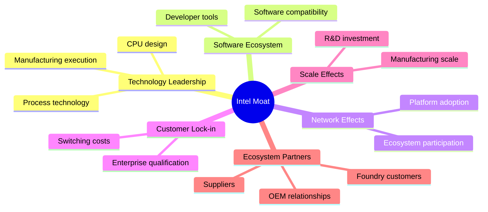
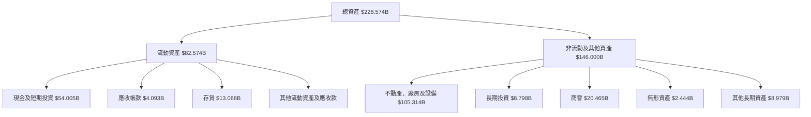
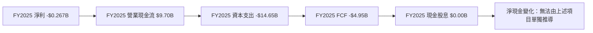
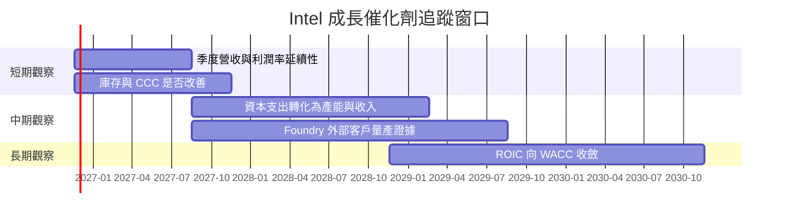
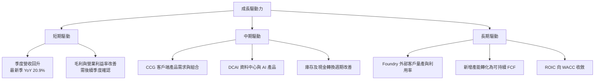
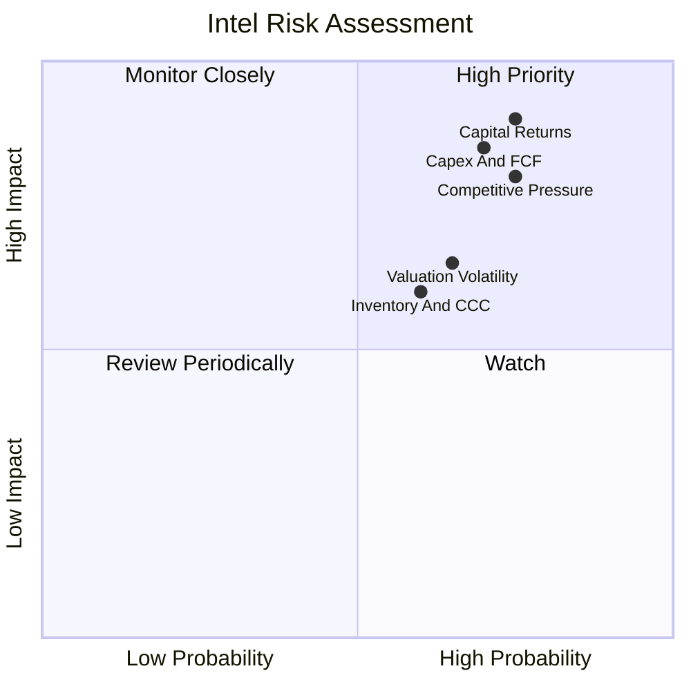
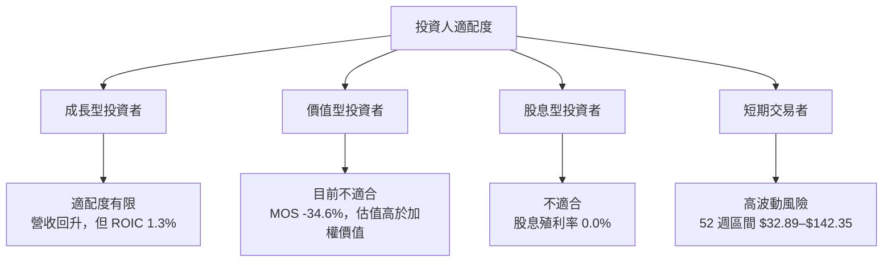

# INTC 基本面深度分析報告
> **報告日期**：2026-11-18 ｜ **語言**：繁體中文 ｜ **數據來源**：SEC 申報資料 (XBRL)、Yahoo Finance、Finviz、StockAnalysis、Roic.ai ｜ **分析師**：CFA 級機構研究

## 目錄

| # | 章節 | 核心結論 |
|---|------|----------|
| 1 | 執行摘要 | 賣出；加權合理價值 $40.98；MOS -34.6% |
| 2 | 公司概覽與商業模式 | 有製造與產品平台基礎，但競爭優勢受執行與產品競爭考驗 |
| 3 | 損益表深度分析 | TTM 營收 $59.89B、TTM 成長 12.1%；利潤率數據來源有差異，獲利仍波動 |
| 4 | 資產負債表分析 | 淨現金 $3.87B、流動比率 2.208；庫存天數與 CCC 上升 |
| 5 | 現金流量深度分析 | TTM FCF $3.77B、FCF Yield 1.29%；高資本支出仍壓抑現金回報 |
| 6 | 獲利能力與資本效率 | ROIC 1.3% 明顯低於 WACC 12.94%，目前摧毀股東價值 |
| 7 | 相對估值分析 | Forward P/E 高於同業中位數；P/S 高於自身五年中位數 |
| 8 | DCF 內在價值評估 | DCF N/A：預測期末 FCF 不為正，無法建立有效模型 |
| 9 | 成長催化劑 | 季度營收回升是正面訊號，但缺少可引用的 TAM 與催化劑財務量化資料 |
| 10 | 風險矩陣 | 製造投入回報、競爭與盈利反覆是主要風險 |
| 11 | 投資建議 | 評級賣出；需等待估值與資本報酬改善後再評估 |

## 1. 執行摘要

### 1.0 一頁式投資儀表板

| 項目 | 內容 |
|------|------|
| **投資論點（3 句）** | ① TTM 營收成長 12.1%、最新一季年增 20.9%，營運有回升跡象。② TTM ROIC 僅 1.3%，低於 WACC 12.94%，目前資本回報未覆蓋資本成本。③ TTM FCF 為 $3.77B、FCF Yield 1.29%，且年度資本支出仍高，現金創造能力尚未充分轉化為股東回報。 |
| **綜合評分** | **4.6/10**（引用 1.1 評分卡） |
| **財務健康** | 🟡 現金及短期投資 $54.01B、總債務 $50.13B，淨現金 $3.87B；流動比率 2.208，但營運資金週期惡化。 |
| **ROIC vs WACC** | **1.3% vs 12.94%**；ROIC 低於資本成本，摧毀股東價值。 |
| **FCF 趨勢** | TTM FCF $3.77B、FCF Yield 1.29%；較 FY2022–FY2025 多年負 FCF 有改善，但仍受資本支出影響。 |
| **估值** | Forward P/E 30.8x ｜ EV/EBITDA 15.99x（市場估值資料）｜ FCF Yield 1.29%。 |
| **DCF 內在價值（基準）** | **N/A**；DCF 模型未能計算，原因見第 8 章。故不計 DCF 折溢價。 |
| **安全邊際（MOS）** | **-34.6%＝($40.98 − $55.17) ÷ $40.98**；基準為 8.8 加權合理價值。🔴 不具安全邊際。 |
| **預期報酬（基準情境 12M）** | DCF 情境 N/A；以加權合理價值衡量的隱含上行空間為 **-25.7%**，不是 DCF 基準情境報酬。 |
| **關鍵風險（前二）** | 資本報酬長期低於資本成本；競爭與高資本支出使復甦未能轉成持續 FCF。 |
| **評級 + 信心度** | 🔴 **賣出** ｜ 信心：中。評級由 MOS -34.6% 對應規則 20 的賣出門檻；DCF 不可計算，限制估值信心。 |

### 1.1 綜合評分卡（全報告唯一）

| 維度 | 評分（1–10） | 主要依據（引用數字與其來源章節） |
|------|--------------|----------------------------------|
| 成長性 | 6.0 | TTM 營收成長 12.1%、最新一季年增 20.9%；但最近三個季度收入年增速度不均（第 3.2 節）。 |
| 獲利能力 | 3.0 | ROIC 1.3% 對比 WACC 12.94%；TTM F-Score 6/9，但 ROA 測試未通過（第 6 章）。 |
| 財務健康 | 6.5 | 淨現金 $3.87B、流動比率 2.208；CCC 從 35 天增至 68 天（第 4 章）。 |
| 估值 | 2.0 | 加權合理價值 $40.98、MOS -34.6%；P/S 4.9x，高於自身五年中位數 2.6x（第 7、8 章）。 |
| 護城河 | 6.0 | 擁有產品、製造與客戶生態基礎，但面臨 AMD、NVIDIA、Qualcomm 等競爭；未提供各業務市占數字（第 2 章）。 |
| 管理層與資本配置 | 4.0 | FY2022–FY2025 資本支出每年約 $14.65B–$25.75B；Piotroski 稀釋股數測試未通過，投資回報仍需驗證（第 5、6 章）。 |
| **綜合評分** | **4.6** | 六項算術平均：\((6.0+3.0+6.5+2.0+6.0+4.0)÷6=4.6\)。 |

### 1.2 五大投資論點 + 三大核心風險

| 類型 | 項目 | 具體依據 | 信心度 |
|------|------|----------|--------|
| 🟢 **投資論點①** | 營收回升提供復甦訊號 | TTM 營收 $59.89B、TTM 成長 12.1%；最新一季營收 $16.51B，年增 20.9%。若產品需求與交付延續，營收基礎可改善固定成本吸收。 | 🟡 中 |
| 🟢 **投資論點②** | 最新一季營運改善 | 最新一季營業利益率 15.3%，高於 TTM 2.9%；表示最近一季的獲利狀況較整體 TTM 好，但尚不足以證明可持續。 | 🟡 中 |
| 🟢 **投資論點③** | 資產負債表仍有緩衝 | 現金及短期投資 $54.01B、總債務 $50.13B，淨現金 $3.87B；流動比率 2.208，短期償債緩衝尚可。 | 🟢 高 |
| 🟢 **投資論點④** | TTM FCF 已轉正 | TTM 營業現金流 $17.47B 減資本支出 $13.70B，FCF 為 $3.77B；改善有助降低外部融資需求，但 FCF Yield 僅 1.29%。 | 🟡 中 |
| 🟢 **投資論點⑤** | 多元產品及製造平台具策略價值 | 公司涵蓋客戶運算、資料中心與 AI、Foundry 等業務；但各部門收入拆分與市占數據未提供，策略價值尚須以持續獲利與客戶量產證明。 | 🟡 中 |
| 🟡 **風險①** | 資本報酬低於資本成本 | TTM ROIC 1.3%，WACC 12.94%，差距 -11.64 個百分點；若不能提高產能利用率及營業利潤率，新增投資可能繼續稀釋回報。 | 🔴 高衝擊 |
| 🔴 **風險②** | 高資本支出與獲利波動 | FY2024 資本支出 $23.94B、FCF -$15.66B；TTM 雖恢復正 FCF，但未來製造投入可能再次使 FCF 轉負。 | 🔴 高衝擊 |
| 🟡 **風險③** | 估值與營運表現不匹配 | 股價 $55.17，高於加權合理價值 $40.98；Forward P/E 30.8x，約為同業中位數 13.7x 的 2.25 倍。 | 🔴 高 |

### 1.3 快速統計卡片

| 指標 | 公司實際值（期間） | 同業中位數 | 狀態 |
|------|--------------------|------------|------|
| 營收成長（TTM） | **12.1%** | — | 🟢 |
| 營收成長（最新一季年增） | **20.9%** | 44.7% | 🟡 |
| 毛利率（TTM） | **40.2%** | 56.0% | 🔴 |
| 營業利益率（TTM） | **2.9%**（VERIFIED FIGURES） | — | 🔴 |
| ROIC（TTM） | **1.3%** | — | 🔴 |
| Forward P/E | **30.8x** | 13.7x | 🔴 |
| FCF Yield（TTM） | **1.29%** | — | 🟡 |
| Piotroski F-Score | **6 / 9** | — | 🟡 |

### 1.4 投資結論

╔══════════════════════════════════════════════════════════════════╗  
║                    📊 投資結論摘要                               ║  
╠══════════════════════════════════════════════════════════════════╣  
║  評級：🔴 賣出（MOS -34.6%，符合規則 20；未作質化調整）          ║  
║  價格（2026-11-17 收盤）：$55.17                                 ║  
║  DCF 內在價值（基準）：N/A（模型無法計算）                       ║  
║  安全邊際 MOS：-34.6%（以加權合理價值 $40.98 為分母）           ║  
║  加權合理價值（8.8）：$40.98                                     ║  
║  DCF 情境價值：N/A（DCF 模型未能計算）                           ║  
║  綜合評分：4.6/10（引用 1.1）                                    ║  
║  適合投資人：能承受高波動、以復甦選擇權為主的投資人；不適合      ║  
║              需要穩定股息或低估值安全邊際的投資人                ║  
╚══════════════════════════════════════════════════════════════════╝

## 2. 公司概覽與商業模式

### 2.1 業務結構與收入來源

公司資料列示 Intel 的主要業務涵蓋 Client Computing Group（CCG）、Data Center and AI（DCAI）與 Intel Foundry。未提供各業務營收與占比，故不估算部門比例；以下只呈現可確認的業務關係。

```mermaid
graph TD
    I["Intel Corporation<br/>市值 $293.23B<br/>TTM 營收 $59.89B"]
    I --> C["CCG：客戶端運算"]
    I --> D["D["DCAI：資料中心與 AI"]
    I --> F["Intel Foundry：晶圓製造服務"]
    C --> C1["客戶與商用 CPU、離散 GPU、邊緣運算、連接產品"]
    D --> D1["伺服器 CPU、離散 GPU、網路產品"]
    F --> F1["製程與晶圓製造能力"]
    I --> S["軟體與服務：收入拆分未提供"]
```

### 2.2 市場份額

市場份額數據未提供，因此不列市占比例或市場份額圖。Intel TTM 營收為 $59.89B，最新一季年增 20.9%；作為比較，Peer multiples 所列 AMD 最新一季營收年增 44.7%、NVIDIA 105.9%、Qualcomm -8.4%。營收成長比較並非市占比較，亦不能單獨推論競爭地位變化。

### 2.3 競爭護城河分析



### 2.4 護城河強度

| 護城河項目 | 強度（強／中／弱） | 證據（引用數字或事實） | 會削弱它的情況 |
|------------|--------------------|------------------------|----------------|
| 技術與產品平台 | 中 | CCG、DCAI 涵蓋客戶端、伺服器及 AI 產品；最新一季營收年增 20.9%。 | 競爭對手產品效能、能效或產品推出節奏持續領先。 |
| 軟體生態系統 | 中 | 公司提供 CPU、GPU、網路等平台產品；財務資料未提供軟體收入及開發者留存指標。 | 開發者工具或軟體支援未能保持相容性與採用度。 |
| 網路效應 | 弱至中 | 平台與 OEM、軟體及企業部署形成間接網絡；沒有用戶或開發者規模數據可量化。 | 客戶採用 AMD、ARM 或其他替代平台增加。 |
| 客戶鎖定 | 中 | 企業伺服器與 PC 產品涉及驗證與相容性，但公司客戶集中度及續購率未提供。 | 轉換成本下降、客戶多供應商策略擴大。 |
| 規模效應 | 中 | FY2025 研發支出 $13.77B，具大規模研發與製造資產；同時高資本投入對回報構成壓力。 | 產能利用率不足，固定成本與折舊超過產品毛利貢獻。 |
| 生態夥伴 | 中 | 公司業務涉及 OEM、供應商與 Foundry 客戶；Foundry 客戶營收與訂單數據未提供。 | 外部客戶採用量產不足，或供應鏈合作關係轉向競品。 |

**護城河分數理由：**1.1 評分卡中護城河為 6.0/10，依據是平台、製造與客戶生態的存在，但缺乏可量化市占、客戶鎖定與 Foundry 外部收入證據。

## 3. 損益表深度分析

### 3.1 年度收入成長趨勢（近4年）

FY2022 至 FY2025 年營收分別為 $63.05B、$54.23B、$53.10B、$52.85B。三年 CAGR 為：

\[
(52.85 \div 63.05)^{1/3}-1=-5.7\%
\]

這表示年度營收仍低於 FY2022 高點；TTM 及最新季度的反彈尚待轉化為全年持續成長。

╔══════════════════════════════════════════════════════════════════╗  
║           Intel 年度收入趨勢（FY2022–FY2025）                    ║  
╠══════════════════════════════════════════════════════════════════╣  
║ FY2022  $63.05B  █████████████████████████  基期                  ║  
║ FY2023  $54.23B  ██████████████████████     YoY -14.0% 🔴         ║  
║ FY2024  $53.10B  █████████████████████      YoY -2.1% 🔴          ║  
║ FY2025  $52.85B  █████████████████████      YoY -0.5% 🔴          ║  
║                                                                  ║  
║ FY2022–FY2025 三年營收 CAGR：-5.7%                               ║  
╚══════════════════════════════════════════════════════════════════╝

### 3.2 季度收入趨勢分析

| 季度 | 營收 | QoQ 成長 | YoY 成長 | 備註 |
|------|------:|---------:|---------:|------|
| 2025 Q4 | $13.67B | +0.2% | -4.1% | 對比 2025 Q3 的 $13.65B；收入仍略低於前一年。 |
| 2026 Q1 | $13.58B | -0.7% | +7.2% | 季度略降，但同比回升。 |
| 2026 Q2 | $16.13B | +18.8% | +25.4% | 環比增幅明顯；可能反映需求、出貨或產品組合變動，單季數據不能單獨外推。 |
| 2026 Q3 | $16.51B | +2.4% | +20.9% | 最新季營收再增；20.9% 是單季 YoY，非 TTM 成長率。 |

### 3.3 利潤率演變分析

年度毛利率與營業利益率依所列年度損益表中的營收、毛利及營業利益計算。TTM 營業利益率則優先採用 SEC 申報資料程式計算的 VERIFIED FIGURES 數值 2.9%。另有彙整資料列出 TTM 營業利益率 10.1%，存在來源口徑差異，故不與 VERIFIED FIGURES 混用。

| 利潤率指標 | FY2022 | FY2023 | FY2024 | FY2025 | 趨勢 | 評估 |
|------------|-------:|-------:|-------:|-------:|------|------|
| **毛利率** | 42.6% | 40.0% | 32.6% | 34.8% | FY2024 下滑、FY2025 小幅回升 | 🔴 |
| **營業利益率** | 3.7% | 0.1% | -8.9% | 約 0.0% | FY2024 明顯轉負，FY2025 接近損益兩平 | 🔴 |
| **淨利率** | 12.7% | 3.1% | -35.3% | -0.5% | FY2024 大幅虧損，FY2025 仍略為負值 | 🔴 |

**利潤率演變深度解析：**FY2022–FY2025 毛利率從 42.6% 降至 34.8%，FY2025 雖回升約 2.2 個百分點，但仍低於 FY2022。年度營業利益由 FY2022 的 $2.34B 降至 FY2024 的 -$4.71B，反映收入下降、研發與製造成本負擔，以及製造資產高折舊與產能利用效率等因素可能共同壓迫利潤。財務數據沒有提供部門產品組合、單位成本與產能利用率，不能將變化精確歸因至單一因素。最新一季營業利益率 15.3%（VERIFIED FIGURES）高於 TTM 2.9%，是正面訊號，但尚須後續季度驗證。

### 3.4 費用結構分析

完整 TTM 費用明細與各項費用比例未提供，故不以不完整項目繪製費用圓餅圖。FY2025 研發支出為 $13.77B；其餘銷管、重整、折舊及製造成本的同口徑拆分未提供，不能據此製作可加總的費用結構圖。

### 3.5 季度 EPS 趨勢與盈餘品質（Quality of Earnings）

| 季度 | 報告 EPS／盈餘狀況 | EPS 預估與驚喜 | 評估 |
|------|--------------------|------------------|------|
| 2025 Q4 | EPS -$0.12；淨利 -$0.591B | 預估與實際值 N/A | 無法判斷超預期或不及預期。 |
| 2026 Q1 | EPS -$0.73；淨利 -$3.728B | 預估與實際值 N/A | 虧損擴大，季間波動大。 |
| 2026 Q2 | EPS -$2.16；淨利 -$11.033B | 預估與實際值 N/A | 淨利受大額虧損影響，單季 EPS 不宜作常態化盈利基準。 |
| 2026 Q3 | 財務表列淨利 $3.32B；EPS 資料來源列 $0.60–$0.63，存在差異 | 預估與實際值 N/A | 淨利轉正，但 EPS 來源數字不一致；不作超預期判斷。 |

近四季 EPS 預估值在資料源中均為 `nan`，因此不能可靠判斷超預期或不及預期；季度 EPS 與淨利也存在資料源口徑差異。

| 盈餘品質項目 | 數值/佔比 | 評估 |
|--------------|-----------|------|
| 股權薪酬 SBC / 營收 | 約 **4.1%**；以最近四季已列 SBC 合計 $2.432B ÷ TTM 營收 $59.89B 計算 | 🟡 SBC 佔營收具一定規模；若持續發放，會透過股數增加稀釋股東。 |
| SBC / 營業現金流 | 約 **13.9%**；$2.432B ÷ $17.47B | 🟡 SBC 是非現金費用，但代表股東承擔的經濟成本，不能只因加回現金流就忽略。 |
| FCF / 淨利（現金轉換率） | 以 StockAnalysis TTM 淨利 -$12.032B 計算，約 **-31.3%**；因淨利為負，比例不具一般轉換率解讀意義 | 🔴 營業現金流為正但 GAAP 淨利為負，現金流與會計獲利背離，需拆解非現金項目及營運資金。 |
| 一次性／非經常性損益 | 可能有重大單季波動；各項調整明細 N/A | 🟡 FY2026 Q2 淨利 -$11.033B，Q3 $3.32B，幅度反轉很大；因缺少完整調整項目，不能判定一次性損益金額。 |
| 有效稅率異常 | N/A（可用稅前淨利與所得稅費用明細未提供） | 不宜假設稅務利益或常態稅率主導盈餘。 |
| 資本化支出 vs 費用化 | TTM 資本支出 $13.70B；TTM 折舊與攤銷分拆 N/A | 🔴 製造業資本密集，資本化支出會在未來透過折舊影響獲利；沒有折舊及資產增減明細，無法量化是否遞延成本。 |

**盈餘品質結論：**TTM FCF 為正是有利現金證據，但 GAAP TTM 淨利仍為負（資料源列示 -$12.032B），且單季淨利變化幅度極大。SBC 約占營收 4.1%，有稀釋成本；缺少所得稅與一次性調整明細，故現有盈餘不宜直接視為穩定、可資本化的常態盈利。

## 4. 資產負債表分析

### 4.1 資產結構分解

以下採 2026 年 9 月季度資產資料；細項與總資產合計約 $228.574B。未提供的項目不自行補估。



### 4.2 流動性與營運資金分析

| 指標 | 最新 TTM | 一年前 TTM | 變化 | 解讀 |
|------|----------|------------|------|------|
| DSO 應收帳款天數 | 25 天 | 22 天 | +3 天 | 收款天數增加，應收帳款占用資金略升；尚不能單憑天數判定信用政策惡化。 |
| DIO 存貨天數 | 133 天 | 122 天 | +11 天 | 存貨週轉放慢，可能增加資金占用與存貨減值風險；需觀察產品需求及庫存組成。 |
| DPO 應付帳款天數 | 90 天 | 109 天 | -19 天 | 支付供應商速度加快，短期對現金轉換週期不利；可能反映付款條件或供應鏈安排變化。 |
| CCC 現金轉換週期 | 68 天 | 35 天 | +33 天 | 營運資金回收週期拉長，與 DIO 上升及 DPO 下降一致，對現金流品質構成壓力。 |

流動比率為 2.208、速動比率為 1.751，顯示短期流動性尚可；但 CCC 一年增加 33 天，若存貨累積或應付款條件進一步收緊，營業現金流可能承壓。

### 4.3 債務結構分析

╔══════════════════════════════════════════════════════════════════╗  
║                   Intel 債務健康診斷                             ║  
╠══════════════════════════════════════════════════════════════════╣  
║ 總債務：          $50.13B  ██████████████████  🟡                ║  
║ 現金及短期投資：  $54.01B  ███████████████████  🟢               ║  
║ 淨現金：           $3.87B  ██                  🟢                ║  
║ 流動比率：          2.208x                     🟢                ║  
║ 速動比率：          1.751x                     🟢                ║  
║ Debt/EBITDA：N/A（可比 EBITDA 口徑與債務範圍資料未提供）          ║  
║ 利息保障倍數：N/A（利息費用資料未提供）                           ║  
╚══════════════════════════════════════════════════════════════════╝

淨現金提供資產負債表緩衝，但不等同於低資本需求：TTM 資本支出仍達 $13.70B。債務到期結構、利率固定／浮動比例及利息保障倍數未提供，因此不能據此作更強的償債安全判斷。

### 4.4 股東權益趨勢

| 財年 | 股東權益 |
|------|---------:|
| FY2022 | $101.42B |
| FY2023 | $105.59B |
| FY2024 | $99.27B |
| FY2025 | $114.28B |

╔══════════════════════════════════════════════════════════════════╗  
║                   股東權益趨勢                                   ║  
╠══════════════════════════════════════════════════════════════════╣  
║ FY2022  $101.42B  ██████████████████                            ║  
║ FY2023  $105.59B  ███████████████████                           ║  
║ FY2024   $99.27B  █████████████████                             ║  
║ FY2025  $114.28B  ████████████████████                          ║  
╚══════════════════════════════════════════════════════════════════╝

FY2025 權益較 FY2024 回升，但權益帳面增加不代表資本回報改善；TTM ROIC 1.3% 仍遠低於 WACC。

## 5. 現金流量深度分析

### 5.1 現金流量瀑布圖

年度現金流量瀑布依 FY2025 顯示；季度資料中的股息與回購支付未完整提供，不以缺失數字補齊。



### 5.2 FCF 轉換率趨勢

| 財年 | 營業現金流 | 資本支出 | FCF | 淨利 | FCF／淨利 |
|------|-----------:|---------:|----:|----:|-----------|
| FY2022 | $15.43B | $24.84B | -$9.41B | $8.01B | -117.5% |
| FY2023 | $11.47B | $25.75B | -$14.28B | $1.69B | -845.0% |
| FY2024 | $8.29B | $23.94B | -$15.66B | -$18.76B | 83.5%，負分母不具一般轉換率含義 |
| FY2025 | $9.70B | $14.65B | -$4.95B | -$0.267B | 1,854%，負分母不具一般轉換率含義 |
| TTM | $17.47B | $13.70B | $3.77B | -$12.032B（StockAnalysis TTM） | -31.3%，負分母不具一般轉換率含義 |

FY2022–FY2025 的 FCF 持續為負，主要是營業現金流不足以覆蓋資本支出；FY2025 資本支出降至 $14.65B，FCF 虧損幅度收窄。TTM FCF 轉正至 $3.77B，但會計淨利仍為負，現金改善尚未充分證明獲利能力回到穩態。

### 5.3 自由現金流趨勢

╔══════════════════════════════════════════════════════════════════╗  
║                 自由現金流：年度與 TTM                           ║  
╠══════════════════════════════════════════════════════════════════╣  
║ FY2022  -$9.41B   ◀█████████░░░░░░░░░░░░                        ║  
║ FY2023 -$14.28B   ◀██████████████░░░░░░                         ║  
║ FY2024 -$15.66B   ◀████████████████░░░░                         ║  
║ FY2025  -$4.95B   ◀█████░░░░░░░░░░░░░░                          ║  
║ TTM      $3.77B    ████░░░░░░░░░░░░░░                           ║  
║ TTM FCF Yield：1.29%                                            ║  
╚══════════════════════════════════════════════════════════════════╝

### 5.4 資本配置評估

完整回購與投資支出拆分未提供，故不繪製會暗示資金分配比例的圓餅圖。

| 配置項目 | 可確認數據 | 評估 |
|----------|------------|------|
| 資本支出 | TTM $13.70B；FY2025 $14.65B；FY2024 $23.94B | 製造與產能投資大，需以增量 FCF 和 ROIC 衡量投資回報。 |
| 現金股息 | FY2025 $0；資料列示股息殖利率 0.0% | 目前現金回報重心不是股息。 |
| 股權薪酬 | FY2025 $2.43B；最近四季合計約 $2.432B | 需納入股東稀釋成本考量。 |
| 回購 | N/A（資料未提供可核對金額） | 不對回購強度作推論。 |
| 留存現金及其他配置 | N/A（完整資本配置用途未提供） | 需追蹤現金變動與後續投資回報。 |

## 6. 獲利能力與資本效率

### 6.1 ROE / ROA / ROIC 趨勢

| 指標 | 最新數值 | 歷史／補充資料 | 評估 |
|------|---------:|----------------|------|
| ROE（TTM） | -10.5%（QUALITY FIGURES） | 另有彙整資料列 -9.6%，來源口徑不同 | 負 ROE 反映 TTM 淨損；本報告採品質指標區塊數值。 |
| ROA（TTM） | 1.8%（彙整資料） | Piotroski 測試中「ROA > 0」未通過，顯示測試計算口徑可能不同 | 不以單一非負 ROA 說明資本效率改善。 |
| ROIC（TTM） | 1.3% | 程式依稅後營業利益與投入資本計算 | 低於 WACC 12.94%。 |

行業平均 ROE／ROA／ROIC 數據未提供，故不列行業比較。ROIC 是本報告判斷公司是否創造經濟價值的核心指標。

### 6.2 ROIC vs WACC 分析（核心價值創造判斷）

╔══════════════════════════════════════════════════════════════════╗  
║                ROIC vs WACC 深度分析                             ║  
╠══════════════════════════════════════════════════════════════════╣  
║ WACC 輸入（來源：Cost of capital）                               ║  
║ ├── 無風險利率：5.10%                                            ║  
║ ├── ERP：5.00%                                                    ║  
║ ├── 原始 Beta：2.43；調整後 Beta：1.95                           ║  
║ ├── 股權成本（提供值）：14.86%                                   ║  
║ ├── 稅前債務成本：2.18%；稅後：約 1.72%                          ║  
║ ├── 股權／債務權重：85.4%／14.6%                                 ║  
║ └── WACC：12.94%                                                 ║  
║                                                                  ║  
║ ROIC（TTM）：1.3%                                                ║  
║ EVA spread = ROIC − WACC = 1.3% − 12.94% = -11.64 個百分點      ║  
║                                                                  ║  
║ ROIC  1.30%  ▓▓░░░░░░░░░░░░░░░░░░░░░░░░░░                       ║  
║ WACC 12.94%  ▓▓▓▓▓▓▓▓▓▓▓▓▓▓▓▓▓▓▓▓▓▓▓▓▓▓                         ║  
║                                                                  ║  
║ 結論：ROIC 顯著低於 WACC，公司目前未覆蓋資本成本，摧毀股東價值。║  
╚══════════════════════════════════════════════════════════════════╝

WACC 中股權成本與權重直接採用資本成本資料。由於列示的調整後 Beta 1.95 與 ERP 5.00%、無風險利率 5.10% 以顯示精度計算為 14.85%，而來源列示股權成本 14.86%，可能來自未四捨五入輸入；本報告不另替換該來源值，採用其 WACC 12.94%。稅後債務成本的算式為 \(2.18\%×(1-21.0\%)=1.7222\%\)，四捨五入為 1.72%。債務權重與股權權重採來源所列 14.6% 與 85.4%。

### 6.3 杜邦三因素分解

| 因素 | 數值（TTM） | 解讀 |
|------|-------------|------|
| 淨利率 | -20.1% | 淨損使淨利率為負，拖累 ROE。 |
| 資產週轉率 | 0.26 | 每單位資產產生的收入有限，反映資產密集型營運特徵。 |
| 權益乘數 | 1.99 | 有槓桿，但並非高倍數槓桿主導。 |
| **ROE** | **-10.5%** | QUALITY FIGURES 原值：-20.1% × 0.26 × 1.99 = -10.5%。 |

ROE 為負主要由負淨利率驅動，而非單純靠高槓桿放大；公司仍需改善營業獲利與資產利用效率。

### 6.4 財務體質：Piotroski F-Score

**Piotroski F-Score：6 / 9**（TTM 至 2026-09-26 對比 TTM 至 2025-09-27；缺失輸入測試不計入，依來源原值列示）。

| 測試 | 結果 | 解讀 |
|------|------|------|
| ROA > 0 | ❌ 未通過 | 依該測試口徑，資產報酬未達正值。 |
| 營業現金流 > 0 | ✅ 通過 | TTM 營業現金流 $17.47B，現金流為正。 |
| ROA 高於一年前 | ❌ 未通過 | 資產獲利能力未較一年前改善。 |
| 營業現金流 > 淨利（應計品質） | ✅ 通過 | 現金流高於淨利，有利於應計品質判斷，但不代表常態獲利已恢復。 |
| 長期負債 ÷ 總資產低於一年前 | ✅ 通過 | 槓桿相對變化方向符合測試條件。 |
| 流動比率高於一年前 | ✅ 通過 | 短期流動性較一年前改善。 |
| 稀釋股數未增加 | ❌ 未通過 | 稀釋股數測試未通過，意味每股經濟權益可能受到稀釋。 |
| 毛利率高於一年前 | ✅ 通過 | 毛利率較一年前改善。 |
| 資產週轉率高於一年前 | ✅ 通過 | 資產使用效率較一年前改善。 |

6/9 顯示若干資產負債表與營運指標改善，但 ROA 及股數稀釋兩項未通過，且 ROIC 仍低於 WACC；因此 F-Score 不應被單獨解讀為價值創造已恢復。

## 7. 相對估值分析

### 7.1 同業估值比較表格

Intel 的 P/E TTM 為 N/A，因 TTM EPS 為 -$2.35；其 Forward P/E 為 30.81331x。同行數字採 Yahoo Finance Peer multiples 原值。表中中位數僅依所列 AMD、NVDA、QCOM 三家公司計算。

| 估值指標 | **INTC** | **AMD** | **NVDA** | **QCOM** | 本公司評估 |
|----------|---------:|-------:|-------:|-------:|-----------|
| **Trailing P/E** | N/A | 107.6x | 19.7x | 13.1x | 🔴 Intel TTM 虧損，P/E 不具可比性。 |
| **Forward P/E** | 30.8x | 28.5x | 9.8x | 13.7x | 🔴 同業中位數 13.7x；Intel 約為其 2.25 倍。 |
| **P/S Ratio** | 4.9x | 18.3x | 12.4x | 4.1x | 🟡 低於 AMD、NVDA，但高於 QCOM；自身歷史中位數為 2.6x。 |
| **EV/EBITDA** | 15.99x（估值彙整資料）；歷史序列現值 21.4x | 73.5x | 18.5x | 17.6x | 🟡 Intel 估值來源口徑不一；相對 Peer multiples，中位數約 18.5x。 |
| **最新一季營收 YoY** | 20.9% | 44.7% | 105.9% | -8.4% | 🟡 Intel 成長為正，但低於 AMD、NVDA。 |
| **毛利率 TTM** | 40.2% | 56.0% | 74.7% | 53.1% | 🔴 Intel 低於三家同業。 |

EV/EBITDA 的市場估值彙整值 15.992x 與自身歷史估值區塊的 21.4x 不一致，可能來自 EBITDA 期間或估值資料口徑差別；相對估值法採用程式提供的同業中位數與方法價值，不以其中一個公司當前倍數替代。

### 7.2 歷史估值區間分析

╔══════════════════════════════════════════════════════════════════╗  
║                Intel 自身五年估值位置                            ║  
╠══════════════════════════════════════════════════════════════════╣  
║ P/S：目前 4.9x                                                   ║  
║      五年區間 1.5x–11.5x ｜中位數 2.6x｜百分位 90%              ║  
║      4.9x 高於中位數，且目前處於歷史偏高區域 🔴                 ║  
║                                                                  ║  
║ EV/EBITDA：目前 21.4x                                            ║  
║      五年區間 6.4x–536.5x｜中位數 23.6x｜百分位 41%             ║  
║      低於中位數；歷史區間極寬，參考價值受 EBITDA 波動影響 🟡     ║  
║                                                                  ║  
║ P/E 歷史區間：N/A（未提供可用的自身歷史序列）                    ║  
╚══════════════════════════════════════════════════════════════════╝

### 7.3 情境價值（Bear / Base / Bull）

**N/A（DCF 無法計算：預測期末 FCF 不為正，原因是資本支出高於營業利益與折舊攤銷，故沒有可引用的 DCF Scenarios）。**本報告不自行設定悲觀、基準或樂觀目標價。

### 7.4 相對估值隱含價格區間

╔══════════════════════════════════════════════════════════════════╗  
║               相對估值每股價值與現價位置                         ║  
╠══════════════════════════════════════════════════════════════════╣  
║ 同業 Forward P/E：$24.45       現價：$55.17       $90.65：共識   ║  
║ 同業 EV/EBITDA： $46.48        ──────────────────────────────    ║  
║                                                                  ║  
║ 同業 Forward P/E：Peer 中位數 13.7x × Intel Forward EPS $1.79    ║  
║ 同業 EV/EBITDA：Peer 中位數 18.0x × TTM EBITDA，並加回淨現金    ║  
║ 分析師共識目標價：43 位分析師平均 $90.65                         ║  
╚══════════════════════════════════════════════════════════════════╝

上述方法價值來自程式估值方法輸出。Forward EPS 以 $1.79 列示；精確輸入與表內計算使用程式提供的未四捨五入資料。分析師共識目標價為參考值，不代表本報告獨立認可該價位。

## 8. DCF 內在價值評估（Discounted Cash Flow）

### 8.0 估值推理鏈（Thinking Logic）

DCF 模型未能計算，因預測期最後一年 FCF 不為正（資本支出高於營業利益與折舊攤銷）。故本章不建立替代模型、不填入逐年預測、終值、敏感度矩陣或反推假設；以下說明模型失效原因與可採用的估值路徑。

**Step 1 — 價值由哪些變數決定？**  
Intel 的估值主要取決於既有 CCG、DCAI 產品營收能否持續成長、Foundry 投資能否轉化為外部營收與正回報，以及龐大資本支出能否下降至可持續水平。各部門營收占比未提供，故不能捏造占比；就合併層面而言，TTM 營收 $59.89B、TTM FCF $3.77B，但資本支出 $13.70B，資本需求及投資回報是估值關鍵。

**Step 2 — 模型選擇與限制**

| 決策點 | 本報告採用 | 理由（含數字） | 曾考慮但否決 | 否決理由 |
|--------|-----------|----------------|--------------|----------|
| 現金流定義 | FCFF，僅在模型具有效正現金流路徑時適用 | 與 WACC 折現、導出 EV 的框架一致 | 自行建立 FCFE 模型 | 官方模型標示 N/A，不另造模型。 |
| 預測期 N | N/A | 缺少可用 DCF 預測期，且終值基礎不成立 | 另選 5 年或 10 年 | 將構成自行設定模型輸入，與規則不符。 |
| 終值方法 | N/A | 沒有可用的正數期末 FCF | Gordon Growth 或退出倍數 | 不能以失效現金流假設推導價值。 |
| EBIT 基礎 | N/A | DCF 模型不可計算 | GAAP 或非 GAAP 自建 EBIT | 不可另建模型或另定 SBC 處理。 |

**Step 3 — 假設推導鏈**  
營收 CAGR、期末營業利潤率、g、預測期、Capex／營收、D&A／營收、營運資金、SBC 與股數稀釋等 DCF 假設均為 N/A；模型未產生有效假設，不以歷史值自行推導替代輸入。WACC 使用提供值 12.94%，原因及構成見 8.2。終值方法及 SBC 組合均不適用。

**Step 4 — 最脆弱的一環**  
最脆弱環節是未來營業利益與折舊攤銷是否能覆蓋維持及擴張性資本支出；若改善不及預期，正 FCF 可能不能持續，DCF 仍無法成立。

**Step 5 — 計算路徑圖**


### 8.1 模型假設總表（Model Inputs）

**N/A（DCF 模型無有效期末 FCF，模型未提供假設表；不得自行建立預測）。**因此，預測期長度、營收 CAGR、營業利潤率、有效稅率、Capex／營收、D&A／營收、營運資金變動、EBIT 基礎、SBC 處理、年稀釋率、永續成長率及終值方法均不適用。

### 8.2 折現率推導（WACC）

╔══════════════════════════════════════════════════════════════════╗  
║                    WACC 推導（折現率）                           ║  
╠══════════════════════════════════════════════════════════════════╣  
║ 無風險利率 Rf：5.10%                                            ║  
║ ERP：5.00%                                                       ║  
║ 原始 Beta：2.43；調整後 Beta：1.95                              ║  
║ 股權成本（來源提供）：14.86%                                    ║  
║ 稅前債務成本：2.18%                                             ║  
║ 稅率：21.0%                                                      ║  
║ 稅後債務成本：2.18% × (1 − 21.0%) = 1.72%                       ║  
║ 股權／債務權重：85.4%／14.6%                                    ║  
║ WACC（來源提供）：12.94%                                        ║  
╚══════════════════════════════════════════════════════════════════╝

來源列示 Beta 調整方式為 \(⅔×2.43+⅓=1.9533\)，四捨五入至 1.95。CAPM 以顯示精度計算為 \(5.10\%+1.95×5.00\%=14.85\%\)，來源提供股權成本 14.86%，差異可能來自未四捨五入的底層 Beta；本報告採用來源提供的股權成本及 WACC，不另計替代 WACC。

逐步列示可得的 WACC 組成：
1. 股權成本：來源提供 14.86%（上述顯示精度算式為 14.85%，採用來源未四捨五入計算值）。
2. 稅前債務成本：來源提供 2.18%；利息費用與平均計息負債細目未提供，故不另反推。
3. 稅後債務成本：\(2.18\%×(1-21.0\%)=1.7222\%\)，四捨五入為 1.72%。
4. 權重：股權 85.4%、債務 14.6%，權重合計 \(85.4\%+14.6\%=100.0\%\)。
5. 加權資本成本：\(85.4\%×14.86\%+14.6\%×1.72\%=12.69\%+0.25\%=12.94\%\)（四捨五入）。

WACC 與第 6.2 節 ROIC 比較採同一來源數值 12.94%。資料沒有提供計算平均計息負債所需的利息費用明細，故上述債務成本組成直接引用資本成本輸入，不自行重算。

### 8.3 逐年自由現金流預測（基準情境）

**N/A（DCF 模型無有效逐年預測；原因是預測期末 FCF 不為正，且資本支出高於營業利益與折舊攤銷）。**不列逐年營收、FCFF、現值合計或自行計算的預測 FCF CAGR。

### 8.4 終值計算（Terminal Value）

**N/A（沒有可用的正數 FY+N FCFF，無法計算 Gordon Growth 終值或退出倍數終值）。**

### 8.5 企業價值 → 每股內在價值（Bridge）

**N/A（DCF 企業價值、DCF 股權價值與每股內在價值均未計算）。**本節不計 DCF 折溢價，也不計 DCF MOS；全報告 MOS 只採 8.8 加權合理價值。

### 8.6 敏感性分析（WACC × 永續成長率）

**N/A（DCF 基準模型未成立，沒有可用的現金流、終值或基準格；不建立敏感度矩陣與 DCF 三情境）。**

### 8.7 反推 DCF（Reverse DCF：市場在預期什麼）

**N/A（無有效基準 DCF，無法固定模型其餘輸入並反解單一未知數）。**因此不宣稱市場隱含營收 CAGR、營業利潤率、永續成長率或高成長年限。

### 8.8 估值三角驗證與安全邊際

| 估值方法 | 隱含每股價值 | 上行空間（÷現價） | 權重 | 說明 |
|----------|--------------:|------------------:|------:|------|
| 同業 Forward P/E | $24.45 | -55.7% | 45% | Peer 中位數 13.7x × Intel Forward EPS $1.79。 |
| 同業 EV/EBITDA | $46.48 | -15.8% | 45% | Peer 中位數 18.0x × TTM EBITDA，並加回淨現金。 |
| 分析師共識目標價 | $90.65 | +64.3% | 10% | 43 位分析師平均目標價；參考權重。 |
| **加權合理價值** | **$40.98** | **-25.7%** | **100%** | 公司類型為 profitable；DCF 因無法計算而剔除，其權重按程式規則分配至可計算方法。 |

**加權計算：**

\[
24.45×45\%+46.48×45\%+90.65×10\%
=11.0025+20.916+9.065
=40.9835
\]

加權合理價值以來源列示值 **$40.98** 呈現；計算值 $40.9835 四捨五入至美分為 $40.98。未作事後折讓或調整。

\[
MOS=(40.98-55.17)÷40.98=-34.6\%
\]

\[
上行空間=(40.98-55.17)÷55.17=-25.7\%
\]

\[
折溢價=55.17÷DCF\ 基準內在價值-1=\text{N/A}
\]

DCF 基準價值不存在，故折溢價不適用。MOS 依規則固定以加權合理價值 $40.98 為分母，與第 1.0 節相同。

╔══════════════════════════════════════════════════════════════════╗  
║                  估值區間與安全邊際                              ║  
╠══════════════════════════════════════════════════════════════════╣  
║ 相對估值：$24.45 ─── 現價 $55.17 ─── 加權合理價值 $40.98 ─── $90.65║  
║             Forward P/E      市場價         加權值       共識目標價 ║  
║                                                                  ║  
║ MOS = ($40.98 − $55.17) ÷ $40.98 = -34.6%                      ║  
║ 上行空間 = ($40.98 − $55.17) ÷ $55.17 = -25.7%                 ║  
║ DCF 基準內在價值：N/A；不計 DCF 折溢價。                        ║  
║                                                                  ║  
║ 加權合理價值的 MOS ≥ 10% 價格上限：$40.98 × 90% = $36.88        ║  
║ 目前評級：賣出；$36.88 以下僅代表達到該估值門檻，不是自動買入。 ║  
╚══════════════════════════════════════════════════════════════════╝

> 🔎 **程式複算（Python，依本節各項自動重算）**
>
> 加權合理價值 = $24.45 × 45% + $46.48 × 45% + $90.65 × 10% = **$40.98**（權重合計 100%）
>
> 以價格 $55.17 計：MOS = **-34.6%**，上行空間 = **-25.7%**
>
> ✅ 與本節所寫數值一致。

### 8.9 DCF 模型的局限與失效條件

- **終值依賴度：**N/A，DCF 未建立，不能計算終值占企業價值比例。
- **最脆弱假設：**資本支出高於營業利益與折舊攤銷，使模型期末 FCF 不為正。若製造投資不能帶來足夠營收與利潤率，DCF 仍無法提供可靠單點價值。
- **不適用情境：**公司現金流、淨利及季度獲利波動較大，且仍處高資本投入階段，傳統 DCF 可靠度有限。現階段宜以同業 Forward P/E、EV/EBITDA、P/S 及資產負債表分析交叉檢驗；若能取得分部獲利與 Foundry 外部收入，可進一步採 SOTP。
- **與第 10 章連結：**製程與產能利用率、客戶需求、資本支出超支或產品競爭等風險，會直接影響營收、營業利益率、Capex 與 FCF，亦是 DCF 無法成立的主要來源。

### 8.10 複算檢核表（Audit Trail）

| # | 檢核項目 | 檢查方式 | 結果 |
|---|----------|----------|------|
| 1 | 所有高／中敏感度假設都有四段式推導 | 8.1 無有效模型輸入；不得自行建立 | N/A（DCF 無效） |
| 2 | 每個假設都有來歷 | 不適用模型假設；已說明模型 N/A 原因 | N/A |
| 3 | WACC 組成與算式一致 | 權重合計 100%；採來源 WACC 12.94% | ✅ |
| 4 | Kd 分母與債務權重 D 範圍一致 | 原始利息及平均計息債務明細未提供；直接採來源 WACC 輸入 | N/A（明細未提供） |
| 5 | WACC 與第 6.2 節同值 | 比對兩節皆為 12.94% | ✅ |
| 6 | 逐年表格年度數等於 N，且無省略符號 | 無有效 N 或逐年預測表 | N/A |
| 7 | FY+1 FCFF 與 PV 可複算 | 未建立預測 | N/A |
| 8 | 預測期 PV 合計可複算 | 未建立預測 | N/A |
| 9 | WACC > g | 未採用 g | N/A |
| 10 | 終值取 FY+N FCFF 並折現 N 期 | 無有效終值 | N/A |
| 11 | EV 至每股價值橋接可複算 | 無 DCF EV 或股權價值 | N/A |
| 12 | SBC 組合相容 | 未建立 DCF SBC 與股數假設；不宣稱已建模 SBC | N/A |
| 13 | 矩陣基準格等於 DCF 每股價值 | 未建立矩陣 | N/A |
| 14 | 矩陣無效格均列 N/A | 未建立矩陣 | N/A |
| 15 | 三情境機率加總為 100% | 未提供 DCF 情境 | N/A |
| 16 | 反推 DCF 每列只放開一個變數 | 未建立 Reverse DCF | N/A |
| 17 | MOS 與折溢價基準正確 | MOS 以 $40.98 計算；DCF 折溢價標 N/A | ✅ |
| 18 | 報告完整至第 11 章 | 已完成 11 章 | ✅ |
| 19 | 加權合理價值等於方法價值加權和 | $24.45×45%+$46.48×45%+$90.65×10%=$40.9835，呈現 $40.98 | ✅ |
| 20 | 評級符合 MOS 門檻 | MOS -34.6% < -25%，評級賣出 | ✅ |

## 9. 成長催化劑

### 9.1 催化劑時間軸

以下時間區間是研究追蹤窗口，不代表公司已公布的確定日期或財務承諾。



### 9.2 TAM 市場規模分析

**N/A（TAM 數據未提供）。**資料未提供可核實的市場規模金額與年份，因此不填 TAM 或滲透率。Intel TTM 營收 $59.89B、TTM 成長 12.1%，最新一季年增 20.9%；成長空間需以後續季度需求、產品組合及 Foundry 客戶收入驗證，而不是以未提供的 TAM 推估。

### 9.3 成長驅動力結構圖



上述短期營收數字來自財務資料；中長期為可追蹤的業務催化因素，未提供具體時間表與收入目標，故不將其當作已確定的財務預測。

## 10. 風險矩陣

### 10.1 風險評分矩陣

下列機率與衝擊位置為分析師定性評估，不是公司披露的統計機率；不代表財務預測。



### 10.2 風險清單詳細分析

| # | 風險項目 | 發生機率 | 財務衝擊 | 風險評分 | 緩解措施 |
|---|----------|----------|----------|----------|----------|
| 1 | 🔴 **資本回報未覆蓋資本成本** | 高（分析師定性） | 高；ROIC 1.3% 對 WACC 12.94%，差距 -11.64 個百分點 | 🔴 高 | 季度追蹤營業利益率、資本支出與 ROIC；要求新增產能逐步提升利用率與現金回報。 |
| 2 | 🔴 **Foundry／製造投入未能轉成足夠回報** | 中高（分析師定性） | 高；TTM 資本支出 $13.70B，年度歷史曾達 $25.75B，對 FCF 影響重大 | 🔴 高 | 追蹤外部客戶量產、產能利用率、資本支出執行及 FCF；若投資延遲，需重新評估資本配置。 |
| 3 | 🔴 **產品競爭壓力** | 高（分析師定性） | 高；Peer multiples 顯示 Intel 最新季成長 20.9%，低於 AMD 44.7% 與 NVDA 105.9% | 🔴 高 | 追蹤產品出貨、毛利率、客戶採用與同業新品；避免將市場整體成長直接等同 Intel 市占提升。 |
| 4 | 🟡 **營運資金占用增加** | 中高（分析師定性） | 中高；CCC 由 35 天升至 68 天，DIO 增 11 天、DPO 減 19 天 | 🟡 中高 | 每季追蹤庫存、應收帳款、供應商付款條件與現金流。 |
| 5 | 🟡 **估值波動及高估值風險** | 中高（分析師定性） | 中高；股價 $55.17，高於加權合理價值 $40.98；P/S 為五年百分位 90% | 🟡 中高 | 依加權價值與營運里程碑分批評估，避免僅因股價回落就推定低估。 |

## 11. 投資建議

### 11.1 最終評級與評分

Intel MOS 為 -34.6%，低於賣出門檻 -25%，因此依規則 20 評級為 **賣出**，未作一級質化調整。1.1 綜合評分為 **4.6/10**；其中成長性 6.0、獲利能力 3.0、財務健康 6.5、估值 2.0、護城河 6.0、管理層與資本配置 4.0。

### 11.2 合理價值與隱含報酬率

| 估值項目 | 每股價值 | 相對 2026-11-17 收盤 $55.17 | 機率／權重 |
|----------|---------:|----------------------------:|-----------:|
| 同業 Forward P/E | $24.45 | -55.7% | 45% |
| 同業 EV/EBITDA | $46.48 | -15.8% | 45% |
| 分析師共識目標價 | $90.65 | +64.3% | 10% |
| **加權合理價值** | **$40.98** | **上行空間 -25.7%；MOS -34.6%** | **100%** |
| DCF 悲觀／基準／樂觀情境 | N/A | N/A | DCF 無法計算 |

分析師共識目標價高於現價，但其權重只有 10%；兩項同業相對估值合計權重 90%，加權結果低於現價。

### 11.3 買入時機與觸發因素

╔══════════════════════════════════════════════════════════════════╗  
║                  ✅ 買入觸發因素 Checklist                       ║  
╠══════════════════════════════════════════════════════════════════╣  
║  目前評級為賣出；下列條件是重新評估依據，不是自動買入指令：    ║  
║                                                                  ║  
║  重新評估條件（多數符合）：                                      ║  
║  ☐ 最新一季營收年增持續為正，並維持或高於 20.9%                 ║  
║  ☐ TTM 營業利益率由 2.9% 持續改善，且後續季度可重複             ║  
║  ☐ CCC 從 68 天下降，特別是 DIO 不再高於 133 天                  ║  
║  ☐ TTM FCF 維持正值，且 FCF Yield 高於目前 1.29%                 ║  
║  ☐ ROIC 明顯向 WACC 12.94% 收斂                                  ║  
║                                                                  ║  
║  估值觸發條件：                                                  ║  
║  ☐ 股價低於約 $36.88，對應加權合理價值 $40.98 的 MOS 至少 10%   ║  
║  ☐ 估值回落同時基本面未惡化；價格單獨下跌不足以構成買入理由      ║  
║                                                                  ║  
║  減碼／退出觸發條件：                                            ║  
║  ☐ TTM FCF 再度轉負且營業現金流無法覆蓋資本支出                 ║  
║  ☐ 營業利益率回落至零附近或以下                                 ║  
║  ☐ CCC 持續拉長、庫存增加且營收成長轉負                          ║  
║  ☐ ROIC 長期維持低於 WACC，且資本投資未見可驗證回報              ║  
╚══════════════════════════════════════════════════════════════════╝

### 11.4 投資人適配度分析



### 11.5 每季財報監控清單（Quarterly Watch List）

| 監控指標 | 最新基準 | 加碼觀察門檻 | 減碼／重新評估門檻 |
|----------|---------:|--------------|-------------------|
| 營收年增率 | 最新一季 20.9% | 維持正成長，且成長由多個季度支持 | 連續兩季年增轉負 |
| TTM 營收成長 | 12.1% | 維持正成長並向上 | 回落至零以下 |
| TTM 營業利益率 | 2.9%；最新一季 15.3% | TTM 持續上升，單季改善可延續 | 最新季回落至零附近或以下 |
| TTM 營業現金流 | $17.47B | 持續為正並能覆蓋 Capex | 營業現金流不足以支應資本支出 |
| TTM 資本支出 | $13.70B | 投入帶來可驗證收入與利用率提升 | 資本支出增加但營收、毛利與 FCF 無改善 |
| TTM FCF | $3.77B | 維持正值且 FCF Yield 高於 1.29% | FCF 轉負 |
| 庫存與 CCC | DIO 133 天、CCC 68 天 | DIO 與 CCC 逐季回落 | DIO 上升且 CCC 高於 68 天並持續惡化 |
| ROIC | 1.3% | 持續向 WACC 12.94% 收斂 | ROIC 長期停滯或下滑 |
| 股數與 SBC | 最近四季 SBC 約 $2.432B；Piotroski 稀釋測試未通過 | 稀釋放緩，SBC／營收低於約 4.1% | 股數稀釋加速或 SBC／營收進一步上升 |
| 季度 EPS | 最近四季預估／驚喜資料 N/A | 以 SEC 報表確認 GAAP EPS 與現金流一致性 | 獲利改善只來自不可重複項目 |

### 11.6 反面論證：什麼會證明論點錯誤（What Would Change My Mind）

╔══════════════════════════════════════════════════════════════════╗  
║              ⚠️ 論點失效條件（Disconfirming Evidence）            ║  
╠══════════════════════════════════════════════════════════════════╣  
║ 本報告的復甦觀察若出現下列情況，應重新檢視或退出：              ║  
║                                                                  ║  
║ ☐ 營收最新一季 YoY 連續兩季低於 0%                              ║  
║ ☐ TTM 營業利益率由 2.9% 回落至 0% 或以下                        ║  
║ ☐ TTM FCF 由 $3.77B 轉負，且營業現金流低於資本支出              ║  
║ ☐ ROIC 長期低於 WACC 12.94%，且沒有可驗證的改善趨勢             ║  
║ ☐ CCC 高於 68 天且 DIO 高於 133 天，顯示庫存占用繼續惡化         ║  
║ ☐ 股數稀釋持續、SBC／營收高於最近四季約 4.1%                     ║  
║ ☐ 資本支出維持高位，但新增產能未帶來營收、毛利或 FCF 改善       ║  
╚══════════════════════════════════════════════════════════════════╝

> **免責聲明**：本報告為 AI 自動生成，僅供研究參考，不構成投資建議。投資有風險，入市需謹慎。

---

## 資料與來源

| 項目 | 內容 |
|------|------|
| 價格 | 55.17 USD，2026-11-17 收盤（Yahoo Finance 即時報價（該交易日已收盤）） |
| 財務報表 | SEC 10-Q filed 2026-10-30，最新季度 2026-09-26（FY2026 Q3） |
| 有回應的資料來源 | SEC 申報資料 (XBRL)、Yahoo Finance、Finviz、StockAnalysis、Roic.ai |
| 由程式計算 | TTM 數字、WACC、DCF 模型、估值方法與權重、加權合理價值、MOS、評級門檻、F-Score、杜邦分解、營運資金天數、綜合評分 |
| 撰寫模型 | openai / gpt-6-luna |

> 本區塊由產生報告的程式依實際取得的資料填寫，非模型撰寫。「由程式計算」的數字不是模型的估計；其餘判斷（評分、情境、策略）是模型的分析。
