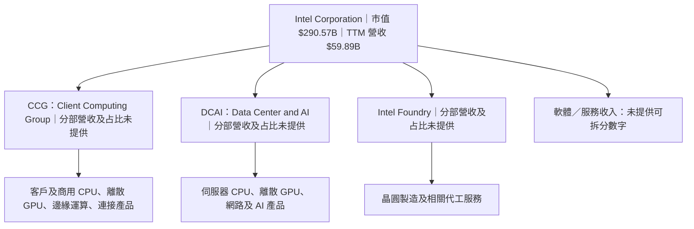
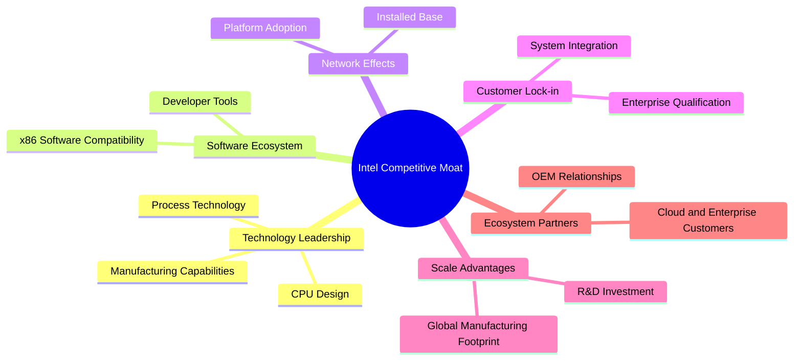
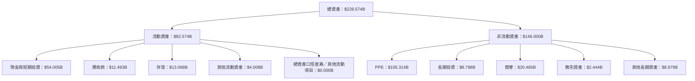
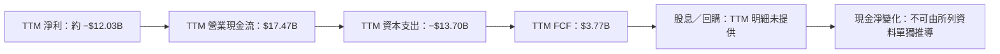
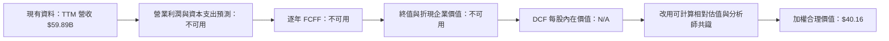
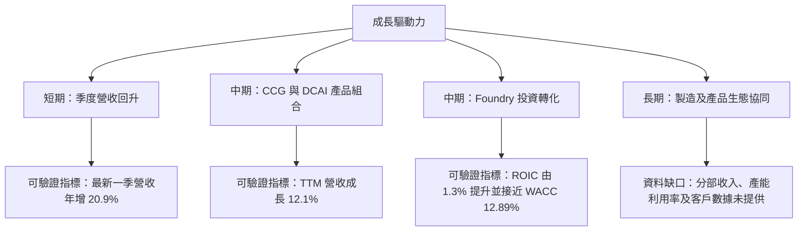
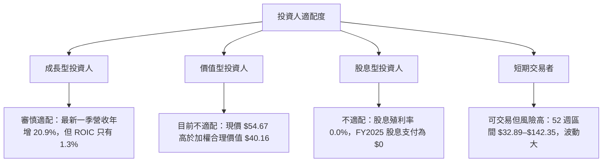

# INTC 基本面深度分析報告

> **報告日期**：2026-11-19 ｜ **語言**：繁體中文 ｜ **數據來源**：SEC 申報資料 (XBRL)、Yahoo Finance、Finviz、StockAnalysis、Roic.ai ｜ **分析師**：CFA 級機構研究  
> **價格基準**：2026-11-18 收盤價 **$54.67**。同一價格基準適用於全文。

## 目錄

| # | 章節 | 核心結論 |
|---|------|----------|
| 1 | 執行摘要 | 賣出；加權合理價值 $40.16，MOS −36.1% |
| 2 | 公司概覽與商業模式 | 具製造與軟硬體生態基礎，但各業務收入占比未提供，護城河仍受競爭侵蝕 |
| 3 | 損益表深度分析 | TTM 營收 $59.89B、成長 12.1%；最新一季年增 20.9%，獲利仍不穩定 |
| 4 | 資產負債表分析 | 淨現金 $3.87B、流動比率 2.208；營運資金週期一年增加 33 天 |
| 5 | 現金流量深度分析 | TTM FCF $3.77B，但多年資本支出高、年度 FCF 曾連續為負 |
| 6 | 獲利能力與資本效率 | ROIC 1.3% 低於 WACC 12.89%，目前仍在摧毀股東價值 |
| 7 | 相對估值分析 | 股價相較加權合理價值高 36.1%；同業 Forward P/E 倍數明顯低於 INTC |
| 8 | DCF 內在價值評估 | DCF 不可計算：預測末年 FCF 非正；改以固定權重方法交叉驗證 |
| 9 | 成長催化劑 | 季度營收回升與製造能力是觀察重點，缺少可引用 TAM 與明確催化時程數據 |
| 10 | 風險矩陣 | 主要風險為製程執行、資本密集造成的現金流壓力、估值與盈利落差 |
| 11 | 投資建議 | 依 MOS 評級為賣出；加權合理價值 $40.16，建議以營運里程碑重新評估 |

---

## 1. 執行摘要

截至 2026-11-18，INTC 收盤價為 **$54.67**；程式計算的三項可用估值方法加權合理價值為 **$40.16**，相對現價的安全邊際 MOS 為 **−36.1%**。公司 TTM ROIC 僅 **1.3%**，低於 **12.89%** 的 WACC；TTM FCF 為 **$3.77B**，但自由現金流殖利率僅 **1.30%**，而 DCF 因預測末年 FCF 非正無法建模。按規則 20，MOS 低於 −25% 對應 **🔴 賣出**；以下評級由這些數據推導，未做質化上調或下調。

### 1.0 一頁式投資儀表板（Portfolio Manager 30 秒速讀）

| 項目 | 內容 |
|------|------|
| **投資論點（3 句）** | ① TTM 營收年增 **12.1%**，最新一季年增 **20.9%**，營收動能改善。② ROIC **1.3%** 對比 WACC **12.89%**，資本回報仍未覆蓋資金成本。③ TTM FCF **$3.77B**、FCF Yield **1.30%**，現金流尚正，但不足以支持現價的估值風險。 |
| **綜合評分** | **4.3/10**（引用 1.1 評分卡） |
| **財務健康** | 🟡 現金及短期投資 **$54.01B** 高於總債務 **$50.13B**，但淨現金僅 **$3.87B**，CCC 較一年前增加 33 天。 |
| **ROIC vs WACC** | **1.3% vs 12.89%**；ROIC 低於資本成本，現階段摧毀股東價值。 |
| **FCF 趨勢** | 最新 TTM FCF **$3.77B**、FCF Yield **1.30%**；年度 FCF 2022–2025 均為負，TTM 轉正尚待持續驗證。 |
| **估值** | Forward P/E **30.53x** ｜ EV/EBITDA（市場估值欄）**15.853x** ｜ FCF Yield **1.30%** |
| **DCF 內在價值（基準）** | **N/A**；DCF 模型不可計算，故無 DCF 折溢價。 |
| **安全邊際（MOS）** | **−36.1%＝($40.16 − $54.67) ÷ $40.16**（基準為第 8.8 節加權合理價值）｜ 🔴 <10%：無安全邊際 |
| **預期報酬（基準情境 12M）** | **N/A**；DCF 基準情境無法計算。以加權合理價值作估值參照的上行空間為 **−26.5%**，不是 DCF 12M 預測。 |
| **關鍵風險（前二）** | 製程與代工投資未能轉化成獲利；高資本支出使 FCF 再度轉負。 |
| **評級 + 信心度** | 🔴 **賣出** ｜ 信心：中；估值方法顯示下行，但 DCF 無法計算且營運資料存在來源口徑差異。 |

### 1.1 綜合評分卡（全報告唯一）

| 維度 | 評分（1–10） | 主要依據（引用數字與其來源章節） |
|------|--------------|----------------------------------|
| 成長性 | 5.5 | TTM 營收成長 **12.1%**、最新一季年增 **20.9%**，但年度營收仍由 2022 年 $63.05B 降至 2025 年 $52.85B（第 3 章）。 |
| 獲利能力 | 2.5 | TTM 營業利益率（SEC 10-Q 計算值）**2.9%**、ROIC **1.3%**，低於 WACC **12.89%**；F-Score 為 **6/9**（第 6 章）。 |
| 財務健康 | 6.5 | 淨現金 **$3.87B**、流動比率 **2.208**、速動比率 **1.751**；但 CCC 由 35 天升至 68 天（第 4 章）。 |
| 估值 | 2.0 | MOS **−36.1%**；P/S **4.8x** 高於自身五年中位數 **2.6x**，位於自身歷史第 90 百分位（第 7–8 章）。 |
| 護城河 | 6.0 | CPU 軟硬體生態、全球製造及研發體系具壁壘，但同業成長與毛利率數據顯示競爭壓力（第 2、7 章）。 |
| 管理層與資本配置 | 3.5 | 2025 年資本支出 **$14.65B**、OCF **$9.70B**，造成年度 FCF **−$4.95B**；稀釋股數未通過 Piotroski 測試（第 5、6 章）。 |
| **綜合評分** | **4.3** | 六項算術平均：**(5.5 + 2.5 + 6.5 + 2.0 + 6.0 + 3.5) ÷ 6 = 4.333… ≈ 4.3**。 |

### 1.2 五大投資論點 + 三大核心風險

| 類型 | 項目 | 具體依據 | 信心度 |
|------|------|----------|--------|
| 🟢 **投資論點①** | 營收近期回升 | TTM 營收 **$59.89B**、年增 **12.1%**；最新一季營收年增 **20.9%**，季度營收由 2026 Q1 $13.58B 升至 Q3 $16.51B。 | 🟡 中 |
| 🟢 **投資論點②** | 資產負債表仍有流動性緩衝 | 現金及短期投資 **$54.01B**、總債務 **$50.13B**，淨現金 **$3.87B**。 | 🟡 中 |
| 🟢 **投資論點③** | TTM 現金流轉正 | OCF **$17.47B** 減資本支出 **$13.70B**，TTM FCF 為 **$3.77B**。 | 🟡 中 |
| 🟢 **投資論點④** | 既有產品及客戶生態仍具商業基礎 | CCG、DCAI 與 Intel Foundry 構成產品、平台與製造能力；但各業務收入占比未提供。 | 🟡 中 |
| 🟢 **投資論點⑤** | 季度營業表現改善 | 最新季度營業利益 **$2.58B**，較 2026 Q2 的 **$1.97B** 高；季度營業利益率官方計算值為 **15.3%**。 | 🟡 中 |
| 🟡 **風險①** | 資本回報顯著低於資金成本 | ROIC **1.3%**，WACC **12.89%**，差距 **−11.59 個百分點**。 | 🔴 高衝擊 |
| 🔴 **風險②** | 現價高於估值交叉驗證結果 | 加權合理價值 **$40.16**，低於現價 **$54.67**；MOS **−36.1%**。 | 🔴 高衝擊 |
| 🔴 **風險③** | 資本密集令 FCF 易受投資周期影響 | 2022–2025 年度 FCF 分別為 **−$9.41B、−$14.28B、−$15.66B、−$4.95B**；TTM 才轉為 **+$3.77B**。 | 🔴 高衝擊 |

### 1.3 快速統計卡片

| 指標 | 公司實際值（期間） | 同業中位數 | 狀態 |
|------|--------------------|------------|------|
| 營收成長（TTM） | **12.1%** | — | 🟢 |
| 營收成長（最新一季年增） | **20.9%** | **44.7%** | 🟡 |
| 毛利率（TTM） | **40.2%** | **56.0%** | 🔴 |
| 營業利益率（TTM） | **2.9%**（SEC 10-Q 指標） | — | 🔴 |
| ROIC（TTM） | **1.3%** | — | 🔴 |
| Forward P/E | **30.53x** | **13.1x** | 🔴 |
| FCF Yield（TTM） | **1.30%** | — | 🟡 |
| Piotroski F-Score | **6 / 9** | — | 🟡 |

> 同業中位數為 AMD、NVDA、QCOM 的 Peer multiples 中可比較數據的中位數；未提供項目不填列。

### 1.4 投資結論

```text
╔══════════════════════════════════════════════════════════════════╗
║                    📊 投資結論摘要                               ║
╠══════════════════════════════════════════════════════════════════╣
║  評級：🔴 賣出（依規則 20，MOS = −36.1%）                       ║
║  價格（2026-11-18 收盤）：$54.67                                 ║
║  DCF 內在價值（基準）：N/A（DCF 模型不可計算）                  ║
║  安全邊際 MOS：−36.1%（＝($40.16−$54.67)÷$40.16）              ║
║  加權合理價值（8.8）：$40.16                                     ║
║  綜合評分：4.3/10（引用 1.1）                                    ║
║  適合投資人：可承受高波動、願意追蹤營運轉型的投資人；            ║
║              不適合以低估值或穩定股息為核心的投資人。            ║
╚══════════════════════════════════════════════════════════════════╝
```

---

## 2. 公司概覽與商業模式

### 2.1 業務結構與收入來源

Intel 設計、開發、製造、行銷並銷售運算及相關產品，在美國、愛爾蘭、以色列及其他市場營運。員工數為 **81,100 人**，市值為 **$290.57B**，TTM 營收為 **$59.89B**。分部營收及占比未提供，因此以下圖示保留分部名稱，不推算金額或占比。



### 2.2 市場份額

市場份額數據未提供，故不以推估比例繪製圖表。Intel TTM 營收 **$59.89B**，最新一季年增 **20.9%**；相比之下，Peer multiples 所列 AMD 最新季度營收年增 **44.7%**、NVDA **105.9%**、QCOM **−8.4%**。這反映 Intel 的營收正回升，但無法僅憑這些成長率推算市場份額變化。

### 2.3 競爭護城河分析



### 2.4 護城河強度

| 護城河項目 | 強度（強／中／弱） | 證據（引用數字或事實） | 會削弱它的情況 |
|------------|--------------------|------------------------|----------------|
| 技術與製造能力 | 中 | 公司同時設計產品並擁有製造與代工業務；2025 年研發支出 **$13.77B**。 | 製程節點落後、良率不佳或產品推出延遲，導致研發與資本投入未轉化為價格或成本優勢。 |
| 軟體生態系統 | 中 | CCG、DCAI 產品跨越客戶端、伺服器與網路產品，與既有軟體相容性有助維繫客戶。 | 軟體與工作負載轉向其他架構或加速器，降低傳統 CPU 平台的重要性。 |
| 網路效應 | 弱至中 | 平台安裝基礎與 OEM／企業合作可形成互補，但量化安裝量、客戶留存率及生態規模未提供。 | 競爭平台提供更好的效能／成本比，吸引開發者及客戶轉移。 |
| 客戶鎖定 | 中 | 企業產品需經系統整合與驗證，轉換可能帶來工程及相容性成本；量化轉換成本未提供。 | 客戶採用多供應商策略，或以雲端與客製化晶片降低對單一 CPU 供應商依賴。 |
| 規模效應 | 中 | TTM 營收 **$59.89B**、員工 **81,100 人**，並有製造和研發基礎。 | 規模帶來的固定成本若利用率不足，反而擴大折舊與單位成本壓力。 |
| 生態夥伴 | 中 | 業務涵蓋客戶、資料中心及代工，可與 OEM、雲端與企業客戶合作；分部客戶集中度未提供。 | 競爭者取得主要客戶設計案，或客戶以自研晶片替代商用產品。 |

**1.1 護城河評分 6.0/10**：平台相容性、研發規模及製造能力提供一定進入障礙，但同業成長率與毛利率差距，加上未提供分部市占和客戶留存數據，使護城河強度仍需營運表現驗證。

---

## 3. 損益表深度分析

### 3.1 年度收入成長趨勢（近 4 年）

```text
╔══════════════════════════════════════════════════════════════════╗
║              Intel 年度收入趨勢（FY2022–FY2025）                 ║
╠══════════════════════════════════════════════════════════════════╣
║  FY2022  $63.05B  █████████████████████████  YoY：基期            ║
║  FY2023  $54.23B  ██████████████████████     YoY：−14.0% 🔴       ║
║  FY2024  $53.10B  █████████████████████      YoY：−2.1%  🔴       ║
║  FY2025  $52.85B  █████████████████████      YoY：−0.5%  🟡       ║
╠══════════════════════════════════════════════════════════════════╣
║  FY2022–FY2025 營收 CAGR：(52.85 ÷ 63.05)^(1/3) − 1 ≈ −5.7%      ║
╚══════════════════════════════════════════════════════════════════╝
```

年度營收由 2022 年 **$63.05B** 降至 2025 年 **$52.85B**，三年 CAGR 約 **−5.7%**。FY2025 年增跌幅已收窄至 **−0.5%**，顯示收入下行速度趨緩；TTM 營收增長 **12.1%** 則顯示近期回升，但仍需確認其能否延續並轉化成營業利潤與 FCF。

### 3.2 季度收入趨勢分析

| 季度 | 營收 | QoQ 成長 | YoY 成長 | 備註 |
|------|------:|---------:|---------:|------|
| 2025 Q4 | $13.67B | +0.2%（對比 Q3） | −4.1% | 2024 Q4 營收為 $14.26B，年比仍低。 |
| 2026 Q1 | $13.58B | −0.7% | +7.2% | QoQ 略降，但較 2025 Q1 $12.67B 高。 |
| 2026 Q2 | $16.13B | +18.8% | +25.4% | 季度營收明顯上升，須觀察是否由持續需求及產品組合支持。 |
| 2026 Q3 | $16.51B | +2.4% | +20.9% | 仍維持正向年增，QoQ 成長較 Q2 放緩。 |

QoQ 及 YoY 以季度收入表計算；最新一季 YoY **20.9%** 也與 SEC 10-Q 計算數據一致。營收成長本身不等同獲利復甦，還要看毛利率、營業費用及資本支出。

### 3.3 利潤率演變分析

| 利潤率指標 | FY2022 | FY2023 | FY2024 | FY2025 | 趨勢 | 評估 |
|------------|-------:|-------:|-------:|-------:|------|------|
| **毛利率** | 42.6% | 40.0% | 32.6% | 34.8% | FY2024 明顯收縮，FY2025 回升約 2.2 個百分點 | 🔴 |
| **營業利益率** | 3.7% | 0.1% | −8.9% | 約 0.0% | FY2024 轉負，FY2025 接近損益兩平 | 🔴 |
| **淨利率** | 12.7% | 3.1% | −35.3% | −0.5% | FY2024 大幅惡化，FY2025 收窄虧損 | 🟡 |

年度毛利率和營業利益率由提供的年度毛利、營收及營業利益計算。TTM 指標採 SEC 10-Q 計算值：毛利率 **40.2%**、營業利益率 **2.9%**。另有 Yahoo Finance／Finviz 彙整欄位列示 TTM 營業利益率 **10.1%**；因與 SEC 10-Q 計算值口徑不一致，本報告以 VERIFIED figures 的 **2.9%** 作主分析基準，不將兩者混用。

#### 利潤率演變深度解析

FY2024 毛利率由 2023 年 **40.0%** 降至 **32.6%**，營業利益率轉為 **−8.9%**，意味收入下降之外，製造利用率、產品組合及固定成本負擔亦是觀察重點。FY2025 毛利率回升至 **34.8%**，但營業利益仍約在損益兩平，顯示毛利改善尚未完全轉成營業獲利。最新季度營業利益為 **$2.58B**，高於前一季 **$1.97B**，但單季改善不足以取代對 TTM 利潤率持續性的驗證。

### 3.4 費用結構分析

未提供完整 TTM 費用明細、產品成本分解或分部費用，因此不繪製容易造成錯誤比例印象的 pie chart。可確認 FY2025 研發費用為 **$13.77B**，2024 年為 **$16.55B**；研發費用下降可能改善短期費用負擔，但也必須同時評估其對製程、產品與新業務的長期競爭力影響。2025 年毛利 **$18.38B**、營業利益 **−$0.023B**，顯示毛利以下的營業費用合計基本抵銷了毛利。

### 3.5 季度 EPS 趨勢與盈餘品質（Quality of Earnings）

| 季度 | EPS 實際 | EPS 預估 | 超預期／不及預期 | 原因與資料限制 |
|------|---------:|---------:|------------------|----------------|
| 2025 Q4 | −$0.12 | N/A | N/A | EPS Est 欄位為缺值，不能判斷 beat/miss。 |
| 2026 Q1 | −$0.73 | N/A | N/A | EPS Est 欄位為缺值。 |
| 2026 Q2 | −$2.16 | N/A | N/A | EPS Est 欄位為缺值；同期淨利為 −$11.03B。 |
| 2026 Q3 | $0.63（另一來源列示） | N/A | N/A | EPS Est 欄位為缺值；季度淨利數據列示 $3.32B。 |

季度 EPS 預估值均未提供，因此不能如實標示超預期或不及預期。公司最新季度 EPS 年增率列示 **−32.7%**；這與單季淨利變化並不必然一一對應，EPS 亦受股數及其他損益項目影響。各資料源 EPS 數值口徑可能不同，故採用來源表格所列並標示限制。

| 盈餘品質項目 | 數值/佔比 | 評估 |
|--------------|-----------|------|
| 股權薪酬 SBC / 營收 | FY2025：$2.43B ÷ $52.85B = **4.6%** | 🔴 SBC 佔營收比重不低，對股東的經濟成本不可忽視。 |
| SBC / 營業現金流 | FY2025：$2.43B ÷ $9.70B = **25.1%** | 🔴 SBC 相當於年度 OCF 約四分之一；這是 FY2025 年度比率，不是 TTM。 |
| FCF / 淨利（現金轉換率） | TTM：約 $3.77B ÷ 約 −$12.03B = **−31.3%** | 🔴 分母為負，傳統轉換率不具正常正向解讀；TTM 仍處虧損而 FCF 為正，不能據此視為穩定盈餘品質。 |
| 一次性／非經常性損益 | N/A | 缺少可完整拆分的 TTM 非經常項目；不能判斷其對最新季度淨利的淨影響。 |
| 有效稅率異常 | N/A | 未提供可複核 TTM 所得稅費用與稅前利益明細。 |
| 資本化支出 vs 費用化 | Capex TTM **$13.70B**；資本化明細 N/A | 資本支出代表大量投資，但缺乏資本化政策、折舊與維護性／成長性 Capex 拆分，不能判斷是否遞延成本。 |

**盈餘品質結論**：FY2025 SBC 為營收 **4.6%**、年度 OCF **25.1%**，且稀釋股數未增加的 Piotroski 測試未通過；這些因素降低每股盈餘的含金量。TTM 淨利為負而 FCF 為正，反映折舊、非現金費用及營運資金等因素可能令淨利與現金流偏離，但缺乏足夠資料拆分一次性項目，不能判定 GAAP 虧損是被高估還是低估。

---

## 4. 資產負債表分析

### 4.1 資產結構分解



非流動資產 **$146.000B** 為總資產減流動資產。流動資產明細加總為 **$82.574B**，圖中「其他流動項目」為 0；此處僅表示所列分類加總吻合，不代表公司另有單獨披露的零值資產。

### 4.2 流動性與營運資金分析

| 指標 | 最新 TTM | 一年前 TTM | 變化 | 解讀 |
|------|----------|------------|------|------|
| DSO 應收帳款天數 | 25 天 | 22 天 | +3 天 | 應收帳款收現所需時間增加，需關注客戶付款條件及收入收款品質。 |
| DIO 存貨天數 | 133 天 | 122 天 | +11 天 | 存貨停留時間拉長，可能反映備貨、產品週期或需求變化；未有產品拆分，不能確定原因。 |
| DPO 應付帳款天數 | 90 天 | 109 天 | −19 天 | 付款天數下降，供應商融資支持減少；不能單憑此推斷議價力變化。 |
| CCC 現金轉換週期 | 68 天 | 35 天 | +33 天 | 現金由投入到回收的週期拉長，對營運資金及現金流形成不利影響。 |

流動性指標為流動比率 **2.208**、速動比率 **1.751**。這表示帳面短期資產對短期負債有一定覆蓋；但 CCC 增加主要來自 DIO 上升及 DPO 下降，若延續，可能抵銷營收增長帶來的現金流改善。

### 4.3 債務結構分析

```text
╔══════════════════════════════════════════════════════════════════╗
║                   Intel 債務健康診斷                             ║
╠══════════════════════════════════════════════════════════════════╣
║  總債務：          $50.13B                                        ║
║  現金及短期投資：  $54.01B                                        ║
║  淨現金：          $3.87B   🟢 但相對債務規模緩衝有限             ║
║  流動比率：        2.208x                                         ║
║  速動比率：        1.751x                                         ║
║  Debt / EBITDA：   N/A（所提供 TTM EBITDA 口徑不一致，未重算）    ║
║  利息保障倍數：    N/A（未提供 TTM 利息費用及可比 EBIT）           ║
╚══════════════════════════════════════════════════════════════════╝
```

資產負債表提供 **$3.87B** 淨現金，但這是總現金與短期投資高於債務的差額，並非可自由分配現金的直接估計。近年資本支出規模大，應將現金緩衝與投資承諾一併考慮。

### 4.4 股東權益趨勢

```text
╔══════════════════════════════════════════════════════════════════╗
║                 Intel 歷年股東權益變化                           ║
╠══════════════════════════════════════════════════════════════════╣
║  FY2022  $101.42B  █████████████████████                         ║
║  FY2023  $105.59B  ██████████████████████                        ║
║  FY2024   $99.27B  ████████████████████                          ║
║  FY2025  $114.28B  ████████████████████████                      ║
╚══════════════════════════════════════════════════════════════════╝
```

FY2025 股東權益升至 **$114.28B**，高於 FY2024 的 **$99.27B**；但權益帳面增長並不能取代資本回報率。公司 TTM ROE 為 **−10.5%**（品質數據口徑），顯示帳面權益尚未轉化成正向股東回報。

---

## 5. 現金流量深度分析

### 5.1 現金流量瀑布圖



FCF 依本報告統一定義計算：**營業現金流 − 資本支出**。TTM OCF **$17.47B** 減 Capex **$13.70B**，得 FCF **$3.77B**。淨利為負但 OCF 為正，顯示非現金項目及營運資金對現金流的影響重大；缺少完整調節表，不能將差額直接歸因於單一項目。

### 5.2 FCF 轉換率趨勢

| 財年／期間 | FCF | 淨利 | FCF / 淨利 | 解讀 |
|------------|----:|-----:|-----------:|------|
| FY2022 | −$9.41B | $8.01B | −117.4% | 有獲利但資本支出後 FCF 顯著為負。 |
| FY2023 | −$14.28B | $1.69B | −845.0% | FCF 虧損遠大於淨利，屬重投資／資本支出壓力的訊號。 |
| FY2024 | −$15.66B | −$18.76B | +83.5% | 比率表面為正，但分子與分母同為負，不代表現金轉換良好。 |
| FY2025 | −$4.95B | −$0.267B | +1,853.9% | 分母接近零且為負，比率失真，不宜當作有效品質指標。 |
| TTM 至 2026-09-26 | $3.77B | 約 −$12.03B | 約 −31.3% | FCF 轉正，但虧損使比率仍不適合單獨解讀。 |

### 5.3 自由現金流趨勢

```text
╔══════════════════════════════════════════════════════════════════╗
║               自由現金流：年度實際及 TTM                         ║
╠══════════════════════════════════════════════════════════════════╣
║  FY2022  −$9.41B   ◀█████████                                    ║
║  FY2023 −$14.28B   ◀██████████████                               ║
║  FY2024 −$15.66B   ◀████████████████                             ║
║  FY2025  −$4.95B   ◀█████                                        ║
║  TTM       $3.77B    ████ ▶                                       ║
╠══════════════════════════════════════════════════════════════════╣
║  TTM FCF Yield：1.30%；年度 FCF 近年仍呈波動，需驗證轉正持續性。 ║
╚══════════════════════════════════════════════════════════════════╝
```

FY2025 Capex 為 **$14.65B**，高於 OCF **$9.70B**，因此年度 FCF 為 **−$4.95B**。TTM FCF 改善到 **$3.77B**，但近期投資支出與現金流仍有顯著波動，故不能只以單一 TTM 正值推論長期 FCF 已穩定。

### 5.4 資本配置評估

資本配置類別不是完整且互斥的現金流分類，因此不繪製 pie chart。可取得的歷史數據如下：

| 項目 | FY2022 | FY2023 | FY2024 | FY2025 | 評估 |
|------|-------:|-------:|-------:|-------:|------|
| 資本支出 | $24.84B | $25.75B | $23.94B | $14.65B | 連續高額投資，雖 FY2025 下滑，仍高於年度 OCF。 |
| 營業現金流 | $15.43B | $11.47B | $8.29B | $9.70B | FY2024 下降後 FY2025 回升，但未覆蓋 Capex。 |
| 股息支付 | $6.00B | $3.09B | $1.60B | $0.00B | 年度股息由 FY2022 逐步下降至 FY2025 為零。 |
| SBC | $3.13B | $3.23B | $3.41B | $2.43B | FY2025 降低，但仍造成股東稀釋成本。 |
| 回購 | N/A | N/A | N/A | N/A | 缺少可用年度數據，不推估。 |

資本配置的核心取捨是以高額資本支出換取未來製造與產品能力。成功與否應由 ROIC 是否逐步接近 WACC、FCF 能否在投資高峰後持續轉正來驗證，而非僅以投入金額判斷。

---

## 6. 獲利能力與資本效率

### 6.1 ROE / ROA / ROIC 趨勢

| 指標 | 歷史數據 | 評估 |
|------|----------|------|
| ROIC | TTM **1.3%** | 低於 WACC **12.89%**，資本回報尚未覆蓋資金成本。 |
| ROE | TTM **−10.5%**（QUALITY FIGURES） | 負值顯示近期股東報酬受虧損拖累。 |
| ROA | QUALITY FIGURES 測試為未通過「ROA > 0」及「ROA 高於一年前」 | 其他彙整欄另列 ROA **1.8%**，但口徑與品質指標不一致；依規則採用品質區塊測試結果，不以其推導或替代。 |

歷年一致口徑的 ROIC、ROE、ROA 系列未提供，故不補填年度序列或同業均值。

### 6.2 ROIC vs WACC 分析（核心價值創造判斷）

```text
╔══════════════════════════════════════════════════════════════════╗
║                ROIC vs WACC 深度分析                             ║
╠══════════════════════════════════════════════════════════════════╣
║  WACC 輸入（成本資本資料）：                                     ║
║  ├── 無風險利率（10Y 美債）：5.07%（觀測日期未提供）             ║
║  ├── 市場風險溢酬 ERP：5.00%（模型假設）                        ║
║  ├── 原始 Beta：2.43；採用調整後 Beta：1.95                    ║
║  ├── 股權成本 Ke：5.07% + 1.95 × 5.00% = 14.82%                ║
║  ├── 稅前債務成本：2.18%；稅後：2.18% × (1−21%) = 1.7222%     ║
║  ├── 資本權重：股權 85.3%、債務 14.7%                           ║
║  └── 採用 WACC：12.89%（程式計算未四捨五入輸入）                ║
║                                                                  ║
║  ROIC（TTM）：1.3%                                               ║
║  ROIC − WACC：1.30% − 12.89% = −11.59 個百分點                  ║
║                                                                  ║
║  ROIC  1.3%     ▓                                                ║
║  WACC 12.89%     ▓▓▓▓▓▓▓▓▓▓▓▓▓                                   ║
║  EVA 差額 −11.59pp：負值，顯示資本回報不足                       ║
║                                                                  ║
║  結論：ROIC 明顯低於資本成本，現階段摧毀股東價值。               ║
╚══════════════════════════════════════════════════════════════════╝
```

調整後 Beta 採用數值為 **1.95**，計算方式為 **⅔ × 原始 Beta 2.43 + ⅓ × 1 = 1.9533… ≈ 1.95**。用已四捨五入的權重與利率重算，會因輸入精度產生約 1 個基點的差異；正式採用成本資本資料所列 **WACC 12.89%**，不以顯示位數重新替代。

ROIC 與 WACC 的差額為 **1.3% − 12.89% = −11.59 個百分點**。除非未來 ROIC 有持續回升，單靠營收成長並不足以證明投資創造價值；資本密集的代工投資更需要以投入資本回報和 FCF 作為驗收標準。

### 6.3 杜邦三因素分解

| 因素 | 數值（TTM） | 解讀 |
|------|-------------|------|
| 淨利率 | **−20.1%** | 淨利率為負，是 ROE 為負的主要來源。 |
| 資產週轉率 | **0.26** | 每單位資產創造的營收有限，重資產製造模式需要較高利用率支撐回報。 |
| 權益乘數 | **1.99** | 財務槓桿不是 ROE 為負的主要來源，虧損是核心因素。 |
| **ROE** | **−10.5%** | **−20.1% × 0.26 × 1.99 = −10.4%**，與資料列示 −10.5% 的差異來自各輸入四捨五入。 |

本表照抄 QUALITY FIGURES 的三因素及 ROE；乘積以已四捨五入顯示值重算會有小幅精度差異，不另改寫來源 ROE。

### 6.4 財務體質：Piotroski F-Score

**Piotroski F-Score：6 / 9**，比較期間為截至 2026-09-26 的 TTM 與截至 2025-09-27 的 TTM。

| 測試 | 結果 | 解讀 |
|------|------|------|
| ROA > 0 | ❌ 未通過 | 代表品質計算所用 ROA 未達正值。 |
| 營業現金流 > 0 | ✅ 通過 | TTM OCF 為 **$17.47B**。 |
| ROA 高於一年前 | ❌ 未通過 | 資產獲利能力尚未改善至符合該測試的條件。 |
| 營業現金流 > 淨利（應計品質） | ✅ 通過 | 現金流高於淨利，顯示現金流與會計盈餘存在差距。 |
| 長期負債 ÷ 總資產低於一年前 | ✅ 通過 | 槓桿相關測試改善。 |
| 流動比率高於一年前 | ✅ 通過 | 短期流動性相對改善。 |
| 稀釋股數未增加 | ❌ 未通過 | 股數增加會稀釋每股經濟利益。 |
| 毛利率高於一年前 | ✅ 通過 | 毛利率趨勢符合測試。 |
| 資產週轉率高於一年前 | ✅ 通過 | 資產效率相對改善。 |

總分 **6/9** 表示資產負債表及部分營運效率項目呈改善，但獲利能力與股數稀釋仍是弱點。此分數並不代表公司已恢復持續獲利，需與負 ROE、低 ROIC 及歷史負 FCF 一併看待。

---

## 7. 相對估值分析

### 7.1 同業估值比較表格

| 估值指標 | **INTC** | **AMD** | **NVDA** | **QCOM** | INTC 評估 |
|----------|---------:|--------:|---------:|--------:|-----------|
| **Trailing P/E** | N/A（TTM EPS −$2.35） | 113.3x | 19.1x | 12.6x | 🔴 INTC 虧損，P/E 不具經濟解讀。 |
| **Forward P/E** | 30.53x | 30.1x | 9.1x | 13.1x | 🔴 高於同業中位數 **13.1x**，前瞻 EPS 能否實現是估值關鍵。 |
| **P/S Ratio（TTM）** | 4.85x | 19.3x | 12.0x | 4.0x | 🟡 高於 QCOM，低於 AMD、NVDA；INTC 自身歷史位置偏高。 |
| **EV/EBITDA（TTM）** | 15.853x | 77.4x | 18.5x | 16.9x | 🟢 低於 AMD、NVDA、QCOM；但不同公司盈利品質與增長速度不同。 |
| **最新一季營收年增** | 20.9% | 44.7% | 105.9% | −8.4% | 🟡 高於 QCOM，低於 AMD、NVDA。 |
| **毛利率（TTM）** | 40.2% | 56.0% | 74.7% | 53.1% | 🔴 低於三家同業。 |

同業倍數直接引用 Peer multiples。INTC 的 Forward P/E **30.53x** 是根據提供的公司 Forward P/E 欄位，Peer 中位數依 AMD、NVDA、QCOM 三者為 **13.1x**。市場估值欄列示 INTC EV/EBITDA **15.853x**；自身歷史欄另列當前 **21.2x**，可能涉及資料日期或計算口徑差異，兩者分別在比較表及歷史區間中保留，不互相替代。

### 7.2 歷史估值區間分析

```text
╔══════════════════════════════════════════════════════════════════╗
║               INTC 自身五年估值區間（TTM）                       ║
╠══════════════════════════════════════════════════════════════════╣
║  P/S：範圍 1.5x ├────────────── 2.6x 中位數 ───────────────┤11.5x║
║       現值 4.8x；自身歷史百分位第 90 百分位 🔴                 ║
║                                                                  ║
║  EV/EBITDA：範圍 6.4x ├──── 23.6x 中位數 ───────────────┤536.5x║
║       現值 21.2x；自身歷史百分位第 41 百分位 🟡                 ║
╚══════════════════════════════════════════════════════════════════╝
```

P/S **4.8x** 高於五年中位數 **2.6x**，且處於自身歷史第 **90** 百分位，代表股價已對營收改善有所反映。EV/EBITDA 的歷史百分位為第 **41**，低於其中位數 **23.6x**；但歷史範圍上端達 **536.5x**，盈利基數變動可能使該倍數波動極大，應避免單獨用其判斷便宜。

### 7.3 情境價值（Bear / Base / Bull）

**N/A（DCF 無法計算：預測最後一年 FCF 非正，原因為 Capex 高於營業利益及折舊攤銷；沒有可用 DCF MODEL 情境數值，因此不提供悲觀／基準／樂觀目標價。）**

### 7.4 相對估值隱含價格區間

```text
╔══════════════════════════════════════════════════════════════════╗
║                 相對估值方法隱含每股價值                         ║
╠══════════════════════════════════════════════════════════════════╣
║  $23.49 ───────── $40.16 ───────── $45.60 ───────── $54.67     ║
║  Forward P/E       加權合理值       EV/EBITDA        現價        ║
║                                                                  ║
║  分析師共識目標價：$90.65（43 位分析師均值；非相對估值下限）    ║
╚══════════════════════════════════════════════════════════════════╝
```

- **同業 Forward P/E：$23.49**。依據為 Peer 中位數 **13.1x × INTC Forward EPS $1.79**；估值低於現價 **$54.67**。
- **同業 EV/EBITDA：$45.60**。依據為 NVDA、QCOM 中位數倍數 **17.7x**，乘上 INTC TTM EBITDA 並加回淨現金；此數字與固定估值方法區塊一致。
- **分析師共識：$90.65**，為 43 位分析師平均目標價。該值遠高於兩項同業倍數估值，但屬外部共識參考，不等同可由財報直接驗證的現金流價值。

---

## 8. DCF 內在價值評估（Discounted Cash Flow）

> **DCF MODEL：N/A。**程式提供的 DCF 判定為預測末年 FCF 非正，原因是 Capex 高於營業利益及折舊攤銷。因此不建立替代模型、不自行填入營收 CAGR、預測期、WACC 敏感度、終值或每股 DCF 內在價值。第 8.8 節仍依既定規則使用可計算的估值方法交叉驗證。

### 8.0 估值推理鏈（Thinking Logic：在算之前先想清楚）

**核心命題**：Intel 的長期價值取決於既有 CCG／DCAI 產品現金流、資料中心與 AI 產品的成長，以及 Foundry 投資能否轉化為具回報的產能；但可用資料未提供分部營收，三部分的營收占比均 **N/A**。目前可觀察的整體錨點為 TTM 營收 **$59.89B**、TTM FCF **$3.77B**、ROIC **1.3%**。在現有資訊下，無法把 Foundry 投資的未來現金流可靠地與既有產品分離。

| 決策點 | 本報告採用 | 理由（含數字） | 曾考慮但否決 | 否決理由 |
|--------|-----------|----------------|--------------|----------|
| 現金流定義 | 不建立 DCF | DCF MODEL 明示預測末年 FCF 非正，無法形成有效終值。 | 自行假設 FCFF | 會違反只可引用程式 DCF 模型的要求，也缺乏支撐資本支出與利潤率的逐年預測。 |
| 預測期 N | N/A | 模型未提供預測期，且模型判定不適用。 | 自行設定 5–10 年 | 缺少模型輸入與營運錨點。 |
| 終值方法 | N/A | 無有效正向末年 FCF 可供終值計算。 | Gordon Growth 或退出倍數 | 不能以缺乏基礎的末年現金流建立終值。 |
| EBIT 基礎 | N/A | DCF MODEL 為 N/A，未提供模型 EBIT 路徑。 | 自行預測 GAAP／非 GAAP EBIT | 未有足夠預測資料支持。 |

**最脆弱的一環**是 Foundry 資本支出何時、能否轉化為正向現金流與高於 WACC 的 ROIC。若這項假設不能成立，估值應下修；由於 DCF 敏感度矩陣亦不存在，本報告不虛構其下修幅度。



### 8.1 模型假設總表（Model Inputs）

| 假設項目 | 採用值 | 依據／來源 | 敏感度 |
|----------|--------|-------------|--------|
| 預測期長度 N | N/A | DCF MODEL 未提供有效模型。 | 🔴 高 |
| 營收 CAGR | N/A | 無程式模型輸入；歷史 TTM 成長 **12.1%** 不能直接當未來預測。 | 🔴 高 |
| 營業利潤率 | N/A | TTM 營業利益率採 SEC 指標 **2.9%**，但無預測路徑。 | 🔴 高 |
| 有效稅率 | N/A | DCF 假設未提供；法定預設稅率 **21.0%** 不等於實際預測稅率。 | 🟢 低 |
| Capex / 營收 | N/A | TTM Capex **$13.70B**，但未提供模型 Capex 比率或未來路徑。 | 🟡 中 |
| D&A / 營收 | N/A | 缺少 DCF 模型比率輸入。 | 🟢 低 |
| 營運資金變動 / 營收增額 | N/A | 缺少模型輸入；已知 CCC 由 35 天增至 68 天，不能代替 ΔWC 預測。 | 🟢 低 |
| EBIT 基礎 | N/A | DCF 模型未建立。 | 🟡 中 |
| SBC 處理 | N/A | 無 DCF 股數與 SBC 計算組合可供引用。 | 🟡 中 |
| 年稀釋率 | N/A | 缺少 DCF 股數假設。 | 🟡 中 |
| 永續成長率 g | N/A | 模型未提供。 | 🔴 高 |
| 終值方法 | N/A | 模型判定末年 FCF 非正。 | 🔴 高 |
| WACC | **12.89%**（僅引用資本成本數據） | 成本資本輸入提供；但 DCF 模型無法使用。 | 🔴 高 |

DCF 模型為 N/A，因此不存在可合法採用的 (A)、(B) 或 (C) SBC 模型組合；不把 SBC 另行加入假設現金流。

### 8.2 折現率推導（WACC）

```text
╔══════════════════════════════════════════════════════════════════╗
║                    WACC 推導（折現率）                           ║
╠══════════════════════════════════════════════════════════════════╣
║  股權成本 Ke（CAPM）：                                           ║
║  ├── 無風險利率 Rf：5.07%（日期未提供）                         ║
║  ├── 市場風險溢酬 ERP：5.00%（假設輸入）                       ║
║  ├── 原始 Beta：2.43；採用調整後 Beta：1.95                   ║
║  ├── 規模／國別溢酬：未另加計                                   ║
║  └── Ke = 5.07% + 1.95 × 5.00% = 14.82%                       ║
║                                                                  ║
║  債務成本 Kd：                                                   ║
║  ├── 稅前 Kd：2.18%                                             ║
║  ├── 預設稅率：21.0%                                            ║
║  └── 稅後 Kd = 2.18% × (1−21.0%) = 1.7222%                     ║
║                                                                  ║
║  資本結構權重：股權 85.3%；債務 14.7%                           ║
║  WACC：正式採用程式提供的 12.89%                                 ║
╚══════════════════════════════════════════════════════════════════╝
```

調整後 Beta 的公式為 **⅔ × 2.43 + ⅓ × 1 = 1.9533… ≈ 1.95**。以顯示的四捨五入權重與利率直接相乘，結果可能有約 0.01 個百分點差異；本報告依規則採用官方成本資本輸入 **12.89%**，不以四捨五入後的中間數字另算一個 WACC。Rf 的觀測日期未提供，故不補寫日期。

### 8.3 逐年自由現金流預測（基準情境）

**N/A（DCF 模型未建立：預測末年 FCF 非正，原因為 Capex 高於營業利益及折舊攤銷。）**因此沒有 FY+1 至 FY+N 現金流表、PV 加總或代表年度逐步演算；不以自行設定的數字替代。

### 8.4 終值計算（Terminal Value）

**N/A（DCF 模型無有效預測末年 FCF，未提供 Gordon Growth 或退出倍數終值。）**無法執行 WACC 與 g 的適用性判斷，也不推算終值、終值現值或終值占企業價值比重。

### 8.5 企業價值 → 每股內在價值（Bridge）

```text
╔══════════════════════════════════════════════════════════════════╗
║              企業價值 → 每股內在價值 橋接表                      ║
╠══════════════════════════════════════════════════════════════════╣
║  預測期 FCF 現值合計：N/A                                        ║
║  終值現值 PV(TV)：N/A                                            ║
║  = 企業價值 EV：N/A                                              ║
║  + 現金及短期投資：N/A（DCF 橋接未建立）                         ║
║  − 總債務：N/A（DCF 橋接未建立）                                 ║
║  = 股權價值：N/A                                                 ║
║  ÷ 稀釋後流通股數：N/A                                           ║
║  ★ DCF 每股內在價值：N/A                                         ║
║  當前股價：$54.67（2026-11-18 收盤）                             ║
║  DCF 折溢價：N/A                                                 ║
║  本節不計算 MOS；MOS 只以 8.8 加權合理價值為分母。               ║
╚══════════════════════════════════════════════════════════════════╝
```

### 8.6 敏感性分析（WACC × 永續成長率）

**N/A（DCF 無法計算：沒有可用的基準現金流、終值及 DCF 基準每股價值，因此不提供敏感性矩陣或三情境數值。）**

### 8.7 反推 DCF（Reverse DCF：市場在預期什麼）

**N/A（無可用 DCF 模型，無法以現價反解單一未知變數，也無法列出逐步試算軌跡。）**現價 **$54.67** 高於第 8.8 節的加權合理價值 **$40.16**；要支持現價，須有比現有同業倍數估值更高的盈利或現金流，但缺乏模型數據不能量化其所需 CAGR 或利潤率。

### 8.8 估值三角驗證與安全邊際

| 估值方法 | 隱含每股價值 | 上行空間（÷現價） | 權重 | 說明 |
|----------|--------------:|------------------:|-----:|------|
| 同業 Forward P/E | $23.49 | −57.0% | 45% | Peer 中位數 **13.1x** × 公司 Forward EPS **$1.79**。 |
| 同業 EV/EBITDA | $45.60 | −16.6% | 45% | NVDA、QCOM 中位數 **17.7x** × TTM EBITDA，加回淨現金。 |
| 分析師共識目標價 | $90.65 | +65.8% | 10% | 43 位分析師平均目標價，作參考而非主要基本面驅動。 |
| **加權合理價值** | **$40.16** | **−26.5%** | **100%** | 公司類型為 profitable，權重依固定估值方法設定；DCF 因不可計算而剔除。 |

**逐步演算（權重外顯）**：

- 同業 Forward P/E 加權：**$23.49 × 45% = $10.5705**
- 同業 EV/EBITDA 加權：**$45.60 × 45% = $20.5200**
- 分析師共識加權：**$90.65 × 10% = $9.0650**
- 權重合計：**45% + 45% + 10% = 100%**
- 加權合理價值：**$10.5705 + $20.5200 + $9.0650 = $40.1555 ≈ $40.16**

上行空間：**($40.16 − $54.67) ÷ $54.67 = −$14.51 ÷ $54.67 = −26.5%**。  
MOS：**($40.16 − $54.67) ÷ $40.16 = −$14.51 ÷ $40.16 = −36.1%**。  
折溢價若以 DCF 為基準則 **N/A**，因 DCF 內在價值未計算。

```text
╔══════════════════════════════════════════════════════════════════╗
║                  估值區間與安全邊際                              ║
╠══════════════════════════════════════════════════════════════════╣
║  $23.49 ───── $40.16 ───── $54.67 ───── $90.65                  ║
║  Forward P/E   加權合理值   現價       分析師共識               ║
║                                                                  ║
║  MOS = ($40.16−$54.67)÷$40.16 = −36.1%                          ║
║  MOS 評估：🔴 <10%，沒有安全邊際                                ║
║  上行空間 = ($40.16−$54.67)÷$54.67 = −26.5%                     ║
║  DCF 基準值及 DCF 情境：N/A                                     ║
║  估值觀察線：$36.14 或以下，對應加權價值下 MOS 至少 10%          ║
╚══════════════════════════════════════════════════════════════════╝
```

以加權合理價值計算，若要求至少 **10% MOS**，價格上限為 **$40.16 × (1−10%) = $36.144 ≈ $36.14**。目前評級為賣出，該價位僅作估值重新檢視門檻，不代表價格觸及後即自動買入。

> 🔎 **程式複算（Python，依本節各項自動重算）**
>
> 加權合理價值 = $23.49 × 45% + $45.60 × 45% + $90.65 × 10% = **$40.16**（權重合計 100%）
>
> 以價格 $54.67 計：MOS = **-36.1%**，上行空間 = **-26.5%**
>
> ✅ 與本節所寫數值一致。

### 8.9 DCF 模型的局限與失效條件

- **終值依賴度**：N/A；模型未計算終值及終值占比。
- **最脆弱的假設**：Foundry 投資的現金流回報與資本支出下降速度；缺少 DCF 模型，不能量化對每股價值的衝擊幅度。
- **不適用情境**：FCF 歷年波動，FY2022–FY2025 均為負，TTM 才轉正至 **$3.77B**；公司仍處高投資期，DCF 可靠度有限。可搭配同業 EV/EBITDA、P/S 及分部估值，但不得在缺少分部數據時自行補出 SOTP 價格。
- **與第 10 章風險矩陣連結**：製程執行與產能利用率影響營業利潤率及 Capex；存貨增加與供應鏈付款週期影響營運資金；以上變數均是本次 DCF 不能成立的關鍵限制。

### 8.10 複算檢核表（Audit Trail：輸出前自我驗算）

| # | 檢核項目 | 檢查方式 | 結果 |
|---|----------|----------|------|
| 1 | 高／中敏感度假設有完整推導 | DCF 為 N/A，不建立假設 | N/A |
| 2 | 每項假設有來源依據 | 無 DCF 輸入；缺漏明確標示 N/A | ✅ |
| 3 | WACC 算式及輸入一致 | 引用成本資本資料 WACC 12.89%；顯示位數造成約 1bp 差異已註明 | ✅ |
| 4 | Kd 負債範圍與權重 D 一致 | 使用成本資本資料所列 Kd 及權重，不另改造 | ✅ |
| 5 | WACC 與第 6.2 節同值 | 均為 12.89% | ✅ |
| 6 | 逐年預測年數等於 N | DCF 模型未提供預測期 | N/A |
| 7 | FY+1 九步算式可複算 | 無有效模型年度現金流 | N/A |
| 8 | 預測期 PV 加總可驗算 | 無預測期 PV | N/A |
| 9 | WACC > g | g 未提供，無法檢驗 | N/A |
| 10 | 終值基於 FY+N 並折現 N 期 | 終值未計算 | N/A |
| 11 | EV 至每股橋接 | DCF 橋接未計算 | N/A |
| 12 | SBC 三要素組合相容 | DCF 無模型組合，不套用 A/B/C | N/A |
| 13 | 敏感性基準格等於 DCF 基準價 | 矩陣未提供 | N/A |
| 14 | 敏感度有效格符合 WACC > g | 矩陣未提供 | N/A |
| 15 | 三情境機率合計 100% | DCF 情境未提供 | N/A |
| 16 | Reverse DCF 每列僅解一變數 | 無模型與逐次試算 | N/A |
| 17 | MOS 分母及折溢價基準正確 | MOS 使用 $40.16；DCF 折溢價標示 N/A | ✅ |
| 18 | 報告完整至第 11 章 | 已列至第 11 章 | ✅ |
| 19 | 加權價值等於各方法加權總和 | $10.5705 + $20.5200 + $9.0650 = $40.1555 ≈ $40.16 | ✅ |
| 20 | 評級符合 MOS 門檻 | MOS −36.1% < −25%，評級為賣出 | ✅ |

DCF 相關檢核列為 N/A 的原因均為 DCF MODEL 不可計算；因此本報告不提供虛構的 DCF 內在價值、敏感度或情境目標價。

---

## 9. 成長催化劑

### 9.1 催化劑時間軸

目前資料未提供公司正式的產品量產、製程節點、客戶認證或代工產能時程，不宜自行指定財務催化劑日期。以下保留可追蹤的時間層次，不虛構精確年月。

| 時間層次 | 可觀察催化劑 | 追蹤數據 |
|----------|--------------|----------|
| 短期：下一至數季 | 最新一季營收年增 **20.9%** 能否延續；季度營業利益能否維持正值 | 營收 YoY、營業利益率、毛利率、FCF |
| 中期：未來數季至數年 | CCG 與 DCAI 需求能否支撐營收成長，Foundry 投資能否逐步改善利用率與獲利 | 分部營收、產能利用率、資本支出、客戶導入 |
| 長期：多年 | 製造能力、產品組合與代工服務能否形成高於資本成本的回報 | ROIC 是否提高並超過 **12.89%**；FCF 是否可持續為正 |

### 9.2 TAM 市場規模分析

**N/A（TAM 數據未提供）。**Intel TTM 營收為 **$59.89B**、TTM 成長 **12.1%**、最新一季年增 **20.9%**，可作為現有商業規模及短期動能參照。缺少 TAM、可服務市場與分部營收，無法計算滲透率或市場空間金額。

### 9.3 成長驅動力結構圖



成長催化劑是否成功，不能只看銷售規模擴張；還需確認新增營收轉為毛利、營業利益與 FCF，並改善目前低於 WACC 的 ROIC。

---

## 10. 風險矩陣

### 10.1 風險評分矩陣

可用資料沒有公司自行量化的風險發生機率，也沒有經可驗證的損失分布；依「有資料才畫」原則，不使用帶有虛構座標的 quadrantChart。下表以定性分級呈現，機率及衝擊為分析判斷，不冒充財務數據。

### 10.2 風險清單詳細分析

| # | 風險項目 | 發生機率 | 財務衝擊 | 風險評分 | 緩解措施 |
|---|----------|----------|----------|----------|----------|
| 1 | 🔴 **製程／代工執行與產能利用率** | 中高 | 高；可能令營收成長無法轉成營業利潤，並使 ROIC 持續低於 WACC | 高 | 按季度追蹤分部營收、利用率、良率、客戶認證、Capex 與 ROIC；若延誤且資本支出不降，重新評估投資論點。 |
| 2 | 🔴 **資本支出壓力及 FCF 再轉負** | 中高 | 高；FY2022–FY2025 年度 FCF 均為負，TTM 目前僅 **$3.77B** | 高 | 設定 Capex／營收與 FCF 追蹤門檻，分辨成長性投資與維持性投資；若 TTM FCF 再轉負，降低估值信心。 |
| 3 | 🟠 **產品競爭及毛利率落後** | 中高 | 高；TTM 毛利率 **40.2%**，低於 AMD **56.0%**、NVDA **74.7%**、QCOM **53.1%** | 高 | 追蹤毛利率、產品組合及同業比較；若營收增加但毛利率收縮，視為成長品質惡化。 |
| 4 | 🟠 **庫存及營運資金週期拉長** | 中 | 中高；DIO **133 天**，CCC **68 天**，均高於一年前 | 中高 | 逐季監控 DIO、CCC、存貨備抵及營收，判斷庫存積累是否與需求相符。 |
| 5 | 🟡 **估值與盈利預期落差** | 高 | 中高；Forward P/E **30.53x**，高於 Peer 中位數 **13.1x** | 高 | 以實現 EPS、FCF 及 ROIC 驗證估值；避免把分析師共識目標價直接視為基本面價值。 |

---

## 11. 投資建議

### 11.1 最終評級與評分

以加權合理價值 **$40.16** 和 2026-11-18 收盤價 **$54.67** 計算，MOS 為 **−36.1%**，符合規則 20 的 **賣出**門檻，未做一級調整。1.1 的綜合評分為 **4.3/10**；六項分數依序為成長性 **5.5**、獲利能力 **2.5**、財務健康 **6.5**、估值 **2.0**、護城河 **6.0**、管理層與資本配置 **3.5**。投資評級反映估值與 ROIC，而非公司業務完全沒有復甦可能。

### 11.2 合理價值與隱含報酬率

| 方法／情境 | 每股價值 | 相對現價 | 權重／機率 |
|------------|---------:|---------:|------------|
| 同業 Forward P/E | $23.49 | −57.0% | 45% |
| 同業 EV/EBITDA | $45.60 | −16.6% | 45% |
| 分析師共識目標價 | $90.65 | +65.8% | 10% |
| **加權合理價值** | **$40.16** | **−26.5%** | **100%** |
| 悲觀／基準／樂觀 DCF 情境 | N/A | N/A | DCF MODEL 不可計算 |

分析師平均目標價 **$90.65** 高於現價，但固定權重僅 **10%**；其餘 90% 權重由同業倍數方法承擔。由於 DCF 無法計算，不能把分析師目標價表述為 DCF 基準報酬預測。

### 11.3 買入時機與觸發因素

```text
╔══════════════════════════════════════════════════════════════════╗
║                  ✅ 買入觸發因素 Checklist                      ║
╠══════════════════════════════════════════════════════════════════╣
║  重新考慮建倉條件（應有多項同時符合）：                          ║
║  ☐ 股價降至 $36.14 或以下，對加權合理價值達至少 10% MOS          ║
║  ☐ 最新季度營收年增維持正值，且營業利益率沒有顯著回落            ║
║  ☐ TTM FCF 持續為正，不只依賴單季現金流                          ║
║  ☐ ROIC 有逐步向 WACC 12.89% 收斂的明確證據                      ║
║                                                                  ║
║  加碼觸發條件（營運與估值同時改善）：                            ║
║  ☐ FCF 持續改善且 Capex 不再吞噬大部分營業現金流                 ║
║  ☐ DIO 與 CCC 趨勢回落，營運資金週期改善                         ║
║  ☐ 同業估值差距縮小，且改善來自盈利而非只靠股價上漲              ║
║                                                                  ║
║  減碼／退出觸發條件：                                             ║
║  ☐ TTM FCF 再度轉負且資本支出沒有同步下降                         ║
║  ☐ ROIC 長期維持低於 WACC 12.89%                                  ║
║  ☐ 營收成長放緩，同時毛利率或營業利益率收縮                       ║
║  ☐ CCC 持續高於目前 68 天並伴隨存貨增加                           ║
╚══════════════════════════════════════════════════════════════════╝
```

### 11.4 投資人適配度分析



### 11.5 每季財報監控清單（Quarterly Watch List）

| 監控指標 | 目前基準 | 加碼／改善訊號 | 減碼／惡化訊號 |
|----------|----------|---------------|----------------|
| 營收年增率 | 最新一季 **20.9%** | 維持正成長並由多個業務共同支持 | 連續兩季轉為負成長，或增長只集中於單一來源 |
| TTM 營業利益率 | **2.9%**（SEC 計算值） | 持續高於目前水準且與營收同步改善 | 再度轉負，或季度改善未能延續至 TTM |
| 毛利率 | TTM **40.2%** | 向上改善並縮小與同業差距 | 低於目前水準且同業差距擴大 |
| OCF | TTM **$17.47B** | 現金流持續支持投資與債務管理 | OCF 下滑且營運資金占用上升 |
| Capex | TTM **$13.70B** | Capex 下降時 FCF 仍可維持正值，或投資回報明確提高 | Capex 上升、FCF 同時轉負且無明確產能回報 |
| FCF | TTM **$3.77B**；Yield **1.30%** | 持續為正並擴大 | 轉負，或僅靠一次性營運資金釋放維持正值 |
| 存貨／CCC | DIO **133 天**；CCC **68 天** | DIO 與 CCC 下降 | DIO、CCC 持續升高並伴隨營收放緩 |
| 現金與債務 | 淨現金 **$3.87B** | 維持淨現金並保持流動性 | 淨現金快速消耗、債務增加且 FCF 轉負 |
| ROIC | TTM **1.3%**，WACC **12.89%** | ROIC 持續上升並逐步接近 WACC | ROIC 下滑，或長期沒有改善跡象 |
| 稀釋股數與 SBC | SBC：FY2025 **$2.43B**；稀釋股數測試未通過 | SBC／營收下降且股數穩定 | 股數持續增加或 SBC 占營收上升 |
| 公司財測 | 可用資料未提供 | 下一期營收、利潤率及 Capex 指引同步改善 | 財測下修，尤其是營業利潤率與現金流 |

### 11.6 反面論證：什麼會證明論點錯誤（What Would Change My Mind）

| 可量化失效條件 | 監控門檻 | 對投資論點的含義 |
|----------------|----------|------------------|
| 營收動能反轉 | 連續兩季最新季度營收年增 **<0%** | 短期復甦論點失效，應降低對營收回升的權重。 |
| 營業獲利惡化 | TTM 營業利益率由目前 **2.9%** 轉為負值並持續 | 代表成本與產品組合未能支撐收入，估值應進一步下修。 |
| FCF 再度轉負 | TTM FCF 低於 **$0** | 轉正趨勢未能持續，資本支出與營運現金流需重新評估。 |
| 資本效率停滯 | ROIC 長期維持 **1.3%** 附近，且明顯低於 WACC **12.89%** | 投資與製造資產無法創造足夠回報，轉型價值論點被削弱。 |
| 營運資金進一步惡化 | CCC 高於目前 **68 天**，且 DIO 高於 **133 天** | 現金回收壓力加劇，可能侵蝕營收成長帶來的現金流。 |
| 股東稀釋加劇 | 稀釋股數連續增加，且 SBC／營收高於 FY2025 **4.6%** | 即使公司層級盈利改善，每股價值也可能被稀釋。 |
| 估值缺乏支撐 | 股價仍明顯高於加權合理價值 **$40.16**，而盈利與 FCF 未同步改善 | 市場預期與可驗證的基本面持續背離，應維持保守立場。 |

> **免責聲明**：本報告為 AI 自動生成，僅供研究參考，不構成投資建議。投資有風險，入市需謹慎。

---

## 資料與來源

| 項目 | 內容 |
|------|------|
| 價格 | 54.67 USD，2026-11-18 收盤（Yahoo Finance 即時報價（該交易日已收盤）） |
| 財務報表 | SEC 10-Q filed 2026-10-30，最新季度 2026-09-26（FY2026 Q3） |
| 有回應的資料來源 | SEC 申報資料 (XBRL)、Yahoo Finance、Finviz、StockAnalysis、Roic.ai |
| 由程式計算 | TTM 數字、WACC、DCF 模型、估值方法與權重、加權合理價值、MOS、評級門檻、F-Score、杜邦分解、營運資金天數、綜合評分 |
| 撰寫模型 | openai / gpt-6-luna |

> 本區塊由產生報告的程式依實際取得的資料填寫，非模型撰寫。「由程式計算」的數字不是模型的估計；其餘判斷（評分、情境、策略）是模型的分析。
