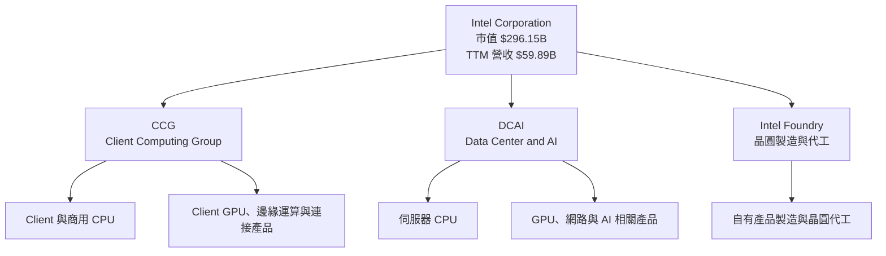
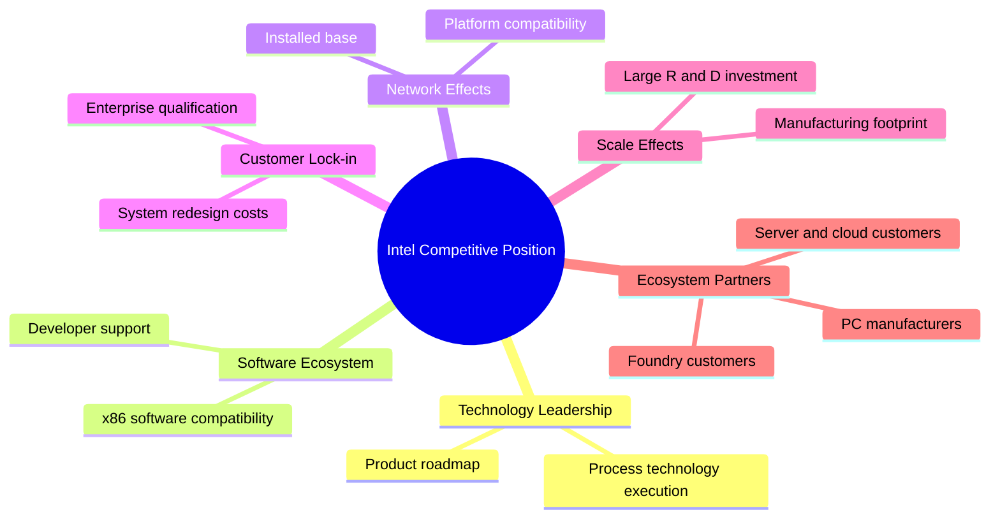
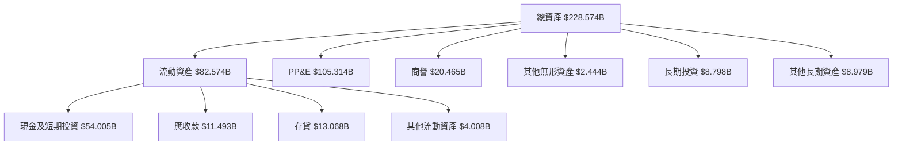
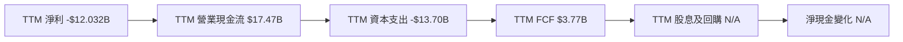
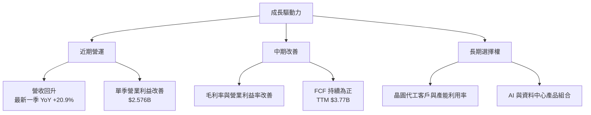
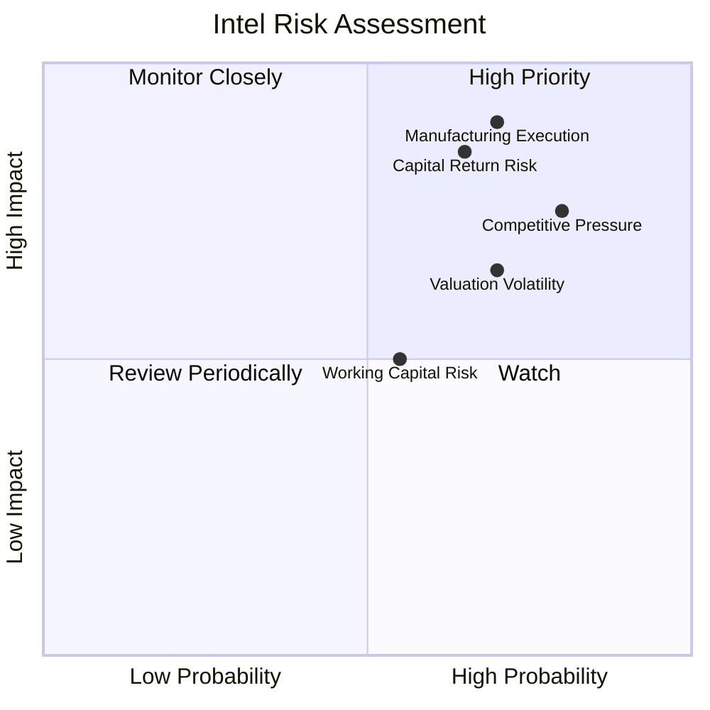
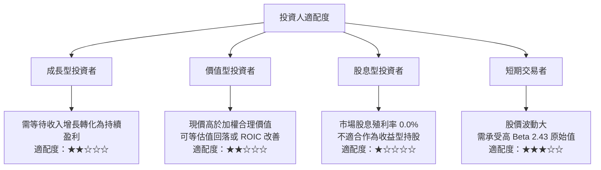

# INTC 基本面深度分析報告
> **報告日期**：2026-11-20 ｜ **語言**：繁體中文 ｜ **數據來源**：SEC 申報資料 (XBRL)、Yahoo Finance、Finviz、StockAnalysis、Roic.ai ｜ **分析師**：CFA 級機構研究

---

## 目錄

| # | 章節 | 核心結論 |
|---|------|----------|
| 1 | 執行摘要 | 賣出；加權合理價值 $37.99；MOS -46.7% |
| 2 | 公司概覽與商業模式 | CPU、資料中心與晶圓代工構成業務核心；護城河仍有規模基礎，但競爭侵蝕明顯 |
| 3 | 損益表深度分析 | TTM 營收 $59.89B、年增 12.1%；TTM 營業利益率 2.9%，季度改善但獲利品質波動 |
| 4 | 資產負債表分析 | 淨現金 $3.87B、流動比率 2.208；營運資金週期較一年前延長 33 天 |
| 5 | 現金流量深度分析 | TTM FCF $3.77B，FCF Yield 1.27%；資本支出仍高，年度歷史 FCF 曾持續為負 |
| 6 | 獲利能力與資本效率 | ROIC 1.3% 對 WACC 12.91%，目前仍在摧毀股東價值 |
| 7 | 相對估值分析 | 現價高於同業倍數法推導價值；自身 P/S 位於五年歷史第 90 百分位 |
| 8 | DCF 內在價值評估 | DCF 不適用：預測期末 FCF 不為正，不能建立可稽核模型 |
| 9 | 成長催化劑 | 季度營收回升與營業利益改善是正面訊號；分部營收及 TAM 數據不足以量化 |
| 10 | 風險矩陣 | 主要風險為製程／代工執行、AI 與資料中心競爭、資本支出回報不足 |
| 11 | 投資建議 | 依 MOS 評級為賣出；關注估值回落、ROIC 回升及 FCF 持續改善 |

---

## 1. 執行摘要

截至 2026-11-19 收盤，INTC 股價為 **$55.72**。同業 Forward P/E 法及 EV/EBITDA 法分別推導出每股 **$23.81** 與 **$40.46**，與分析師共識目標價 **$90.65** 按固定權重加權後，合理價值為 **$37.99**，MOS 為 **-46.7%**。同時，TTM ROIC 僅 **1.3%**，低於 **12.91%** 的 WACC；TTM FCF 雖轉正至 **$3.77B**，但 FCF Yield 僅 **1.27%**，而 DCF 因模型末期 FCF 不為正而無法計算。綜合估值與資本回報證據，依規則 20 評級為 **賣出**。

### 1.0 一頁式投資儀表板

| 項目 | 內容 |
|------|------|
| **投資論點（3 句）** | ① TTM 營收 $59.89B、年增 12.1%，最新一季年增 20.9%，顯示營收動能回升。② 最新季度營業利益 $2.576B，營業利益率資料口徑為 15.3%，但 TTM 營業利益率僅 2.9%，季度改善尚未證明可持續。③ 加權合理價值 $37.99，較 $55.72 現價低；ROIC 1.3% 仍低於 WACC 12.91%。 |
| **綜合評分** | **4.4/10**（引用 1.1 評分卡） |
| **財務健康** | 🟡 現金與短期投資 $54.01B、總債務 $50.13B、淨現金 $3.87B；流動比率 2.208，但自由現金流與資本回報仍需驗證。 |
| **ROIC vs WACC** | **1.3% vs 12.91%**：目前資本回報低於資本成本，摧毀股東價值。 |
| **FCF 趨勢** | TTM FCF 為正 $3.77B；FCF Yield **1.27%**。歷史年度 FCF 曾連續多年為負。 |
| **估值** | Forward P/E **31.1x** ｜ EV/EBITDA **16.1x** ｜ FCF Yield **1.27%** |
| **DCF 內在價值（基準）** | **N/A**；DCF 模型未能計算，無法給出 DCF 折溢價。 |
| **安全邊際（MOS）** | **-46.7%＝($37.99 − $55.72) ÷ $37.99**；加權合理價值基準，🔴無安全邊際。 |
| **預期報酬（基準情境 12M）** | **-31.8%**（加權合理價值相對現價的隱含報酬，不是 DCF 情境值）。 |
| **關鍵風險（前二）** | 製程與晶圓代工資本投入回報低於預期；CPU／AI 市場競爭令營收與利潤率改善不持久。 |
| **評級 + 信心度** | 🔴 **賣出** ｜ 信心：中。估值方法指向折價幅度較大，但 DCF 不可用、資料來源間部分財務指標存在差異。 |

### 1.1 綜合評分卡（全報告唯一）

| 維度 | 評分（1–10） | 主要依據（引用數字與其來源章節） |
|------|--------------|----------------------------------|
| 成長性 | 6.0 | TTM 營收成長 12.1%、最新一季年增 20.9%；近三個完整年度收入仍下降，詳見第 3 章。 |
| 獲利能力 | 3.0 | TTM 營業利益率 2.9%、ROIC 1.3% 對 WACC 12.91%；Piotroski F-Score 6/9，詳見第 3、6 章。 |
| 財務健康 | 6.5 | 淨現金 $3.87B、流動比率 2.208；CCC 從 35 天增至 68 天，詳見第 4 章。 |
| 估值 | 2.0 | MOS -46.7%；P/S 4.9x，高於五年中位數 2.6x 且位於第 90 百分位，詳見第 7、8 章。 |
| 護城河 | 5.0 | 既有客戶、產品與製造規模仍具價值，但缺少市占及分部營收資料，且相對同業的成長、毛利率存在差距，詳見第 2 章。 |
| 管理層與資本配置 | 4.0 | FY2025 SBC $2.43B、流通股數未通過 F-Score 測試；FY2022–FY2025 資本支出高，年度 FCF 多為負，詳見第 3、5 章。 |
| **綜合評分** | **4.4** | 六項算術平均：\((6.0+3.0+6.5+2.0+5.0+4.0)÷6=4.4167\)，四捨五入至一位小數。 |

### 1.2 五大投資論點 + 三大核心風險

| 類型 | 項目 | 具體依據 | 信心度 |
|------|------|----------|--------|
| 🟢 **投資論點①** | 季度營收回升 | FY2026 Q3 營收 $16.513B，單季 YoY 成長 20.9%；近幾季營收高於 2025 年同期。若回升由終端需求而非短期出貨時點推動，將支持產能利用率改善。 | 🟡 中 |
| 🟢 **投資論點②** | 最新季度營業獲利改善 | FY2026 Q3 營業利益 $2.576B，前一季 $1.966B；單季營業利益連續改善，需觀察成本與產品組合是否能延續。 | 🟡 中 |
| 🟢 **投資論點③** | 現金緩衝仍具規模 | 現金及短期投資 $54.01B、總債務 $50.13B，淨現金 $3.87B，短期流動性提供轉型時間。 | 🟢 高 |
| 🟢 **投資論點④** | TTM FCF 轉正 | TTM OCF $17.47B 減 Capex $13.70B，FCF $3.77B；但年度歷史數據仍顯示高 Capex 對現金流的壓力。 | 🟡 中 |
| 🟢 **投資論點⑤** | 產品與製造一體化的戰略選擇權 | Intel 同時從事產品設計與晶圓製造，若製程與外部客戶代工進展成功，可能增加產能利用與供應鏈彈性；分部收入及客戶數據未提供，暫無法量化。 | 🟡 中低 |
| 🟡 **風險①** | 估值與基本面落差 | 現價 $55.72 高於加權合理價值 $37.99；Forward P/E 31.1x，且 TTM ROIC 1.3% 低於 WACC 12.91%。 | 🔴 高衝擊 |
| 🔴 **風險②** | 製程與代工投資回收不確定 | 年度 Capex FY2023–FY2025 分別為 $25.75B、$23.94B、$14.65B；若產能利用率、良率或客戶需求未能達標，折舊及固定成本將限制利潤率。 | 🔴 高衝擊 |
| 🟡 **風險③** | 同業競爭及執行風險 | Peer data 顯示 AMD 最新季度營收年增 44.7%、NVDA 103.2%，分別高於 Intel 20.9%；Intel TTM 毛利率 40.2%，低於三家同業中位數 56.0%。 | 🔴 高衝擊 |

### 1.3 快速統計卡片

| 指標 | 公司實際值（期間） | 同業中位數 | 狀態 |
|------|--------------------|------------|------|
| 營收成長（TTM） | **12.1%** | — | 🟢 |
| 營收成長（最新一季年增） | **20.9%** | **44.7%** | 🟡 |
| 毛利率（TTM） | **40.2%** | **56.0%** | 🔴 |
| 營業利益率（TTM） | **2.9%** | — | 🔴 |
| ROIC（TTM） | **1.3%** | — | 🔴 |
| Forward P/E | **31.1x** | **13.3x** | 🔴 |
| FCF Yield（TTM） | **1.27%** | — | 🟡 |
| Piotroski F-Score | **6 / 9** | — | 🟡 |

> 同業中位數以 AMD、NVDA、QCOM 的 Peer multiples 資料計算；Forward P/E 中位數為 13.3x，毛利率中位數為 56.0%。

### 1.4 投資結論

╔══════════════════════════════════════════════════════════════════╗  
║                         📊 投資結論摘要                          ║  
╠══════════════════════════════════════════════════════════════════╣  
║ 評級：🔴 賣出（依規則 20 的 MOS 門檻）                           ║  
║ 價格（2026-11-19 收盤）：$55.72                                  ║  
║ DCF 內在價值（基準）：N/A（DCF 模型無法計算）                    ║  
║ 安全邊際 MOS：-46.7%＝($37.99−$55.72)÷$37.99                    ║  
║ 加權合理價值（8.8）：$37.99                                      ║  
║ 綜合評分：4.4/10（引用 1.1）                                     ║  
║ 適合投資人：能承受高波動、願意追蹤轉型執行進度者；不適合以目前   ║  
║ 現金收益或低估值作為主要投資理由的投資人。                       ║  
╚══════════════════════════════════════════════════════════════════╝  

---

## 2. 公司概覽與商業模式

### 2.1 業務結構與收入來源

Intel 設計、開發、製造及銷售運算相關產品與服務，資料列出 CCG、DCAI、Intel Foundry 三個主要業務板塊。各板塊收入與收入佔比未提供，因此不對分部營收或比例作推算。

### 2.2 市場份額

市場份額數據未提供，不能據此繪製市占率圖或推算各業務板塊佔比。營收規模方面，Intel TTM 營收為 $59.89B，最新一季年增 20.9%；相較之下，Peer data 顯示 AMD 最新季度年增 44.7%、NVDA 年增 103.2%。此比較顯示 Intel 的營收正回升，但成長速度仍落後於部分直接競爭者。

### 2.3 競爭護城河分析

### 2.4 護城河強度

| 護城河項目 | 強度（強／中／弱） | 證據（引用數字或事實） | 會削弱它的情況 |
|------------|--------------------|------------------------|----------------|
| 技術領先 | 中 | 公司橫跨產品設計及製造；年度 R&D 支出 FY2025 為 $13.77B。單靠研發支出不能證明產品或製程領先。 | 製程延誤、良率不足、產品效能或能效落後競品。 |
| 軟體生態系統 | 中 | 公司產品包含 x86 CPU 及客戶端、資料中心平台；具既有軟體相容性基礎，但生態使用數據未提供。 | 客戶轉向替代架構，或開發者資源及軟體最佳化減少。 |
| 網路效應 | 弱至中 | 平台與裝機基礎具一定互補性；用戶數、開發者數與網路效應量化資料未提供。 | 生態系統轉移門檻下降，替代平台相容性增加。 |
| 客戶鎖定 | 中 | 商用及伺服器產品需經系統驗證，切換涉及重新認證；客戶留存率未提供。 | 長期合約流失、客戶集中採購替代供應商產品。 |
| 規模效應 | 中 | FY2025 R&D $13.77B、PP&E（2026 年 9 月）$105.314B，形成可觀資源與資產基礎。 | 高固定成本在低利用率下反而形成利潤壓力；ROIC 目前僅 1.3%。 |
| 生態夥伴 | 中 | 涉及 PC、伺服器、網路及代工客戶；分部客戶數及代工客戶數未提供。 | 主要 OEM、雲端客戶或外部代工客戶轉單。 |

第 1.1 節「護城河」評分為 **5.0/10**，反映 Intel 仍有平台、品牌、資產與客戶基礎，但缺乏足以確認競爭優勢正在轉化為高資本回報的證據。

---

## 3. 損益表深度分析

### 3.1 年度收入成長趨勢（近 4 年）

| 財年 | 營收 | YoY | 視覺趨勢 |
|------|------:|----:|----------|
| FY2022 | $63.05B | — | █████████████████████████ |
| FY2023 | $54.23B | -14.0% | ██████████████████████ |
| FY2024 | $53.10B | -2.1% | █████████████████████ |
| FY2025 | $52.85B | -0.5% | █████████████████████ |
| FY2022–FY2025 CAGR | — | **-5.7%** | 營收較 FY2022 持續收縮 |

\[
\text{CAGR}=(52.85÷63.05)^{1/3}-1=-5.7\%
\]

╔══════════════════════════════════════════════════════════════════╗  
║             Intel 年度收入趨勢（FY2022–FY2025）                  ║  
╠══════════════════════════════════════════════════════════════════╣  
║ FY2022  $63.05B  █████████████████████████  YoY：基期            ║  
║ FY2023  $54.23B  ██████████████████████     YoY：-14.0% 🔴       ║  
║ FY2024  $53.10B  █████████████████████      YoY：-2.1% 🟡        ║  
║ FY2025  $52.85B  █████████████████████      YoY：-0.5% 🟡        ║  
║ FY2022–FY2025 營收 CAGR：-5.7%                                    ║  
╚══════════════════════════════════════════════════════════════════╝  

營收三年複合下降，表示最新 TTM 與季度反彈尚未抵銷過去下滑。要確認趨勢反轉，需要觀察後續季度的營收增長是否擴展至更多產品及客戶，而非僅由單季出貨節奏帶動。

### 3.2 季度收入趨勢分析

| 季度 | 營收 | QoQ 成長率 | YoY 成長率 | 備註 |
|------|------:|-----------:|-----------:|------|
| FY2025 Q4 | $13.674B | +0.7% | -4.1% | 年增仍為負，但季比趨穩。 |
| FY2026 Q1 | $13.577B | -0.7% | +7.2% | 季比略降，年比轉正。 |
| FY2026 Q2 | $16.128B | +18.8% | +25.4% | 季比增幅明顯，需留意產品出貨季節性。 |
| FY2026 Q3 | $16.513B | +2.4% | +20.9% | 年增仍高，但季比增速放緩。 |

QoQ 按相鄰季度營收計算；YoY 使用同一財務數據中的季度同比值。TTM 營收成長率為 12.1%，不應與最新單季 YoY 20.9% 混為同一期間指標。

### 3.3 利潤率演變分析

以下年度毛利率按年度損益表所列毛利與營收計算；年度營業利益率按同表所列營業利益除以營收計算。資料中的年度財務欄與 StockAnalysis 歷史欄部分數值不一致，故不把不同來源混成單一序列。TTM 與最新季度營業利益率採 SEC 申報資料計算值。

| 利潤率指標 | FY2022 | FY2023 | FY2024 | FY2025 | 趨勢 | 評估 |
|------------|-------:|-------:|-------:|-------:|------|------|
| 毛利率 | 42.6% | 40.0% | 32.6% | 34.8% | 2024 下滑，2025 回升 | 🔴 |
| 營業利益率 | 3.7% | 0.1% | -8.9% | 約 -0.04% | 大幅惡化後接近損益兩平 | 🔴 |
| TTM 營業利益率 | — | — | — | **2.9%** | TTM 回到正值，但幅度有限 | 🟡 |
| 最新季度營業利益率 | — | — | — | **15.3%** | 單季改善，尚需驗證延續性 | 🟡 |

毛利率在 FY2024 下滑與收入規模、產品組合及製造成本壓力相符；FY2025 有回升，但仍低於 FY2022。營業利益率由 FY2024 負值改善至 FY2025 約損益兩平，TTM 轉正；最新季度營業利益率更高，顯示營運槓桿有所改善。惟單季數據與 TTM 差距大，投資論點需要後續季度確認，不宜直接年化。

**資料口徑提示：**另一組合併市場數據列有 TTM 營業利益率 10.1%、最新季度 10.3%，與 SEC 計算區塊的 TTM 2.9%、最新季度 15.3% 不一致。本報告對應 TTM 與最新季度的關鍵比較採 SEC 計算區塊數值，並保留該差異作為資料限制。

### 3.4 費用結構分析

完整成本及費用明細不足以構成可核對的費用結構圓餅圖，因此不以不完整項目繪製比例圖。已知研發費用如下：

| 項目 | 金額 | 對營運的含義 |
|------|------:|--------------|
| FY2025 R&D | $13.77B | 研發是核心投入；約為 FY2025 營收 $52.85B 的 26.0%，計算為 $13.77B ÷ $52.85B。 |
| FY2024 R&D | $16.55B | 高於 FY2025；年度支出下降可能降低費用壓力，但需評估對產品競爭力與未來產品週期的影響。 |
| FY2023 R&D | $16.05B | 維持高額技術投入。 |
| FY2022 R&D | $17.53B | 顯示長期研發投入規模大，並不自動代表研發產出效率改善。 |

### 3.5 季度 EPS 趨勢與盈餘品質（Quality of Earnings）

| 季度 | EPS 實際值 | EPS 估值／驚喜 | 淨利狀況 | 評估 |
|------|-----------:|----------------|----------|------|
| FY2025 Q4 | -$0.12 | 估值與驚喜資料 N/A | 淨損 $0.591B | EPS estimate 缺漏，不能判定超預期或不及預期。 |
| FY2026 Q1 | -$0.73 | N/A | 淨損 $3.728B | 虧損擴大；季度預估資料缺漏。 |
| FY2026 Q2 | -$2.16 | N/A | 淨損 $11.033B | 淨損大幅增加；不可僅憑後續單季改善推斷全年盈利。 |
| FY2026 Q3 | $0.60–$0.63（來源口徑略異） | N/A | 淨利 $3.320B | 轉為單季盈利，但 EPS 驚喜值仍無法計算。 |

過去四季的 EPS 估值與實際值欄位均缺資料，故無法可靠分類為「超預期」或「不及預期」。市場資料列出的 FY2026 Q3 EPS 成長為 -32.7%，亦不可直接等同 EPS surprise。

| 盈餘品質項目 | 數值／佔比 | 評估 |
|--------------|-----------|------|
| 股權薪酬 SBC / 營收 | 近四季 SBC 約 $2.432B；佔 TTM 營收 $59.89B 約 **4.1%** | 🔴 SBC 並非現金支出，但代表股權稀釋成本；F-Score 的「稀釋股數未增加」未通過。 |
| SBC / 營業現金流 | 約 **13.9%**，計算為 $2.432B ÷ $17.47B | 🟡 比例具一定規模，需與股數變化一併觀察。 |
| FCF / 淨利（現金轉換率） | TTM 淨利 -$12.032B、FCF $3.77B；算術比率約 **-31.3%** | 🔴 淨利為負，該比率不具一般正向現金轉換率解讀；顯示 FCF 與 GAAP 淨利受到折舊、非現金項目及期間因素影響。 |
| 一次性／非經常性損益 | 可能有重大項目，但可分項量化的資料未提供 | 🟡 FY2026 Q2 淨損 $11.033B，需查 SEC 10-Q 的減損、重組、稅務及資產處分明細，不能假定全屬經常性或一次性。 |
| 有效稅率異常 | N/A（缺少 TTM 稅前損益與所得稅費用分項） | 🟡 不以預設稅率代替歷史有效稅率。 |
| 資本化支出 vs 費用化 | TTM Capex $13.70B；資本化支出構成及資產化政策細節未提供 | 🟡 高 Capex 會先列為資產，再透過折舊進入損益；應追蹤產能利用率、減損及折舊費用。 |

**盈餘品質結論：**TTM GAAP 淨利為負，而現金流口徑 FCF 為正，兩者方向相反；因此單季盈利改善尚不足以證明穩定經濟盈餘已恢復。SBC 約佔 TTM 營收 4.1%，亦意味股東須承擔稀釋成本。估值判斷應以可持續 FCF、營業利益率與股數變化共同驗證，而非僅看單季 EPS。

---

## 4. 資產負債表分析

### 4.1 資產結構分解

2026 年 9 月資產負債表列示總資產 $228.574B。以下圖表只列出已披露金額的科目，不反推未提供項目：

### 4.2 流動性與營運資金分析

| 流動性指標 | 最新值 | 評估 |
|------------|-------:|------|
| 流動比率 | 2.208 | 🟢 流動資產相對短期負債具緩衝。 |
| 速動比率 | 1.751 | 🟢 扣除存貨後仍高於 1，但不代表營運資金效率沒有惡化。 |
| 現金及短期投資 | $54.01B | 🟢 規模可支持轉型投入；仍須觀察現金變動及資本支出。 |
| 淨現金 | $3.87B | 🟡 現金高於總債務，但淨現金緩衝相對總資產有限。 |

**營運資金天數（QUALITY FIGURES 原值）：**

| 指標 | 最新 TTM | 一年前 TTM | 變化 | 解讀 |
|------|---------:|-----------:|-----:|------|
| DSO 應收帳款天數 | 25 天 | 22 天 | +3 天 | 收款週期拉長，可能與客戶及出貨組合變化有關；需要追蹤應收款逾期資料。 |
| DIO 存貨天數 | 133 天 | 122 天 | +11 天 | 存貨停留時間增加，可能增加減價、過時或產能配置風險。 |
| DPO 應付帳款天數 | 90 天 | 109 天 | -19 天 | 付款天數下降，對現金轉換週期不利；不宜在缺少供應商條款資料時解讀為議價力改善。 |
| CCC 現金轉換週期 | 68 天 | 35 天 | +33 天 | 現金被營運資金占用的時間變長，需和存貨週轉、客戶帳期共同監控。 |

### 4.3 債務結構分析

╔══════════════════════════════════════════════════════════════════╗  
║                    Intel 債務健康診斷                           ║  
╠══════════════════════════════════════════════════════════════════╣  
║ 總債務：$50.13B                                                  ║  
║ 現金及短期投資：$54.01B                                          ║  
║ 淨現金：$3.87B  🟡                                               ║  
║ Debt / EBITDA：N/A（本節所需 EBITDA 絕對金額未列示）             ║  
║ 利息保障倍數：N/A（利息費用及相同期間 EBIT 明細未完整提供）      ║  
║ 總體判斷：短期流動性有緩衝，但高額製造投資仍使現金流執行重要。   ║  
╚══════════════════════════════════════════════════════════════════╝  

Debt/Equity 的合併市場數據列有 38.108，但口徑與其他來源未進一步解釋，本報告不以該數值推導債務償付能力。公司 2026 年 9 月總債務 $50.13B，較 FY2025 年底 $46.59B 高；同期現金與短期投資為 $54.005B，淨現金 $3.87B。

### 4.4 股東權益趨勢

| 財年 | 股東權益 | YoY 變化 | 解讀 |
|------|---------:|---------:|------|
| FY2022 | $101.42B | — | 歷史基準。 |
| FY2023 | $105.59B | +4.1% | 權益上升。 |
| FY2024 | $99.27B | -6.0% | 權益減少，與大幅淨損相符。 |
| FY2025 | $114.28B | +15.1% | 權益回升；不能僅憑帳面權益推斷經營回報改善。 |

╔══════════════════════════════════════════════════════════════════╗  
║                    股東權益趨勢（年度）                         ║  
╠══════════════════════════════════════════════════════════════════╣  
║ FY2022  $101.42B  ██████████████████                             ║  
║ FY2023  $105.59B  ███████████████████                            ║  
║ FY2024   $99.27B  █████████████████                              ║  
║ FY2025  $114.28B  █████████████████████                          ║  
╚══════════════════════════════════════════════════════════════════╝  

---

## 5. 現金流量深度分析

### 5.1 現金流量瀑布圖

TTM 淨利採 StockAnalysis TTM 值 -$12.032B；營業現金流、資本支出及 FCF 按 SEC 計算區塊值列示。股息及回購的 TTM 完整數據未提供，故不補入瀑布。

FCF 的定義固定為營業現金流減資本支出：**$17.47B − $13.70B = $3.77B**。淨利與 OCF 之間差距大，反映應計項目及非現金費用對現金流的影響；不能把正 FCF 等同於 GAAP 獲利已恢復。

### 5.2 FCF 轉換率趨勢

| 財年 | FCF | 淨利 | FCF / 淨利 | 解讀 |
|------|----:|-----:|-----------:|------|
| FY2022 | -$9.41B | $8.01B | -117.4% | 高資本支出令 FCF 顯著低於淨利。 |
| FY2023 | -$14.28B | $1.69B | -845.0% | 正淨利但 FCF 深度為負，反映投資現金需求高。 |
| FY2024 | -$15.66B | -$18.76B | 83.5% | 分子分母同為負，該比率不代表正常現金轉換品質。 |
| FY2025 | -$4.95B | -$0.267B | 1,853.9% | 因淨利接近零而產生極大比率，不具可比性。 |
| TTM | $3.77B | -$12.032B | -31.3% | 淨利為負，比例不能用作正向轉換率判斷。 |

上述比例按給定 FCF、淨利計算；負值或接近零的淨利會使比率失去通常經濟含義，重點應放在 FCF 是否持續為正及其相對營收規模。

### 5.3 自由現金流趨勢

| 財年／期間 | FCF | 解讀 |
|------------|----:|------|
| FY2022 | -$9.41B | Capex $24.84B，高於 OCF $15.43B。 |
| FY2023 | -$14.28B | Capex $25.75B，高於 OCF $11.47B。 |
| FY2024 | -$15.66B | Capex $23.94B，高於 OCF $8.29B。 |
| FY2025 | -$4.95B | Capex $14.65B；現金消耗較前三年收窄。 |
| TTM | **+$3.77B** | OCF $17.47B 減 Capex $13.70B；FCF Yield 1.27%。 |

╔══════════════════════════════════════════════════════════════════╗  
║               自由現金流：歷史實際與最新 TTM                     ║  
╠══════════════════════════════════════════════════════════════════╣  
║ FY2022  -$9.41B  ◀█████████                                       ║  
║ FY2023 -$14.28B  ◀██████████████                                  ║  
║ FY2024 -$15.66B  ◀████████████████                                ║  
║ FY2025  -$4.95B  ◀█████                                           ║  
║ TTM     +$3.77B  ████▶   FCF Yield：1.27%                         ║  
╠══════════════════════════════════════════════════════════════════╣  
║ TTM FCF = $17.47B OCF − $13.70B Capex = $3.77B                   ║  
╚══════════════════════════════════════════════════════════════════╝  

TTM FCF 轉正是改善訊號，但過去四個年度均為負值，且近期資本支出仍達 $13.70B。若現金流改善來自暫時性營運資金變化，而非 OCF 的持續提高或 Capex 效率改善，FCF 可能反轉。

### 5.4 資本配置評估

完整資本配置資料不足以繪製比例圓餅圖；可確認項目如下：

| 項目 | 數據 | 評估 |
|------|------|------|
| 資本支出 | FY2022 $24.84B、FY2023 $25.75B、FY2024 $23.94B、FY2025 $14.65B；TTM $13.70B | 高資本投入支撐製造能力，但需以 ROIC 與產能利用率檢驗回報。 |
| 現金股利 | FY2025 $0；FY2024 $1.60B、FY2023 $3.09B、FY2022 $6.00B | 歷史股利下降至 FY2025 無支付，市場資料股息殖利率 0.0%。 |
| SBC | FY2025 $2.43B | 形成股東稀釋成本；須與員工留任及每股價值創造比較。 |
| 回購 | 可比期間完整回購數據未提供 | 不對回購金額或淨回購效果作估算。 |

---

## 6. 獲利能力與資本效率

### 6.1 ROE / ROA / ROIC 趨勢

| 指標 | 最新值 | 歷史資訊 | 評估 |
|------|-------:|----------|------|
| ROE | **-10.5%**（QUALITY FIGURES） | 合併市場數據另列 -9.6%，口徑不一致 | 🔴 股東權益報酬為負；引用品質指標的 TTM 數值。 |
| ROA | **1.8%**（合併市場數據） | F-Score 測試顯示 TTM ROA 未大於 0，來源口徑存在差異 | 🟡 不以不同口徑數值混合推導。 |
| ROIC | **1.3%**（SEC 計算區塊） | 歷史 ROIC 趨勢序列未提供可直接同口徑比較的數據 | 🔴 低於資本成本。 |
| WACC | **12.91%** | 財務數據成本資本區塊 | 🔴 作為資本成本基準。 |

### 6.2 ROIC vs WACC 分析（核心價值創造判斷）

╔══════════════════════════════════════════════════════════════════╗  
║                  ROIC vs WACC 深度分析                           ║  
╠══════════════════════════════════════════════════════════════════╣  
║ 無風險利率（10Y 美債）：5.05%                                    ║  
║ 市場風險溢酬 ERP：5.00%                                          ║  
║ 原始 Beta：2.43；採用調整後 Beta：1.95                          ║  
║ 股權成本 Ke：14.81%（成本資本資料原值）                          ║  
║ 稅前債務成本：2.18%；預設稅率：21.0%                             ║  
║ 股權／債務權重：85.5%／14.5%                                     ║  
║ 採用 WACC：12.91%（成本資本資料原值）                            ║  
║ TTM ROIC：1.3%（SEC 計算區塊）                                    ║  
║ ROIC − WACC：1.3% − 12.91% = -11.61 個百分點                     ║  
║ 結論：ROIC 顯著低於資本成本，現階段摧毀股東價值。                 ║  
╚══════════════════════════════════════════════════════════════════╝  

Beta 原始值 2.43 高，代表股價對市場波動較敏感；成本資本資料採用調整後 Beta **1.95**，並列出公式 \(⅔×2.43+⅓=1.953\)，四捨五入為 1.95。無風險利率與 ERP 依成本資本資料所列 5.05% 與 5.00%；該資料未給出 10 年期殖利率的觀察日期，故不補填日期。

成本資本資料給定 WACC **12.91%**，本報告直接採用，不另行替換。需注意，提供的 Ke、稅前 Kd、稅率與 E/D 權重依標準稅後加權公式代入後，與 12.91% 存在約 0.15 個百分點差異；因此 WACC 輸入的來源數值存在小幅內部不一致，但為維持規定口徑，估值評級及 ROIC 比較均採用指定 WACC 12.91%。

### 6.3 杜邦三因素分解

以下照抄 QUALITY FIGURES 的 TTM closing-balance 杜邦數據，不重算：

| 因素 | 數值（TTM） | 解讀 |
|------|-------------|------|
| 淨利率 | -20.1% | 淨利為負是 ROE 為負的主要因素。 |
| 資產週轉率 | 0.26 | 每單位資產所產生的營收偏低，重資產製造模式需要足夠利用率。 |
| 權益乘數 | 1.99 | 財務槓桿放大報酬變化，但不是 ROE 為負的主要根源。 |
| **ROE** | **-10.5%** | **-20.1% × 0.26 × 1.99 = -10.5%**（按來源原值）。 |

### 6.4 財務體質：Piotroski F-Score

**Piotroski F-Score：6 / 9。**未通過及通過項目照列 QUALITY FIGURES：

| 測試 | 結果 | 解讀 |
|------|------|------|
| ROA > 0 | ❌ 未通過 | 公司獲利能力仍存在壓力。 |
| 營業現金流 > 0 | ✅ 通過 | TTM OCF 為 $17.47B。 |
| ROA 高於一年前 | ❌ 未通過 | 資產獲利能力未顯示改善。 |
| 營業現金流 > 淨利（應計品質） | ✅ 通過 | 現金流高於淨利，惟 TTM 淨利為負，須審慎解讀。 |
| 長期負債 ÷ 總資產低於一年前 | ✅ 通過 | 槓桿相對資產的測試改善。 |
| 流動比率高於一年前 | ✅ 通過 | 流動性測試改善；最新流動比率 2.208。 |
| 稀釋股數未增加 | ❌ 未通過 | 股數增加意味每股價值可能被稀釋。 |
| 毛利率高於一年前 | ✅ 通過 | 毛利率測試改善，但 TTM 毛利率 40.2% 仍低於同業中位數。 |
| 資產週轉率高於一年前 | ✅ 通過 | 資產使用效率測試改善，仍須觀察趨勢持續性。 |

---

## 7. 相對估值分析

### 7.1 同業估值比較表格

以下競爭對手倍數均引用 Peer multiples；Intel 公司倍數按市場估值資料列示。P/E trailing 對 Intel 為 N/A，因 TTM EPS 為負。

| 估值指標 | **INTC** | **AMD** | **NVDA** | **QCOM** | INTC 評估 |
|----------|---------:|--------:|--------:|--------:|-----------|
| **Trailing P/E** | N/A（TTM EPS -$2.35） | 104.5x | 15.7x | 12.8x | 🔴 Intel TTM 虧損，P/E 不具可比性。 |
| **Forward P/E** | **31.1x** | 27.7x | 8.8x | 13.3x | 🔴 高於同業中位數 13.3x；但公司未提供同口徑盈利預測明細。 |
| **P/S Ratio** | **4.9x** | 17.8x | 9.7x | 4.0x | 🟡 低於 AMD、NVDA，高於 QCOM；但 P/S 未反映低 ROIC 與資本支出。 |
| **EV/EBITDA** | **16.1x** | 71.4x | 14.2x | 17.1x | 🟡 介於 NVDA、QCOM 附近，低於 AMD；EBITDA 倍數需配合投資回報看。 |
| **最新一季營收 YoY** | **20.9%** | 44.7% | 103.2% | -8.4% | 🟡 高於 QCOM，但落後 AMD、NVDA。 |
| **毛利率 TTM** | **40.2%** | 56.0% | 74.9% | 53.1% | 🔴 低於三家同業；毛利率差距限制盈利彈性。 |

Peer median 的使用依方法有所區分：Forward P/E 中位數為 AMD、NVDA、QCOM 三家之中位數 **13.3x**；EV/EBITDA 方法採 NVDA 與 QCOM 中位數 **15.7x**，照既定估值方法使用。

### 7.2 歷史估值區間分析

自身歷史資料提供 P/S 與 EV/EBITDA，沒有 P/E 歷史區間，故不以 P/E 替代。

╔══════════════════════════════════════════════════════════════════╗  
║                  Intel 自身五年估值區間                          ║  
╠══════════════════════════════════════════════════════════════════╣  
║ P/S：現值 4.9x ｜中位數 2.6x｜區間 1.5x–11.5x｜百分位第 90 位 ║  
║ EV/EBITDA：現值 21.6x｜中位數 23.6x｜區間 6.4x–536.5x         ║  
║ EV/EBITDA 百分位：第 41 位                                      ║  
╚══════════════════════════════════════════════════════════════════╝  

現行 P/S 4.9x 高於自身五年中位數 2.6x，且位於第 90 百分位，表示以銷售額衡量的定價偏高。EV/EBITDA 現值 21.6x 低於五年中位數 23.6x，但歷史區間極寬，且 EBITDA 所處周期可能不同，解讀應以同業比較和資本回報交叉驗證。

### 7.3 情境價值（Bear / Base / Bull）

N/A（DCF 無法計算：模型預測期最後一年 FCF 不為正，原因為資本支出高於營業利益與折舊攤銷；DCF MODEL 未提供情境估值。）

### 7.4 相對估值隱含價格區間

╔══════════════════════════════════════════════════════════════════╗  
║                     相對估值隱含價格                             ║  
╠══════════════════════════════════════════════════════════════════╣  
║ 同業 Forward P/E：$23.81  ────── 現價 $55.72 ────── 分析師 $90.65 ║  
║ 同業 EV/EBITDA：  $40.46  ──────┘                                 ║  
╚══════════════════════════════════════════════════════════════════╝  

| 方法 | 每股價值 | 相對現價 | 方法依據 |
|------|---------:|---------:|----------|
| 同業 Forward P/E | $23.81 | -57.3% | AMD、NVDA、QCOM Forward P/E 中位數 13.3x × Intel Forward EPS $1.79。 |
| 同業 EV/EBITDA | $40.46 | -27.4% | NVDA、QCOM EV/EBITDA 中位數 15.7x × TTM EBITDA，再加回淨現金。 |
| 分析師共識目標價 | $90.65 | +62.7% | 43 位分析師目標價平均值；參考性較高，並非本報告主要估值依據。 |

上述相對估值反映方法間分歧較大。分析師共識顯著高於兩種同業倍數法，這種分歧使加權合理價值依賴分析師目標價權重，但其權重僅 10%。

---

## 8. DCF 內在價值評估（Discounted Cash Flow）

### 8.0 估值推理鏈

**DCF MODEL：N/A。**程式計算指出預測期末 FCF 不為正，原因為資本支出高於營業利益與折舊攤銷，故無法建立符合模型條件的 DCF。依規定，本章不另造預測期、WACC 情境或每股內在價值，也不提供 DCF 情境目標價。

INTC 的企業價值理論上由既有產品業務的現金流、晶圓製造投資的未來回報及新業務選擇權構成；但未提供 CCG、DCAI、Intel Foundry 的分部營收，不能量化各來源佔比。現階段最關鍵的估值變數應是投資能否轉化為持續正向 FCF；但由於模型已標示 N/A，不能用自建假設填補缺口。

| 決策點 | 本報告採用 | 理由 | 曾考慮但否決 | 否決理由 |
|--------|-----------|------|--------------|----------|
| 現金流模型 | N/A | DCF MODEL 未提供可用模型，期末 FCF 不為正。 | 自行建立 FCFF | 會違反本報告所採用的模型資料優先規則，且缺少完整模型輸入。 |
| 預測期 N | N/A | 模型未能計算。 | 任意採用 5 或 10 年 | 缺少可稽核的預測依據。 |
| 終值方法 | N/A | 模型未能計算。 | Gordon Growth／退出倍數 | 無法以非正終期 FCF 建立可信終值。 |
| EBIT 基礎及 SBC | N/A | DCF 模型不存在，無法指定組合。 | GAAP／非 GAAP 選擇 | 不以自建假設替代資料缺口。 |

### 8.1 模型假設總表（Model Inputs）

N/A（DCF MODEL 未提供可計算的預測期及假設值；不可自行設置營收 CAGR、期末利潤率、Capex、D&A、ΔWC、SBC 或稀釋率。）

### 8.2 折現率推導（WACC）

╔══════════════════════════════════════════════════════════════════╗  
║                     WACC 資料（採用原值）                        ║  
╠══════════════════════════════════════════════════════════════════╣  
║ 無風險利率 Rf（10Y Treasury）：5.05%                             ║  
║ ERP：5.00%                                                       ║  
║ 原始 Beta：2.43                                                  ║  
║ 調整後 Beta：1.95＝⅔×2.43＋⅓                                    ║  
║ 股權成本 Ke：14.81%（成本資本資料原值）                          ║  
║ 稅前債務成本 Kd：2.18%                                           ║  
║ 預設稅率：21.0%                                                  ║  
║ 股權／債務權重：85.5%／14.5%                                     ║  
║ 採用 WACC：12.91%                                                ║  
╚══════════════════════════════════════════════════════════════════╝  

成本資本資料提供的 Ke、Kd、稅率、資本權重及 WACC 數值如上。本報告直接採用指定 **WACC 12.91%**，與第 6.2 節一致；由於輸入項目按標準稅後加權公式存在小幅算術差異，並不另行以重算值替換指定 WACC。Kd 所需利息費用與平均計息負債明細未提供，故不自行拆算。

### 8.3 逐年自由現金流預測（基準情境）

N/A（DCF 模型未提供年度預測表。資料僅指出預測期末 FCF 不為正，因此不具備逐年現金流現值、算式或折現因子可供照錄。）

### 8.4 終值計算（Terminal Value）

N/A（DCF 模型未提供終期 FCF、永續成長率或退出倍數；不能計算終值或終值現值。）

### 8.5 企業價值 → 每股內在價值（Bridge）

N/A（DCF 模型未提供預測期 FCF 現值、終值現值、股權價值橋接或稀釋後股數，故不計算 DCF 每股價值及 DCF 折溢價。）

### 8.6 敏感性分析（WACC × 永續成長率）

N/A（DCF MODEL 未提供敏感性矩陣；不能自行建立 WACC 與 g 的情境數字。）

### 8.7 反推 DCF（Reverse DCF）

N/A（未提供可用 DCF 模型與基準假設，因此不能從現價反解單一營運變數或建構疊代試算表。）

### 8.8 估值三角驗證與安全邊際

DCF 基準值無法計算，因此估值三角驗證由已提供的兩種同業倍數法與分析師共識目標價構成。公司類型標示為 profitable；按照固定估值方法權重列示，DCF（基準）因無法計算而未納入，權重按既定資料分配至其他方法。

| 估值方法 | 隱含每股價值 | 上行空間（÷現價） | 權重 | 說明 |
|----------|--------------:|-------------------:|-----:|------|
| 同業 Forward P/E | $23.81 | -57.3% | 45% | Peer Forward P/E 中位數 13.3x × Forward EPS $1.79。 |
| 同業 EV/EBITDA | $40.46 | -27.4% | 45% | Peer EV/EBITDA 中位數 15.7x × TTM EBITDA，再加回淨現金。 |
| 分析師共識目標價 | $90.65 | +62.7% | 10% | 43 位分析師目標價平均值。 |
| **加權合理價值** | **$37.99** | **-31.8%** | **100%** | 加權總和；未作事後調整。 |

**逐步演算：**

\[
23.81×45\%+40.46×45\%+90.65×10\%
=10.7145+18.207+9.065
=37.9865
\approx \$37.99
\]

MOS 以加權合理價值為分母：

\[
\text{MOS}=(37.99-55.72)÷37.99=-46.7\%
\]

隱含上行空間以現價為分母：

\[
\text{上行空間}=(37.99-55.72)÷55.72=-31.8\%
\]

╔══════════════════════════════════════════════════════════════════╗  
║                    估值區間與安全邊際                            ║  
╠══════════════════════════════════════════════════════════════════╣  
║ $23.81 ─── $37.99 ─── [$55.72 現價] ─── $90.65                  ║  
║ Forward P/E  加權合理值  現價          分析師共識                ║  
║                                                                  ║  
║ MOS = ($37.99−$55.72)÷$37.99 = -46.7%                            ║  
║ 上行空間 = ($37.99−$55.72)÷$55.72 = -31.8%                      ║  
║ 評級：🔴 賣出                                                    ║  
║ 加權合理價值下 10% MOS 對應價格上限：$37.99×90% = $34.19         ║  
╚══════════════════════════════════════════════════════════════════╝  

> 🔎 **程式複算（Python，依本節各項自動重算）**
>
> 加權合理價值 = $23.81 × 45% + $40.46 × 45% + $90.65 × 10% = **$37.99**（權重合計 100%）
>
> 以價格 $55.72 計：MOS = **-46.7%**，上行空間 = **-31.8%**
>
> ✅ 與本節所寫數值一致。

### 8.9 DCF 模型的局限與失效條件

- **終值依賴度：**N/A，DCF 未能計算，因此沒有可引用的終值佔 EV 比例。
- **最脆弱的假設：**DCF 模型之所以失效，關鍵在於模型預測期末 FCF 不為正；若 Capex 長期高於營業利益與折舊攤銷，現金流折現法難以提供可信終值。
- **適用性：**公司資本支出高、獲利波動大，單一 DCF 結果容易受利潤率與資本支出假設支配。現階段應以同業倍數、收入與毛利趨勢、資本支出回報及營運現金流交叉觀察。
- **與第 10 章風險矩陣連結：**製程延誤或需求不足可能使營收、利潤率改善低於預期；產能利用率不足可能令 Capex 無法轉化為現金流；競爭加劇則可能壓低毛利率，使正向 FCF 難以持續。

### 8.10 複算檢核表（Audit Trail）

| # | 檢核項目 | 檢查方式 | 結果 |
|---|----------|----------|------|
| 1 | 所有高／中敏感度輸入都有完整推導 | DCF MODEL 為 N/A，無模型輸入可供逐項推導 | N/A |
| 2 | 每個假設都有來歷 | 未另建 DCF 假設；缺漏值標示 N/A | ✅ |
| 3 | WACC 算式與加權結果 | 採用成本資本資料原值；組成輸入存在小幅不一致，未自行替換 WACC | ⚠️ |
| 4 | Kd 分母與債務權重範圍一致 | 缺少利息及平均計息負債分項，無法驗證 | N/A |
| 5 | WACC 與第 6.2 節相同 | 兩處均為 12.91% | ✅ |
| 6 | 逐年預測年度數與 N 相符 | DCF MODEL 無年度預測 | N/A |
| 7 | FY+1 算式可複算 | 無 FY+1 預測數據 | N/A |
| 8 | 預測期現值合計可複算 | 無逐年現值 | N/A |
| 9 | WACC > g | g 未提供 | N/A |
| 10 | 終值以 FY+N 現金流折現 | DCF 未計算 | N/A |
| 11 | EV 至每股橋接可複算 | DCF 未計算 | N/A |
| 12 | SBC 組合相容 | 無 DCF EBIT 基礎、SBC 預測或股數假設 | N/A |
| 13 | 敏感性矩陣基準格等於 8.5 | 矩陣與 DCF 基準值均不存在 | N/A |
| 14 | 敏感性矩陣有效格規則 | 矩陣未提供 | N/A |
| 15 | 三情境機率加總 100% | DCF Scenarios 未提供 | N/A |
| 16 | 反推 DCF 每列只放開一個變數 | 無反推模型 | N/A |
| 17 | MOS 分母及折溢價基準正確 | MOS 以 $37.99 為分母；DCF 折溢價因 DCF N/A 未計算 | ✅ |
| 18 | 完整輸出至第 11 章 | 本報告包含 11 章 | ✅ |
| 19 | 加權合理價值等於加權總和 | $23.81×45%+$40.46×45%+$90.65×10%=$37.9865≈$37.99 | ✅ |
| 20 | 評級符合 MOS 門檻 | MOS -46.7% < -25%，評級為賣出 | ✅ |

---

## 9. 成長催化劑

### 9.1 催化劑時間軸

目前資料未提供可核實的未來產品發布、晶圓廠投產或代工客戶導入日期，因此不繪製含未經證實日期的 gantt 圖。可追蹤的催化劑按觀察順序列示：

| 觀察階段 | 催化劑 | 驗證指標 |
|----------|--------|----------|
| 近期財報 | 季度營收回升是否延續 | 最新一季營收年增 20.9%；追蹤下一季是否持續正成長。 |
| 近期財報 | 營業獲利改善是否具有持續性 | 最新季度營業利益 $2.576B；追蹤 TTM 營業利益率能否由 2.9% 持續改善。 |
| 中期 | FCF 改善與資本支出效率 | TTM FCF $3.77B、Capex $13.70B；追蹤 FCF 是否連續為正且不依賴營運資金一次性變化。 |
| 長期 | 晶圓代工與製造投資回報 | 分部營收、外部代工客戶、產能利用率及 ROIC；目前相關分部數據未提供。 |

### 9.2 TAM 市場規模分析

N/A（TAM 數據未提供）。Intel TTM 營收 $59.89B、TTM 年增 12.1%，最新一季年增 20.9%，顯示近期業務動能回升；但無法以未提供的市場總額推算滲透率或可服務市場規模。要評估長期增長空間，需另有 PC、資料中心、AI 與代工市場的可引用 TAM 數據及分部營收。

### 9.3 成長驅動力結構圖

---

## 10. 風險矩陣

### 10.1 風險評分矩陣

以下象限位置是定性分析師評估，不是財務報表數字；圖中機率與衝擊以相對位置表示。

### 10.2 風險清單詳細分析

| # | 風險項目 | 發生機率 | 財務衝擊 | 風險評估 | 緩解措施 |
|---|----------|----------|----------|----------|----------|
| 1 | 🔴 **製程、良率與代工執行** | 中高（定性） | 高：可能提高單位成本、延後收入並增加資產減損風險；量化幅度未提供 | 高 | 追蹤製程里程碑、良率、產能利用率及外部客戶收入；未達成時重新評估長期 Capex。 |
| 2 | 🔴 **產品與市場競爭** | 高（定性） | 高：Intel 最新季度營收年增 20.9%，仍低於 AMD 44.7% 與 NVDA 103.2%；毛利率 40.2% 低於同業中位數 56.0% | 高 | 逐季比較產品營收、毛利率、資料中心需求與客戶採用；避免僅靠市場總體成長推論份額提升。 |
| 3 | 🔴 **資本支出回報不足** | 中高（定性） | 高：FY2023–FY2024 Capex 分別 $25.75B、$23.94B；若投資回報不足，ROIC 可能持續低於 WACC | 高 | 追蹤 TTM FCF、ROIC、產能利用率及折舊；要求新投資能支持正向 FCF。 |
| 4 | 🟡 **營運資金效率惡化** | 中（定性） | 中：CCC 一年增加 33 天至 68 天；其中 DIO +11 天、DPO -19 天 | 中 | 監控存貨週轉、應收帳款和供應商付款天數，確認不是需求低於預期造成存貨堆積。 |
| 5 | 🟡 **估值波動與市場預期差** | 中高（定性） | 高：現價 $55.72 高於加權合理價值 $37.99；股價 24 個月內曾大幅波動 | 高 | 以估值方法、營運指標及季度財報更新估值；避免以單一分析師目標價作為買入依據。 |

---

## 11. 投資建議

### 11.1 最終評級與評分

MOS **-46.7%** 低於賣出門檻 -25%，因此依規則 20 評級為 **賣出**；本報告未作質化升降級。1.1 評分卡綜合評分為 **4.4/10**，由成長性 6.0、獲利能力 3.0、財務健康 6.5、估值 2.0、護城河 5.0、管理層與資本配置 4.0 六項算術平均得出。

### 11.2 合理價值與隱含報酬率

| 方法／情境 | 每股價值 | 相對現價 $55.72 | 機率／權重 | 說明 |
|------------|---------:|----------------:|-----------:|------|
| 加權合理價值 | **$37.99** | **-31.8%** | 100% 權重總和 | 兩種同業估值與分析師共識加權。 |
| DCF 悲觀情境 | N/A | N/A | N/A | DCF 模型不可計算。 |
| DCF 基準情境 | N/A | N/A | N/A | DCF 模型不可計算。 |
| DCF 樂觀情境 | N/A | N/A | N/A | DCF 模型不可計算。 |

加權合理價值 $37.99 不是保證目標價，而是基於指定倍數與權重的估值參考；分析師共識 $90.65 顯著高於兩種相對估值法，應視為估值分歧而非已確認上行情境。

### 11.3 買入時機與觸發因素

╔══════════════════════════════════════════════════════════════════╗  
║                  ✅ 買入觸發因素 Checklist                      ║  
╠══════════════════════════════════════════════════════════════════╣  
║ 目前判斷：不建議以 $55.72 現價追買；等待價格與營運證據改善。    ║  
║                                                                  ║  
║ 重新評估買入的條件：                                             ║  
║ ☐ 股價回落至約 $34.19 或以下（相對 $37.99 合理價值達 10% MOS） ║  
║ ☐ TTM FCF 維持正值，且不是依賴單季營運資金釋放                 ║  
║ ☐ ROIC 持續上升，並逐步接近 WACC 12.91%                         ║  
║ ☐ TTM 營業利益率由 2.9% 持續改善，且季度改善不只出現一次       ║  
║                                                                  ║  
║ 加碼觸發條件：                                                   ║  
║ ☐ 同業倍數法隱含價值向上修正，且原因是 EPS／EBITDA 改善          ║  
║ ☐ CCC 由 68 天回落，尤其存貨天數 133 天改善                      ║  
║                                                                  ║  
║ 減碼／退出觸發條件：                                             ║  
║ ☐ TTM FCF 再度轉負並連續惡化                                     ║  
║ ☐ ROIC 維持遠低於 WACC，且資本支出仍高                           ║  
║ ☐ 營收連續兩季年增轉負，或毛利率進一步低於 TTM 40.2%            ║  
╚══════════════════════════════════════════════════════════════════╝  

以加權合理價值計算，10% MOS 對應價格為 \(37.99×(1-10\%)=\$34.19\)。此為估值觸發參考，不構成保證價格底部；若營運假設惡化，合理價值本身亦可能下修。

### 11.4 投資人適配度分析

### 11.5 每季財報監控清單（Quarterly Watch List）

| 監控指標 | 最新基準 | 加碼觀察條件 | 減碼／重新檢視條件 |
|----------|---------:|--------------|--------------------|
| 營收成長 | TTM +12.1%；最新季度 YoY +20.9% | 後續季度維持正年增，且 TTM 成長延續 | 連續兩季單季 YoY 轉負 |
| 營業利益率 | TTM 2.9%；最新季度 15.3% | TTM 利益率逐季上升，非只由單季拉動 | TTM 回落至 2.9% 以下並持續兩季 |
| 毛利率 | TTM 40.2% | 維持或高於目前水平，並縮小與同業差距 | 低於 TTM 40.2% 且持續收縮 |
| Capex | TTM $13.70B | Capex 對應產能利用率與現金流改善 | 支出增加但 FCF 和 ROIC 無改善 |
| FCF | TTM $3.77B；Yield 1.27% | 維持正值，並以營業現金流支持 | TTM FCF 轉負或多季下降 |
| 存貨與 CCC | DIO 133 天；CCC 68 天 | DIO、CCC 持續回落 | DIO 高於 133 天且 CCC 繼續延長 |
| ROIC | 1.3% | 持續上升並逐步接近 WACC 12.91% | ROIC 下滑或長期無改善 |
| 股數及 SBC | 近四季 SBC 約 $2.432B；F-Score 股數測試未通過 | 稀釋幅度下降、每股盈利改善 | SBC 與股數持續上升但每股價值未增長 |
| 管理層財測 | 資料未提供 | 後續以正式公司指引與實際值比較 | 多次下修或實際結果低於公司指引 |

### 11.6 反面論證：什麼會證明論點錯誤（What Would Change My Mind）

╔══════════════════════════════════════════════════════════════════╗  
║              ⚠️ 論點失效條件（Disconfirming Evidence）           ║  
╠══════════════════════════════════════════════════════════════════╣  
║ 本報告的偏保守判斷應在以下情況重新檢視：                         ║  
║ ☐ TTM 營收成長由目前 12.1% 回落至零以下，並連續兩季未恢復       ║  
║ ☐ TTM 營業利益率由目前 2.9% 收縮，且最新季度改善未能延續        ║  
║ ☐ TTM FCF $3.77B 轉負並連續兩季維持負值                         ║  
║ ☐ ROIC 長期維持 1.3% 附近或下滑，與 WACC 12.91% 差距未縮小       ║  
║ ☐ CCC 高於目前 68 天並繼續惡化，尤其 DIO 超過 133 天              ║  
║ ☐ 股權稀釋增加，SBC 仍約佔營收 4.1% 或上升，但每股獲利未改善    ║  
╚══════════════════════════════════════════════════════════════════╝  

若相反地，Intel 能連續多季維持正向 FCF、提高 TTM 利潤率並使 ROIC 持續接近資本成本，則本報告對其盈利修復與估值的保守判斷需要重新評估。DCF 目前不可用，因而更需以可觀察的季度經營數據驗證轉型，而非依賴未能複算的長期預測。

> **免責聲明**：本報告為 AI 自動生成，僅供研究參考，不構成投資建議。投資有風險，入市需謹慎。

---

## 資料與來源

| 項目 | 內容 |
|------|------|
| 價格 | 55.72 USD，2026-11-19 收盤（Yahoo Finance 即時報價（該交易日已收盤）） |
| 財務報表 | SEC 10-Q filed 2026-10-30，最新季度 2026-09-26（FY2026 Q3） |
| 有回應的資料來源 | SEC 申報資料 (XBRL)、Yahoo Finance、Finviz、StockAnalysis、Roic.ai |
| 由程式計算 | TTM 數字、WACC、DCF 模型、估值方法與權重、加權合理價值、MOS、評級門檻、F-Score、杜邦分解、營運資金天數、綜合評分 |
| 撰寫模型 | openai / gpt-6-luna |

> 本區塊由產生報告的程式依實際取得的資料填寫，非模型撰寫。「由程式計算」的數字不是模型的估計；其餘判斷（評分、情境、策略）是模型的分析。
