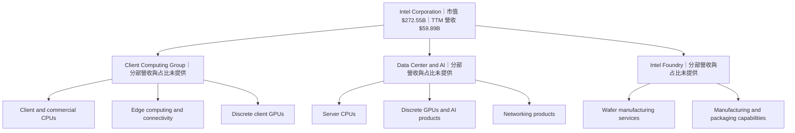
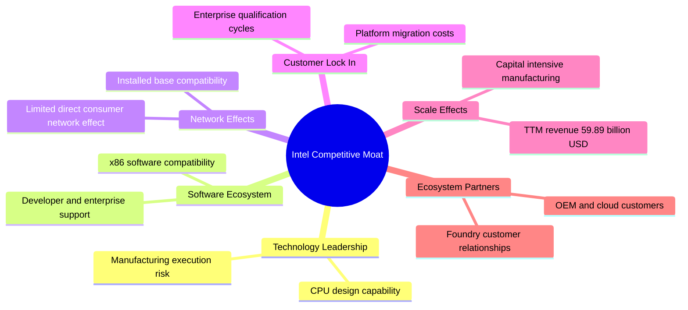
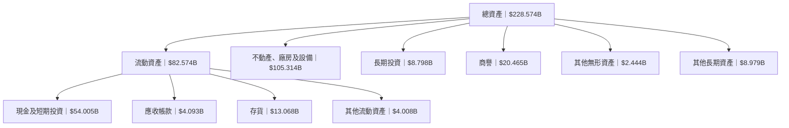
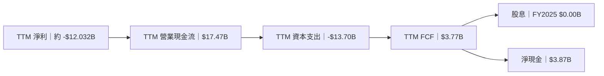
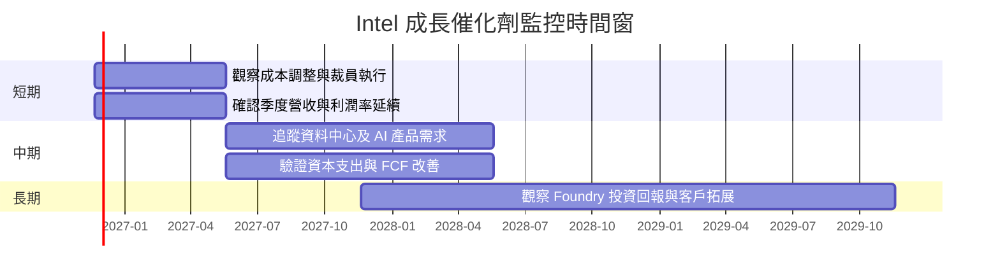
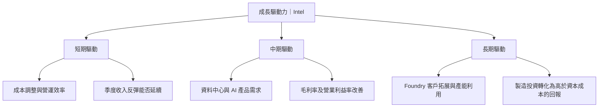
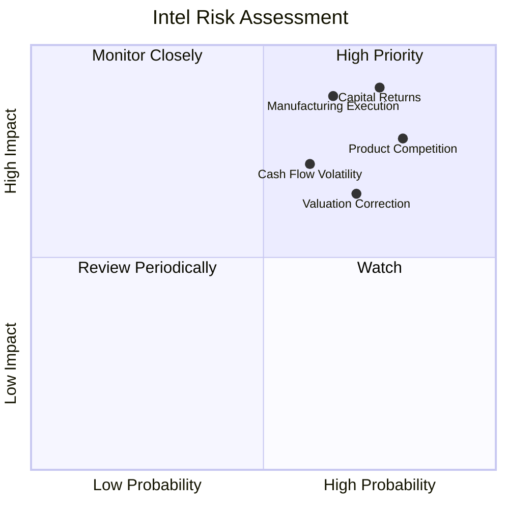
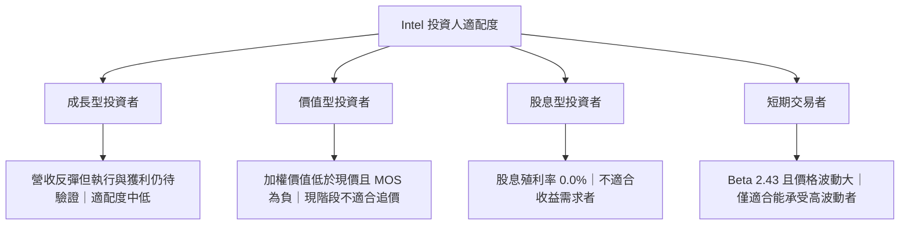

# INTC 基本面深度分析報告
> **報告日期**：2026-11-21 ｜ **語言**：繁體中文 ｜ **數據來源**：SEC 申報資料 (XBRL)、Yahoo Finance、Finviz、StockAnalysis、Roic.ai ｜ **分析師**：CFA 級機構研究

## 目錄

| # | 章節 | 核心結論 |
|---|------|----------|
| 1 | 執行摘要 | 賣出；加權合理價值 $35.37，MOS -45.0% |
| 2 | 公司概覽與商業模式 | CPU、製造及生態系統具規模優勢，但護城河承受競爭壓力 |
| 3 | 損益表深度分析 | TTM 營收 $59.89B、年增 12.1%；利潤率仍有來源差異與波動 |
| 4 | 資產負債表分析 | 淨現金 $3.87B、流動比率 2.208；庫存與現金週期惡化 |
| 5 | 現金流量深度分析 | TTM FCF $3.77B，但歷年資本支出高、現金流改善仍待驗證 |
| 6 | 獲利能力與資本效率 | ROIC 1.3% 明顯低於 WACC 12.65%，目前摧毀股東價值 |
| 7 | 相對估值分析 | Forward P/E 高於同業中位數；股價高於兩項相對估值結果 |
| 8 | DCF 內在價值評估 | DCF 無法有效計算；改以固定權重方法得加權價值 $35.37 |
| 9 | 成長催化劑 | 營收回升、裁員與成本調整、AI／資料中心需求為待驗證因素 |
| 10 | 風險矩陣 | 製程與資本回報、競爭、估值波動是主要風險 |
| 11 | 投資建議 | 賣出；需觀察利潤率、FCF、ROIC 與資本支出能否持續改善 |

## 1. 執行摘要

Intel 的 TTM 營收為 **$59.89B**，TTM 年增 **12.1%**，最新一季營收年增 **20.9%**；但 TTM ROIC 僅 **1.3%**，低於 **12.65% WACC**，TTM FCF 為 **$3.77B**、FCF Yield 僅 **1.38%**。相對估值法及分析師共識依固定權重得出加權合理價值 **$35.37**，低於 2026-11-20 收盤價 **$51.28**；MOS 為 **-45.0%**。因此依規則 20 評級為 **🔴 賣出**，並非因單季營收反彈即可抵銷資本回報率與估值落差。

### 1.0 一頁式投資儀表板

| 項目 | 內容 |
|------|------|
| **投資論點（3 句）** | ① TTM 營收年增 12.1%、最新一季年增 20.9%，顯示收入趨勢回升。② ROIC 1.3% 對比 WACC 12.65%，代表目前投資回報低於資本成本。③ TTM FCF $3.77B、FCF Yield 1.38%，而加權合理價值 $35.37 低於現價 $51.28。 |
| **綜合評分** | **4.6/10**（引用 1.1；六項算術平均） |
| **財務健康** | 🟡 現金及短期投資 $54.01B，高於總債務 $50.13B；但 CCC 從 35 天升至 68 天。 |
| **ROIC vs WACC** | **1.3% vs 12.65%**；目前摧毀股東價值。 |
| **FCF 趨勢** | FY2022–FY2024 為負，FY2025 改善但仍為負；TTM FCF 為正，FCF Yield **1.38%**。 |
| **估值** | Forward P/E **28.64x**｜EV/EBITDA **14.935x**｜FCF Yield **1.38%** |
| **DCF 內在價值（基準）** | **N/A**；DCF 模型未能計算，故 DCF 折溢價不適用。 |
| **安全邊際（MOS）** | **-45.0%＝($35.37 − $51.28) ÷ $35.37**（基準為 8.8 加權合理價值）｜🔴 無 |
| **預期報酬（基準情境 12M）** | N/A；DCF 模型未提供可用的情境目標價。 |
| **關鍵風險（前二）** | 製造／製程投資回報低於資本成本；與 AMD、NVIDIA、Qualcomm 的產品及市場競爭。 |
| **評級 + 信心度** | 🔴 **賣出**｜信心：中；估值訊號清楚，但營運數據存在來源差異且轉型仍可能改變獲利。 |

### 1.1 綜合評分卡（全報告唯一）

| 維度 | 評分（1–10） | 主要依據（引用數字與其來源章節） |
|------|--------------|----------------------------------|
| 成長性 | 6.0 | TTM 營收成長 12.1%、最新一季年增 20.9%（第 3 章）；但年度營收由 FY2022 $63.05B 降至 FY2025 $52.85B。 |
| 獲利能力 | 3.0 | ROIC 1.3% 對比 WACC 12.65%；TTM F-Score 6/9（第 6 章）。 |
| 財務健康 | 6.5 | 淨現金 $3.87B、流動比率 2.208；但 CCC 年增 33 天（第 4 章）。 |
| 估值 | 2.0 | MOS -45.0%；Forward P/E 28.64x 高於同業中位數 12.3x（第 7、8 章）。 |
| 護城河 | 6.0 | x86 生態與既有客戶基礎仍有價值，但同業最新一季成長及毛利率較高（第 2 章）。 |
| 管理層與資本配置 | 4.0 | FY2022–FY2024 年度 FCF 均為負；FY2025 SBC $2.43B，且 F-Score 的稀釋股數測試未通過。 |
| **綜合評分** | **4.6** | 六項算術平均：(6.0 + 3.0 + 6.5 + 2.0 + 6.0 + 4.0) ÷ 6 = **4.58 ≈ 4.6**。 |

### 1.2 五大投資論點 + 三大核心風險

| 類型 | 項目 | 具體依據 | 信心度 |
|------|------|----------|--------|
| 🟢 **投資論點①** | 營收動能回升 | TTM 營收 $59.89B，年增 12.1%；最新一季年增 20.9%。但需辨別成長是否能轉化為獲利。 | 🟡 中 |
| 🟢 **投資論點②** | 資產負債表仍有緩衝 | 現金及短期投資 $54.01B、總債務 $50.13B，淨現金 $3.87B。 | 🟢 高 |
| 🟢 **投資論點③** | 最新季度營業獲利改善 | 最新季度營業利益率為 15.3%，高於 TTM 2.9%；單季改善尚未證明可持續。 | 🟡 中 |
| 🟢 **投資論點④** | 現金流轉正 | TTM 營業現金流 $17.47B、資本支出 $13.70B，按定義 FCF 為 $3.77B。 | 🟡 中 |
| 🟢 **投資論點⑤** | 產品與製造能力仍具戰略價值 | 產品涵蓋客戶端、資料中心與晶圓製造；但細分收入與市場份額數據未提供。 | 🟡 中 |
| 🟡 **風險①** | 資本回報低於資本成本 | ROIC 1.3%，WACC 12.65%，負利差 11.35 個百分點。 | 🔴 高衝擊 |
| 🔴 **風險②** | 現價高於相對估值結果 | 加權合理價值 $35.37，低於現價 $51.28；MOS -45.0%。 | 🔴 高 |
| 🟡 **風險③** | 轉型資本需求及執行風險 | FY2022–FY2024 年度 FCF 分別為 -$9.41B、-$14.28B、-$15.66B；投資回收時間存在不確定性。 | 🔴 高 |

### 1.3 快速統計卡片

| 指標 | 公司實際值（期間） | 同業中位數 | 狀態 |
|------|--------------------|------------|------|
| 營收成長（TTM） | **12.1%** | — | 🟢 |
| 營收成長（最新一季年增） | **20.9%** | 44.7% | 🟡 |
| 毛利率（TTM） | **40.2%** | 56.0% | 🔴 |
| 營業利益率（TTM） | **2.9%** | — | 🔴 |
| ROIC（TTM） | **1.3%** | — | 🔴 |
| Forward P/E | **28.64x** | 12.3x | 🔴 |
| FCF Yield（TTM） | **1.38%** | — | 🟡 |
| Piotroski F-Score | **6 / 9** | — | 🟡 |

### 1.4 投資結論

```text
╔══════════════════════════════════════════════════════════════════╗
║                    📊 投資結論摘要                               ║
╠══════════════════════════════════════════════════════════════════╣
║  評級：🔴 賣出（MOS -45.0%，符合規則 20）                       ║
║  價格（2026-11-20 收盤）：$51.28                                ║
║  DCF 內在價值（基準）：N/A（模型無法計算）                      ║
║  安全邊際 MOS：-45.0%（＝($35.37−$51.28)÷$35.37）             ║
║  加權合理價值（8.8）：$35.37                                    ║
║  綜合評分：4.6/10（引用 1.1）                                   ║
║  適合投資人：能承受高波動並等待轉型驗證的長線投資人；            ║
║              不適合以當前估值尋求安全邊際或穩定股息者。          ║
╚══════════════════════════════════════════════════════════════════╝
```

## 2. 公司概覽與商業模式

### 2.1 業務結構與收入來源

Intel 經營客戶端運算、資料中心與 AI，以及 Intel Foundry。公司 TTM 營收為 **$59.89B**；細分業務營收及占比未提供，因此不推估分部比例。公司概覽列出的產品包括客戶端 CPU、伺服器 CPU、GPU、網路及晶圓製造服務。



### 2.2 市場份額

可引用的市場份額數字未提供，因此不繪製市占率圖。Intel TTM 營收 $59.89B，規模仍大；但最新一季營收成長 20.9%，低於 AMD 44.7%及 NVIDIA 103.2%，高於 Qualcomm 的 -8.4%。營收增長並不等同市場份額增加，仍需追蹤各產品線出貨與分部收入。

### 2.3 競爭護城河分析



### 2.4 護城河強度

| 護城河項目 | 強度（強／中／弱） | 證據（引用數字或事實） | 會削弱它的情況 |
|------------|--------------------|------------------------|----------------|
| 技術與產品能力 | 中 | 產品覆蓋客戶端、伺服器、GPU、網路及製造；但同業營收增長與毛利率比較偏弱。 | 產品性能、能效或交付落後競爭者。 |
| 軟體生態系統 | 中 | x86 相容性與企業軟體支援形成轉換成本；缺少可量化的生態收入資料。 | ARM 或客製晶片擴大相容性、企業軟體遷移成本下降。 |
| 網路效應 | 弱至中 | 開發者與客戶基礎有正回饋，但非典型雙邊網路平台。 | 開發者資源與新應用向其他架構轉移。 |
| 客戶鎖定 | 中 | 伺服器與企業平台認證具轉換時間成本；量化留存率未提供。 | 客戶採用多供應商或轉向自研晶片。 |
| 規模效應 | 中 | TTM 營收 $59.89B，但資本密集使規模未直接轉成高回報；ROIC 1.3%。 | 製造設施利用率不足、固定成本負擔加重。 |
| 生態夥伴 | 中 | 有 OEM、企業與雲端合作關係；個別合作收入未提供。 | 主要客戶降低採購或改採競爭平台。 |

**護城河分數理由**：1.1 評分卡給予 **6.0/10**，主要因為既有 x86 生態、產品組合及規模仍有價值，但 ROIC 低於 WACC，且相對同業毛利率偏低，表示護城河尚未充分轉化為經濟租金。

## 3. 損益表深度分析

### 3.1 年度收入成長趨勢（近 4 年）

年度營收呈下降趨勢：FY2022 $63.05B、FY2023 $54.23B、FY2024 $53.10B、FY2025 $52.85B。FY2022–FY2025 CAGR 約 **-5.7%**。以下同比成長以年度收入表計算。

```text
╔══════════════════════════════════════════════════════════════════╗
║               Intel 年度收入趨勢（FY2022–FY2025）                ║
╠══════════════════════════════════════════════════════════════════╣
║  FY2022  $63.05B  █████████████████████████  YoY：基期           ║
║  FY2023  $54.23B  ██████████████████████    YoY：-14.0% 🔴      ║
║  FY2024  $53.10B  █████████████████████     YoY： -2.1% 🔴      ║
║  FY2025  $52.85B  █████████████████████     YoY： -0.5% 🟡      ║
╠══════════════════════════════════════════════════════════════════╣
║  FY2022–FY2025 CAGR：約 -5.7%                                    ║
╚══════════════════════════════════════════════════════════════════╝
```

FY2023 的大幅下降後，FY2024–FY2025 降幅收窄；最新 TTM 營收年增 12.1% 表示近期反轉，但尚不足以抹去近年年度營收收縮，應檢視成長是否由可持續的需求、產品組合與出貨帶動。

### 3.2 季度收入趨勢分析

| 季度 | 營收 | QoQ 成長 | YoY 成長 | 備註 |
|------|------|----------|----------|------|
| 2025 Q4 | $13.674B | +0.2% | -4.1% | 同比仍下降。 |
| 2026 Q1 | $13.577B | -0.7% | +7.2% | 年增轉正，但環比略降。 |
| 2026 Q2 | $16.128B | +18.8% | +25.4% | 營收階躍上升，需觀察是否為持續需求。 |
| 2026 Q3 | $16.513B | +2.4% | +20.9% | 同比增長維持，環比增速低於前季。 |

QoQ 與 YoY 依季度營收計算；Q3 YoY 亦引用 SEC 申報資料處理後的最新季度成長率。季度資料顯示營收基礎改善，但不能單獨證明毛利與現金流趨勢已結構性反轉。

### 3.3 利潤率演變分析

| 利潤率指標 | FY2022 | FY2023 | FY2024 | FY2025 | 趨勢 | 評估 |
|------------|--------|--------|--------|--------|------|------|
| **毛利率** | 42.6% | 40.0% | 32.6% | 34.8% | 近年下滑後略回升 | 🔴 |
| **營業利益率** | 3.7% | 0.1% | -8.9% | -0.0% | FY2024 大幅惡化，FY2025 接近損益兩平 | 🔴 |
| **淨利率（TTM）** | — | — | — | -20.1% | TTM 仍為負值 | 🔴 |

FY2022–FY2025 毛利率依各年度毛利除以營收計算。固定成本、產品組合、製程投資折舊與競爭共同影響毛利及營業利益。FY2025 年度營業損失接近零，並不代表 TTM 淨利率已恢復；TTM 淨利率為 -20.1%。

**來源差異說明**：不同財務資料來源對 TTM 營業利益率呈現 2.9%、10.1%及依 StockAnalysis TTM 營業利益／營收推算的約 10.3%等差異；本報告凡引用「營業利益率（TTM）」均採 SEC 申報資料處理後的 VERIFIED 數值 **2.9%**，最新季度採 **15.3%**。不以其他來源替代該數字。

### 3.4 費用結構分析

完整且一致的營業費用細項未提供，故不以不完整資料繪製費用結構圓餅圖。可確認 FY2025 研發費用為 **$13.77B**；年度資本支出屬現金流項目，不可直接與研發費用混為一談。資本密集度與研發投入均需以未來收入及毛利改善驗證其回報。

### 3.5 季度 EPS 趨勢與盈餘品質（Quality of Earnings）

| 盈餘品質項目 | 數值/佔比 | 評估 |
|--------------|-----------|------|
| 股權薪酬 SBC / 營收 | 約 $2.43B ÷ $59.89B = **4.1%** | 🔴 SBC 對股東有稀釋成本；FY2025 年度 SBC 為 $2.43B。 |
| SBC / 營業現金流 | 約 $2.43B ÷ $17.47B = **13.9%** | 🟡 SBC 占營業現金流比重不可忽略。 |
| FCF / 淨利（現金轉換率） | $3.77B ÷ -$12.032B = **-31.3%** | 🔴 負淨利使比率解讀受限；FCF 為正不代表 GAAP 獲利已恢復。 |
| 一次性/非經常性損益 | N/A（未提供可核對明細） | 無法確認一次性項目對 TTM 淨利的影響。 |
| 有效稅率異常 | N/A（未提供可核對 TTM 稅率） | 不推定稅務利益或常態稅率。 |
| 資本化支出 vs 費用化 | 資本支出 TTM $13.70B；資本化與費用化拆分 N/A | 無法判斷是否有特定成本資本化造成當期盈餘偏高。 |

最近四季 EPS（由早至近）為 **-$0.12、-$0.73、-$2.16、+$0.63**；其中最新季度 EPS 年增率為 -32.7%。EPS 預估與實際值資料為 N/A，因此不能判定四季「超預期／不及預期」；不可將缺少的預估值補成結論。最新季度轉盈與同期 TTM 淨虧損並存，反映單季波動大。

**盈餘品質結論**：TTM 淨利為負，FCF 為正，兩者背離；同時 SBC 約占營收 4.1%、TTM 營業現金流 13.9%。因此目前不宜把單季正 EPS 外推成常態盈利。DCF 模型亦因無法形成正的預測期末 FCF 而未能計算，獲利可持續性仍是估值核心不確定性。

## 4. 資產負債表分析

### 4.1 資產結構分解

以下列示可取得的 TTM 資產細項；部分細項合計與總資產因資料分類、其他項目而不一定完整對帳。



### 4.2 流動性與營運資金分析

| 指標 | 最新 TTM | 一年前 TTM | 變化 | 解讀 |
|------|----------|------------|------|------|
| 流動比率 | 2.208 | 高於一年前 | N/A | 流動比率改善測試通過；絕對數字顯示短期資產高於短期負債。 |
| 速動比率 | 1.751 | N/A | N/A | 現金及應收款覆蓋短期負債能力仍有緩衝。 |
| DSO 應收帳款天數 | 25 天 | 22 天 | +3 天 | 收款週期稍延長，需留意客戶付款條件與應收品質。 |
| DIO 存貨天數 | 133 天 | 122 天 | +11 天 | 庫存週期拉長，可能反映備貨增加或去化速度放慢。 |
| DPO 應付帳款天數 | 90 天 | 109 天 | -19 天 | 付款天數下降，供應商融資緩衝減少。 |
| CCC 現金轉換週期 | 68 天 | 35 天 | +33 天 | 現金被營運資金占用時間增加，為明確的監控項目。 |

DSO、DIO、DPO 與 CCC 均照錄品質指標計算結果。CCC 變長主要來自 DSO、DIO 上升與 DPO 下降的合併影響；資料本身未提供成因拆分，不能將變化單獨歸因於客戶或供應商議價力。

### 4.3 債務結構分析

```text
╔══════════════════════════════════════════════════════════════════╗
║                   Intel 債務健康診斷                             ║
╠══════════════════════════════════════════════════════════════════╣
║  總債務：             $50.13B                                   ║
║  現金及短期投資：     $54.01B                                   ║
║  淨現金：              $3.87B  🟢 但相對總債務緩衝有限          ║
║                                                                  ║
║  流動比率：            2.208  🟢                                 ║
║  速動比率：            1.751  🟢                                 ║
║  Debt/EBITDA：         N/A（缺少可一致核對的 EBITDA 基礎）       ║
║  Interest Coverage：   N/A（未提供利息保障倍數所需資料）         ║
╚══════════════════════════════════════════════════════════════════╝
```

淨現金為正有助於支應資本支出及營運，但不等於資本配置沒有壓力。歷史年度資本支出 FY2022–FY2024 高於營業現金流，持續的製造投資若未帶來足夠回報，將使淨現金緩衝的重要性上升。

### 4.4 股東權益趨勢

```text
╔══════════════════════════════════════════════════════════════════╗
║                 Intel 股東權益變化（年度）                       ║
╠══════════════════════════════════════════════════════════════════╣
║  FY2022  $101.42B  ████████████████████                        ║
║  FY2023  $105.59B  █████████████████████                       ║
║  FY2024   $99.27B  ███████████████████                         ║
║  FY2025  $114.28B  ███████████████████████                     ║
╚══════════════════════════════════════════════════════════════════╝
```

FY2025 股東權益高於 FY2024，但單年權益變動不能直接等同於內生獲利改善；TTM ROE 為 -10.5%，並不足以支持股東權益增長已轉化為較高資本回報。

## 5. 現金流量深度分析

### 5.1 現金流量瀑布圖



此圖表呈現指標間的方向關係，不代表淨利可直接加總成營業現金流。TTM FCF 依統一定義為營業現金流減資本支出。

### 5.2 FCF 轉換率趨勢

| 年度 | 營業現金流 | 資本支出 | FCF | 淨利 | FCF / 淨利 |
|------|------------|----------|-----|------|------------|
| FY2022 | $15.43B | $24.84B | -$9.41B | $8.01B | -117.4% |
| FY2023 | $11.47B | $25.75B | -$14.28B | $1.69B | -845.0% |
| FY2024 | $8.29B | $23.94B | -$15.66B | -$18.76B | +83.5%* |
| FY2025 | $9.70B | $14.65B | -$4.95B | -$0.267B | +1,853.9%* |
| TTM | $17.47B | $13.70B | $3.77B | 約 -$12.032B | -31.3% |

*淨利為負時，正的 FCF／淨利比率沒有通常意義，不能視為高現金轉換品質。年度 FCF 改善主要受 FY2025 資本支出低於前三年影響；未有足夠資料判斷減少資本支出是否來自效率提升或投資時點調整。

### 5.3 自由現金流趨勢

```text
╔══════════════════════════════════════════════════════════════════╗
║                 FCF 歷史實績與 TTM                               ║
╠══════════════════════════════════════════════════════════════════╣
║  FY2022  -$9.41B  ◀███████████░░░░░░░░░░                        ║
║  FY2023 -$14.28B  ◀██████████████████░░░░                       ║
║  FY2024 -$15.66B  ◀████████████████████░░                       ║
║  FY2025  -$4.95B  ◀██████░░░░░░░░░░░░░░                         ║
║  TTM      $3.77B  █████░░░░░░░░░░░░░░░                          ║
╠══════════════════════════════════════════════════════════════════╣
║  TTM FCF Yield：1.38%；年度 FCF 連續為負後，TTM 才轉正。        ║
╚══════════════════════════════════════════════════════════════════╝
```

FY2022–FY2025 FCF 依年度現金流量表；TTM FCF 及 FCF Yield 採 SEC 申報資料處理後數值。估值仍需以後續季度 FCF 持續為正、且不依賴一次性壓低資本支出來驗證。

### 5.4 資本配置評估

FY2025 營業現金流 $9.70B、資本支出 $14.65B、股息支付 $0；回購金額未提供，故不繪製資本配置比例圖。

| 資本配置項目 | 可得數據 | 評估 |
|--------------|----------|------|
| 資本支出 | FY2025 $14.65B；TTM $13.70B | 製造投資規模大；投資回報尚未由 ROIC 證明。 |
| 股息 | FY2025 $0.00B；股息殖利率 0.0% | 目前非股息收益型標的。 |
| SBC | FY2025 $2.43B | 具稀釋成本，需與每股獲利改善一併觀察。 |
| 回購 | N/A | 未提供可核實金額。 |
| 留存及其他用途 | N/A | 無法可靠拆分。 |

## 6. 獲利能力與資本效率

### 6.1 ROE / ROA / ROIC 趨勢

| 指標 | 可得數值 | 評估 |
|------|----------|------|
| ROE（TTM） | -10.5%（品質指標） | 負值顯示 TTM 股東獲利為負；其他合併資料源呈現 -9.6%，本報告採 VERIFIED 數值。 |
| ROA（歷史比較） | N/A（年度一致序列未提供） | F-Score 指出 ROA 未通過大於零測試，但不補推數值。 |
| ROIC（TTM） | 1.3% | 遠低於 WACC，資本運用未創造正經濟利潤。 |
| 行業均值 | N/A（無一致來源資料） | 不以未提供數字進行比較。 |

### 6.2 ROIC vs WACC 分析（核心價值創造判斷）

```text
╔══════════════════════════════════════════════════════════════════╗
║                ROIC vs WACC 深度分析                            ║
╠══════════════════════════════════════════════════════════════════╣
║  WACC（資本成本資料）：                                          ║
║  ├── 無風險利率（10Y 美債）：       4.91%                       ║
║  ├── 市場風險溢酬（假設）：         5.00%                       ║
║  ├── 原始 Beta：                    2.43                        ║
║  ├── 調整後 Beta：                  1.95                        ║
║  ├── 股權成本：                    14.67%                      ║
║  ├── 稅前債務成本：                 2.18%                      ║
║  ├── 股權／債務權重：               84.5%／15.5%                ║
║  └── WACC：                        12.65%                      ║
║                                                                  ║
║  ROIC（TTM）：                      1.30%                       ║
║  EVA 利差：                         1.30% − 12.65%              ║
║                                     = -11.35 個百分點 🔴        ║
║                                                                  ║
║  ROIC  1.30%  ▓▓░░░░░░░░░░░░░░░░░░░░░░░░░░░░░░                ║
║  WACC 12.65%  ▓▓▓▓▓▓▓▓▓▓▓▓▓▓▓▓▓▓▓▓▓▓▓▓▓░░░░░░                ║
║                                                                  ║
║  結論：ROIC 低於 WACC，現階段資本投資未創造足以補償風險的回報。║
╚══════════════════════════════════════════════════════════════════╝
```

ROIC 與 WACC 均依資本成本及品質指標資料引用，不另行建立不同口徑。依提供的已四捨五入成本組成重新乘算會因輸入精度產生微小尾差；正式採用 WACC 為 **12.65%**。此利差若持續，增加資本投入可能擴大而非縮小價值缺口。

### 6.3 杜邦三因素分解

| 因素 | 數值（TTM） | 解讀 |
|------|-------------|------|
| 淨利率 | -20.1% | 淨利為負，是 ROE 負值的直接因素。 |
| 資產週轉率 | 0.26 | 資產基礎相對營收龐大；製造資產需靠利用率與毛利改善提升效率。 |
| 權益乘數 | 1.99 | 財務槓桿放大結果，但不是負 ROE 的主要根因。 |
| **ROE** | **-10.5%** | 品質指標照錄：淨利率 -20.1% × 資產週轉率 0.26 × 權益乘數 1.99 = ROE -10.5%（尾差屬四捨五入）。 |

### 6.4 財務體質：Piotroski F-Score

**Piotroski F-Score：6 / 9**，依 TTM 至 2026-09-26 與 TTM 至 2025-09-27 比較；缺少輸入的測試已依來源規則不納入分母。

| 測試 | 結果 | 解讀 |
|------|------|------|
| ROA > 0 | ❌ 未通過 | TTM 資產獲利能力未達正值測試。 |
| 營業現金流 > 0 | ✅ 通過 | TTM 營業現金流 $17.47B。 |
| ROA 高於一年前 | ❌ 未通過 | 資產回報改善未達測試標準。 |
| 營業現金流 > 淨利（應計品質） | ✅ 通過 | 現金流測試通過；但 TTM 淨利為負，仍需謹慎解讀。 |
| 長期負債 ÷ 總資產低於一年前 | ✅ 通過 | 相對負債指標改善。 |
| 流動比率高於一年前 | ✅ 通過 | 短期流動性相對改善。 |
| 稀釋股數未增加 | ❌ 未通過 | 股數增加會稀釋每股股東權益。 |
| 毛利率高於一年前 | ✅ 通過 | 相對改善不代表毛利率已回到歷史高點。 |
| 資產週轉率高於一年前 | ✅ 通過 | 資產效率比較有所改善。 |

## 7. 相對估值分析

### 7.1 同業估值比較表格

| 估值指標 | **Intel** | **AMD** | **NVIDIA** | **Qualcomm** | Intel 評估 |
|----------|----------:|--------:|-----------:|-------------:|------------|
| **Trailing P/E** | N/A（TTM EPS 為負） | 90.7x | 13.5x | 11.8x | 🔴 負盈餘下不可比較 |
| **Forward P/E** | 28.64x | 24.1x | 7.6x | 12.3x | 🔴 高於同業中位數 12.3x |
| **P/S Ratio** | 4.55x | 15.5x | 8.4x | 3.7x | 🟡 高於中位數 8.4x 不成立；低於 AMD、NVIDIA，高於 QCOM |
| **EV/EBITDA** | 14.935x | 61.9x | 12.2x | 15.9x | 🟡 接近 NVIDIA 與 Qualcomm；Peer 中位數 15.9x |
| **最新一季營收年增** | 20.9% | 44.7% | 103.2% | -8.4% | 🟡 高於 QCOM，低於 AMD、NVIDIA |
| **毛利率（TTM）** | 40.2% | 56.0% | 74.9% | 53.1% | 🔴 低於三家同業 |

> Peer 倍數依 Yahoo Finance 同業資料。Intel EV/EBITDA 的即時估值表為 14.935x，而自身歷史估值資料列示 19.9x；兩者口徑或資料時點不同，不混為同一指標。

### 7.2 歷史估值區間分析

自身歷史數據提供 P/S 與 EV/EBITDA，未提供 P/E 歷史區間，故不製作 P/E 圖。

```text
╔══════════════════════════════════════════════════════════════════╗
║                 Intel 自身 5 年估值位置                          ║
╠══════════════════════════════════════════════════════════════════╣
║  P/S：       區間 1.5x ───────── 中位數 2.6x ───────── 11.5x    ║
║              現值 4.5x；歷史百分位 90% 🔴                       ║
║                                                                  ║
║  EV/EBITDA： 區間 6.4x ───────── 中位數 23.6x ─────── 536.5x   ║
║              現值 19.9x；歷史百分位 35% 🟡                       ║
╚══════════════════════════════════════════════════════════════════╝
```

P/S 位於自身五年歷史第 90 百分位，表示相對自身歷史偏高；EV/EBITDA 的第 35 百分位看似較低，但其歷史區間受極端高值影響，不宜孤立解讀。TTM 獲利仍為負，不能以低於歷史中位數的 EV/EBITDA 直接推論低估。

### 7.3 情境價值（Bear / Base / Bull）

**N/A（DCF 無法計算：預測期末自由現金流不為正，資本支出高於營業利益與折舊攤銷；DCF MODEL 未提供情境估值）。**依規則不另行設定情境目標價。

### 7.4 相對估值隱含價格區間

```text
╔══════════════════════════════════════════════════════════════════╗
║              相對估值每股價值與現價位置                          ║
╠══════════════════════════════════════════════════════════════════╣
║  $22.04 ─────────── $36.41 ─────────── $51.28 ───── $90.65     ║
║  Forward P/E       EV/EBITDA             現價      共識目標價    ║
╚══════════════════════════════════════════════════════════════════╝
```

| 方法 | 每股價值 | 依據 | 相對現價 |
|------|----------|------|----------|
| 同業 Forward P/E | $22.04 | 同業中位數 12.3x × Forward EPS $1.79 | -57.0% |
| 同業 EV/EBITDA | $36.41 | 同業中位數 14.1x（NVIDIA、Qualcomm）× TTM EBITDA，加回淨現金 | -29.0% |
| 分析師共識目標價 | $90.65 | 43 位分析師平均目標價 | +76.8% |

前兩項相對估值結果均低於 $51.28 現價；分析師共識顯著高於現價，但不具備本報告相對估值方法的同等可檢驗性，權重僅按固定規則列入 8.8。

## 8. DCF 內在價值評估（Discounted Cash Flow）

### 8.0 估值推理鏈（Thinking Logic）

**核心命題**：Intel 價值應由現有客戶端／資料中心業務的獲利修復、製造投資回報，以及新產品與晶圓代工的未來現金流共同決定；但各業務收入占比未提供，無法量化拆分。

**模型可用性判斷**：SEC 申報資料處理後的 DCF MODEL 標示 N/A，原因為預測期最後一年 FCF 不為正（資本支出高於營業利益與折舊攤銷）。此時若自行外推正 FCF，會引入未經資料支持的營收、利潤率、Capex 與終值假設，因此本報告不自建 DCF，也不報告 DCF 每股價值、敏感度矩陣或 DCF 情境目標價。

### 8.1 模型假設總表（Model Inputs）

**N/A（DCF MODEL 未提供可用預測；不自行建立假設或補造年度現金流。）**

### 8.2 折現率推導（WACC）

DCF 本身未能計算，但 ROIC 比較採用指定 WACC **12.65%**，其原始資本成本資料如下：10 年期美債殖利率 4.91%、ERP 5.00%、原始 Beta 2.43；調整後 Beta 為 **1.95 = ⅔ × 2.43 + ⅓**。資料所列股權成本為 14.67%、稅前債務成本 2.18%、股權／債務權重 84.5%／15.5%。WACC 採用值固定為 12.65%，不另算新的折現率。

### 8.3 逐年自由現金流預測（基準情境）

**N/A（模型預測期末 FCF 不為正；不提供逐年預測或逐步演算。）**

### 8.4 終值計算（Terminal Value）

**N/A（DCF 模型無有效預測期末 FCF，無法建立可用的 Gordon Growth 或退出倍數終值。）**

### 8.5 企業價值 → 每股內在價值（Bridge）

**N/A（無可用的 DCF 企業價值、股權價值與每股內在價值；因此不計算 DCF 折溢價。）**

### 8.6 敏感性分析（WACC × 永續成長率）

**N/A（DCF 基準現金流與終值未能計算，因此不生成敏感性矩陣或三情境 DCF。）**

### 8.7 反推 DCF（Reverse DCF：市場在預期什麼）

**N/A（基準 DCF 不可計算，無法以現價反解單一營運變數；不虛構反推軌跡。）**

### 8.8 估值三角驗證與安全邊際

DCF 基準值不可計算，因此本節採用固定規則所列的三個估值方法，方法與權重不調整。

| 估值方法 | 隱含每股價值 | 上行空間（÷現價） | 權重 | 說明 |
|----------|--------------|-------------------|------|------|
| 同業 Forward P/E | $22.04 | -57.0% | 45% | 同業 Forward P/E 中位數 12.3x × 公司 Forward EPS $1.79。 |
| 同業 EV/EBITDA | $36.41 | -29.0% | 45% | 同業中位數 14.1x（NVIDIA、Qualcomm）× TTM EBITDA，再加回淨現金。 |
| 分析師共識目標價 | $90.65 | +76.8% | 10% | 43 位分析師平均目標價，作參考項。 |
| **加權合理價值** | **$35.37** | **-31.0%** | **100%** | 公司類型為 profitable；DCF 因不可計算而剔除，其權重依固定規則在可用方法間分配。 |

**加權演算**：

$22.04 × 45% + $36.41 × 45% + $90.65 × 10%  
= $9.918 + $16.3845 + $9.065  
= **$35.3675 ≈ $35.37**

現價為 2026-11-20 收盤 **$51.28**。

- **MOS** = ($35.37 − $51.28) ÷ $35.37 = -$15.91 ÷ $35.37 = **-45.0%**
- **上行空間** = ($35.37 − $51.28) ÷ $51.28 = -$15.91 ÷ $51.28 = **-31.0%**
- **折溢價對 DCF 基準價**：N/A，因 DCF 基準內在價值未計算。

```text
╔══════════════════════════════════════════════════════════════════╗
║                  估值區間與安全邊際                              ║
╠══════════════════════════════════════════════════════════════════╣
║  $22.04 ───── $35.37 ─────────── [$51.28] ────────── $90.65     ║
║  Forward P/E  加權合理價值       現價              共識目標價     ║
║                                                                  ║
║  MOS = ($35.37 − $51.28) ÷ $35.37 = -45.0% 🔴                  ║
║  上行空間 = ($35.37 − $51.28) ÷ $51.28 = -31.0%                 ║
║  DCF 基準價：N/A；不得以 DCF 內在價值代替加權合理價值作 MOS 基準║
║                                                                  ║
║  MOS ≥ 10% 對應股價上限：$35.37 × 90% = $31.83                  ║
║  買入觀察區：低於或等於 $31.83（非現價下的買入評級）             ║
║  合理持有區：$31.83–$38.91（約對應 MOS +10% 至 -10%）            ║
║  減碼考慮區：高於 $38.91（MOS 低於 -10%）                       ║
╚══════════════════════════════════════════════════════════════════╝
```

> 🔎 **程式複算（Python，依本節各項自動重算）**
>
> 加權合理價值 = $22.04 × 45% + $36.41 × 45% + $90.65 × 10% = **$35.37**（權重合計 100%）
>
> 以價格 $51.28 計：MOS = **-45.0%**，上行空間 = **-31.0%**
>
> ✅ 與本節所寫數值一致。

### 8.9 DCF 模型的局限與失效條件

- **終值依賴度**：N/A，因模型沒有有效終值及企業價值。
- **最脆弱環節**：核心風險是營業利益與折舊攤銷不足以覆蓋資本支出；若資本支出無法下降或營業利潤率無法持續改善，FCF 可能再次轉負。
- **適用性**：Intel 正處於高資本投入且盈利波動階段，單一 DCF 的可靠性偏低；更適合先用可驗證的同業倍數、EV/Sales 及分部獲利趨勢交叉檢查，待正向可持續 FCF 建立後再重啟 DCF。
- **風險連結**：製程延遲或工廠利用率不足會推高資本支出／壓低利潤率；CPU 市占與定價受壓會傷及營收成長及毛利；上述風險均會使可持續 FCF 更難成立。

### 8.10 複算檢核表（Audit Trail）

| # | 檢核項目 | 檢查方式 | 結果 |
|---|----------|----------|------|
| 1 | 高／中敏感度假設完整推導 | DCF 假設未建立 | N/A（DCF 不適用） |
| 2 | 每項假設均有來歷 | 未建立 DCF 假設 | N/A（未自建模型） |
| 3 | WACC 五步計算可重算 | 採用提供的 WACC 12.65%，不另建 DCF WACC | N/A（未重算） |
| 4 | Kd 分母與債務權重範圍一致 | DCF 未建立債務權重模型 | N/A |
| 5 | WACC 與第 6.2 節一致 | 兩處均引用 12.65% | ✅ |
| 6 | 年度預測表格年度數等於 N | 無 DCF 逐年表 | N/A |
| 7 | FY+1 演算可複算 | 無 DCF 預測 | N/A |
| 8 | 預測期 PV 加總 | 無 DCF PV | N/A |
| 9 | WACC > g | 無 DCF 永續成長率 | N/A |
| 10 | 終值基期及折現期 | 無 DCF 終值 | N/A |
| 11 | 橋接算式 | 無 DCF EV 橋接 | N/A |
| 12 | SBC 組合一致性 | 無 DCF EBIT 或股數預測組合 | N/A |
| 13 | 敏感性矩陣基準格 | 無矩陣 | N/A |
| 14 | 矩陣有效格 WACC > g | 無矩陣 | N/A |
| 15 | 三情境機率加總 | 無 DCF 情境 | N/A |
| 16 | 反推 DCF 單一變數與試算軌跡 | 未建立反推模型 | N/A |
| 17 | MOS 基準、DCF 折溢價基準 | MOS 以 $35.37 加權價值計算；DCF 折溢價列 N/A | ✅ |
| 18 | 報告完整至第 11 章 | 已完整列出第 1–11 章 | ✅ |
| 19 | 加權合理價值等於方法加權總和 | $22.04×45% + $36.41×45% + $90.65×10% = $35.3675 | ✅ |
| 20 | 評級符合 MOS 門檻 | MOS -45.0%，對應賣出；未調整 | ✅ |

## 9. 成長催化劑

### 9.1 催化劑時間軸

以下是監控時間窗，不代表公司已公布具體交付日期。新聞標題中提及 Intel 裁員、Microsoft 可能帶來 AI 晶片機會等，均屬待驗證訊息。



### 9.2 TAM 市場規模分析

**N/A（TAM 數據未提供）**。現有數據顯示 TTM 營收 $59.89B、年增 12.1%，最新一季年增 20.9%；市場規模與滲透率缺乏可引用數字，故不自行估計 TAM。成長能否持續，應由各分部收入、產品出貨及毛利改善驗證。

### 9.3 成長驅動力結構圖



短期收入動能有數據支持，但 Foundry 客戶拓展與長期投資回報缺少足夠量化資訊；其投資價值需以未來訂單、利用率、現金流及 ROIC 驗證。

## 10. 風險矩陣

### 10.1 風險評分矩陣

以下象限位置為分析師對風險機率與影響的主觀排序，不是財報數值或公司公布機率。



### 10.2 風險清單詳細分析

機率區間與財務衝擊幅度為分析師情境評估，並非公司指引。

| # | 風險項目 | 發生機率 | 財務衝擊 | 風險評分 | 緩解措施 |
|---|----------|----------|----------|----------|----------|
| 1 | 🔴 資本回報持續低於資本成本 | 高（分析估計 60–80%） | 高：ROIC 若仍低於 WACC 12.65%，新增投資繼續擴大價值缺口 | 🔴 9/10 | 逐季追蹤 ROIC、營業利益率、資本支出與新增產能利用率；優先確認投資回收。 |
| 2 | 🔴 製程與製造執行風險 | 中高（分析估計 40–70%） | 高：延遲或低利用率會壓低利潤、增加單位成本並拖延 FCF 轉正 | 🔴 9/10 | 監控資本支出、折舊、毛利率與 FCF；避免僅以技術路線發布作為投資成功證據。 |
| 3 | 🔴 同業競爭與產品組合壓力 | 高（分析估計 60–80%） | 高：同業毛利率 53.1%–74.9%，高於 Intel 40.2%；成長率亦有較大差距 | 🔴 8/10 | 追蹤各分部收入、產品價格、出貨及毛利率，而非只看公司總營收。 |
| 4 | 🟡 現金流再度轉負 | 中（分析估計 30–60%） | 高：FY2022–FY2025 年度 FCF 均為負；TTM 轉正仍需確認 | 🟡 7/10 | 追蹤季度 OCF、Capex、FCF 及管理層資本支出計畫。 |
| 5 | 🟡 股價估值回落 | 中高（分析估計 50–70%） | 高：現價 $51.28 高於加權合理價值 $35.37，MOS -45.0% | 🟡 8/10 | 設定估值紀律，並以季度基本面改善而非短期題材作為持有依據。 |

## 11. 投資建議

### 11.1 最終評級與評分

基於加權合理價值 **$35.37**、現價 **$51.28**、MOS **-45.0%**，依規則 20 評級為 **🔴 賣出**，沒有質化上調或下調。公司綜合評分為 **4.6/10**；六項分數依次為成長性 6.0、獲利能力 3.0、財務健康 6.5、估值 2.0、護城河 6.0、管理層與資本配置 4.0。

### 11.2 合理價值與隱含報酬率

| 估值項目 | 每股價值 | 相對現價 $51.28 | 權重／機率 | 備註 |
|----------|----------|-----------------|------------|------|
| 加權合理價值 | $35.37 | -31.0% | 100% 權重結果 | 8.8 三種可用估值方法加權。 |
| DCF 悲觀情境 | N/A | N/A | N/A | DCF 模型未能計算。 |
| DCF 基準情境 | N/A | N/A | N/A | DCF 模型未能計算。 |
| DCF 樂觀情境 | N/A | N/A | N/A | DCF 模型未能計算。 |

### 11.3 買入時機與觸發因素

```text
╔══════════════════════════════════════════════════════════════════╗
║                  ✅ 買入觸發因素 Checklist                      ║
╠══════════════════════════════════════════════════════════════════╣
║  立即重新評估條件（需多數符合）：                                ║
║  ☐ TTM FCF 持續為正，且不是單靠降低必要資本支出達成            ║
║  ☐ TTM 營業利益率由 2.9% 持續改善，並帶動 ROIC 上升            ║
║  ☐ CCC 由 68 天回落，庫存天數不再高於目前 133 天                ║
║                                                                  ║
║  加碼觀察條件：                                                  ║
║  ☐ 股價進入 $31.83 或以下，即以 $35.37 合理價值計算 MOS ≥ 10%   ║
║  ☐ ROIC 持續向 WACC 12.65% 收斂，並有連續財報數據支持          ║
║  ☐ TTM 營收成長持續為正，且毛利率不再低於目前 40.2%            ║
║                                                                  ║
║  減碼／退出條件：                                                ║
║  ☐ TTM FCF 再度轉負並持續，且資本支出沒有可驗證的回報改善      ║
║  ☐ 最新季度營業利益率明顯回落，且 TTM 利潤率同步走弱            ║
║  ☐ ROIC 長期維持在 WACC 12.65% 以下                            ║
║  ☐ 存貨天數或 CCC 持續惡化，營運資金占用上升                    ║
╚══════════════════════════════════════════════════════════════════╝
```

建議買入觀察價位為 **$31.83 或以下**，其推導是 $35.37 × (1 − 10%)；此價位僅表示按加權合理價值計算達到 10% MOS 的價格，不是保證合理價值會實現。當前賣出評級不代表短期股價必然下跌，而是現價缺乏足夠估值保護。

### 11.4 投資人適配度分析



### 11.5 每季財報監控清單（Quarterly Watch List）

| 監控指標 | 最新基準 | 觸發加碼／改善訊號 | 觸發減碼／惡化訊號 |
|----------|----------|--------------------|--------------------|
| 營收成長 | TTM +12.1%；最新一季 YoY +20.9% | 同比維持正成長，且連動改善毛利與現金流 | 連續兩季最新季度 YoY 低於 0% |
| 營業利益率 | TTM 2.9%；最新季度 15.3% | TTM 利潤率持續改善，而非只靠單季 | TTM 利潤率回落至 2.9% 以下並持續 |
| 毛利率 | TTM 40.2% | 穩定高於 40.2% 並改善產品組合 | 持續低於 40.2% |
| 營業現金流 | TTM $17.47B | 持續支撐資本支出後仍產生正 FCF | OCF 下滑並導致 FCF 轉負 |
| 資本支出 | TTM $13.70B | 投資同步提升收入、毛利與 ROIC | Capex 上升但產能利用／獲利未改善 |
| FCF | TTM $3.77B；FCF Yield 1.38% | 正 FCF 延續，FCF Yield 改善 | FCF 再度轉負 |
| 庫存與 CCC | DIO 133 天；CCC 68 天 | DIO、CCC 回落至目前水準以下 | CCC 高於 68 天且 DIO 持續拉長 |
| 股數與 SBC | SBC 約為 TTM 營收 4.1% | SBC 佔營收下降且稀釋放緩 | 稀釋股數繼續增加、SBC 比例上升 |
| ROIC | TTM 1.3% | 明確連續改善並逐步靠近 WACC 12.65% | 長期停留在 1.3% 附近或下降 |
| 指引與財測 | EPS 預估歷史值 N/A | 公司財測提高且後續實際達成 | 財測下修或實際營收／利潤率低於指引 |

### 11.6 反面論證：什麼會證明論點錯誤（What Would Change My Mind）

```text
╔══════════════════════════════════════════════════════════════════╗
║              ⚠️ 論點失效條件（Disconfirming Evidence）           ║
╠══════════════════════════════════════════════════════════════════╣
║  下列條件若成立，應重新檢視賣出論點與估值：                    ║
║  ☐ 最新一季營收年增連續兩季低於 0%                              ║
║  ☐ TTM 營業利益率低於目前 2.9%，且季度改善反轉                  ║
║  ☐ TTM FCF 轉負並連續兩季未恢復                                 ║
║  ☐ ROIC 長期停留在 1.3% 附近，遠低於 WACC 12.65%               ║
║  ☐ DIO 高於 133 天、CCC 高於 68 天且持續惡化                    ║
║  ☐ 同業競爭使 TTM 毛利率低於目前 40.2%且無改善跡象             ║
║                                                                  ║
║  相反地，若 Intel 能持續提高 ROIC、維持正 FCF、改善 CCC，並     ║
║  使 TTM 營業利潤率高於目前 2.9%，則本報告的低估值判斷應重估。  ║
╚══════════════════════════════════════════════════════════════════╝
```

> **免責聲明**：本報告為 AI 自動生成，僅供研究參考，不構成投資建議。投資有風險，入市需謹慎。

---

## 資料與來源

| 項目 | 內容 |
|------|------|
| 價格 | 51.28 USD，2026-11-20 收盤（Yahoo Finance 即時報價（該交易日已收盤）） |
| 財務報表 | SEC 10-Q filed 2026-10-30，最新季度 2026-09-26（FY2026 Q3） |
| 有回應的資料來源 | SEC 申報資料 (XBRL)、Yahoo Finance、Finviz、StockAnalysis、Roic.ai |
| 由程式計算 | TTM 數字、WACC、DCF 模型、估值方法與權重、加權合理價值、MOS、評級門檻、F-Score、杜邦分解、營運資金天數、綜合評分 |
| 撰寫模型 | openai / gpt-6-luna |

> 本區塊由產生報告的程式依實際取得的資料填寫，非模型撰寫。「由程式計算」的數字不是模型的估計；其餘判斷（評分、情境、策略）是模型的分析。
