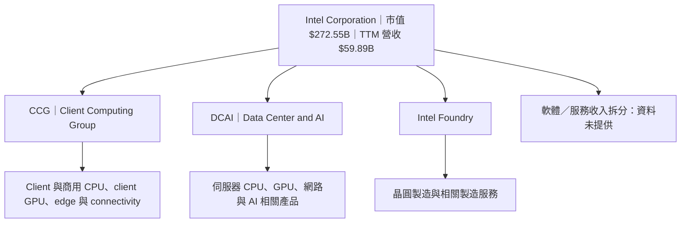
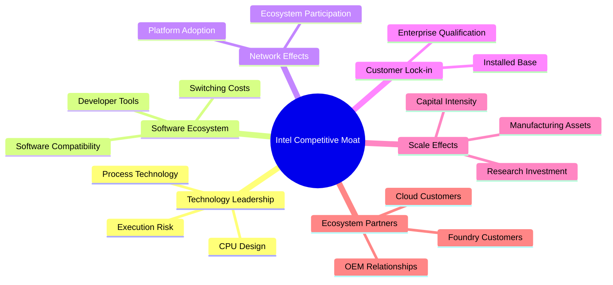
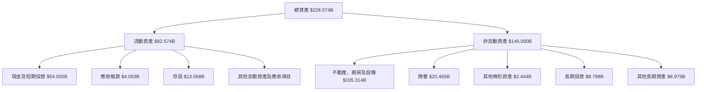
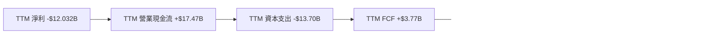
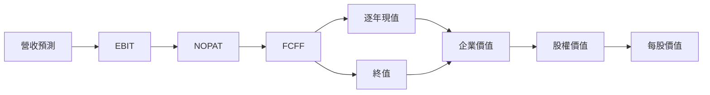
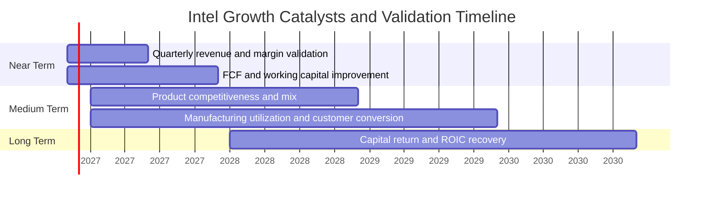
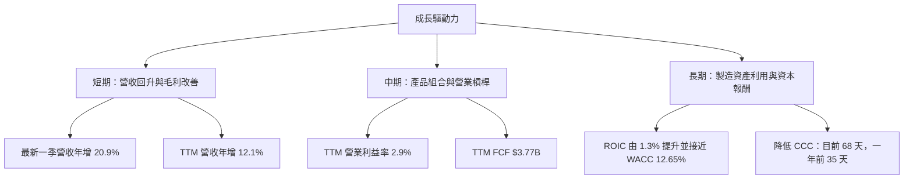
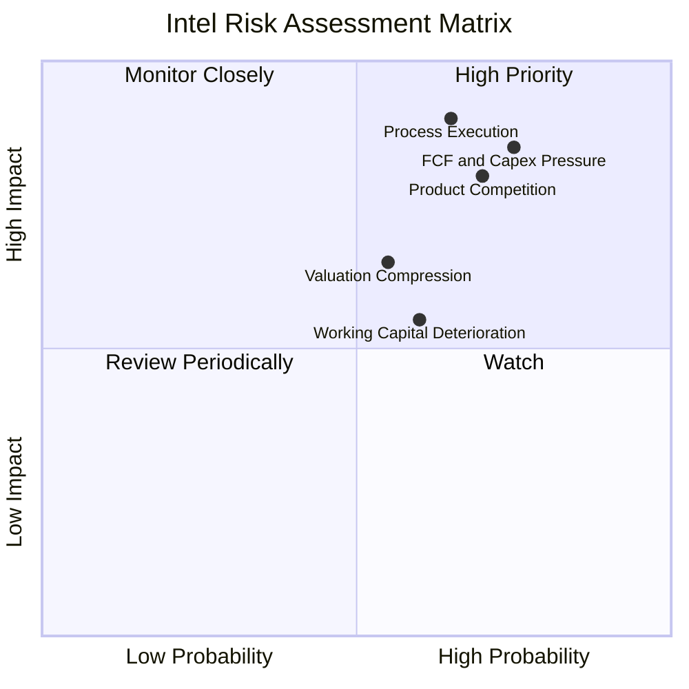
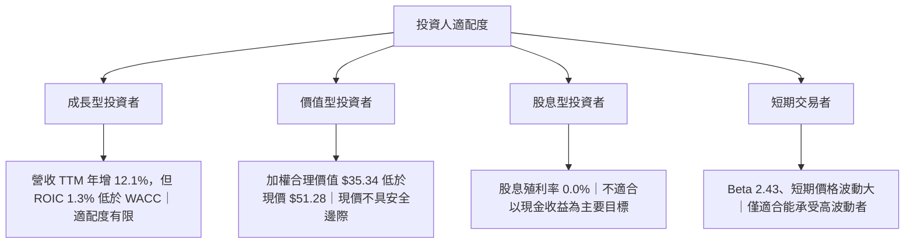

# INTC 基本面深度分析報告
> **報告日期**：2026-11-22 ｜ **語言**：繁體中文 ｜ **數據來源**：SEC 申報資料 (XBRL)、Yahoo Finance、Finviz、StockAnalysis、Roic.ai ｜ **分析師**：CFA 級機構研究

## 目錄

| # | 章節 | 核心結論 |
|---|------|----------|
| 1 | 執行摘要 | 賣出；加權合理價值 $35.34；MOS -45.1% |
| 2 | 公司概覽與商業模式 | CPU 與製造能力是重要資產，但市場份額數據未提供，護城河仍面臨競爭考驗 |
| 3 | 損益表深度分析 | TTM 營收 $59.89B、成長 12.1%；TTM 營業利益率 2.9% |
| 4 | 資產負債表分析 | 淨現金 $3.87B、流動比率 2.208；庫存天數與 CCC 上升 |
| 5 | 現金流量深度分析 | TTM FCF $3.77B、FCF Yield 1.38%；歷史資本支出使多年 FCF 為負 |
| 6 | 獲利能力與資本效率 | ROIC 1.3% 低於 WACC 12.65%，價值創造仍不足 |
| 7 | 相對估值分析 | 公司估值低於部分高成長同業，但相對自身 P/S 歷史偏高 |
| 8 | DCF 內在價值評估 | DCF N/A；依相對估值與分析師共識加權後合理價值 $35.34 |
| 9 | 成長催化劑 | 產品需求與製程執行可能推動復甦；量化 TAM 與具體時間表未提供 |
| 10 | 風險矩陣 | 主要風險為製程執行、競爭加劇、資本支出與現金流壓力 |
| 11 | 投資建議 | 賣出；若價格回落至約 $31.81 以下，才達加權價值基準下 10% MOS |

---

## 1. 執行摘要

Intel 的 TTM 營收為 **$59.89B**，TTM 營收年增 **12.1%**，最新一季年增 **20.9%**；但 TTM 營業利益率僅 **2.9%**、ROIC **1.3%**，遠低於 **12.65% WACC**，顯示營收回升尚未轉化為足夠資本報酬。TTM FCF 為 **$3.77B**，FCF Yield 僅 **1.38%**，且過去多個年度 FCF 為負。以同業 Forward P/E、同業 EV/EBITDA 與分析師共識加權，合理價值為 **$35.34**；相對 **2026-11-20 收盤價 $51.28**，MOS 為 **-45.1%**、上行空間為 **-31.1%**，故依規則 20 評級為 **賣出**，未作質化上調或下調。

### 1.0 一頁式投資儀表板（Portfolio Manager 30 秒速讀）

| 項目 | 內容 |
|------|------|
| **投資論點（3 句）** | ① TTM 營收年增 12.1%、最新一季年增 20.9%，營收動能改善。② ROIC 1.3% 低於 WACC 12.65%，現階段仍未創造足夠資本報酬。③ TTM FCF $3.77B、FCF Yield 1.38%，但加權合理價值 $35.34 低於現價。 |
| **綜合評分** | **4.0/10**（引用 1.1 評分卡） |
| **財務健康** | 🟡 現金及短期投資 $54.01B、總債務 $50.13B，淨現金 $3.87B；但歷史 FCF 曾持續為負 |
| **ROIC vs WACC** | **1.3% vs 12.65%**（摧毀股東價值；差距 -11.35 個百分點） |
| **FCF 趨勢** | TTM FCF $3.77B；多年資本支出高企，TTM FCF Yield 1.38% |
| **估值** | Forward P/E **28.64x** ｜ EV/EBITDA **19.9x**（自身歷史估值口徑）｜ FCF Yield **1.38%** |
| **DCF 內在價值（基準）** | **N/A**；現價折溢價不適用（模型未能計算） |
| **安全邊際（MOS）** | **-45.1%**＝($35.34 − $51.28) ÷ $35.34（基準為 8.8 加權合理價值）｜🔴 無 |
| **預期報酬（基準情境 12M）** | **-31.1%**，以加權合理價值相對現價計算；DCF 基準情境 N/A |
| **關鍵風險（前二）** | 製程與產品競爭力改善不及預期；高再投資需求繼續壓制 FCF |
| **評級 + 信心度** | 🔴 **賣出** ｜ 信心：中（估值訊號明確，DCF 因現金流條件不適用而無法提供獨立驗證） |

### 1.1 綜合評分卡（全報告唯一）

| 維度 | 評分（1–10） | 主要依據（引用數字與其來源章節） |
|------|--------------|----------------------------------|
| 成長性 | 6.0 | TTM 營收年增 12.1%，最新一季年增 20.9%；見第 3.2 節 |
| 獲利能力 | 3.0 | TTM 營業利益率 2.9%、ROIC 1.3% 對比 WACC 12.65%；F-Score 6/9；見第 3、6 章 |
| 財務健康 | 6.5 | 淨現金 $3.87B、流動比率 2.208；CCC 由 35 天升至 68 天；見第 4 章 |
| 估值 | 2.0 | MOS -45.1%；P/S 4.5x 高於自身 5 年中位數 2.6x；見第 7、8.8 節 |
| 護城河 | 5.5 | 具 CPU 與製造資產、規模優勢，但市場份額數據未提供且面臨 AMD、NVIDIA、Qualcomm 等競爭；見第 2 章 |
| 管理層與資本配置 | 3.0 | 2025 財年資本支出 $14.65B、FCF -$4.95B；2025 年 SBC $2.43B，稀釋股數測試未通過；見第 3.5、5、6.4 節 |
| **綜合評分** | **4.3** | 六項算術平均：(6.0 + 3.0 + 6.5 + 2.0 + 5.5 + 3.0) ÷ 6 = **4.3** |

### 1.2 五大投資論點 + 三大核心風險

| 類型 | 項目 | 具體依據 | 信心度 |
|------|------|----------|--------|
| 🟢 **投資論點①** | 營收短期回升 | TTM 營收年增 12.1%，最新一季年增 20.9%，且 Q3 2026 營收 $16.51B 高於 Q3 2025 的 $13.65B | 🟡 中 |
| 🟢 **投資論點②** | 資產負債表仍有緩衝 | 現金及短期投資 $54.01B、總債務 $50.13B，淨現金 $3.87B | 🟢 高 |
| 🟢 **投資論點③** | 最新 TTM FCF 已轉正 | 營業現金流 $17.47B 減資本支出 $13.70B，TTM FCF 為 $3.77B | 🟡 中 |
| 🟢 **投資論點④** | 季度營業利益改善 | 最近四季營業利益由 2025 Q4 的 $0.55B 增至 2026 Q3 的 $2.58B；改善仍需用後續季度驗證 | 🟡 中 |
| 🟢 **投資論點⑤** | 業務涵蓋設計與製造 | 公司同時經營 CCG、DCAI 與 Intel Foundry，具備產品與製造資產整合的可能性；目前尚無部門收入拆分可量化其貢獻 | 🟡 中 |
| 🟡 **風險①** | 資本報酬不足 | ROIC 1.3% 對比 WACC 12.65%，差距 -11.35 個百分點 | 🔴 高衝擊 |
| 🔴 **風險②** | FCF 對資本支出敏感 | TTM FCF $3.77B，但 FY2022–FY2025 年度 FCF 分別為 -$9.41B、-$14.28B、-$15.66B、-$4.95B | 🔴 高衝擊 |
| 🔴 **風險③** | 相對加權價值顯著溢價 | 現價 $51.28 高於加權合理價值 $35.34，MOS -45.1% | 🔴 高衝擊 |

### 1.3 快速統計卡片

| 指標 | 公司實際值（期間） | 同業中位數 | 狀態 |
|------|--------------------|------------|------|
| 營收成長（TTM） | **12.1%** | — | 🟢 |
| 營收成長（最新一季年增） | **20.9%** | 44.7%（AMD、NVIDIA、Qualcomm） | 🟡 |
| 毛利率（TTM） | **40.2%** | 56.0% | 🔴 |
| 營業利益率（TTM） | **2.9%** | — | 🔴 |
| ROIC（TTM） | **1.3%** | — | 🔴 |
| Forward P/E | **28.64x** | 12.3x | 🔴 |
| FCF Yield（TTM） | **1.38%** | — | 🟡 |
| Piotroski F-Score | **6 / 9** | — | 🟡 |

*同業最新一季營收成長中位數為 44.7%，取 AMD 44.7%、NVIDIA 103.2%、Qualcomm -8.4%。*

### 1.4 投資結論

╔══════════════════════════════════════════════════════════════════╗  
║                    📊 投資結論摘要                               ║  
╠══════════════════════════════════════════════════════════════════╣  
║  評級：🔴 賣出（依 MOS 門檻，未作質化調整）                     ║  
║  價格（2026-11-20 收盤）：$51.28                                ║  
║  DCF 內在價值（基準）：N/A（DCF 模型未能計算）                  ║  
║  安全邊際 MOS：-45.1%（以加權合理價值為分母）                  ║  
║  加權合理價值（8.8）：$35.34                                    ║  
║  DCF 情境價值：N/A（DCF 模型未能計算，無情境價值）              ║  
║  綜合評分：4.3/10（引用 1.1）                                   ║  
║  適合投資人：能承受高波動、願意追蹤製程與現金流轉型的投資人     ║  
╚══════════════════════════════════════════════════════════════════╝

---

## 2. 公司概覽與商業模式

### 2.1 業務結構與收入來源

Intel 主要透過 CCG、DCAI 與 Intel Foundry 經營運算產品及製造相關業務。現有資料未提供各部門收入、部門利潤或公司總營收的部門拆分，因此不計算各板塊佔比，也不繪製比例圖。

### 2.2 市場份額

市場份額數據未提供，因此不以未經核實的比例估算。Intel TTM 營收為 $59.89B、成長 12.1%；最新一季營收年增 20.9%，低於 AMD、NVIDIA 與 Qualcomm 的最新一季營收成長中位數 44.7%。但同業的產品組合與終端市場不同，這個比較只能表示成長速度相對位置，不能直接等同市場份額變化。

### 2.3 競爭護城河分析

Intel 的護城河取決於技術路線圖能否轉化為產品競爭力、製造能力能否取得外部及內部需求，以及軟硬體生態能否維持客戶黏著。提供的資料沒有各項市占率、代工客戶數或外部代工收入，故不對這些因素作量化推定。

### 2.4 護城河強度

| 護城河項目 | 強度（強／中／弱） | 證據（引用數字或事實） | 會削弱它的情況 |
|------------|--------------------|------------------------|----------------|
| 技術與產品能力 | 中 | TTM 營收 $59.89B；公司涵蓋客戶端、資料中心與 AI 產品 | 產品效能、功耗或推出時程落後競爭者 |
| 軟體生態系統 | 中 | 公司業務涵蓋 CPU、GPU、網路與相關軟體工具；無生態收入數字 | 開發者與企業工作負載轉向替代平台 |
| 客戶鎖定 | 中 | 客戶端及企業伺服器產品有平台相容與驗證需求；無留存率數據 | 客戶轉換成本降低、競品產品表現改善 |
| 規模效應 | 中 | 2025 年研發費用 $13.77B，且擁有大型製造資產 | 高固定成本、產能利用不足，令規模反而成為負擔 |
| 網路效應 | 弱至中 | 未提供可量化的使用者或開發者網路效應資料 | 平台生態未能擴張 |
| 生態夥伴 | 中 | 公司涉及 OEM、雲端與製造等合作關係；未提供合作收入拆分 | 客戶自研晶片或製造合作轉向其他供應商 |

**1.1 護城河分數 5.5/10**，反映 Intel 具品牌、平台與製造資產，但缺乏可量化市場份額與客戶鎖定證據，且 ROIC 仍低於資本成本。

---

## 3. 損益表深度分析

### 3.1 年度收入成長趨勢（近 4 年）

年度收入來自公司年度財務資料。FY2022 至 FY2025 營收由 $63.05B 降至 $52.85B，三年 CAGR 約 -5.7%；FY2026 TTM 營收回升至 $59.89B，但 TTM 與財政年度並非完全相同的期間口徑。

╔══════════════════════════════════════════════════════════════════╗  
║              Intel 年度收入趨勢（FY2022-FY2025）               ║  
╠══════════════════════════════════════════════════════════════════╣  
║ FY2022  $63.05B  █████████████████████████  YoY：基期          ║  
║ FY2023  $54.23B  ██████████████████████░░░  YoY：-14.0% 🔴   ║  
║ FY2024  $53.10B  █████████████████████░░░░  YoY：-2.1% 🔴    ║  
║ FY2025  $52.85B  █████████████████████░░░░  YoY：-0.5% 🔴    ║  
╠══════════════════════════════════════════════════════════════════╣  
║ FY2022-FY2025 CAGR：(52.85 ÷ 63.05)^(1/3) − 1 ≈ -5.7%         ║  
║ FY2026 TTM 營收：$59.89B；TTM 年增 12.1%                        ║  
╚══════════════════════════════════════════════════════════════════╝

近年營收下滑後，FY2026 TTM 回升，最新一季也有較快成長。這可能反映需求與產品組合改善，但在分部收入未提供、TTM 營業利益率仍僅 2.9% 的情況下，還不能確認成長已具有持續性與足夠獲利品質。

### 3.2 季度收入趨勢分析

| 季度 | 營收 | QoQ 成長 | YoY 成長 | 備註 |
|------|------:|---------:|---------:|------|
| 2025 Q4 | $13.67B | +0.2%（對 2025 Q3） | -4.1% | 年增仍為負，營收趨勢尚未轉正 |
| 2026 Q1 | $13.58B | -0.7% | +7.2% | 季減但較去年同期回升 |
| 2026 Q2 | $16.13B | +18.8% | +25.4% | 季度成長明顯，需留意季節性與組合因素 |
| 2026 Q3 | $16.51B | +2.4% | +20.9% | 年增保持雙位數，季增速度放緩 |

*QoQ 以相鄰季度營收計算；2025 Q4 的 YoY 依 StockAnalysis 數據列示為 -4.11%。其餘最新一季年增率使用 SEC／財務資料的單季口徑。*

### 3.3 利潤率演變分析

| 利潤率指標 | FY2022 | FY2023 | FY2024 | FY2025 | 趨勢 | 評估 |
|------------|--------:|--------:|--------:|--------:|------|------|
| **毛利率** | 42.6% | 40.0% | 32.6% | 34.8% | 2024 下滑後 2025 小幅回升 | 🔴 |
| **營業利益率** | 3.7% | 0.1% | -8.9% | -0.04% | 2024 大幅轉負，2025 接近損益兩平 | 🔴 |
| **淨利率** | 12.7% | 3.1% | -35.3% | -0.5% | 2024 大幅虧損，2025 接近損益兩平 | 🔴 |

*年度毛利率與營業利益率按所列年度營收及毛利／營業利益計算。TTM 營業利益率一律採核心財務數據的 **2.9%**，不以其他來源的不同口徑替換。*

**利潤率演變深度解析：** FY2024 毛利率由 2023 年約 40.0% 降至約 32.6%，營業利益轉為 -$4.71B；FY2025 毛利率回升至約 34.8%，但營業利益仍約 -$23M。研發費用在 FY2025 為 $13.77B，反映公司仍需承擔高額產品與製程投入。TTM 營業利益率 2.9% 顯示營運已改善，但與同業較高毛利率相比，成本結構與產品組合仍限制獲利槓桿。

### 3.4 費用結構分析

資料提供年度研發費用，但未提供同一期間完整且可比的銷售、管理、製造與其他費用拆分；因此不製作會造成比例誤讀的費用圓餅圖。

| 項目 | 數值 | 解讀 |
|------|------:|------|
| FY2025 研發費用 | $13.77B | 研發投入約為 FY2025 營收 $52.85B 的 26.0%；需以新產品與利潤改善回收投入 |
| FY2024 研發費用 | $16.55B | 高於 FY2025，可能與費用控制或投入節奏改變有關；不能單憑減少判定效率提升 |
| FY2023 研發費用 | $16.05B | 持續處於高水準，反映競爭與產品更新需求 |
| FY2022 研發費用 | $17.53B | 研發投入規模大，但同期營收走弱，投資回報仍需檢驗 |

### 3.5 季度 EPS 趨勢與盈餘品質（Quality of Earnings）

最近四季可取得的實際 EPS 為：2025 Q4 **-$0.12**、2026 Q1 **-$0.73**、2026 Q2 **-$2.16**、2026 Q3 **$0.63**。提供的季度 EPS 預估值皆為缺漏，因此無法判斷各季是超預期或不及預期，也無法把盈餘變化歸因於相對分析師預期的差異。

| 盈餘品質項目 | 數值/佔比 | 評估 |
|--------------|-----------|------|
| 股權薪酬 SBC / 營收 | TTM SBC 約 $2.43B ÷ $59.89B = **4.1%** | 🔴 稀釋成本不可忽略；SBC 是經濟成本，會降低既有股東持有比例 |
| SBC / 營業現金流 | $2.43B ÷ $17.47B = **13.9%** | 🟡 SBC 佔營業現金流約七分之一，估值時需視作股東成本 |
| FCF / 淨利（現金轉換率） | TTM 淨利 -$12.032B；$3.77B ÷ -$12.032B = **-31.3%** | 🔴 因淨利為負，比例不宜用一般正向轉換率解讀；現金流與會計盈餘差異大 |
| 一次性／非經常性損益 | N/A（缺少可核對的完整調節項目） | 無法判定最新季度 $3.32B 淨利是否受一次性項目大幅影響 |
| 有效稅率異常 | N/A（未提供可用 TTM 稅前利益及所得稅費用拆分） | 不將預設稅率當作實際有效稅率 |
| 資本化支出 vs 費用化 | TTM Capex $13.70B；資本化與費用化逐項拆分 N/A | 資本支出透過折舊攤銷影響後續期間；缺少細目，不推定是否遞延成本 |

**盈餘品質結論：** TTM FCF 已轉正，但淨利仍為負、SBC 佔 TTM 營收約 4.1%，且單季 EPS 預估資料缺失。近期正 FCF 是正面訊號，但尚不足以證明 GAAP 盈餘已穩定、現金轉換品質已正常化；估值應避免直接採用短期單季淨利外推。

---

## 4. 資產負債表分析

### 4.1 資產結構分解

2026 年 9 月 TTM 資產總額為 $228.574B。下列各項為資產負債表列示項目；流動資產以外的其他資產項目為長期資產分類，不表示所有細項均為現金等價物。

### 4.2 流動性與營運資金分析

| 指標 | 最新值 | 歷史比較 | 評估 |
|------|-------:|----------|------|
| 流動比率 | 2.208 | FY2025 流動資產 $63.69B、流動負債 $31.57B；季度口徑不同，不直接計算同比 | 🟢 短期流動性緩衝充足 |
| 速動比率 | 1.751 | 歷史季度序列未提供 | 🟢 |
| 現金及短期投資 | $54.01B | FY2025 為 $37.416B；比較時點與 TTM 季末不同 | 🟢 現金部位增加 |
| 淨現金 | $3.87B | 現金及短期投資 $54.01B 減總債務 $50.13B | 🟡 淨現金為正，但緩衝相對資產規模有限 |

**營運資金天數（照錄品質指標）：**

| 指標 | 最新 TTM | 一年前 TTM | 變化 | 解讀 |
|------|----------:|----------:|------:|------|
| DSO 應收帳款天數 | 25 天 | 22 天 | +3 天 | 收款週期稍長；需觀察是否為季末時點或客戶付款條件改變 |
| DIO 存貨天數 | 133 天 | 122 天 | +11 天 | 存貨占用增加，可能提高過時與減值風險；需對照產品需求與產能爬坡 |
| DPO 應付帳款天數 | 90 天 | 109 天 | -19 天 | 對供應商付款時間縮短，現金占用增加 |
| CCC 現金轉換週期 | 68 天 | 35 天 | +33 天 | 現金被營運資金占用的時間延長，是現金流品質的重要監控項 |

### 4.3 債務結構分析

╔══════════════════════════════════════════════════════════════════╗  
║                   Intel 債務健康診斷                            ║  
╠══════════════════════════════════════════════════════════════════╣  
║ 總債務：              $50.13B  ████████████████████             ║  
║ 現金及短期投資：      $54.01B  ██████████████████████           ║  
║ 淨現金：               $3.87B  🟡 正值，但相對債務規模不大       ║  
║ 流動比率：               2.208  🟢                               ║  
║ 速動比率：               1.751  🟢                               ║  
║ Debt/EBITDA、利息保障倍數：N/A（缺少同口徑完整必要數據）         ║  
╚══════════════════════════════════════════════════════════════════╝

現金及短期投資高於總債務，提供融資緩衝；不過，淨現金僅 $3.87B，而公司仍有較高的資本支出需求。Debt/EBITDA 與利息保障倍數缺乏可核對的同口徑分子、分母，故不推算。

### 4.4 股東權益趨勢

| 財政年度 | 股東權益 |
|----------|---------:|
| 2022 | $101.42B |
| 2023 | $105.59B |
| 2024 | $99.27B |
| 2025 | $114.28B |

╔══════════════════════════════════════════════════════════════════╗  
║                 股東權益趨勢（年度）                            ║  
╠══════════════════════════════════════════════════════════════════╣  
║ FY2022  $101.42B  ██████████████████░░                          ║  
║ FY2023  $105.59B  ███████████████████░                          ║  
║ FY2024   $99.27B  █████████████████░░░                          ║  
║ FY2025  $114.28B  ████████████████████                          ║  
╚══════════════════════════════════════════════════════════════════╝

2025 年股東權益高於 2024 年，但帳面權益增加不等於資本報酬改善；ROIC 仍只有 1.3%，因此需以投資回報與現金流，而非單看帳面權益，評估價值創造。

---

## 5. 現金流量深度分析

### 5.1 現金流量瀑布圖

TTM FCF 定義固定為營業現金流減資本支出，即 $17.47B − $13.70B = $3.77B。淨利採 TTM -$12.032B；股息與回購的 TTM 數據未提供，故不補造資本配置流向。

### 5.2 FCF 轉換率趨勢

| 財政年度 | 營業現金流 | Capex | FCF | 淨利 | FCF / 淨利 |
|----------|-----------:|------:|----:|-----:|------------:|
| 2022 | $15.43B | $24.84B | -$9.41B | $8.01B | -117.5% |
| 2023 | $11.47B | $25.75B | -$14.28B | $1.69B | -845.0% |
| 2024 | $8.29B | $23.94B | -$15.66B | -$18.76B | 83.5%* |
| 2025 | $9.70B | $14.65B | -$4.95B | -$0.267B | 1,853.9%* |

\*淨利為負，比例不具一般「現金轉換率」的正向解讀意義。年度 FCF 採營業現金流減資本支出；負值表示高資本支出超過營業現金流。

### 5.3 自由現金流趨勢

╔══════════════════════════════════════════════════════════════════╗  
║                 自由現金流：歷史實際                            ║  
╠══════════════════════════════════════════════════════════════════╣  
║ FY2022  -$9.41B  ◀█████████░░░░░░░░░░░░  FCF 為負             ║  
║ FY2023 -$14.28B  ◀██████████████░░░░░░░  FCF 為負             ║  
║ FY2024 -$15.66B  ◀████████████████░░░░░  FCF 為負             ║  
║ FY2025  -$4.95B  ◀█████░░░░░░░░░░░░░░░  赤字收窄             ║  
║ TTM      $3.77B   ████░░░░░░░░░░░░░░░░░  FCF Yield 1.38%     ║  
╚══════════════════════════════════════════════════════════════════╝

FY2022–FY2025 FCF 均為負，主要數學原因是年度 Capex 高於營業現金流；FY2025 的負 FCF 較 FY2024 收窄，TTM 進一步轉正。這表示資本支出與營業現金流同步變化時，FCF 仍可能波動，不能把單一 TTM 正值視作已完成結構性轉型。

### 5.4 資本配置評估

資料顯示 FY2025 Capex 為 $14.65B、現金股息支付為 $0；但未提供同一期間完整回購、併購、投資與留存現金拆分，因此不繪製比例加總的圓餅圖。

| 配置項目 | 可用數值 | 評估 |
|----------|---------:|------|
| 資本支出 | FY2025 $14.65B；TTM $13.70B | 大型投資支出仍是自由現金流的主要變數 |
| 股息 | FY2025 $0；股息殖利率 0.0% | 目前無現金股息回報 |
| 回購 | N/A（缺少可比期間數據） | 不推定回購金額 |
| 留存／其他投資 | N/A（缺少完整現金用途明細） | 資本配置回報需以日後 ROIC、FCF 驗證 |

---

## 6. 獲利能力與資本效率

### 6.1 ROE / ROA / ROIC 趨勢

| 指標 | 最新 TTM | 歷史可比數據 | 評估 |
|------|---------:|--------------|------|
| ROE | **-10.5%**（品質指標口徑） | N/A（未提供同口徑品質指標歷史序列） | 🔴 淨利率為負是主要拖累 |
| ROA | N/A（品質指標列示 ROA 測試未通過，未提供可直接引用數值） | N/A | 🔴 不以不同來源、不同口徑數字替換 |
| ROIC | **1.3%** | N/A（未提供同口徑近年完整序列） | 🔴 低於資本成本 |
| 行業均值 | 未提供 | — | 不列示未有來源的均值 |

### 6.2 ROIC vs WACC 分析（核心價值創造判斷）

╔══════════════════════════════════════════════════════════════════╗  
║                ROIC vs WACC 深度分析                            ║  
╠══════════════════════════════════════════════════════════════════╣  
║ WACC 參數（Cost of Capital 資料）：                              ║  
║ ├── 無風險利率（10Y 美債）：       4.91%                        ║  
║ ├── 市場風險溢酬 ERP：              5.00%                        ║  
║ ├── 原始 Beta：                     2.43                         ║  
║ ├── 調整後 Beta：                   1.95                         ║  
║ ├── 股權成本 Ke：                  14.67%                        ║  
║ ├── 稅前債務成本 Kd：                2.18%                        ║  
║ ├── 資本權重 E / D：             84.5% / 15.5%                   ║  
║ └── 採用 WACC：                    12.65%                        ║  
║                                                                  ║  
║ ROIC（TTM）：                     1.30%                          ║  
║ EVA spread = ROIC − WACC：         1.30% − 12.65% = -11.35pp     ║  
║ ROIC  1.30%  ▓▓░░░░░░░░░░░░░░░░░░░░░░░░░░░░░░ 🔴              ║  
║ WACC 12.65%  ▓▓▓▓▓▓▓▓▓▓▓▓▓▓▓▓▓▓▓▓▓▓▓▓▓░░░░░░ ──              ║  
╠══════════════════════════════════════════════════════════════════╣  
║ 結論：ROIC 顯著低於 WACC，按目前回報水準仍在摧毀股東價值。      ║  
╚══════════════════════════════════════════════════════════════════╝

Beta 採調整後 **1.95**，其來源方式為三分之二原始 Beta 加三分之一市場 Beta：⅔ × 2.43 + ⅓ × 1。此處直接採用資料列示 WACC **12.65%**，不以已四捨五入的組成數字另行重算替代。ROIC 為 TTM 稅後營業利益除以投入資本的程式計算值；其低於 WACC 11.35 個百分點，表示營業回報不足以補償股權與債務資金成本。

### 6.3 杜邦三因素分解

| 因素 | 數值（TTM） | 解讀 |
|------|-------------|------|
| 淨利率 | **-20.1%** | 負淨利率是 ROE 為負的主要來源 |
| 資產週轉率 | **0.26** | 資產基礎大，營收轉換效率仍受資本密集型營運影響 |
| 權益乘數 | **1.99** | 財務槓桿提高資產相對股東權益規模，但並未扭轉負回報 |
| **ROE** | **-10.5%** | -20.1% × 0.26 × 1.99 = 約 -10.4%；品質指標列示 -10.5%，微小差異來自原始值四捨五入 |

### 6.4 財務體質：Piotroski F-Score

Piotroski F-Score 為 **6 / 9**，品質指標提供九項測試結果如下。

| 測試 | 結果 | 解讀 |
|------|------|------|
| ROA > 0 | ❌ 未通過 | 獲利能力仍弱 |
| 營業現金流 > 0 | ✅ 通過 | TTM 營業現金流為正 |
| ROA 高於一年前 | ❌ 未通過 | 資產報酬改善未獲確認 |
| 營業現金流 > 淨利 | ✅ 通過 | 現金流高於會計淨利，惟淨利為負時解讀需審慎 |
| 長期負債 ÷ 總資產低於一年前 | ✅ 通過 | 相對負債指標改善 |
| 流動比率高於一年前 | ✅ 通過 | 短期流動性指標改善 |
| 稀釋股數未增加 | ❌ 未通過 | 股數增加會稀釋既有股東持有比例 |
| 毛利率高於一年前 | ✅ 通過 | 毛利率測試轉為通過 |
| 資產週轉率高於一年前 | ✅ 通過 | 資產使用效率相對改善 |

---

## 7. 相對估值分析

### 7.1 同業估值比較表格

以下同業倍數採 Yahoo Finance 的同業數據；Intel 公司估值採提供的市場數據。Trailing P/E 因 Intel TTM EPS 為負而不可比較。

| 估值指標 | **Intel** | **AMD** | **NVIDIA** | **Qualcomm** | 本公司評估 |
|----------|----------:|--------:|-----------:|-------------:|-----------|
| **Trailing P/E** | N/A（TTM EPS -$2.35） | 90.7x | 13.5x | 11.8x | 🔴 Intel TTM 虧損，倍數無法解讀 |
| **Forward P/E** | 28.64x | 24.1x | 7.6x | 12.3x | 🔴 高於三家同業中位數 12.3x；未來 EPS 預估不確定性較高 |
| **P/S Ratio** | 4.55x | 15.5x | 8.4x | 3.7x | 🟡 低於 AMD、NVIDIA，高於 Qualcomm；公司自身 P/S 已高於 5 年中位數 |
| **EV/EBITDA** | 19.9x（自身歷史口徑） | 61.9x | 12.2x | 15.9x | 🟡 高於 NVDA、Qualcomm，低於 AMD；商業模式與成長結構不同 |
| **最新一季營收年增** | 20.9% | 44.7% | 103.2% | -8.4% | 🟡 Intel 成長為正，但低於同業中位數 44.7% |
| **毛利率（TTM）** | 40.2% | 56.0% | 74.9% | 53.1% | 🔴 低於三家同業 |

*Peer Forward P/E 中位數為 12.3x；P/S 中位數為 8.4x；EV/EBITDA 中位數取 NVIDIA 與 Qualcomm 的中位數 14.0x。*

### 7.2 歷史估值區間分析

╔══════════════════════════════════════════════════════════════════╗  
║                 Intel 自身歷史估值位置                          ║  
╠══════════════════════════════════════════════════════════════════╣  
║ P/S：現在 4.5x｜5 年中位數 2.6x｜區間 1.5x–11.5x               ║  
║      現在百分位：90%｜🟡 偏高                                   ║  
║      4.5x ÷ 2.6x = 約 1.73 倍歷史中位數                        ║  
║                                                                  ║  
║ EV/EBITDA：現在 19.9x｜5 年中位數 23.6x｜區間 6.4x–536.5x      ║  
║      現在百分位：35%｜🟡 低於中位數                              ║  
╚══════════════════════════════════════════════════════════════════╝

P/S 顯示股價所反映的營收估值已位於自身歷史偏高區間；EV/EBITDA 則低於自身歷史中位數，但其歷史區間極寬，受到獲利低基期影響，解讀須審慎。

### 7.3 情境價值（Bear / Base / Bull，照抄 DCF MODEL 的 Scenarios）

**N/A（DCF 無法計算：模型最後一年自由現金流條件不成立，資本支出高於營業利益與折舊攤銷；因此不提供悲觀、基準、樂觀 DCF 情境價值、營收假設或機率。）**

### 7.4 相對估值隱含價格區間

╔══════════════════════════════════════════════════════════════════╗  
║              相對估值回推每股價值（USD）                        ║  
╠══════════════════════════════════════════════════════════════════╣  
║ 同業 Forward P/E： $22.04  ──────●                              ║  
║ 同業 EV/EBITDA：   $36.34  ─────────────●                       ║  
║ 加權合理價值：     $35.34  ────────────●                        ║  
║ 現價：             $51.28  ─────────────────────●               ║  
║ 分析師共識：       $90.65  ──────────────────────────────────●  ║  
╚══════════════════════════════════════════════════════════════════╝

| 方法 | 每股價值 | 計算依據 |
|------|---------:|----------|
| 同業 Forward P/E | $22.04 | AMD、NVIDIA、Qualcomm 同業 Forward P/E 中位數 12.3x × Intel Forward EPS $1.79 |
| 同業 EV/EBITDA | $36.34 | NVIDIA、Qualcomm EV/EBITDA 中位數 14.0x × TTM EBITDA，再加回淨現金 |
| 分析師共識目標價 | $90.65 | 43 位分析師平均目標價，作為參考值而非基本面現金流估值 |
| DCF 基準 | N/A | 模型無法計算 |

---

## 8. DCF 內在價值評估（Discounted Cash Flow）

### 8.0 估值推理鏈（Thinking Logic：在算之前先想清楚）

**Step 1 — 公司價值由哪些變數決定？**  
Intel 的價值理論上由客戶端與資料中心產品現金流、Intel Foundry 製造業務的獲利能力，以及高額再投資後可回收的自由現金流共同決定。現有資料沒有各分部營收佔比，因此無法量化各項佔比。現階段主導估值的變數是**可持續的營業利潤與資本支出之差**：TTM 營業利益率為 2.9%、Capex 為 $13.70B，而 FCF 只有 $3.77B。

**Step 2 — 模型選擇**

| 決策點 | 本報告採用 | 理由（含數字） | 曾考慮但否決 | 否決理由 |
|--------|-----------|----------------|--------------|----------|
| 現金流定義 | FCFF | 若模型可行，應以企業現金流對應 WACC 折現 | FCFE | 資本結構與再投資需求會影響股東現金流 |
| 預測期 N | N/A | 程式 DCF 模型未能成立，未列預測期間 | 自行採 5–10 年 | 禁止另建模型或自行填入預測 |
| 終值方法 | N/A | 模型未能建立可用正向最後年度 FCF | Gordon Growth、退出倍數 | 缺少有效預測現金流基礎 |
| EBIT 基礎 | N/A | 未建立 DCF 預測表 | GAAP / 非 GAAP | 不自行假設或計算 |

**Step 3 — 關鍵假設推導鏈**  
DCF MODEL 的結果為 N/A，故營收 CAGR、期末營業利潤率、有效稅率、Capex／營收、D&A／營收、營運資金變動、預測期、終值成長率與年稀釋率均沒有可直接引用的模型採用值；不以自行估值假設替代程式結果。

**Step 4 — 最脆弱的一環**  
最脆弱處是資本支出與營業獲利能否形成正向、可持續 FCF；在模型判定最後一年 FCF 條件不成立時，任何自建終值都會造成不可稽核的估值。

**Step 5 — 計算路徑圖**  
下圖為 DCF 的一般計算關係，不代表本報告已對 Intel 建立預測數字。

### 8.1 模型假設總表（Model Inputs）

| 假設項目 | 採用值 | 依據 / 來源 | 敏感度 |
|----------|--------|-------------|--------|
| 預測期長度 N | N/A | DCF MODEL 未能計算，無可引用預測年數 | 🔴 高 |
| 營收 CAGR（預測期） | N/A | 無 DCF 假設；歷史 TTM 成長率 12.1% 不能直接代替預測 | 🔴 高 |
| 營業利潤率（期末） | N/A | DCF MODEL 無有效最後年度 FCF | 🔴 高 |
| 有效稅率 | N/A | 無 DCF 模型輸入；21.0% 為資本成本資料的預設稅率，不等於公司實際預測稅率 | 🟢 低 |
| Capex / 營收 | N/A | TTM Capex $13.70B、TTM 營收 $59.89B 可作歷史背景，但 DCF 不可自行建立 | 🟡 中 |
| 折舊攤銷 D&A / 營收 | N/A | 缺少 DCF 模型假設值 | 🟢 低 |
| 營運資金變動 / 營收增額 | N/A | 缺少 DCF 模型假設值 | 🟢 低 |
| EBIT 基礎 | N/A | 未建立 DCF 預測，不選 GAAP 或非 GAAP | 🟡 中 |
| 股權薪酬 SBC 處理 | N/A | 未建立 DCF 預測，不能宣稱 SBC 在 DCF 中已計入一次 | 🟡 中 |
| 年稀釋率（股數） | N/A | 未提供 DCF 股數假設 | 🟡 中 |
| 永續成長率 g | N/A | 未建立終值 | 🔴 高 |
| 終值方法 | N/A | 未建立有效終值 | 🔴 高 |
| WACC | **12.65%** | Cost of Capital 計算值，直接採用於資本效率與 DCF 折現；DCF 本身仍為 N/A | 🔴 高 |

### 8.2 折現率推導（WACC）

╔══════════════════════════════════════════════════════════════════╗  
║                    WACC 推導（折現率）                           ║  
╠══════════════════════════════════════════════════════════════════╣  
║ 股權成本 Ke（CAPM，按資料列示）：                                ║  
║ ├── 無風險利率 Rf：                 4.91%                        ║  
║ ├── 市場風險溢酬 ERP：              5.00%                        ║  
║ ├── 原始 Beta：                     2.43                         ║  
║ ├── 調整後 Beta：                   1.95                         ║  
║ ├── 股權成本 Ke：                  14.67%                        ║  
║ └── 資料列示的規模／國別額外溢酬：未列示                         ║  
║                                                                  ║  
║ 債務成本 Kd：                                                      ║  
║ ├── 稅前債務成本：                  2.18%                        ║  
║ ├── 預設稅率：                     21.0%                         ║  
║ └── 權重及 WACC 採資料列示值，不另以四捨五入輸入重算             ║  
║                                                                  ║  
║ 資本權重：股權 84.5%／債務 15.5%                                 ║  
║ ✅ 採用 WACC：12.65%                                             ║  
╚══════════════════════════════════════════════════════════════════╝

- **Ke（CAPM）**：資料列示公式為 Rf + 調整後 Beta × ERP；原始 Beta 2.43 依 ⅔ × 2.43 + ⅓ × 1 調整為 1.95。Cost of Capital 區塊列示 Ke **14.67%**，本報告照錄。
- **稅前 Kd**：資料列示 **2.18%**。利息費用與平均計息負債明細未提供，不能重新建立獨立的利息／負債算式。
- **稅後 Kd**：預設稅率 21.0%，但此處不以四捨五入輸入值改寫官方 WACC。
- **權重**：股權權重 **84.5%**、債務權重 **15.5%**，合計 **100.0%**。
- **WACC**：直接採用 **12.65%**；已與第 6.2 節一致。因原始精確輸入與平均計息負債細節未列示，不能用顯示到兩位小數的各參數要求重算後替代資料列示值。

### 8.3 逐年自由現金流預測（基準情境）

**N/A（DCF MODEL 未能計算）。** 原因：程式模型判定預測最後一年 FCF 不為正，且資本支出高於營業利益與折舊攤銷。依規則不另建 DCF，故沒有逐年營收、利潤率、FCFF、折現因子或預測期現值，亦不提供代表年度演算。

### 8.4 終值計算（Terminal Value）

**N/A（DCF MODEL 未能計算）。** 沒有可用的 FY+N FCFF、永續成長率 g 或退出 EBITDA，故不能計算 Gordon Growth 終值或退出倍數終值。

### 8.5 企業價值 → 每股內在價值（Bridge）

╔══════════════════════════════════════════════════════════════════╗  
║              企業價值 → 每股內在價值 橋接表                      ║  
╠══════════════════════════════════════════════════════════════════╣  
║ 預測期 FCF 現值合計：N/A                                         ║  
║ 終值現值 PV(TV)：N/A                                             ║  
║ 企業價值 EV：N/A                                                 ║  
║ 現金及短期投資：$54.01B（2026-09 季末）                          ║  
║ 總債務：$50.13B（2026-09 季末）                                  ║  
║ 股權價值：N/A                                                    ║  
║ 稀釋後流通股數：DCF 模型未提供                                   ║  
║ ★ 每股 DCF 內在價值：N/A                                         ║  
║ 當前股價：$51.28（2026-11-20 收盤）                              ║  
║ DCF 折溢價：N/A                                                   ║  
╚══════════════════════════════════════════════════════════════════╝

橋接運算因企業價值及預測現金流未能計算而無法成立。此處不計算 MOS；全報告 MOS 只以 8.8 加權合理價值為分母。

### 8.6 敏感性分析（WACC × 永續成長率）

**N/A（DCF MODEL 未能計算）。** 無基準 DCF、終值或敏感度矩陣，故不製作 5×5 矩陣、不提供三情境目標價，也不自行試算敏感度。

### 8.7 反推 DCF（Reverse DCF：市場在預期什麼）

**N/A（DCF MODEL 未能計算）。** 沒有可供反推的基準現金流模型，不能以現價解出營收 CAGR、期末營業利潤率、g 或預測期 N，也不呈現自行試算軌跡。

### 8.8 估值三角驗證與安全邊際

| 估值方法 | 隱含每股價值 | 上行空間（÷現價） | 權重 | 說明 |
|----------|--------------:|------------------:|------:|------|
| DCF（基準） | N/A | N/A | 未納入 | DCF 無法計算 |
| 同業 Forward P/E | $22.04 | -57.0% | 45% | 同業 Forward P/E 中位數 12.3x × Intel Forward EPS $1.79 |
| 同業 EV/EBITDA | $36.34 | -29.1% | 45% | NVDA、QCOM 中位數 14.0x × TTM EBITDA，再加回淨現金 |
| 分析師共識目標價 | $90.65 | +76.8% | 10% | 43 位分析師平均目標價，非主要基本面估值 |
| **加權合理價值** | **$35.34** | **-31.1%** | **100%** | — |

**逐步演算（權重與加總）：**

- 估值方法加權總和 = $22.04 × 45% + $36.34 × 45% + $90.65 × 10%
- = $9.918 + $16.353 + $9.065
- = $35.336，依指定精度列示 **$35.34**。

公司類型為「profitable」，估值方法與權重採固定設定。DCF 因無法計算而不納入；相對估值使用同業中位數倍數，未改用 Intel 自身目前倍數。

**MOS 與上行空間計算：**

- 加權合理價值差額 = $35.34 − $51.28 = **-$15.94**
- **MOS** = ($35.34 − $51.28) ÷ $35.34 = -$15.94 ÷ $35.34 = **-45.1%**
- **上行空間** = ($35.34 − $51.28) ÷ $51.28 = -$15.94 ÷ $51.28 = **-31.1%**
- **折溢價**以 DCF 基準值為分母；因 DCF 基準值 N/A，折溢價 N/A。

╔══════════════════════════════════════════════════════════════════╗  
║                  估值區間與安全邊際                              ║  
╠══════════════════════════════════════════════════════════════════╣  
║ $22.04 ───────── $35.34 ───────── $51.28 ───────── $90.65        ║  
║ Forward P/E       加權合理值       現價            分析師共識     ║  
║                                                                  ║  
║ MOS = ($35.34 − $51.28) ÷ $35.34 = -45.1%                       ║  
║ MOS 評估：🔴 無（MOS < 10%）                                      ║  
║ 上行空間 = ($35.34 − $51.28) ÷ $51.28 = -31.1%                  ║  
║                                                                  ║  
║ 依 MOS ≥ 10% 的買入價格上限：$35.34 × 90% = $31.81               ║  
║ 合理持有參考區間：$31.81–$38.87（MOS 約 +10% 至 -10%）           ║  
║ 減碼考慮：現價已高於加權合理價值，且 MOS 為 -45.1%               ║  
╚══════════════════════════════════════════════════════════════════╝

> 🔎 **程式複算（Python，依本節各項自動重算）**
>
> 加權合理價值 = $22.04 × 45% + $36.34 × 45% + $90.65 × 10% = **$35.34**（權重合計 100%）
>
> 以價格 $51.28 計：MOS = **-45.1%**，上行空間 = **-31.1%**
>
> ✅ 與本節所寫數值一致。

### 8.9 DCF 模型的局限與失效條件

- **終值依賴度：** N/A。模型沒有可計算的企業價值與終值，不能量化終值佔比。
- **最脆弱的假設：** 目前最需要驗證的是資本支出能否轉化為營業獲利與正 FCF；ROIC 1.3% 對比 WACC 12.65%，顯示投資回報仍不足。
- **不適用情境說明：** DCF MODEL 因最後年度 FCF 條件不成立而 N/A。此時應以同業相對估值、P/S、EV/EBITDA、分部估值或資產與產能利用情境作交叉參照，而非輸出未經支持的單一 DCF 數字。
- **與第 10 章風險矩陣的連結：** 製程執行不佳會壓低營業利潤率；產能利用與資本支出超支會壓低 FCF；競爭加劇則可能削弱營收成長與倍數。

### 8.10 複算檢核表（Audit Trail：輸出前自我驗算）

| # | 檢核項目 | 檢查方式 | 結果 |
|---|----------|----------|------|
| 1 | 所有高／中敏感度輸入都有完整四段式推導 | DCF 為 N/A，沒有採用輸入值可供推導 | N/A |
| 2 | 每個假設都有來歷 | 8.1 缺少的模型假設明確列 N/A 與原因 | ✅ |
| 3 | WACC 算式與加總 | 使用資料列示 WACC 12.65%；不以四捨五入組件重算替代 | ✅ |
| 4 | Kd 分母與債務權重 D 範圍一致 | 缺少平均計息負債明細，不建立獨立 Kd 分母計算 | N/A |
| 5 | WACC 與第 6.2 節同值 | 兩處均為 12.65% | ✅ |
| 6 | 逐年預測年度數等於 N | DCF N/A，無年度表格 | N/A |
| 7 | FY+1 九步算式可複算 | DCF N/A，無 FY+1 預測數字 | N/A |
| 8 | 預測期 PV 逐項相加 | DCF N/A，無預測 PV | N/A |
| 9 | WACC > g | g 未提供 | N/A |
| 10 | 終值以 FY+N 現金流為基礎 | DCF N/A，無終值 | N/A |
| 11 | EV 至每股價值橋接可複算 | DCF N/A，無 EV 與每股價值 | N/A |
| 12 | SBC 基礎、扣除列與稀釋率相容 | DCF N/A，不宣稱採用 A/B/C 組合 | N/A |
| 13 | 敏感性矩陣基準格等於 DCF 內在價值 | DCF N/A，無矩陣 | N/A |
| 14 | 矩陣有效格符合 WACC > g | DCF N/A，無矩陣 | N/A |
| 15 | 三情境機率合計 100% | DCF N/A，無情境 | N/A |
| 16 | 反推 DCF 每列只放開一個變數且有軌跡 | DCF N/A，不自行反推 | N/A |
| 17 | MOS 與折溢價基準一致 | MOS 只按 8.8 加權合理價值；DCF 折溢價 N/A | ✅ |
| 18 | 報告完整輸出至第 11 章 | 11 章完整列示 | ✅ |
| 19 | 加權合理價值等於價值乘權重之和 | $22.04×45% + $36.34×45% + $90.65×10% = $35.336，列示 $35.34 | ✅ |
| 20 | 評級符合 MOS 門檻 | MOS -45.1% < -25%，評級賣出 | ✅ |

---

## 9. 成長催化劑

### 9.1 催化劑時間軸

資料未提供具體產品上市時程、產能投產日期或管理層量化財測；以下時間軸僅按可能的驗證節奏呈現，不代表已確認事件日期。

### 9.2 TAM 市場規模分析

**N/A（TAM 數據未提供）。** Intel TTM 營收為 $59.89B、TTM 年增 12.1%，最新一季營收年增 20.9%，說明當期營收動能改善；但沒有可引用的市場規模、來源年份與公司滲透率數據，故不填入 TAM 金額或滲透率。

### 9.3 成長驅動力結構圖

---

## 10. 風險矩陣

### 10.1 風險評分矩陣

下列座標為分析師對發生機率與影響程度的定性評估，不是公司財務預測；已知財務壓力指標列於各風險說明。

### 10.2 風險清單詳細分析

| # | 風險項目 | 發生機率 | 財務衝擊 | 風險評分 | 緩解措施 |
|---|----------|----------|----------|----------|----------|
| 1 | 🔴 **製程與產品執行風險** | 中高；非公司披露機率 | 可能使營收成長、毛利率與產能利用低於預期；目前 ROIC 1.3% 對比 WACC 12.65% | 🔴 8.5/10 | 按季追蹤產品時程、毛利率、產能利用與 ROIC；若執行偏差持續，重新評估長期投資回報 |
| 2 | 🔴 **高資本支出與 FCF 波動** | 高；年度歷史多次發生 | FY2022–FY2025 FCF 皆為負，最大年度負值為 FY2024 -$15.66B | 🔴 8.0/10 | 追蹤 Capex、營業現金流及 TTM FCF；要求新增產能與研發投入逐步轉化為獲利 |
| 3 | 🔴 **同業競爭與產品組合壓力** | 高；同業成長差距可觀察 | 最新一季 Intel 營收年增 20.9%，低於三家同業中位數 44.7%；TTM 毛利率 40.2% 低於三家同業 | 🔴 7.5/10 | 觀察核心產品需求、毛利率與客戶採用；避免只以市場題材外推估值 |
| 4 | 🟡 **營運資金惡化** | 中 | CCC 由 35 天升至 68 天，DIO 增 11 天且 DPO 減 19 天 | 🟡 6.5/10 | 監控存貨周轉、應收回收與供應商付款條件 |
| 5 | 🟡 **估值回落風險** | 中 | 加權合理價值 $35.34 低於現價 $51.28，MOS -45.1%；P/S 4.5x 位於自身 5 年 90 百分位 | 🔴 7.0/10 | 按加權估值與營運指標設定分批進出，不以分析師共識單獨作買進依據 |

---

## 11. 投資建議

### 11.1 最終評級與評分

Intel 的加權合理價值為 **$35.34**，相對 2026-11-20 收盤價 **$51.28** 的 MOS 為 **-45.1%**，依規則 20 評級為 **🔴 賣出**，未作一級質化調整。1.1 綜合評分為 **4.3/10**，六項分數為成長性 6.0、獲利能力 3.0、財務健康 6.5、估值 2.0、護城河 5.5、管理層與資本配置 3.0。

### 11.2 合理價值與隱含報酬率

| 估值項目 | 每股價值 | 相對現價 $51.28 | 機率 |
|----------|---------:|----------------:|------|
| 同業 Forward P/E | $22.04 | -57.0% | — |
| 同業 EV/EBITDA | $36.34 | -29.1% | — |
| 分析師共識目標價 | $90.65 | +76.8% | — |
| **加權合理價值** | **$35.34** | **-31.1%** | — |
| DCF 悲觀情境 | N/A | N/A | N/A |
| DCF 基準情境 | N/A | N/A | N/A |
| DCF 樂觀情境 | N/A | N/A | N/A |

分析師共識目標價與相對估值差距顯著；共識平均值不等於可由現金流驗證的合理價值，本報告依既定權重採用 $35.34 作為 MOS 基準。

### 11.3 買入時機與觸發因素

╔══════════════════════════════════════════════════════════════════╗  
║                  ✅ 買入觸發因素 Checklist                      ║  
╠══════════════════════════════════════════════════════════════════╣  
║ 目前評級為賣出；以下為重新評估的觸發條件：                      ║  
║                                                                  ║  
║ 重新評估買入（多數符合）：                                       ║  
║ ☐ 股價回落至 $31.81 或以下，達加權合理價值 10% MOS              ║  
║ ☐ ROIC 持續改善，且有縮小與 WACC 12.65% 差距的證據             ║  
║ ☐ TTM FCF 維持正值，且非僅由延後必要資本支出帶動                ║  
║                                                                  ║  
║ 加碼觸發條件：                                                   ║  
║ ☐ CCC 從 68 天回落，並由存貨天數與付款週期改善支持               ║  
║ ☐ 營業利益率連續改善，且毛利率不因降價而惡化                     ║  
║                                                                  ║  
║ 減碼／退出觸發條件：                                             ║  
║ ☐ TTM FCF 再度轉負，或資本支出持續高於營業現金流                 ║  
║ ☐ ROIC 長期維持明顯低於 WACC                                    ║  
║ ☐ 營收增長減速同時伴隨毛利率與營業利益率收縮                     ║  
╚══════════════════════════════════════════════════════════════════╝

依加權合理價值 $35.34 計算，達到 10% MOS 的價格上限為 **$31.81**（$35.34 × 90%）。現價 $51.28 高於該價位，因此目前不符合本報告設定的估值型買入條件。

### 11.4 投資人適配度分析

### 11.5 每季財報監控清單（Quarterly Watch List）

| 監控指標 | 最新基準 | 加碼觀察條件 | 減碼／重新評估條件 |
|----------|---------|--------------|----------------------|
| 營收成長 | TTM +12.1%；最新一季年增 +20.9% | 單季年增維持正值，並有多季持續性 | 單季年增轉負且連續惡化 |
| 營業利益率 | TTM 2.9%；最新一季資料列示 15.3% | TTM 利潤率上升，且不是單季一次性因素 | 單季反彈後回落，TTM 利潤率再度收縮 |
| 毛利率 | TTM 40.2% | 毛利率改善同時營收維持成長 | 毛利率下滑並伴隨降價或產品組合惡化 |
| 營業現金流 | TTM $17.47B | 營業現金流維持正值並支持資本支出 | 營業現金流減弱，且依賴現金存量支撐投資 |
| Capex | TTM $13.70B | 投資支出逐步帶動產能利用與獲利 | Capex 高企但營收、利潤與 FCF 無改善 |
| FCF | TTM $3.77B；Yield 1.38% | 維持正值且不是單季波動造成 | TTM FCF 轉負 |
| CCC | 68 天；一年前 35 天 | CCC 下降，特別是 DIO 回落 | CCC 持續上升、庫存與應收同步增加 |
| 稀釋股數與 SBC | Piotroski 稀釋股數測試未通過；FY2025 SBC $2.43B | SBC 相對營收下降且股數增長放緩 | SBC/營收上升、稀釋股數持續擴大 |
| 資本效率 | ROIC 1.3%；WACC 12.65% | ROIC 持續上升並縮小與 WACC 差距 | ROIC 無改善或進一步下降 |

### 11.6 反面論證：什麼會證明論點錯誤（What Would Change My Mind）

╔══════════════════════════════════════════════════════════════════╗  
║              ⚠️ 論點失效條件（Disconfirming Evidence）           ║  
╠══════════════════════════════════════════════════════════════════╣  
║ 以下條件若成立，須重新檢視本報告的估值與賣出判斷：              ║  
║                                                                  ║  
║ ☐ TTM 營收成長由目前 +12.1% 轉負，且連續兩季無改善               ║  
║ ☐ TTM 營業利益率由 2.9% 回落並持續收縮                           ║  
║ ☐ TTM FCF $3.77B 再度轉負，或 FCF Yield 進一步低於 1.38%         ║  
║ ☐ ROIC 長期維持 1.3% 附近，無法縮小與 WACC 12.65% 的差距         ║  
║ ☐ CCC 由 68 天繼續延長，且存貨天數高於目前 133 天                 ║  
║ ☐ SBC 佔營收高於目前約 4.1%，同時稀釋股數繼續增加                 ║  
║                                                                  ║  
║ 若相反地，ROIC 持續改善、FCF 穩定為正、營收成長可持續，且股價    ║  
║ 回落至加權合理價值所支持的 MOS 買入區間，則應重新評估賣出結論。  ║  
╚══════════════════════════════════════════════════════════════════╝

> **免責聲明**：本報告為 AI 自動生成，僅供研究參考，不構成投資建議。投資有風險，入市需謹慎。

---

## 資料與來源

| 項目 | 內容 |
|------|------|
| 價格 | 51.28 USD，2026-11-20 收盤（Yahoo Finance 日線） |
| 財務報表 | SEC 10-Q filed 2026-10-30，最新季度 2026-09-26（FY2026 Q3） |
| 有回應的資料來源 | SEC 申報資料 (XBRL)、Yahoo Finance、Finviz、StockAnalysis、Roic.ai |
| 由程式計算 | TTM 數字、WACC、DCF 模型、估值方法與權重、加權合理價值、MOS、評級門檻、F-Score、杜邦分解、營運資金天數、綜合評分 |
| 撰寫模型 | openai / gpt-6-luna |

> 本區塊由產生報告的程式依實際取得的資料填寫，非模型撰寫。「由程式計算」的數字不是模型的估計；其餘判斷（評分、情境、策略）是模型的分析。
