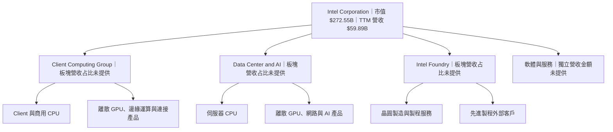
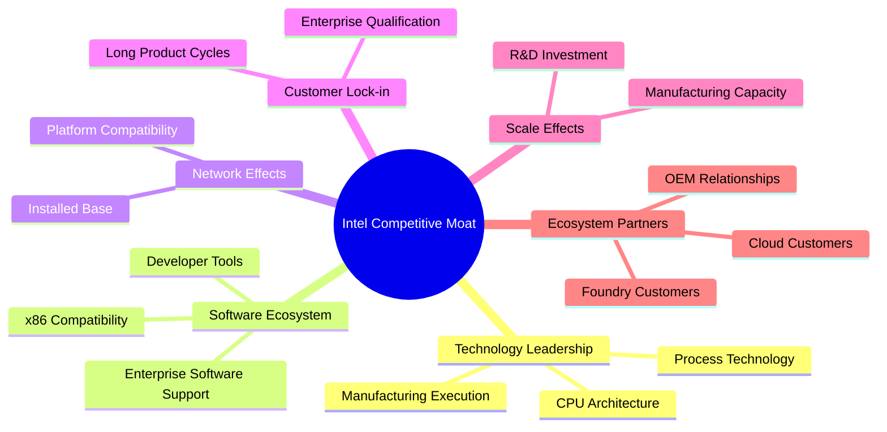
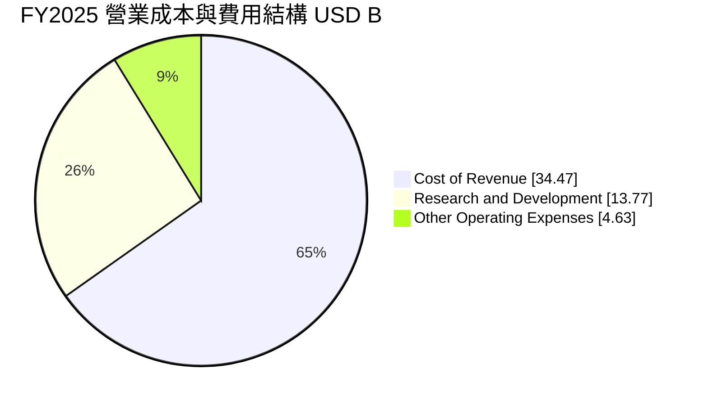
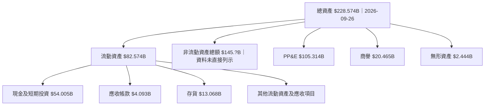
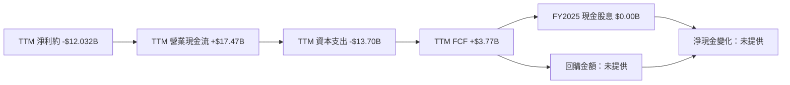
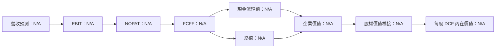
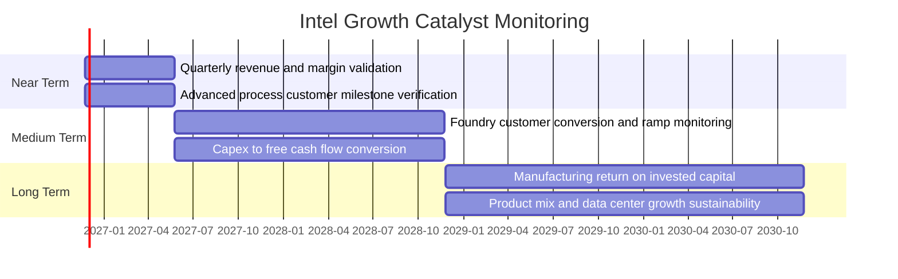
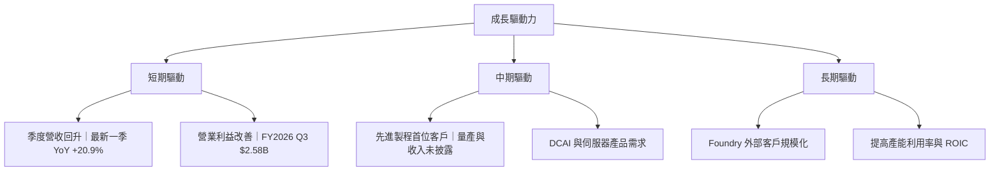
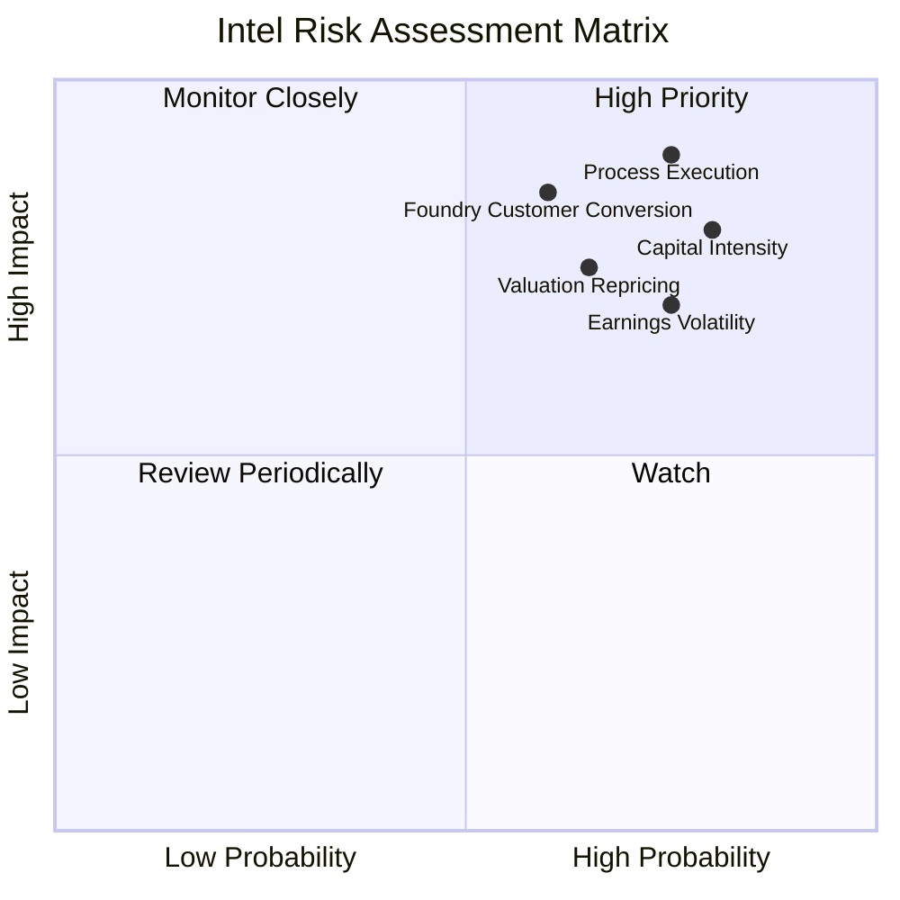
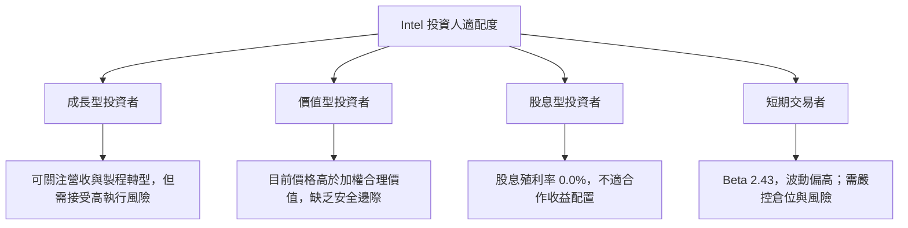

# INTC 基本面深度分析報告
> **報告日期**：2026-11-23 ｜ **語言**：繁體中文 ｜ **數據來源**：SEC 申報資料 (XBRL)、Yahoo Finance、Finviz、StockAnalysis、Roic.ai ｜ **分析師**：CFA 級機構研究

## 目錄

| # | 章節 | 核心結論 |
|---|------|----------|
| 1 | 執行摘要 | 賣出；加權合理價值 $35.34，安全邊際 MOS -45.1% |
| 2 | 公司概覽與商業模式 | 擁有製程、產品與客戶生態，但現有數據不足以證明 Foundry 已形成穩定外部規模 |
| 3 | 損益表深度分析 | TTM 營收 $59.89B、成長 12.1%；TTM 營業利益率僅 2.9%，季度改善尚未證明可持續 |
| 4 | 資產負債表分析 | 淨現金 $3.87B、流動比率 2.208；但現金轉換週期由 35 天升至 68 天 |
| 5 | 現金流量深度分析 | TTM FCF $3.77B、FCF Yield 1.38%；年度資本支出曾使 FCF 多年為負 |
| 6 | 獲利能力與資本效率 | ROIC 1.3% 低於 WACC 12.65%，目前仍在摧毀股東價值 |
| 7 | 相對估值分析 | 相對估值方法指向 $22.04–$36.34，均低於 $51.28 現價 |
| 8 | DCF 內在價值評估 | DCF 模型不可計算；改以可計算的相對估值與分析師共識加權 |
| 9 | 成長催化劑 | 新製程首位客戶與產品組合改善是催化劑，但 TAM、訂單規模及貢獻金額未提供 |
| 10 | 風險矩陣 | 主要風險為製程執行、資本密集度及獲利反彈不能轉為持續現金流 |
| 11 | 投資建議 | 賣出；現價高於加權合理價值，觀察現金流、ROIC 與 Foundry 客戶進展 |

---

## 1. 執行摘要

截至 **2026-11-20 收盤價 $51.28**，Intel TTM 營收為 **$59.89B**、TTM 營收成長 **12.1%**，但 TTM 營業利益率只有 **2.9%**、ROIC 僅 **1.3%**，低於 **12.65% WACC**；TTM FCF 為 **$3.77B**、FCF Yield 為 **1.38%**。以同業 Forward P/E、同業 EV/EBITDA 與分析師共識估值加權後，合理價值為 **$35.34**，MOS 為 **-45.1%**，依評級門檻為 **賣出**。這反映價格已提前計入相當程度的復甦，而現有資本回報仍未覆蓋資本成本。

### 1.0 一頁式投資儀表板（Portfolio Manager 30 秒速讀）

| 項目 | 內容 |
|------|------|
| **投資論點（3 句）** | ① TTM 營收成長 12.1%，最新一季年增 20.9%，顯示需求與比較基期改善。② ROIC 1.3% 明顯低於 WACC 12.65%，營收復甦尚未轉化為足夠資本報酬。③ TTM FCF $3.77B、FCF Yield 1.38%，而加權合理價值 $35.34 低於現價 $51.28。 |
| **綜合評分** | **4.6/10**（引用 1.1 評分卡） |
| **財務健康** | 🟡 淨現金 $3.87B、流動比率 2.208；但 CCC 由 35 天升至 68 天。 |
| **ROIC vs WACC** | **1.3% vs 12.65%**；目前摧毀股東價值。 |
| **FCF 趨勢** | TTM FCF 為正，但年度歷史曾連續多期為負；FCF Yield **1.38%**。 |
| **估值** | Forward P/E **28.64x**｜EV/EBITDA：市場資料欄 **14.911x**，自身歷史區塊 **19.9x**｜FCF Yield **1.38%**。 |
| **DCF 內在價值（基準）** | **N/A**；DCF 模型因預測期末 FCF 不為正而無法計算，現價相對 DCF 折溢價亦為 N/A。 |
| **安全邊際（MOS）** | **-45.1%＝($35.34 − $51.28) ÷ $35.34**；🔴 小於 10%，無安全邊際。 |
| **預期報酬（基準情境 12M）** | DCF 情境不可用；加權合理價值相對現價隱含 **-31.1%**，此為估值差距，不是有期限保證的 12 個月報酬預測。 |
| **關鍵風險（前二）** | 製程與外部 Foundry 客戶轉化未達預期；Capex 高、ROIC 長期低於 WACC。 |
| **評級 + 信心度** | 🔴 **賣出**｜信心：中；估值訊號清楚，但業務復甦與季度數據的持續性仍不確定。 |

### 1.1 綜合評分卡（全報告唯一）

| 維度 | 評分（1–10） | 主要依據（引用數字與其來源章節） |
|------|--------------|----------------------------------|
| 成長性 | 6.0 | TTM 營收成長 12.1%、最新一季年增 20.9%，但 FY2022–FY2025 營收仍呈下行，見第 3 章。 |
| 獲利能力 | 3.0 | TTM 營業利益率 2.9%、ROIC 1.3% 對 WACC 12.65%，Piotroski 6/9，見第 3、6 章。 |
| 財務健康 | 6.5 | 淨現金 $3.87B、流動比率 2.208，但 CCC 增至 68 天，見第 4 章。 |
| 估值 | 2.0 | MOS -45.1%；相對估值 $22.04–$36.34 低於現價 $51.28，見第 7、8 章。 |
| 護城河 | 6.0 | x86、生態與製造能力仍具戰略價值，但外部製程客戶仍處早期驗證階段，見第 2 章。 |
| 管理層與資本配置 | 4.0 | FY2022–FY2025 Capex 每年約 $14.65B–$25.75B，歷年 FCF 多為負；股數增加測試未通過，見第 5、6 章。 |
| **綜合評分** | **4.6** | 六項算術平均：(6.0 + 3.0 + 6.5 + 2.0 + 6.0 + 4.0) ÷ 6 = 4.58，四捨五入至一位小數。 |

### 1.2 五大投資論點 + 三大核心風險

| 類型 | 項目 | 具體依據 | 信心度 |
|------|------|----------|--------|
| 🟢 **投資論點①** | 營收與季度趨勢轉正 | TTM 營收 $59.89B、年增 12.1%；FY2026 Q3 營收 $16.51B，單季 YoY +20.9%。若多季延續，固定成本吸收率可改善。 | 🟡 中 |
| 🟢 **投資論點②** | 資產負債表仍有緩衝 | 現金與短期投資 $54.01B、債務 $50.13B，淨現金 $3.87B；流動比率 2.208。 | 🟢 高 |
| 🟢 **投資論點③** | 季度營運利益回升 | 最近四季營業利益由 FY2025 Q4 的 $0.55B 增至 FY2026 Q3 的 $2.58B；若不是一次性或季節性因素，營業槓桿可能延續。 | 🟡 中 |
| 🟢 **投資論點④** | 高價值製程有客戶驗證催化劑 | 新聞報導 Intel 已為其先進製程簽下首位客戶；訂單金額、量產時間與貢獻營收未提供，仍需後續驗證。 | 🟡 中 |
| 🟢 **投資論點⑤** | TTM 現金流目前轉正 | 營業現金流 $17.47B 減 Capex $13.70B，TTM FCF 為 $3.77B；但尚不足以證明長期現金流穩定。 | 🟡 中 |
| 🟡 **風險①** | 投資報酬不足以覆蓋資本成本 | ROIC 1.3% 對 WACC 12.65%，差距 -11.35 個百分點；若長期未改善，擴產會持續壓低股東價值。 | 🔴 高衝擊 |
| 🔴 **風險②** | 估值高於相對價值錨點 | 加權合理價值 $35.34，較現價低 $15.94；MOS -45.1%。 | 🔴 高 |
| 🔴 **風險③** | 資本密集與現金流波動 | FY2022–FY2025 FCF 分別為 -$9.41B、-$14.28B、-$15.66B、-$4.95B；雖 TTM 回正，仍有再度轉負風險。 | 🔴 高 |

### 1.3 快速統計卡片

| 指標 | 公司實際值（期間） | 同業中位數 | 狀態 |
|------|--------------------|------------|------|
| 營收成長（TTM） | **12.1%** | — | 🟢 |
| 營收成長（最新一季年增） | **20.9%** | 44.7%（AMD、NVIDIA、Qualcomm 中位數） | 🟡 |
| 毛利率（TTM） | **40.2%** | 56.0%（同業中位數） | 🔴 |
| 營業利益率（TTM，SEC 計算口徑） | **2.9%** | — | 🔴 |
| ROIC（TTM） | **1.3%** | — | 🔴 |
| Forward P/E | **28.64x** | 12.3x（同業中位數） | 🔴 |
| FCF Yield（TTM） | **1.38%** | — | 🟡 |
| Piotroski F-Score | **6 / 9** | — | 🟡 |

### 1.4 投資結論

```text
╔══════════════════════════════════════════════════════════════════╗
║                    📊 投資結論摘要                               ║
╠══════════════════════════════════════════════════════════════════╣
║  評級：賣出（依 MOS 評級門檻；無質化調整）                       ║
║  價格（2026-11-20 收盤）：$51.28                                 ║
║  DCF 內在價值（基準）：N/A（DCF 模型不可計算）                   ║
║  安全邊際 MOS：-45.1%（＝($35.34−$51.28)÷$35.34）               ║
║  加權合理價值（8.8）：$35.34                                     ║
║  綜合評分：4.6/10（引用 1.1）                                    ║
║  適合投資人：能承受高波動、願意等待轉型驗證的投資人；不適合作為  ║
║              低波動核心持倉或收益型投資                         ║
╚══════════════════════════════════════════════════════════════════╝
```

---

## 2. 公司概覽與商業模式

### 2.1 業務結構與收入來源

Intel 設計、開發、製造並銷售運算相關產品，主要揭露業務包括 Client Computing Group（CCG）、Data Center and AI（DCAI）與 Intel Foundry。現有財務資料沒有各板塊營收金額與占比，因此以下僅呈現業務關係，不推估比例。



商業模式同時包含晶片設計與自有製造。其優勢是產品、製程與供應鏈可協同；代價是製造資本需求高，若產能利用率或製程良率不足，固定成本會壓低毛利與 ROIC。TTM Capex 為 $13.70B，約為 TTM 營收的 22.9%（$13.70B ÷ $59.89B），顯示資本配置與產能利用率是估值的核心變數。

### 2.2 市場份額

市場份額數據未提供，因此不推估 Intel 在 PC CPU、伺服器 CPU、GPU 或晶圓代工市場的占比。相對位置可由財務指標觀察：Intel 最新一季營收年增 20.9%，仍低於 AMD、NVIDIA、Qualcomm 最新季年增率的中位數 44.7%；但 Intel 的業務組合與同業不同，不能把單一成長率直接解讀為市場份額變化。

### 2.3 競爭護城河分析



### 2.4 護城河強度

| 護城河項目 | 強度（強／中／弱） | 證據（引用數字或事實） | 會削弱它的情況 |
|------------|--------------------|------------------------|----------------|
| 技術與製程 | 中 | 公司同時設計晶片並持有製造能力；新聞指出先進製程已簽下首位客戶，但客戶規模、良率與量產收入未提供。 | 製程延誤、良率落後或外部客戶無法持續轉量產。 |
| 軟體生態系統 | 中 | x86 生態、相容性與企業部署形成轉換成本；資料未提供生態系營收或鎖定率。 | Arm 等架構持續擴張，主要軟體對 x86 的依賴下降。 |
| 網路效應 | 弱至中 | 廣泛部署可吸引軟體與硬體支援；但沒有可量化使用者、開發者或市場份額數據。 | 競爭平台的生態規模加速擴大。 |
| 客戶鎖定 | 中 | 企業 CPU 平台通常涉及認證與相容性，但 Intel 客戶留存率及轉換成本數據未提供。 | 雲端客戶自研晶片、採購多元化或提高議價能力。 |
| 規模效應 | 中 | TTM 營收 $59.89B、員工 81,100 人，研發與製造資源規模大；但 TTM ROIC 只有 1.3%。 | 固定成本利用率不足，或資本支出無法提高產能回報。 |
| 生態夥伴 | 中 | 具 OEM、企業與供應鏈合作基礎；外部 Foundry 客戶的商業量產規模尚未披露。 | 客戶只做初期測試，無法帶來持續性大額營收。 |

1.1「護城河」評分 **6.0/10**，理由是 x86 生態與整合製造形成一定進入障礙，但現有 ROIC 低、外部 Foundry 變現證據有限，護城河尚未充分轉化成經濟租金。

---

## 3. 損益表深度分析

### 3.1 年度收入成長趨勢（近4年）

| 財年 | 營收 | YoY | 解讀 |
|------|------|-----|------|
| FY2022 | $63.05B | — | 作為比較基期。 |
| FY2023 | $54.23B | -14.0% | 需求與產品週期轉弱，營收規模收縮。 |
| FY2024 | $53.10B | -2.1% | 下滑幅度縮小，但尚未回到成長。 |
| FY2025 | $52.85B | -0.5% | 接近持平；仍低於 FY2022。 |
| TTM 至 2026-09-26 | $59.89B | +12.1% 對比前一 TTM | 最新季度改善使 TTM 恢復成長；不可與單季 YoY 混為一談。 |

FY2022 至 FY2025 營收 CAGR：

\[
(52.85 \div 63.05)^{1/3}-1 \approx -5.7\%
\]

```text
╔══════════════════════════════════════════════════════════════════╗
║              Intel 年度收入趨勢（FY2022-FY2025）                 ║
╠══════════════════════════════════════════════════════════════════╣
║  FY2022  $63.05B  █████████████████████████  基期               ║
║  FY2023  $54.23B  ██████████████████████░░  YoY: -14.0% 🔴      ║
║  FY2024  $53.10B  █████████████████████░░░  YoY:  -2.1% 🟡      ║
║  FY2025  $52.85B  █████████████████████░░░  YoY:  -0.5% 🟡      ║
║  TTM     $59.89B  ████████████████████████░  YoY: +12.1% 🟢     ║
╠══════════════════════════════════════════════════════════════════╣
║  FY2022-FY2025 營收 CAGR：約 -5.7%                               ║
║  TTM 成長轉正，但不能直接視為長期趨勢已反轉                     ║
╚══════════════════════════════════════════════════════════════════╝
```

### 3.2 季度收入趨勢分析

QoQ 以相鄰季度營收計算；YoY 使用同季去年營收。最新一季 YoY 20.9% 與 VERIFIED FIGURES 一致。

| 季度 | 營收 | QoQ | YoY | 備註 |
|------|------|-----|-----|------|
| FY2025 Q4 | $13.67B | +0.2% | -4.1% | 相較 FY2025 Q3 持平附近，但仍年減。 |
| FY2026 Q1 | $13.58B | -0.7% | +7.2% | 季度小幅回落，年增轉正。 |
| FY2026 Q2 | $16.13B | +18.8% | +25.4% | 季度增幅明顯；可能受季節性、產品組合或交付時點影響，需後續驗證。 |
| FY2026 Q3 | $16.51B | +2.4% | +20.9% | 環比仍增但速度放緩；YoY 成長強於同業中位數以外的參照基期，但低於同業中位數成長率 44.7%。 |

### 3.3 利潤率演變分析

以下年度毛利率與營業利益率依年度營收與年度損益表數據計算；TTM 營業利益率採 SEC 計算口徑 **2.9%**。另一個市場彙整欄位顯示 10.1%，兩者口徑或期間可能不同，本報告對 TTM 結論採 VERIFIED FIGURES 的 2.9%。

| 利潤率指標 | FY2022 | FY2023 | FY2024 | FY2025 | 趨勢 | 評估 |
|------------|--------|--------|--------|--------|------|------|
| **毛利率** | 42.6% | 40.0% | 32.7% | 34.8% | FY2024 下滑，FY2025 回升 | 🔴 |
| **營業利益率** | 3.7% | 0.1% | -8.9% | 約 0.0% | 低位徘徊，尚未回到歷史較高水準 | 🔴 |
| **淨利率** | 12.7% | 3.1% | -35.3% | -0.5% | FY2024 大幅轉負，FY2025 接近損益兩平 | 🔴 |

**利潤率演變深度解析：** FY2024 毛利由 FY2023 的 $21.71B 降至 $17.34B，營業損失擴大至 $4.71B；FY2025 毛利回升至 $18.38B、營業損失收窄至 $23M，顯示成本控制或產品組合有所改善。但年度研發費用 FY2025 仍達 $13.77B，且資本密集製造使折舊、產能利用率與產品轉換成本對利潤率影響大。季度營業利益改善值得注意，仍須觀察它是否反映可重複的毛利改善，而非一次性或期間性因素。

### 3.4 費用結構分析

FY2025 收入 $52.85B、毛利 $18.38B，故銷貨成本為 $34.47B；研發費用 $13.77B。其他營業費用以「毛利 − 研發 − 營業利益」推得約 $4.63B，因未提供細項，只能作為剩餘合計，不代表單一費用科目。



```text
╔══════════════════════════════════════════════════════════════════╗
║              FY2025 主要成本與費用（USD B）                      ║
╠══════════════════════════════════════════════════════════════════╣
║  銷貨成本                 $34.47B  ██████████████████████████   ║
║  研發費用                 $13.77B  ██████████                   ║
║  其他營業費用合計估算      $4.63B   ███                          ║
║  毛利                     $18.38B  （收入減銷貨成本）            ║
╚══════════════════════════════════════════════════════════════════╝
```

### 3.5 季度 EPS 趨勢與盈餘品質（Quality of Earnings）

最近四季 EPS 分別為 FY2025 Q4 **-$0.12**、FY2026 Q1 **-$0.73**、Q2 **-$2.16**、Q3 **$0.60**。EPS beats/misses 區塊的分析師預期值與實際值均為 NaN，因此無法判定超預期或不及預期；不能以實際 EPS 方向代替相對預期的判斷。

| 季度 | EPS | 超預期／不及預期 | 可觀察原因 |
|------|-----|------------------|------------|
| FY2025 Q4 | -$0.12 | N/A（預期值缺漏） | 淨損 $0.591B。 |
| FY2026 Q1 | -$0.73 | N/A（預期值缺漏） | 淨損 $3.73B。 |
| FY2026 Q2 | -$2.16 | N/A（預期值缺漏） | 淨損 $11.03B；具體一次性項目與稅務調節細項未提供。 |
| FY2026 Q3 | $0.60 | N/A（預期值缺漏） | 淨利 $3.32B；其高於營業利益 $2.58B，代表非營業項目及稅項可能影響淨利，細目未提供。 |

| 盈餘品質項目 | 數值／佔比 | 評估 |
|--------------|-----------|------|
| 股權薪酬 SBC / 營收 | 近四季 SBC 約 $2.432B ÷ TTM 營收 $59.89B = **4.1%** | 🔴 SBC 對股東經濟回報具實質稀釋成本；Piotroski 股數未增加測試未通過。 |
| SBC / 營業現金流 | $2.432B ÷ $17.47B = **13.9%** | 🟡 SBC 是非現金費用，但不是無成本；若股數增加，股東每股權益會被稀釋。 |
| FCF / 淨利（現金轉換率） | TTM 淨利約 -$12.032B；$3.77B ÷ -$12.032B = **-31.3%** | 🔴 分母為淨損，百分比不具通常的轉換率解讀；正 FCF 與 GAAP 淨損並存，需留意折舊、非現金項目及營運資金影響。 |
| 一次性／非經常性損益 | 季度明細 N/A；Q2 淨損 -$11.03B、Q3 淨利 $3.32B | 🔴 單季盈餘大幅波動，沒有附註細項不能斷言由哪種一次性項目造成。 |
| 有效稅率異常 | N/A（TTM 有效稅率未提供） | 無法判定稅務利益是否帶動特定季度盈餘。 |
| 資本化支出 vs 費用化 | TTM Capex $13.70B；費用化研發 FY2025 $13.77B | 🟡 製造投資主要形成資產並透過折舊分期費用化；需用現金流而非當期 EPS 單獨判斷投入成本。 |

**盈餘品質結論：** TTM FCF 已轉正，但 GAAP TTM 淨利仍為負、近四季 EPS 波動大，且 SBC 約佔營收 4.1%。因此單季盈餘反彈尚不足以代表可持續的每股獲利能力；估值應更多依賴可持續營業現金流、資本支出需求與稀釋後每股表現。

---

## 4. 資產負債表分析

### 4.1 資產結構分解

截至 2026-09-26，總資產 $228.574B、流動資產 $82.574B、PP&E $105.314B。以下列示有資料的組成；非流動資產細項並未完整呈現，不以未列示項目補足。



註：非流動資產合計未直接列示，本圖不對該數值作反推，亦不應將其與各已列示細項重複加總。

### 4.2 流動性與營運資金分析

| 指標 | 最新 TTM | 一年前 TTM | 變化 | 解讀 |
|------|----------|------------|------|------|
| DSO 應收帳款天數 | 25 天 | 22 天 | +3 天 | 收款週期略延長；目前不足以單獨判定客戶信用惡化。 |
| DIO 存貨天數 | 133 天 | 122 天 | +11 天 | 存貨占用增加；若不能由出貨消化，可能帶來折價、減值或現金流壓力。 |
| DPO 應付帳款天數 | 90 天 | 109 天 | -19 天 | 付款天數縮短，可能降低供應商融資對現金的支持。 |
| CCC 現金轉換週期 | 68 天 | 35 天 | +33 天 | 現金被營運週期占用的時間變長，是營運資金監控重點。 |

流動比率為 **2.208**、速動比率 **1.751**，表面短期流動性尚可；但 CCC 變長、存貨天數上升，意味帳面流動資產並不等同於同等品質的可自由支配現金。

### 4.3 債務結構分析

```text
╔══════════════════════════════════════════════════════════════════╗
║                   Intel 債務健康診斷                             ║
╠══════════════════════════════════════════════════════════════════╣
║  總債務：          $50.13B  ██████████████████░░                 ║
║  現金+短期投資：   $54.01B  ████████████████████                 ║
║  淨現金：           $3.87B  █░░░░░░░░░░░░░░░░░░░  🟡             ║
║                                                                  ║
║  流動比率：         2.208x   🟢                                  ║
║  速動比率：         1.751x   🟢                                  ║
║  Debt/EBITDA：      N/A（本資料無一致口徑的 EBITDA 值）          ║
║  利息保障倍數：     N/A（利息費用及 EBIT 口徑未完整提供）        ║
╚══════════════════════════════════════════════════════════════════╝
```

公司總債務為 $50.13B，現金及短期投資 $54.01B，淨現金 $3.87B，短期償債能力有緩衝。不過淨現金相對市值 $272.55B 不大，且製造業仍需持續投資；不宜把淨現金視為足以消除資本配置風險的證據。

### 4.4 股東權益趨勢

| 財年 | 股東權益 | 年增 | 解讀 |
|------|----------|------|------|
| FY2022 | $101.42B | — | 歷史基期。 |
| FY2023 | $105.59B | +4.1% | 帳面權益增加。 |
| FY2024 | $99.27B | -6.0% | 權益下降，與大額淨損相符。 |
| FY2025 | $114.28B | +15.1% | 權益回升；但不能單獨代表營運回報改善。 |

```text
╔══════════════════════════════════════════════════════════════════╗
║              股東權益趨勢（USD B）                               ║
╠══════════════════════════════════════════════════════════════════╣
║  FY2022  $101.42B  ██████████████████░░                          ║
║  FY2023  $105.59B  ███████████████████░                          ║
║  FY2024   $99.27B  ██████████████████░░  YoY: -6.0%              ║
║  FY2025  $114.28B  ████████████████████  YoY: +15.1%             ║
╚══════════════════════════════════════════════════════════════════╝
```

---

## 5. 現金流量深度分析

### 5.1 現金流量瀑布圖



TTM FCF 的定義固定為營業現金流減資本支出：**$17.47B − $13.70B = $3.77B**。股息與回購資料沒有提供 TTM 一致口徑，不能推算剩餘現金用途或淨現金變化。

### 5.2 FCF 轉換率趨勢

| 年度／期間 | FCF | 淨利 | FCF / 淨利 | 解讀 |
|------------|-----|------|------------|------|
| FY2022 | -$9.41B | $8.01B | -117.5% | 高額資本支出超過營業現金流，現金轉換弱。 |
| FY2023 | -$14.28B | $1.69B | -845.0% | FCF 大幅為負，且淨利較小使比率放大，不宜單獨解讀。 |
| FY2024 | -$15.66B | -$18.76B | 83.5% | FCF 與淨利同為負，現金損失幅度低於會計損失。 |
| FY2025 | -$4.95B | -$0.267B | 1,853.9% | 分母接近零且為負，比率失真；應直接觀察 FCF。 |
| TTM 至 2026-09-26 | $3.77B | 約 -$12.032B | -31.3% | 淨損下比率無通常經濟意義；重點是 FCF 恢復為正。 |

### 5.3 自由現金流趨勢

| 期間 | 營業現金流 | Capex | FCF |
|------|------------|-------|-----|
| FY2022 | $15.43B | $24.84B | -$9.41B |
| FY2023 | $11.47B | $25.75B | -$14.28B |
| FY2024 | $8.29B | $23.94B | -$15.66B |
| FY2025 | $9.70B | $14.65B | -$4.95B |
| TTM | $17.47B | $13.70B | $3.77B |

```text
╔══════════════════════════════════════════════════════════════════╗
║              自由現金流：年度實際與 TTM（USD B）                  ║
╠══════════════════════════════════════════════════════════════════╣
║  FY2022  -$9.41B  ◀████████░░░░░░░░░░░░░░                         ║
║  FY2023 -$14.28B  ◀████████████░░░░░░░░░░                         ║
║  FY2024 -$15.66B  ◀█████████████░░░░░░░                           ║
║  FY2025  -$4.95B  ◀████░░░░░░░░░░░░░░░░                           ║
║  TTM      $3.77B  ███░░░░░░░░░░░░░░░░░░                           ║
╠══════════════════════════════════════════════════════════════════╣
║  TTM FCF Yield：1.38%｜歷史年度 FCF 曾連續四年為負               ║
╚══════════════════════════════════════════════════════════════════╝
```

### 5.4 資本配置評估

可核對的 FY2025 資本配置數據包括 Capex $14.65B、現金股息 $0.00B、SBC $2.43B。回購、併購與其他投資支出缺乏同一期間可比資料，故不以圓餅圖虛構比例。

| 項目 | 已知數據 | 評估 |
|------|----------|------|
| 資本支出 | FY2025 $14.65B；FY2024 $23.94B；FY2023 $25.75B | 資本支出下降有助改善 FCF，但需確認是否與產能與製程執行計畫一致。 |
| 股息 | FY2025 $0.00B；股息殖利率 0.0% | 暫無現金收益回報。 |
| 股權薪酬 | FY2025 $2.43B | 對股東每股權益造成稀釋成本。 |
| 股票回購 | N/A（資料未提供） | 不對資本配置效果作推定。 |
| 留存與現金變化 | TTM 淨現金 $3.87B | 現金緩衝有限於大型長期投資需求，需觀察後續 Capex 與現金流。 |

---

## 6. 獲利能力與資本效率

### 6.1 ROE / ROA / ROIC 趨勢

| 指標 | 可得期間數值 | 評估 |
|------|--------------|------|
| ROE | TTM **-10.5%**（VERIFIED）；市場彙整欄另列 -9.6% | 口徑有差異，採 VERIFIED 數值；負報酬與 TTM 淨損一致。 |
| ROA | TTM 1.8%（市場彙整）；Piotroski 測試顯示 ROA 未大於 0 | 來源口徑不一致，不把 1.8% 當作 SEC 計算的標準化 ROA 趨勢。 |
| ROIC | TTM **1.3%** | 遠低於資本成本，尚未證明投入資本能創造價值。 |
| 歷史年度 ROIC／ROE／ROA | N/A（未提供可比的年度序列） | 不補造歷史值或同業均值。 |

### 6.2 ROIC vs WACC 分析（核心價值創造判斷）

```text
╔══════════════════════════════════════════════════════════════════╗
║                ROIC vs WACC 深度分析                            ║
╠══════════════════════════════════════════════════════════════════╣
║  WACC（直接採用資本成本計算值）：12.65%                          ║
║  ├── 無風險利率（10Y 美債）：4.91%                               ║
║  ├── 市場風險溢酬 ERP：5.00%                                     ║
║  ├── Beta 原始：2.43；採用調整後 Beta：1.95                     ║
║  ├── 股權成本 Ke：14.67%                                        ║
║  ├── 稅前債務成本 Kd：2.18%                                     ║
║  ├── 稅率：21.0%；債務成本稅後約 1.72%                          ║
║  ├── 資本權重：股權 84.5%，債務 15.5%                           ║
║  └── WACC：12.65%（採用已計算值；顯示輸入經四捨五入）           ║
║                                                                  ║
║  ROIC（TTM）：1.3%                                               ║
║  EVA spread = ROIC − WACC = 1.3% − 12.65% = -11.35pp             ║
║                                                                  ║
║  ROIC   1.30%  ▓▓░░░░░░░░░░░░░░░░░░░░░░░░░░  🔴                 ║
║  WACC  12.65%  ▓▓▓▓▓▓▓▓▓▓▓▓▓▓▓▓▓▓▓▓▓▓▓▓▓░░░  ──                 ║
║                                                                  ║
║  結論：ROIC 低於 WACC 11.35 個百分點，現階段摧毀股東價值。     ║
╚══════════════════════════════════════════════════════════════════╝
```

資本成本參數為：CAPM 股權成本 **14.67%**、稅前債務成本 **2.18%**、股權／債務權重 **84.5%／15.5%**、WACC **12.65%**。原始 Beta 2.43 高，模型採用調整後 Beta 1.95；此調整降低了對歷史高波動度的直接外推。資本成本資料未提供 10 年美債利率的具體觀測日期，故只引用數據所列 4.91%，不另行推定日期。

**判斷：** ROIC 1.3% 僅約為 WACC 的 10.3%（1.3% ÷ 12.65%）。若新製程與產品組合無法提高營業利潤率，新增資本支出可能擴大經濟價值損失。

### 6.3 杜邦三因素分解

| 因素 | 數值（TTM） | 解讀 |
|------|-------------|------|
| 淨利率 | -20.1% | 淨損是 ROE 負值的主要來源。 |
| 資產週轉率 | 0.26 | 資產規模大而營收週轉偏低；製造資產利用率是重要變數。 |
| 權益乘數 | 1.99 | 槓桿放大資產報酬，但不是負 ROE 的主要成因。 |
| **ROE** | **-10.5%** | QUALITY FIGURES 原列：-20.1% × 0.26 × 1.99 = -10.5%；各分項經四捨五入，乘積有尾差。 |

### 6.4 財務體質：Piotroski F-Score

Piotroski F-Score 為 **6 / 9**。資料缺漏測試會排除於分母之外；本次九項列示均有結果。

| 測試 | 結果 | 解讀 |
|------|------|------|
| ROA > 0 | ❌ 未通過 | 盈利能力不足。 |
| 營業現金流 > 0 | ✅ 通過 | TTM 營業現金流為正。 |
| ROA 高於一年前 | ❌ 未通過 | 資產報酬未改善。 |
| 營業現金流 > 淨利 | ✅ 通過 | 現金流高於淨利，反映應計品質測試通過；但不能單憑此項判定整體盈餘品質良好。 |
| 長期負債 ÷ 總資產低於一年前 | ✅ 通過 | 相對槓桿指標改善。 |
| 流動比率高於一年前 | ✅ 通過 | 短期流動性相較前一年改善。 |
| 稀釋股數未增加 | ❌ 未通過 | 股數增加會稀釋每股經濟利益。 |
| 毛利率高於一年前 | ✅ 通過 | 毛利率改善，但當前毛利率仍只有 40.2%。 |
| 資產週轉率高於一年前 | ✅ 通過 | 資產使用效率相對改善。 |

---

## 7. 相對估值分析

### 7.1 同業估值比較表格

Intel Forward P/E、P/S 與 EV/EBITDA 使用提供的市場估值欄位；同業倍數一律採 Yahoo Finance 同業資料。Trailing P/E 因 Intel TTM EPS 為負而不適用。

| 估值指標 | **Intel** | **AMD** | **NVIDIA** | **Qualcomm** | 本公司評估 |
|----------|----------:|--------:|-----------:|-------------:|-----------|
| **Trailing P/E** | N/A（TTM EPS -$2.35） | 90.7x | 13.5x | 11.8x | 🔴 Intel TTM 虧損，P/E 不具比較意義。 |
| **Forward P/E** | 28.64x | 24.1x | 7.6x | 12.3x | 🔴 Intel 高於同業中位數 12.3x；反映預期修復已被定價。 |
| **P/S Ratio** | 4.55x | 15.5x | 8.4x | 3.7x | 🟡 Intel 高於 Qualcomm，但低於 AMD 與 NVIDIA；需連同較低成長與利潤率看待。 |
| **EV/EBITDA** | 14.911x（估值彙整欄） | 61.9x | 12.2x | 15.9x | 🟡 Intel 約在兩家有該數值的同業之間；歷史估值區塊另列 19.9x，計算口徑可能不同。 |
| **最新一季營收 YoY** | 20.9% | 44.7% | 103.2% | -8.4% | 🟡 Intel 成長為正，但低於三家同業中位數 44.7%。 |
| **TTM 毛利率** | 40.2% | 56.0% | 74.9% | 53.1% | 🔴 Intel 低於同業，反映製造成本與產品組合壓力。 |

### 7.2 歷史估值區間分析

歷史估值區塊提供 P/S 與 EV/EBITDA，沒有 P/E 的自身歷史百分位資料，故不以估計值補列。

```text
╔══════════════════════════════════════════════════════════════════╗
║          Intel 自身 5 年估值區間（TTM multiples）                ║
╠══════════════════════════════════════════════════════════════════╣
║  P/S：         現值 4.5x ｜中位數 2.6x｜區間 1.5x–11.5x         ║
║                現值百分位 90%  🔴 高於自身歷史中位數             ║
║  EV/EBITDA：   現值 19.9x｜中位數 23.6x｜區間 6.4x–536.5x       ║
║                現值百分位 35%  🟡 低於自身歷史中位數             ║
║  P/E 歷史區間：N/A（歷史百分位資料未提供）                       ║
╚══════════════════════════════════════════════════════════════════╝
```

EV/EBITDA 歷史區間上限極高，可能受低 EBITDA 基期影響，降低了區間平均值或百分位的直覺解讀能力。現值 19.9x 依自身歷史估值區塊引用；市場彙整欄位另列 14.911x，兩者不應混成同一口徑。

### 7.3 情境價值（Bear / Base / Bull）

N/A（DCF 無法計算：模型預測期末自由現金流不為正，且資本支出高於營業利益與折舊攤銷的合成現金流條件）。因此不提供 DCF 悲觀、基準或樂觀情境目標價，避免另建模型。

### 7.4 相對估值隱含價格區間

以下照用估值方法資料中的方法、每股價值及權重。Forward P/E 使用 AMD、NVIDIA、Qualcomm 的同業中位數 12.3x 乘 Intel Forward EPS $1.79；EV/EBITDA 使用 NVIDIA 與 Qualcomm 的同業中位數 14.0x，再加回淨現金。由於 DCF 不可計算，權重依公司類型配置給其餘方法。

```text
╔══════════════════════════════════════════════════════════════════╗
║              相對估值每股價值與現價位置                          ║
╠══════════════════════════════════════════════════════════════════╣
║  $22.04 同業 Forward P/E ── $36.34 同業 EV/EBITDA ── $51.28 現價║
║  $90.65 分析師共識目標價                                          ║
║                                                                  ║
║  Forward P/E：12.3x × Forward EPS $1.79 = $22.04／股             ║
║  EV/EBITDA：同業中位數 14.0x × TTM EBITDA，再加淨現金 = $36.34   ║
║  分析師共識：43 位分析師平均目標價 = $90.65                      ║
╚══════════════════════════════════════════════════════════════════╝
```

---

## 8. DCF 內在價值評估（Discounted Cash Flow）

### 8.0 估值推理鏈（Thinking Logic：在算之前先想清楚）

**Step 1 — 價值來源與主導變數**

Intel 的經濟價值取決於現有 CPU 業務現金流、DCAI／AI 產品成長，以及 Foundry 外部客戶轉量產的選擇權；各板塊營收占比未提供，不能量化各項占比。現有可核對的整體起點是 TTM 營收 $59.89B、營業利益率 2.9%、Capex $13.70B 與 FCF $3.77B。最可能主導估值的營運變數是**製造投資能否轉化為可持續正 FCF 與較高 ROIC**。

**Step 2 — 模型可用性**

| 決策點 | 本報告採用 | 理由（含數字） | 曾考慮但否決 | 否決理由 |
|--------|-----------|----------------|--------------|----------|
| 現金流定義 | FCFF（若模型可用） | 與 WACC 折現、企業價值橋接相符 | FCFE | 現有模型未提供可計算的完整 FCFF 預測。 |
| 預測期 N | N/A | DCF MODEL 標示不可計算 | 自行設定 5–10 年 | 不得以缺漏假設另建 DCF。 |
| 終值方法 | N/A | 無有效的模型預測現金流 | Gordon Growth／退出倍數 | 期末 FCF 條件不滿足，無法得到可稽核終值。 |
| EBIT 基礎 | N/A | DCF 不可計算 | GAAP／非 GAAP EBIT | 不另建預測模型。 |

**Step 3 — 關鍵假設推導鏈**

營收 CAGR、期末營業利潤率、永續成長率、預測期、Capex、D&A、營運資金、SBC、稀釋股數與終值假設皆不列採用值：DCF MODEL 為 N/A，若在此自行補入即構成新模型與未授權假設。

**Step 4 — 最脆弱環節**

最脆弱之處是短期營業改善能否持續，並把高額製造投資轉化為正且具增長性的 FCF；若不能，估值需回到較低的同業相對估值，而不是依賴未證實的長期現金流。

**Step 5 — 計算路徑圖**

以下只說明一般 DCF 計算關係，不填入 Intel 的預測數字，因公司專屬 DCF 模型不可計算。



### 8.1 模型假設總表（Model Inputs）

**DCF MODEL：N/A。** 原因為預測期最後一年自由現金流不為正，資本支出高於營業利益與折舊攤銷的合成現金流條件。依規定不自建 DCF，故下列預測輸入不適用。

| 假設項目 | 採用值 | 依據／來源 | 敏感度 |
|----------|--------|-------------|--------|
| 預測期長度 N | N/A | DCF MODEL 不可計算 | N/A |
| 營收 CAGR（預測期） | N/A | 不另設模型假設 | N/A |
| 營業利潤率（期末） | N/A | 不另設模型假設 | N/A |
| 有效稅率 | N/A | 不另設模型假設 | N/A |
| Capex / 營收 | N/A | 不另設模型假設 | N/A |
| 折舊攤銷 D&A / 營收 | N/A | 不另設模型假設 | N/A |
| 營運資金變動 / 營收增額 | N/A | 不另設模型假設 | N/A |
| EBIT 基礎 | N/A | 不進行 DCF 預測 | N/A |
| 股權薪酬 SBC 處理 | N/A | 不進行 DCF 預測 | N/A |
| 年稀釋率 | N/A | 不進行 DCF 預測 | N/A |
| 永續成長率 g | N/A | 不計算終值 | N/A |
| 終值方法 | N/A | 不計算終值 | N/A |
| WACC | 12.65%（公司資本成本參數） | 直接採用資本成本資料；不代表 DCF 已可計算 | N/A |

FCFF 一般定義為 NOPAT + D&A − Capex − ΔWC；但本報告沒有建立預測期，亦不呈列逐年 FCF。

### 8.2 折現率參數（WACC）

本節列示公司資本成本資料，與第 6.2 節一致。由於 DCF 模型不可計算，此 WACC 不用於本報告內在價值預測。

```text
╔══════════════════════════════════════════════════════════════════╗
║                    WACC 資本成本參數                             ║
╠══════════════════════════════════════════════════════════════════╣
║  無風險利率 Rf（10Y 美債）：4.91%                                ║
║  市場風險溢酬 ERP：5.00%                                         ║
║  Beta 原始值：2.43；採用調整後 Beta：1.95                       ║
║  調整方式：2/3 × 2.43 + 1/3 × 1 = 1.953，採用 1.95             ║
║  股權成本 Ke（資料列示）：14.67%                                 ║
║  稅前債務成本 Kd（資料列示）：2.18%                              ║
║  稅率：21.0%；資本權重 E/D：84.5% / 15.5%                       ║
║  WACC（直接採用）：12.65%                                        ║
╚══════════════════════════════════════════════════════════════════╝
```

以顯示值試算，Ke = 4.91% + 1.95 × 5.00% = 14.66%；與資料列示 14.67% 的差異可由 Beta 與原始輸入未顯示的小數位造成。稅後 Kd 以顯示值計算為 2.18% × (1 − 21.0%) = 1.7222%，約 1.72%。以四捨五入後資本權重試算會有微小尾差，故 WACC **採用資料列示的 12.65%**，不另行替換或建立另一個折現率。

Rf 的具體觀測日、利息費用金額、平均計息負債與完整市值權重底數未提供，因此不臆測補算上述輸入的原始來源細節。

### 8.3 逐年自由現金流預測（基準情境）

N/A（DCF MODEL 不可計算：預測期末 FCF 不為正，原因為 Capex 高於營業利益與 D&A 的合成現金流條件）。不提供 FY+1 至 FY+N 的逐年預測，也不另建模型。

### 8.4 終值計算（Terminal Value）

N/A（DCF MODEL 不可計算，沒有預測期最後一年 FCFF、永續成長率或可用退出倍數）。因此不計算 Gordon Growth 終值或退出倍數終值。

### 8.5 企業價值 → 每股內在價值（Bridge）

N/A（缺少可用 DCF 企業價值、預測期現金流現值與終值）。**DCF 內在價值及現價相對 DCF 折溢價均為 N/A。**本節不計算 MOS；全報告 MOS 固定以第 8.8 節加權合理價值為基準。

### 8.6 敏感性分析（WACC × 永續成長率）

N/A（DCF MODEL 不可計算，沒有可用的基準現金流、終值與每股內在價值）。不提供敏感性矩陣或三情境 DCF，亦不自行假設悲觀、基準或樂觀目標價。

### 8.7 反推 DCF（Reverse DCF：市場在預期什麼）

N/A（DCF MODEL 不可計算，不能以單一市場價格對不可用的現金流模型反推營收 CAGR、利潤率、永續成長率或預測期）。現價可與可計算的相對估值方法比較，但不能因此宣稱解出了市場隱含 DCF 假設。

### 8.8 估值三角驗證與安全邊際

因 DCF 無法計算，估值三角驗證使用可計算的兩種同業相對估值與分析師共識；方法與權重按公司類型固定採用。

| 估值方法 | 隱含每股價值 | 上行空間（÷現價） | 權重 | 說明 |
|----------|--------------|-------------------|------|------|
| 同業 Forward P/E | $22.04 | -57.0% | 45% | AMD、NVIDIA、Qualcomm 同業中位數 12.3x × Intel Forward EPS $1.79。 |
| 同業 EV/EBITDA | $36.34 | -29.1% | 45% | NVIDIA、Qualcomm 同業中位數 14.0x × TTM EBITDA，再加回淨現金。 |
| 分析師共識目標價 | $90.65 | +76.8% | 10% | 43 位分析師平均目標價；權重僅 10%，作參考而非估值主錨。 |
| **加權合理價值** | **$35.34** | **-31.1%** | **100%** | DCF（基準）不可計算，其權重按固定方法分配至可用方法。 |

**逐步演算：**

\[
\$22.04 \times 45\%+\$36.34 \times 45\%+\$90.65 \times 10\%
=\$9.918+\$16.353+\$9.065
=\$35.336\approx \mathbf{\$35.34}
\]

公司類型為「profitable」，估值方法與權重依資料列示固定採用；DCF 因不可計算而剔除。對加權合理價值計算，未作事後調整。

- **MOS** = ($35.34 − $51.28) ÷ $35.34 = -$15.94 ÷ $35.34 = **-45.1%**
- **上行空間** = ($35.34 − $51.28) ÷ $51.28 = -$15.94 ÷ $51.28 = **-31.1%**
- **折溢價相對 DCF**：N/A；DCF 基準內在價值不可計算。

```text
╔══════════════════════════════════════════════════════════════════╗
║                  估值區間與安全邊際                              ║
╠══════════════════════════════════════════════════════════════════╣
║  $22.04 ───── $35.34 ───────── $51.28 ───────── $90.65          ║
║  同業 P/E     加權合理值        現價              分析師共識       ║
║                                                                  ║
║  安全邊際 MOS = (加權合理價值−現價)÷加權合理價值 = -45.1%       ║
║  MOS 評估：🔴 小於 10%，無安全邊際                               ║
║  上行空間 = (加權合理價值−現價)÷現價 = -31.1%                   ║
║  建議觀察買入價：不高於 $31.81（加權價值的 90%，約 MOS 10%）     ║
║  合理價值參考：$35.34；DCF 情境區間：N/A                        ║
╚══════════════════════════════════════════════════════════════════╝
```

其中 $31.81 為 $35.34 × (1 − 10%) = $31.806，四捨五入至美分；這是估值門檻推導，不代表保證可達的市場價格。

> 🔎 **程式複算（Python，依本節各項自動重算）**
>
> 加權合理價值 = $22.04 × 45% + $36.34 × 45% + $90.65 × 10% = **$35.34**（權重合計 100%）
>
> 以價格 $51.28 計：MOS = **-45.1%**，上行空間 = **-31.1%**
>
> ✅ 與本節所寫數值一致。

### 8.9 DCF 模型的局限與失效條件

- **終值依賴度：** N/A；DCF 沒有計算 EV，不能聲稱終值占比。
- **最脆弱假設：** DCF 模型未建立，故沒有可量化的 DCF 假設敏感度。相對估值的主要風險是 Forward EPS $1.79 能否實現，以及 12.3x 同業中位數是否適用於 Intel。
- **不適用情境：** Intel 資本密集、年度 FCF 曾連續為負，且 TTM 淨損仍大。DCF 可靠度因此下降；目前更適合以同業倍數、資本支出趨勢、製程投資回報及分部營收披露作交叉驗證。
- **與第 10 章風險矩陣的連結：** 製程延誤會壓低營業利潤率；產能利用率不足會維持高 Capex 對 FCF 的壓力；Foundry 客戶未量產會使長期營收成長預期下修。

### 8.10 複算檢核表（Audit Trail：輸出前自我驗算）

| # | 檢核項目 | 檢查方式 | 結果 |
|---|----------|----------|------|
| 1 | 所有高／中敏感度 DCF 輸入都有推導 | DCF 模型為 N/A，未設定假設 | ✅ 不適用；未虛構輸入 |
| 2 | 每個假設都有來歷 | 假設表明確標示 N/A 原因 | ✅ |
| 3 | WACC 五步算式與完整底數 | 採用已計算 WACC 12.65%；部分底數未提供 | ⚠️ 未另建計算，已揭露輸入精度及資料缺口 |
| 4 | Kd 分母與債務權重範圍一致 | 利息費用與負債明細未提供 | ⚠️ 無法獨立驗證，未以無息負債代替 |
| 5 | WACC 與第 6.2 節同值 | 兩節均採 12.65% | ✅ |
| 6 | 逐年預測年度數符合 N | DCF N/A，無年度預測表 | ✅ 不適用 |
| 7 | FY+1 九步算式可複算 | DCF N/A，無 FY+1 預測 | ✅ 不適用 |
| 8 | 預測期 PV 加總 | 無 DCF 預測現值 | ✅ 不適用 |
| 9 | WACC > g | g 未設定 | ✅ 不適用 |
| 10 | 終值以 FY+N 現金流折現 | 終值未計算 | ✅ 不適用 |
| 11 | EV 到每股價值橋接 | DCF 橋接未計算 | ✅ 不適用 |
| 12 | SBC EBIT、FCF 扣除、股數設定相容 | DCF 模型未採組合 A/B/C | ✅ 不適用；未進行 DCF |
| 13 | 敏感性矩陣基準格與 8.5 相同 | 無矩陣 | ✅ 不適用 |
| 14 | 矩陣有效格條件 | 無矩陣 | ✅ 不適用 |
| 15 | 三情境機率加總 | DCF 情境未提供 | ✅ 不適用 |
| 16 | 反推 DCF 一次只放開一個變數 | 反推 DCF 未計算 | ✅ 不適用 |
| 17 | MOS 基準與 DCF 折溢價基準正確 | MOS 採 $35.34 加權合理價值；DCF 折溢價列 N/A | ✅ |
| 18 | 報告完整至第 11 章 | 章節 1–11 均列出 | ✅ |
| 19 | 加權合理價值為方法加權和 | $22.04×45% + $36.34×45% + $90.65×10% = $35.336 ≈ $35.34 | ✅ |
| 20 | 評級符合 MOS 規則 | MOS -45.1% < -25%，評級賣出 | ✅ |

---

## 9. 成長催化劑

### 9.1 催化劑時間軸

下列期間為研究追蹤區間，不是公司已承諾的財務指引或確定量產日期。



短期需確認單季營收成長是否能延續，以及 Q3 營業利益改善能否重複；中期重點是新製程客戶由初期合作轉成量產營收；長期則看 ROIC 是否從 1.3% 向 WACC 12.65% 收斂。各催化劑的量化目標與公司指引未提供。

### 9.2 TAM 市場規模分析

N/A（TAM 數據未提供）。Intel TTM 營收為 $59.89B、TTM 成長 12.1%，最新一季營收年增 20.9%；但市場規模、可服務市場與公司滲透率均未提供，不能據此推估 TAM 或市場份額。

### 9.3 成長驅動力結構圖



---

## 10. 風險矩陣

### 10.1 風險評分矩陣

下圖座標為分析師對風險機率與衝擊的定性判斷，不是財務資料庫提供的統計機率；量化財務影響門檻列於 10.2。



### 10.2 風險清單詳細分析

| # | 風險項目 | 發生機率 | 財務衝擊 | 風險評分 | 緩解措施 |
|---|----------|----------|----------|----------|----------|
| 1 | 🔴 **製程執行與良率風險** | 中高（分析師估計 60–75%） | 高；可能令營收成長低於目前 TTM +12.1%，並使 TTM 營業利益率 2.9%無法改善 | 🔴 8.5/10 | 追蹤製程里程碑、量產良率、客戶認證與資本支出回報；若延誤，重新下修獲利假設。 |
| 2 | 🔴 **資本密集與 FCF 再轉負** | 高（分析師估計 60–80%） | 高；TTM Capex $13.70B，FY2022–FY2025 FCF 曾連續為負 | 🔴 8.0/10 | 每季追蹤 Capex、營業現金流與 FCF；若 TTM FCF 再度轉負且非短期投資時點因素，降低持倉。 |
| 3 | 🔴 **季度獲利波動與非營業項目** | 中高（分析師估計 55–75%） | 中高；FY2026 Q2 淨損 -$11.03B，Q3 淨利 $3.32B，波動幅度大 | 🔴 7.5/10 | 要求管理層說明非經常項目、稅率、減損與重整成本；以多季累積結果而非單季 EPS 作判斷。 |
| 4 | 🟡 **Foundry 外部客戶未能量產** | 中（分析師估計 40–60%） | 高；首位先進製程客戶的收入金額與爬坡時間未披露 | 🟠 7.0/10 | 追蹤客戶數、量產節點、外部 Foundry 營收與毛利，而非只看簽約新聞。 |
| 5 | 🟡 **現價估值回歸** | 中高（分析師估計 50–70%） | 高；現價 $51.28，高於加權合理價值 $35.34，MOS -45.1% | 🔴 7.5/10 | 以分批與估值紀律降低追價風險；在獲利及 ROIC 證據出現前，不把分析師共識 $90.65 當作基準價值。 |

---

## 11. 投資建議

### 11.1 最終評級與評分

Intel 的 MOS 為 **-45.1%**，低於 -25% 的門檻，因此評級為 **賣出**；未作質化調整。綜合評分為 **4.6/10**，引用 1.1 的六項分數：成長性 6.0、獲利能力 3.0、財務健康 6.5、估值 2.0、護城河 6.0、管理層與資本配置 4.0。

### 11.2 合理價值與隱含報酬率

| 估值參考 | 每股價值 | 相對現價 $51.28 | 說明 |
|----------|----------:|----------------:|------|
| 同業 Forward P/E | $22.04 | -57.0% | 同業中位數 12.3x × Forward EPS $1.79。 |
| 同業 EV/EBITDA | $36.34 | -29.1% | 同業中位數 14.0x，並加回淨現金。 |
| **加權合理價值** | **$35.34** | **-31.1%** | 加權方法輸出；MOS 為 -45.1%。 |
| 分析師共識 | $90.65 | +76.8% | 43 位分析師平均目標價，權重 10%。 |
| DCF 悲觀／基準／樂觀 | N/A | N/A | DCF 模型不可計算，不提供情境目標價。 |

分析師共識與相對估值方法差異很大，尤其共識目標價高於現價，而兩個同業倍數方法均低於現價。加權合理價值對方法權重敏感，但權重依規則固定，不另行調整。

### 11.3 買入時機與觸發因素

```text
╔══════════════════════════════════════════════════════════════════╗
║                  ✅ 買入觸發因素 Checklist                      ║
╠══════════════════════════════════════════════════════════════════╣
║  目前價格 $51.28 高於加權合理價值 $35.34；不建議因單季反彈追買。║
║                                                                  ║
║  重新評估買入（多數符合）：                                      ║
║  ☐ 股價回到 $31.81 以下，約對應加權合理價值 10% MOS 門檻        ║
║  ☐ TTM FCF 維持正值，且不是單純縮減必要 Capex 所致              ║
║  ☐ TTM ROIC 持續改善並向 WACC 12.65% 收斂                       ║
║  ☐ 新製程客戶公布可驗證的量產、營收或產能利用率進展             ║
║                                                                  ║
║  加碼觸發條件（需與估值相容）：                                  ║
║  ☐ 毛利率改善同時，營業現金流不弱化                             ║
║  ☐ CCC 從 68 天回落，存貨天數由 133 天下降                       ║
║  ☐ 營業利益率多季維持改善，而非僅一季跳升                       ║
║                                                                  ║
║  減碼／退出觸發條件：                                            ║
║  ☐ TTM FCF 再轉負且連續兩季未改善                               ║
║  ☐ 核心營收成長轉負，或 TTM 營業利益率降至 0% 以下              ║
║  ☐ Foundry 客戶里程碑延誤，且資本支出未同步下降                 ║
╚══════════════════════════════════════════════════════════════════╝
```

### 11.4 投資人適配度分析



| 投資人類型 | 適配度 | 主要理由 |
|------------|--------|----------|
| 成長型 | 中低 | 最新一季營收年增 20.9%，但需等待 Foundry 與 AI 業務實際收入驗證。 |
| 價值型 | 低 | 現價 $51.28 高於加權合理價值 $35.34，MOS -45.1%。 |
| 股息型 | 低 | 股息殖利率 0.0%，不提供目前收益。 |
| 短期交易者 | 中 | Beta 2.43、兩年價格波動大；交易機會與下行風險並存。 |

### 11.5 每季財報監控清單（Quarterly Watch List）

| 監控項目 | 最新基準 | 加碼／改善觸發 | 減碼／惡化觸發 |
|----------|----------|----------------|----------------|
| 營收成長 | TTM +12.1%；最新季 YoY +20.9% | 單季 YoY 維持正成長，且不是單一季度或低基期造成 | 連續兩季單季 YoY < 0% |
| 營業利益率 | TTM 2.9%；最新季 15.3%（SEC 指標） | 季度改善延續並帶動 TTM 利益率上升 | TTM 營業利益率跌至 0% 以下 |
| 毛利率 | TTM 40.2% | 毛利率改善且營收同步成長 | 毛利率連續兩季下降 |
| 營業現金流 | TTM $17.47B | 現金流與營業利益同步改善 | TTM 營業現金流轉負 |
| Capex | TTM $13.70B | 投資帶來更高產能利用率與 FCF | Capex 上升而 FCF 持續轉負 |
| FCF | TTM $3.77B | 維持正值並具可持續性 | TTM FCF 轉負且持續兩季以上 |
| 存貨及現金轉換 | DIO 133 天、CCC 68 天 | DIO 與 CCC 逐季回落 | DIO 繼續升高或 CCC 再擴大 |
| 淨現金與債務 | 淨現金 $3.87B | 保持淨現金並避免高成本融資 | 淨現金轉為淨負債且營運現金流惡化 |
| ROIC | TTM 1.3% | 持續上升並逐步收斂至 WACC 12.65% | ROIC 下滑或長期停留在低個位數 |
| 股數與 SBC | 近四季 SBC 約 $2.432B；Piotroski 股數測試未通過 | SBC/營收下降且稀釋放緩 | 股數持續增加、SBC 佔營收上升 |
| Foundry 客戶與製程 | 首位先進製程客戶消息；營收貢獻未提供 | 公布量產、營收或可驗證客戶擴張 | 里程碑延誤且產能投入未產生回報 |

### 11.6 反面論證：什麼會證明論點錯誤（What Would Change My Mind）

```text
╔══════════════════════════════════════════════════════════════════╗
║              ⚠️ 論點失效條件（Disconfirming Evidence）           ║
╠══════════════════════════════════════════════════════════════════╣
║  多頭復甦論點在以下情況出現時應重新檢視：                        ║
║  ☐ 單季營收 YoY 連續兩季低於 0%                                  ║
║  ☐ TTM 營業利益率降至 0% 以下，或最新季改善無法延續              ║
║  ☐ TTM FCF 轉負，並連續兩季未恢復                                ║
║  ☐ ROIC 連續四季低於 WACC 12.65%，且趨勢沒有收斂                 ║
║  ☐ DIO 高於 133 天且 CCC 高於 68 天，反映庫存與現金占用惡化       ║
║  ☐ 新製程客戶沒有形成量產或可驗證營收，資本支出仍維持高位         ║
║  ☐ SBC/營收高於目前約 4.1%，並伴隨流通股數持續增加               ║
╚══════════════════════════════════════════════════════════════════╝
```

以上任一條件並不自動代表公司長期失敗，但會削弱營收反彈、現金流改善或護城河轉化為資本報酬的論點，應重新估計盈利能力與合理價值。

> **免責聲明**：本報告為 AI 自動生成，僅供研究參考，不構成投資建議。投資有風險，入市需謹慎。

---

## 資料與來源

| 項目 | 內容 |
|------|------|
| 價格 | 51.28 USD，2026-11-20 收盤（Yahoo Finance 日線） |
| 財務報表 | SEC 10-Q filed 2026-10-30，最新季度 2026-09-26（FY2026 Q3） |
| 有回應的資料來源 | SEC 申報資料 (XBRL)、Yahoo Finance、Finviz、StockAnalysis、Roic.ai |
| 由程式計算 | TTM 數字、WACC、DCF 模型、估值方法與權重、加權合理價值、MOS、評級門檻、F-Score、杜邦分解、營運資金天數、綜合評分 |
| 撰寫模型 | openai / gpt-6-luna |

> 本區塊由產生報告的程式依實際取得的資料填寫，非模型撰寫。「由程式計算」的數字不是模型的估計；其餘判斷（評分、情境、策略）是模型的分析。
