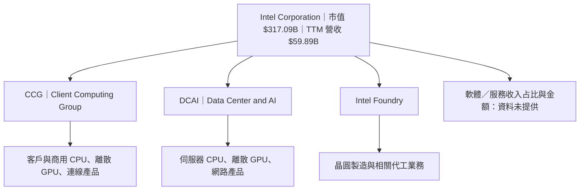
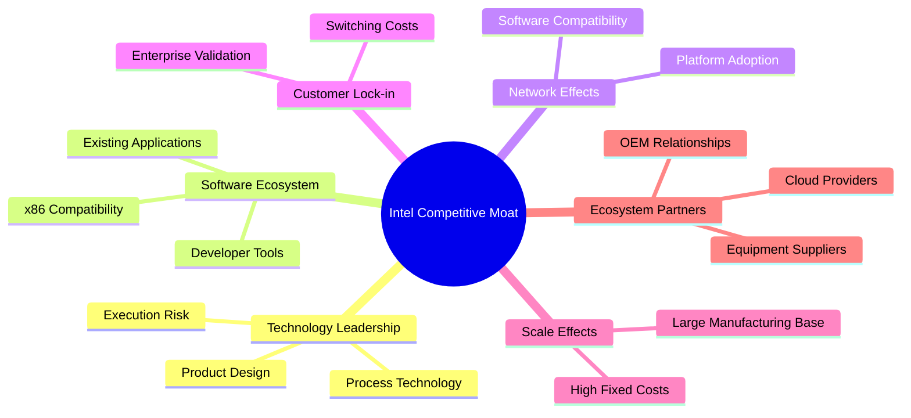
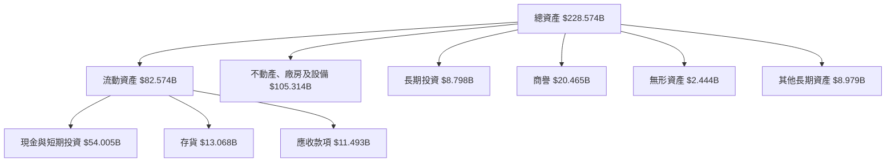
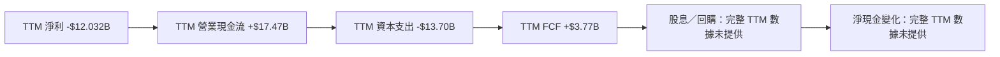
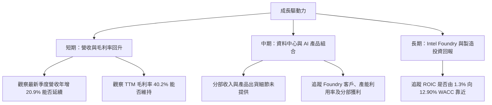
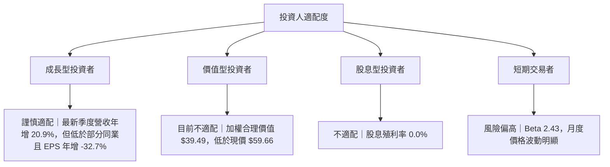

# INTC 基本面深度分析報告
> **報告日期**：2026-11-24 ｜ **語言**：繁體中文 ｜ **數據來源**：SEC 申報資料 (XBRL)、Yahoo Finance、Finviz、StockAnalysis、Roic.ai ｜ **分析師**：CFA 級機構研究

## 目錄

| # | 章節 | 核心結論 |
|---|------|----------|
| 1 | 執行摘要 | 評級為賣出；加權合理價值 $39.49，MOS -51.1% |
| 2 | 公司概覽與商業模式 | 有製造規模與平台生態，但分部營收占比資料未提供 |
| 3 | 損益表深度分析 | TTM 營收 $59.89B、年增 12.1%；獲利與利潤率數據仍不穩定 |
| 4 | 資產負債表分析 | 淨現金 $3.87B、流動比率 2.208；現金轉換週期延長 |
| 5 | 現金流量深度分析 | TTM FCF $3.77B、FCF Yield 1.19%；歷史資本支出高且波動 |
| 6 | 獲利能力與資本效率 | ROIC 1.3% 低於 WACC 12.90%，目前摧毀股東價值 |
| 7 | 相對估值分析 | Forward P/E 高於同業中位數；自身 P/S 位於五年歷史第 90 百分位 |
| 8 | DCF 內在價值評估 | DCF 模型為 N/A；以同業估值與分析師共識完成估值三角驗證 |
| 9 | 成長催化劑 | 季度營收回升，但可量化 TAM、分部增長與催化時間資料不足 |
| 10 | 風險矩陣 | 核心風險為製造投資回收、競爭壓力及獲利品質 |
| 11 | 投資建議 | 維持賣出；監控利潤率、FCF、庫存與 ROIC 是否改善 |

---

## 1. 執行摘要

### 1.0 一頁式投資儀表板（Portfolio Manager 30 秒速讀）

| 項目 | 內容 |
|------|------|
| **投資論點（3 句）** | ① TTM 營收 $59.89B、年增 12.1%，最新一季年增 20.9%，顯示營收動能回升。② TTM ROIC 僅 1.3%，低於 12.90% WACC，現階段資本投資報酬不足以覆蓋資金成本。③ TTM FCF 為 $3.77B、FCF Yield 1.19%，而加權合理價值 $39.49 低於 2026-11-23 收盤價 $59.66。 |
| **綜合評分** | **4.6/10**（引用 1.1 評分卡） |
| **財務健康** | 🟡 淨現金 $3.87B、流動比率 2.208；但現金轉換週期由 35 天增至 68 天。 |
| **ROIC vs WACC** | **1.3% vs 12.90%**；低於資金成本，現階段摧毀股東價值。 |
| **FCF 趨勢** | 2025 年 FCF 為 -$4.95B，最新 TTM 回升至 $3.77B；FCF Yield **1.19%**。 |
| **估值** | Forward P/E **33.321x** ｜ EV/EBITDA **17.239x**（估值資料區）｜ FCF Yield **1.19%** |
| **DCF 內在價值（基準）** | **N/A**（DCF MODEL 不可計算）；因此 DCF 折溢價亦為 N/A。 |
| **安全邊際（MOS）** | **-51.1%**＝($39.49 − $59.66) ÷ $39.49；基準為 8.8 加權合理價值。🔴 |
| **預期報酬（基準情境 12M）** | DCF 情境為 N/A；以加權合理價值對比現價的隱含上行空間為 **-33.8%**，並非 12 個月預測。 |
| **關鍵風險（前二）** | 製造與資本支出未能轉化為持續正向 FCF；產品競爭及產品組合使利潤率回升不如預期。 |
| **評級 + 信心度** | 🔴 **賣出** ｜ 信心：中低；估值結論明確，但 DCF 不可計算且部分彙總資料互有差異。 |

### 1.1 綜合評分卡（全報告唯一）

| 維度 | 評分（1–10） | 主要依據（引用數字與其來源章節） |
|------|--------------|----------------------------------|
| 成長性 | 6.0 | TTM 營收年增 12.1%、最新一季年增 20.9%；但競爭對手最新一季營收增長中位數為 44.7%（1.3、7.1）。 |
| 獲利能力 | 3.0 | TTM ROIC 1.3%、營業利益率 2.9%，且 ROIC 低於 WACC 12.90%；F-Score 6/9（3、6）。 |
| 財務健康 | 6.5 | 淨現金 $3.87B、流動比率 2.208，但 CCC 由 35 天增至 68 天（4.2）。 |
| 估值 | 2.0 | MOS -51.1%；Forward P/E 33.321x，高於同業中位數 13.6x（7.1、8.8）。 |
| 護城河 | 6.0 | 自有製造與 x86 生態系具有進入門檻，但分部市占、客戶留存及定價能力數據未提供（2.3–2.4）。 |
| 管理層與資本配置 | 4.0 | 2022–2025 年年度 FCF 均為負；2025 年資本支出 $14.65B，稀釋股數測試未通過（5.2、6.4）。 |
| **綜合評分** | **4.6** | 六項算術平均：$(6.0+3.0+6.5+2.0+6.0+4.0)÷6=4.583$，四捨五入至一位小數。 |

### 1.2 五大投資論點 + 三大核心風險

| 類型 | 項目 | 具體依據 | 信心度 |
|------|------|----------|--------|
| 🟢 **投資論點①** | 營收趨勢回升 | TTM 營收 $59.89B、年增 12.1%；最新一季營收年增 20.9%，高於前幾季成長表現。若增長延續，固定成本吸收有望改善。 | 🟡 中 |
| 🟢 **投資論點②** | 資產負債表仍有緩衝 | 現金及短期投資 $54.01B、總債務 $50.13B、淨現金 $3.87B；可降低短期融資壓力。 | 🟢 高 |
| 🟢 **投資論點③** | 最近一季營業表現回升 | 最近一季營業利益 $2.58B，營業利益率為 15.3%（依 SEC 10-Q 計算資料）。若能持續，將有助改善 TTM 低利潤率。 | 🟡 中 |
| 🟢 **投資論點④** | 現金流已回正 | TTM 營業現金流 $17.47B、資本支出 $13.70B，FCF $3.77B；相較 2025 年全年 FCF -$4.95B 有改善。 | 🟡 中 |
| 🟢 **投資論點⑤** | 重要平台與製造能力具策略價值 | 公司同時經營產品與 Intel Foundry，並服務個人運算、資料中心及 AI 等市場；但分部營收與產能利用率資料未提供，難以量化回報。 | 🟡 中 |
| 🟡 **風險①** | 高估值與有限現金流收益率 | 加權合理價值 $39.49，較 $59.66 現價低；FCF Yield 僅 1.19%。估值需依賴未來獲利改善。 | 🔴 高衝擊 |
| 🔴 **風險②** | 資本效率仍遠低於資金成本 | ROIC 1.3% 對 WACC 12.90%，差距 11.60 個百分點；若回報率未升，增量投資可能繼續侵蝕價值。 | 🔴 高衝擊 |
| 🟡 **風險③** | 營運資金與庫存效率惡化 | DIO 由 122 天升至 133 天，CCC 由 35 天升至 68 天；庫存占用資金增加。 | 🟡 中高 |

### 1.3 快速統計卡片

| 指標 | 公司實際值（期間） | 同業中位數 | 狀態 |
|------|--------------------|------------|------|
| 營收成長（TTM） | **12.1%** | — | 🟢 |
| 營收成長（最新一季年增） | **20.9%** | **44.7%** | 🟡 |
| 毛利率（TTM） | **40.2%** | **56.0%** | 🔴 |
| 營業利益率（TTM） | **2.9%** | — | 🔴 |
| ROIC（TTM） | **1.3%** | — | 🔴 |
| Forward P/E | **33.321x** | **13.6x** | 🔴 |
| FCF Yield（TTM） | **1.19%** | — | 🟡 |
| Piotroski F-Score | **6 / 9** | — | 🟡 |

### 1.4 投資結論

依 8.8 加權合理價值 $39.49 與 2026-11-23 收盤價 $59.66 計算，MOS 為 -51.1%，故依規則 20 評級為賣出；未作質化調整。ROIC 1.3% 低於 WACC 12.90%，FCF Yield 1.19%，與估值折價訊號方向一致。

```text
╔══════════════════════════════════════════════════════════════════╗
║                    📊 投資結論摘要                               ║
╠══════════════════════════════════════════════════════════════════╣
║  評級：賣出（MOS -51.1%，依規則 20；未調整）                    ║
║  價格（2026-11-23 收盤）：$59.66                                 ║
║  DCF 內在價值（基準）：N/A（DCF 模型不可計算）                   ║
║  安全邊際 MOS：-51.1%                                            ║
║  加權合理價值（8.8）：$39.49                                     ║
║  DCF 情境價值：N/A（DCF MODEL 不可計算，故不列情境目標價）      ║
║  綜合評分：4.6/10（引用 1.1）                                    ║
║  適合投資人：能承受高波動、願意等待獲利與資本效率驗證者；        ║
║              不適合以現金收益或低估值為主要要求的投資人。        ║
╚══════════════════════════════════════════════════════════════════╝
```

---

## 2. 公司概覽與商業模式

### 2.1 業務結構與收入來源

公司資料列出 CCG、DCAI、Intel Foundry 三個主要業務板塊，但最新分部營收、分部利潤、板塊占比及軟體／服務收入未提供，因此不推算各板塊金額或比例。



公司採取「設計產品並投入製造」的模式，製造業務亦可能服務外部客戶。這種模式有助控制產品與製程協同，但同時帶來高固定成本與資本支出；若產能利用率或外部代工收入不足，將壓低資本報酬。分部數據缺漏，無法驗證不同板塊對 TTM 營收年增 12.1% 的貢獻。

### 2.2 市場份額

市場份額數據未提供，故不列市場占比或繪製市場份額圖。Intel TTM 營收 $59.89B、最新一季營收年增 20.9%；同業 AMD 最新一季增長 44.7%，NVIDIA 103.2%，而 Qualcomm 為 -8.4%。這些是公司層級營收增長而非市場份額，但顯示 Intel 的增速尚未達到部分高增長競爭者的水平。

### 2.3 競爭護城河分析



### 2.4 護城河強度

| 護城河項目 | 強度（強／中／弱） | 證據（引用數字或事實） | 會削弱它的情況 |
|------------|--------------------|------------------------|----------------|
| 技術與製程 | 中 | Intel 同時設計並製造產品，TTM 營收 $59.89B；但製程領先程度與良率數據未提供。 | 製程延期、良率不佳，或客戶轉向替代供應商。 |
| 軟體生態系統 | 中 | 公司產品涵蓋客戶端及伺服器 CPU，具 x86 生態系基礎；相容性與實際轉換成本未量化。 | 軟體跨平台化降低轉換成本，或競品相容性改善。 |
| 網路效應 | 弱至中 | 平台規模與軟體相容性可形成間接網路效應，但活躍開發者與用戶數未提供。 | 開發者投入及企業部署向替代架構轉移。 |
| 客戶鎖定 | 中 | 企業系統認證與既有部署可形成切換摩擦；客戶留存率及合約期限未提供。 | 大型客戶多來源採購或重新設計系統。 |
| 規模效應 | 中 | 81,100 名員工、TTM 營收 $59.89B，並擁有大規模製造資產。 | 高固定成本在需求下滑時造成低利用率與現金流壓力。 |
| 生態夥伴 | 中 | 業務涉及 OEM、資料中心、AI 及製造供應鏈；夥伴營收貢獻未提供。 | 夥伴增加替代供應商或自研晶片比重。 |

1.1 的「護城河」評分為 6.0/10，依據是平台相容性與製造規模仍有價值，但市場份額、客戶留存、良率及分部回報資料不足，且實際資本報酬偏低。

---

## 3. 損益表深度分析

### 3.1 年度收入成長趨勢（近 4 年）

年度營收由 2022 年 $63.05B 降至 2025 年 $52.85B，三年複合年增率約 -5.8%。2026 年 TTM 營收已回升至 $59.89B，但其可持續性仍需後續季度驗證。

```text
╔══════════════════════════════════════════════════════════════════╗
║              Intel 年度收入趨勢（FY2022-FY2025）                 ║
╠══════════════════════════════════════════════════════════════════╣
║  FY2022  $63.05B  ██████████████████████████  YoY：—            ║
║  FY2023  $54.23B  ██████████████████████      YoY：-14.0% 🔴    ║
║  FY2024  $53.10B  █████████████████████       YoY：-2.1%  🔴    ║
║  FY2025  $52.85B  █████████████████████       YoY：-0.5%  🔴    ║
║                                                                  ║
║  FY2022–FY2025 CAGR：(52.85 ÷ 63.05)^(1/3) − 1 ≈ -5.8%          ║
╚══════════════════════════════════════════════════════════════════╝
```

2023 年收入下滑 14.0%，2024、2025 年跌幅收窄，表示收入底部趨勢可能改善；但 2025 年收入仍低於 2022 年約 $10.20B，不能僅憑單季反彈判定已恢復長期成長。

### 3.2 季度收入趨勢分析

| 季度 | 營收（$B） | QoQ | YoY | 備註 |
|------|-----------:|----:|----:|------|
| 2025 Q4 | 13.674 | +0.2% | -4.1% | 與 2025 Q3 相比近乎持平，年減幅度仍為負。 |
| 2026 Q1 | 13.577 | -0.7% | +7.2% | 年增轉正，但單季營收較前季略降。 |
| 2026 Q2 | 16.128 | +18.8% | +25.4% | QoQ 明顯提升；產品組合及季節性貢獻未提供，不能全數視為結構性增長。 |
| 2026 Q3 | 16.513 | +2.4% | +20.9% | 最新一季仍有雙位數年增，但季增放緩至 2.4%。 |

YoY 依 StockAnalysis 季度列示值；最新季度 YoY 亦與 SEC 衍生資料中的 20.9% 一致。營收提高有利於固定成本吸收，但若成長主要來自低毛利產品或短期出貨提前，對利潤率及現金流的帶動會較有限。

### 3.3 利潤率演變分析

| 利潤率指標 | FY2022 | FY2023 | FY2024 | FY2025 | 趨勢 | 評估 |
|------------|-------:|-------:|-------:|-------:|------|------|
| **毛利率** | 42.6% | 40.0% | 32.6% | 34.8% | 2024 明顯下滑，2025 部分回升 | 🔴 |
| **營業利益率** | 3.7% | 0.1% | -8.9% | 約 0.0% | 2024 轉負，2025 接近損益兩平 | 🔴 |
| **淨利率** | 12.7% | 3.1% | -35.3% | -0.5% | 受 2024 年大額淨損拖累 | 🔴 |

*計算依據：年度損益表所列營收、毛利、營業利益與淨利；四捨五入至一位小數。*

最新 TTM 毛利率為 40.2%，TTM 營業利益率則有來源差異：SEC 衍生的 VERIFIED FIGURES 為 2.9%，合併財務摘要另列 10.1%。本報告遵從 SEC 衍生核驗值，以 2.9% 作為標準 TTM 數字；最新季度營業利益率亦優先引用核驗值 15.3%。兩項來源差異降低了以 TTM 利潤率作趨勢外推的可信度。

毛利率從 FY2024 的 32.6% 回升至 FY2025 的 34.8%，並於 TTM 達 40.2%，方向上有改善；但分部組合、晶圓成本、良率及產品定價的分解數據未提供，無法將改善歸因於單一因素。更重要的是，年度營業利益仍在 FY2024 大幅為負，反映高研發及製造成本使毛利改善未必直接轉成營業獲利。

### 3.4 費用結構分析

營收與毛利數據可計算銷貨成本，但研發、銷售管理、重整費用等完整費用拆分不齊，因此不繪製不完整的費用圓餅圖。已知 2025 年研發支出為 $13.77B，約占營收 26.1%；2024 年研發支出為 $16.55B，約占營收 31.2%。支出下降有利於成本控制，但仍須觀察是否以犧牲產品競爭力或長期製程投資為代價。

### 3.5 季度 EPS 趨勢與盈餘品質（Quality of Earnings）

| 盈餘品質項目 | 數值／佔比 | 評估 |
|--------------|------------|------|
| 股權薪酬 SBC / 營收 | 約 **4.1%**：季度 SBC 合計約 $2.432B ÷ TTM 營收 $59.89B | 🟡 SBC 是實質股東成本；若股數持續增加，現有股東的每股經濟利益會被稀釋。 |
| SBC / 營業現金流 | 約 **13.9%**：$2.432B ÷ $17.47B | 🟡 比重不低，分析現金流時應同時觀察稀釋而非只看非現金費用加回。 |
| FCF / 淨利（現金轉換率） | 約 **-31.3%**：$3.77B ÷ TTM 淨利 -$12.032B | 🔴 淨利為負使比率難以作傳統轉換率解讀；正 FCF 並不代表 TTM GAAP 獲利已轉正。 |
| 一次性／非經常性損益 | N/A（本資料未提供可分拆的一次性損益明細） | 無法判斷非經常項目對當期淨利的量化影響。 |
| 有效稅率異常 | N/A（未提供可對應 TTM 稅前所得與所得稅費用） | 不將預設 WACC 稅率誤當成實際有效稅率。 |
| 資本化支出 vs 費用化 | TTM Capex $13.70B；資本化政策細節 N/A | 大額資本支出形成資產並於未來折舊；缺乏資產年齡、折舊及減損分解，無法量化是否有成本遞延。 |
| EPS 驚喜 | 最近四季 EPS Est 均為 NaN | 無法判定超預期或不及預期；不可把 EPS 實際值代替市場預期值。 |

季度實際 EPS 列示值為 2025 Q4 -$0.12、2026 Q1 -$0.73、2026 Q2 -$2.16、2026 Q3 約 $0.60–$0.63；來源對最新季度 EPS 有小幅差異。最新一季 EPS 年增率為 -32.7%，即使單季淨利轉正，也不等同於 EPS 已恢復至去年同期水準。由於四季 EPS 預估值缺失，盈餘「超預期／不及預期」無法作有效判讀。

**盈餘品質結論：** TTM FCF 為正，但 TTM 淨利為 -$12.032B，現金流與會計盈餘方向不一致；SBC 約占營收 4.1%，且稀釋股數測試未通過。現階段以 FCF、資本支出回收與股數變化來評估含金量，比單看單季淨利轉正更穩妥。缺少一次性項目與有效稅率明細，不能判定 GAAP 淨利的調整後水準。

---

## 4. 資產負債表分析

### 4.1 資產結構分解

以 2026 年 9 月 TTM 資產資料呈現；下列細項合計為總資產 $228.574B。



資產結構以 PP&E $105.314B 與流動資產 $82.574B 為主，反映 Intel 是資本密集型企業。流動資產中現金及短期投資 $54.005B 提供財務緩衝；但 PP&E 高也意味著需要持續投資，資產報酬率須足以覆蓋資金成本。

### 4.2 流動性與營運資金分析

| 指標 | 最新 TTM | 一年前 TTM | 變化 | 解讀 |
|------|----------:|----------:|------:|------|
| 流動比率 | 2.208 | N/A | N/A | 現有流動資產高於流動負債；一年前同口徑數字未提供。 |
| 速動比率 | 1.751 | N/A | N/A | 剔除存貨後仍有流動性緩衝。 |
| DSO 應收帳款天數 | 25 天 | 22 天 | +3 天 | 收款週期略延長；客戶或帳款組合變動資料未提供。 |
| DIO 存貨天數 | 133 天 | 122 天 | +11 天 | 庫存占用上升，可能反映備貨增加或周轉放慢；需以後續出貨驗證。 |
| DPO 應付帳款天數 | 90 天 | 109 天 | -19 天 | 對供應商付款天數縮短，可能減少營運資金融資來源。 |
| CCC 現金轉換週期 | 68 天 | 35 天 | +33 天 | 週期延長，與 DIO 上升及 DPO 下降一致，資金回收效率轉弱。 |

DSO、DIO、DPO 及 CCC 依程式計算的品質指標原值引用。CCC 增加 33 天不等於現金流必然同比例下降，但與存貨積累和付款週期縮短共同出現時，應視為營運資金監控重點。

### 4.3 債務結構分析

```text
╔══════════════════════════════════════════════════════════════════╗
║                   Intel 債務健康診斷                             ║
╠══════════════════════════════════════════════════════════════════╣
║  總債務：                 $50.13B  ██████████████████            ║
║  現金及短期投資：         $54.01B  ███████████████████           ║
║  淨現金：                  $3.87B  🟢 正值                       ║
║                                                                  ║
║  流動比率：                 2.208  🟢 流動資產有緩衝             ║
║  速動比率：                 1.751  🟢 不依賴庫存仍具流動性       ║
║  Debt/EBITDA：               N/A   未提供可一致核驗的口徑         ║
║  利息保障倍數：              N/A   未提供利息費用明細             ║
║                                                                  ║
║  解讀：淨現金狀態降低短期融資壓力；但仍須透過營運現金流支持      ║
║        高額製造投資，淨現金不代表資本配置效率已改善。            ║
╚══════════════════════════════════════════════════════════════════╝
```

債務與現金均以 2026 年最新可得季度資料引用；核驗資料列示總債務 $50.13B、現金及短期投資 $54.01B、淨現金 $3.87B。不同報表列示的現金總額可能因是否含短期投資而不同，本報告不以現金及短期投資以外的單一現金數字重算淨現金。

### 4.4 股東權益趨勢

| 年度 | 股東權益（$B） | 年增額（$B） | 解讀 |
|------|---------------:|-------------:|------|
| 2022 | 101.42 | — | 歷史基準。 |
| 2023 | 105.59 | +4.17 | 權益增加，但年度淨利降至 $1.69B。 |
| 2024 | 99.27 | -6.32 | 淨損 $18.76B，權益同步下滑。 |
| 2025 | 114.28 | +15.01 | 權益回升，但年度淨利仍為 -$0.267B；權益變化不能單以淨利解釋。 |

```text
╔══════════════════════════════════════════════════════════════════╗
║                股東權益趨勢（年度）                             ║
╠══════════════════════════════════════════════════════════════════╣
║  2022  $101.42B  ██████████████████                             ║
║  2023  $105.59B  ███████████████████                            ║
║  2024   $99.27B  ██████████████████                             ║
║  2025  $114.28B  ████████████████████                           ║
╚══════════════════════════════════════════════════════════════════╝
```

---

## 5. 現金流量深度分析

### 5.1 現金流量瀑布圖

以下以 TTM 現金流項目呈現；TTM 淨利採 StockAnalysis 的 -$12.032B，OCF 與 Capex 採 SEC 衍生核驗值。股息、回購及淨現金變化的 TTM 完整數據未提供，不以缺漏數字補足瀑布。



淨利與營業現金流差異較大，顯示折舊、非現金項目及營運資金均可能影響現金轉換；因完整現金流調節表未列於此，不能將差額歸因於某一項目。TTM FCF 的定義固定為營業現金流減資本支出。

### 5.2 FCF 轉換率趨勢

| 年度／期間 | FCF（$B） | 淨利（$B） | FCF / 淨利 | 解讀 |
|------------|----------:|-----------:|-----------:|------|
| FY2022 | -9.41 | 8.01 | -117.5% | 高額投資使正會計獲利未轉成自由現金流。 |
| FY2023 | -14.28 | 1.69 | -845.0% | 淨利基數較低且 FCF 為大幅負值，比率受分母放大。 |
| FY2024 | -15.66 | -18.76 | 83.5% | 兩者同為負，正比率不代表現金轉換健康。 |
| FY2025 | -4.95 | -0.267 | 1,853.9% | 淨利接近零，比例失真，不宜作經濟含義解讀。 |
| TTM 至 2026-09-26 | 3.77 | -12.032 | -31.3% | 正 FCF 與負淨利並存，現金流改善但獲利尚未穩定。 |

比率由所列年度 FCF 與淨利計算，FY2024、FY2025 的分母為負或接近零，故不應用單一比率評價盈餘品質。更具判斷力的現況是 TTM FCF 轉正至 $3.77B，但仍未抵消 TTM 淨損。

### 5.3 自由現金流趨勢

| 期間 | 營業現金流（$B） | 資本支出（$B） | FCF（$B） |
|------|----------------:|---------------:|----------:|
| FY2022 | 15.43 | 24.84 | -9.41 |
| FY2023 | 11.47 | 25.75 | -14.28 |
| FY2024 | 8.29 | 23.94 | -15.66 |
| FY2025 | 9.70 | 14.65 | -4.95 |
| TTM 至 2026-09-26 | 17.47 | 13.70 | 3.77 |

```text
╔══════════════════════════════════════════════════════════════════╗
║           自由現金流：年度實際與最新 TTM                         ║
╠══════════════════════════════════════════════════════════════════╣
║  FY2022  -$9.41B   ◀██████                                       ║
║  FY2023 -$14.28B   ◀█████████                                    ║
║  FY2024 -$15.66B   ◀██████████                                   ║
║  FY2025  -$4.95B   ◀███                                          ║
║  TTM       $3.77B   ████▶                                        ║
╠══════════════════════════════════════════════════════════════════╣
║  TTM FCF Yield：1.19%；年度 FCF 於 2022–2025 連續為負，          ║
║  最新 TTM 回正，仍需觀察能否在高資本投資下持續。                ║
╚══════════════════════════════════════════════════════════════════╝
```

### 5.4 資本配置評估

完整 TTM 股息、回購及其他投資支出拆分未提供，不繪製資本配置圓餅圖。可確認的資本支出為 FY2022 $24.84B、FY2023 $25.75B、FY2024 $23.94B、FY2025 $14.65B，以及 TTM $13.70B；2025 年股息現金流為 $0.00B，最新股息殖利率亦為 0.0%。支出降低有助 FCF 回升，但必須與產能利用率、產品競爭力及未來折舊負擔一併檢視。

---

## 6. 獲利能力與資本效率

### 6.1 ROE / ROA / ROIC 趨勢

| 指標 | 最新 TTM | 歷史資料 | 評估 |
|------|---------:|----------|------|
| ROE | -10.5% | DuPont TTM 指標；其他來源另列 -9.6% | 🔴 負報酬，來源口徑有差異，本報告採品質指標原值。 |
| ROA | N/A | Piotroski 測試顯示 ROA 未通過正值測試 | 🔴 不能以缺少的精確比率補算。 |
| ROIC | 1.3% | TTM 程式核驗值 | 🔴 明顯低於 WACC 12.90%。 |

行業平均數據未提供，故不列行業均值對比。歷史 ROIC 時序在資料中有 2013–2018 年片段，但缺少可比的 2022–2025 年連續值，無法構建一致的多年趨勢。

### 6.2 ROIC vs WACC 分析（核心價值創造判斷）

WACC 按核驗的資本成本輸入引用，不另建立折現率。Beta 採調整後 1.95，原始 Beta 為 2.43，調整方式為 \(⅔×2.43+⅓\)。

```text
╔══════════════════════════════════════════════════════════════════╗
║                ROIC vs WACC 深度分析                            ║
╠══════════════════════════════════════════════════════════════════╣
║  WACC 估算：                                                     ║
║  ├── 無風險利率（10Y 美債）：       4.92%                        ║
║  ├── 市場風險溢酬（ERP）：          5.00%                        ║
║  ├── 原始 Beta：                    2.43                         ║
║  ├── 調整後 Beta：                  1.95 = ⅔×2.43 + ⅓           ║
║  ├── 股權成本 Ke：                  4.92% + 1.95×5.00%           ║
║  │                                  = 14.67%                     ║
║  ├── 稅前債務成本：                 2.18%                        ║
║  ├── 稅後債務成本：                 2.18%×(1−21.0%)=1.72%        ║
║  ├── 股權／債務權重：               86.3%／13.7%                 ║
║  └── WACC：                         12.90%                       ║
║                                                                  ║
║  ROIC（TTM）：                    1.3%                           ║
║  EVA 利差：                       1.3% − 12.90% = -11.60 pp      ║
║                                                                  ║
║  ROIC  1.3%    ▓▓░░░░░░░░░░░░░░░░░░░░░░░░░░░░░░                ║
║  WACC 12.90%   ▓▓▓▓▓▓▓▓▓▓▓▓▓▓▓▓▓▓▓▓▓▓▓▓▓▓▓▓▓▓                  ║
║                                                                  ║
║  結論：ROIC 顯著低於資金成本，現有資本使用未達經濟價值創造門檻。║
╚══════════════════════════════════════════════════════════════════╝
```

逐步核對：  
1. **Ke（CAPM）** = 4.92% + 1.95 × 5.00% = **14.67%**。  
2. **稅前 Kd** = **2.18%**（利息費用與平均計息負債明細未提供，直接採用核驗值，不反推分子或分母）。  
3. **稅後 Kd** = 2.18% × (1 − 21.0%) = **1.7222%**。  
4. **資本權重** = 股權 86.3%、債務 13.7%，合計 100.0%；股權權重依市值、債務權重依資料來源資本結構計算。  
5. **WACC** = 86.3% × 14.67% + 13.7% × 1.7222% = 12.66021% + 0.23594% = **12.89615% ≈ 12.90%**。

ROIC 1.3% 比 WACC 低 **11.60 個百分點**。依定義，若此差距長期維持，新增投入資本的經濟回報不足，不能因營收回升便直接認定股東價值正在創造。

### 6.3 杜邦三因素分解

| 因素 | 數值（TTM） | 解讀 |
|------|-------------|------|
| 淨利率 | -20.1% | TTM 淨利率為負，是 ROE 為負的主要負面因素。 |
| 資產週轉率 | 0.26 | 每單位資產產生的營收有限，與資本密集型製造模式一致。 |
| 權益乘數 | 1.99 | 槓桿提高權益報酬敏感度，但無法抵銷負淨利率。 |
| **ROE** | **-10.5%** | -20.1% × 0.26 × 1.99 = -10.40%，依核驗數字列示 ROE -10.5%。 |

ROE 為負主要由淨利率拖累，並非單靠負債槓桿造成；權益乘數 1.99 會放大盈餘波動，但不是當前負 ROE 的根本來源。

### 6.4 財務體質：Piotroski F-Score

**Piotroski F-Score：6 / 9**，按品質指標原值引用；以下九項逐項列示，不補算未提供的測試。

| 測試 | 結果 | 解讀 |
|------|------|------|
| ROA > 0 | ❌ 未通過 | 資產報酬測試未達正值。 |
| 營業現金流 > 0 | ✅ 通過 | TTM 營業現金流為 $17.47B。 |
| ROA 高於一年前 | ❌ 未通過 | 資產獲利趨勢測試未通過。 |
| 營業現金流 > 淨利（應計品質） | ✅ 通過 | 現金流高於會計淨利，顯示該項測試通過；但不等於所有現金流品質問題均已排除。 |
| 長期負債 ÷ 總資產低於一年前 | ✅ 通過 | 負債比率趨勢改善。 |
| 流動比率高於一年前 | ✅ 通過 | 短期流動性相對改善。 |
| 稀釋股數未增加 | ❌ 未通過 | 股數增加可能稀釋每股報酬。 |
| 毛利率高於一年前 | ✅ 通過 | 毛利率趨勢測試通過。 |
| 資產週轉率高於一年前 | ✅ 通過 | 資產使用效率測試通過。 |

6/9 表示部分財務趨勢改善，但盈利能力及股數稀釋測試未通過；這與低 ROIC、負 ROE 並不矛盾。

---

## 7. 相對估值分析

### 7.1 同業估值比較表格

本公司倍數使用合併財務資料中的市場估值欄位；Peer multiples 依 Yahoo Finance 資料引用。公司 Trailing P/E 為 N/A，因 TTM EPS 為 -$2.73。

| 估值指標 | **Intel** | **AMD** | **NVIDIA** | **Qualcomm** | Intel 評估 |
|----------|----------:|--------:|-----------:|-------------:|-----------|
| **Trailing P/E** | N/A | 96.9x | 13.5x | 11.8x | 🔴 Intel TTM EPS 為負，P/E 不具意義。 |
| **Forward P/E** | 33.321x | 25.7x | 9.9x | 13.6x | 🔴 Intel 高於三家同業中位數 13.6x。 |
| **P/S Ratio** | 5.294x | 16.5x | 11.0x | 4.1x | 🟡 Intel 低於 AMD、NVIDIA，但高於 Qualcomm；自身歷史位置偏高。 |
| **EV/EBITDA** | 17.239x | 66.2x | 16.1x | 17.4x | 🟡 Intel 接近 NVIDIA、Qualcomm；同業倍數差異大。 |
| **最新一季營收年增** | 20.9% | 44.7% | 103.2% | -8.4% | 🟡 Intel 成長為正，但低於 AMD、NVIDIA。 |
| **毛利率（TTM）** | 40.2% | 56.0% | 74.9% | 53.1% | 🔴 Intel 低於三家同業。 |

Forward P/E 同業中位數為 13.6x；Peer 倍數按規則採用核驗資料，不用回憶值替代。Valuation Methods 所列同業 Forward P/E 估值則使用該模型指定的同業中位數 13.6x 乘 Intel Forward EPS $1.79，兩者用途不同：本表比較市場倍數，8.8 按核驗方法值呈現。

### 7.2 歷史估值區間分析

P/E 歷史區間數據未提供；以下使用可得的 P/S 及 EV/EBITDA 歷史資料。

```text
╔══════════════════════════════════════════════════════════════════╗
║                Intel 五年歷史估值位置                            ║
╠══════════════════════════════════════════════════════════════════╣
║  P/S：當前 5.3x｜五年中位數 2.6x｜區間 1.5x–11.5x               ║
║  當前百分位：90%  🔴                                             ║
║                                                                  ║
║  EV/EBITDA：當前 23.2x｜五年中位數 23.6x                       ║
║  五年區間：6.4x–536.5x｜當前百分位：47%  🟡                     ║
║                                                                  ║
║  解讀：P/S 顯著高於自身中位數；EV/EBITDA 接近歷史中位數，        ║
║  但歷史區間受極端值影響，單一倍數不宜獨立作估值結論。            ║
╚══════════════════════════════════════════════════════════════════╝
```

注意：估值資料區的 EV/EBITDA 為 17.239x，而公司歷史估值序列列示當前 23.2x，口徑或來源不同。本節歷史比較依要求使用歷史估值區間的核驗值 23.2x；同業比較保留估值資料區的 17.239x，不混為同一數字。

### 7.3 情境價值（Bear / Base / Bull）

**N/A（DCF 無法計算：DCF MODEL 指出預測最後一年自由現金流不為正，資本支出高於營業利益與折舊攤銷，因此沒有可引用的 DCF Scenarios。）**依規則不另設悲觀、基準或樂觀目標價。

### 7.4 相對估值隱含價格區間

```text
╔══════════════════════════════════════════════════════════════════╗
║             相對估值法隱含價格與現價位置                         ║
╠══════════════════════════════════════════════════════════════════╣
║  $24.31 ─────────── $43.30 ───── 現價 $59.66 ───────── $90.65   ║
║  Forward P/E        EV/EBITDA    ▲                分析師共識       ║
╚══════════════════════════════════════════════════════════════════╝
```

| 方法 | 每股價值 | 相對現價 | 依據 |
|------|---------:|---------:|------|
| 同業 Forward P/E | $24.31 | -59.3% | 同業中位數 P/E 13.6x × Intel Forward EPS $1.79。 |
| 同業 EV/EBITDA | $43.30 | -27.4% | 同業中位數 EV/EBITDA 16.8x（NVDA、QCOM）× TTM EBITDA，再加淨現金。 |
| 分析師共識目標價 | $90.65 | +51.9% | 43 位分析師平均目標價；作為參考，不替代基本面估值。 |

兩種同業估值結果均低於現價，而共識均值高於現價，顯示分析師對未來改善的假設差異大。Forward P/E 與 EV/EBITDA 法都沒有把製造資本回報風險完全解決，故須搭配 ROIC、FCF 與資本支出追蹤。

---

## 8. DCF 內在價值評估（Discounted Cash Flow）

### 8.0 估值推理鏈（Thinking Logic）

**本節的核心結論是：DCF MODEL 為 N/A，因此不能可靠地以折現現金流推導基準每股價值。**核驗資料指出預測期最後一年自由現金流不為正，原因為資本支出高於營業利益與折舊攤銷。不能自行另建預測模型或把缺失假設填成看似精確的目標價。

Intel 價值可從現有產品營收、製造資產回報，以及製造業務未來現金流三部分理解；但分部營收占比、產能利用率與外部代工收入未提供，無法量化各部分的營收權重。現有 TTM 營收 $59.89B、TTM FCF $3.77B、ROIC 1.3%，而 WACC 12.90%；目前最需要驗證的是製造資產能否提升回報率，而不是僅靠營收增長。

| 決策點 | 本報告採用 | 理由（含數字） | 曾考慮但否決 | 否決理由 |
|--------|-----------|----------------|--------------|----------|
| 現金流定義 | N/A | 模型未形成有效預測現金流，無法建立可折現序列。 | 自行建立 FCFF | 違反指定不得另建 DCF 模型的要求。 |
| 預測期 N | N/A | DCF MODEL 未提供可用預測期。 | 自行指定 5–10 年 | 無核驗模型輸入，會造成假精確。 |
| 終值方法 | N/A | 不可用正的終期 FCF 假設構造終值。 | Gordon Growth／退出倍數 | 沒有核驗的終期現金流與情境。 |
| EBIT 基礎 | N/A | 模型無可用預測數字。 | 自行選 GAAP／非 GAAP | 會引入未經核驗的模型設定。 |

**脆弱環節：**製造投資的現金回報與利潤率能否持續改善；若改善不足，正的 TTM FCF 可能無法延續。由於模型 N/A，價值下修幅度不能在本資料內量化。

### 8.1 模型假設總表（Model Inputs）

**N/A（DCF MODEL 不可計算：預測最後一年自由現金流不為正，資本支出高於營業利益與折舊攤銷。）**依規則不自行設定預測期、營收 CAGR、期末營業利潤率、稅率、Capex／營收、D&A／營收、營運資金、SBC、股數稀釋率、永續成長率或終值方法，也不另行建立假設總表。

### 8.2 折現率推導（WACC）

採用核驗的 WACC **12.90%**，此數字也用於 6.2 節。無風險利率資料列示為 10 年期美債 4.92%，但觀察日期未提供；ERP 為假設值 5.00%；原始 Beta 2.43，依 \(⅔×2.43+⅓\) 調整為 1.95。資料未列規模或國別風險溢酬，故採 0.00% 額外溢酬；計算沿用核驗 WACC 輸入。

```text
╔══════════════════════════════════════════════════════════════════╗
║                    WACC 推導（折現率）                           ║
╠══════════════════════════════════════════════════════════════════╣
║  股權成本 Ke（CAPM）：                                           ║
║  ├── 無風險利率 Rf：                  4.92%                      ║
║  ├── 市場風險溢酬 ERP（假設值）：      5.00%                      ║
║  ├── 原始 Beta：                      2.43                       ║
║  ├── 調整後 Beta：                    1.95                       ║
║  ├── 規模／國別溢酬：                 0.00%（資料未列額外溢酬）  ║
║  └── Ke = 4.92% + 1.95×5.00% = 14.67%                           ║
║                                                                  ║
║  債務成本 Kd：                                                    ║
║  ├── 稅前 Kd（核驗值）：              2.18%                      ║
║  ├── 預設稅率：                       21.0%                      ║
║  └── 稅後 Kd = 2.18%×(1−21.0%) = 1.72%                           ║
║                                                                  ║
║  資本結構（核驗權重）：                                           ║
║  ├── 股權權重：                       86.3%                      ║
║  ├── 債務權重：                       13.7%                      ║
║  └── WACC = 86.3%×14.67% + 13.7%×1.7222% = 12.90%               ║
╚══════════════════════════════════════════════════════════════════╝
```

WACC 的計算值為 \(12.66021\%+0.23594\%=12.89615\%\)，四捨五入為 **12.90%**。稅前 Kd 的利息費用與平均計息負債分項未提供，故不能依範本自行推回；本節遵從核驗資本成本資料。

### 8.3 逐年自由現金流預測（基準情境）

**N/A（DCF MODEL 不可計算：預測最後一年自由現金流不為正，資本支出高於營業利益與折舊攤銷。）**沒有逐年預測數字、折現因子或現值；不得自行建立逐年 FCFF 表或計算預測 FCF CAGR。

### 8.4 終值計算（Terminal Value）

**N/A（DCF MODEL 不可計算：沒有可用的 FY+N 正向 FCFF，因此 Gordon Growth 與退出倍數法均無核驗終值。）**不計算終值、終值現值或終值占企業價值比例。

### 8.5 企業價值 → 每股內在價值（Bridge）

**N/A（沒有 DCF 企業價值及終值，無法進行 DCF 橋接或計算 DCF 每股內在價值。）**因此 DCF 折溢價為 N/A。本報告不在此計算 MOS；MOS 僅按 8.8 加權合理價值計算。

### 8.6 敏感性分析（WACC × 永續成長率）

**N/A（DCF MODEL 無基準內在價值、FCFF 序列與終值，無法建立敏感性矩陣或三情境。）**依規則不自行計算敏感度、情境價值或機率加權價值。

### 8.7 反推 DCF（Reverse DCF：市場在預期什麼）

**N/A（DCF MODEL 不可計算，且沒有可核驗的基準模型假設；無法在固定其他變數下以現價反解單一未知數。）**不將現價反推成未經核驗的營收 CAGR、利潤率或成長年數。

### 8.8 估值三角驗證與安全邊際

DCF 方法因模型不可計算，未列入估值方法；核驗估值方法的固定權重由其他方法承接。本公司類型為 **profitable**，依核驗估值方法表照抄方法、價格與權重，不增刪方法。

| 估值方法 | 隱含每股價值 | 上行空間（÷現價） | 權重 | 說明 |
|----------|--------------:|-------------------:|------:|------|
| 同業 Forward P/E | $24.31 | -59.3% | 45% | 同業中位數 13.6x × Intel Forward EPS $1.79。 |
| 同業 EV/EBITDA | $43.30 | -27.4% | 45% | 同業中位數 16.8x × TTM EBITDA，並加回淨現金。 |
| 分析師共識目標價 | $90.65 | +51.9% | 10% | 43 位分析師平均目標價，為參考項。 |
| **加權合理價值** | **$39.49** | **-33.8%** | **100%** | DCF 基準值因無法計算而不納入。 |

**加權合理價值逐步演算：**

\[
\$24.31×45\%+\$43.30×45\%+\$90.65×10\%
=\$10.9395+\$19.485+\$9.065
=\$39.4895
\]

依核驗值列示為 **$39.49**；權重 \(45\%+45\%+10\%=100\%\)，未作事後調整。

\[
\text{MOS}=(\$39.49-\$59.66)÷\$39.49=-\$20.17÷\$39.49=-51.1\%
\]

\[
\text{上行空間}=(\$39.49-\$59.66)÷\$59.66=-\$20.17÷\$59.66=-33.8\%
\]

\[
\text{折溢價}=\$59.66÷\text{DCF 內在價值}-1=\text{N/A}
\]

DCF 內在價值不可計算，所以不能計算以 DCF 為分母的折溢價。MOS 的基準固定為本節加權合理價值，與 1.0 儀表板相同。

```text
╔══════════════════════════════════════════════════════════════════╗
║                  估值區間與安全邊際                              ║
╠══════════════════════════════════════════════════════════════════╣
║  $24.31 ─────── $39.49 ─────── [$59.66] ─────── $90.65          ║
║  Forward P/E    加權合理值        現價          分析師共識        ║
║                                                                  ║
║  安全邊際 MOS = (加權合理價值 − 現價) ÷ 加權合理價值 = -51.1%   ║
║  MOS 評估：🔴 <10% 無；實際 MOS 為負值                           ║
║  上行空間 = (合理價值 − 現價) ÷ 現價 = -33.8%                   ║
║                                                                  ║
║  10% MOS 對應價格上限：$39.49×(1−10%) = $35.54                  ║
║  買入區間參考：不高於 $35.54；目前評級仍為賣出。                 ║
╚══════════════════════════════════════════════════════════════════╝
```

> 🔎 **程式複算（Python，依本節各項自動重算）**
>
> 加權合理價值 = $24.31 × 45% + $43.30 × 45% + $90.65 × 10% = **$39.49**（權重合計 100%）
>
> 以價格 $59.66 計：MOS = **-51.1%**，上行空間 = **-33.8%**
>
> ✅ 與本節所寫數值一致。

### 8.9 DCF 模型的局限與失效條件

- **終值依賴度：** N/A，無法計算終值占 EV 比例。
- **最脆弱的假設：** DCF MODEL 已無法提供可用預測現金流，因預測最後一年 FCF 不為正；因此不存在可報告的 DCF 內在價值下行情境。
- **不適用情境：** 目前獲利波動大，2024 年 FCF -$15.66B、2025 年 -$4.95B，最新 TTM 才回升至 $3.77B；以長期穩定 FCFF 建模的可靠度不足。相對估值可作交叉參考，但仍須以 ROIC、資本支出與實際 FCF 驗證。
- **與第 10 章的連結：** 若產品競爭令毛利率回落、製造利用率不足或 Capex 再度超過營運現金流，將直接削弱 FCF；這些正是本報告無法建立可用 DCF 的核心限制。

### 8.10 複算檢核表（Audit Trail）

| # | 檢核項目 | 檢查方式 | 結果 |
|---|----------|----------|------|
| 1 | 所有 DCF 敏感度輸入都有四段式推導 | DCF MODEL 為 N/A，未設定敏感度輸入 | N/A |
| 2 | 每個 DCF 假設都有來歷 | 未另設模型假設 | ✅ |
| 3 | WACC 五步算式與權重 | Ke、稅後 Kd、權重與 WACC 算式已列；Kd 分項不另推算 | ✅（採用核驗 WACC） |
| 4 | Kd 分母與債務權重同一計息負債範圍 | 核驗資料提供 Kd 與權重，未提供負債細分供獨立稽核 | ⚠️ 直接沿用核驗值 |
| 5 | WACC 與第 6.2 節同值 | 兩處均為 12.90% | ✅ |
| 6 | 逐年預測欄位數符合 N | N/A，無預測期 | N/A |
| 7 | FY+1 FCFF 與 PV 可複算 | N/A，無逐年現金流 | N/A |
| 8 | 預測期 PV 加總 | N/A，無折現現值 | N/A |
| 9 | WACC > g | N/A，未提供 g | N/A |
| 10 | 終值以 FY+N 現金流折現 | N/A，無終值 | N/A |
| 11 | DCF 橋接可複算 | N/A，無 EV 橋接 | N/A |
| 12 | SBC 組合相容性 | DCF 未建立 EBIT、SBC 扣除或稀釋假設 | N/A |
| 13 | 敏感性基準格等於 8.5 | N/A，無矩陣與 8.5 DCF 值 | N/A |
| 14 | 矩陣有效格符合 WACC > g | N/A，無矩陣 | N/A |
| 15 | 三情境機率加總 | N/A，沒有 DCF 情境 | N/A |
| 16 | 反推 DCF 一次只解一變數 | N/A，無可核驗模型 | N/A |
| 17 | MOS 基準與折溢價基準一致 | MOS 用 8.8 加權值；DCF 折溢價 N/A | ✅ |
| 18 | 報告完整至第 11 章 | 已包含第 1–11 章 | ✅ |
| 19 | 加權合理價值為加權總和 | $24.31×45% + $43.30×45% + $90.65×10% = $39.4895，列示 $39.49 | ✅ |
| 20 | 評級符合 MOS 門檻 | MOS -51.1%，依門檻為賣出，未調整 | ✅ |

---

## 9. 成長催化劑

### 9.1 催化劑時間軸

資料未提供可核驗的產品量產、製程節點、晶圓廠投產或客戶導入的具體日期，因此不以猜測日期繪製甘特圖。可追蹤的近期指標為季度營收、毛利率、營業利益率及 FCF；只有在後續財報提供明確產品或產能時程後，才適合建立日期型催化劑時間軸。

### 9.2 TAM 市場規模分析

**N/A（TAM 數據未提供）。**Intel 的業務覆蓋個人運算、資料中心、AI 及晶圓製造，但可引用的市場規模、年份及滲透率資料未提供。可觀察的公司層級基準是 TTM 營收 $59.89B、TTM 年增 12.1%、最新季度年增 20.9%；此增長尚低於 AMD 與 NVIDIA 的最新一季增長，不能單憑所屬市場增長假設 Intel 份額必然提升。

### 9.3 成長驅動力結構圖



成長催化是否能轉化為股東價值，關鍵不僅是收入增長，還包括增量營收的毛利、製造資產利用率與投入資本回報。若 ROIC 長期低於 WACC，營收成長可能仍無法創造經濟價值。

---

## 10. 風險矩陣

### 10.1 風險評分矩陣

缺乏可引用的事件發生機率與損失幅度數據，故不以估算機率繪製帶數值座標的 quadrantChart。以下以可觀察財務指標排序，而非假裝有精確風險機率。

### 10.2 風險清單詳細分析

| # | 風險項目 | 發生機率 | 財務衝擊 | 風險評估 | 緩解措施／監控方式 |
|---|----------|----------|----------|----------|--------------------|
| 1 | 🔴 **製造投資回收不及預期** | 中高；定量機率 N/A | 可能令 FCF 再度轉負；FY2022–FY2025 年 FCF 均為負，TTM 才回升至 $3.77B | 🔴 高 | 按季追蹤 Capex、OCF、FCF、產能利用率與折舊；若 Capex 再超過 OCF，降低對現金流改善的信心。 |
| 2 | 🔴 **競爭導致市場份額或產品組合承壓** | 中高；市場份額資料未提供 | 最新一季營收增長 20.9%，低於 AMD 44.7% 與 NVIDIA 103.2%；毛利率 40.2%，低於同業數據 | 🔴 高 | 追蹤產品出貨、分部營收、毛利率及客戶採用；未提供市占時，不用總營收增長替代份額指標。 |
| 3 | 🟠 **營運資金占用惡化** | 已觀察到 | CCC 由 35 天增至 68 天；DIO 由 122 天增至 133 天 | 🟠 中高 | 追蹤存貨、應收與應付天數；若 CCC 持續上升，評估是否需要減產或調整備貨。 |
| 4 | 🟡 **獲利與會計口徑波動** | 已觀察到 | TTM ROE -10.5%、淨利率 -20.1%；不同來源對 TTM 營業利益率分別列 2.9% 與 10.1% | 🟡 中高 | 以 SEC 10-Q 及 10-K 為主，逐季核對 GAAP 營業利益、稅項及一次性項目。 |
| 5 | 🟡 **估值下修風險** | 已反映於估值差距；未量化機率 | 加權合理價值 $39.49，低於現價 $59.66；MOS -51.1% | 🔴 高 | 以 8.8 估值方法持續追蹤，只有在獲利、FCF 與 ROIC 有可驗證改善後才重新評估。 |

---

## 11. 投資建議

### 11.1 最終評級與評分

MOS 為 -51.1%，依規則 20 的門檻為 **賣出**，未依質化因素調整。1.1 綜合評分為 **4.6/10**；六項分數為成長性 6.0、獲利能力 3.0、財務健康 6.5、估值 2.0、護城河 6.0、管理層與資本配置 4.0，反映公司有營收回升與淨現金緩衝，但資本回報和估值仍不足。

### 11.2 合理價值與隱含報酬率

| 指標 | 每股價值 | 相對 2026-11-23 收盤價 $59.66 | 說明 |
|------|---------:|------------------------------:|------|
| 同業 Forward P/E | $24.31 | -59.3% | 同業中位數估值方法。 |
| 同業 EV/EBITDA | $43.30 | -27.4% | 同業中位數估值方法。 |
| 分析師共識目標價 | $90.65 | +51.9% | 43 位分析師均值；參考值，不代表本報告合理價值。 |
| **加權合理價值** | **$39.49** | **上行空間 -33.8%** | MOS -51.1%；賣出評級的估值基準。 |
| DCF 悲觀／基準／樂觀情境 | N/A | N/A | DCF MODEL 不可計算，不提供情境目標價。 |

### 11.3 買入時機與觸發因素

以 8.8 加權合理價值計算，達到 MOS 10% 的價格上限為 $39.49 × 90% = **$35.54**。該價格僅是估值條件參考，不代表當前評級已轉為買入。

```text
╔══════════════════════════════════════════════════════════════════╗
║                  ✅ 買入觸發因素 Checklist                      ║
╠══════════════════════════════════════════════════════════════════╣
║  重新評估買入條件（多數符合）：                                  ║
║  ☐ 股價回落至 $35.54 或以下，達到加權合理價值約 10% MOS          ║
║  ☐ TTM FCF 持續為正，並能由 OCF 覆蓋資本支出                    ║
║  ☐ ROIC 持續改善，並顯著縮小與 12.90% WACC 的差距               ║
║  ☐ CCC 從 68 天回落，DIO 不再高於目前 133 天                     ║
║                                                                  ║
║  加碼觸發條件（需財報驗證）：                                    ║
║  ☐ 連續季度營業利益率改善，且不依賴一次性收益                   ║
║  ☐ 分部營收、毛利及製造利用率資料顯示投資回報提升               ║
║                                                                  ║
║  減碼／退出觸發條件：                                            ║
║  ☐ TTM FCF 再度轉負，或資本支出持續高於營業現金流               ║
║  ☐ CCC 持續上升且存貨天數明顯惡化                               ║
║  ☐ ROIC 長期停留在遠低於 WACC 的水準                             ║
╚══════════════════════════════════════════════════════════════════╝
```

### 11.4 投資人適配度分析



短期交易者需注意，股價月收盤曾由 2026 年 6 月的 $139.63 降至 2026 年 11 月的 $59.66；期間價格變動反映波動風險，但月度數據不足以推定未來方向。

### 11.5 每季財報監控清單（Quarterly Watch List）

| 監控指標 | 目前基準 | 觸發加碼／正面訊號 | 觸發減碼／負面訊號 |
|----------|----------|-------------------|-------------------|
| 營收年增率 | 最新一季 20.9%；TTM 12.1% | 年增保持正值，且分部資料顯示主要業務同步成長 | 連續兩季年增低於 0%；分部成長集中於單一短期因素 |
| 毛利率 | TTM 40.2% | 連續季度上升並能轉化為營業利益 | 連續兩季下滑，且產品組合或製造成本未改善 |
| 營業利益率 | TTM 核驗值 2.9%；最新季度 15.3% | TTM 持續改善並接近最新季度水平 | TTM 再度轉負，或最新季度改善無法延續 |
| OCF、Capex、FCF | TTM OCF $17.47B、Capex $13.70B、FCF $3.77B | FCF 持續為正，且資本支出有明確回報指標 | FCF 轉負或 Capex 再高於 OCF |
| 庫存與 CCC | DIO 133 天、CCC 68 天 | DIO 與 CCC 連續回落 | DIO 或 CCC 進一步上升 |
| ROIC 相對 WACC | 1.3% vs 12.90% | ROIC 有連續改善趨勢，差距逐季收窄 | ROIC 停滯或下滑，長期遠低於 WACC |
| 股數與 SBC | SBC 約占 TTM 營收 4.1%；稀釋股數測試未通過 | 稀釋股數穩定或回落，SBC 占營收下降 | 股數持續增加，SBC 占營收擴大 |
| EPS 與財測 | 最新一季 EPS 年增 -32.7%；估計值未提供 | EPS 改善並伴隨現金流與營業利益同步改善 | EPS 改善僅由一次性項目或稅務波動推動 |

### 11.6 反面論證：什麼會證明論點錯誤（What Would Change My Mind）

```text
╔══════════════════════════════════════════════════════════════════╗
║              ⚠️ 論點失效條件（Disconfirming Evidence）           ║
╠══════════════════════════════════════════════════════════════════╣
║  若下列任一狀況持續出現，須重新檢視投資論點：                    ║
║  ☐ TTM 營收增長轉負，或最新季度營收連續兩季年減                  ║
║  ☐ 毛利率由 TTM 40.2% 連續兩季下滑                               ║
║  ☐ TTM FCF 由 +$3.77B 再度轉負，且資本支出未下降                 ║
║  ☐ ROIC 長期低於 WACC 12.90%，且沒有可量化的收斂趨勢             ║
║  ☐ DIO 高於 133 天、CCC 高於 68 天並持續惡化                     ║
║  ☐ 稀釋股數持續增加，SBC 占營收高於目前約 4.1%                   ║
║  ☐ 關鍵製造或產品投資無法帶動營業利益與自由現金流改善            ║
╚══════════════════════════════════════════════════════════════════╝
```

> **免責聲明**：本報告為 AI 自動生成，僅供研究參考，不構成投資建議。投資有風險，入市需謹慎。

---

## 資料與來源

| 項目 | 內容 |
|------|------|
| 價格 | 59.66 USD，2026-11-23 收盤（Yahoo Finance 日線） |
| 財務報表 | SEC 10-Q filed 2026-10-30，最新季度 2026-09-26（FY2026 Q3） |
| 有回應的資料來源 | SEC 申報資料 (XBRL)、Yahoo Finance、Finviz、StockAnalysis、Roic.ai |
| 由程式計算 | TTM 數字、WACC、DCF 模型、估值方法與權重、加權合理價值、MOS、評級門檻、F-Score、杜邦分解、營運資金天數、綜合評分 |
| 撰寫模型 | openai / gpt-6-luna |

> 本區塊由產生報告的程式依實際取得的資料填寫，非模型撰寫。「由程式計算」的數字不是模型的估計；其餘判斷（評分、情境、策略）是模型的分析。
