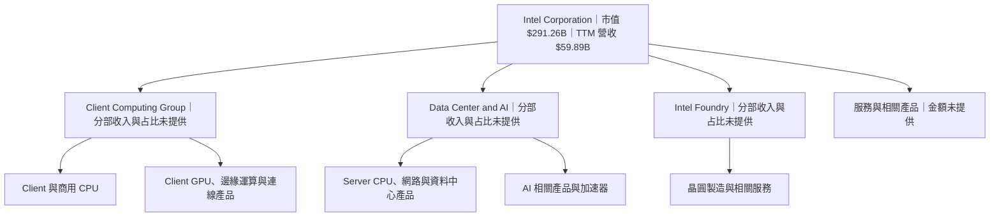
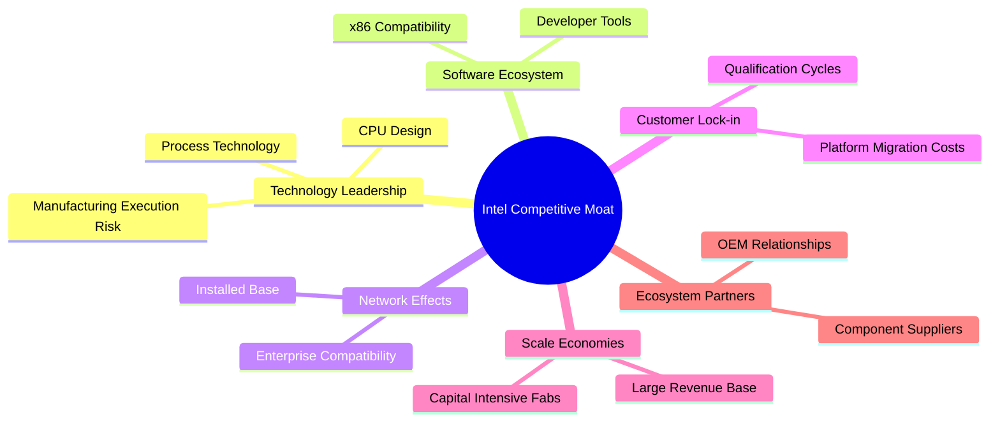
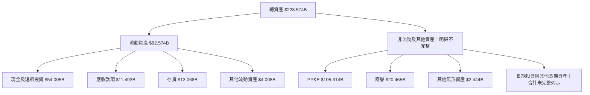
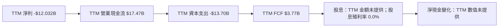
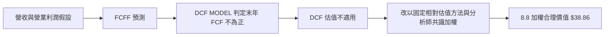
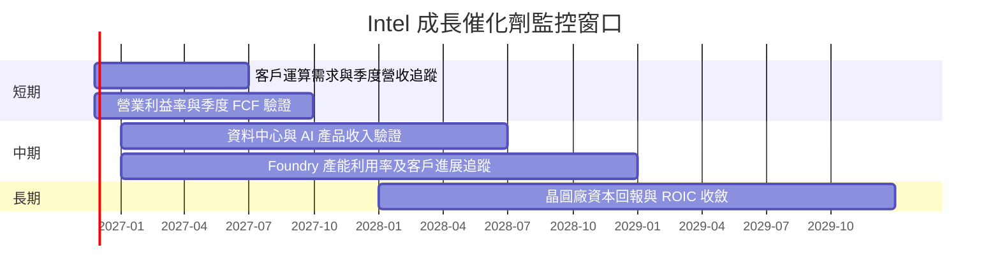
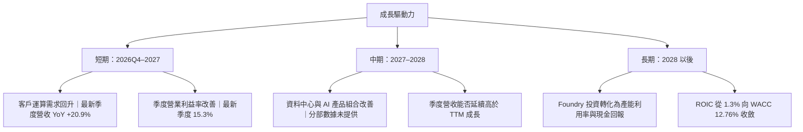
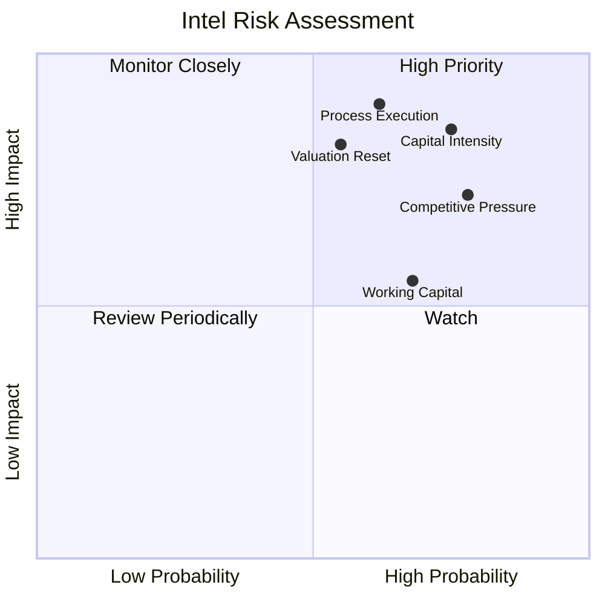
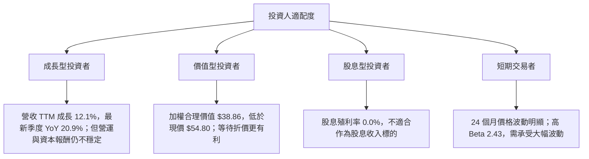

# INTC 基本面深度分析報告
> **報告日期**：2026-11-25 ｜ **語言**：繁體中文 ｜ **數據來源**：SEC 申報資料 (XBRL)、Yahoo Finance、Finviz、StockAnalysis、Roic.ai ｜ **分析師**：CFA 級機構研究

## 目錄

| # | 章節 | 核心結論 |
|---|------|----------|
| 1 | 執行摘要 | 賣出；加權合理價值 $38.86，MOS -41.0% |
| 2 | 公司概覽與商業模式 | x86、製造與客戶生態具韌性，但市場份額數字未提供 |
| 3 | 損益表深度分析 | TTM 營收 $59.89B、年增 12.1%；獲利仍受重整與投資週期影響 |
| 4 | 資產負債表分析 | 淨現金 $3.87B、流動比率 2.208；現金轉換週期惡化 |
| 5 | 現金流量深度分析 | TTM FCF $3.77B，但資本支出高、年度 FCF 歷年為負 |
| 6 | 獲利能力與資本效率 | ROIC 1.3% 遠低於 WACC 12.76%，目前摧毀股東價值 |
| 7 | 相對估值分析 | 同業估值參照下，股價高於兩項相對估值結果 |
| 8 | DCF 內在價值評估 | DCF N/A；末年 FCF 不為正，依規則不建立模型 |
| 9 | 成長催化劑 | 客戶運算復甦與資料中心需求可提供支撐，落地情況待驗證 |
| 10 | 風險矩陣 | 製程執行、資本密集度與競爭壓力為主要風險 |
| 11 | 投資建議 | 現價風險報酬不利；以財務改善與估值回落作為重新評估條件 |

## 1. 執行摘要

Intel 2026-11-24 收盤價為 **$54.80**。TTM 營收 **$59.89B**、年增 **12.1%**，最新一季營收年增 **20.9%**，顯示營收動能轉強；但 TTM ROIC 僅 **1.3%**，低於 **12.76% WACC**，而 TTM FCF 為 **$3.77B**、FCF Yield 僅 **1.29%**。同業 Forward P/E 與 EV/EBITDA 估值法得出每股 **$24.25** 與 **$42.01**，加上分析師共識 **$90.42**、依固定權重計算的加權合理價值為 **$38.86**。因此 MOS 為 **-41.0%**，依規則 20 評級為**賣出**；目前營運改善尚未轉化為與股價相稱的資本報酬。

### 1.0 一頁式投資儀表板

| 項目 | 內容 |
|------|------|
| **投資論點（3 句）** | ① TTM 營收 $59.89B、年增 12.1%，最新一季年增 20.9%，需求復甦已反映在營收。② TTM ROIC 1.3% 對比 WACC 12.76%，資本報酬仍未覆蓋資金成本。③ TTM FCF $3.77B、FCF Yield 1.29%，相對 $54.80 股價，現金流支撐有限。 |
| **綜合評分** | **4.6/10**（引用 1.1 評分卡） |
| **財務健康** | 🟡 淨現金 $3.87B、流動比率 2.208；但 CCC 從 35 天升至 68 天 |
| **ROIC vs WACC** | **1.3% vs 12.76%**；目前摧毀股東價值 |
| **FCF 趨勢** | TTM 為正但年度歷史仍波動；最新 FCF Yield **1.29%** |
| **估值** | Forward P/E **30.6x** ｜ EV/EBITDA **15.9x** ｜ FCF Yield **1.29%** |
| **DCF 內在價值（基準）** | **N/A**；DCF MODEL 未提供可用估值，無法計算折溢價 |
| **安全邊際（MOS）** | **-41.0%**＝($38.86 − $54.80) ÷ $38.86；以 8.8 加權合理價值為基準 🔴 |
| **預期報酬（基準情境 12M）** | DCF 情境 N/A；以加權合理價值衡量的隱含上行空間為 **-29.1%** |
| **關鍵風險（前二）** | 製程與晶圓廠投資執行；高資本支出下 FCF 持續性不足 |
| **評級 + 信心度** | 🔴 **賣出** ｜ 信心：中；DCF 無法計算，估值依相對估值與共識交叉參照 |

### 1.1 綜合評分卡

| 維度 | 評分（1–10） | 主要依據（引用數字與其來源章節） |
|------|--------------|----------------------------------|
| 成長性 | 6.0 | TTM 營收年增 12.1%，最新一季年增 20.9%；但年度營收自 2022 至 2025 下滑（第 3 章） |
| 獲利能力 | 3.0 | TTM 營業利益率 2.9%、ROIC 1.3% 對比 WACC 12.76%；Piotroski 6/9（第 3、6 章） |
| 財務健康 | 6.5 | 淨現金 $3.87B、流動比率 2.208；CCC 由 35 天增至 68 天（第 4 章） |
| 估值 | 2.0 | MOS -41.0%；Forward P/E 30.6x，高於 Peer Forward P/E 中位數 13.5x（第 7、8 章） |
| 護城河 | 6.0 | x86 生態、製造規模與客戶關係仍有價值，但市場份額及分部財務拆分未提供（第 2 章） |
| 管理層與資本配置 | 4.0 | FY2025 Capex $14.65B、SBC $2.43B；稀釋股數測試未通過（第 5、6 章） |
| **綜合評分** | **4.6** | 六項算術平均：$(6.0+3.0+6.5+2.0+6.0+4.0)÷6=4.58$，四捨五入至一位小數 |

### 1.2 五大投資論點 + 三大核心風險

| 類型 | 項目 | 具體依據 | 信心度 |
|------|------|----------|--------|
| 🟢 **投資論點①** | 營收動能回升 | TTM 營收 $59.89B、年增 12.1%；最新一季年增 20.9%，季度營收由 2025Q3 的 $13.653B 增至 2026Q3 的 $16.513B | 🟡 中 |
| 🟢 **投資論點②** | 資產負債表保有緩衝 | 現金及短期投資 $54.01B、總債務 $50.13B、淨現金 $3.87B | 🟢 中高 |
| 🟢 **投資論點③** | 現金流已轉正 | TTM OCF $17.47B 減 Capex $13.70B，FCF 為 $3.77B | 🟡 中 |
| 🟢 **投資論點④** | 最新季度營運槓桿改善 | 最新一季營業利益 $2.58B；相較 2025Q4 的 $0.55B，改善約 $2.03B，但季度波動仍大 | 🟡 中 |
| 🟢 **投資論點⑤** | 客戶及製造生態具有延續性 | 公司同時設計 CPU 並經營 Intel Foundry；分部收入與客戶集中度數字未提供，故只作質化判斷 | 🟡 中低 |
| 🟡 **風險①** | 現價相對估值缺乏安全墊 | 加權合理價值 $38.86，較現價 $54.80 低 $15.94；MOS -41.0% | 🔴 高 |
| 🔴 **風險②** | 資本報酬低於資金成本 | ROIC 1.3% 比 WACC 12.76% 低 11.46 個百分點 | 🔴 高 |
| 🔴 **風險③** | 高資本支出壓縮自由現金流 | FY2025 Capex $14.65B，年度 FCF -$4.95B；2024、2023 年 FCF 分別為 -$15.66B、-$14.28B | 🔴 高 |

### 1.3 快速統計卡片

| 指標 | 公司實際值（期間） | 同業中位數 | 狀態 |
|------|--------------------|------------|------|
| 營收成長（TTM） | **12.1%** | — | 🟢 |
| 營收成長（最新一季年增） | **20.9%** | 44.7% | 🟡 |
| 毛利率（TTM） | **40.2%** | 56.0% | 🔴 |
| 營業利益率（TTM） | **2.9%** | — | 🔴 |
| ROIC（TTM） | **1.3%** | — | 🔴 |
| Forward P/E | **30.6x** | 13.5x | 🔴 |
| FCF Yield（TTM） | **1.29%** | — | 🟡 |
| Piotroski F-Score | **6 / 9** | — | 🟡 |

### 1.4 投資結論

```text
╔══════════════════════════════════════════════════════════════════╗
║                    📊 投資結論摘要                               ║
╠══════════════════════════════════════════════════════════════════╣
║  評級：賣出（依 8.8 MOS -41.0%，符合 MOS < -25% 門檻）           ║
║  價格（2026-11-24 收盤）：$54.80                                 ║
║  DCF 內在價值（基準）：N/A（DCF 模型無法計算）                  ║
║  安全邊際 MOS：-41.0%（＝($38.86−$54.80)÷$38.86）              ║
║  加權合理價值（8.8）：$38.86                                     ║
║  DCF 情境價值：N/A（DCF 模型無法計算）                          ║
║  綜合評分：4.6/10（引用 1.1）                                   ║
║  適合投資人：能承受高波動、願意等待營運與資本報酬修復者；        ║
║              不適合以股息收入或低波動為首要目標的投資人          ║
╚══════════════════════════════════════════════════════════════════╝
```

## 2. 公司概覽與商業模式

### 2.1 業務結構與收入來源

財務資料確認 Intel 業務包含 Client Computing Group（CCG）、Data Center and AI（DCAI）與 Intel Foundry，並涉及設計、製造、銷售及服務。各分部收入與占比未提供，因此不以估算比例繪製收入拆分。



### 2.2 市場份額

市場份額數據未提供，故不繪製份額圖，也不推定 Intel 在 CPU、GPU 或代工市場的占比。可確認的相對位置是：Intel TTM 營收 $59.89B，規模高於許多半導體公司；但最新一季營收成長 20.9%，低於 AMD 的 44.7% 與 NVIDIA 的 103.2%，高於 Qualcomm 的 -8.4%。

### 2.3 競爭護城河分析



### 2.4 護城河強度

| 護城河項目 | 強度（強／中／弱） | 證據（引用數字或事實） | 會削弱它的情況 |
|------------|--------------------|------------------------|----------------|
| 技術與產品組合 | 中 | 覆蓋客戶 CPU、伺服器 CPU、GPU、網路及晶圓製造；TTM 營收 $59.89B | 產品效能、良率或上市時間落後同業 |
| 軟體與相容性 | 中 | x86 軟體相容性與企業部署具延續價值；未提供量化留存或開發者數據 | ARM 等架構兼容性提升、軟體遷移成本下降 |
| 網路效應 | 弱至中 | 裝機基礎有利於生態延續，但缺少市占、開發者與活躍裝置數據 | 生態夥伴轉向替代架構 |
| 客戶鎖定 | 中 | 企業平台導入涉及驗證與相容性，但客戶集中度未提供 | 大型客戶轉向自研晶片或其他供應商 |
| 規模效應 | 中 | TTM 營收 $59.89B，具大規模設計與製造能力；但高資本支出亦形成成本負擔 | 產能利用率不足、製程投資回收延後 |
| 生態夥伴 | 中 | 產品涉及 OEM、企業及供應鏈合作；量化夥伴數據未提供 | 競爭者形成更完整的軟硬體整合 |

1.1「護城河」評分為 **6.0/10**：規模、相容性與客戶關係提供一定防守，但可量化市占、客戶留存及分部經濟數據不足，且製造投資未轉化為高 ROIC。

## 3. 損益表深度分析

### 3.1 年度收入成長趨勢（近 4 年）

年度營收由 FY2022 的 $63.05B 降至 FY2025 的 $52.85B，三年 CAGR 約 **-5.7%**。FY2025 雖比 FY2024 小幅回升，仍未回到 FY2022 規模。

```text
╔══════════════════════════════════════════════════════════════════╗
║              Intel 年度收入趨勢（FY2022-FY2025）                 ║
╠══════════════════════════════════════════════════════════════════╣
║  FY2022  $63.05B  █████████████████████████  YoY: -20.2% 🔴     ║
║  FY2023  $54.23B  ██████████████████████░░░  YoY: -14.0% 🔴     ║
║  FY2024  $53.10B  █████████████████████░░░░  YoY:  -2.1% 🟡     ║
║  FY2025  $52.85B  █████████████████████░░░░  YoY:  -0.5% 🟡     ║
╠══════════════════════════════════════════════════════════════════╣
║  FY2022-FY2025 CAGR：約 -5.7%                                    ║
╚══════════════════════════════════════════════════════════════════╝
```

FY2022 年增率以 FY2021 營收 $79.024B 計算，約 -20.2%。FY2023、FY2024、FY2025 的衰退速度依序放緩；而 TTM 成長轉正，代表近期需求回升，但尚未證明年度收入已恢復長期擴張。

### 3.2 季度收入趨勢分析

| 季度 | 營收 | QoQ 成長 | YoY 成長 | 備註 |
|------|------:|---------:|---------:|------|
| 2025Q4 | $13.674B | +0.2% | -4.1% | QoQ 比較 2025Q3；YoY 比較 2024Q4 |
| 2026Q1 | $13.577B | -0.7% | +7.2% | 相較 2025Q1 $12.667B |
| 2026Q2 | $16.128B | +18.8% | +25.4% | 相較 2025Q2 $12.859B；單季跳升需觀察持續性 |
| 2026Q3 | $16.513B | +2.4% | +20.9% | 最新一季；同比比較基期為 2025Q3 |

2026Q2 的 QoQ 增幅主要反映單季營收基數及產品組合變化，不能直接外推為全年成長率。最新季度仍保持 20.9% YoY 成長，後續應觀察其是否同步帶動利潤率與現金流。

### 3.3 利潤率演變分析

| 利潤率指標 | FY2022 | FY2023 | FY2024 | FY2025 | 趨勢 | 評估 |
|------------|--------|--------|--------|--------|------|------|
| **毛利率** | 42.6% | 40.0% | 32.7% | 34.8% | FY2024 下探後回升 | 🔴 |
| **營業利益率** | 3.7% | 0.1% | -8.9% | 約 0.0% | 大幅收縮後接近損益兩平 | 🔴 |
| **淨利率** | 12.7% | 3.1% | -35.3% | -0.5% | 2024 年大幅虧損，2025 年仍微虧 | 🔴 |

毛利率依年度損益表提供的毛利與營收計算；營業利益率與淨利率亦以年度營業利益、淨利除以營收計算。FY2024 營業利益 -$4.71B、淨利 -$18.76B，顯示收入收縮與成本結構壓力使營運槓桿轉為負向；FY2025 毛利率改善至約 34.8%，但營業利益僅 -$23M，尚未形成穩定的高利潤結構。最新季度營業利益率為程式計算的 **15.3%**，高於 TTM **2.9%**，反映近期改善，但單季表現仍需後續驗證。

### 3.4 費用結構分析

FY2025 R&D 為 **$13.77B**；收入 $52.85B，R&D 約占營收 **26.0%**。由於完整年度銷售、管理與其他營業費用拆分未提供，不以不完整項目繪製費用占比圖。

| 項目 | 金額或比率 | 解讀 |
|------|------------|------|
| FY2025 R&D | $13.77B | 研發投入龐大，約占年度收入 26.0%；有助於維持產品與製程投入，但提高損益平衡門檻 |
| FY2025 營收 | $52.85B | R&D 投入須透過產品上市、毛利率及產能利用率轉化為回報 |
| 完整費用拆分 | 未提供 | 不推算其他費用占比 |

### 3.5 季度 EPS 趨勢與盈餘品質（Quality of Earnings）

| 季度 | EPS | EPS 預期／實際 surprise | 盈餘表現說明 |
|------|----:|-------------------------|--------------|
| 2025Q4 | -$0.12 | N/A | 分析師預期與實際 surprise 資料缺漏 |
| 2026Q1 | -$0.73 | N/A | 分析師預期與實際 surprise 資料缺漏 |
| 2026Q2 | -$2.16 | N/A | 季度淨利 -$11.03B；EPS 大幅受損 |
| 2026Q3 | $0.63（Roic.ai）／季度資料另列 $0.60 | N/A | 季度淨利 $3.32B；不能判定超預期或不及預期 |

EPS 預期與實際數據缺漏，因此不能聲稱四季中任何一季「超預期」或「不及預期」。兩個來源列示的 2026Q3 EPS 略有差異，故不將其合併成單一精確值。

| 盈餘品質項目 | 數值/佔比 | 評估 |
|--------------|-----------|------|
| 股權薪酬 SBC / 營收 | 近四季已列 SBC 合計 $2.432B ÷ TTM 營收 $59.89B = **4.1%** | 🟡 SBC 對股東有稀釋成本；比率不低 |
| SBC / 營業現金流 | $2.432B ÷ $17.47B = **13.9%** | 🟡 佔 OCF 約七分之一，需監控稀釋及現金流品質 |
| FCF / 淨利（現金轉換率） | $3.77B ÷ -$12.032B = **-31.3%** | 🔴 分母為負，該比率不適合解讀為一般現金轉換效率 |
| 一次性／非經常性損益 | 具體金額未提供 | N/A；季度淨利波動大，但無法可靠拆分一次性項目 |
| 有效稅率異常 | TTM 有效稅率 N/A | N/A；無法判斷當期稅務利益是否影響淨利 |
| 資本化支出 vs 費用化 | TTM Capex $13.70B；費用化／資本化明細未提供 | 高 Capex 可能提升未來產能，但無法以現有資料判定成本資本化對盈餘的影響 |

**盈餘品質結論**：TTM 淨利為負，而 TTM OCF 為正、FCF 僅 $3.77B，現金流與會計盈餘呈現明顯背離。SBC 約為營收 4.1%，又有稀釋股數測試未通過，股東應將 SBC 視為實質成本。盈餘與現金流均尚未形成穩定可預測基礎，因此估值不宜只依單季獲利年化。

## 4. 資產負債表分析

### 4.1 資產結構分解

最新 TTM 資產負債表總資產為 **$228.574B**。分類數據依 StockAnalysis 的 2026 年 9 月資料；下列項目不一定涵蓋全部資產，故不強行加總。



### 4.2 流動性與營運資金分析

| 指標 | 最新 TTM | 一年前 TTM | 變化 | 解讀 |
|------|----------|------------|------|------|
| 流動比率 | 2.208 | N/A | N/A | 短期資產對流動負債有覆蓋，但不代表營運資金全部可迅速變現 |
| Quick Ratio | 1.751 | N/A | N/A | 排除存貨後仍高於 1，短期流動性有一定緩衝 |
| DSO 應收帳款天數 | 25 天 | 22 天 | +3 天 | 收款天數上升，可能反映收款週期拉長；需追蹤客戶付款狀況 |
| DIO 存貨天數 | 133 天 | 122 天 | +11 天 | 存貨占用增加，需確認是否與供應備料或需求預測偏差相關 |
| DPO 應付帳款天數 | 90 天 | 109 天 | -19 天 | 付款天數縮短，對現金轉換週期形成負面影響 |
| CCC 現金轉換週期 | 68 天 | 35 天 | +33 天 | 存貨與收款占用增加、應付天數縮短共同推高週期 |

DSO、DIO、DPO 與 CCC 均照財務資料中的品質指標列示，不重新計算。CCC 一年增加 33 天，表示營運資金被占用時間拉長；若收入成長同時伴隨存貨攀升，應注意未來現金流是否落後於損益改善。

### 4.3 債務結構分析

```text
╔══════════════════════════════════════════════════════════════════╗
║                   Intel 債務健康診斷                            ║
╠══════════════════════════════════════════════════════════════════╣
║  總債務：        $50.13B   ████████████████████  🟡              ║
║  現金+短期投資： $54.01B   ██████████████████████ 🟢              ║
║  淨現金：         $3.87B   ██░░░░░░░░░░░░░░░░░░  🟢              ║
║                                                                  ║
║  流動比率：       2.208x   🟢                                    ║
║  Quick Ratio：   1.751x   🟢                                    ║
║  Debt/EBITDA：    N/A（提供資料未列一致、可核對的分母）            ║
║  利息保障倍數：   N/A（利息費用及一致口徑 EBIT 未提供）           ║
╚══════════════════════════════════════════════════════════════════╝
```

淨現金 **$3.87B** 提供財務緩衝，但與 $50.13B 總債務相比，緩衝比例有限。現金和短期投資合計 $54.01B，不能單憑帳面淨現金推定公司可大幅降低資本支出，因晶圓廠營運與投資本身資本密集。

### 4.4 股東權益趨勢

| 年度 | 股東權益 | YoY 變化 |
|------|---------:|---------:|
| FY2022 | $101.42B | N/A |
| FY2023 | $105.59B | +4.1% |
| FY2024 | $99.27B | -6.0% |
| FY2025 | $114.28B | +15.1% |

```text
╔══════════════════════════════════════════════════════════════════╗
║                    股東權益趨勢                                  ║
╠══════════════════════════════════════════════════════════════════╣
║  FY2022  $101.42B  ██████████████████░░                         ║
║  FY2023  $105.59B  ███████████████████░                         ║
║  FY2024   $99.27B  █████████████████░░░                         ║
║  FY2025  $114.28B  ████████████████████                         ║
╚══════════════════════════════════════════════════════════════════╝
```

FY2025 權益回升，但資產負債表改善須與獲利品質、稀釋與投資回報共同判讀；權益增加不等同於每股內在價值同步上升。

## 5. 現金流量深度分析

### 5.1 現金流量瀑布圖



### 5.2 FCF 轉換率趨勢

| 年度 | OCF | Capex | FCF | 淨利 | FCF / 淨利 | 解讀 |
|------|----:|------:|----:|-----:|-----------:|------|
| FY2022 | $15.43B | $24.84B | -$9.41B | $8.01B | -117.5% | Capex 高於營業現金流，現金轉換為負 |
| FY2023 | $11.47B | $25.75B | -$14.28B | $1.69B | -845.0% | 分母較小且 Capex 高，比例失真，FCF 深度為負 |
| FY2024 | $8.29B | $23.94B | -$15.66B | -$18.76B | 83.5% | FCF 與淨利同為負，不能按正向轉換率解讀 |
| FY2025 | $9.70B | $14.65B | -$4.95B | -$0.267B | 1,854.0% | 分母接近零使比例失去判讀價值 |
| TTM | $17.47B | $13.70B | $3.77B | -$12.032B | -31.3% | 淨利為負、FCF 為正，須拆解營運資金及非現金項目 |

以上年度比率依表中數字相除；在淨利為負或接近零時，百分比不代表一般意義的現金轉換效率。可觀察的方向是 FY2022–FY2025 年度 FCF 均為負，最新 TTM 才轉為正值。

### 5.3 自由現金流趨勢

```text
╔══════════════════════════════════════════════════════════════════╗
║                 Intel 自由現金流趨勢                             ║
╠══════════════════════════════════════════════════════════════════╣
║  FY2022  -$9.41B   ← 負值                                         ║
║  FY2023 -$14.28B   ← 負值                                         ║
║  FY2024 -$15.66B   ← 低點                                         ║
║  FY2025  -$4.95B   ← 赤字收窄                                     ║
║  TTM      $3.77B   ██████░░░░░░░░░░░░  FCF Yield: 1.29%          ║
╠══════════════════════════════════════════════════════════════════╣
║  判讀：FCF 已由年度負值轉為 TTM 正值，但可持續性仍待驗證。       ║
╚══════════════════════════════════════════════════════════════════╝
```

### 5.4 資本配置評估

股息殖利率為 **0.0%**；FY2025 現金股息支付為 **$0.00**。FY2025 Capex **$14.65B**、SBC **$2.43B**。由於未提供回購、投資、留存等一致口徑的完整現金配置金額，不繪製資本配置圓餅圖。

| 項目 | 可得數據 | 評估 |
|------|----------|------|
| 資本支出 | FY2025 $14.65B；TTM $13.70B | 投資金額仍大，回報需透過產能利用率與毛利率改善驗證 |
| 股息 | FY2025 $0.00；殖利率 0.0% | 目前不提供股息收入 |
| 股權薪酬 | FY2025 $2.43B；最新四季合計 $2.432B | 造成股東稀釋，須與研發及人才留任效益權衡 |
| 回購與其他投資 | N/A | 未提供可核對的同期間金額 |

## 6. 獲利能力與資本效率

### 6.1 ROE / ROA / ROIC 趨勢

| 指標 | 最新 TTM | 歷史資料 | 評估 |
|------|---------:|----------|------|
| ROE | -10.5% | 另一來源列 -9.6%，本報告採品質指標數值 | 🔴 負報酬；DuPont 淨利率為 -20.1% |
| ROA | N/A（品質指標以 ROA 測試，但未提供精確數值） | 另一財務彙整列 TTM 1.8%，但口徑不一致 | 🟡 不採作主要判斷 |
| ROIC | 1.3% | 其他歷史年度 ROIC 未提供可比序列 | 🔴 明顯低於 WACC 12.76% |

未提供可引用且口徑一致的產業均值，因此不列行業均值比較。ROE、ROA 在不同資料來源間存在差異，分析資本效率時以 VERIFIED 數值 ROIC 1.3% 為主要依據。

### 6.2 ROIC vs WACC 分析（核心價值創造判斷）

```text
╔══════════════════════════════════════════════════════════════════╗
║                ROIC vs WACC 深度分析                            ║
╠══════════════════════════════════════════════════════════════════╣
║  WACC（採用程式計算資本成本資料）：                              ║
║  ├── 無風險利率（10Y 美債）：       4.90%                       ║
║  ├── 市場風險溢酬（假設）：         5.00%                       ║
║  ├── 原始 Beta：                    2.43                        ║
║  ├── 調整後 Beta：                  1.95                        ║
║  ├── 股權成本（提供值）：           14.66%                      ║
║  ├── 稅前債務成本（提供值）：       2.18%                       ║
║  ├── 股權／債務權重：               85.3%／14.7%                 ║
║  └── ✅ WACC：                      12.76%                      ║
║                                                                  ║
║  ROIC（TTM，提供值）：               1.3%                        ║
║  EVA Spread = ROIC - WACC：          1.3% - 12.76% = -11.46pp   ║
║                                                                  ║
║  ROIC  1.3%    ▓░░░░░░░░░░░░░░░░░░░░░░░░                         ║
║  WACC 12.76%   ▓▓▓▓▓▓▓▓▓▓▓▓▓▓▓▓▓▓▓▓▓▓░░                         ║
║  EVA Spread -11.46pp：負值，未覆蓋資本成本                      ║
╚══════════════════════════════════════════════════════════════════╝
```

Beta 採調整後 **1.95**，其調整方式為 **⅔ × 原始 Beta 2.43 + ⅓ × 1 = 1.95**。股權成本依 CAPM 輸入為 14.66%，資本成本資料提供的稅前債務成本為 2.18%、稅率 21%、權重 85.3%／14.7%，最終 WACC 直接採用提供值 **12.76%**。現有資料未提供利息費用及平均計息負債的完整金額，因此不另行重建 Kd。

ROIC 比 WACC 低 **11.46 個百分點**，代表每投入一美元資本，營運回報未達資金成本要求。若製程投資、產能利用率與產品毛利率無法改善，營收成長本身也未必能創造股東價值。

### 6.3 杜邦三因素分解

| 因素 | 數值（TTM） | 解讀 |
|------|-------------|------|
| 淨利率 | -20.1% | 淨利為負，是 ROE 負值的主要來源 |
| 資產週轉率 | 0.26 | 每單位資產產生的收入有限，與重資產晶圓製造結構相關 |
| 權益乘數 | 1.99 | 槓桿程度存在，但不是 ROE 負值的主要來源 |
| **ROE** | **-10.5%** | 照抄品質指標；按已四捨五入因素相乘約為 -10.4%，尾差來自原始精度 |

### 6.4 財務體質：Piotroski F-Score

Piotroski F-Score 為 **6/9**；依資料列示的九項測試，逐項如下：

| 測試 | 結果 | 解讀 |
|------|------|------|
| ROA > 0 | ❌ 未通過 | 獲利能力未達正向測試門檻 |
| 營業現金流 > 0 | ✅ 通過 | TTM 營業現金流為正 |
| ROA 高於一年前 | ❌ 未通過 | 資產報酬未改善 |
| 營業現金流 > 淨利 | ✅ 通過 | 應計品質測試通過；但淨利為負時仍需審視現金流成分 |
| 長期負債 ÷ 總資產低於一年前 | ✅ 通過 | 槓桿相對資產的測試改善 |
| 流動比率高於一年前 | ✅ 通過 | 流動性相對改善 |
| 稀釋股數未增加 | ❌ 未通過 | 稀釋股數增加，對每股價值不利 |
| 毛利率高於一年前 | ✅ 通過 | 毛利率改善 |
| 資產週轉率高於一年前 | ✅ 通過 | 資產使用效率改善 |

整體為中性偏正面：現金流、流動比率、毛利率與資產週轉率測試通過，但 ROA 與稀釋股數兩項未通過，與資本報酬尚待修復的判斷一致。

## 7. 相對估值分析

### 7.1 同業估值比較表格

| 估值指標 | **Intel** | **AMD** | **NVIDIA** | **Qualcomm** | Intel 評估 |
|----------|----------:|--------:|-----------:|-------------:|-----------|
| **Trailing P/E** | N/A | 88.3x | 17.7x | 13.0x | 🔴 Intel TTM EPS 為負，無可比 P/E |
| **Forward P/E** | 30.6x | 23.4x | 9.4x | 13.5x | 🔴 Intel 高於三家同業中位數 13.5x |
| **P/S Ratio（TTM）** | 4.9x | 15.1x | 10.4x | 4.1x | 🟡 高於 Qualcomm，低於 AMD、NVIDIA |
| **EV/EBITDA（TTM）** | 15.9x | 60.2x | 15.2x | 17.4x | 🟡 接近同業區間；公司自身歷史資料列值為 21.3x，口徑有差異 |
| **最新一季營收年增** | 20.9% | 44.7% | 103.2% | -8.4% | 🟡 成長低於 AMD、NVIDIA，高於 Qualcomm |
| **毛利率（TTM）** | 40.2% | 56.0% | 74.9% | 53.1% | 🔴 低於三家同業 |

表中同業數字均取 Yahoo Finance 同業倍數資料。Intel EV/EBITDA 的兩處資料分別為估值彙整 **15.889x** 與自身歷史比較 **21.3x**，計算口徑或資料時點不同；比較同業時列示前者，不以其覆蓋歷史比較資料。

### 7.2 歷史估值區間分析

```text
╔══════════════════════════════════════════════════════════════════╗
║              Intel 自身歷史估值位置（TTM）                       ║
╠══════════════════════════════════════════════════════════════════╣
║  P/S：現值 4.9x │ 5 年中位數 2.6x │ 範圍 1.5x–11.5x            ║
║  當前百分位：90%（接近五年區間上端）                              ║
║  4.9x  ██████████░░░░░░░░░░░░░  上方仍有區間，但估值偏高          ║
║                                                                  ║
║  EV/EBITDA：現值 21.3x │ 5 年中位數 23.6x                       ║
║  範圍 6.4x–536.5x │ 當前百分位：41%                              ║
║  21.3x █████████░░░░░░░░░░░░░░  低於中位數                       ║
╚══════════════════════════════════════════════════════════════════╝
```

自身歷史顯示 P/S 位於五年分布第 90 百分位，偏貴；EV/EBITDA 位於第 41 百分位且低於中位數，但歷史區間上限極端，可能受低基期或 EBITDA 波動影響，解讀上宜採保守態度。

### 7.3 情境價值（Bear / Base / Bull）

**N/A（DCF 無法計算：預測末年自由現金流不為正，且資料顯示資本支出高於營業利益與折舊攤銷，無可用 DCF MODEL 情境值。）**

### 7.4 相對估值隱含價格區間

```text
╔══════════════════════════════════════════════════════════════════╗
║                  相對估值隱含每股價值                            ║
╠══════════════════════════════════════════════════════════════════╣
║  $24.25 ───────── $42.01 ───────── $54.80                        ║
║  Forward P/E       EV/EBITDA        現價                          ║
║                                                                  ║
║  分析師共識：$90.42（參考值，非相對估值法）                      ║
╚══════════════════════════════════════════════════════════════════╝
```

| 方法 | 每股價值 | 依據 |
|------|---------:|------|
| 同業 Forward P/E | $24.25 | AMD、NVIDIA、Qualcomm Forward P/E 中位數 13.5x × Intel Forward EPS $1.79 |
| 同業 EV/EBITDA | $42.01 | NVIDIA、Qualcomm EV/EBITDA 中位數 16.3x × Intel TTM EBITDA，再加淨現金 |
| 分析師共識目標價 | $90.42 | 43 位分析師平均目標價；平均值高於市場價格，不等於可驗證的基本面內在價值 |

兩項同業相對估值均低於 $54.80 現價；分析師共識則高出較多，代表市場預期分歧顯著。

## 8. DCF 內在價值評估（Discounted Cash Flow）

### 8.0 估值推理鏈（Thinking Logic）

**Step 1 — 價值由哪些變數決定？**  
Intel 的價值主要取決於現有 CCG、DCAI 與 Intel Foundry 業務能否改善營業利潤率與資本回報。分部收入占比未提供，不能把任一分部假定為特定營收權重。依現有數據，關鍵變數是能否把營收回升轉化為正向、可持續且足以覆蓋 WACC 的自由現金流。

**Step 2 — 模型與可用性判斷**

| 決策點 | 本報告採用 | 理由（含數字） | 曾考慮但否決 | 否決理由 |
|--------|-----------|----------------|--------------|----------|
| 現金流定義 | FCFF 為理論框架 | 需使用 WACC 折現企業現金流 | FCFE | 本資料沒有可用的 DCF MODEL |
| 預測期 N | N/A | 程式模型已判定末年 FCF 不為正 | 自行設 5–10 年 | 違反不得另建 DCF 的要求 |
| 終值方法 | N/A | 沒有可用末年現金流與模型假設 | Gordon Growth、退出倍數 | 以非正末年 FCF 建終值會產生不可靠估值 |
| EBIT 基礎 | N/A | DCF 模型不可用 | 自行採 GAAP EBIT | 缺少經程式驗證的逐年假設及橋接數字 |

**Step 3 — 假設推導鏈**  
本節不構建 DCF，故營收 CAGR、期末營業利潤率、永續成長率、預測期、Capex、D&A、營運資金、SBC、稀釋率與終值假設均為 **N/A**。以歷史資料自行填入這些輸入，會構成另建模型，故不提供虛假的可複算預測。

**Step 4 — 最脆弱環節**  
估值最脆弱處是高資本支出下能否持續轉為正 FCF；程式判定預測末年 FCF 不為正，故 DCF 不具可用性，估值改以 8.8 固定相對估值方法加權參照。

**Step 5 — 計算路徑**



### 8.1 模型假設總表（Model Inputs）

DCF MODEL 為 N/A，原因是預測末年自由現金流不為正。依要求不自行建立模型，故以下輸入不適用。

| 假設項目 | 採用值 | 依據 / 來源 | 敏感度 |
|----------|--------|-------------|--------|
| 預測期長度 N | N/A | DCF MODEL 無可用預測期 | N/A |
| 營收 CAGR | N/A | 未提供可用 DCF 假設 | N/A |
| 期末營業利潤率 | N/A | 未提供可用 DCF 假設 | N/A |
| 有效稅率 | N/A | DCF 假設未提供 | N/A |
| Capex / 營收 | N/A | DCF 假設未提供 | N/A |
| D&A / 營收 | N/A | DCF 假設未提供 | N/A |
| ΔWC / 營收增額 | N/A | DCF 假設未提供 | N/A |
| EBIT 基礎 | N/A | 不建立 DCF | N/A |
| SBC 處理 | N/A | 不建立 DCF | N/A |
| 年稀釋率 | N/A | 不建立 DCF | N/A |
| 永續成長率 g | N/A | 不建立 DCF | N/A |
| 終值方法 | N/A | 不建立 DCF | N/A |
| WACC | 12.76%（資本成本資料提供值） | 第 6.2 節同值；不將其轉化成自建 DCF | N/A |

FCFF 的一般定義為 FCFF = NOPAT + D&A − Capex − ΔWC；但本報告不對此公式填入預測數字。SBC 組合 A/B/C 不適用，因 DCF 模型未建構。

### 8.2 折現率（WACC）資料

本報告在 ROIC 比較及資本成本討論中採用程式計算的 **WACC 12.76%**，不另算一個 WACC。成本資本資料提供：Rf 4.90%、ERP 5.00%、原始 Beta 2.43、調整後 Beta 1.95、股權成本 14.66%、稅前債務成本 2.18%、稅率 21.0%、股權／債務權重 85.3%／14.7%。因利息費用與平均計息負債金額未提供，不虛構金額重算五步式 WACC。

### 8.3 逐年自由現金流預測（基準情境）

**N/A（DCF MODEL 不可用：預測末年 FCF 不為正，且資本支出高於營業利益與折舊攤銷。）**因此不列逐年預測、折現因子、現值合計或逐步演算，也不繪製模型預測 FCF 圖。可核對的歷史錨點為 FY2024 FCF -$15.66B、FY2025 -$4.95B、TTM $3.77B；歷史由負轉正，但尚不足以推導未來 CAGR。

### 8.4 終值計算（Terminal Value）

**N/A（無可用 DCF 預測期、FY+N FCFF、永續成長率或終值假設。）**故不套用 Gordon Growth 或退出倍數，也不產生終值現值及終值占 EV 比重。

### 8.5 企業價值 → 每股內在價值（Bridge）

**N/A（DCF MODEL 未提供基準企業價值、股權價值或每股價值。）**因此 DCF 折溢價亦為 N/A。本報告不以 8.8 加權合理價值冒充 DCF 內在價值；安全邊際只在 8.8 計算一次。

### 8.6 敏感性分析與三情境 DCF

**N/A（沒有 DCF MODEL 的 WACC × g 敏感性矩陣或 Scenarios。）**不自行編製矩陣、情境價格、機率加權價值或反事實試算。

### 8.7 反推 DCF（Reverse DCF）

**N/A（無可用 DCF 模型，無法以單一方程式回推營收 CAGR、期末營業利潤率、永續成長率或預測期。）**因此不宣稱市場隱含任何特定營運假設。

### 8.8 估值三角驗證與安全邊際

| 估值方法 | 隱含每股價值 | 上行空間（÷現價） | 權重 | 說明 |
|----------|--------------:|------------------:|------|------|
| 同業 Forward P/E | $24.25 | -55.7% | 45% | 同業中位數 13.5x × Intel Forward EPS $1.79 |
| 同業 EV/EBITDA | $42.01 | -23.3% | 45% | 同業中位數 16.3x × TTM EBITDA，加回淨現金 |
| 分析師共識目標價 | $90.42 | +65.0% | 10% | 43 位分析師平均目標價 |
| **加權合理價值** | **$38.86** | **-29.1%** | **100%** | 公司類型為 profitable；DCF 因模型不可用而剔除，其權重依固定規則分配給可計算方法 |

**加權計算：**

$$24.25 \times 45\% + 42.01 \times 45\% + 90.42 \times 10\% = 10.9125 + 18.9045 + 9.042 = 38.859 \approx 38.86$$

其中總和按報告顯示精度四捨五入為 $38.86；DCF（基準）因無法計算而未納入。

- **安全邊際 MOS** = ($38.86 − $54.80) ÷ $38.86 = -$15.94 ÷ $38.86 = **-41.0%**
- **隱含上行空間** = ($38.86 − $54.80) ÷ $54.80 = -$15.94 ÷ $54.80 = **-29.1%**
- **折溢價**：DCF 基準值為 N/A，因此不計算相對 DCF 的折溢價。
- **MOS 評估**：🔴 MOS 低於 -25%，依規則 20 為賣出。

```text
╔══════════════════════════════════════════════════════════════════╗
║                  估值區間與安全邊際                              ║
╠══════════════════════════════════════════════════════════════════╣
║  $24.25 ─────── $38.86 ─────────── $54.80 ─────── $90.42        ║
║  Forward P/E     加權合理價值       現價            分析師共識     ║
║                                                                  ║
║  安全邊際 MOS = ($38.86 - $54.80) ÷ $38.86 = -41.0%            ║
║  上行空間 = ($38.86 - $54.80) ÷ $54.80 = -29.1%                ║
║  建議觀察買入區間：$29.15–$34.97（依加權價值折價 25%–10%）      ║
╚══════════════════════════════════════════════════════════════════╝
```

> 🔎 **程式複算（Python，依本節各項自動重算）**
>
> 加權合理價值 = $24.25 × 45% + $42.01 × 45% + $90.42 × 10% = **$38.86**（權重合計 100%）
>
> 以價格 $54.80 計：MOS = **-41.0%**，上行空間 = **-29.1%**
>
> ✅ 與本節所寫數值一致。

### 8.9 DCF 模型的局限與失效條件

- DCF MODEL 因預測末年 FCF 不為正而不可用；不存在可引用的終值占 EV 比重或 DCF 內在價值。
- 最脆弱的估值假設是市場預期能否把近期季度營收成長轉化為可持續 FCF；若 TTM FCF $3.77B 再度轉負，現有相對估值參照亦可能偏高。
- 對高再投資、獲利波動且年度 FCF 曾連續為負的公司，單一 DCF 結果可靠度不足；現階段應以同業倍數、分部經濟數據與實際 FCF 走勢交叉檢驗。
- 第 10 章的製程與資本支出風險會直接影響未來毛利率、Capex 與 FCFF；競爭壓力會影響營收增速與退出倍數。

### 8.10 複算檢核表（Audit Trail）

| # | 檢核項目 | 檢查方式 | 結果 |
|---|----------|----------|------|
| 1 | DCF 高／中敏感度輸入推導完整 | DCF MODEL 為 N/A，未建立輸入 | ✅ 不適用 |
| 2 | 每項假設有來歷 | 未建立 DCF 假設 | ✅ 不適用 |
| 3 | WACC 算式與權重 | 引用資本成本資料提供值，不另算 | ✅ 採用 12.76% |
| 4 | Kd 與債務權重口徑一致 | 未自行重建 Kd 或 WACC | ✅ 不適用 |
| 5 | WACC 與第 6.2 節同值 | 比對皆為 12.76% | ✅ |
| 6 | 逐年表格年度數與 N 一致 | DCF N/A，無逐年表格 | ✅ 不適用 |
| 7 | FY+1 FCFF、PV 算式可複算 | 無 DCF 預測 | ✅ 不適用 |
| 8 | 預測期 PV 加總 | 無 DCF 預測 | ✅ 不適用 |
| 9 | WACC > g | g 未提供 | ✅ 不適用 |
| 10 | 終值基於 FY+N 並折現 N 期 | 無 DCF 終值 | ✅ 不適用 |
| 11 | EV 到每股價值橋接 | 無 DCF 橋接 | ✅ 不適用 |
| 12 | SBC 三要素組合相容 | 無 DCF，未採任何 SBC 模型組合 | ✅ 不適用 |
| 13 | 敏感性基準格與 DCF 每股價值一致 | 無矩陣或 DCF 基準值 | ✅ 不適用 |
| 14 | 矩陣格符合 WACC > g | 無敏感性矩陣 | ✅ 不適用 |
| 15 | 情境機率加總 | 無 DCF 情境 | ✅ 不適用 |
| 16 | Reverse DCF 每列只放開一個變數 | 無可用模型 | ✅ 不適用 |
| 17 | MOS 與折溢價口徑 | MOS 以 8.8 加權合理價值為分母；DCF 折溢價 N/A | ✅ |
| 18 | 報告輸出至第 11 章 | 全部章節列示 | ✅ |
| 19 | 8.8 加權價值可複算 | $24.25×45%+$42.01×45%+$90.42×10%=$38.859≈$38.86 | ✅ |
| 20 | 評級與 MOS 門檻一致 | MOS -41.0%，低於 -25%，評級賣出 | ✅ |

## 9. 成長催化劑

### 9.1 催化劑時間軸

下列時間為研究監控窗口，不代表公司已公布特定產品上市日期。



### 9.2 TAM 市場規模分析

**N/A（TAM 數據未提供）**。Intel TTM 營收為 $59.89B，TTM 年增 12.1%、最新一季年增 20.9%，顯示短期營收有改善，但缺乏可引用的市場規模與滲透率資料，不能量化長期市場空間。

### 9.3 成長驅動力結構圖



短期催化劑已有營收與季度營業利益改善的數據支持；中長期催化劑則仍需等分部收入、產能利用率、資本回報等具體數據驗證。

## 10. 風險矩陣

### 10.1 風險評分矩陣

以下機率與衝擊位置為研究分析師的定性評估，不是財務資料庫提供的統計機率。



### 10.2 風險清單詳細分析

| # | 風險項目 | 發生機率 | 財務衝擊 | 風險評分 | 緩解措施 |
|---|----------|----------|----------|----------|----------|
| 1 | 🔴 **資本密集與回報不足** | 中高（分析師估計 60%） | 高；若 Capex 高於現金流，FCF 可能重新轉負 | 🔴 8.5/10 | 追蹤 Capex、FCF 與 ROIC；以季度為單位檢驗投資回報 |
| 2 | 🔴 **製程與晶圓廠執行風險** | 中高（分析師估計 55%） | 高；良率或時程延後會壓低產能利用率及利潤率 | 🔴 8.0/10 | 要求披露客戶導入、產能利用與投資回收進展 |
| 3 | 🔴 **產品競爭與定價壓力** | 高（分析師估計 65%） | 高；同業最新季度營收成長高於 Intel，可能造成份額或毛利受壓 | 🔴 8.0/10 | 監控 CCG、DCAI 分部成長與毛利率；分部數據公布後更新分析 |
| 4 | 🟡 **營運資金占用惡化** | 中高（分析師估計 60%） | 中；CCC 一年增加 33 天至 68 天 | 🟡 6.5/10 | 追蹤存貨、應收帳款與 DPO，留意庫存是否持續快於營收增長 |
| 5 | 🔴 **估值回落風險** | 中（分析師估計 50%） | 高；MOS -41.0%，加權合理價值低於現價 | 🔴 7.5/10 | 不以分析師共識單獨支撐投資；等待估值折價或基本面進一步改善 |

## 11. 投資建議

### 11.1 最終評級與評分

依 8.8 加權合理價值 **$38.86** 與 2026-11-24 收盤價 **$54.80** 計算，MOS 為 **-41.0%**，符合規則 20 的**賣出**門檻，未作一級質化調整。公司品質綜合評分為 **4.6/10**，由成長性 6.0、獲利能力 3.0、財務健康 6.5、估值 2.0、護城河 6.0、管理層與資本配置 4.0 的算術平均得出。

### 11.2 合理價值與隱含報酬率

| 方法 | 每股價值 | 相對現價 | 權重／機率 |
|------|---------:|---------:|------------:|
| 同業 Forward P/E | $24.25 | -55.7% | 45% |
| 同業 EV/EBITDA | $42.01 | -23.3% | 45% |
| 分析師共識目標價 | $90.42 | +65.0% | 10% |
| **加權合理價值** | **$38.86** | **-29.1%** | **100%** |
| DCF 悲觀／基準／樂觀情境 | N/A | N/A | DCF MODEL 不可用 |

### 11.3 買入時機與觸發因素

```text
╔══════════════════════════════════════════════════════════════════╗
║                  ✅ 買入觸發因素 Checklist                      ║
╠══════════════════════════════════════════════════════════════════╣
║  重新評估買入的條件（多數符合）：                                ║
║  ☐ 股價回到 $34.97 以下，相當於加權合理價值約 10% 折價           ║
║  ☐ TTM FCF 維持正值，並非僅靠單季營運資金變動支撐               ║
║  ☐ ROIC 明顯高於現有 1.3%，且持續向 WACC 12.76% 收斂            ║
║  ☐ CCC 從 68 天回落，存貨天數不再持續攀升                       ║
║                                                                  ║
║  加碼觸發條件（出現以下任一並經財報確認）：                      ║
║  ☐ TTM 營業利益率高於目前 2.9%，且季度改善延續                  ║
║  ☐ TTM FCF 連續為正，並能覆蓋必要資本支出                       ║
║  ☐ 分部資料證明 CCG、DCAI 或 Foundry 的營收與毛利具持續改善      ║
║                                                                  ║
║  減碼／停損觸發條件（出現以下任一）：                            ║
║  ☐ TTM FCF 再度轉負且沒有明確的短期投資回收依據                 ║
║  ☐ CCC 持續高於 68 天，並伴隨存貨快於營收增長                   ║
║  ☐ ROIC 停滯在低於 WACC 的區間，且投資支出未帶來利潤率改善       ║
╚══════════════════════════════════════════════════════════════════╝
```

以加權合理價值 $38.86 為基準，MOS 10% 的價格約為 **$34.97**（$38.86 × 90%），MOS 25% 的價格約為 **$29.15**（$38.86 × 75%）。這些是依估值折價推導的觀察價位，不是 DCF 目標價。

### 11.4 投資人適配度分析



### 11.5 每季財報監控清單（Quarterly Watch List）

| 監控指標 | 最新基準 | 觸發加碼／改善門檻 | 觸發減碼／惡化門檻 |
|----------|---------:|-------------------|-------------------|
| 營收成長 | TTM +12.1%；最新季度 YoY +20.9% | YoY 成長延續，且分部收入廣泛改善 | 連續兩季 YoY 成長低於 0% |
| 營業利益率 | TTM 2.9%；最新季度 15.3% | TTM 持續高於目前 2.9%，季度表現可延續 | TTM 回落至 0% 以下 |
| 毛利率 | TTM 40.2% | 連續改善且增幅非單季因素 | 連續兩季下降 |
| Capex | TTM $13.70B；FY2025 $14.65B | Capex 對應可觀察到的產能與現金回報 | Capex 高企且 FCF 轉負 |
| FCF | TTM $3.77B；Yield 1.29% | 持續為正並改善 | TTM FCF 轉負 |
| DIO／CCC | DIO 133 天；CCC 68 天 | CCC 回落至 68 天以下且存貨下降 | CCC 高於 68 天並持續擴大 |
| 淨現金 | $3.87B | 維持正淨現金 | 淨現金轉為淨負債且 FCF 為負 |
| ROIC vs WACC | 1.3% vs 12.76% | ROIC 持續改善並縮小差距 | ROIC 長期停留低位或進一步下滑 |
| SBC 與稀釋 | 最新四季 SBC $2.432B；F-Score 稀釋股數測試未通過 | SBC 占營收比例下降、稀釋放緩 | SBC 占營收上升且稀釋持續 |
| 財測與分部披露 | 分部數字未提供於本次資料 | 新財報披露分部營收、利潤與產能利用率改善 | 財測下修，或分部成長不具廣度 |

### 11.6 反面論證：什麼會證明論點錯誤（What Would Change My Mind）

```text
╔══════════════════════════════════════════════════════════════════╗
║              ⚠️ 論點失效條件（Disconfirming Evidence）           ║
╠══════════════════════════════════════════════════════════════════╣
║  若下列情況發生，應重新檢視賣出判斷或更新估值：                 ║
║  ☐ TTM 營收成長連續兩季低於 0%，顯示近期復甦無法延續             ║
║  ☐ TTM 營業利益率由 2.9% 回落至 0% 以下                         ║
║  ☐ TTM FCF 由 $3.77B 轉為負值，且資本支出未下降                 ║
║  ☐ ROIC 長期低於 WACC 12.76%，且沒有可驗證的收斂趨勢            ║
║  ☐ CCC 高於 68 天並繼續拉長，存貨天數高於目前 133 天             ║
║  ☐ 股權稀釋持續增加，SBC／營收高於目前約 4.1%                   ║
║  ☐ 分部資料證明 Foundry 或資料中心投資未能轉化為營收與現金回報   ║
╚══════════════════════════════════════════════════════════════════╝
```

> **免責聲明**：本報告為 AI 自動生成，僅供研究參考，不構成投資建議。投資有風險，入市需謹慎。

---

## 資料與來源

| 項目 | 內容 |
|------|------|
| 價格 | 54.80 USD，2026-11-24 收盤（Yahoo Finance 日線） |
| 財務報表 | SEC 10-Q filed 2026-10-30，最新季度 2026-09-26（FY2026 Q3） |
| 有回應的資料來源 | SEC 申報資料 (XBRL)、Yahoo Finance、Finviz、StockAnalysis、Roic.ai |
| 由程式計算 | TTM 數字、WACC、DCF 模型、估值方法與權重、加權合理價值、MOS、評級門檻、F-Score、杜邦分解、營運資金天數、綜合評分 |
| 撰寫模型 | openai / gpt-6-luna |

> 本區塊由產生報告的程式依實際取得的資料填寫，非模型撰寫。「由程式計算」的數字不是模型的估計；其餘判斷（評分、情境、策略）是模型的分析。
