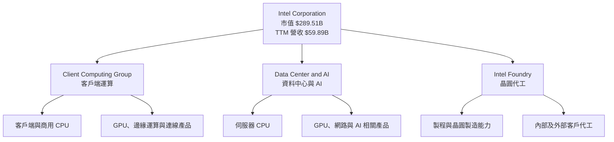
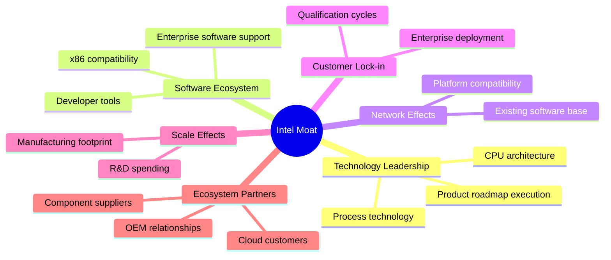
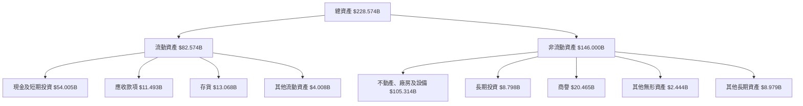
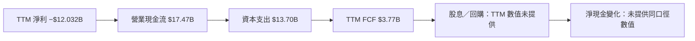
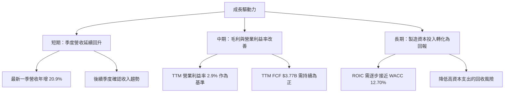
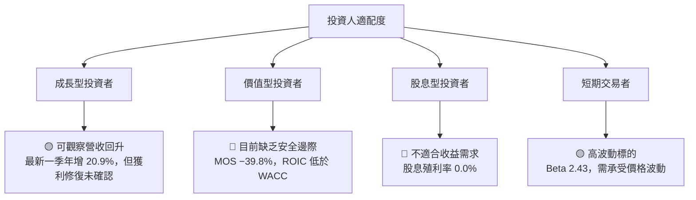

# INTC 基本面深度分析報告
> **報告日期**：2026-11-26 ｜ **語言**：繁體中文 ｜ **數據來源**：SEC 申報資料 (XBRL)、Yahoo Finance、Finviz、StockAnalysis、Roic.ai ｜ **分析師**：CFA 級機構研究

---

## 目錄

| # | 章節 | 核心結論 |
|---|------|----------|
| 1 | 執行摘要 | 評級為賣出；加權合理價值 $38.97，MOS −39.8% |
| 2 | 公司概覽與商業模式 | 有製造與產品整合能力，但缺乏可量化的市占與分部營收資料 |
| 3 | 損益表深度分析 | TTM 營收 $59.89B、年增 12.1%；TTM 營業利益率僅 2.9% |
| 4 | 資產負債表分析 | 淨現金 $3.87B、流動比率 2.208；庫存天數與 CCC 上升 |
| 5 | 現金流量深度分析 | TTM FCF $3.77B、FCF Yield 1.30%；資本支出仍高 |
| 6 | 獲利能力與資本效率 | ROIC 1.3% 低於 WACC 12.70%，目前仍在摧毀股東價值 |
| 7 | 相對估值分析 | 同業估值方法支持的價格低於現價；自身 P/S 位於五年歷史第 90 百分位 |
| 8 | DCF 內在價值評估 | DCF 不適用：模型預測末年自由現金流不為正 |
| 9 | 成長催化劑 | 季度營收回升可追蹤，但缺少可驗證 TAM 與具日期的催化劑資料 |
| 10 | 風險矩陣 | 估值、獲利修復與資本支出執行是主要風險 |
| 11 | 投資建議 | 維持賣出；現價高於加權合理價值，需觀察獲利與現金流改善 |

---

## 1. 執行摘要

Intel 的 TTM 營收為 **$59.89B**，TTM 營收年增 **12.1%**，最新一季營收年增 **20.9%**；但程式計算的 TTM 營業利益率只有 **2.9%**、ROIC **1.3%**，遠低於 **12.70% WACC**，且 TTM FCF 雖轉正至 **$3.77B**，FCF Yield 仍只有 **1.30%**。依估值方法計算的加權合理價值為 **$38.97**，低於 2026-11-25 收盤價 **$54.47**；MOS 為 **−39.8%**，因此依規則 20 評級為 **🔴 賣出**，不作質化上調或下調。

### 1.0 一頁式投資儀表板（Portfolio Manager 30 秒速讀）

| 項目 | 內容 |
|------|------|
| **投資論點（3 句）** | ① TTM 營收年增 12.1%、最新一季年增 20.9%，收入趨勢回升。② TTM 營業利益率 2.9%、ROIC 1.3%，仍低於 12.70% WACC，經濟利潤尚未修復。③ 加權合理價值 $38.97，較 2026-11-25 收盤價 $54.47 低，MOS −39.8%。 |
| **綜合評分** | **4.7/10**（引用 1.1 評分卡） |
| **財務健康** | 🟡 現金及短期投資 $54.01B、高於總債務 $50.13B；但 TTM ROE −10.5%，營運資金週期惡化。 |
| **ROIC vs WACC** | **1.3% vs 12.70%**；ROIC 低於資本成本，摧毀股東價值。 |
| **FCF 趨勢** | TTM FCF 為 **$3.77B**、FCF Yield **1.30%**；相較 FY2022–FY2025 年度 FCF 均為負，近期改善但尚未證明可持續。 |
| **估值** | Forward P/E **30.42235x** ｜ EV/EBITDA **15.797x**（市場估值資料）｜ FCF Yield **1.30%** |
| **DCF 內在價值（基準）** | **N/A**；DCF MODEL 不可計算，因此現價相對 DCF 折溢價亦為 N/A。 |
| **安全邊際（MOS）** | **−39.8%＝($38.97 − $54.47) ÷ $38.97**；以第 8.8 節加權合理價值為基準。🔴 |
| **預期報酬（基準情境 12M）** | N/A（DCF MODEL 未提供情境估值；加權合理價值不是明確的 12 個月預測）。 |
| **關鍵風險（前二）** | 營業利潤率回升不足；高資本支出使 FCF 及估值對執行成效高度敏感。 |
| **評級 + 信心度** | 🔴 **賣出** ｜ 信心：中低（估值訊號明確，但 DCF 不適用且資料口徑存在差異）。 |

### 1.1 綜合評分卡（全報告唯一）

| 維度 | 評分（1–10） | 主要依據（引用數字與其來源章節） |
|------|--------------|----------------------------------|
| 成長性 | 6.0 | TTM 營收年增 12.1%，最新一季年增 20.9%，但 FY2022–FY2025 年營收由 $63.05B 降至 $52.85B（第 3 章）。 |
| 獲利能力 | 3.0 | TTM 營業利益率 2.9%、ROIC 1.3%，低於 WACC 12.70%；Piotroski F-Score 6/9（第 6 章）。 |
| 財務健康 | 6.5 | 淨現金 $3.87B、流動比率 2.208；但 CCC 從 35 天升至 68 天（第 4 章）。 |
| 估值 | 2.0 | MOS −39.8%；P/S 4.8x，高於自身五年中位數 2.6x，當前百分位第 90 百分位（第 7、8 章）。 |
| 護城河 | 6.0 | CPU 與自有製造能力構成重要資產，但市場份額與分部收入數據未提供，且同業成長差距明顯（第 2 章）。 |
| 管理層與資本配置 | 4.5 | FY2025 SBC $2.43B、FY2024 Capex $23.94B，FY2022–FY2025 資本支出高於營業現金流；稀釋股數測試未通過（第 5、6 章）。 |
| **綜合評分** | **4.7** | 六項算術平均：$(6.0+3.0+6.5+2.0+6.0+4.5)÷6=4.7$。 |

### 1.2 五大投資論點 + 三大核心風險

| 類型 | 項目 | 具體依據 | 信心度 |
|------|------|----------|--------|
| 🟢 **投資論點①** | 季度收入動能轉正 | 最新一季營收 $16.51B，年增 20.9%；前一季 $16.13B，季增約 2.4%。 | 🟡 中 |
| 🟢 **投資論點②** | TTM 現金流已回到正值 | TTM OCF $17.47B、Capex $13.70B，兩者差額為 TTM FCF $3.77B。 | 🟡 中 |
| 🟢 **投資論點③** | 流動性具緩衝 | 現金及短期投資 $54.01B，總債務 $50.13B，淨現金 $3.87B。 | 🟢 高 |
| 🟢 **投資論點④** | 研發投入仍大 | FY2025 R&D 為 $13.77B，提供產品與製程投入基礎；但投入是否轉化成收益仍須觀察。 | 🟡 中 |
| 🟢 **投資論點⑤** | 最新一季營業利益改善 | 季度營業利益由 2025-12-31 的 $0.55B 增至 2026-09-30 的 $2.58B；季度數字改善仍須以後續季度驗證。 | 🟡 中 |
| 🟡 **風險①** | 資本報酬低於資本成本 | ROIC 1.3% 對照 WACC 12.70%，差距 −11.4 個百分點。 | 🔴 高衝擊 |
| 🔴 **風險②** | 估值相對基本面偏高 | 加權合理價值 $38.97，現價 $54.47；MOS −39.8%。 | 🔴 高衝擊 |
| 🔴 **風險③** | 高資本支出壓縮現金流 | FY2024 Capex $23.94B、FY2025 Capex $14.65B；近四個完整年度 FCF 均為負。 | 🔴 高衝擊 |

### 1.3 快速統計卡片

| 指標 | 公司實際值（期間） | 同業中位數 | 狀態 |
|------|--------------------|------------|------|
| 營收成長（TTM） | **12.1%** | — | 🟢 |
| 營收成長（最新一季年增） | **20.9%** | 44.7% | 🟡 |
| 毛利率（TTM） | **40.2%** | 56.0% | 🔴 |
| 營業利益率（TTM） | **2.9%** | — | 🔴 |
| ROIC（TTM） | **1.3%** | — | 🔴 |
| Forward P/E | **30.42235x** | 13.8x | 🔴 |
| FCF Yield（TTM） | **1.30%** | — | 🟡 |
| Piotroski F-Score | **6 / 9** | — | 🟡 |

### 1.4 投資結論

```text
╔══════════════════════════════════════════════════════════════════╗
║                    📊 投資結論摘要                               ║
╠══════════════════════════════════════════════════════════════════╣
║  評級：🔴 賣出（依 MOS 評級規則；未作質化調整）                 ║
║  價格（2026-11-25 收盤）：$54.47                                ║
║  DCF 內在價值（基準）：N/A（DCF MODEL 不可計算）                ║
║  安全邊際 MOS：−39.8%                                           ║
║  加權合理價值（8.8）：$38.97                                    ║
║  綜合評分：4.7/10（引用 1.1）                                   ║
║  適合投資人：能承受高波動且願意等待營運修復的投資人；            ║
║              不適合以目前估值追求安全邊際或穩定股息者。          ║
╚══════════════════════════════════════════════════════════════════╝
```

---

## 2. 公司概覽與商業模式

### 2.1 業務結構與收入來源

現有資料描述 Intel 經營 CCG、DCAI 與 Intel Foundry，但未提供各分部收入，因此不能推算或呈現分部占比。公司 TTM 營收為 $59.89B。



公司採產品設計、製造與銷售並行的模式。其優勢在於製造能力可與產品路線整合；代價則是資本密集、產能利用率與製程爬坡會直接影響利潤率及 FCF。

### 2.2 市場份額

**市場份額數據未提供**，因此不呈現市場占比圖或比例。營收規模方面，Intel TTM 營收為 $59.89B，最新一季年增 20.9%；但同業 AMD 最新一季年增 44.7%、NVIDIA 年增 103.2%。這些成長率反映同業近期成長較快，並不等同於市場份額變化。

### 2.3 競爭護城河分析



以上為質化競爭結構，不代表資料已證實 Intel 在各項領域具有持續領先地位。尤其製程競爭力、外部代工客戶拓展與產品相對效能，均須靠後續營運資料驗證。

### 2.4 護城河強度

| 護城河項目 | 強度（強／中／弱） | 證據（引用數字或事實） | 會削弱它的情況 |
|------------|--------------------|------------------------|----------------|
| 技術與產品 | 中 | 公司持續投入研發；FY2025 R&D 為 $13.77B。投入金額本身不等於產品領先。 | 產品效能、能效或上市時程落後競爭者。 |
| 軟體生態系統 | 中 | x86 相容性和既有軟體環境構成轉換摩擦；未提供生態系收入或客戶留存數據。 | 軟體移植成本下降，或客戶加速採用其他架構。 |
| 網路效應 | 弱至中 | 平台相容性可擴大開發者與企業採用；未提供可量化網路效應指標。 | 生態系統分散，軟硬體相容性不再形成差異。 |
| 客戶鎖定 | 中 | 企業部署與驗證流程可增加轉換成本；未提供客戶留存率。 | 雲端客戶自研晶片或採購轉向競品。 |
| 規模效應 | 中 | TTM 營收 $59.89B、研發支出規模大；但高資本支出也提高固定成本負擔。 | 產能利用率低、製程投資回收期延長。 |
| 生態夥伴 | 中 | 公司具 OEM、供應鏈及企業產品合作基礎；未提供合作收入拆分。 | 競爭者擴大 OEM 與雲端合作，Intel 產品組合失去優先地位。 |

1.1「護城河」評分為 **6.0/10**，反映公司具既有平台資產與研發規模，但缺少市占、客戶留存與分部盈利資料，且護城河能否轉化為可持續資本回報尚未獲得 ROIC 數據支持。

---

## 3. 損益表深度分析

### 3.1 年度收入成長趨勢（近 4 年）

年度營收由 FY2022 的 $63.05B 降至 FY2025 的 $52.85B。FY2022 至 FY2025 三年 CAGR 為：

$$(52.85 \div 63.05)^{1/3}-1 \approx -5.7\%$$

年度數列顯示營收曾大幅下滑，近年僅呈現趨穩，尚不足以證明長期增長恢復。

```text
╔══════════════════════════════════════════════════════════════════╗
║                 Intel 年度營收趨勢（FY2022–FY2025）              ║
╠══════════════════════════════════════════════════════════════════╣
║  FY2022  $63.05B  █████████████████████████  基期              ║
║  FY2023  $54.23B  ██████████████████████░░░  YoY −14.0% 🔴    ║
║  FY2024  $53.10B  █████████████████████░░░░  YoY  −2.1% 🔴    ║
║  FY2025  $52.85B  █████████████████████░░░░  YoY  −0.5% 🔴    ║
╠══════════════════════════════════════════════════════════════════╣
║  FY2022–FY2025 營收 CAGR：約 −5.7%                               ║
╚══════════════════════════════════════════════════════════════════╝
```

> 年度報表不同來源對 FY2025 gross profit 與個別營業項目存在口徑差異；營收成長採年度損益表列示金額計算，TTM 成長率則引用程式計算值。

### 3.2 季度收入趨勢分析

下表季度 YoY 按相同季度比較；QoQ 以相鄰季度營收計算。

| 季度 | 營收 | QoQ 成長 | YoY 成長 | 備註 |
|------|------:|---------:|---------:|------|
| 2025 Q4 | $13.674B | 約 0.2% | −4.1% | 以 2025 Q3 及 2024 Q4 營收計算。 |
| 2026 Q1 | $13.577B | 約 −0.7% | 7.2% | 季減，但較 2025 Q1 增長。 |
| 2026 Q2 | $16.128B | 約 18.8% | 25.4% | 季度收入明顯回升。 |
| 2026 Q3 | $16.513B | 約 2.4% | 20.9% | 收入維持高於前一年同期。 |

最新季度營收 YoY 成長 20.9% 與 TTM 營收 YoY 成長 12.1% 是不同口徑，不能混用。季度營收回升為正面證據，但尚需檢驗收入增長能否持續轉化為毛利、營業利益及現金流。

### 3.3 利潤率演變分析

年度毛利率及營業利益率依年度損益表金額計算；TTM 營業利益率採程式計算的 **2.9%**。另有資料來源列出 TTM 營業利益率 10.1%，與程式計算口徑不一致，本文以程式計算的已驗證數值作為核心估值與評級依據。

| 利潤率指標 | FY2022 | FY2023 | FY2024 | FY2025 | 趨勢 | 評估 |
|------------|-------:|-------:|-------:|-------:|------|------|
| 毛利率 | 42.6% | 40.0% | 32.6% | 34.8% | FY2024 下滑，FY2025 小幅回升 | 🔴 |
| 營業利益率 | 3.7% | 0.1% | −8.9% | 約 0.0% | 由正轉負後接近損益兩平 | 🔴 |
| 淨利率 | 12.7% | 3.1% | −35.3% | −0.5% | FY2024 大幅轉負，FY2025 接近損益兩平 | 🔴 |

FY2024 毛利率與營業利潤率顯著承壓，代表毛利結構與固定成本吸收能力下滑。FY2025 毛利率小幅回升，但營業利益仍接近零，說明毛利改善尚未充分落到營業利益；產品組合、製造成本、產能利用率及重整費用的個別貢獻，現有資料不足以逐項拆解。

### 3.4 費用結構分析

資料提供 FY2025 R&D **$13.77B**，但沒有完整且同期間的銷售、管理、重整及其他營業費用拆分；因此不製作費用占比圓餅圖，避免把單一費用項目誤當成完整費用結構。FY2025 R&D 約占年度營收 $52.85B 的 **26.0%**，顯示研發是重要投入，但其回報須透過新產品競爭力及營業利潤改善來驗證。

### 3.5 季度 EPS 趨勢與盈餘品質（Quality of Earnings）

最近四季 EPS 實際值分別為 −$0.12、−$0.73、−$2.16、$0.60。EPS estimates 缺漏，無法判定超預期或不及預期。

| 季度 | EPS 實際值 | EPS 預估／驚喜 | 解讀 |
|------|-----------:|----------------|------|
| 2025 Q4 | −$0.12 | N/A | 無預估值，不能判定 beat/miss。 |
| 2026 Q1 | −$0.73 | N/A | 實際 EPS 為負。 |
| 2026 Q2 | −$2.16 | N/A | 單季虧損擴大；未提供足夠調節資料拆分原因。 |
| 2026 Q3 | $0.60 | N/A | EPS 轉正，但資料列示 EPS YoY −32.7%；須留意 EPS 成長率與單季淨利變化不完全一致。 |

| 盈餘品質項目 | 數值／佔比 | 評估 |
|--------------|-----------|------|
| 股權薪酬 SBC / 營收 | 約 **4.1%**；近四季 SBC $2.432B ÷ TTM 營收 $59.89B | 🔴 SBC 代表股東稀釋成本，若以現金流作回報比較，不能忽略。 |
| SBC / 營業現金流 | 約 **13.9%**；$2.432B ÷ $17.47B | 🟡 佔 OCF 不低，但資料未提供具體稀釋對每股價值的分拆。 |
| FCF / 淨利（現金轉換率） | 約 **−31.3%**；TTM FCF $3.77B ÷ TTM 淨利 −$12.032B | 🔴 淨利為負，該比率符號與大小不宜視為一般獲利轉換率。 |
| 一次性／非經常性損益 | N/A（未提供可一致比較的調節表） | 🟡 無法量化稅務、重整或資產處分對單季盈餘的影響。 |
| 有效稅率異常 | N/A（資料未提供同期間有效稅率） | 無法判定近期轉盈是否由稅務利益帶動。 |
| 資本化支出 vs 費用化 | TTM Capex $13.70B；資產負債表 PPE $105.314B | 🟡 製造設備投入通常形成資產並經折舊；未提供資本化明細，不能判斷是否存在費用遞延。 |

**盈餘品質結論：** TTM 淨利為負而 FCF 為正，現金流表現優於會計淨利，但 FCF Yield 僅 1.30%，且 SBC 約占 TTM 營收 4.1%、占 OCF 13.9%。因此不能只憑近期轉正 EPS 推論獲利品質已恢復；估值應更重視可持續 FCF、SBC 對每股價值的影響及資本支出需求。

---

## 4. 資產負債表分析

### 4.1 資產結構分解

依 2026 年 9 月季度資產資料，總資產 $228.574B，其中流動資產 $82.574B、PPE $105.314B。其餘細項依季度資產負債表列示如下。



### 4.2 流動性與營運資金分析

| 指標 | 最新 TTM | 一年前 TTM | 變化 | 解讀 |
|------|---------:|-----------:|-----:|------|
| 流動比率 | 2.208 | N/A | N/A | 短期資產相對短期負債具緩衝；缺少同口徑一年前比率。 |
| 速動比率 | 1.751 | N/A | N/A | 不含存貨後仍高於 1，短期流動性尚可。 |
| DSO 應收帳款天數 | 25 天 | 22 天 | +3 天 | 收款週期延長，可能增加營運資金占用；原因須由客戶及付款條件資料驗證。 |
| DIO 存貨天數 | 133 天 | 122 天 | +11 天 | 存貨周轉變慢，若需求或產品組合不如預期，可能增加跌價與現金占用風險。 |
| DPO 應付帳款天數 | 90 天 | 109 天 | −19 天 | 對供應商付款天數減少，可能反映付款條件變化或供應鏈結算節奏改變；不能單憑天數推斷議價力。 |
| CCC 現金轉換週期 | 68 天 | 35 天 | +33 天 | 現金被營運資金占用時間增加，與 DIO 上升及 DPO 下降方向一致。 |

營運資金天數照錄品質指標計算結果，未另行重算。CCC 增加 33 天是值得追蹤的現金流訊號，但資料不足以判定其成因是備貨策略、需求組合或供應商條款。

### 4.3 債務結構分析

```text
╔══════════════════════════════════════════════════════════════════╗
║                   Intel 債務健康診斷                             ║
╠══════════════════════════════════════════════════════════════════╣
║  總債務：              $50.13B   ██████████████████░░             ║
║  現金及短期投資：      $54.01B   ████████████████████             ║
║  淨現金：               $3.87B   現金高於總債務                    ║
║  Debt/Equity：         38.108   來源口徑；未另行重算               ║
║  Current Ratio：        2.208   🟢 短期流動性有緩衝                ║
║  Debt/EBITDA：          N/A（未提供同口徑 TTM EBITDA 絕對值）       ║
║  Interest Coverage：   N/A（未提供同期間利息費用與 EBIT 調節）     ║
╚══════════════════════════════════════════════════════════════════╝
```

淨現金 $3.87B 代表目前現金緩衝大於帳面總債務，但相較 $289.51B 市值規模有限。若資本支出持續維持高檔、而營運現金流未同步提升，淨現金優勢可能收窄。

### 4.4 股東權益趨勢

```text
╔══════════════════════════════════════════════════════════════════╗
║                 Intel 年度股東權益變化                           ║
╠══════════════════════════════════════════════════════════════════╣
║  FY2022  $101.42B  ████████████████████                          ║
║  FY2023  $105.59B  █████████████████████                         ║
║  FY2024   $99.27B  ███████████████████                           ║
║  FY2025  $114.28B  ███████████████████████                       ║
╚══════════════════════════════════════════════════════════════════╝
```

FY2025 股東權益升至 $114.28B，但帳面權益增加不等於資本效率改善；同一期間 TTM ROE 為 −10.5%，資本回報仍不足。

---

## 5. 現金流量深度分析

### 5.1 現金流量瀑布圖

TTM 淨利資料為負、OCF 為正；未提供 TTM 股息／回購及淨現金變動的完整一致拆分，圖中相應節點不填數值。



### 5.2 FCF 轉換率趨勢

| 財年 | FCF | 淨利 | FCF / 淨利 | 解讀 |
|------|----:|----:|-----------:|------|
| FY2022 | −$9.41B | $8.01B | 約 −1.17x | 盈利但資本支出使 FCF 為負。 |
| FY2023 | −$14.28B | $1.69B | 約 −8.45x | 現金投入顯著高於會計淨利。 |
| FY2024 | −$15.66B | −$18.76B | 約 0.83x | 兩者同為負數，比率容易受虧損規模影響。 |
| FY2025 | −$4.95B | −$0.267B | 約 18.54x | 因淨利接近零而形成極高倍數，不代表高品質現金轉換。 |
| TTM 至 2026-09-26 | $3.77B | −$12.032B | 約 −31.3% | 淨利為負，不能按正盈利公司的轉換率解讀。 |

比率以表列數值計算；當淨利為負或接近零時，單看倍數容易失真，應同時看絕對 FCF 與資本支出。

### 5.3 自由現金流趨勢

```text
╔══════════════════════════════════════════════════════════════════╗
║              Intel 自由現金流：年度與 TTM                       ║
╠══════════════════════════════════════════════════════════════════╣
║  FY2022  −$9.41B  ◀█████████░░░░░░░░░░░░░░  FCF 為負           ║
║  FY2023 −$14.28B  ◀██████████████░░░░░░░░░  FCF 為負           ║
║  FY2024 −$15.66B  ◀████████████████░░░░░░░░  FCF 為負           ║
║  FY2025  −$4.95B  ◀█████░░░░░░░░░░░░░░░░░░  FCF 為負           ║
║  TTM     +$3.77B   ████░░░░░░░░░░░░░░░░░░░  Yield 1.30%        ║
╚══════════════════════════════════════════════════════════════════╝
```

TTM FCF 回正，與 TTM OCF $17.47B、Capex $13.70B 相符。另一方面，FY2022–FY2025 完整年度 FCF 全為負，代表 TTM 改善仍需要更多季度驗證，且 FCF Yield 1.30% 尚未提供很強的估值緩衝。

### 5.4 資本配置評估

資料沒有提供可完整調節的同期資本配置比例，故不畫圓餅圖。

| 配置項目 | 已知數據 | 評估 |
|----------|----------|------|
| 資本支出 | TTM $13.70B；FY2024 $23.94B；FY2025 $14.65B | 資本密集度高，需觀察投資能否改善產能利用率與 FCF。 |
| 研發 | FY2025 $13.77B | 保持研發投入有助產品競爭，但尚無足夠資料量化投資回報。 |
| 股息 | 市場資料顯示殖利率 0.0%；FY2025 現金股息支付 $0.00 | 現階段股息並非投資報酬來源。 |
| SBC | FY2025 $2.43B；近四季約 $2.432B | 對員工激勵有用，但會形成每股價值稀釋成本。 |
| 回購 | N/A | 未提供可一致比較的近期回購數據。 |

---

## 6. 獲利能力與資本效率

### 6.1 ROE / ROA / ROIC 趨勢

| 指標 | 目前數值 | 歷史／補充資料 | 評估 |
|------|---------:|----------------|------|
| ROE（TTM） | −10.5% | 市場資料另一口徑列 −9.6% | 以品質指標的 TTM −10.5% 為主；回報為負。 |
| ROA（TTM） | 1.8% | Piotroski 測試指出 TTM ROA 未通過大於零測試，來源口徑存在差異 | 不同來源定義或期間有衝突，須以 SEC 同口徑重核；不將其當成明確改善證據。 |
| ROIC（TTM） | 1.3% | 依 after-tax operating income ÷ 投入資本計算 | 遠低於 12.70% WACC。 |
| 行業均值對比 | N/A | 未提供一致來源的同業 ROE／ROA／ROIC 中位數 | 不以未驗證均值填補。 |

### 6.2 ROIC vs WACC 分析（核心價值創造判斷）

```text
╔══════════════════════════════════════════════════════════════════╗
║                ROIC vs WACC 深度分析                             ║
╠══════════════════════════════════════════════════════════════════╣
║  WACC 輸入（採程式計算的資本成本資料）：                         ║
║  ├── 無風險利率 Rf（10Y 美債）：       4.85%                    ║
║  ├── 市場風險溢酬 ERP：                5.00%                    ║
║  ├── 原始 Beta：                       2.43                     ║
║  ├── 調整後 Beta：                     1.95                     ║
║  ├── 股權成本 Ke：                    14.60%                    ║
║  ├── 稅前債務成本 Kd：                 2.18%                    ║
║  ├── 稅率：                            21.0%                    ║
║  ├── 股權／債務權重：                85.2% / 14.8%              ║
║  └── WACC：                           12.70%                    ║
║                                                                  ║
║  ROIC（TTM）：                         1.3%                     ║
║  ROIC − WACC：                       −11.4 個百分點              ║
║  判斷：ROIC 顯著低於資本成本，目前摧毀股東價值。                ║
╚══════════════════════════════════════════════════════════════════╝
```

Beta 調整方式為 `⅔ × 原始 Beta 2.43 + ⅓ = 1.95`，採用資本成本資料列示的調整後 Beta。WACC 的組成與數值依指定的資本成本資料引用；因利息費用與平均計息負債明細未提供，不自行重建稅前 Kd。

成本權益計算為 $$(4.85\% + 1.95\times5.00\%)=14.60\%$$。稅後債務成本為 $$2.18\%\times(1-21.0\%)=1.7222\%$$。以已提供權重代入，$$85.2\%\times14.60\%+14.8\%\times1.7222\%=12.694\%\approx12.70\%$$。ROIC 低於 WACC 11.4 個百分點，因此目前沒有證據顯示新投入資本已創造超額經濟回報。

### 6.3 杜邦三因素分解

| 因素 | 數值（TTM） | 解讀 |
|------|-------------|------|
| 淨利率 | −20.1% | 虧損拖累 ROE。 |
| 資產週轉率 | 0.26 | 每單位資產產生的營收有限，反映資產密集型製造結構。 |
| 權益乘數 | 1.99 | 有槓桿，但並非 ROE 負值的唯一來源。 |
| **ROE** | **−10.5%** | 品質指標列示：−20.1% × 0.26 × 1.99 = −10.5%。 |

依給定的杜邦分解，負淨利率是 ROE 為負的主要因素，不能將低 ROE 單純歸因於槓桿。

### 6.4 財務體質：Piotroski F-Score

**Piotroski F-Score：6 / 9**，以 TTM 至 2026-09-26 對比 TTM 至 2025-09-27；以下結果照錄品質指標。

| 測試 | 結果 | 解讀 |
|------|------|------|
| ROA > 0 | ❌ 未通過 | 獲利能力測試未過。 |
| 營業現金流 > 0 | ✅ 通過 | TTM OCF 為正。 |
| ROA 高於一年前 | ❌ 未通過 | 未顯示資產報酬改善。 |
| 營業現金流 > 淨利（應計品質） | ✅ 通過 | 現金流相對淨利較強；仍須注意淨利為負的特殊性。 |
| 長期負債 ÷ 總資產低於一年前 | ✅ 通過 | 相對負債測試改善。 |
| 流動比率高於一年前 | ✅ 通過 | 流動性測試改善。 |
| 稀釋股數未增加 | ❌ 未通過 | 股數增加可能稀釋每股價值。 |
| 毛利率高於一年前 | ✅ 通過 | 毛利率測試改善。 |
| 資產週轉率高於一年前 | ✅ 通過 | 資產使用效率測試改善。 |

---

## 7. 相對估值分析

### 7.1 同業估值比較表格

公司估值採市場資料所列數值；同業倍數照錄 Yahoo Finance Peer multiples。AMD、NVIDIA 與 Qualcomm 的業務組合不完全相同，倍數比較只作相對參考。

| 估值指標 | **Intel** | **AMD** | **NVIDIA** | **Qualcomm** | Intel 評估 |
|----------|----------:|--------:|-----------:|-------------:|-----------|
| **Trailing P/E** | N/A（TTM EPS 為 −$2.35） | 86.8x | 16.0x | 13.3x | 🔴 Intel TTM 虧損，P/E 不適用。 |
| **Forward P/E** | **30.42235x** | 23.0x | 9.0x | 13.8x | 🔴 高於三家同業中位數 13.8x。 |
| **P/S Ratio** | **4.8338346x** | 14.8x | 10.0x | 4.2x | 🟡 低於 AMD、NVIDIA，但高於 Qualcomm。 |
| **EV/EBITDA** | **15.797x** | 59.2x | 14.5x | 17.8x | 🟡 低於 AMD，高於 NVIDIA，接近 Qualcomm。 |
| **最新一季營收 YoY** | **20.9%** | 44.7% | 103.2% | −8.4% | 🟡 高於 Qualcomm，低於 AMD 與 NVIDIA。 |
| **毛利率（TTM）** | **40.2%** | 56.0% | 74.9% | 53.1% | 🔴 低於三家同業。 |

Intel 的 Forward P/E 高於 Peer multiples 中位數，且當前估值需要未來 EPS 實現支撐。由於 Intel TTM EPS 為負，Trailing P/E 不適用；不以負 P/E 作數值比較。

### 7.2 歷史估值區間分析

自身估值使用程式計算的五年 TTM 區間，不以資料缺漏的 P/E 估值補位。

```text
╔══════════════════════════════════════════════════════════════════╗
║               Intel 自身五年估值位置                             ║
╠══════════════════════════════════════════════════════════════════╣
║  P/S：       1.5x ───── 中位數 2.6x ─────────── 現值 4.8x       ║
║                         五年區間上限 11.5x                        ║
║                         當前百分位：90%  🔴                      ║
║                                                                  ║
║  EV/EBITDA： 6.4x ───── 中位數 23.6x ─ 現值 21.2x ─ 536.5x     ║
║                         當前百分位：41%                          ║
║  P/E：N/A（未提供可用的自身歷史估值區間）                         ║
╚══════════════════════════════════════════════════════════════════╝
```

P/S 4.8x 高於五年中位數 2.6x，且位於歷史第 90 百分位，對當前收入估值的要求偏高。自身歷史 EV/EBITDA 現值 21.2x 低於中位數 23.6x，但該估值與市場資料區塊的 EV/EBITDA 15.797x 有口徑差異，兩者不混用；該差異降低單一倍數比較的確定性。

### 7.3 情境價值（Bear / Base / Bull）

**N/A（DCF 無法計算：DCF MODEL 指出預測末年 FCF 不為正，因 Capex 高於營業利益與折舊攤銷）**。依規則不自行建立 DCF 情境，也不另設目標價或情境假設。

### 7.4 相對估值隱含價格區間

```text
╔══════════════════════════════════════════════════════════════════╗
║              相對估值方法隱含每股價值                            ║
╠══════════════════════════════════════════════════════════════════╣
║  $24.79 ───────── $41.72 ─────────── 現價 $54.47                 ║
║  同業 Forward P/E   同業 EV/EBITDA     2026-11-25 收盤價          ║
║                                                                  ║
║  分析師共識目標價：$90.42（43 位分析師平均值）                    ║
╚══════════════════════════════════════════════════════════════════╝
```

| 方法 | 每股價值 | 相對現價 | 計算依據 |
|------|---------:|---------:|----------|
| 同業 Forward P/E | $24.79 | −54.5% | 同業中位數 Forward P/E 13.8x × Intel Forward EPS $1.79。 |
| 同業 EV/EBITDA | $41.72 | −23.4% | 同業中位數 EV/EBITDA 16.2x（NVIDIA、Qualcomm）× TTM EBITDA，再加淨現金。 |
| 分析師共識目標價 | $90.42 | +66.0% | 43 位分析師平均目標價。 |

分析師共識與兩種同業倍數推算差距甚大，顯示共識價格可能隱含較高的營運修復預期；本報告的加權估值依指定權重整合三項估值方法，不把共識單獨視為基本面證據。

---

## 8. DCF 內在價值評估（Discounted Cash Flow）

### 8.0 估值推理鏈（Thinking Logic）

**Step 1 — 價值驅動來源：** Intel 的基本面價值取決於現有客戶端與資料中心產品的營收及毛利、代工業務的營運成果，以及重資本製造投資能否產生正現金回報。分部營收占比未提供，不能量化各來源比重。就已知數據而言，能否把資本支出轉化為穩定正 FCF 是估值最重要的驗證點。

**Step 2 — 模型選擇：** 本次不輸出 FCFF 或 FCFE DCF 數值，因程式計算的 DCF MODEL 為 N/A：預測末年 FCF 不為正，且原因為 Capex 高於營業利益與折舊攤銷。此時強行使用 Gordon Growth 終值會放大模型假設誤差，不能產生可稽核的可靠內在價值。

| 決策點 | 本報告採用 | 理由（含數字） | 曾考慮但否決 | 否決理由 |
|--------|-----------|----------------|--------------|----------|
| 現金流定義 | FCFF DCF 不計算 | DCF MODEL 標示 N/A；TTM FCF 為 $3.77B，但模型預測末年 FCF 不為正 | 直接用 TTM FCF 套終值 | 單一 TTM FCF 不能替代逐年預測；模型已因末年 FCF 條件不符而排除。 |
| 預測期 N | N/A | DCF 模型不可用 | 自行設定 5 年或 10 年 | 違反指定模型須照錄的要求。 |
| 終值方法 | N/A | 不具備有效末年正 FCF | Gordon Growth／退出倍數 | 缺少有效模型輸入與程式計算結果。 |
| EBIT 基礎 | N/A | 未提供 DCF 模型逐年假設 | 自建 GAAP EBIT 預測 | 不得另建 DCF。 |

**Step 3 — 關鍵假設推導鏈：** DCF MODEL 未提供逐年營收、營業利潤率、稅率、Capex、D&A、營運資金、稀釋股數與終值假設，因此無法為這些輸入建立可驗證的推導鏈，也不以自行估計值取代。

**Step 4 — 脆弱環節：** 若不先證明營業利益、D&A 與 Capex 的關係足以支持預測末年正 FCF，終值模型便無法成立；因此現階段相對估值與現金流轉正的持續性比 DCF 更適合用作判斷依據。

### 8.1 模型假設總表（Model Inputs）

**N/A（DCF 模型未提供可用假設：預測末年 FCF 不為正，因 Capex 高於營業利益與 D&A。）**依規則不自建模型，故不填入預測期、營收 CAGR、期末營業利潤率、Capex／營收、D&A／營收、稅率、稀釋率或永續成長率。

### 8.2 折現率推導（WACC）

WACC 在此引用已計算的資本成本資料，供第 6.2 節與估值方法討論使用；**不代表本報告已計算 DCF**。

```text
╔══════════════════════════════════════════════════════════════════╗
║                    WACC 推導（折現率）                           ║
╠══════════════════════════════════════════════════════════════════╣
║  股權成本 Ke（CAPM）：                                           ║
║  ├── 無風險利率 Rf：                  4.85%                     ║
║  ├── 市場風險溢酬 ERP：               5.00%                     ║
║  ├── 原始 Beta：                      2.43                      ║
║  ├── 調整後 Beta：                    1.95                      ║
║  └── Ke = 4.85% + 1.95 × 5.00% = 14.60%                         ║
║                                                                  ║
║  債務成本：                                                      ║
║  ├── 稅前 Kd：                        2.18%                     ║
║  ├── 稅率：                           21.0%                     ║
║  └── 稅後 Kd = 2.18% × (1 − 21.0%) = 1.7222%                   ║
║                                                                  ║
║  資本結構權重：股權 85.2% ｜ 債務 14.8%                          ║
║  WACC = 85.2% × 14.60% + 14.8% × 1.7222% = 12.70%              ║
╚══════════════════════════════════════════════════════════════════╝
```

輸入依據是資本成本資料所列 10Y Treasury 4.85%、ERP 5.00%、原始 Beta 2.43 與調整後 Beta 1.95；資料沒有標示無風險利率的精確觀測日，故不另行補造日期。權重、成本與稅率均照錄提供值。利息費用及平均計息負債絕對值未提供，故只引用給定稅前 Kd，不反推其分子或分母。

WACC 算式核對：稅後 Kd = 2.18% × 0.79 = 1.7222%；股權加權成本 = 0.852 × 14.60% = 12.4392%；債務加權成本 = 0.148 × 1.7222% = 0.2549%；合計 12.6941%，四捨五入為 12.70%。

### 8.3 逐年自由現金流預測（基準情境）

**N/A（DCF 模型不可用，原因同 8.1）。**缺少程式提供的逐年營收、EBIT、稅、D&A、Capex、ΔWC、折現因子與 PV，依規則不自建預測表或補入估計數字。

### 8.4 終值計算（Terminal Value）

**N/A（沒有有效 DCF 末年 FCFF，不能計算 Gordon Growth 或退出倍數終值）。**不以正的 TTM FCF 取代模型末年現金流，也不自行假設永續成長率或退出倍數。

### 8.5 企業價值 → 每股內在價值（Bridge）

**N/A（DCF 企業價值、終值現值及股權價值未計算）。**因此 DCF 每股內在價值與 DCF 折溢價均為 N/A。此處不計算 MOS；全報告 MOS 僅採 8.8 加權合理價值。

### 8.6 敏感性分析（WACC × 永續成長率）

**N/A（DCF MODEL 未提供敏感性矩陣，且 DCF 基準模型不可計算）。**不自行產生 WACC × g 矩陣或敏感度數值。

### 8.7 反推 DCF（Reverse DCF：市場在預期什麼）

**N/A（缺少有效 DCF 基準模型與反推結果）。**不以單一現價自行反解營收 CAGR、利潤率、永續成長率或預測期。

### 8.8 估值三角驗證與安全邊際

DCF 基準值不可計算，因此照估值方法區塊只列可計算的三種方法，並保留其既定權重。

| 估值方法 | 隱含每股價值 | 上行空間（÷現價） | 權重 | 說明 |
|----------|--------------:|-------------------:|------:|------|
| 同業 Forward P/E | $24.79 | −54.5% | 45% | 同業中位數 13.8x × Intel Forward EPS $1.79。 |
| 同業 EV/EBITDA | $41.72 | −23.4% | 45% | 同業中位數 16.2x（NVIDIA、Qualcomm）× TTM EBITDA，加回淨現金。 |
| 分析師共識目標價 | $90.42 | +66.0% | 10% | 43 位分析師平均目標價，作為參考。 |
| **加權合理價值** | **$38.97** | **−28.5%** | **100%** | 公司類型為 profitable；DCF 因不可計算而不納入。 |

逐步演算：

$$(24.79\times45\%)+(41.72\times45\%)+(90.42\times10\%)$$
$$=11.1555+18.774+9.042=38.9715\approx \$38.97$$

MOS 以加權合理價值作分母：

$$MOS=(38.97-54.47)\div38.97=(-15.50)\div38.97=-39.8\%$$

上行空間以現價作分母：

$$上行空間=(38.97-54.47)\div54.47=(-15.50)\div54.47=-28.5\%$$

折溢價固定以 DCF 基準值作基準；因 DCF 為 N/A，折溢價亦為 **N/A**。MOS 依規則 20 低於 −25%，對應賣出評級。

```text
╔══════════════════════════════════════════════════════════════════╗
║                  估值區間與安全邊際                              ║
╠══════════════════════════════════════════════════════════════════╣
║  同業 P/E $24.79 ─ 加權合理值 $38.97 ─ 現價 $54.47 ─ 共識 $90.42║
║                                                                  ║
║  安全邊際 MOS = ($38.97 − $54.47) ÷ $38.97 = −39.8%             ║
║  上行空間 = ($38.97 − $54.47) ÷ $54.47 = −28.5%                 ║
║  DCF 折溢價：N/A（DCF 基準內在價值不可計算）                     ║
║                                                                  ║
║  加權合理價值的 MOS 10% 對應價格上限：$38.97 × 90% = $35.07      ║
║  依規則 20 目前為賣出；$35.07 僅為 MOS 門檻換算，不是買入評級。  ║
╚══════════════════════════════════════════════════════════════════╝
```

> 🔎 **程式複算（Python，依本節各項自動重算）**
>
> 加權合理價值 = $24.79 × 45% + $41.72 × 45% + $90.42 × 10% = **$38.97**（權重合計 100%）
>
> 以價格 $54.47 計：MOS = **-39.8%**，上行空間 = **-28.5%**
>
> ✅ 與本節所寫數值一致。

### 8.9 DCF 模型的局限與失效條件

- **終值依賴度：** N/A；未產生 DCF 企業價值，不能計算終值占比。
- **最脆弱的假設：** DCF MODEL 因預測末年 FCF 不為正而不可用；在沒有有效預測末年 FCFF 的情況下，不能虛構假設並估算其估值影響。
- **不適用情境說明：** Intel 目前處於高資本支出、利潤與現金流修復階段；若未來 FCF 符合穩定正值條件，才適合重新評估 FCFF DCF。現階段以同業倍數、EV/Sales 或分部估值作交叉參考較合理，但資料不足時不自行計算。
- **與第 10 章風險矩陣連結：** 營業利潤率不回升會壓低 EBIT；Capex 維持高檔會侵蝕 FCFF；存貨天數及 CCC 惡化會占用現金。這些因素皆可能延後 DCF 恢復適用的時間。

### 8.10 複算檢核表（Audit Trail）

| # | 檢核項目 | 檢查方式 | 結果 |
|---|----------|----------|------|
| 1 | 高／中敏感度 DCF 假設四段式推導 | DCF MODEL 不可用，未列假設 | N/A |
| 2 | DCF 假設均有來源 | 不適用：未自行建立輸入 | ✅ |
| 3 | WACC 算式與權重核對 | 權重合計 100%；重算為 12.6941%，取 12.70% | ✅ |
| 4 | Kd 與債務權重口徑一致 | 直接引用給定 Kd 與權重；底層平均計息負債明細未提供 | N/A |
| 5 | WACC 與第 6.2 節一致 | 兩處均為 12.70% | ✅ |
| 6 | 逐年預測年度數與 N 一致 | DCF 無有效模型，不列逐年表 | N/A |
| 7 | FY+1 九步算式複算 | 無程式模型逐年數字 | N/A |
| 8 | 預測期 PV 加總核對 | 無預測期 PV | N/A |
| 9 | WACC > g 檢查 | 無有效 g | N/A |
| 10 | 終值基期與折現期 | 無有效末年 FCFF | N/A |
| 11 | EV 至每股價值橋接 | DCF bridge 不可計算 | N/A |
| 12 | SBC 模型組合相容 | 未建 DCF，沒有 SBC 重複扣除問題 | N/A |
| 13 | 敏感性矩陣基準格與 DCF 一致 | 未提供矩陣 | N/A |
| 14 | 矩陣有效格符合 WACC > g | 未提供矩陣 | N/A |
| 15 | 三情境機率加總 | DCF 情境未提供 | N/A |
| 16 | 反推 DCF 每列只放開一變數 | 未提供反推模型 | N/A |
| 17 | MOS 與折溢價基準分開 | MOS 用 $38.97；DCF 折溢價 N/A | ✅ |
| 18 | 報告完整輸出至第 11 章 | 已完成 | ✅ |
| 19 | 加權合理價值等於逐項加權總和 | $11.1555+$18.774+$9.042=$38.9715≈$38.97 | ✅ |
| 20 | 評級符合 MOS 門檻 | MOS −39.8%，對應賣出；未調整 | ✅ |

---

## 9. 成長催化劑

### 9.1 催化劑時間軸

**具日期的產品發布、製程節點、外部代工客戶量產或公司財測里程碑未提供**，不製作含推測日期的 Gantt 圖。可觀察的營運驗證順序如下：

| 期間 | 可追蹤項目 | 已有數據基準 |
|------|------------|--------------|
| 短期：後續財報 | 營收是否延續最新一季年增 20.9% | 最新一季營收 $16.51B |
| 短期：後續財報 | 營業利益率是否高於 TTM 2.9% | 最新季度營業利益率的已驗證值為 15.3%，但其他來源列有不同口徑 |
| 中期 | TTM FCF 能否持續為正 | TTM FCF $3.77B、FCF Yield 1.30% |
| 中期 | CCC 是否由 68 天回落 | 一年前 CCC 為 35 天 |
| 長期 | 製造投資能否提高資本回報 | ROIC 1.3%，低於 WACC 12.70% |

### 9.2 TAM 市場規模分析

**N/A（TAM 數據未提供）**。Intel TTM 營收為 $59.89B、年增 12.1%，最新一季年增 20.9%；這表示近期收入動能較年度歷史改善，但不能在沒有市場規模與產品滲透率資料時推估 TAM 或未來市占。

### 9.3 成長驅動力結構圖



---

## 10. 風險矩陣

### 10.1 風險評分矩陣

資料沒有提供各風險的客觀發生機率，故不以主觀座標製作 quadrantChart，也不將未驗證的機率偽裝成財務數據。以下以影響方向和可監控指標呈現。

### 10.2 風險清單詳細分析

| # | 風險項目 | 發生機率 | 財務衝擊 | 風險評估 | 緩解措施／追蹤指標 |
|---|----------|----------|----------|----------|---------------------|
| 1 | 獲利修復不持續 | N/A（無可驗證機率） | 若營業利潤率停留於 TTM 2.9%，難以支撐 12.70% WACC | 🔴 高 | 逐季追蹤 TTM 營業利益率、毛利率及 ROIC；要求改善可延續而非單季跳升。 |
| 2 | 資本支出回收期延長 | N/A | FY2024 Capex $23.94B、FY2025 $14.65B；若產能與利潤未提升，FCF 可能受壓 | 🔴 高 | 追蹤 Capex、OCF、FCF 與產能利用情況；確認投資帶來增量收入。 |
| 3 | 估值回歸 | N/A | P/S 4.8x 高於五年中位數 2.6x；MOS −39.8% | 🔴 高 | 以加權合理價值 $38.97 與 $54.47 現價比較，避免只依賴分析師共識。 |
| 4 | 營運資金惡化 | N/A | CCC 由 35 天升至 68 天，DIO 增加 11 天 | 🟡 中高 | 追蹤存貨天數、應收週期與現金轉換週期。 |
| 5 | 同業競爭與產品組合變化 | N/A | 最新一季 Intel 成長 20.9%，低於 AMD 44.7%、NVIDIA 103.2%；不同產品組合需審慎比較 | 🟡 中高 | 追蹤分部營收、毛利率與客戶需求；目前分部營收資料未提供。 |

---

## 11. 投資建議

### 11.1 最終評級與評分

依加權合理價值 $38.97、現價 $54.47 所得 MOS **−39.8%**，規則 20 對應 **🔴 賣出**，未作一級調整。1.1 綜合評分為 **4.7/10**；六項分數依序為成長性 6.0、獲利能力 3.0、財務健康 6.5、估值 2.0、護城河 6.0、管理層與資本配置 4.5。

### 11.2 合理價值與隱含報酬率

| 估值基準 | 每股價值 | 相對 2026-11-25 收盤價 $54.47 | 備註 |
|----------|---------:|------------------------------:|------|
| 加權合理價值 | **$38.97** | **−28.5% 上行空間** | 依第 8.8 節三種可計算方法加權。 |
| 悲觀 DCF 情境 | N/A | N/A | DCF MODEL 不可計算。 |
| 基準 DCF 情境 | N/A | N/A | DCF MODEL 不可計算。 |
| 樂觀 DCF 情境 | N/A | N/A | DCF MODEL 不可計算。 |

加權合理價值與現價的差額為 $38.97 − $54.47 = **−$15.50**；上行空間以現價為分母為 −28.5%，MOS 則以加權合理價值為分母為 −39.8%，兩者分母不同。

### 11.3 買入時機與觸發因素

```text
╔══════════════════════════════════════════════════════════════════╗
║                  ✅ 買入觸發因素 Checklist                       ║
╠══════════════════════════════════════════════════════════════════╣
║  立即建立部位前，建議多數條件同時改善：                          ║
║  ☐ 股價回到 $35.07 以下，對 $38.97 加權合理價值具 MOS ≥ 10%     ║
║  ☐ TTM FCF 持續為正，且 FCF Yield 高於目前 1.30%                 ║
║  ☐ TTM 營業利益率高於目前 2.9%，且改善可延續                     ║
║                                                                  ║
║  加碼觸發條件：                                                  ║
║  ☐ ROIC 持續向 12.70% WACC 收斂                                 ║
║  ☐ CCC 從 68 天下降，尤其存貨天數由 133 天改善                   ║
║  ☐ 季度營收成長伴隨毛利率與 FCF 同步改善                         ║
║                                                                  ║
║  減碼／退出觸發條件：                                            ║
║  ☐ TTM FCF 再度轉負，或 Capex 上升而 OCF 未同步成長              ║
║  ☐ ROIC 長期停留在 1.3% 附近且顯著低於 WACC 12.70%               ║
║  ☐ CCC 繼續上升、存貨周轉進一步惡化                              ║
╚══════════════════════════════════════════════════════════════════╝
```

$35.07 是由 $38.97 加權合理價值乘以 90% 換算出的 MOS 10% 價格門檻，不是新的獨立估值目標，也不改變目前賣出評級。

### 11.4 投資人適配度分析



### 11.5 每季財報監控清單（Quarterly Watch List）

| 監控項目 | 當前基準 | 加碼訊號 | 減碼／重新評估訊號 |
|----------|----------|----------|---------------------|
| 營收成長 | TTM +12.1%；最新一季 YoY +20.9% | 成長延續且分部資料顯示需求改善 | 營收年增轉負並連續兩季惡化 |
| 營業利益率 | TTM 2.9% | TTM 持續改善，且營收增加轉化為營業利益 | 營收成長但利潤率持續下滑 |
| 毛利率 | TTM 40.2% | 毛利率改善且產品組合支持持續性 | 毛利率回落並侵蝕營業利益 |
| OCF、Capex、FCF | TTM OCF $17.47B；Capex $13.70B；FCF $3.77B | FCF 持續為正，且不依賴一次性項目 | FCF 轉負或 Capex 上升、OCF 未同步成長 |
| 營運資金 | DIO 133 天、CCC 68 天 | DIO 與 CCC 下降 | CCC 繼續上升或存貨天數延長 |
| SBC 與股數 | 近四季 SBC 約 $2.432B；稀釋股數測試未通過 | SBC／營收降低且股數趨穩 | 稀釋增加、SBC 占營收上升 |
| ROIC | 1.3% | 持續向 WACC 12.70% 靠近 | 長期維持低於 WACC |
| 財測與投資回報 | 公司未提供可用的完整分部財測於本報告資料中 | 管理層財測可由後續營收與 FCF 驗證 | 財測持續下修或投資里程碑延後 |

### 11.6 反面論證：什麼會證明論點錯誤（What Would Change My Mind）

```text
╔══════════════════════════════════════════════════════════════════╗
║              ⚠️ 論點失效條件（Disconfirming Evidence）           ║
╠══════════════════════════════════════════════════════════════════╣
║  以下情況出現時，須重新評估目前的賣出判斷：                      ║
║  ☐ TTM 營收成長轉負，且連續兩季低於目前 TTM +12.1%               ║
║  ☐ TTM 營業利益率無法維持 2.9% 以上，或營收增長未帶動利潤改善   ║
║  ☐ TTM FCF 由目前 +$3.77B 再度轉負                               ║
║  ☐ CCC 高於目前 68 天並持續惡化                                  ║
║  ☐ ROIC 長期遠低於 WACC 12.70%，沒有向資本成本收斂的趨勢        ║
║  ☐ SBC／營收高於目前約 4.1%，且稀釋股數持續增加                 ║
║                                                                  ║
║  若相反地，FCF 穩定轉正、營業利益率持續改善、ROIC 向 WACC 靠攏，║
║  且股價回落至合理價值附近，則目前偏空判斷需要重新檢驗。          ║
╚══════════════════════════════════════════════════════════════════╝
```

> **免責聲明**：本報告為 AI 自動生成，僅供研究參考，不構成投資建議。投資有風險，入市需謹慎。

---

## 資料與來源

| 項目 | 內容 |
|------|------|
| 價格 | 54.47 USD，2026-11-25 收盤（Yahoo Finance 日線） |
| 財務報表 | SEC 10-Q filed 2026-10-30，最新季度 2026-09-26（FY2026 Q3） |
| 有回應的資料來源 | SEC 申報資料 (XBRL)、Yahoo Finance、Finviz、StockAnalysis、Roic.ai |
| 由程式計算 | TTM 數字、WACC、DCF 模型、估值方法與權重、加權合理價值、MOS、評級門檻、F-Score、杜邦分解、營運資金天數、綜合評分 |
| 撰寫模型 | openai / gpt-6-luna |

> 本區塊由產生報告的程式依實際取得的資料填寫，非模型撰寫。「由程式計算」的數字不是模型的估計；其餘判斷（評分、情境、策略）是模型的分析。
