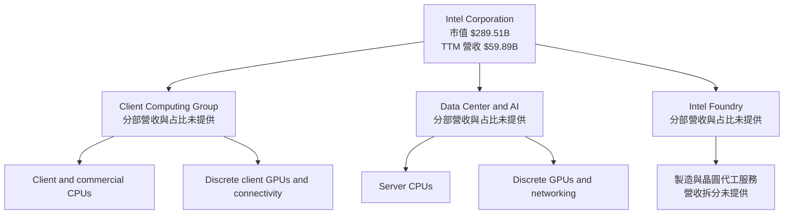
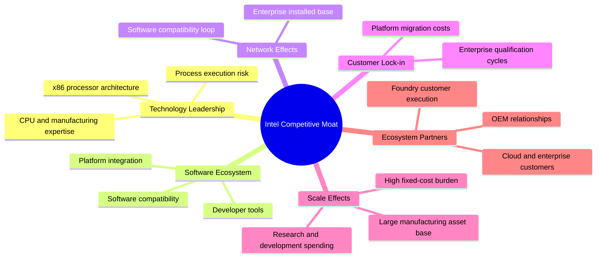
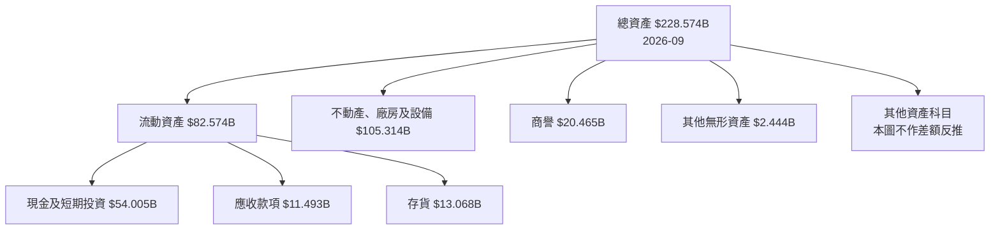
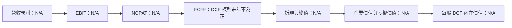
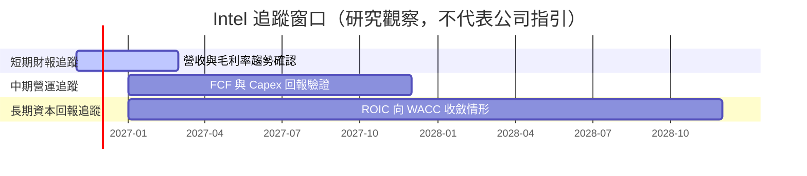
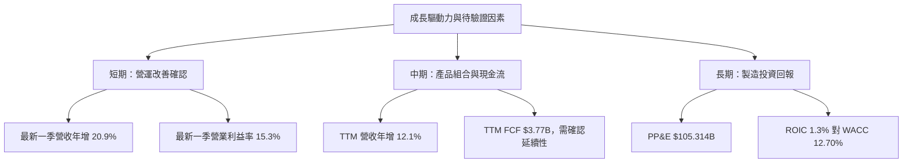
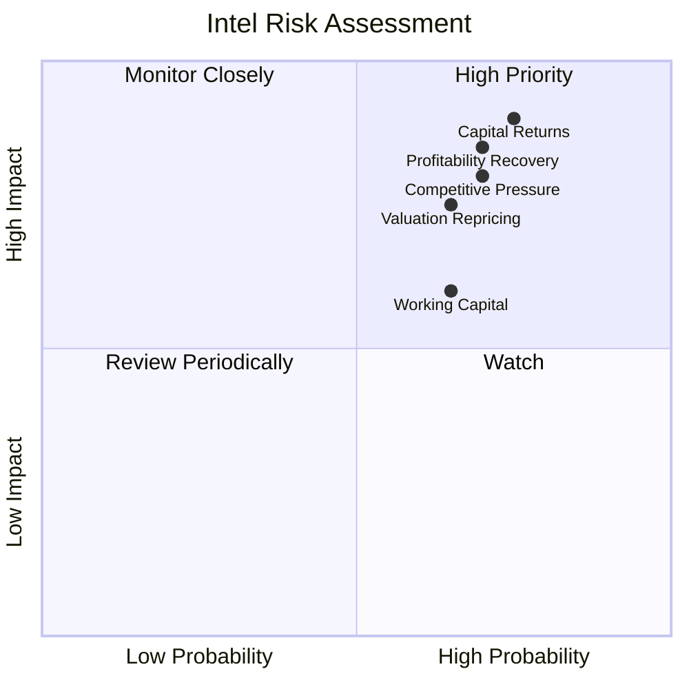
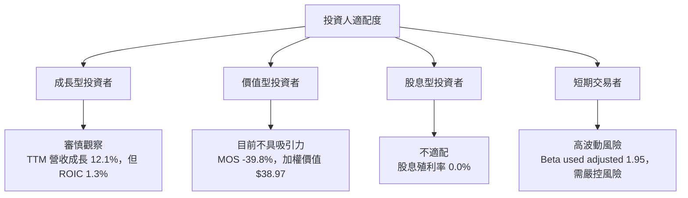

# INTC 基本面深度分析報告
> **報告日期**：2026-11-27 ｜ **語言**：繁體中文 ｜ **數據來源**：SEC 申報資料 (XBRL)、Yahoo Finance、Finviz、StockAnalysis、Roic.ai ｜ **分析師**：CFA 級機構研究

## 目錄

| # | 章節 | 核心結論 |
|---|------|----------|
| 1 | 執行摘要 | 賣出；加權合理價值 $38.97；MOS -39.8% |
| 2 | 公司概覽與商業模式 | CPU 與製造能力具策略價值，但產品組合、競爭力及分部營收資料不足以證明護城河擴張 |
| 3 | 損益表深度分析 | TTM 營收 $59.89B、年增 12.1%；TTM 營業利益率 2.9%，獲利仍不穩定 |
| 4 | 資產負債表分析 | 淨現金 $3.87B、流動比率 2.208；現金緩衝改善，但營運週期拉長 |
| 5 | 現金流量深度分析 | TTM FCF $3.77B、FCF Yield 1.30%；資本支出仍高，歷史 FCF 曾連年為負 |
| 6 | 獲利能力與資本效率 | ROIC 1.3% 對 WACC 12.70%，目前明顯摧毀股東價值 |
| 7 | 相對估值分析 | 公司估值相對同業與歷史區間不便宜；同業倍數法回推價值低於現價 |
| 8 | DCF 內在價值評估 | DCF 模型 N/A；原因是模型預測末年 FCF 不為正，不以自建模型填補 |
| 9 | 成長催化劑 | 季度營收回升與製造／AI 產品是可追蹤方向；TAM 與具體催化日期未提供 |
| 10 | 風險矩陣 | 製造投資回報、獲利品質與估值回落為主要風險 |
| 11 | 投資建議 | 依 MOS 評級為賣出；監控營業利潤率、FCF、ROIC 與現金轉換週期 |

## 1. 執行摘要

### 1.0 一頁式投資儀表板（Portfolio Manager 30 秒速讀）

| 項目 | 內容 |
|------|------|
| **投資論點（3 句）** | ① TTM 營收 $59.89B、年增 12.1%，最新一季營收年增 20.9%，需求回升是正面訊號。② TTM ROIC 僅 1.3%，低於 12.70% WACC，資本報酬尚未覆蓋資金成本。③ TTM FCF $3.77B、FCF Yield 1.30%，但加權合理價值 $38.97 低於 2026-11-25 收盤價 $54.47。 |
| **綜合評分** | **4.5/10**（引用 1.1 評分卡） |
| **財務健康** | 🟡 現金及短期投資 $54.01B、淨現金 $3.87B、流動比率 2.208；但 CCC 從 35 天升至 68 天 |
| **ROIC vs WACC** | **1.3% vs 12.70%**；ROIC 未覆蓋資本成本，現階段摧毀股東價值 |
| **FCF 趨勢** | TTM FCF $3.77B，近期轉正；FCF Yield **1.30%**。2022–2025 年度 FCF 連續三年為負後才改善 |
| **估值** | Forward P/E **30.42235x** ｜ EV/EBITDA **15.797x** ｜ FCF Yield **1.30%** |
| **DCF 內在價值（基準）** | **N/A**；DCF 模型末年 FCF 不為正，不能提供 DCF 折溢價 |
| **安全邊際（MOS）** | **-39.8%**＝($38.97 − $54.47) ÷ $38.97；加權合理價值基準來自 8.8。🔴 無安全邊際 |
| **預期報酬（基準情境 12M）** | DCF 基準情境 N/A；以加權合理價值衡量的隱含上行空間為 **-28.5%**，不是 DCF 情境報酬 |
| **關鍵風險（前二）** | ① ROIC 與 WACC 差距達 11.40 個百分點；② 應收、存貨與 CCC 惡化，可能拖累現金轉換 |
| **評級 + 信心度** | 🔴 **賣出** ｜ 信心：中（估值訊號明確，但 DCF 無法成立，未來獲利路徑仍高度不確定） |

### 1.1 綜合評分卡（全報告唯一）

| 維度 | 評分（1–10） | 主要依據（引用數字與其來源章節） |
|------|--------------|----------------------------------|
| 成長性 | 6.0 | TTM 營收年增 12.1%，最新一季年增 20.9%；但 FY2022–FY2025 營收 CAGR 約 -5.7%（第 3 章） |
| 獲利能力 | 3.0 | TTM 營業利益率 2.9%、ROIC 1.3%，低於 WACC 12.70%；Piotroski F-Score 6/9（第 3、6 章） |
| 財務健康 | 6.5 | 淨現金 $3.87B、流動比率 2.208；CCC 由 35 天增至 68 天（第 4 章） |
| 估值 | 2.0 | MOS -39.8%；P/S 4.8x 高於自身五年中位數 2.6x（第 7、8 章） |
| 護城河 | 6.0 | x86、軟硬體生態與晶圓製造資產形成進入門檻，但同業成長、毛利率與資本回報數據顯示競爭壓力仍大（第 2 章） |
| 管理層與資本配置 | 3.5 | FY2022–FY2024 年度 FCF 分別為 -$9.41B、-$14.28B、-$15.66B；稀釋股數測試未通過（第 5、6 章） |
| **綜合評分** | **4.5** | 六項算術平均：(6.0 + 3.0 + 6.5 + 2.0 + 6.0 + 3.5) ÷ 6 = **4.5** |

### 1.2 五大投資論點 + 三大核心風險

| 類型 | 項目 | 具體依據 | 信心度 |
|------|------|----------|--------|
| 🟢 **投資論點①** | 營收短期回升 | TTM 營收 $59.89B、年增 12.1%；最新一季營收 $16.51B、年增 20.9%，顯示近幾季需求改善 | 🟢 中 |
| 🟢 **投資論點②** | 資產負債表保有緩衝 | 現金及短期投資 $54.01B、總債務 $50.13B，淨現金 $3.87B | 🟢 中 |
| 🟢 **投資論點③** | 最新季度營業表現改善 | 最新一季營業利益 $2.58B、營業利益率 15.3%（VERIFIED FIGURES）；但單季結果不等同可持續 TTM 水準 | 🟡 中 |
| 🟢 **投資論點④** | 供應鏈與平台資產仍具策略價值 | 公司經營 Client、Data Center & AI 與 Intel Foundry 等業務；分部營收拆分未提供，不能量化其獨立貢獻 | 🟡 中 |
| 🟢 **投資論點⑤** | 現金流較年度低谷改善 | TTM OCF $17.47B、Capex $13.70B、FCF $3.77B；但 FCF Yield 僅 1.30% | 🟡 中 |
| 🟡 **風險①** | 投資回報低於資金成本 | ROIC 1.3% 對 WACC 12.70%，差距 -11.40 個百分點；若無改善，新增資本可能繼續稀釋價值 | 🔴 高 |
| 🔴 **風險②** | 估值與獲利脫節 | 加權合理價值 $38.97，低於現價 $54.47；MOS -39.8%，且 TTM EPS 為 -$2.35 | 🔴 高 |
| 🟡 **風險③** | 現金轉換效率惡化 | CCC 由 35 天增至 68 天，DIO 由 122 天增至 133 天；庫存與營運資金可能佔用現金 | 🟡 中 |

### 1.3 快速統計卡片

| 指標 | 公司實際值（期間） | 同業中位數 | 狀態 |
|------|--------------------|------------|------|
| 營收成長（TTM） | **12.1%** | — | 🟢 |
| 營收成長（最新一季年增） | **20.9%** | 44.7% | 🟡 |
| 毛利率（TTM） | **40.2%** | 56.0% | 🔴 |
| 營業利益率（TTM） | **2.9%** | — | 🔴 |
| ROIC（TTM） | **1.3%** | — | 🔴 |
| Forward P/E | **30.42235x** | 13.8x | 🔴 |
| FCF Yield（TTM） | **1.30%** | — | 🟡 |
| Piotroski F-Score | **6 / 9** | — | 🟡 |

### 1.4 投資結論

╔══════════════════════════════════════════════════════════════════╗  
║                    📊 投資結論摘要                               ║  
╠══════════════════════════════════════════════════════════════════╣  
║  評級：🔴 賣出（MOS -39.8%，依規則 20）                           ║  
║  價格（2026-11-25 收盤）：$54.47                                ║  
║  DCF 內在價值（基準）：N/A（DCF 模型無法計算）                    ║  
║  安全邊際 MOS：-39.8%（以加權合理價值 $38.97 為基準）             ║  
║  加權合理價值（8.8）：$38.97                                    ║  
║  DCF 情境價值：N/A（DCF 模型無法計算，不提供情境價值）            ║  
║  綜合評分：4.5/10（引用 1.1）                                    ║  
║  適合投資人：能承受高波動、以營運里程碑而非股息為主的投資人；      ║  
║              不適合以目前估值尋求安全邊際的保守型投資人            ║  
╚══════════════════════════════════════════════════════════════════╝  

## 2. 公司概覽與商業模式

### 2.1 業務結構與收入來源

Intel 設計、開發、製造及銷售運算相關產品，財務資料列出 CCG、DCAI 與 Intel Foundry 等業務。各分部營收金額與占比、軟體及服務收入拆分均未提供，因此不以未披露的分部占比繪圖。

### 2.2 市場份額

市場份額數據及其來源年份未提供，故不呈現市場份額圖或比例。以已披露數據看，Intel TTM 營收年增 12.1%、最新一季年增 20.9%；同一比較資料中 AMD 最新一季營收年增 44.7%、NVIDIA 年增 103.2%。這反映 Intel 的營收回升，但成長速度仍落後部分主要競爭者。

### 2.3 競爭護城河分析

### 2.4 護城河強度

| 護城河項目 | 強度（強／中／弱） | 證據（引用數字或事實） | 會削弱它的情況 |
|------------|--------------------|------------------------|----------------|
| 技術與產品平台 | 中 | 公司同時提供客戶端、資料中心及 AI 產品；TTM 營收 $59.89B，但 TTM ROIC 僅 1.3% | 產品效能、能效或上市節奏落後競爭者 |
| 軟體生態系統 | 中 | x86 相容性及企業軟體支援具有平台價值；未提供生態系營收或留存數據 | 客戶轉向替代架構，或軟硬體工具鏈差距擴大 |
| 規模與製造 | 中 | FY2025 R&D $13.77B，PP&E（2026 年 9 月）$105.31B | 大額資本投入未能帶來產能利用率與資本回報 |
| 客戶鎖定與夥伴 | 中 | 長期企業與 OEM 採購關係有助平台延續；客戶集中度與續約資料未提供 | 客戶多來源採購、內製晶片或更換平台 |
| 網路效應 | 弱至中 | 主要價值來自相容性、規模與開發者支援，未提供可量化網路效應指標 | 生態系規模與軟體支援相對競爭者減弱 |

**護城河分數理由：**1.1 評分卡的護城河分數為 **6.0/10**；平台相容性、製造資產與研發投入提供防禦性，但 ROIC 1.3% 和毛利率低於競爭者，顯示護城河尚未轉化為足夠的經濟回報。

## 3. 損益表深度分析

### 3.1 年度收入成長趨勢（近4年）

以下年度營收取自年度損益表；條形長度只作相對視覺呈現。

╔══════════════════════════════════════════════════════════════════╗  
║              Intel 年度收入趨勢（FY2022–FY2025）                 ║  
╠══════════════════════════════════════════════════════════════════╣  
║  FY2022  $63.05B  █████████████████████████  🟢 基期              ║  
║  FY2023  $54.23B  ██████████████████████░░░  YoY -14.0% 🔴        ║  
║  FY2024  $53.10B  █████████████████████░░░░  YoY -2.1%  🔴        ║  
║  FY2025  $52.85B  █████████████████████░░░░  YoY -0.5%  🔴        ║  
║                                                                  ║  
║  FY2022–FY2025 CAGR = ($52.85B ÷ $63.05B)^(1/3) − 1 ≈ -5.7%     ║  
╚══════════════════════════════════════════════════════════════════╝  

FY2022 至 FY2025 營收累計收縮，顯示前幾年的周期性需求、產品競爭與業務組合壓力尚未完全消退。2026 年 TTM 營收年增 12.1%，是與年度歷史下滑相反的改善訊號；是否持續仍須由後續季度確認。

### 3.2 季度收入趨勢分析

| 季度 | 營收 | QoQ 成長率 | YoY 成長率 | 備註 |
|------|------:|-----------:|-----------:|------|
| 2025 Q4 | $13.674B | — | -4.11% | StockAnalysis 公布單季年增率 |
| 2026 Q1 | $13.577B | -0.71% | 7.18% | 對比 2025 Q4；單季年增轉正 |
| 2026 Q2 | $16.128B | 18.79% | 25.42% | 季度營收明顯提高 |
| 2026 Q3 | $16.513B | 2.38% | 20.95% | 最新一季年增；依 VERIFIED FIGURES 為 20.9% |

QoQ 計算例：2026 Q3 相對 Q2 為 ($16.513B ÷ $16.128B) − 1 = **2.38%**。季度營收連續回升能提高固定成本吸收，但單季增長尚不能證明長期定價能力或持續性利潤率改善。

### 3.3 利潤率演變分析

年度毛利率以年度毛利 ÷ 年度營收計算；年度營業利益率以年度營業利益 ÷ 年度營收計算。TTM 與最新季度營業利益率採 VERIFIED FIGURES，避免把單季率誤標成 TTM。

| 利潤率指標 | FY2022 | FY2023 | FY2024 | FY2025 | 趨勢 | 評估 |
|------------|-------:|-------:|-------:|-------:|------|------|
| **毛利率** | 42.6% | 40.0% | 32.7% | 34.8% | 先降後略回升 | 🔴 |
| **營業利益率** | 3.7% | 0.1% | -8.9% | 約 0.0% | 2024 明顯惡化、2025 接近損益兩平 | 🔴 |
| **營業利益率（TTM）** | — | — | — | **2.9%** | TTM 利潤率偏低 | 🔴 |
| **營業利益率（最新一季）** | — | — | — | — | **15.3%** | 🟢 單季改善，但不可外推為 TTM |

年度毛利率從 FY2022 的 42.6% 降至 FY2024 的 32.7%，FY2025 回升至 34.8%。毛利率承壓與產品組合、價格競爭及製造成本吸收等因素相符，但提供的資料不足以將各因素量化拆解。最新季度營業利益率 15.3% 高於 TTM 2.9%，可能代表近期營運改善；但過去年度的獲利大幅波動，需觀察改善能否連續數季維持。

> **口徑提示：**財務資料不同區塊所列營業利益率存在差異；本報告 TTM 與最新季度分別採 VERIFIED FIGURES 的 2.9% 與 15.3%，年度率則依年度損益表列示營業利益計算。

### 3.4 費用結構分析

完整營業費用與各費用項目拆分未提供，因此不繪製會造成誤導的費用結構圓餅圖。已知 FY2025 R&D 為 **$13.77B**，反映研發是公司重要成本投入；但不能據此推算其他營業費用或完整費用占比。

### 3.5 季度 EPS 趨勢與盈餘品質（Quality of Earnings）

| 季度 | EPS 實際值 | EPS 預期／驚喜 | 判讀 |
|------|-----------:|----------------|------|
| 2025 Q4 | -$0.12 | N/A（估值與實際 EPS 欄位為 NaN） | 無法判斷超預期或不及預期 |
| 2026 Q1 | -$0.73 | N/A | 虧損擴大；缺少可用市場預期值 |
| 2026 Q2 | -$2.16 | N/A | 單季虧損；缺少可用市場預期值 |
| 2026 Q3 | $0.63（StockAnalysis） | N/A | 季度轉正；另有數據源列示 $0.60，且 EPS 年增率為 -32.7% |

最近四季 EPS 驚喜資料的估計值與實際值為缺漏，**不能可靠判定哪一季超預期或不及預期**。季度淨利也受高波動影響，解讀單季 EPS 時應併看現金流與非經常性項目；相關拆分資料不足。

| 盈餘品質項目 | 數值/佔比 | 評估 |
|--------------|-----------|------|
| 股權薪酬 SBC / 營收 | 約 $2.432B ÷ $59.89B = **4.1%**；SBC 為最近四個季度列示值合計 | 🟡 SBC 佔營收比重具有稀釋成本；Piotroski 稀釋股數測試未通過 |
| SBC / 營業現金流 | 約 $2.432B ÷ $17.47B = **13.9%** | 🟡 對現金流規模不小；屬非現金費用，但仍是股東經濟成本 |
| FCF / 淨利（現金轉換率） | $3.77B ÷ -$12.032B = **-31.3%** | 🔴 分母為負，轉換率不宜按一般正盈餘公司解讀；FCF 為正但 TTM 淨利為負 |
| 一次性／非經常性損益 | N/A（未提供完整調節表） | 無法判定單季獲利是否受一次性項目美化 |
| 有效稅率異常 | N/A（未提供可比的 TTM 稅前利潤與所得稅數據） | 不以缺漏數據推算稅率 |
| 資本化支出 vs 費用化 | TTM Capex $13.70B；資本化政策與資本化研發資料未提供 | Capex 透過現金流扣除；無法判定是否存在費用遞延或資本化異常 |

**盈餘品質結論：**TTM FCF 已轉正，但 TTM EPS 為 -$2.35、TTM 淨利為負，且 SBC 約占營收 4.1%。目前不能把單季轉盈直接視為穩態獲利；估值應更重視持續性營業利益與自由現金流，而不是單季 EPS。

## 4. 資產負債表分析

### 4.1 資產結構分解

2026 年 9 月資產負債表列示總資產 $228.574B、流動資產 $82.574B，以及 PP&E $105.314B 等項目。以下只展示有披露的科目，不以差額反推未披露項目。

資產明細中的各項來自不同分類科目；圖表不代表所列項目合計等於總資產，亦未把未提供的剩餘項目估算填入。

### 4.2 流動性與營運資金分析

| 指標 | 最新 TTM | 一年前 TTM | 變化 | 解讀 |
|------|----------:|----------:|-----:|------|
| DSO 應收帳款天數 | 25 天 | 22 天 | +3 天 | 收款週期略延長；可能佔用更多營運資金，需觀察客戶付款條件與應收品質 |
| DIO 存貨天數 | 133 天 | 122 天 | +11 天 | 存貨天數上升，可能反映備貨、需求預測或產品組合變化；若銷售不及預期，存貨風險提高 |
| DPO 應付帳款天數 | 90 天 | 109 天 | -19 天 | 付款天數下降，代表供應商融資天數減少，或採購與付款節奏改變 |
| CCC 現金轉換週期 | 68 天 | 35 天 | +33 天 | 現金被營運週期佔用的時間增加，與 DSO、DIO 上升及 DPO 下降一致 |

流動比率為 **2.208**、速動比率 **1.751**，顯示短期流動性尚可；但流動性比率是時點指標，不能抵銷 CCC 惡化帶來的營運資金壓力。

### 4.3 債務結構分析

╔══════════════════════════════════════════════════════════════════╗  
║                   Intel 債務健康診斷                             ║  
╠══════════════════════════════════════════════════════════════════╣  
║  總債務：             $50.13B  ████████████████████  🟡           ║  
║  現金及短期投資：     $54.01B  ██████████████████████ 🟢         ║  
║  淨現金：              $3.87B  ██░░░░░░░░░░░░░░░░░░  🟢           ║  
║  流動比率：            2.208x  🟢                                 ║  
║  Debt/EBITDA：         N/A（缺少同口徑債務與 EBITDA 時點資料）     ║  
║  利息保障倍數：         N/A（利息費用與可比 EBIT 未提供）           ║  
╚══════════════════════════════════════════════════════════════════╝  

淨現金為正，短期償債緩衝尚可；但不能由淨現金直接推定債務風險消失。FY2025 總債務為 $46.59B，最新列示總債務為 $50.13B，期間口徑與資產負債表日不同，不直接把兩者差額解讀為單一季度新增借款。

### 4.4 股東權益趨勢

╔══════════════════════════════════════════════════════════════════╗  
║                   Intel 歷年股東權益                             ║  
╠══════════════════════════════════════════════════════════════════╣  
║  FY2022  $101.42B  █████████████████████                      ║  
║  FY2023  $105.59B  ██████████████████████                     ║  
║  FY2024   $99.27B  ████████████████████                       ║  
║  FY2025  $114.28B  ████████████████████████                   ║  
╚══════════════════════════════════════════════════════════════════╝  

股東權益 FY2024 下降後於 FY2025 回升至 $114.28B；但帳面權益上升不等於資本效率改善，需與 ROIC、盈利及現金流一併評估。

## 5. 現金流量深度分析

### 5.1 現金流量瀑布圖

淨利轉營業現金流的調節包含折舊、營運資金與其他非現金項目，具體調節明細未提供；圖中因此只連接已披露的彙總數，不將淨利與 OCF 間差額歸因於特定項目。

### 5.2 FCF 轉換率趨勢

| 財年 | FCF | 淨利 | FCF / 淨利 | 解讀 |
|------|----:|-----:|-----------:|------|
| FY2022 | -$9.41B | $8.01B | -117.4% | 大額資本支出令 FCF 遠低於淨利 |
| FY2023 | -$14.28B | $1.69B | -845.0% | FCF 為負，正淨利無法代表可分配現金 |
| FY2024 | -$15.66B | -$18.76B | 83.5% | 分子、分母皆負，比例不代表正常現金轉換 |
| FY2025 | -$4.95B | -$0.267B | 1,853.9% | 小額負淨利使比率失真，不宜作正常轉換率解讀 |

當淨利接近零或為負時，FCF/淨利比率容易被放大或失去經濟意義。重點是 FY2022–FY2025 年度 FCF 均為負，而最新 TTM FCF 為正 $3.77B，改善仍需持續驗證。

### 5.3 自由現金流趨勢

╔══════════════════════════════════════════════════════════════════╗  
║                   Intel 自由現金流趨勢                            ║  
╠══════════════════════════════════════════════════════════════════╣  
║  FY2022  -$9.41B  ◀██████████████████░░  FCF 為負                 ║  
║  FY2023 -$14.28B  ◀████████████████████  FCF 為負                 ║  
║  FY2024 -$15.66B  ◀████████████████████  FCF 為負                 ║  
║  FY2025  -$4.95B  ◀██████░░░░░░░░░░░░░░  缺口收窄                 ║  
║  TTM      $3.77B   █████░░░░░░░░░░░░░░░  FCF Yield 1.30%          ║  
╚══════════════════════════════════════════════════════════════════╝  

TTM FCF 按定義為營業現金流減資本支出：$17.47B − $13.70B = **$3.77B**。Capex 對現金流仍有重大影響，未來若營收復甦但製造投資維持高檔，營收成長不必然同步帶來自由現金流擴張。

### 5.4 資本配置評估

股息收益率為 0.0%；回購金額與各項投資用途的完整年度拆分未提供，不繪製比例圓餅圖。

| 資本配置項目 | 可用數據 | 評估 |
|--------------|----------|------|
| 資本支出 | TTM $13.70B；FY2025 $14.65B | 大額再投資支出壓低 FCF；回報須由產能利用率、毛利及 ROIC 驗證 |
| 研發 | FY2025 $13.77B | 支持產品與製程競爭，但投入成效需反映在利潤率與資本回報 |
| 股息 | 殖利率 0.0%；FY2025 股息支付 $0.00 | 當前不是以股息回報為主的投資標的 |
| 回購 | 金額未提供 | 不推算回購規模或淨資本返還 |
| 留存與其他投資 | 分項未提供 | 缺少完整資本配置拆分 |

## 6. 獲利能力與資本效率

### 6.1 ROE / ROA / ROIC 趨勢

| 指標 | 最新 TTM | 可用歷史資訊 | 評估 |
|------|---------:|--------------|------|
| ROE | -10.5% | QUALITY FIGURES 的 DuPont TTM 值 | 🔴 負報酬 |
| ROA | N/A（品質指標區塊未提供可一致引用的歷年序列） | 另一數據區塊列示 TTM ROA 1.8%，但與品質區塊口徑不一 | 🟡 口徑需核實 |
| ROIC | 1.3% | 依 VERIFIED FIGURES 計算 | 🔴 明顯低於資本成本 |
| 行業均值比較 | N/A（未提供可核實的同口徑行業均值） | — | 不以估算值替代 |

ROE 為負、ROIC 僅 1.3%，與資本密集型製造業需要較高產能利用率才能創造回報的特性相符。不能只依單季營業利益率反推全年資本回報。

### 6.2 ROIC vs WACC 分析（核心價值創造判斷）

╔══════════════════════════════════════════════════════════════════╗  
║                ROIC vs WACC 深度分析                             ║  
╠══════════════════════════════════════════════════════════════════╣  
║  WACC（採用 Cost of Capital 區塊數值）：12.70%                    ║  
║  ├── 無風險利率（10Y 美債）：4.85%                                ║  
║  ├── 市場風險溢酬 ERP：5.00%                                      ║  
║  ├── 原始 Beta：2.43；採用調整後 Beta：1.95                      ║  
║  ├── 股權成本 Ke：4.85% + 1.95 × 5.00% = 14.60%                 ║  
║  ├── 稅前債務成本：2.18%；稅率：21.0%                            ║  
║  ├── E / D 權重：85.2% / 14.8%                                   ║  
║  └── WACC：12.70%（直接採用資本成本資料）                         ║  
║                                                                  ║  
║  ROIC（TTM）：1.3%                                                ║  
║  EVA 利差：1.3% − 12.70% = -11.40 個百分點                       ║  
║                                                                  ║  
║  ROIC  1.3%   ▓░░░░░░░░░░░░░░░░░░░░░░░░░░░░ 🔴                 ║  
║  WACC 12.70%  ▓▓▓▓▓▓▓▓▓▓▓▓▓▓▓▓▓▓▓▓▓▓▓▓▓▓▓▓ ──                 ║  
║                                                                  ║  
║  結論：ROIC 低於 WACC；目前資本回報不足以補償資金成本。           ║  
╚══════════════════════════════════════════════════════════════════╝  

股權成本代入為 4.85% + 1.95 × 5.00% = **14.60%**。以所列權重作核對，稅後債務成本為 2.18% × (1 − 21.0%) = **1.72%**；WACC 為 85.2% × 14.60% + 14.8% × 1.72% = **12.69%**，與資本成本區塊採用值 **12.70%** 的差異來自權重及中間數字四捨五入。第 8 章如需 WACC 應採 12.70%；但 DCF 模型為 N/A。

### 6.3 杜邦三因素分解

| 因素 | 數值（TTM） | 解讀 |
|------|-------------|------|
| 淨利率 | -20.1% | 淨利率為負，是 ROE 負值的主要來源 |
| 資產週轉率 | 0.26 | 每單位資產帶來的營收有限，反映資產密集度 |
| 權益乘數 | 1.99 | 財務槓桿放大資產對股東權益的影響，但不是主要問題來源 |
| **ROE** | **-10.5%** | -20.1% × 0.26 × 1.99 約為 -10.4%；依 QUALITY FIGURES 列示 ROE -10.5%，差異為四捨五入 |

ROE 的負值主要由負淨利率驅動，並非依賴高槓桿撐起。以上各數值照列品質指標，不以重新計算結果替代。

### 6.4 財務體質：Piotroski F-Score

Piotroski F-Score 為 **6 / 9**；品質指標未標示有缺項，以下逐項照列。

| 測試 | 結果 | 解讀 |
|------|------|------|
| ROA > 0 | ❌ 未通過 | 獲利資產報酬未達門檻 |
| 營業現金流 > 0 | ✅ 通過 | TTM 營業現金流為正 |
| ROA 高於一年前 | ❌ 未通過 | 資產獲利改善不足 |
| 營業現金流 > 淨利（應計品質） | ✅ 通過 | 現金流相對會計淨利較佳 |
| 長期負債 ÷ 總資產低於一年前 | ✅ 通過 | 負債比方向改善 |
| 流動比率高於一年前 | ✅ 通過 | 短期流動性改善 |
| 稀釋股數未增加 | ❌ 未通過 | 股數增加可能稀釋每股價值 |
| 毛利率高於一年前 | ✅ 通過 | 毛利率比較項目改善 |
| 資產週轉率高於一年前 | ✅ 通過 | 資產使用效率改善 |

## 7. 相對估值分析

### 7.1 同業估值比較表格

同業倍數依 Yahoo Finance 同業資料；Intel 市場估值依估值資料區塊。Trailing P/E 為 N/A，因 Intel TTM EPS 為負，不以負本益比作正常比較。

| 估值指標 | **Intel** | **AMD** | **NVIDIA** | **Qualcomm** | Intel 評估 |
|----------|----------:|--------:|-----------:|-------------:|------------|
| **Trailing P/E** | N/A | 86.8x | 16.0x | 13.3x | 🔴 Intel TTM EPS 為 -$2.35，無可比正本益比 |
| **Forward P/E** | 30.42235x | 23.0x | 9.0x | 13.8x | 🔴 高於三家同業；同業中位數 13.8x |
| **P/S Ratio（TTM）** | 4.8338346x | 14.8x | 10.0x | 4.2x | 🟡 低於高成長同業，但略高於 Qualcomm |
| **EV/EBITDA（TTM）** | 15.797x | 59.2x | 14.5x | 17.8x | 🟡 介於 NVIDIA 與 Qualcomm 附近；AMD 倍數較高 |
| **最新一季營收 YoY** | 20.9% | 44.7% | 103.2% | -8.4% | 🟡 成長為正，但落後 AMD 與 NVIDIA |
| **毛利率（TTM）** | 40.2% | 56.0% | 74.9% | 53.1% | 🔴 低於三家同業 |

相對估值的解讀不能脫離盈利品質：Intel Forward P/E 30.42235x 高於同業中位數 13.8x，而 TTM ROIC 僅 1.3%。另一方面，EV/EBITDA 低於 AMD，但 AMD 倍數本身較高；因此不能單靠某一項倍數推導「便宜」。

### 7.2 歷史估值區間分析

╔══════════════════════════════════════════════════════════════════╗  
║                   Intel 歷史估值位置                              ║  
╠══════════════════════════════════════════════════════════════════╣  
║  P/S：當前 4.8x │ 五年中位數 2.6x │ 五年區間 1.5x–11.5x          ║  
║  當前百分位：90%（接近自身五年區間高位）                           ║  
║                                                                  ║  
║  EV/EBITDA：當前 21.2x │ 五年中位數 23.6x                        ║  
║  五年區間 6.4x–536.5x │ 當前百分位 41%                           ║  
╚══════════════════════════════════════════════════════════════════╝  

歷史估值資料顯示 P/S 4.8x 位於自身五年分布第 90 百分位，高於 2.6x 中位數；EV/EBITDA 21.2x 則低於 23.6x 中位數、位於第 41 百分位。由於整體估值區塊另列 EV/EBITDA 15.797x，兩種來源／計算口徑有差異；本節歷史定位照用歷史估值區間所列數值，不混用兩個倍數。

### 7.3 情境價值（Bear / Base / Bull）

N/A（DCF 無法計算：DCF MODEL 註明預測末年 FCF 不為正，原因為資本支出高於營業利益與折舊攤銷。因此不提供悲觀、基準或樂觀 DCF 情境目標價。）

### 7.4 相對估值隱含價格區間

╔══════════════════════════════════════════════════════════════════╗  
║                  相對估值方法與現價                               ║  
╠══════════════════════════════════════════════════════════════════╣  
║  $24.79 ─────────── $41.72 ───────────── $54.47 ─────── $90.42  ║  
║  Forward P/E       EV/EBITDA             現價          共識目標價 ║  
╚══════════════════════════════════════════════════════════════════╝  

| 方法 | 每股價值 | 相對現價 | 依據 |
|------|---------:|---------:|------|
| 同業 Forward P/E | $24.79 | -54.5% | 同業中位數 13.8x × Intel Forward EPS $1.79 |
| 同業 EV/EBITDA | $41.72 | -23.4% | 同業中位數 16.2x（NVIDIA、Qualcomm）× TTM EBITDA，再加淨現金 |
| 分析師共識目標價 | $90.42 | +66.0% | 43 位分析師平均目標價；屬市場參考，不代表模型內在價值 |

兩項相對估值法均低於 $54.47 現價，分析師共識目標價則高於現價。方法間差距大，反映對 Intel 獲利復甦與估值倍數的看法分歧。

## 8. DCF 內在價值評估（Discounted Cash Flow）

### 8.0 估值推理鏈（Thinking Logic：在算之前先想清楚）

本報告不自行建立 DCF。程式化 DCF MODEL 已標示 **N/A**，原因是預測末年 FCF 不為正，並指出 Capex 高於營業利益與折舊攤銷；在此狀態下硬套終值會造成不可稽核、容易失真的每股價值。因此本章 8.1–8.7 依規則標示 N/A，不以假設值替代模型輸出。

**Step 1 — 價值來源與主導變數**

公司價值理論上來自既有客戶端與資料中心產品、製造業務，以及未來現金流；但三個分部的營收占比未提供，不能替各業務填入比例。已知整體 TTM 營收 $59.89B、營業利益率 2.9%、ROIC 1.3%，故最關鍵的可驗證變數是**製造投資能否轉化為可持續營業利潤與正向自由現金流**，而非單看營收成長。

**Step 2 — 模型選擇**

| 決策點 | 本報告採用 | 理由（含數字） | 曾考慮但否決 | 否決理由 |
|--------|-----------|----------------|--------------|----------|
| 現金流定義 | DCF N/A | TTM FCF 為正 $3.77B，但程式預測末年 FCF 不為正 | 自行選 FCFF 預測路徑 | 沒有權限改寫已給模型或填入無依據假設 |
| 預測期 N | N/A | DCF MODEL 未提供可採用預測期 | 自行設定 5 年或 10 年 | 將變成另一套模型，非指定模型 |
| 終值方法 | N/A | 無有效末年正 FCF 可供終值推導 | Gordon Growth／退出倍數 | 無模型輸出及可核實末年現金流基礎 |
| EBIT 基礎 | N/A | DCF MODEL 未給出預測表 | GAAP EBIT 自行外推 | 不能自建 DCF |

**Step 3 — 關鍵假設推導鏈**

DCF 模型沒有公布營收 CAGR、期末營業利潤率、稅率、Capex/營收、D&A/營收、ΔWC、SBC 處理、股數稀釋、永續成長率與預測期等輸入。因此這些項目均為 **N/A（模型未提供；不可自行補值）**，無法進行錨點—調整—採用值—否決值的四段推導。

**Step 4 — 最脆弱的一環**

末年 FCF 不為正，使終值與估值橋接無法成立；即使 TTM FCF $3.77B 為正，也不能替代模型所需的預測末年現金流。

**Step 5 — 計算路徑圖**

### 8.1 模型假設總表（Model Inputs）

| 假設項目 | 採用值 | 依據 / 來源 | 敏感度 |
|----------|--------|-------------|--------|
| 預測期長度 N | N/A | DCF MODEL 未提供可用預測期 | N/A |
| 營收 CAGR | N/A | DCF MODEL 未提供 | N/A |
| 期末營業利潤率 | N/A | DCF MODEL 未提供 | N/A |
| 有效稅率 | N/A | DCF MODEL 未提供 | N/A |
| Capex / 營收 | N/A | DCF MODEL 未提供；不能反推填值 | N/A |
| D&A / 營收 | N/A | DCF MODEL 未提供 | N/A |
| ΔWC / 營收增額 | N/A | DCF MODEL 未提供 | N/A |
| EBIT 基礎 | N/A | DCF MODEL 未提供 | N/A |
| SBC 處理 | N/A | DCF MODEL 未提供 | N/A |
| 年稀釋率 | N/A | DCF MODEL 未提供 | N/A |
| 永續成長率 g | N/A | DCF MODEL 未提供 | N/A |
| 終值方法 | N/A | 模型未產出有效終值 | N/A |
| WACC | 12.70% | Cost of Capital 數據；但 DCF MODEL 整體為 N/A | N/A |

DCF 模型未產出 FCFF 預測表；因此不列逐年營收、FCFF、PV、終值、股權價值、每股價值或敏感度矩陣，也不以另一套估值模型補建。

### 8.2 折現率推導（WACC）

DCF 計算本身為 N/A，但資本成本資料提供 WACC，可用於第 6.2 節資本回報比較。此處照引資本成本輸入，不重新建構估值模型。

╔══════════════════════════════════════════════════════════════════╗  
║                    WACC 輸入（資本成本資料）                      ║  
╠══════════════════════════════════════════════════════════════════╣  
║  無風險利率 Rf（10Y 美債）：4.85%                                ║  
║  市場風險溢酬 ERP：5.00%（資料列示為 assumed）                   ║  
║  原始 Beta：2.43；調整後 Beta：1.95                              ║  
║  股權成本 Ke：4.85% + 1.95 × 5.00% = 14.60%                     ║  
║  稅前債務成本：2.18%；預設稅率：21.0%                            ║  
║  股權／債務權重：85.2%／14.8%                                    ║  
║  WACC：12.70%（採用資本成本資料列示值）                           ║  
╚══════════════════════════════════════════════════════════════════╝  

Beta 調整依資料列示方式：⅔ × 原始 Beta 2.43 + ⅓ × 1 = **1.95**（資料列示值）。無風險利率日期未提供；ERP 明確為假設輸入，但其外部推導依據未提供。稅前債務成本直接採用 2.18%；利息金額、平均計息負債明細及租賃負債口徑未提供，因此不另造 WACC 五步重算。第 6.2 節與本節採用相同 WACC **12.70%**。

### 8.3 逐年自由現金流預測（基準情境）

N/A（DCF MODEL 未提供逐年預測；模型說明預測末年 FCF 不為正，因 Capex 高於營業利益與折舊攤銷。依規則不自建預測、不推算折現因子或估值。）

### 8.4 終值計算（Terminal Value）

N/A（DCF MODEL 未提供可用末年 FCFF、永續成長率或退出倍數；無法檢查 WACC 與 g 的大小關係，也不能計算終值及終值現值。）

### 8.5 企業價值 → 每股內在價值（Bridge）

N/A（沒有模型企業價值、終值現值、少數股權調整或可用稀釋股數橋接。當前價格與 DCF 內在價值的折溢價亦不計算。）

### 8.6 敏感性分析（WACC × 永續成長率）

N/A（DCF MODEL 未提供敏感度矩陣，且模型標示 DCF N/A；不自行編製矩陣、情境價值或敏感度彈性。）

### 8.7 反推 DCF（Reverse DCF：市場在預期什麼）

N/A（沒有可運算的基準 DCF、預測期與營運假設，無法以現價反解 CAGR、利潤率、永續成長率或預測期；不以多未知數方程冒充反推結果。）

### 8.8 估值三角驗證與安全邊際

估值方法與權重採用程式計算的固定輸出。DCF 基準因無法計算而未列入；可計算方法權重合計為 100%。

| 估值方法 | 隱含每股價值 | 上行空間（÷現價） | 權重 | 說明 |
|----------|--------------:|-------------------:|------:|------|
| 同業 Forward P/E | $24.79 | -54.5% | 45% | 同業中位數 13.8x × Intel Forward EPS $1.79 |
| 同業 EV/EBITDA | $41.72 | -23.4% | 45% | 同業中位數 16.2x × TTM EBITDA，加回淨現金 |
| 分析師共識目標價 | $90.42 | +66.0% | 10% | 43 位分析師平均目標價 |
| **加權合理價值** | **$38.97** | **-28.5%** | **100%** | 固定權重下的加權結果 |

**逐步演算（權重外顯）：**

加權合理價值 = $24.79 × 45% + $41.72 × 45% + $90.42 × 10%  
= $11.1555 + $18.7740 + $9.0420  
= $38.9715  
= **$38.97**（金額四捨五入至美分）

公司類型為 profitable；估值權重依此類型固定。DCF 因不可計算而不納入；沒有事後折讓或調整。

**MOS、上行空間與折溢價計算：**

- MOS = (加權合理價值 − 現價) ÷ 加權合理價值  
  = ($38.97 − $54.47) ÷ $38.97  
  = -$15.50 ÷ $38.97  
  = **-39.8%**
- 上行空間 = (加權合理價值 − 現價) ÷ 現價  
  = ($38.97 − $54.47) ÷ $54.47  
  = -$15.50 ÷ $54.47  
  = **-28.5%**
- DCF 折溢價：**N/A**，因第 8.5 節 DCF 內在價值為 N/A。

依加權合理價值 $38.97，MOS ≥ 10% 對應的價位上限為 $38.97 × (1 − 10%) = **$35.07**。此為達到 10% MOS 的估值篩選參考，不是與「賣出」評級相矛盾的主動買入建議；若基本面仍未改善，價格下跌本身不足以構成買入理由。

╔══════════════════════════════════════════════════════════════════╗  
║                  估值區間與安全邊際                              ║  
╠══════════════════════════════════════════════════════════════════╣  
║  $24.79 ───── $38.97 ───── $54.47 ───────── $90.42             ║  
║  同業P/E     加權合理值     現價             分析師共識          ║  
║                                                                  ║  
║  安全邊際 MOS = ($38.97 − $54.47) ÷ $38.97 = -39.8%             ║  
║  上行空間 = ($38.97 − $54.47) ÷ $54.47 = -28.5%                 ║  
║  DCF 基準價值：N/A                                                ║  
║  MOS ≥ 10% 的參考價位上限：$38.97 × 90% = $35.07                ║  
╚══════════════════════════════════════════════════════════════════╝  

> 🔎 **程式複算（Python，依本節各項自動重算）**
>
> 加權合理價值 = $24.79 × 45% + $41.72 × 45% + $90.42 × 10% = **$38.97**（權重合計 100%）
>
> 以價格 $54.47 計：MOS = **-39.8%**，上行空間 = **-28.5%**
>
> ✅ 與本節所寫數值一致。

### 8.9 DCF 模型的局限與失效條件

- **終值依賴度：**N/A。模型沒有有效企業價值或終值現值，不能計算終值占比。
- **最脆弱的假設：**N/A。DCF 的營收、利潤率、Capex 與 g 假設未提供；不能以假設數字估算估值下檔。
- **不適用情境：**模型末年 FCF 不為正，且公司正處於資本密集投資階段。DCF 可靠度降低；短期應以已披露的相對估值、資本回報和現金流趨勢交叉檢視，避免將單一終值模型當成可靠錨點。
- **與第 10 章風險矩陣連結：**若資本支出高於營運利益與折舊攤銷的狀態延續，將延長 FCF 轉正時間；若營收或毛利率回落，也會削弱未來現金流與相對估值支撐。

### 8.10 複算檢核表（Audit Trail）

| # | 檢核項目 | 檢查方式 | 結果 |
|---|----------|----------|------|
| 1 | 高／中敏感度輸入都有四段式推導 | DCF MODEL N/A，無可列假設 | N/A |
| 2 | 每個假設都有來歷 | 未填模型外假設 | ✅ |
| 3 | WACC 五步算式及加總 | 採用區塊 WACC；輸入核對見 8.2 | N/A（未重建模型 WACC） |
| 4 | Kd 分母與債務權重範圍一致 | 計息債務平均餘額及細項未提供 | N/A |
| 5 | WACC 與第 6.2 節同值 | 均採用 12.70% | ✅ |
| 6 | 逐年表格年度數符合 N | N 未提供，無逐年預測表 | N/A |
| 7 | FY+1 九步算式可複算 | 無 FY+1 模型輸入 | N/A |
| 8 | 預測期 PV 逐項加總 | 無模型 PV 數字 | N/A |
| 9 | WACC > g | g 未提供 | N/A |
| 10 | 終值取 FY+N 並折現 N 期 | 模型未提供有效終值 | N/A |
| 11 | EV 至每股價值橋接可複算 | DCF 橋接未產出 | N/A |
| 12 | SBC 組合經濟上相容 | 未套用 DCF 組合，未重複扣除或放大股數 | N/A |
| 13 | 敏感性矩陣基準格符合 DCF | 矩陣未提供 | N/A |
| 14 | 矩陣有效格滿足 WACC > g | 矩陣與 g 未提供 | N/A |
| 15 | 三情境機率與加權值 | DCF 情境未提供 | N/A |
| 16 | 反推每列只放開一個變數 | 無可反推基準模型 | N/A |
| 17 | MOS 分母為 8.8 加權價值；DCF 折溢價另計 | MOS -39.8%；DCF 折溢價 N/A | ✅ |
| 18 | 報告完整輸出至第 11 章 | 章節 1–11 均列出 | ✅ |
| 19 | 加權合理價值為方法價值加權和 | $24.79×45% + $41.72×45% + $90.42×10% = $38.9715 → $38.97 | ✅ |
| 20 | 評級符合 MOS 門檻 | MOS -39.8% < -25%，採賣出 | ✅ |

## 9. 成長催化劑

### 9.1 催化劑時間軸

具體產品上市日期、公司財測時點與具名里程碑未提供。下圖是財報追蹤窗口，不代表公司已公告的催化事件或時程預測。

### 9.2 TAM 市場規模分析

N/A（TAM 數據未提供）。可查核的成長基礎為 TTM 營收 $59.89B、TTM 年增 12.1%，最新一季營收年增 20.9%；但沒有市場規模與公司市場份額資料，不能量化滲透率或剩餘市場空間。

### 9.3 成長驅動力結構圖

以下為公司業務類型與目前財務指標可支持的觀察方向，不代表已公布的業務成長預測。

## 10. 風險矩陣

### 10.1 風險評分矩陣

下圖機率及衝擊位置為研究者的定性估計，不是公司披露的統計機率；對應的量化風險指標與限制列於 10.2。

### 10.2 風險清單詳細分析

| # | 風險項目 | 發生機率 | 財務衝擊 | 風險評分 | 緩解措施 |
|---|----------|----------|----------|----------|----------|
| 1 | 🔴 **資本投資未轉化為足夠回報** | 高（研究者估計 70%） | 高；ROIC 1.3% 對 WACC 12.70%，差距 -11.40 個百分點 | 🔴 8.5/10 | 每季檢視 ROIC、產能使用與 Capex；若資本回報持續低於 WACC，重新檢視長期投資論點 |
| 2 | 🔴 **獲利復甦不持續** | 中高（研究者估計 65%） | 高；TTM 營業利益率 2.9%，與最新一季 15.3% 存在差異 | 🔴 8.0/10 | 觀察後續季度營業利益率、毛利率及營業現金流，不以單季高值年化 |
| 3 | 🔴 **現金轉換週期惡化** | 中高（研究者估計 60%） | 中高；CCC 由 35 天升至 68 天，DIO 增 11 天 | 🟠 7.0/10 | 追蹤存貨天數、應收天數、應付天數與備抵存貨變化 |
| 4 | 🟡 **估值下修** | 中高（研究者估計 65%） | 高；加權合理價值 $38.97，比現價 $54.47 低 28.5% | 🔴 8.0/10 | 對照盈利預期與同業估值；避免只依分析師共識目標價判斷 |
| 5 | 🟡 **同業競爭與產品組合落後** | 中高（研究者估計 70%） | 中高；最新一季 Intel 營收成長 20.9%，低於 AMD 44.7%、NVIDIA 103.2% | 🟠 7.5/10 | 持續比較產品營收增長、毛利率、客戶採用及研發投入轉換成果 |

## 11. 投資建議

### 11.1 最終評級與評分

依 8.8 的 MOS **-39.8%**，規則 20 對應 🔴 **賣出**；未作質化升降級。1.1 綜合評分為 **4.5/10**，六項分數依序為成長性 6.0、獲利能力 3.0、財務健康 6.5、估值 2.0、護城河 6.0、管理層與資本配置 3.5。評級是估值結論，綜合評分則描述基本面與估值整體品質，兩者不互相取代。

### 11.2 合理價值與隱含報酬率

| 估值依據 | 每股價值 | 相對 2026-11-25 收盤價 $54.47 | 備註 |
|----------|---------:|------------------------------:|------|
| 同業 Forward P/E | $24.79 | -54.5% | 固定權重 45% |
| 同業 EV/EBITDA | $41.72 | -23.4% | 固定權重 45% |
| 分析師共識目標價 | $90.42 | +66.0% | 固定權重 10% |
| **加權合理價值** | **$38.97** | **-28.5% 上行空間** | **MOS -39.8%** |
| DCF 悲觀／基準／樂觀情境 | N/A | N/A | DCF MODEL 不可計算 |

### 11.3 買入時機與觸發因素

╔══════════════════════════════════════════════════════════════════╗  
║                  ✅ 買入觸發因素 Checklist                       ║  
╠══════════════════════════════════════════════════════════════════╣  
║  目前評級為賣出；下列條件是重新評估投資論點的門檻，不代表立即買入。║  
║                                                                  ║  
║  重新評估買入條件（需多數符合）：                                 ║  
║  ☐ TTM 營業利益率從 2.9% 持續改善，並由多季數據支持              ║  
║  ☐ ROIC 明確上升，縮小與 WACC 12.70% 的差距                     ║  
║  ☐ TTM FCF 維持正值，且 FCF Yield 高於目前 1.30%                 ║  
║  ☐ CCC 由 68 天回落，DIO 由 133 天改善                           ║  
║                                                                  ║  
║  估值觸發參考：                                                   ║  
║  ☐ 價格不高於 $35.07，對應加權合理價值 $38.97 的 MOS ≥ 10%       ║  
║     （仍須基本面確認；此價位非自動買入訊號）                     ║  
║                                                                  ║  
║  減碼／退出觸發條件：                                             ║  
║  ☐ TTM FCF 轉負且持續，或資本支出增加但營業現金流走弱            ║  
║  ☐ CCC 進一步高於 68 天並伴隨存貨增長                             ║  
║  ☐ ROIC 持續遠低於 WACC 12.70%，而營業利潤率無改善               ║  
╚══════════════════════════════════════════════════════════════════╝  

### 11.4 投資人適配度分析

### 11.5 每季財報監控清單（Quarterly Watch List）

| 監控指標 | 當前基準 | 觸發加碼／重新評估 | 觸發減碼／風險升高 |
|----------|----------|---------------------|--------------------|
| 營收成長 | TTM +12.1%；最新一季 YoY +20.9% | 最新一季成長維持正值，且連續季度改善 | 連續兩季單季年增轉負 |
| 營業利益率 | TTM 2.9%；最新一季 15.3% | TTM 利潤率持續上升，單季改善可延續 | 最新季度改善後快速回落，TTM 再度下滑 |
| 毛利率 | TTM 40.2% | 毛利率連續改善、接近同業水平 | 毛利率低於 40.2% 且伴隨營收放緩 |
| Capex | TTM $13.70B | Capex 投入帶動營收、利潤率與 ROIC 改善 | Capex 上升而 FCF 轉負或 ROIC 無改善 |
| FCF / FCF Yield | $3.77B / 1.30% | TTM FCF 持續為正且 Yield 提升 | TTM FCF 轉負 |
| 存貨與現金週期 | DIO 133 天；CCC 68 天 | DIO 及 CCC 連續下降 | CCC 高於 68 天並伴隨存貨增加 |
| ROIC / WACC | 1.3% / 12.70% | ROIC 逐步接近 WACC | ROIC 長期停留低位，差距擴大 |
| 股數稀釋 | Piotroski 稀釋股數測試未通過 | 稀釋趨緩或流通股數穩定 | 股數持續增加且每股現金流未成長 |
| 公司財測 | 未提供可引用數值 | 財測上修且以已實現數據支持 | 財測下修或實際結果連續落後財測 |

### 11.6 反面論證：什麼會證明論點錯誤（What Would Change My Mind）

╔══════════════════════════════════════════════════════════════════╗  
║              ⚠️ 論點失效條件（Disconfirming Evidence）            ║  
╠══════════════════════════════════════════════════════════════════╣  
║  多頭復甦論點若遇到下列情況，應重新檢視或退出：                   ║  
║  ☐ 最新一季營收年增連續兩季低於 0%，且 TTM 成長轉負               ║  
║  ☐ TTM 營業利益率由 2.9% 再度下降，且連續兩季營業利益為負        ║  
║  ☐ TTM FCF 由 $3.77B 轉負，且下一季仍未恢復                       ║  
║  ☐ ROIC 持續低於 WACC 12.70%，且資本回報差距未收斂               ║  
║  ☐ CCC 高於目前 68 天，且 DIO 高於目前 133 天                     ║  
║  ☐ 稀釋股數持續增加，且每股營收或每股 FCF 未同步改善              ║  
║                                                                  ║  
║  上述門檻為投資監控條件；若數據觸發，應重新估值而非只依股價判斷。 ║  
╚══════════════════════════════════════════════════════════════════╝  

> **免責聲明**：本報告為 AI 自動生成，僅供研究參考，不構成投資建議。投資有風險，入市需謹慎。

---

## 資料與來源

| 項目 | 內容 |
|------|------|
| 價格 | 54.47 USD，2026-11-25 收盤（Yahoo Finance 日線） |
| 財務報表 | SEC 10-Q filed 2026-10-30，最新季度 2026-09-26（FY2026 Q3） |
| 有回應的資料來源 | SEC 申報資料 (XBRL)、Yahoo Finance、Finviz、StockAnalysis、Roic.ai |
| 由程式計算 | TTM 數字、WACC、DCF 模型、估值方法與權重、加權合理價值、MOS、評級門檻、F-Score、杜邦分解、營運資金天數、綜合評分 |
| 撰寫模型 | openai / gpt-6-luna |

> 本區塊由產生報告的程式依實際取得的資料填寫，非模型撰寫。「由程式計算」的數字不是模型的估計；其餘判斷（評分、情境、策略）是模型的分析。
