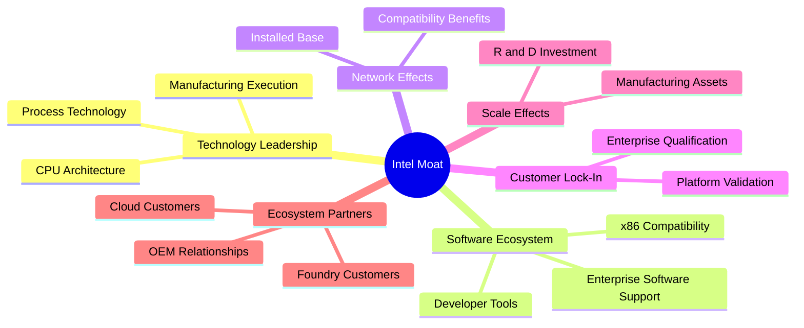
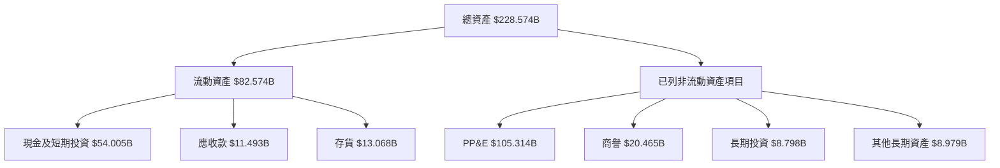
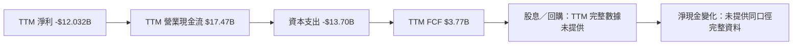
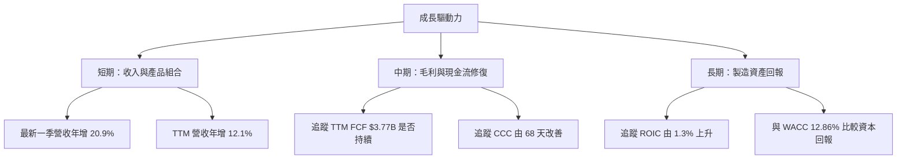
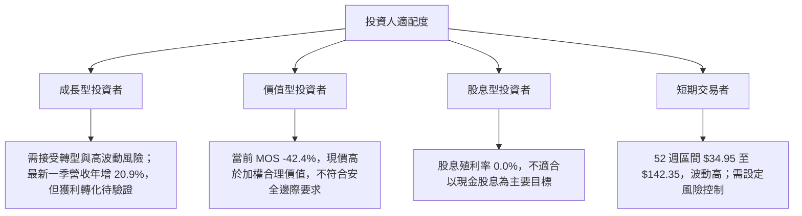

# INTC 基本面深度分析報告
> **報告日期**：2026-11-28 ｜ **語言**：繁體中文 ｜ **數據來源**：SEC 申報資料 (XBRL)、Yahoo Finance、Finviz、StockAnalysis、Roic.ai ｜ **分析師**：CFA 級機構研究

> **資料口徑提醒**：本報告優先引用 SEC 申報資料與程式計算的核實指標。部分彙整來源對 TTM 營業利益率、ROE、季度日期等欄位存在差異；需遵守核實數值的指標採核實口徑，其他歷史資料則標示其來源與期間。季度 EPS 預估值未提供，因此無法判定實際盈餘是否超預期。

## 目錄

| # | 章節 | 核心結論 |
|---|------|----------|
| 1 | 執行摘要 | 賣出；加權合理價值 $40.30；MOS -42.4% |
| 2 | 公司概覽與商業模式 | CPU 與製造資產具產業基礎，但市場份額數字未提供，護城河面臨競爭壓力 |
| 3 | 損益表深度分析 | TTM 營收 $59.89B、年增 12.1%；TTM 營業利益率 2.9% |
| 4 | 資產負債表分析 | 淨現金 $3.87B；流動比率 2.208 |
| 5 | 現金流量深度分析 | TTM FCF $3.77B、FCF Yield 1.24%；歷史年度 FCF 多為負值 |
| 6 | 獲利能力與資本效率 | ROIC 1.3% 低於 WACC 12.86%，目前資本回報不足以覆蓋資本成本 |
| 7 | 相對估值分析 | 同業相對估值低於當前股價；自身 P/S 位於五年歷史第 90 百分位 |
| 8 | DCF 內在價值評估 | DCF 不適用：預測最後一年 FCF 非正，不能自建模型 |
| 9 | 成長催化劑 | Q3 營收年增 20.9%，但未提供 TAM、產能或各業務營收拆分 |
| 10 | 風險矩陣 | 製造投資回報、競爭與高估值為主要風險 |
| 11 | 投資建議 | 賣出；須觀察利潤率、FCF、ROIC 與估值是否改善 |

---

## 1. 執行摘要

Intel 2026-11-27 收盤價為 **$57.40**。核實的 TTM 營收為 **$59.89B**、年增 **12.1%**，最新一季營收年增 **20.9%**，但 TTM 營業利益率僅 **2.9%**、ROIC 為 **1.3%**，低於 **12.86% WACC**；TTM FCF 為 **$3.77B**，FCF Yield 僅 **1.24%**。相對估值三角驗證的加權合理價值為 **$40.30**，由此計算 MOS 為 **-42.4%**，符合規則 20 的 **🔴 賣出**門檻。DCF 因模型最後一年 FCF 非正而不適用，本報告不自行建模，也不以 DCF 推出目標價。

### 1.0 一頁式投資儀表板（Portfolio Manager 30 秒速讀）

| 項目 | 內容 |
|------|------|
| **投資論點（3 句）** | ① TTM 營收年增 **12.1%**、最新一季年增 **20.9%**，顯示需求與出貨動能有改善。② TTM ROIC **1.3%** 對比 WACC **12.86%**，資本回報仍未覆蓋資金成本。③ 加權合理價值 **$40.30** 低於 $57.40 現價，MOS **-42.4%**，反映估值與基本面存在落差。 |
| **綜合評分** | **4.2/10**（引用 1.1；六項算術平均） |
| **財務健康** | 🟡 **有流動性緩衝**：淨現金 $3.87B、流動比率 2.208；但 F-Score 6/9 且 CCC 同比增加 33 天。 |
| **ROIC vs WACC** | **1.3% vs 12.86%**；摧毀股東價值，差距 **-11.56 個百分點**。 |
| **FCF 趨勢** | TTM FCF $3.77B；年度 FCF 曾連續為負，最新 FCF Yield **1.24%**。 |
| **估值** | Forward P/E **32.0588x** ｜ EV/EBITDA **16.611x** ｜ FCF Yield **1.24%** |
| **DCF 內在價值（基準）** | **N/A**；DCF 模型因預測最後一年 FCF 非正而不可計算，故無 DCF 折溢價。 |
| **安全邊際（MOS）** | **-42.4%＝($40.30 − $57.40) ÷ $40.30**（基準為 8.8 加權合理價值）｜ 🔴 無 |
| **預期報酬（基準情境 12M）** | **-29.8%**，以加權合理價值為參考：($40.30 − $57.40) ÷ $57.40。這不是 DCF 情境預測。 |
| **關鍵風險（前二）** | 製造資本支出回報不確定；ROIC 長期低於 WACC。 |
| **評級 + 信心度** | 🔴 **賣出** ｜ 信心：中（DCF 不適用，且季度 EPS 預估值缺漏）。 |

### 1.1 綜合評分卡（全報告唯一）

| 維度 | 評分（1–10） | 主要依據（引用數字與其來源章節） |
|------|--------------|----------------------------------|
| 成長性 | 6.0 | TTM 營收年增 12.1%、最新一季年增 20.9%；但 2022–2025 年營收由 $63.05B 降至 $52.85B，見第 3 章。 |
| 獲利能力 | 3.0 | TTM 營業利益率 2.9%、ROIC 1.3% 低於 WACC 12.86%、F-Score 6/9，見第 3、6 章。 |
| 財務健康 | 6.0 | 淨現金 $3.87B、流動比率 2.208；但 CCC 從 35 天升至 68 天，見第 4 章。 |
| 估值 | 2.0 | MOS -42.4%；P/S 5.1x 對比五年中位數 2.6x，見第 7、8 章。 |
| 護城河 | 5.0 | CPU 產品、軟體生態及自有製造資產提供基礎；但市場份額數據未提供，競爭者增長較快，見第 2 章。 |
| 管理層與資本配置 | 3.0 | 2022–2025 年資本支出每年 $14.65B–$25.75B，FCF 多年為負；2025 年 SBC $2.43B，且 F-Score 未通過稀釋股數測試，見第 5、6 章。 |
| **綜合評分** | **4.2** | 六項算術平均：$(6.0+3.0+6.0+2.0+5.0+3.0)÷6=4.1667$，四捨五入至一位小數。 |

### 1.2 五大投資論點 + 三大核心風險

| 類型 | 項目 | 具體依據 | 信心度 |
|------|------|----------|--------|
| 🟢 **投資論點①** | 營收動能改善 | TTM 營收 $59.89B、年增 12.1%；最新一季營收 $16.51B、年增 20.9%。仍須確認增長能否轉化為獲利。 | 🟡 中 |
| 🟢 **投資論點②** | 淨現金提供投資緩衝 | 現金及短期投資 $54.01B、總債務 $50.13B、淨現金 $3.87B；降低近期流動性壓力。 | 🟢 高 |
| 🟢 **投資論點③** | 最近季度毛利額改善 | 2026 Q3 毛利 $7.10B，高於 Q2 的 $6.51B；但單季獲利改善尚未充分反映為 TTM 高利潤率。 | 🟡 中 |
| 🟢 **投資論點④** | 2025 年後資本開支有所回落 | 2025 年 Capex $14.65B，低於 2024 年 $23.94B；若投資效率提升，可能改善 FCF。 | 🟡 中 |
| 🟢 **投資論點⑤** | 客戶與製造技術具長期選擇權 | Intel 同時經營 CCG、DCAI 與 Foundry；但各業務營收、利潤及產能利用率拆分未提供，選擇權不宜直接量化。 | 🟡 中 |
| 🟡 **風險①** | 資本回報長期低於資本成本 | ROIC 1.3% 對 WACC 12.86%；若差距未縮小，新增投資可能持續壓低股東價值。 | 🔴 高 |
| 🔴 **風險②** | 高資本需求與現金流波動 | 2022–2025 年年度 FCF 依序為 -$9.41B、-$14.28B、-$15.66B、-$4.95B；TTM 雖轉為 $3.77B，持續性待驗證。 | 🔴 高 |
| 🔴 **風險③** | 市場定價高於相對估值推算 | 現價 $57.40 對比加權合理價值 $40.30，MOS -42.4%；P/S 五年百分位 90%。 | 🔴 高 |

### 1.3 快速統計卡片

| 指標 | 公司實際值（期間） | 同業中位數 | 狀態 |
|------|--------------------|------------|------|
| 營收成長（TTM） | **12.1%** | — | 🟢 |
| 營收成長（最新一季年增） | **20.9%** | 44.7% | 🟡 |
| 毛利率（TTM） | **40.2%** | 56.0% | 🔴 |
| 營業利益率（TTM） | **2.9%** | — | 🔴 |
| ROIC（TTM） | **1.3%** | — | 🔴 |
| Forward P/E | **32.0588x** | 14.7x | 🔴 |
| FCF Yield（TTM） | **1.24%** | — | 🔴 |
| Piotroski F-Score | **6 / 9** | — | 🟡 |

### 1.4 投資結論

```text
╔══════════════════════════════════════════════════════════════════╗
║                    📊 投資結論摘要                               ║
╠══════════════════════════════════════════════════════════════════╣
║  評級：🔴 賣出（MOS -42.4%，依規則 20）                          ║
║  價格（2026-11-27 收盤）：$57.40                                 ║
║  DCF 內在價值（基準）：N/A（模型不適用）                         ║
║  安全邊際 MOS：-42.4%（＝($40.30−$57.40)÷$40.30）               ║
║  加權合理價值（8.8）：$40.30                                     ║
║  DCF 情境價值：N/A（DCF 模型不可計算，不提供情境目標價）         ║
║  綜合評分：4.2/10（引用 1.1）                                    ║
║  適合投資人：能承受高波動、以營運轉型進度為核心追蹤的投資人；    ║
║              不適合以當前價格追求安全邊際或穩定股息者。          ║
╚══════════════════════════════════════════════════════════════════╝
```

---

## 2. 公司概覽與商業模式

### 2.1 業務結構與收入來源

Intel 設計、開發、製造、行銷及銷售運算相關產品，業務涵蓋 Client Computing Group（CCG）、Data Center and AI（DCAI）與 Intel Foundry。可用資料未提供各業務的 TTM 營收、營收占比或軟體／服務收入，依規則不推算份額、不畫帶比例的業務結構圖。

**商業結構（非收入占比圖）**：CCG 主要服務個人電腦及客戶端運算；DCAI 服務伺服器、資料中心與 AI 運算；Foundry 承擔製程、晶圓製造與相關製造服務。Intel 的差異在於設計與製造並行，但製造資本投入也提高了固定成本與產能利用率風險。

### 2.2 市場份額

市場份額資料未提供，不能據此量化 Intel 在 PC CPU、伺服器 CPU、AI 加速器或晶圓代工市場的份額。可用數據顯示 Intel TTM 營收為 $59.89B、年增 12.1%，但低於所列 AMD 最新一季年增 44.7% 與 NVIDIA 103.2%；不同公司業務組合差異很大，不能單憑成長率推論市占變化。

### 2.3 競爭護城河分析



### 2.4 護城河強度

| 護城河項目 | 強度（強／中／弱） | 證據（引用數字或事實） | 會削弱它的情況 |
|------------|--------------------|------------------------|----------------|
| 技術與製造 | 中 | Intel 具設計及自有製造能力；帳面 PP&E 約 $105.31B（2026 年 9 月期資料），展現資產規模，也代表高折舊與資本需求。 | 製程進度落後、良率偏低或產能利用不足。 |
| 軟體生態 | 中 | x86 相容性與既有企業軟體支援形成轉換成本；量化客戶留存與授權數據未提供。 | ARM、雲端自研晶片或跨平台軟體工具降低轉換成本。 |
| 網路效應 | 弱至中 | 大量既有軟體與硬體相容性有利於延續採用；但未提供活躍開發者或裝置基數資料。 | 生態系統轉向其他架構且軟體相容性改善。 |
| 客戶鎖定 | 中 | 商用與資料中心平台通常需驗證、部署及維運，換平台有成本；客戶集中度與合約年期未提供。 | 價格／效能差距擴大或客戶採多供應商策略。 |
| 規模效應 | 中 | TTM 營收 $59.89B、PP&E 約 $105.31B；規模可分攤研發，但高固定成本令低利用率成為反向槓桿。 | 市場需求下降、產能過剩或資本效率落後競爭者。 |
| 生態夥伴 | 中 | CCG、DCAI 與製造業務連結 OEM、雲端與供應鏈夥伴；合作收入與客戶數未提供。 | 客戶轉向自研晶片、代工對手或其他平台。 |

**1.1 護城河評分理由**：評為 **5.0/10**，因平台相容性、既有客戶與製造資產仍有價值，但缺乏市場份額及客戶留存數據，且巨額資產投入尚未轉化為高 ROIC。

---

## 3. 損益表深度分析

### 3.1 年度收入成長趨勢（近 4 年）

下表年度營收依年度損益資料，金額取至 $0.01B；2022–2025 年 CAGR 約 **-5.7%**。

```text
╔══════════════════════════════════════════════════════════════════╗
║              Intel 年度收入趨勢（FY2022-FY2025）                ║
╠══════════════════════════════════════════════════════════════════╣
║  FY2022  $63.05B  █████████████████████████  YoY: —             ║
║  FY2023  $54.23B  ██████████████████████░░░  YoY: -14.0%  🔴    ║
║  FY2024  $53.10B  █████████████████████░░░░  YoY:  -2.1%  🔴    ║
║  FY2025  $52.85B  █████████████████████░░░░  YoY:  -0.5%  🔴    ║
║                                                                  ║
║  2022–2025 營收 CAGR：($52.85B ÷ $63.05B)^(1/3) − 1 ≈ -5.7%     ║
╚══════════════════════════════════════════════════════════════════╝
```

年度收入由 $63.05B 下滑至 $52.85B，主要反映前幾年需求、產品組合及競爭壓力的綜合結果；2025 年跌幅收窄，但年度營收仍低於 2022 年。TTM 年增轉正至 12.1%，說明近期趨勢改善，尚需連續季度確認。

### 3.2 季度收入趨勢分析

| 季度 | 營收 | QoQ 成長 | YoY 成長 | 備註 |
|------|------|----------|----------|------|
| 2025 Q4 | $13.67B | +0.2% | — | QoQ 對比 2025 Q3 $13.65B；該季 YoY 未在季度成長資料中提供。 |
| 2026 Q1 | $13.58B | -0.7% | +7.2% | QoQ 對比 2025 Q4 $13.67B；YoY 依 StockAnalysis 季度資料。 |
| 2026 Q2 | $16.13B | +18.8% | +25.4% | 以 $16.128B 與前季 $13.577B 計算；顯示季度收入明顯抬升。 |
| 2026 Q3 | $16.51B | +2.4% | +20.9% | 核實的最新一季年增率為單季數字，不是 TTM。 |

季度表的資料標示為 2026-09-30，SEC 最新季度結束日另列 2026-09-26；期間標籤存在幾日差異，分析以季度資料表及核實指標為準。最新一季營收年增 20.9%，但 Q3 淨利年減 18.3%、EPS 年減 32.7%，收入增長沒有同步轉化為盈餘增長。

### 3.3 利潤率演變分析

| 利潤率指標 | FY2022 | FY2023 | FY2024 | FY2025 | 趨勢 | 評估 |
|------------|--------|--------|--------|--------|------|------|
| **毛利率** | 42.6% | 40.0% | 32.7% | 34.8% | 2024 明顯下滑，2025 回升約 2.1 個百分點 | 🔴 |
| **營業利益率** | 3.7% | 0.1% | -8.9% | 約 -0.04% | 2024 虧損後 2025 接近損益兩平 | 🔴 |
| **淨利率** | 12.7% | 3.1% | -35.3% | -0.5% | 2024 極端虧損，2025 大幅收斂 | 🔴 |

計算口徑：年度毛利率＝年度毛利÷年度營收；營業利益率及淨利率按年度損益表數值計算，四捨五入至一位小數。TTM 核實營業利益率為 **2.9%**，與彙整資料中其他營業利益率欄位不同；本報告涉及 TTM 指標時遵循核實數值。

毛利率在 2024 年下降，與收入下滑及產品／製造成本吸收壓力一致；2025 年回升，但仍低於 2022 年。營業利益率由 2024 年 -8.9% 回升至 2025 年接近零，顯示費用控制或營運條件較前期改善，但 TTM 2.9% 仍偏薄。最新季度營業利益率核實值為 15.3%，與 TTM 2.9% 的差異代表近期季度改善較快，惟不可將單季水準直接外推全年。

### 3.4 費用結構分析

**N/A（完整費用結構未提供）**：雖有 R&D 支出等單項數字，但缺少可一致對照的銷貨成本、研發、銷售管理、重整及其他費用明細，因此不畫費用占比圓餅圖，也不以不完整項目拼成總額。

### 3.5 季度 EPS 趨勢與盈餘品質（Quality of Earnings）

#### 季度 EPS 表現

| 季度 | 實際 EPS（StockAnalysis） | 預估 EPS | 超預期／不及預期 |
|------|--------------------------|----------|--------------------|
| 2025 Q4 | -$0.12 | N/A | 無法判定 |
| 2026 Q1 | -$0.73 | N/A | 無法判定 |
| 2026 Q2 | -$2.16 | N/A | 無法判定 |
| 2026 Q3 | $0.63 | N/A | 無法判定 |

最近四季 EPS 預估與實際驚喜值資料均為缺漏，不能判定 beat／miss。依核實資料，最新季度 EPS 年增 **-32.7%**；StockAnalysis 季度 EPS 顯示 Q3 由 2025 Q3 的 $0.90 降至約 $0.63。季度淨利受 Q2 大額虧損影響，單看連續季度 EPS 容易受一次性或非經常項目扭曲。

#### 盈餘品質量化

| 盈餘品質項目 | 數值／佔比 | 評估 |
|--------------|-----------|------|
| 股權薪酬 SBC / 營收 | 2025：$2.43B ÷ $52.85B = **4.6%** | 🔴 比例不低，SBC 會稀釋股東；Piotroski 稀釋股數測試未通過。 |
| SBC / 營業現金流 | 2025：$2.43B ÷ $9.70B = **25.1%** | 🟡 SBC 是非現金加回項，佔 OCF 四分之一左右，不能忽略其經濟成本。 |
| FCF / 淨利（現金轉換率） | TTM FCF $3.77B ÷ TTM 淨利 -$12.032B = **-31.3%** | 🔴 分母為負，比例不具一般「越高越好」解讀；TTM 淨利口徑亦可能受重大項目影響。 |
| 一次性／非經常性損益 | SEC 資料未提供可完整拆分的 TTM 調整項 | 🟡 2026 Q2 淨損 -$11.03B、Q3 淨利 $3.32B，季度波動極大，應逐項檢視申報附註。 |
| 有效稅率異常 | 本報告可用資料未提供一致的 TTM 有效稅率 | 🟡 N/A；不能判定稅務利益對盈餘的貢獻。 |
| 資本化支出 vs 費用化 | TTM Capex $13.70B；TTM 折舊及攤銷明細未在核實區塊列示 | 🟡 無法量化資本化支出相對折舊的幅度；製造業投資通常先進資產負債表，再透過折舊進損益。 |

**盈餘品質結論**：TTM 淨利率 -20.1%、TTM FCF $3.77B，兩者方向相反；同時季度淨利出現由 -$11.03B 到 $3.32B 的大幅變動。現有資料不足以拆分一次性項目與稅務影響，因此不可將單季獲利直接視作可持續經濟盈餘。估值應更多依賴可持續現金流與資本回報，而非單季 EPS。

---

## 4. 資產負債表分析

### 4.1 資產結構分解

以下為 StockAnalysis 2026 年 9 月期資料所列主要資產項目；因部分明細及合併抵銷項目未提供，並非完整資產負債表拆解。



Intel 資產中 PP&E 約 $105.31B，反映製造資產高度資本密集；現金及短期投資 $54.01B 提供資金緩衝，但大規模固定資產也增加產能利用率不足時的折舊及回報壓力。

### 4.2 流動性與營運資金分析

| 指標 | 最新值 | 歷史值 | 評估 |
|------|--------|--------|------|
| 流動比率 | 2.208 | 2025 年末：$63.69B ÷ $31.57B ≈ 2.02 | 🟢 短期資產覆蓋流動負債有緩衝。 |
| 速動比率 | 1.751 | N/A | 🟢 不含存貨後仍高於 1。 |
| 現金及短期投資 | $54.01B | 2025 年末 $37.42B | 🟢 增加 $16.59B；資金來源與用途需追蹤。 |
| 淨現金 | $3.87B | N/A | 🟡 現金高但債務亦高，淨現金緩衝相對總資產有限。 |

**營運資金天數（照抄品質指標）**

| 指標 | 最新 TTM | 一年前 TTM | 變化 | 解讀 |
|------|----------|------------|------|------|
| DSO 應收帳款天數 | 25 天 | 22 天 | +3 天 | 收款周期稍長；需觀察是否為客戶付款條件或季度組合變動。 |
| DIO 存貨天數 | 133 天 | 122 天 | +11 天 | 庫存天數增加，可能占用更多營運資金；若需求不及預期亦提高庫存風險。 |
| DPO 應付帳款天數 | 90 天 | 109 天 | -19 天 | 付款周期縮短，對供應商付款較快，降低了供應商融資對現金的支撐。 |
| CCC 現金轉換週期 | 68 天 | 35 天 | +33 天 | 現金回收周期延長，方向不利；主要由 DIO 增加、DPO 下降共同造成。 |

### 4.3 債務結構分析

```text
╔══════════════════════════════════════════════════════════════════╗
║                   Intel 債務健康診斷                            ║
╠══════════════════════════════════════════════════════════════════╣
║  總債務：        $50.13B     ████████████████████  🟡            ║
║  現金+短期投資： $54.01B     ██████████████████████ 🟢          ║
║  淨現金：         $3.87B     ██░░░░░░░░░░░░░░░░░░  🟡            ║
║                                                                  ║
║  流動比率：       2.208x     🟢                                 ║
║  Quick Ratio：    1.751x     🟢                                 ║
║  Debt/EBITDA：    N/A（核實區塊未提供同口徑 EBITDA）             ║
║  利息保障倍數：   N/A（利息費用與 EBIT 口徑未提供可複算資料）    ║
╚══════════════════════════════════════════════════════════════════╝
```

2026 年 9 月期現金及短期投資 $54.01B 略高於總債務 $50.13B，形成 $3.87B 淨現金。年報列示 2025 年末債務 $46.59B，低於最新期總債務；債務餘額增加值得持續追蹤。Debt/EBITDA 與利息保障倍數缺少一致口徑，故不以其他來源拼湊。

### 4.4 股東權益趨勢

```text
╔══════════════════════════════════════════════════════════════════╗
║                    Intel 股東權益趨勢                            ║
╠══════════════════════════════════════════════════════════════════╣
║  FY2022  $101.42B  ████████████████████░░░░░                    ║
║  FY2023  $105.59B  █████████████████████░░░░                    ║
║  FY2024   $99.27B  ████████████████████░░░░░                    ║
║  FY2025  $114.28B  ███████████████████████░░                     ║
╚══════════════════════════════════════════════════════════════════╝
```

股東權益 FY2025 回升至 $114.28B，但帳面權益增長不等同於股東價值創造；ROIC 1.3% 仍低於 WACC 12.86%。

---

## 5. 現金流量深度分析

### 5.1 現金流量瀑布圖



淨利與營業現金流差距很大，代表現金流包含非現金費用、營運資金變化及其他調整；現有資料不足以完整拆解各項來源。TTM FCF 的定義固定為營業現金流減資本支出，即 $17.47B − $13.70B = $3.77B。

### 5.2 FCF 轉換率趨勢

| 年度 | 年度 FCF | 年度淨利 | FCF / 淨利 | 解讀 |
|------|----------|----------|-----------|------|
| 2022 | -$9.41B | $8.01B | -117.5% | 高資本支出壓過當年盈餘，現金轉換為負。 |
| 2023 | -$14.28B | $1.69B | -845.0% | 分母小且為正，負轉換率顯著；投資支出遠高於現金盈餘。 |
| 2024 | -$15.66B | -$18.76B | 83.5% | 兩者皆為負，比例不宜作「良好轉換」解讀。 |
| 2025 | -$4.95B | -$0.267B | 1,853.9% | 淨損很小，造成比率失真；絕對 FCF 仍為負。 |
| TTM 至 2026-09-26 | $3.77B | -$12.032B | -31.3% | 淨利為負，比例不適合直接比較；FCF 絕對額轉正但須驗證持續性。 |

### 5.3 自由現金流趨勢

```text
╔══════════════════════════════════════════════════════════════════╗
║               Intel 年度 FCF：實際值與最新 TTM                  ║
╠══════════════════════════════════════════════════════════════════╣
║  FY2022  -$9.41B  ◀█████████░░░░░░░░░░░░░░░                     ║
║  FY2023 -$14.28B  ◀██████████████░░░░░░░░░░                     ║
║  FY2024 -$15.66B  ◀████████████████░░░░░░░░                     ║
║  FY2025  -$4.95B  ◀█████░░░░░░░░░░░░░░░░░░░                     ║
║  TTM     +$3.77B  ████░░░░░░░░░░░░░░░░░░░░  FCF Yield 1.24%    ║
╚══════════════════════════════════════════════════════════════════╝
```

TTM FCF 轉正是改善訊號，但歷史年度 FCF 連續為負，且年度 Capex 從 FY2022 的 $24.84B 降至 FY2025 的 $14.65B。現金流改善一部分可能來自支出下降，故應追蹤資本支出降低是否伴隨產能、產品競爭力或製程路線延誤。

### 5.4 資本配置評估

資本配置金額中可對照的項目如下；未提供的回購與留存金額不推算。

| 配置項目 | 已知數據 | 評估 |
|----------|----------|------|
| Capex | FY2022 $24.84B；FY2023 $25.75B；FY2024 $23.94B；FY2025 $14.65B；TTM $13.70B | 資本密集度高，降低後有助 FCF，但需檢查投資是否足以支撐競爭力。 |
| 股息 | FY2025 $0；FY2024 $1.60B；FY2023 $3.09B；FY2022 $6.00B | 股息支出大幅下調，資金優先留在資產負債表與營運投資。 |
| SBC | FY2025 $2.43B；FY2024 $3.41B；FY2023 $3.23B | SBC 對股東有稀釋成本；FY2025 仍相當於營收 4.6%。 |
| 回購／留存 | 回購金額與 TTM 留存現金用途未完整提供 | N/A；不從現金變化反推。 |

---

## 6. 獲利能力與資本效率

### 6.1 ROE / ROA / ROIC 趨勢

| 指標 | 最新 TTM | 其他可得數據 | 評估 |
|------|----------|--------------|------|
| ROE | -10.5%（核實指標） | 彙整市場資料另列 -9.6%，口徑不同 | 🔴 股東權益報酬為負；採核實值。 |
| ROA | N/A（核實品質區塊未列 TTM 值） | 彙整資料列 1.8% | 🟡 不混用口徑作趨勢；F-Score 的 ROA > 0 測試未通過。 |
| ROIC | 1.3% | 近年歷史序列未提供一致口徑 | 🔴 明顯低於資本成本。 |

行業均值資料未提供，故不列同業平均比較。Intel 的資本效率判斷重點是 ROIC 與自身 WACC 的差距，而非缺乏可比口徑的產業平均。

### 6.2 ROIC vs WACC 分析（核心價值創造判斷）

```text
╔══════════════════════════════════════════════════════════════════╗
║                ROIC vs WACC 深度分析                            ║
╠══════════════════════════════════════════════════════════════════╣
║  WACC（直接採用核實資本成本數據）：12.86%                        ║
║  ├── 無風險利率（10Y 美債）：4.94%                               ║
║  ├── ERP：5.00%                                                  ║
║  ├── 原始 Beta：2.43；採用調整後 Beta：1.95                     ║
║  ├── Ke = 4.94% + 1.95 × 5.00% = 14.69%                         ║
║  ├── 稅前債務成本：2.18%；稅率：21.0%                            ║
║  ├── 稅後債務成本：2.18% × (1 − 21.0%) = 1.7222%               ║
║  ├── 股權／債務權重：85.9%／14.1%                                ║
║  └── WACC：核實採用值 12.86%                                     ║
║                                                                  ║
║  ROIC（TTM）：1.3%                                               ║
║  EVA 差距：ROIC − WACC = 1.3% − 12.86% = -11.56 個百分點        ║
║                                                                  ║
║  ROIC  1.3%   ▓░░░░░░░░░░░░░░░░░░░░░░░░░░░░  🔴               ║
║  WACC 12.86%  ▓▓▓▓▓▓▓▓▓▓▓▓▓▓▓▓▓▓▓▓▓▓▓▓▓▓▓▓  ──               ║
║                                                                  ║
║  結論：ROIC 未覆蓋資本成本；依目前 TTM 數據，資本配置尚未創造    ║
║        足以補償股東風險的經濟報酬。                              ║
╚══════════════════════════════════════════════════════════════════╝
```

WACC 及其組成依核實資本成本資料直接引用，未另行建立折現率。Beta 原始值 2.43，調整後採 1.95；調整公式為 ⅔ × 2.43 + ⅓。ROIC 1.3% 與 WACC 12.86% 相差 **-11.56 個百分點**，因此當前投資回報對股東價值是負向的。這不代表未來必然如此，但轉型論點必須由後續 ROIC 實際上升來驗證。

### 6.3 杜邦三因素分解

| 因素 | 數值（TTM） | 解讀 |
|------|-------------|------|
| 淨利率 | -20.1% | 淨利為負，是 ROE 為負的主要來源。 |
| 資產週轉率 | 0.26 | 資產相對營收的周轉較低，與大型製造資產基礎相符。 |
| 權益乘數 | 1.99 | 財務槓桿放大資產報酬變動，但不是造成負 ROE 的唯一因素。 |
| **ROE** | **-10.5%** | 核實杜邦：-20.1% × 0.26 × 1.99 = 約 -10.4%；以提供的品質指標 ROE -10.5% 為準，差異來自四捨五入。 |

### 6.4 財務體質：Piotroski F-Score

| 測試 | 結果 | 解讀 |
|------|------|------|
| ROA > 0 | ❌ 未通過 | 獲利能力指標偏弱。 |
| 營業現金流 > 0 | ✅ 通過 | TTM OCF 為 $17.47B。 |
| ROA 高於一年前 | ❌ 未通過 | 未顯示資產報酬改善。 |
| 營業現金流 > 淨利 | ✅ 通過 | 現金流高於會計淨利，但淨利為負時解讀需審慎。 |
| 長期負債 ÷ 總資產低於一年前 | ✅ 通過 | 槓桿指標相較一年前改善。 |
| 流動比率高於一年前 | ✅ 通過 | 短期流動性指標改善。 |
| 稀釋股數未增加 | ❌ 未通過 | 股數稀釋降低每股價值；與 SBC 成本相符。 |
| 毛利率高於一年前 | ✅ 通過 | 毛利率相較一年前改善。 |
| 資產週轉率高於一年前 | ✅ 通過 | 資產使用效率相較一年前改善。 |

**F-Score：6/9。** 分數顯示部分營運與資產負債表指標改善，但 ROA 與稀釋股數測試未通過，獲利改善品質仍需確認。

---

## 7. 相對估值分析

### 7.1 同業估值比較表格

| 估值指標 | **Intel** | **AMD** | **NVIDIA** | **Qualcomm** | Intel 評估 |
|----------|-----------|---------|------------|--------------|------------|
| **Trailing P/E** | N/A（TTM EPS 為負） | 90.7x | 16.2x | 14.1x | 🔴 Intel TTM 虧損，P/E 不具意義。 |
| **Forward P/E** | 32.0588x | 24.1x | 9.1x | 14.7x | 🔴 高於同業中位數 14.7x。 |
| **P/S Ratio** | 5.093852x | 15.5x | 10.0x | 4.4x | 🟡 低於 AMD／NVIDIA，但高於 Qualcomm。 |
| **EV/EBITDA** | 16.611x（市場資料） | 61.9x | 14.7x | 18.8x | 🟡 同業資料顯示 Intel 高於 NVDA、低於 AMD。 |
| **最新一季營收年增** | 20.9% | 44.7% | 103.2% | -8.4% | 🟡 高於 Qualcomm、低於 AMD 與 NVIDIA。 |
| **毛利率（TTM）** | 40.2% | 56.0% | 74.9% | 53.1% | 🔴 低於三家同業。 |

同業倍數採 Yahoo Finance 的 Peer multiples；同業中位數 Forward P/E 為 **14.7x**，EV/EBITDA 的有效比較公司為 NVIDIA 與 Qualcomm，中位數 **16.8x**。不同來源的 Intel EV/EBITDA 數值可能因日期與計算口徑不同；第 7.4 與第 8.8 節的相對估值回推則嚴格採用核實估值方法區塊所列結果，不以本表倍數替換。

### 7.2 歷史估值區間分析

```text
╔══════════════════════════════════════════════════════════════════╗
║              Intel 五年估值位置（TTM 倍數）                     ║
╠══════════════════════════════════════════════════════════════════╣
║  P/S       1.5x ├──────── 中位數 2.6x ────────┤ 11.5x          ║
║                              ↑                                  ║
║                       現值 5.1x                                  ║
║                       百分位 90%                                 ║
║                                                                  ║
║  EV/EBITDA 6.4x ├──────── 中位數 23.6x ───────┤ 536.5x         ║
║                       ↑                                          ║
║                 現值 22.3x；百分位 41%                           ║
╚══════════════════════════════════════════════════════════════════╝
```

P/S 現值 5.1x 高於五年中位數 2.6x，且位於歷史第 90 百分位；這代表收入倍數偏高，要求未來增長與利潤率持續改善。EV/EBITDA 現值 22.3x 略低於五年中位數 23.6x、位於第 41 百分位，但歷史區間上限 536.5x 受異常低 EBITDA 時期影響，解讀須保留。

### 7.3 情境價值（Bear / Base / Bull）

**N/A（DCF 無法計算：核實 DCF 模型顯示，預測最後一年 FCF 非正，原因為資本支出高於營業利益與折舊攤銷；依規則不建構自有 DCF，也不提供悲觀／基準／樂觀 DCF 情境目標價。）**

### 7.4 相對估值隱含價格區間

```text
╔══════════════════════════════════════════════════════════════════╗
║             相對估值隱含每股價值與現價位置                      ║
╠══════════════════════════════════════════════════════════════════╣
║  $26.35 ───────── $43.23 ─────── 現價 $57.40 ───────── $89.91  ║
║  Forward P/E      EV/EBITDA       Intel 收盤價       分析師共識  ║
╚══════════════════════════════════════════════════════════════════╝
```

| 方法 | 每股價值 | 相對現價 | 依據 |
|------|----------|----------|------|
| 同業 Forward P/E | $26.35 | -54.1% | 同業中位數 14.7x × Intel Forward EPS $1.79。 |
| 同業 EV/EBITDA | $43.23 | -24.7% | NVIDIA、Qualcomm 同業中位數 16.8x × TTM EBITDA，再加淨現金。 |
| 分析師共識目標價 | $89.91 | +56.6% | 43 位分析師平均目標價；此值為分析師預測，不是獨立現金流估值。 |

---

## 8. DCF 內在價值評估（Discounted Cash Flow）

> **模型狀態：N/A。** SEC 申報資料與程式計算所示 DCF MODEL 不可計算：預測最後一年 FCF 非正，原因為資本支出高於營業利益與折舊攤銷。依規則，不自行補假設、不重建另一套 DCF，因此不產生 DCF 基準內在價值、敏感度矩陣或 DCF 情境價格。

### 8.0 估值推理鏈（Thinking Logic）

公司長期價值理論上由現有 CPU／資料中心產品現金流、製造業務資本回報，以及新產品與代工業務的增量貢獻共同決定；但各業務營收占比未提供，不能量化拆分。核實 DCF 模型因最後一年 FCF 非正而關閉，故不能在沒有程式模型輸出的情況下補做 FCFF 預測或終值推導。

| 決策點 | 本報告採用 | 理由 | 曾考慮但否決 | 否決理由 |
|--------|-----------|------|--------------|----------|
| 現金流定義 | DCF 不適用 | 模型已判定預測末年 FCF 非正 | 自行改用 FCFE 或調整資本支出重建 | 違反核實模型只能照抄、不得另建 DCF 的要求 |
| 預測期 N | N/A | DCF MODEL 未提供可用預測期 | 自行指定 5–10 年 | 缺乏模型輸入來源 |
| 終值方法 | N/A | 無有效預測末年現金流可作終值基礎 | Gordon Growth／退出倍數 | 缺少可驗算的終值輸入 |
| EBIT 基礎 | N/A | 無可用 DCF 預測表 | 自行選 GAAP／非 GAAP | 無法與程式模型一致性核對 |

### 8.1 模型假設總表（Model Inputs）

**N/A（DCF 模型不可計算：預測最後一年 FCF 非正；因此無程式輸出的預測期、營收 CAGR、利潤率、稅率、Capex、D&A、營運資金、SBC、股數稀釋、永續成長率及終值假設，不自行補列。）**

### 8.2 折現率推導（WACC）

```text
╔══════════════════════════════════════════════════════════════════╗
║                    WACC 核實輸入（非 DCF 重建）                 ║
╠══════════════════════════════════════════════════════════════════╣
║  無風險利率 Rf（10Y 美債）：4.94%                                ║
║  股權風險溢酬 ERP：5.00%                                         ║
║  原始 Beta：2.43；調整後 Beta：1.95                              ║
║  股權成本 Ke：4.94% + 1.95 × 5.00% = 14.69%                     ║
║  稅前債務成本：2.18%；預設稅率：21.0%                            ║
║  權重 E／D：85.9%／14.1%                                         ║
║  WACC：12.86%（直接採用核實資本成本資料）                        ║
╚══════════════════════════════════════════════════════════════════╝
```

上述 WACC 及組成用於第 6.2 節的 ROIC 比較；這裡不將其轉作另一套 DCF 折現模型。債務成本分母與資本權重的底層細項並未在可用數據中完整列示，因此不另行推導或修正核實 WACC。

### 8.3 逐年自由現金流預測（基準情境）

**N/A（DCF 模型不可計算：預測最後一年 FCF 非正，且沒有可用的逐年 DCF 預測表。依規則不自建逐年營收、EBIT、FCFF 或折現值。）**

### 8.4 終值計算（Terminal Value）

**N/A（無可用預測期末 FCFF，亦無程式計算的終值；不自行使用 Gordon Growth 或退出倍數法。）**

### 8.5 企業價值 → 每股內在價值（Bridge）

**N/A（DCF EV、終值現值及股權價值均未能計算，因此不提供 DCF 每股內在價值或 DCF 折溢價。）**

### 8.6 敏感性分析（WACC × 永續成長率）

**N/A（沒有可用 DCF 基準模型輸出，無法建立 WACC × g 矩陣；不自建情境值或敏感度數字。）**

### 8.7 反推 DCF（Reverse DCF：市場在預期什麼）

**N/A（DCF 基準模型不可計算，沒有可供固定其餘變數後反推的現金流方程式；因此不反推營收 CAGR、利潤率、永續成長率或預測期。）**

### 8.8 估值三角驗證與安全邊際

核實估值方法提供同業 Forward P/E、同業 EV/EBITDA 與分析師共識三項；DCF 因無法計算而剔除。公司類型為 **profitable**，方法權重依核實估值方法固定，不作調整。

| 估值方法 | 隱含每股價值 | 上行空間（÷現價） | 權重 | 說明 |
|----------|--------------|-------------------|------|------|
| 同業 Forward P/E | $26.35 | -54.1% | 45% | 同業中位數 14.7x × Intel Forward EPS $1.79。 |
| 同業 EV/EBITDA | $43.23 | -24.7% | 45% | 同業中位數 16.8x × TTM EBITDA，加回淨現金。 |
| 分析師共識目標價 | $89.91 | +56.6% | 10% | 43 位分析師平均目標價。 |
| **加權合理價值** | **$40.30** | **-29.8%** | **100%** | DCF 不可計算，未納入；其權重按核實方法分配。 |

**逐步演算**

- 權重合計：45% + 45% + 10% = **100%**。
- 加權合理價值：  
  $26.35 × 45% + $43.23 × 45% + $89.91 × 10%  
  = $11.8575 + $19.4535 + $8.991  
  = **$40.302 ≈ $40.30**。
- 安全邊際 MOS：  
  $(加權合理價值 − 現價) ÷ 加權合理價值  
  = ($40.30 − $57.40) ÷ $40.30  
  = -$17.10 ÷ $40.30  
  = **-42.4%**。
- 上行空間：  
  $(加權合理價值 − 現價) ÷ 現價  
  = ($40.30 − $57.40) ÷ $57.40  
  = -$17.10 ÷ $57.40  
  = **-29.8%**。

```text
╔══════════════════════════════════════════════════════════════════╗
║                  估值區間與安全邊際                              ║
╠══════════════════════════════════════════════════════════════════╣
║  $26.35 ─────── $40.30 ─────── $57.40 ─────────── $89.91       ║
║  同業 P/E       加權合理值       現價              分析師共識     ║
║                                                                  ║
║  安全邊際 MOS = ($40.30 − $57.40) ÷ $40.30 = -42.4%             ║
║  MOS 評估：🔴 無；現價高於加權合理價值                           ║
║  上行空間 = ($40.30 − $57.40) ÷ $57.40 = -29.8%                 ║
║  DCF 買入區間：N/A；本報告不以 DCF 推導區間                      ║
╚══════════════════════════════════════════════════════════════════╝
```

由於規則 20 的評級依 MOS 門檻判定，MOS 低於 -25% 對應 **🔴 賣出**，本報告不因質化因素調整評級。加權合理價值只用於相對估值三角驗證，不等同 DCF 內在價值。

> 🔎 **程式複算（Python，依本節各項自動重算）**
>
> 加權合理價值 = $26.35 × 45% + $43.23 × 45% + $89.91 × 10% = **$40.30**（權重合計 100%）
>
> 以價格 $57.40 計：MOS = **-42.4%**，上行空間 = **-29.8%**
>
> ✅ 與本節所寫數值一致。

### 8.9 DCF 模型的局限與失效條件

- **終值依賴度**：N/A；沒有可用 DCF 終值及企業價值，不能計算終值占比。
- **最脆弱的假設**：無法逐項列出模型假設，因核實 DCF 未產生有效模型。對投資判斷最關鍵的可觀察變數是製造資本支出能否帶來高於資本成本的回報。
- **不適用情境說明**：當現金流預測末年非正、獲利波動大或再投資需求高時，單一 DCF 數字可靠度下降。評價應搭配同業倍數、收入與利潤率改善趨勢、資本支出回報及資產負債表分析。
- **與第 10 章風險矩陣的連結**：製程或產能利用率不佳會壓低營業利潤率及 FCFF；競爭加劇會壓低收入成長與定價；高資本支出則會推遲 FCF 轉正或降低現金流餘額。

### 8.10 複算檢核表（Audit Trail）

| # | 檢核項目 | 檢查方式 | 結果 |
|---|----------|----------|------|
| 1 | 所有 DCF 高／中敏感度輸入均有推導 | DCF MODEL 不可計算，無輸入可推導 | N/A |
| 2 | 每個 DCF 假設都有來源 | 未補列任何自行假設 | ✅ |
| 3 | WACC 五步算式完整且可重算 | 本報告直接引用核實 WACC；未建立 DCF WACC | N/A |
| 4 | Kd 分母與債務權重範圍一致 | 底層計息負債細項未提供，不另推算 | N/A |
| 5 | WACC 與第 6.2 節同值 | 均引用 12.86% | ✅ |
| 6 | 逐年預測欄數等於 N | DCF 預測期 N 未提供 | N/A |
| 7 | FY+1 FCFF 與 PV 可複算 | 無逐年預測表 | N/A |
| 8 | 預測期 PV 加總可核對 | 無預測期 PV | N/A |
| 9 | WACC > g | g 未提供 | N/A |
| 10 | 終值以 FY+N FCFF 為基礎 | 無有效終值 | N/A |
| 11 | EV 至每股橋接可複算 | DCF EV 未計算 | N/A |
| 12 | SBC 組合合法且只計一次 | 未建立 DCF；未假設 SBC 模型處理方式 | N/A |
| 13 | 敏感度矩陣基準格等於 DCF 每股價值 | 無矩陣 | N/A |
| 14 | 矩陣無效格已正確排除 | 無矩陣 | N/A |
| 15 | DCF 三情境權重合計 100% | DCF 情境未提供 | N/A |
| 16 | Reverse DCF 每列只放開一個變數 | 未進行反推 | N/A |
| 17 | MOS 以 8.8 加權合理價值為分母 | $40.30 為分母；折溢價不適用 | ✅ |
| 18 | 已完整輸出至第 11 章 | 章節完整 | ✅ |
| 19 | 加權合理價值等於各方法加權合計 | 算式結果 $40.302，四捨五入 $40.30 | ✅ |
| 20 | 評級符合 MOS 門檻 | MOS -42.4%，評級賣出 | ✅ |

---

## 9. 成長催化劑

### 9.1 催化劑時間軸

沒有提供具體產品上市、製程量產、產能爬坡或客戶合約時點，故不以推測日期製作 Gantt 圖。可追蹤的近期數據催化劑是後續季度營收、營業利益率、Capex、FCF 與庫存變化。

| 時間範圍 | 可觀察催化劑 | 量化基準 |
|----------|--------------|----------|
| 短期：下一季財報 | 營收動能是否延續、單季營業利益率是否維持改善 | 最新一季營收年增 20.9%；單季營業利益率核實值 15.3%。 |
| 中期：未來數季 | Capex 下降是否轉化為穩定正 FCF，CCC 是否改善 | TTM Capex $13.70B、FCF $3.77B、CCC 68 天。 |
| 長期：未來數年 | 製造投資是否推升資本回報，ROIC 是否向 WACC 靠攏 | ROIC 1.3% 對比 WACC 12.86%。 |

### 9.2 TAM 市場規模分析

**N/A（TAM 數據未提供）**。Intel TTM 營收為 $59.89B，TTM 年增 12.1%，最新一季年增 20.9%，說明近期收入趨勢轉正。由於沒有可引用的各市場 TAM、年份及來源，不能計算市場滲透率或自行估列市場規模。

### 9.3 成長驅動力結構圖



---

## 10. 風險矩陣

### 10.1 風險評分矩陣

可用財務數據未提供各風險事件的發生機率或衝擊百分比。為避免把主觀機率偽裝成客觀數據，本報告不提供數值座標的 quadrantChart；下表以方向與可量化監控指標呈現風險。

### 10.2 風險清單詳細分析

| # | 風險項目 | 發生機率 | 財務衝擊 | 風險評分 | 緩解措施 |
|---|----------|----------|----------|----------|----------|
| 1 | 🔴 **資本投入回報不足** | 無可靠機率資料 | 高：ROIC 1.3% 低於 WACC 12.86% | 高優先 | 追蹤新投資的產能利用率、製造利潤率、Capex 及 ROIC；若 ROIC 長期低於 WACC，重新評估資本配置。 |
| 2 | 🔴 **自由現金流再次轉負** | 無可靠機率資料 | 高：年度 FCF 2022–2025 多為負；TTM 目前 $3.77B | 高優先 | 逐季監控 OCF、Capex 及 TTM FCF；以 OCF − Capex 的同一口徑比較。 |
| 3 | 🔴 **競爭壓力與產品組合不利** | 無可靠機率資料 | 高：Intel 最新一季年增 20.9%，低於 AMD 44.7% 及 NVIDIA 103.2%；各業務口徑不同 | 高優先 | 追蹤各業務收入拆分、毛利率與客戶採用；避免只用總營收判斷市占。 |
| 4 | 🟡 **營運資金占用加深** | 已觀察到惡化 | 中：CCC 由 35 天升至 68 天，DIO 增加 11 天、DPO 減少 19 天 | 中高 | 追蹤存貨周轉、應收款與供應商付款周期，確認庫存不因需求不足積壓。 |
| 5 | 🟡 **股權稀釋與 SBC 成本** | 已觀察到稀釋測試未通過 | 中：FY2025 SBC $2.43B，占營收 4.6% | 中 | 追蹤稀釋股數、SBC／營收比率與回購是否真正抵銷稀釋。 |
| 6 | 🟡 **估值回歸風險** | 估值指標顯示偏高 | 高：P/S 5.1x，五年中位數 2.6x、百分位 90%；MOS -42.4% | 高優先 | 以收入、盈利及相對估值驗證價格；不以分析師共識取代現金流證據。 |

---

## 11. 投資建議

### 11.1 最終評級與評分

評級為 **🔴 賣出**：加權合理價值 $40.30、現價 $57.40，MOS -42.4%，依規則 20 不作質化調整。綜合評分為 **4.2/10**，引用第 1.1 節；其中成長性 6.0、獲利能力 3.0、財務健康 6.0、估值 2.0、護城河 5.0、管理層與資本配置 3.0。

### 11.2 合理價值與隱含報酬率

| 價值參考 | 每股價值 | 相對 2026-11-27 收盤價 $57.40 | 機率 |
|----------|----------|-------------------------------|------|
| 加權合理價值（8.8） | **$40.30** | **-29.8%** | 不適用 |
| 悲觀 DCF 情境 | N/A | N/A | N/A |
| 基準 DCF 情境 | N/A | N/A | N/A |
| 樂觀 DCF 情境 | N/A | N/A | N/A |

DCF 因模型預測末年 FCF 非正而不可計算；$40.30 是相對估值加權結果，不是 DCF 價值。

### 11.3 買入時機與觸發因素

```text
╔══════════════════════════════════════════════════════════════════╗
║                  ✅ 買入觸發因素 Checklist                      ║
╠══════════════════════════════════════════════════════════════════╣
║  重新考慮建倉條件（需多數符合）：                                ║
║  ☐ 股價回到或低於加權合理價值 $40.30，並重新核對估值輸入         ║
║  ☐ TTM ROIC 連續改善，且縮小對 WACC 12.86% 的差距                ║
║  ☐ TTM FCF 持續為正，且不是單靠大幅削減必要資本支出               ║
║  ☐ CCC 從 68 天回落，尤其 DIO 不再上升、DPO 不再大幅縮短          ║
║                                                                  ║
║  加碼觸發條件（需基本面確認）：                                  ║
║  ☐ TTM 營業利益率連續改善，並伴隨毛利率與現金流同步改善           ║
║  ☐ 稀釋股數增幅下降，SBC／營收低於 FY2025 的 4.6%                ║
║                                                                  ║
║  減碼／退出觸發條件（出現任一需重新評估）：                       ║
║  ☐ TTM FCF 再度轉負，且不是短期季節性因素                        ║
║  ☐ ROIC 長期停留在 1.3% 附近，未能向 WACC 靠攏                   ║
║  ☐ 庫存天數持續高於 133 天或 CCC 進一步延長                       ║
║  ☐ 營收增長減速而 P/S 仍顯著高於五年中位數 2.6x                   ║
╚══════════════════════════════════════════════════════════════════╝
```

以上價格與基本面門檻是監控觸發器，不代表自動交易指令；買入區間應在新一期財報及估值更新後重新計算。

### 11.4 投資人適配度分析



### 11.5 每季財報監控清單（Quarterly Watch List）

| 監控指標 | 目前基準 | 加碼／改善訊號 | 減碼／警戒訊號 |
|----------|----------|----------------|----------------|
| 營收成長 | TTM +12.1%；最新一季 YoY +20.9% | 連續季度維持正年增，且業務拆分支持增長 | 最新一季轉負，或增長主要來自不可持續的一次性因素 |
| 營業利益率 | TTM 2.9%；最新一季 15.3% | TTM 持續上升，單季改善能轉為全年趨勢 | TTM 轉負或單季高點無法延續 |
| 毛利率 | TTM 40.2% | 持續高於目前水準並能轉成營業利潤 | 毛利率連續下降、但費用未同步收縮 |
| Capex | TTM $13.70B | 投資支出與產能／獲利增長相匹配 | Capex 回升而收入、毛利與 FCF 未改善 |
| FCF | TTM $3.77B；Yield 1.24% | 同口徑 FCF 持續為正且提高 | TTM FCF 轉負或過度依賴營運資金釋放 |
| 存貨與 CCC | DIO 133 天；CCC 68 天 | DIO 與 CCC 回落 | DIO 高於 133 天且持續上行，CCC 延長 |
| ROIC | 1.3% | 逐期提升並縮小與 WACC 12.86% 差距 | ROIC 長期無改善或進一步下降 |
| SBC／稀釋 | FY2025 SBC $2.43B，占營收 4.6%；稀釋股數測試未通過 | SBC 比率下降、股數增幅趨緩 | SBC／營收高於 4.6% 或股數持續增加 |
| 流動性 | 淨現金 $3.87B；流動比率 2.208 | 維持淨現金及充足流動比率 | 淨現金轉為大額淨負債或流動性快速下降 |
| 財測與 EPS | 四季 EPS 預估值未提供 | 實際結果持續符合公司可核實財測 | 財測下修，且收入、利潤率與 FCF 同時轉弱 |

### 11.6 反面論證：什麼會證明論點錯誤（What Would Change My Mind）

```text
╔══════════════════════════════════════════════════════════════════╗
║              ⚠️ 論點失效條件（Disconfirming Evidence）           ║
╠══════════════════════════════════════════════════════════════════╣
║  ☐ TTM 營收成長由目前 +12.1% 轉為負值，且連續兩季未改善          ║
║  ☐ TTM 營業利益率由 2.9% 轉負，或最新季度改善無法延續            ║
║  ☐ TTM FCF $3.77B 再度轉負，或 FCF Yield 持續下滑                ║
║  ☐ ROIC 長期維持 1.3% 附近，與 WACC 12.86% 的差距沒有收窄        ║
║  ☐ CCC 高於 68 天並持續延長，尤其 DIO 高於 133 天                 ║
║  ☐ SBC／營收高於 FY2025 的 4.6%，且稀釋股數繼續增加              ║
║  ☐ 股價上漲但營收、利潤率與現金流未同步改善，估值倍數進一步擴張  ║
╚══════════════════════════════════════════════════════════════════╝
```

> **免責聲明**：本報告為 AI 自動生成，僅供研究參考，不構成投資建議。投資有風險，入市需謹慎。

---

## 資料與來源

| 項目 | 內容 |
|------|------|
| 價格 | 57.40 USD，2026-11-27 收盤（Yahoo Finance 日線） |
| 財務報表 | SEC 10-Q filed 2026-10-30，最新季度 2026-09-26（FY2026 Q3） |
| 有回應的資料來源 | SEC 申報資料 (XBRL)、Yahoo Finance、Finviz、StockAnalysis、Roic.ai |
| 由程式計算 | TTM 數字、WACC、DCF 模型、估值方法與權重、加權合理價值、MOS、評級門檻、F-Score、杜邦分解、營運資金天數、綜合評分 |
| 撰寫模型 | openai / gpt-6-luna |

> 本區塊由產生報告的程式依實際取得的資料填寫，非模型撰寫。「由程式計算」的數字不是模型的估計；其餘判斷（評分、情境、策略）是模型的分析。
