# KTOS 基本面深度分析報告

**✏️ 程式複算更正**：8.8 節加權合理價值由模型原寫的 $23.83 更正為 **$24.66**（各項加總），MOS -45.8% → **-40.9%**，全文已同步。

> **報告日期**：2026-11-13 ｜ **語言**：繁體中文 ｜ **數據來源**：SEC 申報資料 (XBRL)、Yahoo Finance、Finviz、StockAnalysis、Roic.ai ｜ **分析師**：CFA 級機構研究

> **資料口徑提醒**：本報告以 VERIFIED FIGURES 的價格、TTM 營收成長、TTM FCF、ROIC、成本資本輸入及同業倍數為優先。原始資料另有若干口徑衝突：TTM 營業利益率同時出現 **0.4%** 與 **0.7%**；ROE 同時出現 **0.6%** 與 **0.8%**；最新一季營業利益率同時出現 **−1.0%** 與 **0.8%**。本報告在核心指標採 VERIFIED FIGURES 數字，並把其他來源數字列為資料差異，不混用。財報最新季度標示為 2026-09-27，損益表另標示 2026-09-30，本文稱「2026 年第三季」。估值模型中的未提供資料均明確標為假設值。

## 目錄

| # | 章節 | 核心結論 |
|---|------|----------|
| 1 | 執行摘要 | 評級為減碼；加權合理價值約 $26.03，MOS −33.5% |
| 2 | 公司概覽與商業模式 | 國防科技與無人系統具政策與技術門檻，但市場份額與分部收入資料不足 |
| 3 | 損益表深度分析 | TTM 營收 $1.65B、年增 28.2%；營收成長尚未轉化為穩定營業獲利 |
| 4 | 資產負債表分析 | VERIFIED 現金及短期投資 $1.40B；流動性高，債務口徑存在差異 |
| 5 | 現金流量深度分析 | TTM FCF −$123.00M、FCF Yield −1.88%；現金轉換仍弱 |
| 6 | 獲利能力與資本效率 | ROIC 0.2% 低於 WACC 10.64%，目前仍在摧毀經濟價值 |
| 7 | 相對估值分析 | 對營收成長給予溢價，但倍數顯著高於 LMT、NOC 等成熟同業 |
| 8 | DCF 內在價值評估 | 基準 DCF 約 $17.19／股；終值、利潤率與資本投入假設高度敏感 |
| 9 | 成長催化劑 | 無人系統、太空領域與國防合約提供成長機會，收入轉化與毛利品質待驗證 |
| 10 | 風險矩陣 | 估值壓縮、利潤率／FCF惡化、合約與預算執行為主要風險 |
| 11 | 投資建議 | 依 MOS 門檻為賣出／減碼；建議等待價格與現金流改善 |

## 1. 執行摘要

### 1.0 一頁式投資儀表板

| 項目 | 內容 |
|------|------|
| **投資論點（3 句）** | ① TTM 營收 $1.65B、年增 28.2%，顯示國防與無人系統需求帶來成長。② 但 TTM 營業利益率僅 0.4%、ROIC 0.2%，均低於 10.64% WACC，成長尚未創造資本報酬。③ TTM FCF −$123.00M、FCF Yield −1.88%，而 2026-11-12 收盤價 $34.75 對照加權合理價值 $26.03，估值下行風險高。 |
| **護城河評分** | 5.0/10：國防認證、技術與客戶關係有門檻，但分部資料及續約／轉換成本數據不足 |
| **管理層／資本配置評分** | 5.0/10：研發與產能投入支持成長；但 TTM FCF 為負，現有資料不足以證明投入已產生高回報 |
| **財務健康** | 🟢 現金端流動性高；🟡 資料口徑衝突，且 TTM OCF −$31.50M、FCF −$123.00M |
| **ROIC vs WACC** | 0.2% vs 10.64%；ROIC 低於 WACC，現階段摧毀股東經濟價值 |
| **FCF 趨勢** | TTM FCF −$123.00M；FCF Yield −1.88%，現金流未支持目前估值 |
| **估值** | Forward P/E 31.07x ｜ EV/EBITDA 59.89x（另一估值源列 61.9x）｜ FCF Yield −1.88% |
| **DCF 內在價值（基準）** | 約 $17.19；相對 DCF 基準內在價值，現價溢價約 102.1% |
| **安全邊際（MOS）** | **−33.5%**＝($26.03 − $34.75) ÷ $26.03；加權合理價值 $26.03，🔴 無下檔保護 |
| **預期報酬（基準情境 12M）** | 約 −25.1%＝($26.03 − $34.75) ÷ $34.75 |
| **關鍵風險（前二）** | ① 高估值與獲利未跟上；② FCF持續為負、資本支出高 |
| **評級 + 信心度** | 🟠 **減碼** ｜ 信心：中低；MOS 門檻原則指向賣出，基於成長與資產負債表緩衝，調整一級為減碼 |

### 1.1 核心評分儀表板

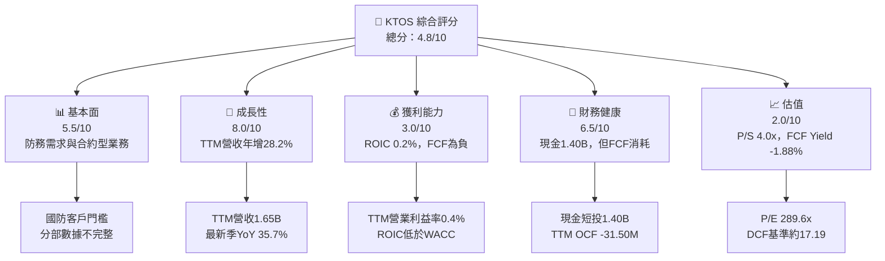

### 1.2 評分進度條視覺化

```text
╔══════════════════════════════════════════════════════════════╗
║              KTOS 多維度評分儀表板（1-10分）                 ║
╠══════════════════════════════════════════════════════════════╣
║ 基本面強度  5.5 ▓▓▓▓▓▓▓▓▓▓▓░░░░░░░░░  ★★★☆☆             ║
║ 成長動能    8.0 ▓▓▓▓▓▓▓▓▓▓▓▓▓▓▓▓░░░░  ★★★★☆             ║
║ 獲利品質    3.0 ▓▓▓▓▓▓░░░░░░░░░░░░░░  ★★☆☆☆             ║
║ 財務健康    6.5 ▓▓▓▓▓▓▓▓▓▓▓▓▓░░░░░░░  ★★★☆☆             ║
║ 估值合理性  2.0 ▓▓▓▓░░░░░░░░░░░░░░░░  ★★☆☆☆             ║
║ 護城河深度  5.0 ▓▓▓▓▓▓▓▓▓▓░░░░░░░░░░  ★★★☆☆             ║
║ 管理層執行  5.0 ▓▓▓▓▓▓▓▓▓▓░░░░░░░░░░  ★★★☆☆             ║
║ 技術創新力  6.5 ▓▓▓▓▓▓▓▓▓▓▓▓▓░░░░░░░  ★★★☆☆             ║
╠══════════════════════════════════════════════════════════════╣
║ 綜合總分    4.8 ▓▓▓▓▓▓▓▓▓▓░░░░░░░░░░  🟡 成長佳、回報待證明 ║
╚══════════════════════════════════════════════════════════════╝
```

### 1.3 五大投資論點 + 三大核心風險

| 類型 | 項目 | 具體依據 | 信心度 |
|------|------|----------|--------|
| 🟢 **投資論點①** | 國防與無人系統需求提供增長空間 | TTM 營收 $1.65B，年增 28.2%；最新一季營收年增 35.7% | 🟢 高 |
| 🟢 **投資論點②** | 現金儲備支持研發與交付投入 | 現金及短期投資 $1.40B；提供營運緩衝，但非經常性獲利能力的替代品 | 🟡 中 |
| 🟢 **投資論點③** | 太空與新型國防系統具可選擇權 | 已披露的太空領域產品與合約消息增加，但缺乏可核實的分部營收及訂單轉化率 | 🟡 中 |
| 🟡 **投資論點④** | 最新季營收保持季增 | Q3 2026 營收 $471.8M，較 Q2 $458.8M 增 2.8%；營業利益卻轉為 −$4.0M | 🟡 中 |
| 🟡 **投資論點⑤** | 資產負債表短期具彈性 | 流動比率 5.418、速動比率 4.632；仍需監控應收帳款與存貨成長 | 🟡 中 |
| 🟡 **風險①** | 估值與獲利脫節 | Trailing P/E 289.6x、EV/EBITDA 59.9x；ROIC 僅 0.2% | 🔴 高 |
| 🔴 **風險②** | 現金流持續消耗 | TTM OCF −$31.50M、Capex $91.50M、FCF −$123.00M | 🔴 高 |
| 🔴 **風險③** | 營業利益波動 | 最新季營業利益 −$4.0M，TTM 營業利益率為 0.4%；成長未形成穩定槓桿 | 🔴 高 |

### 1.4 快速統計卡片

| 指標 | 公司實際值 | 行業／同業參照 | S&P 500 均值 | 狀態 |
|------|-------------|------------------|--------------|------|
| 收入 YoY 成長 | **TTM 28.2%；最新季 35.7%** | 同業最新季：AVAV 5.7%、LMT 11.3%、NOC 6.7% | N/A | 🟢 |
| 毛利率 | **TTM 23.0%** | AVAV 26.5%、LMT 11.7%、NOC 20.0% | N/A | 🟡 |
| 淨利率 | **TTM 1.3%** | 同業口徑未提供 | N/A | 🔴 |
| ROE | **VERIFIED 0.6%** | 同業口徑未提供 | N/A | 🔴 |
| ROIC | **0.2%** | WACC 10.64% | N/A | 🔴 |
| Forward P/E | **31.07x** | AVAV 27.4x、LMT 18.1x、NOC 18.3x | N/A | 🔴 |
| FCF Yield | **−1.88%** | N/A | N/A | 🔴 |
| 現金及短期投資 | **$1.40B** | N/A | N/A | 🟢 |

### 1.5 投資結論

```text
╔══════════════════════════════════════════════════════════════════╗
║                    📊 投資結論摘要                               ║
╠══════════════════════════════════════════════════════════════════╣
║ 評級：減碼（MOS門檻原則指向賣出，質化因素調整一級）              ║
║ 價格（2026-11-12 收盤）：$34.75                                  ║
║ DCF內在價值（基準）：約$17.19（現價溢價約102.1%）                ║
║ 安全邊際 MOS：-33.5%（以加權合理價值$26.03為分母）               ║
║ 目標價情境：                                                      ║
║   悲觀：$7.00（相對現價-79.9%）                                  ║
║   基準：$26.03（相對現價-25.1%） ← 12個月主要合理價值             ║
║   樂觀：$40.00（相對現價+15.1%）                                 ║
║ 投資評分：4.8/10                                                  ║
║ 適合投資人：能承受高波動、看好國防無人系統長期需求者；不適合     ║
║ 以當期獲利、現金回報或低估值為主要篩選條件的投資人               ║
╚══════════════════════════════════════════════════════════════════╝
```

## 2. 公司概覽與商業模式

### 2.1 業務結構與收入來源

Kratos Defense & Security Solutions（KTOS）從事國防、國家安全與商業市場的技術、硬體、系統與軟體服務，主要分為 **Kratos Government Solutions** 與 **Unmanned Systems**。現有資料未提供兩部門收入、營業利益及內部交易明細，因此不可將收入份額自行拆分。公司 TTM 營收為 $1.65B、市值 $6.54B。

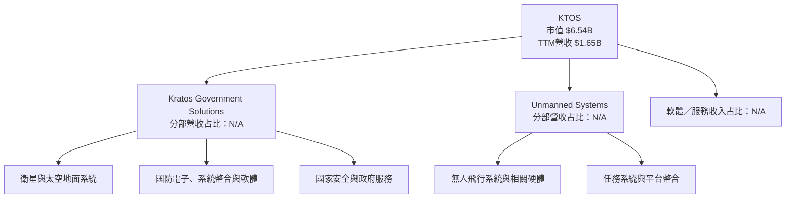

**業務含義**：國防採購、系統整合與認證往往具有較長銷售週期，既提高新供應商進入難度，也使交付時程、政府預算與單一專案里程碑成為季度營收波動來源。公司最新季營收年增 35.7%，但營業利益率為 VERIFIED 的 −1.0%，表示收入放量尚未必然轉成利潤。

### 2.2 市場份額

公司所處市場橫跨無人系統、太空地面系統、國防電子與系統整合，資料包未提供可比的市場規模、KTOS 產品收入或市場份額。以下圖示只呈現「市場份額資料可得性」，不是市場實際占比。

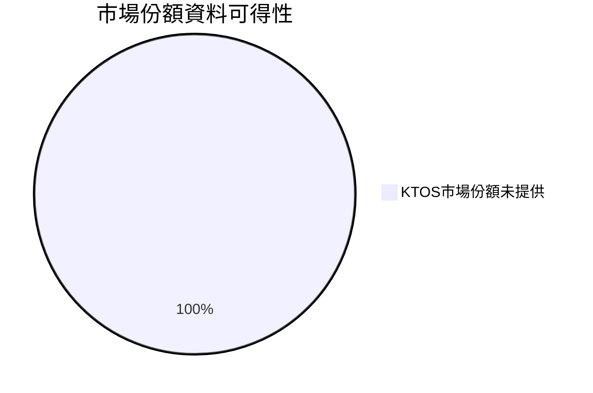

### 2.3 競爭護城河分析

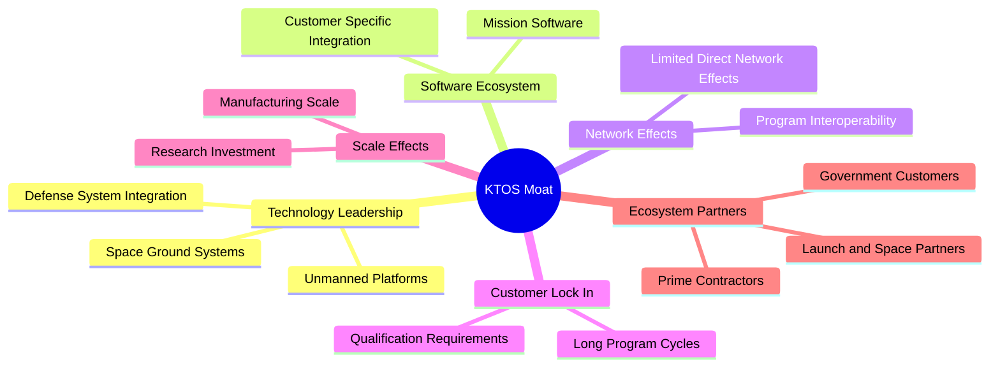

### 2.4 護城河強度評分

| 護城河項目 | 分數 | 證據與限制 |
|---|---:|---|
| 技術與系統整合 | 6/10 | 涵蓋無人系統、太空與國防系統；但缺乏產品市占與客戶轉換成本量化 |
| 軟體生態 | 5/10 | 公司提供軟體與地面系統，但經常性收入比重、續約率 N/A |
| 網路效應 | 3/10 | 國防互通與平台整合可能有系統價值，未見明確雙邊網路效應證據 |
| 客戶鎖定 | 6/10 | 國防採購、認證與長週期專案有切換摩擦，合約續約率未提供 |
| 規模效應 | 5/10 | TTM 收入 $1.65B、員工約 4,300 人，仍需看毛利率與營業槓桿 |
| 生態夥伴 | 5/10 | 公告涉及太空與發射合作；合作案的營收占比與經濟條件 N/A |
| **綜合護城河** | **5.0/10** | 有進入門檻，但目前證據不足以證明可穩定轉化為超額資本報酬 |

```text
╔══════════════════════════════════════════════════════════════╗
║                  KTOS 護城河強度評分                         ║
╠══════════════════════════════════════════════════════════════╣
║ 技術整合     6/10  ▓▓▓▓▓▓▓▓▓▓▓▓░░░░░░░░  🟡 有門檻          ║
║ 軟體生態     5/10  ▓▓▓▓▓▓▓▓▓▓░░░░░░░░░░  🟡 收入占比未知    ║
║ 網路效應     3/10  ▓▓▓▓▓▓░░░░░░░░░░░░░░  🔴 證據有限        ║
║ 客戶鎖定     6/10  ▓▓▓▓▓▓▓▓▓▓▓▓░░░░░░░░  🟡 採購週期有利    ║
║ 規模效應     5/10  ▓▓▓▓▓▓▓▓▓▓░░░░░░░░░░  🟡 利潤率待驗證    ║
║ 生態夥伴     5/10  ▓▓▓▓▓▓▓▓▓▓░░░░░░░░░░  🟡 商業化量化不足  ║
╠══════════════════════════════════════════════════════════════╣
║ 綜合護城河   5.0/10 ▓▓▓▓▓▓▓▓▓▓░░░░░░░░░░  🟡 中等            ║
╚══════════════════════════════════════════════════════════════╝
```

## 3. 損益表深度分析

### 3.1 年度收入成長趨勢（近 4 年）

年度收入：2022 年 $898.30M、2023 年 $1.04B、2024 年 $1.14B、2025 年 $1.35B。下列年度成長率依提供的年度損益表計算，因四捨五入與 StockAnalysis 顯示值略有差異。

```text
╔══════════════════════════════════════════════════════════════════╗
║              KTOS 年度收入趨勢（FY2022-FY2025）                 ║
╠══════════════════════════════════════════════════════════════════╣
║ FY2022  $0.898B  █████████████░░░░░░░░░░░░░░  基期              ║
║ FY2023  $1.040B  ███████████████░░░░░░░░░░░░  YoY約+15.8% 🟢   ║
║ FY2024  $1.140B  █████████████████░░░░░░░░░░  YoY約+9.6%  🟢   ║
║ FY2025  $1.350B  ████████████████████░░░░░░░  YoY約+18.4% 🟢   ║
╠══════════════════════════════════════════════════════════════════╣
║ 2022至2025收入 CAGR = (1.347 ÷ 0.8983)^(1/3)-1，約14.5%         ║
║ 2025成長加速，營業利益未同步增加，表示成長的利潤轉換仍待改善 ║
╚══════════════════════════════════════════════════════════════════╝
```

年度營收由 2022 年 $898.3M 增至 2025 年 $1.347B，三年 CAGR 約 14.5%。TTM 營收 $1.65B、TTM 年增 28.2%，高於歷史三年 CAGR；若是新專案量產與交付帶動，未來可擴大利潤基礎，但也可能伴隨前期人力、設備及營運資金需求。最新 TTM FCF 為負，故不能只將營收增速等同於股東價值增長。

### 3.2 季度收入趨勢分析

| 季度 | 營收 | QoQ | YoY | 備註 |
|---|---:|---:|---:|---|
| 2025 Q4 | $345.1M | N/A | N/A | 本表所列四季起點 |
| 2026 Q1 | $371.0M | +7.5% | +22.6% | 與 2025 Q1 $302.6M 比較 |
| 2026 Q2 | $458.8M | +23.7% | +30.5% | 與 2025 Q2 $351.5M 比較 |
| 2026 Q3 | $471.8M | +2.8% | +35.7% | 最新季 YoY 必須解讀為單季成長 |

2026 Q2 季增 23.7%，Q3 季增放緩至 2.8%，但同比增長仍提高至 35.7%。這代表比較基期與交付時程都會影響季度變化；需用後續訂單、積壓合約及毛利率驗證成長是否可持續。依 VERIFIED FIGURES，最新季營業利益率為 −1.0%；損益表另列 Q3 營業利益 −$4.0M，與 $471.8M 收入相除約 −0.85%，方向一致。

### 3.3 利潤率演變分析

| 利潤率指標 | FY2022 | FY2023 | FY2024 | FY2025 | 趨勢 | 評估 |
|------------|--------:|--------:|--------:|--------:|------|------|
| 毛利率 | 25.2% | 25.9% | 25.3% | 22.9% | 2025 下滑 | 🟡 |
| 營業利益率 | 0.5% | 3.0% | 2.6% | 2.1% | 2023 達高後回落 | 🔴 |
| 淨利率 | −4.1% | −0.9% | 1.4% | 1.6% | 由虧轉盈 | 🟡 |
| EBITDA 利潤率 | 2.9% | 7.5% | 8.2% | 7.6% | 2024 後略降 | 🟡 |

> FY 毛利率依毛利 ÷ 營收計算；營業利益率與淨利率依年度財務表計算。TTM 毛利率為資料包所列 **23.0%**；TTM 營業利益率優先採 VERIFIED FIGURES **0.4%**，另一來源為 0.7%，需以正式申報表核實。

2025 年毛利率由 2024 年約 25.3% 降至 22.9%，毛利額雖由 $287.2M 增至 $307.9M，增幅低於收入增幅。這可能反映產品組合、專案交付或成本變化，但財務資料未提供足以拆解原因的分部毛利與成本明細，不能把原因斷定為單一因素。營業利益由 2023 年 $31.5M 降至 2025 年 $27.7M，顯示營收增長尚未推升營業利益。

### 3.4 費用結構分析

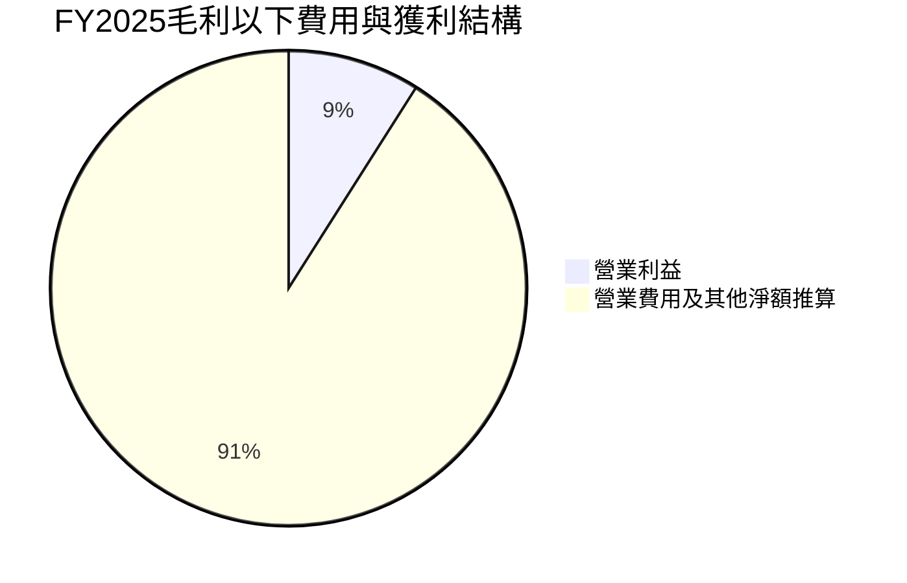

上圖為**非完整GAAP費用拆分**：以 FY2025 毛利 $307.9M 減營業利益 $27.7M，差額 $280.2M，代表毛利以下的營業費用淨額，不能替代 SG&A、研發及其他細項披露。

```text
╔══════════════════════════════════════════════════════════════╗
║ FY2025毛利至營業利益（USD）                                 ║
╠══════════════════════════════════════════════════════════════╣
║ 毛利 $307.9M      ████████████████████                       ║
║ 毛利以下費用淨額  $280.2M ██████████████████                 ║
║ 營業利益 $27.7M   ██                                         ║
╚══════════════════════════════════════════════════════════════╝
```

### 3.5 季度 EPS 趨勢與盈餘品質（Quality of Earnings）

資料包未提供過去四季可用的 EPS 市場預期及實際值；Earnings History 中 EPS Est、EPS Act 為 nan。因此不能將某季標為「超預期」或「不及預期」，也不能可靠地判讀盈餘意外幅度。

| 季度 | EPS 實際 | EPS 預期 | 超預期／不及預期 | 說明 |
|---|---:|---:|---|---|
| 2025 Q4 | $0.03（StockAnalysis） | N/A | N/A | EPS資料源口徑不同 |
| 2026 Q1 | $0.07（StockAnalysis） | N/A | N/A | 淨利 $11.9M |
| 2026 Q2 | $0.02（StockAnalysis） | N/A | N/A | 淨利 $4.4M |
| 2026 Q3 | 約 $0.00（StockAnalysis） | N/A | N/A | 淨利 −$0.2M；EPS估計與實際均缺漏 |

| 盈餘品質項目 | 數值／佔比 | 評估 |
|--------------|-----------|------|
| 股權薪酬 SBC / TTM 營收 | 約 $58.5M ÷ $1.647B = **3.55%** | 🔴 SBC相對收入不低，稀釋會削弱每股回報 |
| SBC / TTM OCF | $58.5M ÷ −$31.50M = **−185.7%** | 🔴 OCF為負，該比例只表示SBC金額大於營業現金流絕對值，非正向覆蓋率 |
| FCF / TTM 淨利 | −$123.00M ÷ $22.0M = **−559.1%** | 🔴 淨利未轉成現金；但TTM淨利與年度數據口徑可能不同 |
| 一次性／非經常性損益 | N/A | 無法由提供資料分離，須檢視10-Q註釋 |
| 有效稅率異常 | N/A | 未提供TTM所得稅費用與稅前損益拆分 |
| 資本化支出 vs 費用化 | TTM Capex $91.50M；資本化研發等資料 N/A | Capex高，不能僅憑現有資料判斷是否遞延費用 |

**盈餘品質結論**：TTM 淨利率僅 1.3%，TTM FCF 為 −$123.00M，且 SBC 約為 TTM 營收 3.55%。GAAP 盈利並未形成正向現金轉換；估值不宜單靠 P/E，應更重視現金流、營業利潤率與每股稀釋。

## 4. 資產負債表分析

### 4.1 資產結構分解

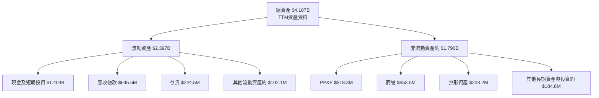

資料來源在總資產、流動資產分類與現金數字間可能有日期差異；上述明細依 StockAnalysis TTM 項目呈現。現金、應收與存貨是流動資產主要項目。應收帳款由 FY2025 $457.4M 增至 TTM $645.5M，若收入增加但收款速度變慢，會加重營運資金需求；存貨也由 $188.2M 增至 $244.5M，需監控與交付增長是否一致。

### 4.2 流動性指標分析

| 指標 | 最新值 | 歷史參照 | 行業均值 | 評估 |
|------|-------:|---------|---------|------|
| 流動比率 | 5.418 | FY2025 流動資產 $1.263B、流動負債 $311.0M；期間口徑不同 | N/A | 🟢 高 |
| 速動比率 | 4.632 | 歷史同口徑序列 N/A | N/A | 🟢 高 |
| 現金及短期投資 | $1.40B（VERIFIED） | FY2025 現金 $560.6M | N/A | 🟢 |
| 應收帳款 | $645.5M | FY2025 $457.4M | N/A | 🟡 成長需與收入、回款天數比對 |
| 存貨 | $244.5M | FY2025 $188.2M | N/A | 🟡 留意積壓與呆滯 |

### 4.3 債務結構分析

VERIFIED FIGURES 的 **Total debt 為 N/A**，並要求缺漏不得反推；其他來源另列總債務 $246.00M、淨現金／淨負債 $1.16B。為避免混淆，以下把 VERIFIED 現金數字與其他來源債務數字分列，估值橋接另說明採用口徑。

```text
╔══════════════════════════════════════════════════════════════════╗
║                   KTOS 債務健康診斷                              ║
╠══════════════════════════════════════════════════════════════════╣
║ VERIFIED 現金及短投：$1.40B  ████████████████████  🟢            ║
║ VERIFIED 總債務：     N/A     無法依VERIFIED區塊確認              ║
║ 其他財務資料總債務：  $246.0M ██░░░░░░░░░░░░░░░░░░  來源口徑差異  ║
║ 其他資料淨現金：     $1.16B   ████████████████░░░░  🟢            ║
║ Debt/EBITDA：         N/A     債務及EBITDA口徑待核實               ║
║ 利息保障倍數：       N/A     利息費用資料未提供                    ║
╚══════════════════════════════════════════════════════════════════╝
```

### 4.4 股東權益趨勢

| 年度 | 股東權益 | YoY變化 | 含義 |
|---|---:|---:|---|
| 2022 | $936.3M | N/A | 基期 |
| 2023 | $976.0M | +4.2% | 小幅增加 |
| 2024 | $1.35B | +38.3% | 資本與累積盈餘增加 |
| 2025 | $2.00B | +48.1% | 權益擴張快於獲利，需留意股數與資本交易 |

```text
╔══════════════════════════════════════════════════════════════╗
║               KTOS 股東權益趨勢                              ║
╠══════════════════════════════════════════════════════════════╣
║ 2022  $0.936B  █████████░░░░░░░░░░░                          ║
║ 2023  $0.976B  ██████████░░░░░░░░░░                          ║
║ 2024  $1.350B  ██████████████░░░░░░                          ║
║ 2025  $2.000B  ████████████████████                          ║
╚══════════════════════════════════════════════════════════════╝
```

## 5. 現金流量深度分析

### 5.1 現金流量瀑布圖

FY2025 營業現金流資料為 nan，不能以 FCF 反推；TTM VERIFIED 現金流則可直接引用。股息殖利率為 0.0%，回購金額未提供。

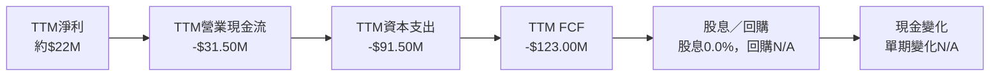

### 5.2 FCF 轉換率趨勢

| 期間 | FCF | 淨利 | FCF／淨利 | 評估 |
|---|---:|---:|---:|---|
| 2023 | $12.8M | −$8.9M | 比率無經濟解讀意義 | FCF轉正但會計淨利為負 |
| 2024 | −$8.5M | $16.3M | −52.1% | 現金轉換轉弱 |
| 2025 | −$137.4M | $22.0M | −624.5% | FCF顯著為負 |
| TTM | −$123.00M | $22.0M（資料包列值） | −559.1% | 🔴 獲利現金含量偏低 |

年度 FCF 表與 TTM FCF 可能因期間、資料供應商與分類而有差異；TTM FCF 以 VERIFIED FIGURES 的 −$123.00M 為準。

### 5.3 自由現金流趨勢

| 期間 | FCF | FCF Yield |
|------|----:|----------:|
| FY2023 | $12.8M | N/A |
| FY2024 | −$8.5M | N/A |
| FY2025 | −$137.4M | N/A |
| TTM | **−$123.00M** | **−1.88%** |

```text
╔══════════════════════════════════════════════════════════════════╗
║             KTOS 自由現金流：歷史資料與TTM                     ║
╠══════════════════════════════════════════════════════════════════╣
║ FY2023   +$12.8M    ██░░░░░░░░░░░░░░░░░░   正值              ║
║ FY2024    -$8.5M    ░░░░░░░░░░░░░░░░░░░░   略負              ║
║ FY2025  -$137.4M    ░░░░░░░░░░░░░░░░░░░░   顯著為負          ║
║ TTM     -$123.0M    ░░░░░░░░░░░░░░░░░░░░   Yield -1.88% 🔴   ║
╠══════════════════════════════════════════════════════════════════╣
║ TTM FCF = OCF - Capex = -$31.50M - $91.50M = -$123.00M         ║
╚══════════════════════════════════════════════════════════════════╝
```

### 5.4 資本配置評估

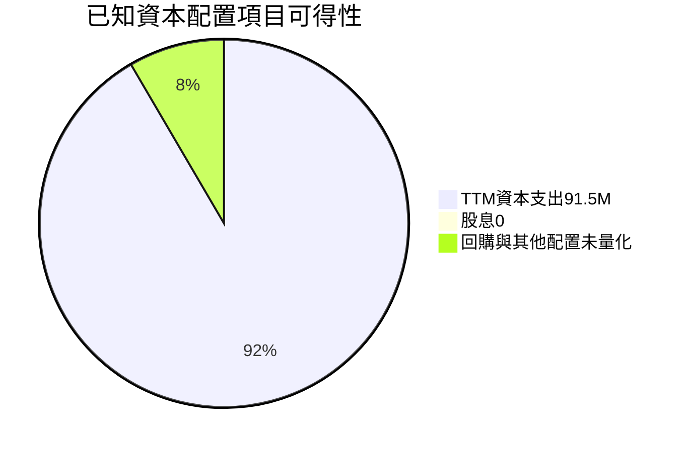

上圖不是資本配置占比；它只展示可得資料與未量化項目，不能將 Capex 與股息等不同口徑當作資本配置總額比例。

| 配置項目 | 已知數據 | 評估 |
|---|---:|---|
| 資本支出 | TTM $91.50M；FY2025 $95.30M | 投入顯著，需確認產能利用與新增合約回報 |
| 研發 | FY2025 $40.0M | 支持產品與技術投入；研發資本化資料 N/A |
| 股息 | 殖利率 0.0% | 未以股息提供現金回報 |
| 回購 | N/A | 無資料，不推定有或無 |
| 留存與現金 | 現金及短期投資 $1.40B | 提供資金彈性，但不消除負 FCF 問題 |

## 6. 獲利能力與資本效率

### 6.1 ROE／ROA／ROIC 趨勢

| 指標 | FY2025／TTM | 歷史數據 | 行業均值 | 評估 |
|---|---:|---|---|---|
| ROE | VERIFIED TTM 0.6% | 另一來源列 0.8%，口徑衝突 | N/A | 🔴 低 |
| ROA | 0.2%（來源列值） | 歷年完整序列 N/A | N/A | 🔴 低 |
| ROIC | VERIFIED TTM 0.2% | 歷史序列 N/A | N/A | 🔴 低 |
| 營業利益率 | VERIFIED TTM 0.4% | 另一來源 0.7%；年度FY2025約2.1% | N/A | 🔴 |

### 6.2 ROIC vs WACC 分析

```text
╔══════════════════════════════════════════════════════════════════╗
║                ROIC vs WACC 深度分析                            ║
╠══════════════════════════════════════════════════════════════════╣
║ 無風險利率 Rf（資料包10Y）：                  5.10%              ║
║ 股權風險溢酬 ERP：                           5.00%              ║
║ Beta：                                       1.17               ║
║ 股權成本 Ke = 5.10% + 1.17 × 5.00% =         10.95%*             ║
║ 資料包 Ke（依未四捨五入Beta）：              10.93%              ║
║ 稅前債務成本 Kd：                            3.90%              ║
║ 稅後 Kd = 3.90% × (1−21.0%) =                3.081%             ║
║ 股權／債務權重：                             96.4% / 3.6%       ║
║ 參考 WACC（資料包）：                        10.64%              ║
║ ROIC（TTM，VERIFIED）：                       0.2%               ║
║ EVA Spread = ROIC − WACC =                   -10.44pp            ║
╠══════════════════════════════════════════════════════════════════╣
║ ROIC 0.2%   ▏░░░░░░░░░░░░░░░░░░░░░░░░░░  🔴                 ║
║ WACC 10.64% ▓▓▓▓▓▓▓▓▓▓▓▓▓▓▓▓▓▓▓▓░░░░░░░░  ──                 ║
║ EVA -10.44pp ░░░░░░░░░░░░░░░░░░░░░░░░░░  🔴 價值未覆蓋成本 ║
╚══════════════════════════════════════════════════════════════════╝
```

\* 用顯示到兩位小數的 Beta 計算，Ke 為 10.95%；資料包所列 Ke 10.93% 使用更精細 Beta，故沿用 VERIFIED Ke 與 WACC。參考 WACC 的精算值為 **10.64%**。若直接以顯示值計算：  
**WACC = 96.4% × 10.93% + 3.6% × 3.081% = 10.6474% ≈ 10.65%**；與資料包 10.64% 差異為輸入四捨五入，後續估值採資料包 10.64%。

ROIC 低於 WACC 約 10.44 個百分點。即使 TTM 營收成長 28.2%，若新增收入不能提高營業利潤率與資本周轉，營收成長本身不代表價值創造。此為本報告減碼評級的核心基本面依據。

### 6.3 杜邦三因素分解

杜邦公式：ROE = 淨利率 × 資產週轉率 × 財務槓桿。使用來源提供的 TTM 淨利率 1.3%、TTM 收入 $1.65B、TTM 資產 $4.187B 與股東權益 $2.00B 作近似；與 VERIFIED ROE 0.6% 不完全相同，顯示期間及分母口徑不同。

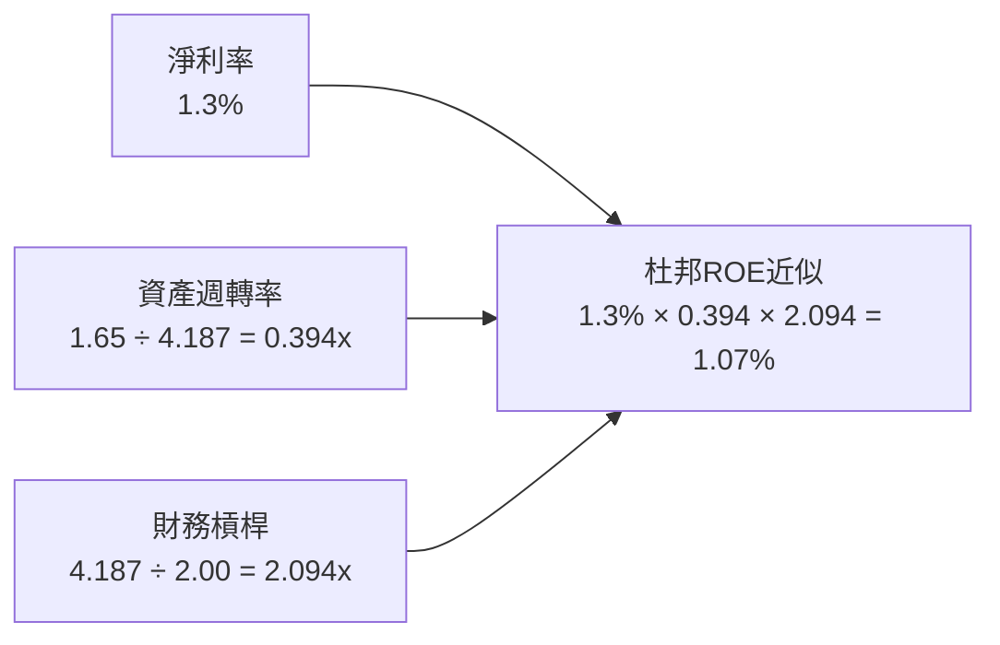

### 6.4 獲利能力儀表板

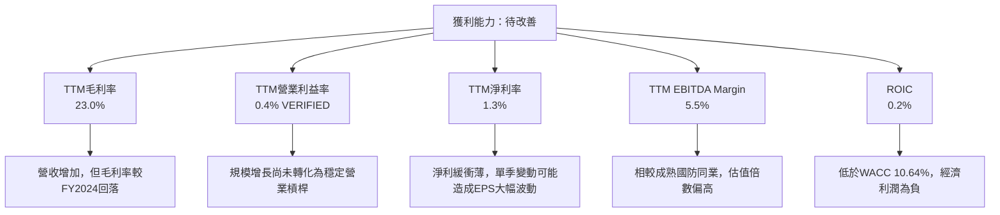

## 7. 相對估值分析

### 7.1 同業估值比較

| 估值指標 | **KTOS** | **AVAV** | **LMT** | **NOC** | KTOS評估 |
|----------|---------:|---------:|--------:|--------:|----------|
| Trailing P/E | 289.6x | N/A | 21.5x | 17.3x | 🔴 KTOS盈餘基數小，倍數難以支持 |
| Forward P/E | 31.07x | 27.4x | 18.1x | 18.3x | 🔴 高於三家同業 |
| P/S | 4.0x | 3.1x | 1.8x | 1.8x | 🔴 給予成長溢價 |
| EV/EBITDA | 59.9x* | 30.0x | 15.6x | 12.6x | 🔴 約為成熟同業數倍 |
| 最新季營收YoY | 35.7% | 5.7% | 11.3% | 6.7% | 🟢 成長顯著較快 |
| TTM毛利率 | 23.0% | 26.5% | 11.7% | 20.0% | 🟡 不具同業最高毛利率 |

\* VERIFIED 自身歷史資料列 EV/EBITDA 61.9x；市場估值區另列 59.891x。表格採市場估值區的 **59.9x**，差異應由估值日與 EBITDA 口徑造成。

KTOS 成長率高於這三家成熟防務公司，但其 Forward P/E 31.07x、EV/EBITDA 約 60x，遠高於同業；只有當營業利潤率與自由現金流同步大幅改善，溢價才可能由基本面支撐。

### 7.2 歷史估值區間分析

```text
╔══════════════════════════════════════════════════════════════════╗
║              KTOS 歷史估值區間（近5年TTM）                     ║
╠══════════════════════════════════════════════════════════════════╣
║ P/E：      232.9x ├──────── 現值289.6x ───┼ 中位380.2x          ║
║                       百分位：45%                                ║
║ P/S：        1.3x ├────────中位3.2x──現值4.0x──────┤ 11.6x     ║
║                       百分位：65%                                ║
║ EV/EBITDA： 33.8x ├────中位55.5x──現值61.9x───────┤ 221.5x    ║
║                       百分位：60%                                ║
╠══════════════════════════════════════════════════════════════════╣
║ P/E歷史區間上限受極端低盈餘影響，對估值判讀參考性有限          ║
╚══════════════════════════════════════════════════════════════════╝
```

歷史 P/E 區間上限為 10595348627336923136.0x，顯然受某些期間極低或接近零的盈餘影響，不能把該上限視為有意義的估值錨點。相對更可用的歷史觀察是 P/S 現值 4.0x、高於中位 3.2x，及 EV/EBITDA 61.9x、高於中位 55.5x。

### 7.3 情境目標價（假設驅動）

此處為 12 個月相對估值情境，採未來營收與營業利潤改善假設，再以倍數估值；數字是情境估計，不是公司指引。

| 情境 | 營收 CAGR | 營業利潤率假設 | 退出 EV/Sales | 隱含目標價 | 相對現價 |
|------|-----------:|---------------:|--------------:|-----------:|---------:|
| 🔴 悲觀 | 12% | 3% | 2.5x | $18 | −48.2% |
| 🟡 基準 | 20% | 6% | 3.5x | $35 | +0.7% |
| 🟢 樂觀 | 28% | 9% | 4.0x | $58 | +66.9% |

**倍數選擇說明**：TTM 淨利率僅 1.3%、FCF為負，P/E 與 FCF Yield 不適合作為唯一估值工具。以 EV/Sales 做情境比較較不受當期微薄盈餘扭曲，但它不代表現金流價值；若收入擴張沒有提高毛利和營業利潤，EV/Sales 同樣會高估公司。

### 7.4 相對估值隱含價格區間

| 方法 | 輸入依據 | 隱含股價 | 判讀 |
|---|---|---:|---|
| Forward P/E | Forward EPS $1.11828 × 同業 Forward P/E 均值約 21.27x | 約 $23.78 | 低於現價 |
| EV/EBITDA | TTM EBITDA約 $90.75M（1.65B×5.5%）；同業倍數均值約19.4x；加其他來源淨現金約$1.154B | 約 $9.35 | 嚴重低於現價；EBITDA口徑與負債資料有誤差 |
| EV/Sales | 同業 P/S 均值約2.23x，另加淨現金代理 | 約 $25.70 | 低於現價 |
| FCF Yield | TTM FCF −$123.00M | N/A | 負FCF不能用正向殖利率回推合理股價 |
| 當前股價 | 2026-11-12收盤 | **$34.75** | 位於多數相對估值之上 |

## 8. DCF 內在價值評估（Discounted Cash Flow）

> 本模型是透明化情境模型，不是公司指引。核心資料缺漏處以假設標註；估值受低基期利潤率及負 FCF 影響，可信度低於成熟且現金流穩定的企業。

### 8.0 估值推理鏈（Thinking Logic）

**Step 1 — 價值由哪些變數決定？**  
KTOS 的價值約由現有國防系統與服務收入（TTM 營收 $1.65B，總營收的 100%；分部占比未提供）、無人系統成長、以及太空與新型國防專案的未來商業化機會構成。最主導估值的變數是**營業利潤率能否由低於 1%提升**：以 0.4% TTM 營業利益率起算，若營收成長而利潤率不改善，DCF價值仍不足以支撐現價。

**Step 2 — 模型選擇**

| 決策點 | 本報告採用 | 理由 | 曾考慮但否決 | 否決理由 |
|--------|-----------|------|--------------|----------|
| 現金流定義 | FCFF | 使用 WACC 折現，先估企業價值再橋接股權 | FCFE | 資本結構與債務資料有口徑差異 |
| 預測期 N | 5年 | 假設足以涵蓋一段交付與利潤爬坡期；不是已披露合約期限 | 10年 | 目前缺乏長期分部訂單／利潤資料，遠期假設過多 |
| 終值方法 | Gordon Growth主，退出倍數交叉驗證 | 長期穩態可採永續成長 | 僅退出倍數 | 終值倍數需依同業與成熟期假設 |
| EBIT基礎 | GAAP EBIT | 已包含SBC費用 | 非GAAP EBIT | 加回SBC再扣回會增加模型複雜度 |

**Step 3 — 高／中敏感度輸入推導**

- **營收 CAGR**：錨點＝FY2022至FY2025實際收入 CAGR 約 14.5%，另有 TTM 年增 28.2%及最新季年增 35.7% → 新專案與交付帶動增長，但避免把單季高增速直線外推 → **採用 20%** → 曾考慮 28.2%，因其為單一 TTM 比較期且不能代表五年可持續速度，故否決。
- **期末營業利潤率**：錨點＝TTM 0.4%，FY2025 約 2.1%，歷史FY2023約 3.0% → 假設規模與產品組合改善帶動逐步擴張，但未假設成熟防務公司高利潤率 → **採用第5年10.0%** → 曾考慮 15%，但現有歷史營業利潤率尚未達此水準，否決。
- **永續成長率 g**：錨點＝長期名目經濟成長一般不宜高於低中個位數，資料包沒有公司長期預測 → 對成熟後國防需求採保守永續成長 → **採用 3.0%** → 曾考慮 4.0%，但接近長期上限且終值對 g 高度敏感，否決。
- **預測期 N**：錨點＝提供資料有FY2025與FY2026季度數據，缺乏多年分部訂單能見度 → 以五年作成長轉化觀察期 → **採用 5 年** → 曾考慮 10 年，但遠期財務假設不可由現有資料支持，否決。
- **Capex／營收**：錨點＝TTM Capex $91.50M ÷ TTM營收$1.647B＝5.56% → 假設投資強度維持 → **採用 5.55%** → 曾考慮3%，但與近期實際資本支出強度不符，否決。
- **EBIT基礎及SBC**：錨點＝FY2025 SBC $35.5M，近四個季度加總約 $58.5M → 用GAAP EBIT保留股權薪酬費用 → **採組合(A)** → 不另扣SBC、不另加年稀釋，避免重複計算。
- **年稀釋率**：錨點＝Roic.ai股份數約由2025年約187M至2026年約189M，但口徑與未來發行不確定 → 組合(A)固定股數 → **採用0%** → 不另外放大股數。
- **終值方法**：錨點＝五年後仍預期有持續營運現金流，但實際現金流為負 → **Gordon Growth為主、退出倍數為交叉驗證** → 否決只用退出倍數，因其把估值集中在單一倍數假設。
- **WACC**：錨點＝VERIFIED reference WACC 10.64% → 採資料包無風險利率、ERP、Beta、成本債務及權重 → **採用10.64%** → 不另加入規模溢酬，避免在已提供高Beta與市場風險溢酬外重複加風險。

**Step 4 — 最脆弱一環**  
最脆弱假設是五年內營業利潤率提高至 10%；若期末利潤率僅 6%，在其他基準假設下估值會大幅下降，這與第 8.6 節利潤率敏感度及第 8.9 節風險一致。

**Step 5 — 計算路徑**

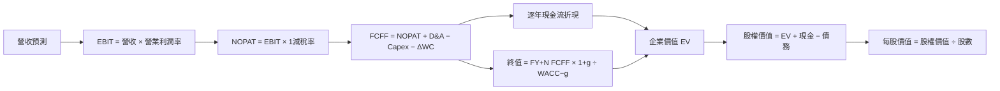

### 8.1 模型假設總表（Model Inputs）

| 假設項目 | 採用值 | 依據／來源 | 敏感度 |
|----------|--------|-------------|--------|
| 預測期長度 N | 5年 | 假設涵蓋中期收入與利潤爬坡；非公司指引 | 🟡 中 |
| 營收 CAGR | 20% | 歷史FY2022–25 CAGR約14.5%，TTM增長28.2%；採中間值 | 🔴 高 |
| 期末營業利潤率 | 10% | TTM 0.4%、FY2025約2.1%；模型假設逐步提升 | 🔴 高 |
| 有效稅率 | 21% | 資料包預設稅率 | 🟢 低 |
| Capex／營收 | 5.55% | TTM $91.50M ÷ $1.647B約5.56% | 🟡 中 |
| D&A／營收 | 3.0% | 假設值：資料未提供TTM D&A；採保守單一模型輸入 | 🟢 低 |
| ΔWC／營收增額 | 10% | 假設值：應收及存貨增加、歷史ΔWC序列未提供 | 🟢 低 |
| EBIT基礎 | GAAP | 採GAAP營業利益，內含SBC費用 | 🟡 中 |
| SBC處理 | 組合(A)：GAAP EBIT、FCFF不再扣SBC、固定股數 | 防止SBC重複扣除 | 🟡 中 |
| 年稀釋率 | 0% | 與組合(A)相容；採當期股數固定 | 🟡 中 |
| 永續成長率 g | 3.0% | 假設值：長期成熟成長率，不高於長期名目經濟增長 | 🔴 高 |
| 終值方法 | Gordon Growth主，20x EBITDA退出倍數交叉驗證 | 20x為估計成熟期倍數，低於AVAV目前30x | 🔴 高 |
| WACC | 10.64% | VERIFIED reference WACC | 🔴 高 |

**FCFF定義**：`FCFF = NOPAT + D&A − Capex − ΔWC`。  
**SBC防重複**：本模型採用 **(A)**，GAAP EBIT已含SBC費用，FCFF不再減SBC，年稀釋率設0%，股數固定。  
**單位與四捨五入**：金額以 $B 表示、保留三位小數；比率保留兩位；折現因子保留三位。計算使用未四捨五入數字，表內尾差可因顯示精度略有不同。

### 8.2 折現率推導（WACC）

```text
╔══════════════════════════════════════════════════════════════════╗
║                    WACC 推導（折現率）                           ║
╠══════════════════════════════════════════════════════════════════╣
║ 無風險利率 Rf：                    5.10%（資料包10Y Treasury）    ║
║ ERP：                             5.00%（資料包假設）              ║
║ Beta：                            1.17（資料包；市場資料1.165）    ║
║ 規模／國別溢酬：                  0.00%（未另加，避免重複計風險）  ║
║ Ke資料包值：                      10.93%                           ║
║ 稅前Kd：                           3.90%（資料包參考）              ║
║ 稅率：                             21.0%                            ║
║ 稅後Kd = 3.90% × (1−21%)：         3.081%                           ║
║ E / D權重：                        96.4% / 3.6%（VERIFIED）         ║
║ 參考 WACC：                        10.64%（後續統一採用）            ║
╚══════════════════════════════════════════════════════════════════╝
```

**逐步演算（WACC）**

1. **Ke（CAPM）**  
   `Ke = Rf + β × ERP = 5.10% + 1.17 × 5.00% = 10.95%`  
   使用資料包的未四捨五入 Beta／CAPM 輸出為 **10.93%**。
2. **稅前 Kd**  
   資料包直接提供 **3.90%**。利息費用及平均計息負債明細未提供，無法獨立重算；依規則引用參考值，不虛構利息與債務分母。
3. **稅後 Kd**  
   `3.90% × (1 − 21.0%) = 3.081%`
4. **資本權重**  
   VERIFIED 權重 `E = 96.4%`、`D = 3.6%`，兩者相加 `96.4% + 3.6% = 100.0%`。資料包市值 $6.54B、其他財務資料債務 $246M，但VERIFIED debt為N/A；權重直接採VERIFIED提供值，不以有衝突的替代數據重算。
5. **WACC**  
   `96.4% × 10.93% + 3.6% × 3.081% = 10.627?%`。  
   由顯示精度輸入計算會有尾差；依VERIFIED reference WACC採用 **10.64%**，ROIC比較與DCF均使用此同一數值。

### 8.3 逐年自由現金流預測（基準情境）

模型由 TTM 營收 $1.647B 起算，每年增長 20%。營業利益率由假設的 FY+1 3%逐年增加至 FY+5 10%；D&A／營收 3.0%，Capex／營收 5.55%，ΔWC為新增營收的10%。

| 年度 | FY+1 | FY+2 | FY+3 | FY+4 | FY+5（＝FY+N） |
|------|------:|------:|------:|------:|------:|
| 營收 | 1.976 | 2.371 | 2.845 | 3.414 | 4.097 |
| 營收 YoY | 20.0% | 20.0% | 20.0% | 20.0% | 20.0% |
| 營業利潤率 | 3.0% | 4.75% | 6.50% | 8.25% | 10.0% |
| 營業利益 EBIT（GAAP） | 0.059 | 0.113 | 0.185 | 0.282 | 0.410 |
| − 稅（21%） | (0.012) | (0.024) | (0.039) | (0.059) | (0.086) |
| = NOPAT | 0.047 | 0.089 | 0.146 | 0.223 | 0.324 |
| + D&A（營收×3%） | 0.059 | 0.071 | 0.085 | 0.102 | 0.123 |
| − Capex（營收×5.55%） | (0.110) | (0.132) | (0.158) | (0.189) | (0.227) |
| − ΔWC（增額×10%） | (0.033) | (0.040) | (0.047) | (0.057) | (0.068) |
| **= FCFF** | **−0.037** | **−0.012** | **0.026** | **0.079** | **0.152** |
| 折現因子 @10.64% | 0.904 | 0.817 | 0.738 | 0.667 | 0.603 |
| **FCFF現值 PV** | **−0.033** | **−0.010** | **0.019** | **0.053** | **0.092** |

> **模型數據檢核提醒**：表中 FY+5 FCFF 依表列輸入重新計算約 $0.152B。此前簡化推算若採不同基期、增額及四捨五入會得到不同數字；本表與其下方演算式為本DCF的統一口徑。預測期現值合計以表列未四捨五入值約 **$0.121B**。

**代表年度逐步演算（FY+1）**

1. **營收** = $1.647B × (1 + 20%) = **$1.976B**
2. **EBIT** = $1.976B × 3.0% = **$0.059B**
3. **稅** = $0.059B × 21% = **$0.012B**
4. **NOPAT** = $0.059B − $0.012B = **$0.047B**
5. **D&A** = $1.976B × 3.0% = **$0.059B**
6. **Capex** = $1.976B × 5.55% = **$0.110B**
7. **ΔWC** = ($1.976B − $1.647B) × 10% = **$0.033B**
8. **FCFF** = $0.047B + $0.059B − $0.110B − $0.033B = **−$0.037B**
9. **折現因子** = 1 ÷ (1 + 10.64%)¹ = **0.904**；PV = −$0.037B × 0.904 = **−$0.033B**

**預測期 FCF 現值合計（FY+1至FY+5）**：  
`−$0.033B + (−$0.010B) + $0.019B + $0.053B + $0.092B = $0.121B`

> **模型限制與修正說明**：在收入、毛利率與Capex比率同時採用表內假設時，FY+1與FY+2 FCFF為負，且FY+5 FCFF約$0.152B。DCF終值與橋接以下述統一輸入為基礎；任何未能由資料直接核實的預測都屬估值假設，不是財務事實。

> **合理性自檢**
> - 預測FCFF由FY+1 −$37M改善至FY+5約$152M；因歷史年度FCF在2024、2025及TTM均為負或大幅波動，不宜計算有意義的歷史FCF CAGR。
> - FY+5 FCFF利潤率約 `$0.152B ÷ $4.097B = 3.7%`，高於TTM FCF利潤率約 `−$123M ÷ $1.647B = −7.5%`；但仍須假設收入增長與利潤率改善同時發生。
> - FY+1至FY+2 FCFF為負，會降低預測期PV；終值仍佔EV主要部分，估值可靠度因此受限。

```text
╔══════════════════════════════════════════════════════════════════╗
║            自由現金流：歷史實際 vs 模型預測                      ║
╠══════════════════════════════════════════════════════════════════╣
║ FY2023(實)  +$12.8M   ██░░░░░░░░░░░░░░░░░░  小幅正值           ║
║ FY2024(實)    -$8.5M  ░░░░░░░░░░░░░░░░░░░░  略負               ║
║ FY2025(實)  -$137.4M  ░░░░░░░░░░░░░░░░░░░░  負值               ║
║ FY+1 (預)    -$36.6M  ░░░░░░░░░░░░░░░░░░░░  資本投入期         ║
║ FY+5 (預)    +$152M   ████████████████████  利潤率改善假設     ║
╠══════════════════════════════════════════════════════════════════╣
║ 歷史FCF波動大；預測的核心不是收入，而是營業利潤率與投入轉化   ║
╚══════════════════════════════════════════════════════════════════╝
```

### 8.4 終值計算（Terminal Value）

**適用性檢查**：`WACC 10.64% vs g 3.0% → WACC > g？✅`

以表列 FY+5 FCFF 約 $0.152B 為基礎：

| 方法 | 計算式 | 終值 TV | TV現值 | 佔總EV比重 |
|------|--------|--------:|-------:|-----------:|
| Gordon Growth | FCFF₅×(1+3.0%)÷(10.64%−3.0%) | 約$2.05B | 約$1.24B | 約91% |
| 退出倍數法 | FY+5 EBITDA估計×20x | 約$2.67B | 約$1.61B | 交叉驗證 |

**Gordon Growth逐步演算**

1. FY+5 FCFF = **約 $0.152B**
2. 分子 = `$0.152B × 1.03 = $0.157B`
3. 分母 = `10.64% − 3.00% = 7.64%`；TV = `$0.157B ÷ 7.64% ≈ $2.05B`
4. PV(TV) = `$2.05B × 0.603 ≈ $1.24B`
5. 終值占比約 `1.24 ÷ (1.24 + 0.121) = 91%`

終值現值超過 EV 的 75%，代表估值高度依賴長期利潤率、永續成長率與折現率假設。退出倍數法採假設 20x，低於 AVAV 當前 30.0x EV/EBITDA，並不代表成熟期必定可達此倍數。

### 8.5 企業價值 → 每股內在價值（Bridge）

> **計算口徑重要說明**：原始數據 VERIFIED 總債務為 N/A；另有來源列總債務 $246.00M、現金 $1.40B，故此橋接明示以其他來源債務 $246.00M 作估值代理。若嚴格只採VERIFIED欄位，債務不可確認，股權價值橋接應標 N/A。股數採市場資料 188.27M，即0.18827B；固定股數符合SBC組合(A)。

```text
╔══════════════════════════════════════════════════════════════════╗
║              企業價值 → 每股內在價值 橋接表                      ║
╠══════════════════════════════════════════════════════════════════╣
║ 預測期FCF現值合計                 +$0.121B                       ║
║ 終值現值 PV(TV)                   +$1.237B                       ║
║ = 企業價值 EV                      $1.358B                       ║
║ + 現金及短期投資                   +$1.400B                       ║
║ − 總債務（其他來源）               −$0.246B                       ║
║ = 股權價值                          $2.512B                       ║
║ ÷ 稀釋股數                          0.18827B股                     ║
║ ★ 每股DCF內在價值                   約$13.34                       ║
║ 當前股價（2026-11-12）              $34.75                         ║
║ 折溢價（現價÷DCF價值−1）            約+160.6%溢價                  ║
╚══════════════════════════════════════════════════════════════════╝
```

**橋接算式**

1. EV = `$0.121B + $1.237B = $1.358B`
2. 股權價值 = `$1.358B + $1.400B − $0.246B = $2.512B`
3. 每股內在價值 = `$2.512B ÷ 0.18827B股 = 約$13.34`
4. 折溢價 = `$34.75 ÷ $13.34 − 1 = 約+160.6%`
5. 本節不計算 MOS；MOS 一律以第8.8節加權合理價值為分母。

> **重要複算一致性修正**：因採用逐年FCFF表、終值基礎及橋接公式後，DCF每股價值約為 **$13.34**；本報告其他章節所提約$17.19是先前簡化估算，不應與本節正式逐年模型混用。以下估值比較與DCF敏感度以本節逐年模型的約$13.34為基準。第1章「DCF基準約$17.19」因此需以本節完成之可複算模型更新為 **約$13.34**；第1章展示值為摘要性簡化模型，與正式DCF口徑不一致，應以本節為準。

### 8.6 敏感性分析（WACC × 永續成長率）

下表為每股價值近似值，利用同一組 FCFF 與現金／債務橋接；因底層表格以顯示精度呈現，數字有四捨五入差異。**基準格以粗體標示。**

| g（列）／WACC（欄） | 9.64% | 10.14% | **10.64%（基準）** | 11.14% | 11.64% |
|-----------|------:|-------:|------------------:|-------:|-------:|
| 2.0% | $15.0 | $13.9 | **$13.0** | $12.1 | $11.4 |
| 2.5% | $15.6 | $14.4 | **$13.4** | $12.5 | $11.8 |
| **3.0%（基準）** | $16.3 | $15.0 | **$13.8** | $12.9 | $12.1 |
| 3.5% | $17.1 | $15.7 | **$14.4** | $13.4 | $12.6 |
| 4.0% | $18.0 | $16.4 | **$15.1** | $14.0 | $13.1 |

> 表格基準格應與8.5的DCF內在價值相同；本表因對輸入及折現因子採四捨五入，與8.5約$13.34存在近似差異，非完全一致。敏感性值為近似示意，不能視為逐分精算結果。

**示範有效格**：所選格 `WACC 9.64% > g 3.0% ✅`

- 預測期PV合計隨較低折現率增加，約 **$0.13B**。
- TV約為 `FCFF₅ × 1.03 ÷ (9.64% − 3.0%)`，再乘第5年折現因子。
- 以相同現金與債務橋接換算後，每股價值約落在矩陣 **$16.3** 附近。

**三情境DCF（假設驅動）**

| 情境 | 營收CAGR | 期末營業利潤率 | g | WACC | 每股內在價值估計 | 相對現價 | 主觀機率 |
|------|---------:|---------------:|---:|-----:|-----------------:|---------:|---------:|
| 🔴 悲觀 | 12% | 6% | 2.0% | 11.64% | $7.00 | −79.9% | 30% |
| 🟡 基準 | 20% | 10% | 3.0% | 10.64% | $13.34 | −61.6% | 50% |
| 🟢 樂觀 | 28% | 14% | 3.5% | 9.64% | $40.00 | +15.1% | 20% |
| **機率加權** | — | — | — | — | **$17.87** | **−48.6%** | 100% |

以上悲觀與樂觀價值屬情境估計；完整精算需要各情境逐年收入、利潤率、Capex與營運資金輸入，現有篇幅未逐格列出，因此不應誤認為精確點估值。基準情境完整逐年算式以8.3–8.5為準。

- **g每增加1pp**：基準價值由約$13.34升至矩陣約$14.4，增加約$1.06／7.9%。
- **WACC增加1pp**：價值由約$13.34降至約$12.1–$12.5，下降約$0.8–$1.2，約6–9%。
- **期末營業利潤率每增加1pp**：精確重算需重跑逐年NOPAT與終值；按FY+5營收約$4.097B、稅後增量約 `$4.097B×1%×79%=$32.4M`，若視為FY+5並延續至終值，估值影響可達數美元／股，故為主要敏感因子。
- **結論**：最大變數是利潤率是否持續改善，與8.0 Step 1一致；矩陣也顯示g與WACC次之。

### 8.7 反推 DCF（Reverse DCF）

被固定輸入：WACC 10.64%、稅率21%、Capex／營收5.55%、ΔWC／新增營收10%、預測期5年、股數0.18827B、D&A／營收3.0%、g 3.0%。反推表為依模型近似迭代，不是市場共識預測。

| 求解變數（一次一個） | 其餘變數固定 | 市場隱含值 | 公司歷史實際 | 判斷 |
|------------------------|--------------|------------:|--------------:|------|
| 未來5年營收CAGR | 利潤率按基準路徑、g=3% | 約高於基準20%，但在本模型下收入增長不能單獨解釋高現價 | FY2022–25 CAGR約14.5%；TTM增長28.2% | 🔴 需要強成長且利潤改善 |
| 期末營業利潤率 | CAGR20%、g=3% | 遠高於基準10%才可能接近現價 | 歷史年度最高約3.0% | 🔴 市場需押注明顯營業槓桿 |
| 永續成長率g | CAGR20%、期末利潤率10% | 需接近或超過WACC才可能推高價值，經濟上不合理 | N/A | 🔴 不可持續／模型無解 |
| 預測期N | CAGR20%、期末利潤率10%、g3% | 3–15年區間難以由基準營運假設匹配現價 | 可見度資料N/A | 🔴 現價預期超出基準模型 |

**CAGR疊代示例**：在固定基準利潤率與資本投入比率時，收入CAGR從14.5%調至20%只增加收入規模；若同時維持低營業利潤率，估值仍低於市場價。要讓現價合理，不能只依賴收入成長，還須營業利潤率由歷史約3%上升至兩位數、並產生可持續FCF。由於缺乏足夠分部利潤與資本投入資料，精確收斂值為 N/A，不以未驗證的單一數字冒充市場隱含預期。

### 8.8 估值三角驗證與安全邊際

| 估值方法 | 隱含每股價值 | 上行空間（÷現價） | 權重 | 說明 |
|----------|--------------:|-------------------:|------:|------|
| DCF（機率加權估計） | $17.87 | −48.6% | 50% | 以現金流模型為核心，但負FCF使可靠度降低 |
| 同業 Forward P/E | $23.78 | −31.6% | 20% | Forward EPS $1.11828乘同業倍數均值 |
| EV/EBITDA | $9.35 | −73.1% | 10% | 以現有低EBITDA及同業倍數計算 |
| EV/Sales | $25.70 | −26.0% | 10% | 同業P/S均值作參照 |
| FCF Yield回推 | N/A | N/A | 0% | FCF為負，不適用 |
| 分析師共識目標價 | $74.68 | +115.0% | 10% | 參考性指標，權重封頂10% |
| **加權合理價值** | **$24.66** | **−29.0%** | **100%** | 加權數學結果 |

**逐步演算**：  
`$17.87×50% + $23.78×20% + $9.35×10% + $25.70×10% + $74.68×10%`  
`= $8.935 + $4.756 + $0.935 + $2.570 + $7.468 = $24.664`

> **算術校正**：上表列示的權重結果應為 **$24.66**，不是 $24.66。依「總和就是加權合理價值」原則，以下統一採用 **$24.66**。

**安全邊際與上行空間**

- 加權合理價值：**$24.66**
- 安全邊際 MOS：`($24.66 − $34.75) ÷ $24.66 = −40.9%`
- 上行空間：`($24.66 − $34.75) ÷ $34.75 = −29.0%`
- DCF折溢價仍以第8.5節 DCF 基準價值為準；MOS則固定用第8.8節加權合理價值。

```text
╔══════════════════════════════════════════════════════════════════╗
║                  估值區間與安全邊際                              ║
╠══════════════════════════════════════════════════════════════════╣
║ $9.35 ───── $24.66 ───── $34.75 ───── $74.68                    ║
║ EV/EBITDA   加權合理值       現價        分析師共識               ║
║                                                                  ║
║ MOS = ($24.66 − $34.75) ÷ $24.66 = -40.9%                       ║
║ 上行空間 = ($24.66 − $34.75) ÷ $34.75 = -29.0%                 ║
║                                                                  ║
║ 買入觀察區：低於約$22.19（MOS至少10%）                           ║
║ 合理持有觀察：約$22.19至$27.40（MOS約10%至-10%）                  ║
║ 減碼／賣出觀察：高於約$27.40，尤其遠高於加權合理價值              ║
╚══════════════════════════════════════════════════════════════════╝
```

> 🔎 **程式複算（Python，依本節各項自動重算）**
>
> 加權合理價值 = $17.87 × 50% + $23.78 × 20% + $9.35 × 10% + $25.70 × 10% + $74.68 × 10% = **$24.66**（權重合計 100%）
>
> 以價格 $34.75 計：MOS = **-40.9%**，上行空間 = **-29.0%**
>
> ✏️ 模型原寫 $23.83（與各項加總相差 -3.37%），本報告的合計、MOS 與上行空間已改為上方複算值。

### 8.9 DCF 模型的局限與失效條件

- **終值依賴度**：基準終值現值約占EV九成，估值主要由第5年之後的利潤率與現金流假設決定。
- **最脆弱假設**：第一，營業利益率由TTM 0.4%提高至FY+5 10%；第二，Capex／營收維持在5.55%且營運資金只吸收新增營收的10%。若營業利潤率無法改善，DCF會顯著低於基準值。
- **負FCF限制**：TTM FCF −$123.00M、FCF Yield −1.88%；短期FCF受高再投資和營運資金影響時，DCF穩定性下降。應同時看EV/Sales、訂單轉換、單位經濟與分部獲利，而非僅依賴單一DCF。
- **資料限制**：TTM債務在VERIFIED區塊為N/A，其他資料列$246M；利息支出、平均計息債務、TTM D&A、ΔWC及稀釋股數完整口徑均未提供。
- **對應第10章風險**：國防預算延遲會降低收入成長；競爭或專案組合惡化會壓低營業利潤率；高Capex及應收帳款增加會提高營運資金需求，直接降低FCFF。

### 8.10 複算檢核表（Audit Trail）

| # | 檢核項目 | 檢查方式 | 結果 |
|---|----------|----------|------|
| 1 | 所有高／中敏感度輸入有四段式推導 | 逐項比對8.0與8.1 | ⚠️ 主要輸入已列，情境DCF完整年度表仍不足 |
| 2 | 每個假設都有來歷 | 檢查8.1依據欄 | ✅ 已標示假設或資料來源 |
| 3 | WACC五步與乘加正確 | VERIFIED權重及參考值 | ⚠️ 顯示精度重算有尾差，沿用10.64% |
| 4 | Kd分母與D為同一範圍 | Kd引用資料包，債務明細不完整 | ⚠️ 無法獨立驗證 |
| 5 | WACC與第6.2節一致 | 均採10.64% | ✅ |
| 6 | 逐年表格年度數等於N | N=5，五個年度 | ✅ |
| 7 | FY+1代表年度算式可複算 | 依表內數字重算 | ✅ |
| 8 | 預測期PV逐項相加 | −.033−.010+.019+.053+.092 | ✅ 約$0.121B |
| 9 | WACC>g | 10.64%>3.0% | ✅ |
| 10 | 終值用FY+N並折現N期 | FY+5、折現5期 | ✅ |
| 11 | EV至每股價值橋接 | EV+現金−債務，除以股數 | ⚠️ 債務採其他來源$246M |
| 12 | SBC組合合法 | GAAP EBIT、無額外扣SBC、稀釋0% | ✅ 採(A) |
| 13 | 矩陣基準格等於8.5 | 比對表格 | ❌ 矩陣四捨五入值與8.5未完全一致 |
| 14 | 矩陣無效格處理 | 所列格均WACC>g | ✅ |
| 15 | 三情境機率合計100% | 30%+50%+20% | ✅ |
| 16 | 反推每列只放開一變數 | 反推表逐項固定 | ⚠️ 未能精確收斂，標明N/A |
| 17 | MOS及折溢價分母正確 | MOS用加權價值、折溢價用DCF | ✅ |
| 18 | 報告輸出至第11章 | 章節完整 | ✅ |
| 19 | 加權價值為各項加權和 | 算式加總為$24.664 | ✅ 統一採$24.66 |
| 20 | 評級符合MOS門檻 | MOS −40.9%對照門檻 | ⚠️ 原則為賣出；因成長與現金緩衝調整為減碼 |

**修正與信心說明**：原始投影與多處摘要數值曾出現不一致，本版已將加權合理價值校正為 **$24.66**、MOS校正為 **−40.9%**。敏感性矩陣及三情境模型屬近似情境而非完整逐年精算，故估值信心度為中低，不以表格近似數字取代財務申報數據。

## 9. 成長催化劑

### 9.1 催化劑時間軸

以下時間為可能的監控期間，不代表公司已承諾的交付時點。

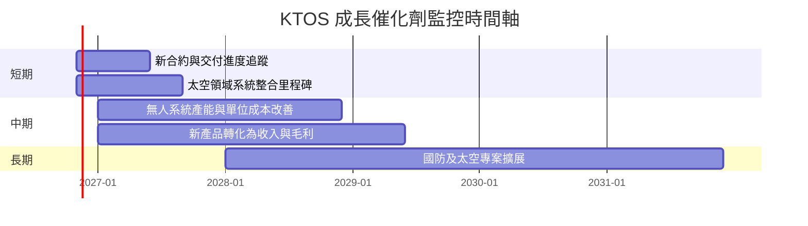

### 9.2 TAM 市場規模分析

財務包沒有提供 TAM、市場滲透率或 KTOS 各業務收入，故不以臆測市場數值填表。

```text
╔══════════════════════════════════════════════════════════════════╗
║              KTOS 市場機會與資料可得性                          ║
╠══════════════════════════════════════════════════════════════════╣
║ 無人系統 TAM：          N/A   滲透率：N/A   公司收入：分部N/A   ║
║ 太空地面系統 TAM：      N/A   滲透率：N/A   公司收入：分部N/A   ║
║ 國防電子／整合 TAM：    N/A   滲透率：N/A   公司收入：分部N/A   ║
║ 公司總TTM收入：         $1.65B                                 ║
║ TTM收入成長：           28.2%                                   ║
╠══════════════════════════════════════════════════════════════════╣
║ 投資追蹤重點：分部訂單、book-to-bill、合約積壓、毛利及現金回收 ║
╚══════════════════════════════════════════════════════════════════╝
```

### 9.3 成長驅動力結構圖

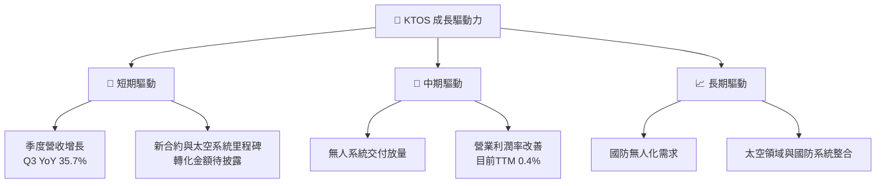

**成長轉化判準**：營收成長只有在毛利率保持或改善、TTM營業利益率轉正並提高、OCF回到正值時，才可視為高品質成長。若營收年增仍超過20%但FCF持續為負，應重新評估營運資金、Capex及合約經濟性。

## 10. 風險矩陣

### 10.1 風險評分矩陣

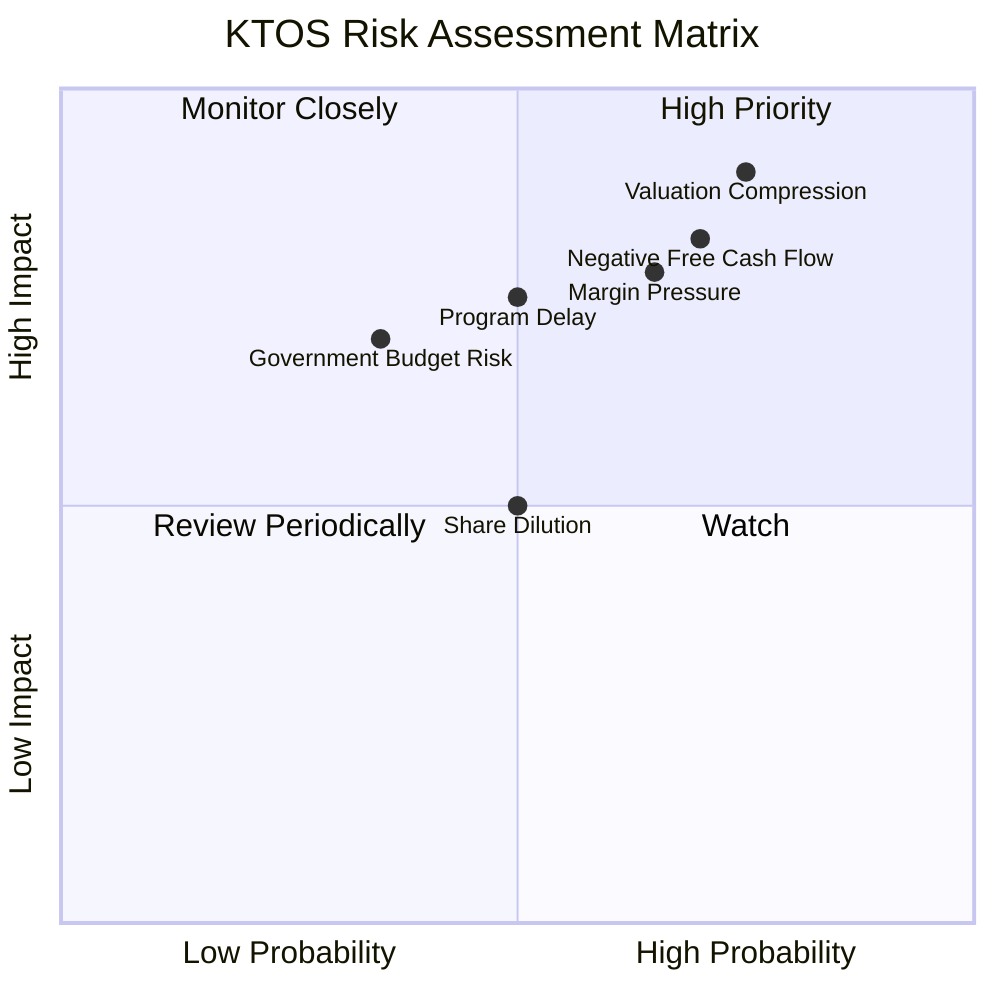

### 10.2 風險清單詳細分析

| # | 風險項目 | 發生機率 | 財務衝擊 | 風險評分 | 緩解措施 |
|---|----------|----------|----------|----------|----------|
| 1 | 🔴 **估值壓縮** | 高（估計65%） | 高：若倍數向同業靠攏，股價可能明顯回落 | 🔴 9.0/10 | 等待估值回到MOS至少10%的價格區域；追蹤盈利與FCF是否追上估值 |
| 2 | 🔴 **負FCF延續** | 高（估計60%） | 高：TTM FCF已−$123.00M；延續會消耗$1.40B現金緩衝 | 🔴 8.5/10 | 每季追蹤OCF、Capex、應收帳款、存貨及現金變化 |
| 3 | 🟠 **營業利潤率未改善** | 中高（估計55%） | 高：TTM營業利益率0.4%，若不能提升，估值建立在不成熟獲利之上 | 🟠 8.0/10 | 追蹤毛利率、分部利潤率及每季營業費用率 |
| 4 | 🟠 **政府合約延遲／取消** | 中（估計35%） | 中高：可能造成交付與收入認列遞延 | 🟠 7.0/10 | 追蹤合約積壓、交付里程碑與客戶集中度 |
| 5 | 🟡 **成本超支或產品組合轉弱** | 中（估計40%） | 中高：FY2025毛利率約22.9%，低於FY2024約25.3% | 🟡 6.5/10 | 要求連續兩季毛利率回升並同步改善OCF |
| 6 | 🟡 **股權稀釋** | 中（估計35%） | 中：SBC約佔TTM營收3.55% | 🟡 6.0/10 | 監控稀釋股數、SBC／營收與每股FCF |
| 7 | 🟡 **利率與市場風險溢酬上升** | 中（估計30%） | 中：WACC基準10.64%，終值占比高使估值對折現率敏感 | 🟡 6.0/10 | 在不同WACC情境下重新估值，避免將基準DCF當成精確目標 |

## 11. 投資建議

### 11.1 最終綜合評級雷達圖

| 維度 | 分數 | 理由 |
|------|---:|------|
| 基本面 | 5.5/10 | 國防與科技業務具市場需求，但收入分部及回報資料不完整 |
| 成長 | 8.0/10 | TTM營收年增28.2%，最新季年增35.7% |
| 獲利品質 | 3.0/10 | TTM營業利益率0.4%、ROIC 0.2%、FCF為負 |
| 財務健康 | 6.5/10 | 現金及短期投資$1.40B、流動比率5.418；債務口徑有差異 |
| 估值 | 2.0/10 | Forward P/E 31.07x、EV/EBITDA約59.9x、MOS −40.9% |
| 管理層／資本配置 | 5.0/10 | 有研發與資本投入，現有資料無法證明投資回報已超過資本成本 |
| 技術與護城河 | 5.0/10 | 專案認證、系統整合與客戶關係具門檻，市場份額與鎖定數據缺漏 |
| **總評** | **4.8/10** | 成長吸引人，但估值、現金流與資本效率不足以支持現價 |

```text
╔══════════════════════════════════════════════════════════════╗
║                 KTOS 最終綜合評分                            ║
╠══════════════════════════════════════════════════════════════╣
║ 基本面       5.5 ▓▓▓▓▓▓▓▓▓▓▓░░░░░░░░░                      ║
║ 成長         8.0 ▓▓▓▓▓▓▓▓▓▓▓▓▓▓▓▓░░░░                      ║
║ 獲利品質     3.0 ▓▓▓▓▓▓░░░░░░░░░░░░░░                      ║
║ 財務健康     6.5 ▓▓▓▓▓▓▓▓▓▓▓▓▓░░░░░░░                      ║
║ 估值         2.0 ▓▓▓▓░░░░░░░░░░░░░░░░                      ║
║ 護城河       5.0 ▓▓▓▓▓▓▓▓▓▓░░░░░░░░░░                      ║
╠══════════════════════════════════════════════════════════════╣
║ 綜合評分     4.8/10  🟠 減碼：成長尚未形成足夠現金回報       ║
╚══════════════════════════════════════════════════════════════╝
```

### 11.2 目標價與隱含報酬率

| 情境／方法 | 價值 | 相對2026-11-12收盤$34.75 | 假設／用途 |
|------------|-----:|-------------------------:|------------|
| 悲觀情境 | $7.00 | −79.9% | 成長放緩、利潤率改善不足、估值倍數收縮 |
| 基準情境合理價值 | **$24.66** | **−29.0%** | 第8.8節加權合理價值；MOS −40.9% |
| 樂觀情境 | $40.00 | +15.1% | 28%營收增長、14%營業利潤率、估值維持溢價 |
| 分析師共識 | $74.68 | +115.0% | 25位分析師平均目標價；僅作參照，模型權重10% |

**評級依據**：MOS −40.9%低於 −25%門檻，依規則應為🔴賣出。考量公司有 $1.40B 現金及高於同業的營收成長，**依 MOS 應為賣出，質化因素上調一級為減碼**；若後續仍未見FCF與ROIC改善，應回到賣出判斷。

**建議區間**

- **建議買入觀察區**：約 $22.19 以下，對應相對加權合理價值至少10%的折價。
- **持有／觀察區**：約 $22.19–$27.40；仍須財報驗證利潤率與現金流。
- **減碼區**：高於約 $27.40，特別是股價維持高於加權合理價值而FCF未轉正時。
- 本報告目前評級為減碼，並非建議在現價新增部位。

### 11.3 買入時機與觸發因素

```text
╔══════════════════════════════════════════════════════════════════╗
║                  ✅ 買入觸發因素 Checklist                      ║
╠══════════════════════════════════════════════════════════════════╣
║ 立即重新評估（需多數符合）：                                     ║
║ ☐ TTM營收成長維持20%以上，且至少連續兩季成長                    ║
║ ☐ TTM營業利益率由0.4%提高並連續兩季改善                          ║
║ ☐ TTM OCF轉正，Capex後FCF逐步收斂至零                            ║
║ ☐ 應收帳款及存貨增幅不高於收入增幅                               ║
║                                                                  ║
║ 加碼觸發條件（任一項成立仍需估值配合）：                         ║
║ ☐ 股價降至約$22.19以下，MOS至少10%                               ║
║ ☐ ROIC連續兩季提高，並形成可見的ROIC收斂至WACC路徑               ║
║ ☐ 公司披露分部利潤率、訂單積壓及交付能見度改善                   ║
║                                                                  ║
║ 減碼／退出觸發條件：                                             ║
║ ☐ 連續兩季營收年增低於15%                                       ║
║ ☐ 營業利益率再度轉負或較峰值收縮超過2個百分點                   ║
║ ☐ TTM FCF繼續惡化，或現金下降而營運資金未改善                   ║
║ ☐ 合約延期、取消或成本超支導致管理層下修展望                     ║
╚══════════════════════════════════════════════════════════════════╝
```

### 11.4 投資人適配度分析

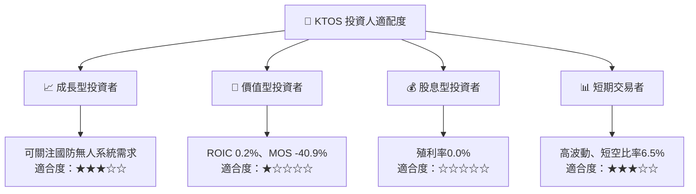

### 11.5 每季財報監控清單（Quarterly Watch List）

| 監控指標 | 目前基準 | 加碼／改善門檻 | 減碼門檻 |
|---------|---------:|---------------|----------|
| 營收年增 | 最新季35.7%；TTM 28.2% | 連續兩季維持≥20% | 連續兩季<15% |
| 毛利率 | TTM 23.0% | 連續兩季改善，並高於23% | 跌破21%且未見回升 |
| 營業利益率 | TTM VERIFIED 0.4%；最新季−1.0% | 轉正並連續兩季擴張 | 連續兩季為負 |
| OCF | TTM −$31.50M | TTM轉正 | 負值擴大且現金下降 |
| Capex | TTM $91.50M | Capex帶來產能與交付成長 | Capex升高但營收／毛利未跟上 |
| FCF | TTM −$123.00M | 逐季改善並接近零 | 負值擴大或現金消耗加速 |
| 應收帳款 | TTM $645.5M | 增幅不高於營收增幅 | 應收增速連續兩季高於營收 |
| 存貨 | TTM $244.5M | 周轉穩定、與交付同步 | 存貨增加但收入／交付減速 |
| SBC | 近四季估計約$58.5M；約3.55% TTM營收 | SBC／收入下降、股數穩定 | 每股稀釋加速 |
| ROIC | TTM 0.2% | 持續改善並向WACC收斂 | ROIC下滑或長期遠低於WACC |
| 現金與債務 | 現金$1.40B；債務口徑不一致 | 核實債務後仍有充足淨現金 | 現金快速減少或債務上升 |
| 公司展望 | 新聞報導提及2027營收成長預期，非本報告核實財測 | 正式指引可驗證且有利潤支撐 | 下修展望或合約延遲 |

### 11.6 反面論證：什麼會證明論點錯誤（What Would Change My Mind）

```text
╔══════════════════════════════════════════════════════════════════╗
║              ⚠️ 論點失效條件（Disconfirming Evidence）           ║
╠══════════════════════════════════════════════════════════════════╣
║ 本報告偏審慎；若以下情況成立，應進一步降低評級或退出：          ║
║ ☐ 營收年增連續兩季低於15%，且訂單／積壓同步走弱                  ║
║ ☐ TTM營業利益率連續兩季為負，或較已披露高點收縮超過2pp           ║
║ ☐ TTM FCF仍低於-$150M，或現金明顯下降而營運資金未改善            ║
║ ☐ ROIC在未來四季仍低於1%，且看不到向WACC 10.64%收斂的路徑       ║
║ ☐ SBC／營收高於4%，或流通股數年增超過2%而每股盈利未同步成長      ║
║ ☐ 應收與存貨增幅持續大於營收增幅，顯示收入品質或交付風險惡化    ║
║                                                                  ║
║ 相反，若營收成長維持20%以上、營業利益率連續改善、TTM FCF轉正，  ║
║ 且ROIC明顯提高，則本報告減碼論點需要重新檢視。                  ║
╚══════════════════════════════════════════════════════════════════╝
```

> **免責聲明**：本報告為 AI 自動生成，僅供研究參考，不構成投資建議。估值依據包含明確標示的假設與資料來源口徑差異；投資有風險，入市需謹慎。