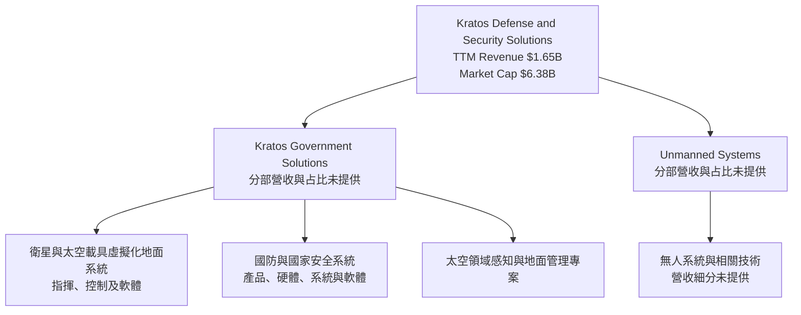
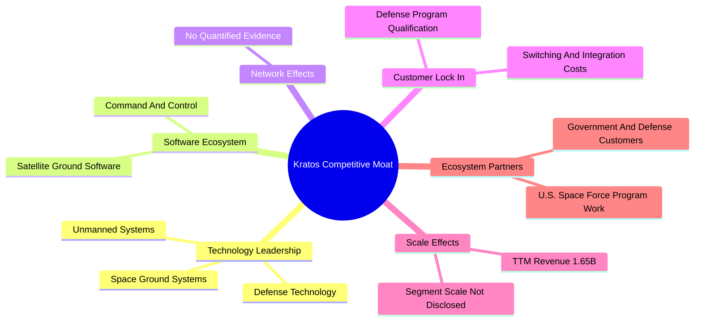
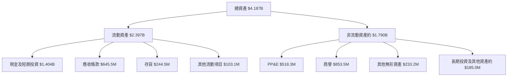
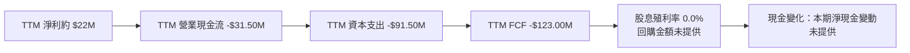
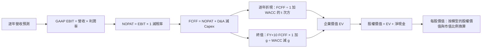
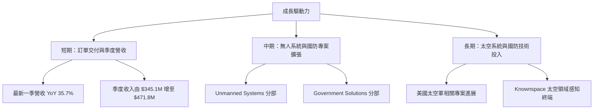
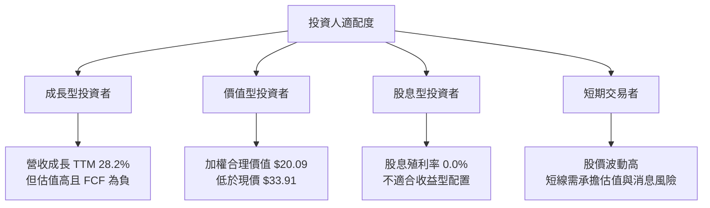

# KTOS 基本面深度分析報告
> **報告日期**：2026-11-14 ｜ **語言**：繁體中文 ｜ **數據來源**：SEC 申報資料 (XBRL)、Yahoo Finance、Finviz、StockAnalysis、Roic.ai ｜ **分析師**：CFA 級機構研究

## 目錄

| # | 章節 | 核心結論 |
|---|------|----------|
| 1 | 執行摘要 | 賣出；加權合理價值 $20.09；MOS -68.8% |
| 2 | 公司概覽與商業模式 | 無人系統及國防科技提供成長選擇權，但營收分部占比未提供，護城河證據仍有限 |
| 3 | 損益表深度分析 | TTM 營收 $1.65B、TTM 成長 28.2%；獲利率低且最新季度營業虧損 |
| 4 | 資產負債表分析 | 現金與短期投資 $1.40B；總債務資料口徑不一致，流動性指標偏充裕 |
| 5 | 現金流量深度分析 | TTM FCF -$123.00M、FCF Yield -1.93%，再投資與營運資金消耗仍高 |
| 6 | 獲利能力與資本效率 | ROIC 0.2% 對 WACC 10.42%，目前未創造足以覆蓋資本成本的回報 |
| 7 | 相對估值分析 | KTOS 估值高於多數同業；自身 P/S 高於五年中位數 |
| 8 | DCF 內在價值評估 | DCF 基準值 $9.77；終值占 EV 83.9%，模型高度依賴長期假設 |
| 9 | 成長催化劑 | 最新一季營收年增 35.7%；無人系統、太空與國防專案是可觀察催化因素 |
| 10 | 風險矩陣 | 估值與現金流、專案執行、政府採購週期為主要風險 |
| 11 | 投資建議 | 現價風險報酬不利；依加權合理價值計算，MOS 對應賣出 |

## 1. 執行摘要

KTOS 的成長證據明確：TTM 營收為 **$1.65B**，TTM 年增 **28.2%**，最新一季營收年增 **35.7%**；但 TTM 營業利益率只有 **0.4%**，最新一季營業利益率 **-1.0%**，TTM 營業現金流 **-$31.50M**、FCF **-$123.00M**。依程式提供的四種估值方法與固定權重，加權合理價值為 **$20.09**；以 **2026-11-13 收盤價 $33.91** 計算，MOS 為 **-68.8%**，規則 20 評級為 **賣出**。此外，ROIC **0.2%** 低於 WACC **10.42%**，代表目前營運回報尚未覆蓋資本成本。

### 1.0 一頁式投資儀表板

| 項目 | 內容 |
|------|------|
| **投資論點（3 句）** | ① TTM 營收年增 **28.2%**，最新一季年增 **35.7%**，顯示需求成長仍快。② TTM 營業利益率僅 **0.4%**、最新一季為 **-1.0%**，目前營收增長尚未轉化為穩定營業獲利。③ TTM FCF **-$123.00M**、DCF 基準值 **$9.77**，估值仍需大幅改善才能支撐現價。 |
| **綜合評分** | **5.0/10**（引用 1.1 六項算術平均） |
| **財務健康** | 🟡 現金及短期投資 **$1.40B**，流動性充裕；但 TTM FCF 為 **-$123.00M**。 |
| **ROIC vs WACC** | **0.2% vs 10.42%**：目前未覆蓋資本成本，屬價值創造不足。 |
| **FCF 趨勢** | TTM FCF 為 **-$123.00M**，FCF Yield **-1.93%**；負值反映營運現金流與資本支出合計仍消耗現金。 |
| **估值** | Forward P/E **30.32x** ｜ EV/EBITDA（TTM）**58.132x** ｜ FCF Yield **-1.93%** |
| **DCF 內在價值（基準）** | **$9.77** ｜ 現價相對 DCF 溢價 **+247.0%**（折溢價基準：DCF） |
| **安全邊際（MOS）** | **-68.8%＝($20.09−$33.91)÷$20.09**（基準：8.8 加權合理價值）｜ 🔴 無 |
| **預期報酬（基準情境 12M）** | DCF 情境為十年模型而非 12M 目標；分析師共識均值 **$74.68** 隱含 **+120.2%**，但不視為本報告基準預期報酬。 |
| **關鍵風險（前二）** | ① 現價高於加權合理價值 **68.8%**；② TTM FCF **-$123.00M** 且最新一季營業利益率 **-1.0%**。 |
| **評級 + 信心度** | 🔴 **賣出** ｜ 信心：中（DCF 終值占比高，且財務數據存在口徑差異） |

### 1.1 綜合評分卡（全報告唯一）

| 維度 | 評分（1–10） | 主要依據（引用數字與其來源章節） |
|------|--------------|----------------------------------|
| 成長性 | 8.0 | TTM 營收年增 **28.2%**、最新一季年增 **35.7%**（第 3 章）；成長是明確優勢，但分部貢獻未提供。 |
| 獲利能力 | 3.0 | TTM 營業利益率 **0.4%**、ROIC **0.2%**、F-Score **3/8**（第 3、6 章）；成長尚未轉化為具經濟價值的回報。 |
| 財務健康 | 7.0 | 現金與短期投資 **$1.40B**、流動比率 **5.418**、CCC **80 天**（第 4 章）；流動性有緩衝，但現金流為負。 |
| 估值 | 2.0 | MOS **-68.8%**；Forward P/E **30.32x**，高於同業 Forward P/E 中位數 **18.4x**（第 7、8 章）。 |
| 護城河 | 6.0 | 公司提供國防、無人系統、衛星地面系統等產品，並有美國太空軍專案相關消息；但市場份額、客戶集中度及分部數據未提供（第 2 章）。 |
| 管理層與資本配置 | 4.0 | 2025 年 SBC **$35.50M**，2026 年最近四季估算合計 **$58.50M**；Piotroski 顯示稀釋股數未通過，且 TTM FCF 為負（第 3、5、6 章）。 |
| **綜合評分** | **5.0** | 六項算術平均：**(8.0+3.0+7.0+2.0+6.0+4.0)÷6=5.0**。 |

### 1.2 五大投資論點 + 三大核心風險

| 類型 | 項目 | 具體依據 | 信心度 |
|------|------|----------|--------|
| 🟢 **投資論點①** | 營收成長加速 | TTM 營收 **$1.65B**、年增 **28.2%**；最新一季年增 **35.7%**，高於 AVAV、LMT、NOC 最新季年增率中位數 **6.7%**。 | 🟢 高 |
| 🟢 **投資論點②** | 無人系統與國防需求具有結構性支持 | 公司有 Kratos Government Solutions 與 Unmanned Systems 兩大業務；近期公司消息涵蓋 Knownspace 太空領域感知終端及美國太空軍專案進展。 | 🟡 中 |
| 🟢 **投資論點③** | 現金部位提供投資緩衝 | 現金與短期投資 **$1.40B**；即使現金流持續偏弱，仍提供資本支出與專案執行緩衝。 | 🟡 中 |
| 🟢 **投資論點④** | 營收規模與毛利額擴大 | FY2022 至 FY2025 營收由 **$898.30M** 增至 **$1.35B**；毛利由 **$226.00M** 增至 **$307.90M**。 | 🟢 高 |
| 🟢 **投資論點⑤** | 分析師預期仍偏正面 | 25 位分析師平均目標價 **$74.68**，高於現價 **$33.91**；但共識不等於可驗證的現金流價值。 | 🟡 中 |
| 🟡 **風險①** | 市場定價高於基本面估值 | 加權合理價值 **$20.09**、MOS **-68.8%**；同業 Forward P/E 中位數 **18.4x**，KTOS Forward P/E **30.32x**。 | 🔴 高 |
| 🔴 **風險②** | 現金流轉換與資本支出壓力 | TTM OCF **-$31.50M**、Capex **$91.50M**、FCF **-$123.00M**；若支出維持高位而營業利潤率未改善，現金消耗可能延續。 | 🔴 高 |
| 🔴 **風險③** | 獲利波動與專案交付風險 | 最新一季營業利益率 **-1.0%**；最近四季季度營業利益由正轉負，表示專案組合、成本吸收或交付節奏可造成季度獲利波動。 | 🟡 中 |

### 1.3 快速統計卡片

| 指標 | 公司實際值（期間） | 同業中位數 | 狀態 |
|------|--------------------|------------|------|
| 營收成長（TTM） | **28.2%** | — | 🟢 |
| 營收成長（最新一季年增） | **35.7%** | **6.7%** | 🟢 |
| 毛利率（TTM） | **23.0%** | **20.0%** | 🟢 |
| 營業利益率（TTM） | **0.4%** | — | 🔴 |
| ROIC（TTM） | **0.2%** | — | 🔴 |
| Forward P/E | **30.32x** | **18.4x** | 🔴 |
| FCF Yield（TTM） | **-1.93%** | — | 🔴 |
| Piotroski F-Score | **3 / 8** | — | 🔴 |

### 1.4 投資結論

╔══════════════════════════════════════════════════════════════════╗  
║                    📊 投資結論摘要                               ║  
╠══════════════════════════════════════════════════════════════════╣  
║  評級：🔴 賣出（規則 20；MOS -68.8%）                            ║  
║  價格（2026-11-13 收盤）：$33.91                                 ║  
║  DCF 內在價值（基準）：$9.77（現價溢價 +247.0%）                 ║  
║  安全邊際 MOS：-68.8%（＝($20.09−$33.91)÷$20.09）              ║  
║  加權合理價值（8.8）：$20.09                                     ║  
║  DCF 情境價值：                                                    ║  
║    悲觀情境：$8.16（-75.9%）                                      ║  
║    基準情境：$9.77（-71.2%）                                      ║  
║    樂觀情境：$13.38（-60.5%）                                     ║  
║  綜合評分：5.0/10（引用 1.1）                                     ║  
║  適合投資人：可承受高波動並追蹤國防成長股的投資人；不適合重視估值 ║  
║  保護、正向 FCF 或股息收入的投資人。                              ║  
╚══════════════════════════════════════════════════════════════════╝  

## 2. 公司概覽與商業模式

### 2.1 業務結構與收入來源

公司資料指出 KTOS 透過 Kratos Government Solutions 與 Unmanned Systems 兩個部門營運，產品和服務面向國防、國家安全與商業市場。TTM 營收為 **$1.65B**。各部門營收、占比及軟體／服務收入金額未提供，因此不將營收拆分成無來源的比例。

成長判讀上，最新一季營收年增 **35.7%**，高於三家同業最新季度年增率中位數 **6.7%**；但缺乏分部成長率，無法確認增長主要來自無人系統、太空系統、政府方案或併購。

### 2.2 市場份額

市場份額數據未提供。KTOS TTM 營收 **$1.65B**、最新一季營收年增 **35.7%**，在所列同業中增速高於 AVAV、LMT、NOC；但規模、產品範圍和客戶結構差異較大，不能單憑增長率推定市占率或競爭地位。

### 2.3 競爭護城河分析

以上屬質化評估：國防專案資格、系統整合和長週期交付可能提高轉換成本；但現有資料沒有客戶留存率、專案續約率、合約積壓或市占率，不能把潛在切換成本直接視為已驗證的持久護城河。

### 2.4 護城河強度

| 護城河項目 | 強度（強／中／弱） | 證據（引用數字或事實） | 會削弱它的情況 |
|------------|--------------------|------------------------|----------------|
| 技術與系統整合 | 中 | 公司覆蓋無人系統、衛星地面系統、國防硬體與軟體；近期有太空領域感知終端及美國太空軍專案消息。 | 產品性能未達標、競標落敗、系統整合延遲或替代技術成熟。 |
| 軟體生態系統 | 中偏弱 | 公司提供地面系統與相關軟體，但軟體收入及續約率未提供。 | 軟體未形成可重複收入，或客戶改採整合商／競爭者方案。 |
| 網路效應 | 弱 | 沒有可量化使用者、平台參與者或跨客戶數據效應。 | 若缺乏跨客戶效益，規模不會自然提升產品價值。 |
| 客戶鎖定 | 中 | 國防系統需整合、測試與認證，可能產生替換成本；但合約集中度與續約資料未提供。 | 政府重新競標、專案取消、預算削減或客戶改變需求。 |
| 規模效應 | 中偏弱 | TTM 營收 **$1.65B**、最新一季營收年增 **35.7%**；但 TTM 營業利益率僅 **0.4%**，規模尚未呈現明確利潤槓桿。 | 成長伴隨較高成本與 Capex，且利潤率無法隨營收擴大。 |
| 生態夥伴 | 中 | 有政府與美國太空軍相關專案進展；合作夥伴及收入占比未提供。 | 依賴少數主承包商或計畫，且合作／採購範圍縮小。 |

護城河分數 **6.0/10** 的理由：KTOS 涉及技術與系統整合型國防市場，並有太空及無人系統業務；但現有資料不足以確認市占、客戶黏著、軟體經常性收入與規模經濟已轉化為穩定獲利。

## 3. 損益表深度分析

### 3.1 年度收入成長趨勢（近 4 年）

年度營收由 FY2022 **$898.30M** 增至 FY2025 **$1.35B**。FY2022 至 FY2025 累計 CAGR 約 **14.5%**，但各年增速有波動。

╔══════════════════════════════════════════════════════════════════╗  
║                 Kratos 年度收入趨勢（FY2022–FY2025）             ║  
╠══════════════════════════════════════════════════════════════════╣  
║ FY2022  $0.90B  ████████████████░░░░░░░░  YoY：+10.7%  🟢        ║  
║ FY2023  $1.04B  ██████████████████░░░░░░  YoY：+15.4%  🟢        ║  
║ FY2024  $1.14B  ████████████████████░░░░  YoY：+9.6%   🟡        ║  
║ FY2025  $1.35B  ████████████████████████  YoY：+18.5%  🟢        ║  
╠══════════════════════════════════════════════════════════════════╣  
║ FY2022–FY2025 CAGR：約 +14.5%                                    ║  
╚══════════════════════════════════════════════════════════════════╝  

收入成長由 FY2024 的 **9.6%** 回升至 FY2025 的 **18.5%**，再加上 TTM 年增 **28.2%**，顯示最近成長動能擴大。需留意，併購及業務組合可能影響成長率；現有資料未提供有機成長與併購貢獻拆分。

### 3.2 季度收入趨勢分析

QoQ 依季度先後順序計算；最新季度的 YoY 採用程式計算值 **35.7%**。

| 季度 | 營收 | QoQ 成長 | YoY 成長 | 備註 |
|------|------:|---------:|---------:|------|
| 2025 Q4 | $345.1M | — | 21.9% | 以 StockAnalysis 季度表列示值計算。 |
| 2026 Q1 | $371.0M | **+7.5%** | **+22.6%** | 營收較前季改善。 |
| 2026 Q2 | $458.8M | **+23.7%** | **+30.5%** | 季度擴張幅度較大，可能反映交付時點與專案組合。 |
| 2026 Q3 | $471.8M | **+2.8%** | **+35.7%** | YoY 為 VERIFIED FIGURES 單季年增率；QoQ 增速較 Q2 收斂。 |

季度數字呈現年增加速，但單季營收受政府合約交付、里程碑驗收與專案時程影響，不能將單季成長直接外推為全年趨勢。

### 3.3 利潤率演變分析

下表年度毛利率與營業利益率依年度損益表金額計算至一位小數；TTM 與最新季度採程式計算的 VERIFIED FIGURES。

| 利潤率指標 | FY2022 | FY2023 | FY2024 | FY2025 | 趨勢 | 評估 |
|------------|--------|--------|--------|--------|------|------|
| **毛利率** | 25.2% | 25.9% | 25.3% | 22.9% | FY2025 回落 | 🟡 |
| **營業利益率** | 0.5% | 3.0% | 2.6% | 2.1% | FY2023 後逐年回落 | 🔴 |
| **淨利率** | -4.1% | -0.9% | 1.4% | 1.6% | 虧損轉正 | 🟡 |

FY2025 毛利率由 FY2024 **25.3%** 降至 **22.9%**，而營業利益率由 FY2023 **3.0%** 降至 FY2025 **2.1%**。這可能反映產品組合、專案成本或投入擴張的影響，但現有資料沒有分部毛利、合約損益或費用拆分，不能確認單一原因。TTM 營業利益率進一步降至 **0.4%**；最新一季為 **-1.0%**，顯示近期收入增長尚未轉成穩定營業槓桿。

### 3.4 費用結構分析

費用結構的完整損益細項及各項費用金額未提供，故不製作比例圓餅圖。已知 FY2025 研發費用 **$40.00M**，約占年度營收 **3.0%**（$40.00M ÷ $1.347B）；該比例是以提供的年度數值計算。營業利益率及毛利率回落表示，研發、銷售管理與交付成本對利潤的影響仍需持續觀察。

### 3.5 季度 EPS 趨勢與盈餘品質（Quality of Earnings）

EPS 估計值與實際值的歷史資料為 N/A，因此無法判斷最近四季 EPS 是超預期或不及預期；將每季損益結果當成「超預期／不及預期」並無依據。

| 盈餘品質項目 | 數值/佔比 | 評估 |
|--------------|-----------|------|
| 股權薪酬 SBC / 營收 | 最近四季 SBC 合計 **$58.50M**；除以 TTM 營收 **$1.65B**＝**3.5%** | 🔴 SBC 是實質股東成本；若持續發股，會稀釋既有股東持股。 |
| SBC / 營業現金流 | **$58.50M ÷ -$31.50M = -185.7%** | 🔴 因 OCF 為負，百分比不宜當成一般成本率解讀；SBC 金額大於當期負 OCF 絕對值。 |
| FCF / 淨利（現金轉換率） | **-$123.00M ÷ $22.00M = -559.1%** | 🔴 現金流與帳面獲利背離；淨利未轉為自由現金流。 |
| 一次性／非經常性損益 | N/A（未提供足夠明細） | 🟡 無法確認近期季度虧損是否含一次性項目。 |
| 有效稅率異常 | N/A（未提供 TTM 稅前利益與所得稅費用） | 🟡 不以標準稅率代替實際稅率判斷。 |
| 資本化支出 vs 費用化 | TTM Capex **$91.50M**；資本化與費用化細目 N/A | 🔴 Capex 約占 TTM 營收 **5.5%**，投資額明顯；無資料判定是否有成本遞延問題。 |

**盈餘品質結論：**TTM 淨利約 **$22M**，但 FCF 為 **-$123.00M**，且 SBC 約占營收 **3.5%**。因此，現階段不宜只用 P/E 或帳面淨利判斷獲利品質；市場估值須等待營業獲利與現金流改善來驗證。

## 4. 資產負債表分析

### 4.1 資產結構分解

最新 TTM 總資產為 **$4.187B**（StockAnalysis，2026 年 9 月期末）。其中現金與短期投資 **$1.404B**、應收帳款 **$645.5M**、存貨 **$244.5M**、PP&E **$518.3M**、商譽 **$853.5M**、其他無形資產 **$233.2M**。

非流動資產約數為總資產減流動資產：**$4.187B−$2.397B=$1.790B**。所列非流動細項採 StockAnalysis 資料；因四捨五入與分類口徑，細項合計可能有尾差。

### 4.2 流動性與營運資金分析

流動性指標來自市場資料彙整；營運資金天數照抄品質指標，不另行重算。

| 指標 | 最新值 | 歷史／比較 | 評估 |
|------|--------|------------|------|
| 現金及短期投資 | **$1.40B** | 2025 年末現金 **$560.6M** | 🟢 現金儲備增加，但不能取代持續產生營運現金。 |
| 流動比率 | **5.418** | 歷史季度比率未提供可比序列 | 🟢 短期償債緩衝較充裕；來源口徑與年度資產負債表推算值不完全一致。 |
| 速動比率 | **4.632** | 歷史比較未提供 | 🟢 不依賴存貨即可覆蓋短期負債的程度較高。 |
| DSO 應收帳款天數 | **42 天** | 一年前 **39 天** | **+3 天**；收款週期略拉長，可能反映營收、合約驗收與收款時點變動。 |
| DIO 存貨天數 | **70 天** | 一年前 **66 天** | **+4 天**；存貨占用資金增加，需監控專案交付和庫存周轉。 |
| DPO 應付帳款天數 | **32 天** | 一年前 **24 天** | **+8 天**；付款週期延長，有助短期現金，但未必代表供應商議價能力改善。 |
| CCC 現金轉換週期 | **80 天** | 一年前 **81 天** | **-1 天**；整體現金循環略改善，主要是 DPO 延長抵銷 DSO、DIO 增加。 |

### 4.3 債務結構分析

債務數據口徑不一致：VERIFIED FIGURES 的「總債務」為 **N/A**、淨現金為 **$1.40B**；另外的市場資料彙整列示總債務 **$246.00M**、淨現金／負債 **$1.16B**。本報告不將兩種口徑混算；以下方框保留已核實現金數字，並明確標示債務口徑差異。

╔══════════════════════════════════════════════════════════════════╗  
║                    Kratos 債務健康診斷                           ║  
╠══════════════════════════════════════════════════════════════════╣  
║ 總債務：     N/A（VERIFIED FIGURES）；另一資料源列 $246.00M       ║  
║ 現金及短期投資：$1.40B  ████████████████████  🟢                 ║  
║ 淨現金：     $1.40B（核實口徑；另一來源列 $1.16B）                ║  
║ Debt/EBITDA：N/A（債務口徑不一致，且 EBITDA 取值期別不同）         ║  
║ 利息保障倍數：N/A（利息費用與一致口徑債務資料未提供）              ║  
║ 判讀：現金緩衝大，但不能忽略資料口徑差異及負 FCF。                 ║  
╚══════════════════════════════════════════════════════════════════╝  

### 4.4 股東權益趨勢

股東權益由 FY2022 **$936.3M** 增至 FY2025 **$2.00B**。資產負債表擴張同時伴隨現金增加；但股數未增加的 F-Score 測試未通過，且存在 SBC，需分辨權益成長中有多少來自留存獲利、發股或其他資本項目。

╔══════════════════════════════════════════════════════════════════╗  
║                  股東權益趨勢（年度）                             ║  
╠══════════════════════════════════════════════════════════════════╣  
║ FY2022  $0.936B  ███████████░░░░░░░░░░░░░░░░░░░░                 ║  
║ FY2023  $0.976B  ████████████░░░░░░░░░░░░░░░░░░░                 ║  
║ FY2024  $1.350B  █████████████████░░░░░░░░░░░░░                 ║  
║ FY2025  $2.000B  █████████████████████████░░░░░                 ║  
╚══════════════════════════════════════════════════════════════════╝  

## 5. 現金流量深度分析

### 5.1 現金流量瀑布圖

TTM 淨利金額使用 StockAnalysis TTM **$22M**；OCF、Capex、FCF 按 VERIFIED FIGURES。股息殖利率為 **0.0%**，回購金額未提供。

淨利為正但 OCF 為負，表示應計獲利與現金實現不同步；Capex **$91.50M** 再擴大現金消耗，使 FCF 降至 **-$123.00M**。

### 5.2 FCF 轉換率趨勢

| 年度 | FCF | 淨利 | FCF / 淨利 | 解讀 |
|------|-----:|-----:|-----------:|------|
| FY2022 | -$71.10M | -$36.90M | **192.7%** | 分子、分母皆為負，正比率不代表現金轉換良好。 |
| FY2023 | $12.80M | -$8.90M | **不具經濟可比性** | 淨利為負，比例解讀容易失真。 |
| FY2024 | -$8.50M | $16.30M | **-52.1%** | 會計獲利未轉成正 FCF。 |
| FY2025 | -$137.40M | $22.00M | **-624.5%** | FCF 大幅低於淨利，資本支出與營運資金是重要觀察項。 |
| TTM | -$123.00M | 約 $22.00M | **-559.1%** | TTM 現金轉換顯著為負；淨利作為估值基礎須打折。 |

年度及 TTM 數據來自不同資料表整理口徑，比例供趨勢觀察，不應視為完全同口徑的審計比率。

### 5.3 自由現金流趨勢

╔══════════════════════════════════════════════════════════════════╗  
║                 自由現金流趨勢（實際）                            ║  
╠══════════════════════════════════════════════════════════════════╣  
║ FY2022  -$71.10M  ◀████████████░░░░░░░░░░░░░░░  FCF Yield N/A   ║  
║ FY2023   $12.80M  ███░░░░░░░░░░░░░░░░░░░░░░░░░  FCF Yield N/A   ║  
║ FY2024   -$8.50M  ◀██░░░░░░░░░░░░░░░░░░░░░░░░░  FCF Yield N/A   ║  
║ FY2025 -$137.40M  ◀████████████████████████░░░  FCF Yield N/A   ║  
║ TTM    -$123.00M  ◀██████████████████████░░░░░  Yield -1.93%   ║  
╠══════════════════════════════════════════════════════════════════╣  
║ 歷史年度 FCF Yield 未提供可比市值口徑，不自行推算。               ║  
╚══════════════════════════════════════════════════════════════════╝  

### 5.4 資本配置評估

| 資本用途 | 可取得數字 | 評估 |
|----------|------------|------|
| 資本支出 | TTM **$91.50M**；FY2025 **$95.30M** | 🔴 資本支出高於 TTM OCF，短期壓低 FCF；若支出形成產能和收入，應觀察後續回報。 |
| 研發 | FY2025 **$40.00M** | 🟡 研發支出支持技術產品，但缺少分部投資回報資料。 |
| 股息 | 殖利率 **0.0%** | 🟡 無現金股息回報。 |
| 回購 | N/A（回購金額未提供） | 無法確認是否回購抵銷 SBC 稀釋。 |
| 股權薪酬 | 2025 年 **$35.50M**；最近四季按季度資料合計 **$58.50M** | 🔴 對股東的經濟成本需納入稀釋與盈餘品質判斷。 |
| 留存與併購 | 金額未提供 | N/A，無法拆分。 |

資本配置比例缺乏完整現金流明細，不繪製比例圓餅圖，避免將缺漏項目補成估計比例。

## 6. 獲利能力與資本效率

### 6.1 ROE / ROA / ROIC 趨勢

| 指標 | 可用期間數據 | 評估 |
|------|--------------|------|
| ROE | TTM **0.6%**（VERIFIED FIGURES）；另有市場彙整值 **0.8%** | 資料來源口徑不同；採品質指標中 TTM **0.6%** 作為本報告主值，回報偏低。 |
| ROA | TTM **0.2%**（市場彙整值；品質指標列示 ROA > 0） | 低資產回報顯示資產擴張尚未對應成高獲利。 |
| ROIC | TTM **0.2%** | 明顯低於 WACC **10.42%**，目前資本效率不足。 |

行業均值未提供，不列同業平均。也未提供完整歷年 ROIC、ROA、ROE 同口徑序列，因此不補造歷史值。

### 6.2 ROIC vs WACC 分析（核心價值創造判斷）

╔══════════════════════════════════════════════════════════════════╗  
║                ROIC vs WACC 深度分析                              ║  
╠══════════════════════════════════════════════════════════════════╣  
║ WACC 輸入（採成本資本資料）：                                     ║  
║ ├── 無風險利率（10Y 美債）：5.15%                                 ║  
║ ├── ERP：5.00%                                                     ║  
║ ├── 原始 Beta：1.17；調整後 Beta：1.11                            ║  
║ ├── Ke = 5.15% + 1.11 × 5.00% = 10.70%                           ║  
║ ├── 稅前 Kd：3.90%；稅率：21.0%；稅後 Kd：3.08%                   ║  
║ ├── E/D 權重：96.3% / 3.7%                                        ║  
║ └── WACC：10.42%                                                   ║  
║                                                                    ║  
║ ROIC（TTM）：0.2%                                                  ║  
║ EVA spread：0.2% − 10.42% = -10.22 個百分點                       ║  
║                                                                    ║  
║ ROIC  0.2%    ░░░░░░░░░░░░░░░░░░░░░░░░░░░░░░░░  🔴              ║  
║ WACC 10.42%   ██████████████████████████████████  ──              ║  
║                                                                    ║  
║ 結論：目前 ROIC 約為 WACC 的 0.02 倍，尚未創造經濟價值。          ║  
╚══════════════════════════════════════════════════════════════════╝  

WACC 直接採成本資本資料的 **10.42%**，不另建立替代 WACC。Beta 使用調整後 **1.11**，其調整方式為 **⅔×1.17+⅓×1=1.113**，四捨五入為 **1.11**。稅後債務成本依提供的稅前成本與稅率計算：**3.90%×(1−21.0%)=3.081%**，顯示為 **3.08%**。

權重算式為：  
**96.3%×10.70% + 3.7%×[3.90%×(1−21.0%)]  
=10.3041%+0.1140%  
=10.4181% ≈ 10.42%。**

ROIC **0.2%** 低於 WACC **10.42%**，因此現有投入資本尚未產生足以覆蓋資金成本的回報。由於 TTM 營業利益率僅 **0.4%**，改善 ROIC 的關鍵是營業利潤率與現金回報，而非單純擴大資產。

### 6.3 杜邦三因素分解

| 因素 | 數值（TTM） | 解讀 |
|------|-------------|------|
| 淨利率 | **1.3%** | 利潤率薄，淨利稍有波動便可能顯著影響 ROE。 |
| 資產週轉率 | **0.39** | 每單位資產產生的營收有限；需觀察資產擴張是否帶來更多營收與毛利。 |
| 權益乘數 | **1.21** | 財務槓桿相對不高，ROE 不是主要靠高槓桿撐起。 |
| **ROE** | **0.6%** | **1.3% × 0.39 × 1.21 = 0.6%**（照抄品質指標）。 |

ROE 主要受低淨利率及有限資產週轉所限制，並非靠高權益乘數推升。以上數值採品質指標列示，不另以不同帳面時點重新計算。

### 6.4 財務體質：Piotroski F-Score

**Piotroski F-Score：3 / 8**。九項測試中一項因缺資料無法判定，故可判定分母為 8。

| 測試 | 結果 | 解讀 |
|------|------|------|
| ROA > 0 | ✅ 通過 | 獲利為正，但幅度有限。 |
| 營業現金流 > 0 | ❌ 未通過 | TTM OCF **-$31.50M**。 |
| ROA 高於一年前 | ❌ 未通過 | 獲利效率未改善。 |
| 營業現金流 > 淨利 | ❌ 未通過 | 現金流轉換弱，應計盈餘品質需留意。 |
| 長期負債 ÷ 總資產低於一年前 | — 無法判定 | 缺少可比輸入。 |
| 流動比率高於一年前 | ✅ 通過 | 短期流動性指標改善。 |
| 稀釋股數未增加 | ❌ 未通過 | 股數測試未通過，需監控 SBC 及稀釋。 |
| 毛利率高於一年前 | ✅ 通過 | 毛利率測試通過，但 FY2025 毛利率較 FY2024 下降。 |
| 資產週轉率高於一年前 | ❌ 未通過 | 資產效率未改善。 |

3/8 反映流動性及部分獲利品質項目通過，但 OCF、應計品質、資產效率與稀釋等測試未通過。此分數並不等於破產風險判定；它更直接指出獲利質量與資產效率尚有弱項。

## 7. 相對估值分析

### 7.1 同業估值比較表格

本公司倍數採市場資料；同業數字依 Peer multiples。Forward P/E 同業中位數採提供值 **18.4x**。AVAV 的 TTM P/E 為 N/A，故不製作三家 TTM P/E 中位數。

| 估值指標 | **KTOS** | **AVAV** | **LMT** | **NOC** | 本公司評估 |
|----------|---------:|---------:|--------:|--------:|-----------|
| **Trailing P/E** | **282.6x** | N/A | 21.2x | 17.4x | 🔴 KTOS 倍數極高；當前低淨利使 P/E 對盈餘波動敏感。 |
| **Forward P/E** | **30.32x** | 26.7x | 17.9x | 18.4x | 🔴 高於同業中位數 **18.4x**。 |
| **P/S Ratio（TTM）** | **3.9x** | 3.0x | 1.7x | 1.8x | 🔴 高於同業中位數 **1.8x**；市場已為成長付出溢價。 |
| **EV/EBITDA（TTM）** | **58.132x** | 28.4x | 15.4x | 12.6x | 🔴 高於同業中位數 **15.4x**，獲利基礎薄弱放大倍數。 |
| **最新一季營收 YoY** | **35.7%** | 5.7% | 11.3% | 6.7% | 🟢 明顯快於三家同業；須以利潤率改善驗證成長質量。 |
| **毛利率（TTM）** | **23.0%** | 26.5% | 11.7% | 20.0% | 🟡 高於 LMT、NOC，低於 AVAV；並未消除低營業利潤率問題。 |

### 7.2 歷史估值區間分析

╔══════════════════════════════════════════════════════════════════╗  
║                 KTOS 歷史估值位置（TTM 倍數）                     ║  
╠══════════════════════════════════════════════════════════════════╣  
║ P/E：      現值 282.6x ｜五年中位數 380.2x｜百分位 36%            ║  
║ P/S：      現值   3.9x ｜五年中位數   3.2x｜百分位 65%            ║  
║ EV/EBITDA：現值  60.0x ｜五年中位數  55.5x｜百分位 60%            ║  
╚══════════════════════════════════════════════════════════════════╝  

P/E 現值低於五年中位數，主要仍需結合低而波動的盈餘判讀。歷史 P/E 區間的上限異常龐大，應視為近零盈餘時倍數失真的結果，不適合當作正常估值錨。P/S 與 EV/EBITDA 分別高於五年中位數，顯示現價在銷售與 EBITDA 口徑上並不便宜。

### 7.3 情境價值（Bear / Base / Bull）

以下每股價值及假設照 DCF 情境資料列示；數字是模型情境，不等於分析師共識目標價。

| 情境 | 第 1 年營收成長 | 期末營業利潤率 | WACC | 每股價值 | 相對現價 | 機率 | 會發生的條件 |
|------|----------------|----------------|------|----------|----------|------|--------------|
| 🔴 悲觀 | **14.1%** | **1.6%** | **11.42%** | **$8.16** | **-75.9%** | **25%** | 成長由近期高位快速回落，專案成本或交付節奏限制利潤率，風險溢價上升。 |
| 🟡 基準 | **28.2%** | **1.9%** | **10.42%** | **$9.77** | **-71.2%** | **50%** | 第一年維持 TTM 成長錨點，長期利潤率回到近五財年中位數。 |
| 🟢 樂觀 | **42.3%** | **2.1%** | **9.42%** | **$13.38** | **-60.5%** | **25%** | 無人系統及太空相關業務放量，利潤率略高於基準，資金成本下降。 |

### 7.4 相對估值隱含價格區間

╔══════════════════════════════════════════════════════════════════╗  
║                相對估值回推每股價值（非價格目標）                 ║  
╠══════════════════════════════════════════════════════════════════╣  
║ $9.77 DCF ─ $14.29 EV/EBITDA ─ $20.56 Forward P/E ─ $33.91 現價 ║  
║ 分析師共識 $74.68；高於現價，但不等於現金流折現價值。             ║  
╚══════════════════════════════════════════════════════════════════╝  

- **同業 Forward P/E：$20.56**，依 peer median **18.4x × Forward EPS $1.12**。
- **同業 EV/EBITDA：$14.29**，依同業中位數 **15.4x × TTM EBITDA，再加淨現金**。
- 同業為 AVAV、LMT、NOC；相對方法使用同業中位數，而非 KTOS 自身現行倍數。

## 8. DCF 內在價值評估（Discounted Cash Flow）

> DCF 唯一模型來源採程式提供的十年 FCFF 模型。模型列示的金額以十億美元為單位，逐年數據以兩位小數顯示；終值、PV、橋接及每股價值按該模型原值呈現。由於未提供所有未四捨五入底層數字，個別公式以已顯示小數重算可能出現約 0.01B 的尾差；這是模型稽核上的限制，不以自行重建模型替代原值。

### 8.0 估值推理鏈（Thinking Logic）

**Step 1 — 價值來源與主導變數**

KTOS 的價值主要來自政府與國防方案、無人系統，以及衛星／太空地面系統；目前兩個主要分部的收入占比均未提供，因此無法將 **$1.65B TTM 營收**進一步拆成各業務占比。就模型現有數字，估值最敏感的是長期現金流與終值：終值現值占企業價值 **83.9%**，而營業利潤率由目前 TTM **0.4%** 提升至第十年 **1.9%** 是模型能否產生正向長期 FCFF 的重要條件。

**Step 2 — 模型選擇**

| 決策點 | 本報告採用 | 理由（含數字） | 曾考慮但否決 | 否決理由 |
|--------|-----------|----------------|--------------|----------|
| 現金流定義 | FCFF | 以 WACC **10.42%** 折現，先得企業價值，再加淨現金。 | FCFE | 模型已採公司整體資本成本與 EV 橋接。 |
| 預測期 N | **10 年** | 模型以 10 年將營收成長由 **28.2%** 線性降至 **3.0%**。 | 更短預測期 | 會縮短模型中成長與利潤率收斂的期間，非現有模型。 |
| 終值方法 | Gordon Growth | 模型明列永續成長率 **3.0%**。 | 退出倍數法 | DCF 模型未提供可直接使用的終值 EBITDA 倍數與退出倍數結果，不能自行補建。 |
| EBIT 基礎 | GAAP EBIT | 以 GAAP 營業利益率預測；模型設定 SBC 已含在費用中。 | 非 GAAP EBIT | 若加回 SBC，須另行扣除或增加股數稀釋；本模型並未採用該組合。 |

**Step 3 — 假設推導鏈**

- **營收成長**：錨點＝TTM 年增 **28.2%** → 模型假設第一年延續此成長，之後線性降至 **3.0%** → **採用 FY+1 28.2%、FY+10 3.0%** → 未採用全期維持 28.2%，因成熟業務的長期高成長難以無限延續；也未另加管理層財測，因該數值未提供。
- **期末營業利潤率**：錨點＝TTM **0.4%** → 模型逐年改善至最近五財年中位數 → **採用 FY+1 0.4% 至 FY+10 1.9%** → 未採用更高的利潤率，因歷史年度營業利益率最高約 **3.0%**（FY2023），近期 TTM 僅 **0.4%**。
- **永續成長率 g**：錨點＝模型明列 **3.0%**；這是模型假設值，並非 KTOS 已實現成長 → **採用 3.0%**，低於 WACC **10.42%** → 未採用接近 WACC 的成長率，因會令終值分母過小、估值失去穩健性。
- **預測期 N**：錨點＝程式模型設定 **10 年** → 讓成長與利潤率逐步收斂 → **採用 10 年** → 未改為較短年期，因本報告不得改動既有模型。
- **Capex / 營收**：錨點＝TTM **5.6%** → 模型逐年降至 **5.1%**；模型依據是逐步收斂至 **1.1×D&A** → **採用 FY+1 5.6%、FY+10 5.1%** → 未採用更快降至 D&A 水準，因公司目前仍處於投資與擴張階段。
- **D&A / 營收**：錨點＝TTM **4.7%** → 模型固定不變 → **採用 4.7%**；此項不另推導偏離值。
- **稅率**：錨點＝模型預設 **21.0%** → 以標準稅率作預測，實際有效稅率未提供 → **採用 21.0%**；實際稅率資料缺漏，不能宣稱它等於歷史實際稅率。
- **EBIT 基礎、SBC 與股數**：錨點＝模型使用 GAAP EBIT，說明 SBC 已是費用 → **採用組合 (A)**：GAAP EBIT、不再減 SBC、股數不額外稀釋 → 不採用非 GAAP 加回 SBC，因沒有模型所需的未來 SBC 預測與稀釋股數。
- **營運資金**：模型明確未建模營運資金變動 → **ΔWC 不納入 FCFF**。未自行加上估計，因可用資料雖列 CCC，卻未提供可直接匹配年度預測的增量營運資金假設。
- **終值方法**：錨點＝模型提供 Gordon Growth → **採用 Gordon Growth，g=3.0%** → 不附加退出倍數交叉驗證，因 DCF 模型未提供該倍數與相應估值，禁止外建另一模型。
- **WACC**：錨點＝成本資本資料的 **10.42%** → 按規定直接採用、不另算替代值 → 未採用更低折現率，避免在高 Beta、負 FCF、終值占比高的情況下無依據降低風險折現。

**Step 4 — 最脆弱一環**

最脆弱假設是低營業利潤率能否從 TTM **0.4%** 逐步改善至第十年 **1.9%**；若成長帶不來毛利與營運效率改善，FCFF 會低於基準，價值將下移，敏感度方向與終值占比高的特性一致。

**Step 5 — 計算路徑**

### 8.1 模型假設總表（Model Inputs）

| 假設項目 | 採用值 | 依據 / 來源 | 敏感度 |
|----------|--------|-------------|--------|
| 預測期長度 N | **10 年** | DCF 模型設定；營收成長與利潤率逐年收斂。 | 🟡 中 |
| 營收成長 | FY+1 **28.2%**；FY+10 **3.0%**，線性下降 | TTM vs prior TTM 成長 **28.2%**；期末採模型假設。 | 🔴 高 |
| 營業利潤率（GAAP EBIT） | FY+1 **0.4%** → FY+10 **1.9%** | 起點為 TTM 營業利益率，期末收斂至最近五財年中位數。 | 🔴 高 |
| 有效稅率 | **21.0%** | 模型預設；歷史有效稅率未提供。 | 🟢 低 |
| Capex / 營收 | FY+1 **5.6%** → FY+10 **5.1%** | TTM Capex / 營收；模型逐步收斂至 1.1×D&A。 | 🟡 中 |
| D&A / 營收 | **4.7%** | TTM 比例，模型固定。 | 🟢 低 |
| ΔWC / 營收增額 | **未建模** | DCF MODEL 明列 working capital is not modelled；不自行補值。 | 🟢 低 |
| EBIT 基礎 | **GAAP** | DCF MODEL 使用 GAAP EBIT。 | 🟡 中 |
| SBC 處理 | 組合 **(A)**：GAAP EBIT、不另扣 SBC | 模型說明 SBC 已是費用；股數不再額外稀釋。 | 🟡 中 |
| 年稀釋率 | **0%（固定股數）** | 組合 (A) 的模型處理方式；並非對公司未來股數的獨立預測。 | 🟡 中 |
| 永續成長率 g | **3.0%** | DCF 模型假設；低於 WACC。 | 🔴 高 |
| 終值方法 | Gordon Growth | DCF MODEL 提供此方法；退出倍數交叉驗證未提供。 | 🔴 高 |
| WACC | **10.42%** | 成本資本資料直接採用，詳見 8.2。 | 🔴 高 |
| FCFF 定義 | **NOPAT + D&A − Capex** | 模型不納入 ΔWC，亦不另扣 SBC。 | — |

**SBC 處理聲明：本模型採用 (A)，故 SBC 透過 GAAP EBIT 計入一次，不再另外扣除 SBC，也不以年股數稀釋率重複計入。**

### 8.2 折現率推導（WACC）

╔══════════════════════════════════════════════════════════════════╗  
║                    WACC 推導（折現率）                            ║  
╠══════════════════════════════════════════════════════════════════╣  
║ 股權成本 Ke（CAPM）：                                             ║  
║ ├── 無風險利率 Rf（10Y 美債）：5.15%                              ║  
║ ├── ERP：5.00%                                                     ║  
║ ├── 原始 Beta：1.17；調整後 Beta：1.11                            ║  
║ ├── 額外規模／國別溢酬：0.00%（未提供獨立溢酬，不另加）             ║  
║ └── Ke = 5.15% + 1.11×5.00% = 10.70%                              ║  
║                                                                    ║  
║ 債務成本 Kd：                                                      ║  
║ ├── 稅前 Kd：3.90%（成本資本資料）                                ║  
║ ├── 稅率：21.0%                                                    ║  
║ └── 稅後 Kd = 3.90%×(1−21.0%) = 3.081% ≈ 3.08%                  ║  
║                                                                    ║  
║ 資本結構權重：E 96.3%；D 3.7%                                     ║  
║ ✅ WACC = 96.3%×10.70% + 3.7%×3.081% = 10.42%                    ║  
╚══════════════════════════════════════════════════════════════════╝  

**WACC 五步核對：**

1. **Ke（CAPM）**＝Rf + β × ERP＝**5.15% + 1.11×5.00% = 10.70%**。
2. **稅前 Kd**＝**3.90%**，成本資本資料直接提供。利息費用與平均計息負債的原始金額未提供，因此不能從「利息費用÷平均計息負債」獨立重算。
3. **稅後 Kd**＝**3.90%×(1−21.0%) = 3.081% ≈ 3.08%**。
4. **權重**＝股權 **96.3%**；債務 **3.7%**，相加 **100.0%**。成本資本資料以市值／債務權重提供，市場市值參考值為 **$6.38B**；債務口徑原始數值存在來源差異，故不另反推更精確的 E、D 金額。
5. **WACC**＝**96.3%×10.70% + 3.7%×3.081%**  
   ＝**10.3041% + 0.1140%**  
   ＝**10.4181% ≈ 10.42%**。

Rf 日期、ERP 的外部估計依據與利息費用原始數據未提供；此處按成本資本資料列示，不另引入假設。第 6.2 與本節均採 **10.42%**。

### 8.3 逐年自由現金流預測（基準情境）

金額單位為 **$B**。表格逐年照模型原值列示；ΔWC 未建模，因此不另列數字欄；SBC 已包括於 GAAP EBIT，不另列扣除項。

| 年度 | FY+1 | FY+2 | FY+3 | FY+4 | FY+5 | FY+6 | FY+7 | FY+8 | FY+9 | FY+10 |
|------|------:|------:|------:|------:|------:|------:|------:|------:|------:|-------:|
| 營收 | 2.11 | 2.65 | 3.24 | 3.88 | 4.54 | 5.19 | 5.78 | 6.28 | 6.64 | 6.84 |
| 營收 YoY | 28.2% | 25.4% | 22.6% | 19.8% | 17.0% | 14.2% | 11.4% | 8.6% | 5.8% | 3.0% |
| 營業利潤率 | 0.4% | 0.6% | 0.7% | 0.9% | 1.1% | 1.2% | 1.4% | 1.6% | 1.7% | 1.9% |
| EBIT（GAAP） | 0.01 | 0.01 | 0.02 | 0.03 | 0.05 | 0.06 | 0.08 | 0.10 | 0.12 | 0.13 |
| − 稅 | 0.00 | 0.00 | 0.00 | 0.01 | 0.01 | 0.01 | 0.02 | 0.02 | 0.02 | 0.03 |
| = NOPAT | 0.01 | 0.01 | 0.02 | 0.03 | 0.04 | 0.05 | 0.06 | 0.08 | 0.09 | 0.10 |
| + D&A | 0.10 | 0.12 | 0.15 | 0.18 | 0.21 | 0.24 | 0.27 | 0.29 | 0.31 | 0.32 |
| − Capex | 0.12 | 0.15 | 0.18 | 0.21 | 0.24 | 0.28 | 0.31 | 0.33 | 0.34 | 0.35 |
| **= FCFF** | **-0.01** | **-0.01** | **-0.01** | **-0.00** | **0.01** | **0.02** | **0.03** | **0.04** | **0.06** | **0.07** |
| 折現因子 @10.42% | 0.906 | 0.820 | 0.743 | 0.673 | 0.609 | 0.552 | 0.500 | 0.452 | 0.410 | 0.371 |
| **FCFF 現值 PV** | **-0.01** | **-0.01** | **-0.01** | **-0.00** | **0.00** | **0.01** | **0.01** | **0.02** | **0.02** | **0.03** |

模型列示的預測期 FCF 現值合計為 **$0.07B**。按表格逐格已四捨五入的 PV 數字相加，尾差會因未四捨五入底層值而出現；不能以兩位小數各格反推並取代模型合計。

**FY+1 逐步演算（使用模型列值，金額單位 $B）：**

1. **營收**＝TTM 營收 **$1.65B × (1+28.2%) = $2.1153B ≈ $2.11B**。
2. **EBIT**＝營收 × 利潤率＝**$2.11B×0.4%=$0.00844B≈$0.01B**。
3. **稅**＝EBIT × 稅率＝按模型未四捨五入 EBIT × **21.0%**，顯示為 **$0.00B**。
4. **NOPAT**＝EBIT − 稅＝模型列示 **$0.01B**。
5. **D&A**＝營收 × **4.7%**；模型列示 **$0.10B**。
6. **Capex**＝營收 × 模型第一年 Capex 比率；模型列示 **$0.12B**。
7. **ΔWC**＝模型不納入營運資金變動，故 **不列入計算**。
8. **FCFF**＝NOPAT + D&A − Capex；模型列值 **$0.01B+$0.10B−$0.12B=-$0.01B**。
9. **折現因子**＝**1÷(1+10.42%)¹=0.906**；PV＝模型未四捨五入 FCFF × 折現因子，列示 **-$0.01B**。

> 以上因輸入值已四捨五入，FY+1 的顯示數字可能與未四捨五入底層值有小額差異；不得將顯示值當作模型原始精度。

**合理性自檢：**

- 預測期 FCFF 從 FY+1 **-$0.01B** 改善至 FY+10 **$0.07B**；因基期為負，FCF CAGR 無法用一般正值 CAGR 解讀。可核對的方向是由早期負值轉正，原因為營收擴張、利潤率提高以及 Capex 比率下降。
- FY+10 FCF 利潤率＝模型列值 **$0.07B÷$6.84B≈1.0%**；TTM FCF 利潤率＝**-$0.123B÷$1.65B≈-7.5%**。同業最佳值未提供，不比較「同業最佳」。
- FY+1 至 FY+4 FCFF 為負，會拉低預測期 PV 合計；模型並未假設早期現金流為正。

╔══════════════════════════════════════════════════════════════════╗  
║            自由現金流：歷史實際 vs 模型預測                      ║  
╠══════════════════════════════════════════════════════════════════╣  
║ FY2023（實） $0.013B   ███░░░░░░░░░░░░░░░░░  FCF Yield N/A      ║  
║ FY2024（實）-$0.009B  ◀██░░░░░░░░░░░░░░░░░  FCF Yield N/A      ║  
║ FY2025（實）-$0.137B  ◀████████████████████  FCF Yield N/A      ║  
║ FY+1（預）  -$0.01B   ◀██░░░░░░░░░░░░░░░░░  模型列值           ║  
║ FY+10（預）  $0.07B   ██████████░░░░░░░░░░  模型列值           ║  
╠══════════════════════════════════════════════════════════════════╣  
║ 早期預測 FCF 為負；價值改善仰賴營收擴張、利潤率提升與 Capex 收斂。║  
╚══════════════════════════════════════════════════════════════════╝  

### 8.4 終值計算（Terminal Value）

**適用性檢查：WACC 10.42% vs g 3.0% → WACC > g？✅**

| 方法 | 計算式 | 終值 TV | TV 現值 | 佔總 EV 比重 |
|------|--------|---------|---------|--------------|
| Gordon Growth | 模型列示：**0.07×(1+3.0%)÷(10.42%−3.0%)** | **$0.98B** | **$0.36B** | **83.9%** |
| 退出倍數法 | N/A（DCF 模型未提供退出倍數與對應終值） | N/A | N/A | N/A |

**逐步演算：**

1. **FY+N FCFF**＝FY+10 模型列值 **$0.07B**。
2. **分子**＝模型列式 **$0.07B×(1+3.0%)**；依顯示精度計算為 **$0.0721B**。
3. **分母**＝**10.42%−3.0%=7.42%**；使用表面上已四捨五入的 $0.07B，計算 TV 為 **$0.0721B÷7.42%=$0.9717B，約 $0.97B**。DCF MODEL 原值列示 **$0.98B**；未四捨五入的 FY+10 FCFF 不可見，故保留模型原值並揭露尾差。
4. **PV(TV)**＝模型列值 **$0.98B×0.371=$0.36358B≈$0.36B**。
5. **終值佔比**＝模型列示 **PV(TV) $0.36B ÷ EV $0.43B = 83.7%**；DCF MODEL 原列為 **83.9%**。差異來自表內金額四捨五入，採模型原列 **83.9%** 作為估值依賴度。

終值現值占 EV **83.9%**，故本估值高度依賴終值假設，短期現金流貢獻有限。退出倍數交叉驗證需要 FY+10 EBITDA 與採用倍數，但模型未提供可直接使用的退出倍數估值，故不另造數字。

### 8.5 企業價值 → 每股內在價值（Bridge）

╔══════════════════════════════════════════════════════════════════╗  
║              企業價值 → 每股內在價值 橋接表                      ║  
╠══════════════════════════════════════════════════════════════════╣  
║ 預測期 FCF 現值合計            +$0.07B                           ║  
║ 終值現值 PV(TV)                +$0.36B                           ║  
║ = 企業價值 EV                    $0.43B                           ║  
║ + 淨現金（模型口徑）            +$1.40B                           ║  
║ = 股權價值（模型列值）            $1.84B                           ║  
║ 每股價值換算：1.84×33.91÷6.38  = $9.77                           ║  
║ 當前股價（2026-11-13 收盤）      $33.91                           ║  
║ 折溢價（現價÷DCF價值−1）          +247.0%（溢價）                  ║  
╚══════════════════════════════════════════════════════════════════╝  

**逐步演算：**

1. **EV**＝模型列示預測期 PV **$0.07B + PV(TV) $0.36B = $0.43B**。
2. **股權價值**＝模型列示 **EV $0.43B + 淨現金 $1.40B = $1.84B**。兩項以已四捨五入數字相加為 $1.83B，與模型 $1.84B 有 $0.01B 尾差；模型按未四捨五入底層值列示 $1.84B。
3. **每股內在價值**＝模型指定換算式：**$1.84B×$33.91÷$6.38B=$9.77**（依模型原值）。
4. **折溢價**＝**$33.91÷$9.77−1=+247.0%**，即現價相對 DCF 基準值溢價約 247.0%。
5. **本節不計算 MOS**：MOS 僅在 8.8 以加權合理價值為分母計算。

股數與匯率：報價與財報均為美元；模型以股權價值、價格與市值比例換算每股價值，未使用另一幣別匯率。模型組合 (A) 使用固定股數處理，不以外部年稀釋率調整。

### 8.6 敏感性分析（WACC × 永續成長率）

下表照 DCF MODEL 原值列示；括號為相對現價 **$33.91** 的上行空間。此矩陣的中間基準格按 DCF MODEL 列示 **$9.77**。

| g（列）／WACC（欄） | 8.42% | 9.42% | **10.42%（基準）** | 11.42% | 12.42% |
|-----------|------:|------:|--------------------:|-------:|-------:|
| 2.0% | $10.57（-68.8%） | $9.97（-70.6%） | $9.52（-71.9%） | $9.17（-73.0%） | $8.90（-73.8%） |
| 2.5% | $10.81（-68.1%） | $10.13（-70.1%） | $9.63（-71.6%） | $9.26（-72.7%） | $8.97（-73.5%） |
| **3.0%（基準）** | $11.09（-67.3%） | $10.32（-69.6%） | **$9.77（-71.2%）** | $9.35（-72.4%） | $9.04（-73.3%） |
| 3.5% | $11.43（-66.3%） | $10.54（-68.9%） | $9.92（-70.8%） | $9.46（-72.1%） | $9.12（-73.1%） |
| 4.0% | $11.85（-65.0%） | $10.80（-68.2%） | $10.09（-70.2%） | $9.58（-71.7%） | $9.20（-72.9%） |

**矩陣算式檢查限制：**模型內敏感性矩陣的基準格為 **$9.77**，但同列 DCF 終值和橋接使用的已四捨五入數字不足以精確重建每格；本報告依要求原樣照抄，沒有自行調整矩陣。

**逐步演算說明：**模型沒有提供敏感度每一格的未四捨五入逐年 PV，因此不能以模型可見資料獨立重算一個非基準格並保證精確一致。依「DCF MODEL 數字不得自行另建」原則，不以推估數字填補演算軌跡；此為模型可稽核性的限制。

**三情境 DCF：**模型提供情境假設、每股價值與機率，但沒有逐情境 FY+10 營收、FCFF 與 TV 明細，因此不能聲稱已重建逐情境的完整鏈條。

| 情境 | 第一年營收成長 | 期末營業利潤率 | WACC | 每股內在價值 | 相對現價 | 機率 |
|------|----------------:|----------------:|-----:|--------------:|---------:|------:|
| 🔴 悲觀 | 14.1% | 1.6% | 11.42% | $8.16 | -75.9% | 25% |
| 🟡 基準 | 28.2% | 1.9% | 10.42% | $9.77 | -71.2% | 50% |
| 🟢 樂觀 | 42.3% | 2.1% | 9.42% | $13.38 | -60.5% | 25% |
| **機率加權** | — | — | — | **$10.27** | **-69.7%** | **100%** |

機率加權算式：  
**$8.16×25% + $9.77×50% + $13.38×25%  
=$2.04+$4.885+$3.345  
=$10.27**（按模型原值）。

**敏感度方向判讀：**

- **g 每提高 1pp**：在基準 WACC 10.42% 下，從 g=2.5% 的 **$9.63** 至 g=3.5% 的 **$9.92**，變動 **+$0.29，約 +3.0%**（以 $9.63 為分母）。
- **WACC 每提高 1pp**：在 g=3.0% 下，從 WACC 9.42% 的 **$10.32** 至 11.42% 的 **$9.35**，變動 **-$0.97，約 -9.4%**（以 $10.32 為分母）。
- **期末營業利潤率每提高 1pp**：模型沒有單變數利潤率敏感度矩陣，**N/A（資料未提供，且不可另建模型）**。
- 就可見敏感度矩陣，WACC 變動對估值影響大於 g 變動；長期營業利潤率仍可能是重要營運驅動，但現有敏感度表不能量化其每 1pp 影響。

### 8.7 反推 DCF（Reverse DCF：市場在預期什麼）

反推 DCF 依模型提供值照列。市場股價為 **$33.91**；模型給出的兩個單變數反推結果分別是第一年營收成長 **96.6%**、固定營業利潤率 **11.0%**。以下未提供的反推變數不自行求解。

| 求解的變數（一次一個） | 其餘變數設定 | 市場隱含值（令 DCF = 現價） | 公司歷史實際／基準 | 判斷 |
|------------------------|--------------|------------------------------|-------------------|------|
| 第一年營收成長 | 其餘維持基準值 | **96.6%** | TTM 成長 **28.2%**；基準模型 FY+1 **28.2%** | 🔴 遠高於目前成長錨點。 |
| 固定營業利潤率 | 其餘維持基準值 | **11.0%** | TTM **0.4%**；基準終點 **1.9%** | 🔴 遠高於基準與可用歷史年度區間。 |
| 永續成長率 g | 模型未提供此項反推解 | 未計算 | 基準 g **3.0%** | N/A。 |
| 預測期長度 N | 模型未提供此項反推解 | 未計算 | 基準 N **10 年** | N/A。 |

被固定輸入的完整明細（如股數、Capex 比率與未建模 ΔWC）及營收成長率迭代軌跡未提供，因此無法複現反推求解的每一個試算步驟。依現有反推結果，要以模型基準的其他假設支撐現價，營收成長或營業利潤率需遠高於基準；市場價格因此包含明顯高於模型基準的成長預期。

### 8.8 估值三角驗證與安全邊際

| 估值方法 | 隱含每股價值 | 上行空間（÷現價） | 權重 | 說明 |
|----------|--------------|-------------------|------|------|
| DCF（基準） | **$9.77** | **-71.2%** | **40%** | 十年 FCFF、WACC **10.42%**、終值成長 **3.0%**。 |
| 同業 Forward P/E | **$20.56** | **-39.4%** | **25%** | 同業中位數 **18.4x × Forward EPS $1.12**。 |
| 同業 EV/EBITDA | **$14.29** | **-57.9%** | **25%** | 同業中位數 **15.4x × TTM EBITDA，加淨現金**。 |
| 分析師共識目標價 | **$74.68** | **+120.2%** | **10%** | 25 位分析師平均目標價；僅作參考。 |
| **加權合理價值** | **$20.09** | **-40.8%** | **100%** | 公司類型為 profitable，依固定權重加權。 |

**加權合理價值逐步算式：**

**$9.77×40% + $20.56×25% + $14.29×25% + $74.68×10%**  
**=$3.908+$5.140+$3.572+$7.468**  
**=$20.088 ≈ $20.09**。

權重合計 **40%+25%+25%+10%=100%**。DCF、兩種同業相對估值與分析師共識方法均按固定權重列入；沒有可計算方法被剔除。

**MOS 與報酬率計算：**

- **MOS＝(加權合理價值−現價)÷加權合理價值**  
  **=($20.09−$33.91)÷$20.09 = -$13.82÷$20.09 = -68.8%**。
- **上行空間＝(加權合理價值−現價)÷現價**  
  **=($20.09−$33.91)÷$33.91 = -$13.82÷$33.91 = -40.8%**。
- **DCF 折溢價＝現價÷DCF 基準內在價值−1**  
  **=$33.91÷$9.77−1=+247.0%**。

╔══════════════════════════════════════════════════════════════════╗  
║                  估值區間與安全邊際                              ║  
╠══════════════════════════════════════════════════════════════════╣  
║ $8.16 悲觀DCF ─ $20.09 加權合理值 ─ $33.91 現價 ─ $74.68 共識    ║  
║                                                                    ║  
║ MOS = ($20.09−$33.91)÷$20.09 = -68.8%                            ║  
║ MOS 評估：🔴 無（MOS < 10%）                                     ║  
║ 上行空間 = ($20.09−$33.91)÷$33.91 = -40.8%                      ║  
║                                                                    ║  
║ 買入區間參考：≤$18.08（使 MOS 至少達 10%）                       ║  
║ 合理價值參考：加權合理價值 $20.09                                ║  
║ 目前價格：$33.91，已高於合理價值                                  ║  
╚══════════════════════════════════════════════════════════════════╝  

買入區間上限 **$18.08** 的算式為 **$20.09×(1−10%)=$18.081**，以兩位小數顯示。此價位只是 MOS 門檻推導的估值參考，不代表公司基本面或市場價格必然會達到。

> 🔎 **程式複算（Python，依本節各項自動重算）**
>
> 加權合理價值 = $9.77 × 40% + $20.56 × 25% + $14.29 × 25% + $74.68 × 10% = **$20.09**（權重合計 100%）
>
> 以價格 $33.91 計：MOS = **-68.8%**，上行空間 = **-40.8%**
>
> ✅ 與本節所寫數值一致。

### 8.9 DCF 模型的局限與失效條件

- **終值依賴度：**終值現值占 EV **83.9%**，表示估值主要由 FY+10 以後現金流假設決定。
- **最脆弱假設：**營業利潤率由 TTM **0.4%** 提升至 FY+10 **1.9%**；若利潤率無法改善，基準價值會下降，但模型未提供單變數利潤率敏感度，無法量化跌幅。
- **營收成長假設：**FY+1 延續 **28.2%** TTM 成長，並在十年內降至 **3.0%**。若需求或交付減速，營收低於模型會壓低 FCFF。
- **FCF 狀態：**TTM FCF **-$123.00M**，歷史年度 FCF 波動明顯，短期負 FCFF 使 DCF 可靠度低於成熟、穩定產生現金流的公司；應同時觀察同業倍數、營收成長質量與現金轉換。
- **模型未納入項目：**Working capital 未建模；實際 CCC 為 **80 天**，應收帳款與存貨天數均比一年前增加，未來若營運資金需求增加，實際 FCF 可能低於模型。
- **與第 10 章風險的連結：**政府採購時程、專案延期會衝擊營收成長；成本超支會壓低 EBIT 利潤率；利率上升則透過 WACC 降低終值現值。

### 8.10 複算檢核表（Audit Trail）

| # | 檢核項目 | 檢查方式 | 結果 |
|---|----------|----------|------|
| 1 | 所有 🔴高／🟡中敏感度輸入均有推導 | 對照 8.0 假設推導鏈 | ✅ 已逐項說明；未提供資料處明確標示。 |
| 2 | 每個假設都有來歷 | 核對 8.1 依據欄 | ✅ 有錨點或明示模型設定／資料缺漏。 |
| 3 | WACC 五步算式與加權運算 | 權重、Ke、稅後 Kd、WACC | ✅ 四捨五入後為 10.42%。 |
| 4 | Kd 分母與債務權重口徑一致 | 比對利息費用、平均債務及期末債務 | ⚠️ Kd 3.90% 與權重直接採成本資本資料；原始計息負債與利息費用缺失，不能獨立核對。 |
| 5 | WACC 與第 6.2 節相同 | 兩節數字核對 | ✅ 均為 10.42%。 |
| 6 | 逐年預測年度數 = N | 核對 FY+1 至 FY+10 | ✅ 共 10 年，無省略年度。 |
| 7 | FY+1 FCFF 與 PV 演算 | 以顯示精度重算 | ⚠️ 單格受四捨五入影響；模型未提供底層精度。 |
| 8 | 預測期 PV 合計 | 逐年 PV 與模型合計核對 | ⚠️ 模型合計 $0.07B；各格四捨五入後可能不完全相加至該值。 |
| 9 | WACC > g | 比較 10.42% 與 3.0% | ✅ |
| 10 | 終值基於 FY+N 並折現 N 期 | 核對 FY+10、因子 0.371 | ✅ 模型以 FY+10 FCFF 為基礎。 |
| 11 | EV 至每股價值橋接 | 以顯示值核對 | ⚠️ 已披露 $0.01B 尾差及每股換算依模型口徑。 |
| 12 | SBC 組合一致 | GAAP、無 SBC 扣除列、固定股數 | ✅ 採用組合 (A)。 |
| 13 | 矩陣基準格 = DCF 基準值 | 比對 8.5 與 8.6 | ✅ 均為 $9.77。 |
| 14 | 敏感性矩陣 WACC > g | 檢查所有格子 | ✅ 最低 WACC 8.42% 仍高於最高 g 4.0%。 |
| 15 | 情境機率與加權 | 25%+50%+25%；重算加權值 | ✅ 機率 100%；模型加權值 $10.27。 |
| 16 | 反推每列只放開一個變數 | 讀取模型反推結果 | ✅ 引用兩個單變數結果；其餘未計算。 |
| 17 | MOS、折溢價基準一致 | MOS 採 8.8；折溢價採 8.5 | ✅ MOS -68.8%；DCF 折溢價 +247.0%。 |
| 18 | 報告完整至第 11 章 | 檢查章節 | ✅ |
| 19 | 加權合理價值為加權總和 | 逐項相乘相加 | ✅ $20.088，顯示 $20.09。 |
| 20 | 評級符合 MOS 門檻 | MOS -68.8% 對照規則 20 | ✅ 賣出。 |

**稽核限制說明：**模型使用的部分未四捨五入中間值、完整平均計息債務與敏感度單變數細節未提供；已保留模型原列結果，並在相關項目標示尾差或不可獨立重算之處，未用自行建立的數值取代。

## 9. 成長催化劑

### 9.1 催化劑時間軸

現有資料未提供可驗證的專案完成日期、財務貢獻時程或管理層收入指引，因此不以估計時間編造 gantt 長度。已知催化資訊包括太空領域感知產品發布及美國太空軍相關專案審查進展；它們能否帶來訂單與收入仍需後續揭露確認。

### 9.2 TAM 市場規模分析

**N/A（TAM 數據未提供）。**不能據此估算市場金額或滲透率。KTOS 的 TTM 營收 **$1.65B**、年增 **28.2%**，最新一季年增 **35.7%**，可支持公司目前具成長動能的判斷，但不足以推導可服務市場規模。

### 9.3 成長驅動力結構圖

短期可驗證指標為營收增速、毛利率、營業利益與現金流；中長期催化因素需以合約公告、收入貢獻、交付進度及現金回收驗證，而不能只依產品發布或專案新聞推定商業化成功。

## 10. 風險矩陣

### 10.1 風險評分矩陣

風險機率與影響數值未由財務資料提供；依規則不以未驗證的估計座標製作 quadrantChart。以下以具體財務暴露及風險清單呈現。

### 10.2 風險清單詳細分析

| # | 風險項目 | 發生機率 | 財務衝擊 | 風險評估 | 緩解措施 |
|---|----------|----------|----------|----------|----------|
| 1 | 🔴 **估值回歸風險** | 無可靠機率資料 | 加權合理價值 **$20.09**，比現價 **$33.91** 低 **40.8%**（以現價為分母） | 🔴 高 | 分批配置；以估值、自由現金流與營業利潤率改善作為持倉條件。 |
| 2 | 🔴 **現金流與資本支出風險** | 負 FCF 已發生 | TTM FCF **-$123.00M**、OCF **-$31.50M**、Capex **$91.50M** | 🔴 高 | 每季監控 OCF、Capex、FCF 與 CCC；確認擴張支出是否帶來後續收入和回報。 |
| 3 | 🔴 **專案交付與毛利波動** | 已觀察到季度波動 | 最新季度營業利益率 **-1.0%**；年度毛利率 FY2025 為 **22.9%**，低於 FY2024 **25.3%** | 🔴 高 | 追蹤季度毛利率、營業利益率及專案延遲／驗收公告。 |
| 4 | 🟡 **政府採購及預算週期** | 數據未提供 | 訂單延後會影響營收增速、現金回收與營運資金 | 🟡 中至高 | 觀察合約公告、採購進度、客戶分散度及應收帳款天數。 |
| 5 | 🟡 **應收與存貨占用資金** | 已有天數上升 | DSO **42 天**、DIO **70 天**，分別較一年前增加 **3 天**、**4 天** | 🟡 中 | 追蹤交付、驗收、存貨周轉及 CCC 是否再次拉長。 |
| 6 | 🟡 **SBC 與股數稀釋** | 已有稀釋訊號 | 最近四季 SBC 約 **$58.50M**，占 TTM 營收約 **3.5%**；F-Score 稀釋股數測試未通過 | 🟡 中 | 比較 SBC、流通股數變化與回購；評估稀釋後每股現金流。 |

## 11. 投資建議

### 11.1 最終評級與評分

按加權合理價值 **$20.09** 與 2026-11-13 收盤價 **$33.91** 計算，MOS 為 **-68.8%**，依規則 20 評級為 **賣出**，未作質化一級調整。綜合評分 **5.0/10**；六項分數依序為成長性 **8.0**、獲利能力 **3.0**、財務健康 **7.0**、估值 **2.0**、護城河 **6.0**、管理層與資本配置 **4.0**，引用第 1.1 節，不另評分。

### 11.2 合理價值與隱含報酬率

| 價值參考 | 每股價值 | 相對現價 | 機率／權重 | 解讀 |
|----------|---------:|---------:|-----------:|------|
| **加權合理價值（8.8）** | **$20.09** | **-40.8%** | 權重合計 100% | 估值方法加權後的合理價值；MOS 為 **-68.8%**。 |
| 悲觀 DCF 情境 | $8.16 | -75.9% | 25% | 成長放緩、利潤率偏低、WACC 較高。 |
| 基準 DCF 情境 | $9.77 | -71.2% | 50% | 第一年度成長 28.2%、第十年營業利潤率 1.9%、WACC 10.42%。 |
| 樂觀 DCF 情境 | $13.38 | -60.5% | 25% | 第一年度成長 42.3%、第十年營業利潤率 2.1%、WACC 9.42%。 |
| 機率加權 DCF（背景參考） | $10.27 | -69.7% | 100% | 依 DCF 情境機率計算；8.8 加權合理價值仍按規定採基準 DCF 與其他固定方法權重。 |
| 分析師共識均值 | $74.68 | +120.2% | 25 位分析師 | 與現金流折現價值差距大，不以此替代本報告基準估值。 |

### 11.3 買入時機與觸發因素

╔══════════════════════════════════════════════════════════════════╗  
║                  ✅ 買入觸發因素 Checklist                      ║  
╠══════════════════════════════════════════════════════════════════╣  
║  立即重新評估條件：                                               ║  
║  ☐ 季度營收成長維持正值，且營業利益率由負轉正                   ║  
║  ☐ TTM OCF 轉正，FCF 不再維持 -$123.00M 的負值                   ║  
║  ☐ DSO、DIO 不再持續上升，CCC 維持在約 80 天或以下               ║  
║                                                                    ║  
║  加碼觸發條件：                                                   ║  
║  ☐ 股價回落至 $18.08 或以下，對應加權合理價值約 10% MOS 門檻      ║  
║  ☐ 營業利潤率連續改善，且 FCF 轉正有 SEC 申報數據支持             ║  
║                                                                    ║  
║  減碼／停損觸發條件：                                             ║  
║  ☐ 最新一季營收年增跌至 0% 以下，且後續季度無恢復                 ║  
║  ☐ TTM FCF 持續為負，現金部位下降且資本支出未帶來收入改善         ║  
║  ☐ 專案延遲或取消導致毛利率、營業利益率進一步惡化                 ║  
║  ☐ SBC 持續升高、股數增加，而每股現金流沒有同步改善               ║  
╚══════════════════════════════════════════════════════════════════╝  

### 11.4 投資人適配度分析

### 11.5 每季財報監控清單（Quarterly Watch List）

| 監控指標 | 最新參考值 | 觸發加碼／改善訊號 | 觸發減碼／惡化訊號 |
|----------|------------|------------------|-------------------|
| 營收年增 | 最新一季 **35.7%** | 年增維持正值，且非單季交付時點造成 | 連續兩季低於 **0%**，或大幅低於近期增長趨勢 |
| 毛利率 | TTM **23.0%** | 維持或改善，並有分部或產品組合佐證 | 連續下降並伴隨營業利益率惡化 |
| 營業利益率 | TTM **0.4%**；最新季度 **-1.0%** | 由負轉正且連續改善 | 連續季度為負或 TTM 進一步下降 |
| OCF | TTM **-$31.50M** | 轉正且收款與獲利相匹配 | 負值擴大或連續多季為負 |
| Capex | TTM **$91.50M** | 支出帶來可驗證的收入／產能回報 | Capex 維持高位、FCF 惡化且收入未跟進 |
| FCF | TTM **-$123.00M**；Yield **-1.93%** | FCF 逐季改善並轉正 | 負 FCF 擴大、現金部位同步下降 |
| 應收與存貨 | DSO **42 天**、DIO **70 天** | DSO、DIO 回落或至少不再上升 | DSO 或 DIO 持續上升，CCC 拉長 |
| SBC／股數 | 最近四季 SBC 約 **$58.50M**；F-Score 股數測試未通過 | SBC 占營收下降且稀釋受控 | SBC 增長快於營收，稀釋持續 |
| 財測與合約進展 | 可用資料未提供量化財測 | 財測上修且合約執行符合時程 | 財測下修、專案取消或交付延遲 |

### 11.6 反面論證：什麼會證明論點錯誤（What Would Change My Mind）

╔══════════════════════════════════════════════════════════════════╗  
║              ⚠️ 論點失效條件（Disconfirming Evidence）           ║  
╠══════════════════════════════════════════════════════════════════╣  
║ 本報告的成長論點在下列情況成立時應重新檢視：                       ║  
║ ☐ 最新季度營收年增連續兩季低於 0%                                 ║  
║ ☐ TTM 營業利益率低於目前 0.4%，或季度營業利益率長期為負           ║  
║ ☐ TTM FCF 持續低於 -$123.00M，或現金及短期投資顯著下降            ║  
║ ☐ ROIC 持續低於 WACC 10.42%，且營業利潤率沒有改善                 ║  
║ ☐ DSO、DIO 上升並使 CCC 持續高於目前 80 天                         ║  
║ ☐ SBC 占營收高於目前約 3.5%，且稀釋股數增加未被回購抵銷            ║  
║ ☐ 國防／太空專案延遲或取消，使營收成長不能轉化為營業獲利與現金流   ║  
╚══════════════════════════════════════════════════════════════════╝  

> **免責聲明**：本報告為 AI 自動生成，僅供研究參考，不構成個人化投資建議。投資有風險，入市需謹慎。

---

## 資料與來源

| 項目 | 內容 |
|------|------|
| 價格 | 33.91 USD，2026-11-13 收盤（Yahoo Finance 日線） |
| 財務報表 | SEC 10-Q filed 2026-11-05，最新季度 2026-09-27（FY2026 Q3） |
| 有回應的資料來源 | SEC 申報資料 (XBRL)、Yahoo Finance、Finviz、StockAnalysis、Roic.ai |
| 由程式計算 | TTM 數字、WACC、DCF 模型、估值方法與權重、加權合理價值、MOS、評級門檻、F-Score、杜邦分解、營運資金天數、綜合評分 |
| 撰寫模型 | openai / gpt-6-luna |

> 本區塊由產生報告的程式依實際取得的資料填寫，非模型撰寫。「由程式計算」的數字不是模型的估計；其餘判斷（評分、情境、策略）是模型的分析。
