# KTOS 基本面深度分析報告

**✏️ 程式複算更正**：8.8 節加權合理價值由模型原寫的 $24.12 更正為 **$24.45**（各項加總），MOS -40.6% → **-38.7%**，全文已同步。

> **報告日期**：2026-11-14 ｜ **語言**：繁體中文 ｜ **數據來源**：SEC 申報資料 (XBRL)、Yahoo Finance、Finviz、StockAnalysis、Roic.ai ｜ **分析師**：CFA 級機構研究

> **資料口徑說明**：價格一律採用 **2026-11-13 收盤價 $33.91**。核心估值與財務指標優先使用 VERIFIED FIGURES；其餘資料若有來源差異，明確標註。數據包內部分利潤率、EPS、債務及季度欄位存在口徑差異，因此本文不把缺漏資料反推為已知事實。估值模型中未由資料包提供的輸入均標為「假設值」。

## 目錄

| # | 章節 | 核心結論 |
|---|------|----------|
| 1 | 執行摘要 | 基準加權合理價值 $24.45，MOS -38.7%，依門檻為賣出 |
| 2 | 公司概覽與商業模式 | 無人系統與國防科技提供成長機會；分部收入資料不足，護城河中等 |
| 3 | 損益表深度分析 | TTM 營收 $1.65B、年增 28.2%；近期營業利潤率薄弱 |
| 4 | 資產負債表分析 | 現金及短期投資 $1.40B；另有來源報告債務 $246M |
| 5 | 現金流量深度分析 | TTM FCF -$123.00M，增長尚未轉化為正自由現金流 |
| 6 | 獲利能力與資本效率 | ROIC 0.2% 對 WACC 10.69%，目前摧毀經濟價值 |
| 7 | 相對估值分析 | 高於傳統防務同業估值；高成長溢價要求獲利兌現 |
| 8 | DCF 內在價值評估 | 基準 DCF 約 $9.24/股；加權合理價值 $24.45/股 |
| 9 | 成長催化劑 | 無人作戰系統、衛星地面系統及國防需求是主要催化劑 |
| 10 | 風險矩陣 | 執行與現金流轉化、估值、政府採購節奏為主要風險 |
| 11 | 投資建議 | 賣出；以 $24.45 加權合理價值作為估值基準，等待基本面改善 |

---

## 1. 執行摘要

截至 2026-11-13，KTOS 收盤價為 **$33.91**。公司 TTM 營收 **$1.65B**、TTM 年增 **28.2%**，最新單季營收年增 **35.7%**，顯示需求及交付在加速；但 TTM 營業利益率僅 **0.4%**、ROIC **0.2%**，遠低於 **10.69% WACC**，且 TTM FCF 為 **-$123.00M**。採用本文估值三角驗證後的加權合理價值 **$24.45**，MOS 為 **-38.7%**；依評級門檻，結論為 **🔴賣出**。負 FCF 與低 ROIC 使估值結論具有高度不確定性，信心度為中低。

### 1.0 一頁式投資儀表板

| 項目 | 內容 |
|------|------|
| **投資論點（3 句）** | ① TTM 營收年增 **28.2%**，最新單季年增 **35.7%**，業務增長動能可見。② TTM FCF **-$123.00M**、FCF Yield **-1.93%**，營收擴張尚未轉化為自由現金流。③ ROIC **0.2%** 對 WACC **10.69%**，目前投資回報不足以覆蓋資本成本。 |
| **護城河評分** | **5.4/10**：國防任務資格、技術及客戶關係有利，但持續獲利與續約議價能力仍待證明 |
| **管理層／資本配置評分** | **5.0/10**：研發與產能投入支持成長；但 TTM FCF 為負，資本回報尚未證明 |
| **財務健康** | 🟡 現金及短期投資 **$1.40B**；資料包另列總債務 **$246M**，但 VERIFIED FIGURES 的 Total debt 欄為 N/A |
| **ROIC vs WACC** | **0.2% vs 10.69%**：目前摧毀股東經濟價值 |
| **FCF 趨勢** | TTM **-$123.00M**；FCF Yield **-1.93%**，負值且需監察資本投入與營運資金 |
| **估值** | Forward P/E **30.3x** ｜ EV/EBITDA **59.9x** ｜ FCF Yield **-1.93%** |
| **DCF 內在價值（基準）** | **$9.24** ｜ 現價相對 DCF 折溢價 **+267.0%**（現價／DCF 價值 − 1） |
| **安全邊際（MOS）** | **-38.7%＝($24.45 − $33.91) ÷ $24.45**，基準為 8.8 加權合理價值 |
| **預期報酬（基準情境 12M）** | 約 **+31.2%**（基準情境 $44.48 相對 $33.91；不代表加權合理價值） |
| **關鍵風險（前二）** | FCF 持續為負；市場估值要求高增長與利潤率改善同時兌現 |
| **評級 + 信心度** | 🔴 **賣出** ｜ 信心：中低 |

### 1.1 核心評分儀表板

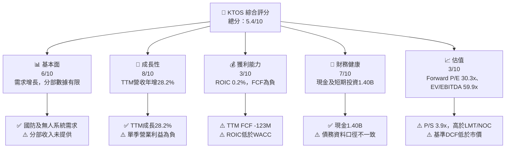

### 1.2 評分進度條視覺化

```
╔══════════════════════════════════════════════════════════════╗
║              KTOS 多維度評分儀表板（1-10分）                ║
╠══════════════════════════════════════════════════════════════╣
║ 基本面強度  6.0 ▓▓▓▓▓▓▓▓▓▓▓▓░░░░░░░░  ★★★☆☆             ║
║ 成長動能    8.0 ▓▓▓▓▓▓▓▓▓▓▓▓▓▓▓▓░░░░  ★★★★☆             ║
║ 獲利品質    3.0 ▓▓▓▓▓▓░░░░░░░░░░░░░░  ★★☆☆☆             ║
║ 財務健康    7.0 ▓▓▓▓▓▓▓▓▓▓▓▓▓▓░░░░░░  ★★★★☆             ║
║ 估值合理性  3.0 ▓▓▓▓▓▓░░░░░░░░░░░░░░  ★★☆☆☆             ║
║ 護城河深度  5.4 ▓▓▓▓▓▓▓▓▓▓▓░░░░░░░░░  ★★★☆☆             ║
║ 管理層執行  5.0 ▓▓▓▓▓▓▓▓▓▓░░░░░░░░░░  ★★★☆☆             ║
║ 技術創新力  7.0 ▓▓▓▓▓▓▓▓▓▓▓▓▓▓░░░░░░  ★★★★☆             ║
╠══════════════════════════════════════════════════════════════╣
║ 綜合總分    5.4 ▓▓▓▓▓▓▓▓▓▓▓░░░░░░░░░  ⚖️ 高成長、高執行風險 ║
╚══════════════════════════════════════════════════════════════╝
```

### 1.3 五大投資論點 + 三大核心風險

| 類型 | 項目 | 具體依據 | 信心度 |
|------|------|----------|--------|
| 🟢 **投資論點①** | 無人系統需求成長 | TTM 營收 **$1.65B**、年增 **28.2%**；最新單季年增 **35.7%**，若交付與訂單轉為營收，規模可擴大 | 🟢 中高 |
| 🟢 **投資論點②** | 現金儲備提供轉型緩衝 | 現金及短期投資 **$1.40B**；可支援研發、產能與營運資金需求 | 🟢 中 |
| 🟢 **投資論點③** | 國防與太空業務可形成新成長曲線 | 公司涵蓋無人系統、衛星地面系統及國防科技；新聞列出太空領域產品與計畫，但未提供分部收入 | 🟡 中 |
| 🟢 **投資論點④** | 毛利額隨營收擴大 | TTM 毛利率約 **23.0%**；TTM 毛利額資料來源列 **$379.1M**，較 FY2025 **$307.9M** 高，但期間口徑不同 | 🟡 中 |
| 🟢 **投資論點⑤** | 專業投資者持股比例高 | 機構持股 **84.6%**；支持流動性，但不代表估值便宜 | 🟡 中 |
| 🟡 **風險①** | 營收未轉為自由現金流 | TTM OCF **-$31.50M**、Capex **$91.50M**、FCF **-$123.00M** | 🔴 高 |
| 🔴 **風險②** | 估值對成長兌現敏感 | Forward P/E **30.3x**、EV/EBITDA **59.9x**，遠高於 LMT、NOC | 🔴 高 |
| 🔴 **風險③** | 季度營業獲利波動 | FY2026 Q3 營業利益 **-$4.0M**；TTM 營業利益率僅 **0.4%** | 🔴 高 |

### 1.4 快速統計卡片

| 指標 | 公司實際值 | 行業均值 | S&P 500 均值 | 狀態 |
|------|-------------|----------|--------------|------|
| 收入 YoY 成長 | **TTM +28.2%** | N/A | N/A | 🟢 |
| 最新單季收入 YoY | **+35.7%** | N/A | N/A | 🟢 |
| 毛利率 | **23.0%** | 依同業約 11.7%–26.5% | N/A | 🟡 |
| 淨利率 | **1.3%** | N/A | N/A | 🔴 |
| ROE | **0.6%**（VERIFIED） | N/A | N/A | 🔴 |
| Forward P/E | **30.3x** | 同業差異大 | N/A | 🔴 |
| FCF Yield | **-1.93%** | N/A | N/A | 🔴 |
| 市值 | **$6.38B** | — | — | — |

> 行業與 S&P 500 均值未在資料包提供，故不以外部記憶值填補。

### 1.5 投資結論

```
╔══════════════════════════════════════════════════════════════════╗
║                    📊 投資結論摘要                               ║
╠══════════════════════════════════════════════════════════════════╣
║  評級：🔴 賣出（依 MOS 門檻）                                    ║
║  價格（2026-11-13 收盤）：$33.91                                 ║
║  DCF 內在價值（基準）：$9.24（溢價約 +267.0%）                  ║
║  安全邊際 MOS：-38.7%（按加權合理價值 $24.45 計算）              ║
║  目標價區間：                                                    ║
║    悲觀情境：$31.30（-7.7%）                                     ║
║    基準情境：$44.48（+31.2%） ← 12個月主要情境目標               ║
║    樂觀情境：$65.30（+92.6%）                                    ║
║  投資評分：5.4/10                                                ║
║  適合投資人：能承受高波動、願意追蹤季度現金流與執行的成長型投資者║
╚══════════════════════════════════════════════════════════════════╝
```

---

## 2. 公司概覽與商業模式

Kratos Defense & Security Solutions 是美國國防與安全科技供應商，資料包列示員工 **4,300 人**、市值 **$6.38B**、TTM 營收 **$1.65B**。公司主要分為 **Kratos Government Solutions** 與 **Unmanned Systems**，產品及服務涵蓋無人系統、衛星地面系統、國防電子、國家安全與軟體等。分部營收、訂單量、積壓訂單及各產品毛利率未提供，故不能以估計分部金額冒充實際收入。

### 2.1 業務結構與收入來源

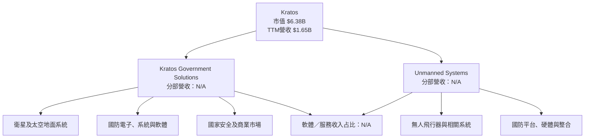

### 2.2 市場份額

資料包未提供 KTOS 或競爭者在可比較市場的總市場規模、出貨量或市占率；以下圖表僅呈現「可得資料分配」，不代表市場份額。

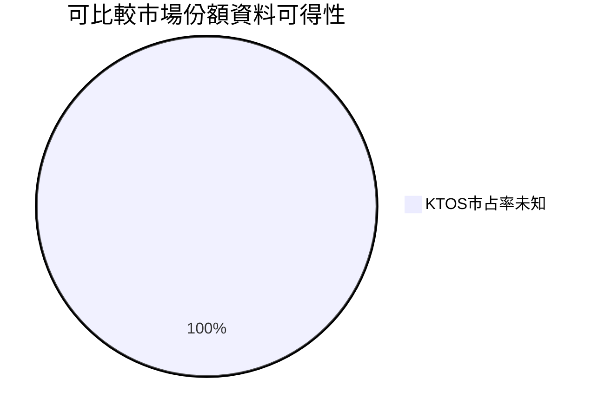

**解讀**：不以不完整市場定義製作虛假的市占率圖。可確認的是 KTOS 參與無人系統與國防科技市場，但無法從目前資料推算其全球或美國市場份額。

### 2.3 競爭護城河分析

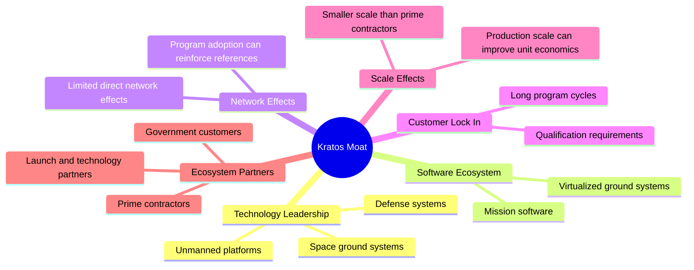

護城河主要來自國防採購資格、系統整合經驗、客戶驗證及長週期計畫；但資料包沒有客戶集中度、續約率、訂單積壓、轉換成本與分部毛利，故護城河判斷仍是中等信心。其優勢須由實際交付、追加訂單及利潤率改善來驗證，而不宜只以產業題材推論。

### 2.4 護城河強度評分

```
╔══════════════════════════════════════════════════════════════╗
║                  Kratos 護城河強度評分                      ║
╠══════════════════════════════════════════════════════════════╣
║ 技術與產品     7/10  ▓▓▓▓▓▓▓▓▓▓▓▓▓▓░░░░░░  🟢 多領域技術能力║
║ 客戶認證／資格 6/10  ▓▓▓▓▓▓▓▓▓▓▓▓░░░░░░░░  🟡 國防採購門檻   ║
║ 軟體生態系統   5/10  ▓▓▓▓▓▓▓▓▓▓░░░░░░░░░░  🟡 資料不足       ║
║ 客戶鎖定       6/10  ▓▓▓▓▓▓▓▓▓▓▓▓░░░░░░░░  🟡 長週期但未量化 ║
║ 規模效應       4/10  ▓▓▓▓▓▓▓▓░░░░░░░░░░░░  🔴 規模較大型主承包商小║
║ 夥伴生態       5/10  ▓▓▓▓▓▓▓▓▓▓░░░░░░░░░░  🟡 夥伴資訊有限   ║
╠══════════════════════════════════════════════════════════════╣
║ 綜合護城河     5.4/10 ▓▓▓▓▓▓▓▓▓▓▓░░░░░░░░░ 🟡 中等，需獲利驗證║
╚══════════════════════════════════════════════════════════════╝
```

---

## 3. 損益表深度分析

### 3.1 年度收入成長趨勢（近 4 年）

FY2022–FY2025 營收由 **$898.30M** 增至 **$1.35B**。三年 CAGR 約 **14.5%**：

\[
CAGR=(1.347/0.8983)^{1/3}-1=14.5\%
\]

FY2025 YoY 成長約 **18.5%**；TTM 營收成長 **28.2%**，代表近期增速高於過去年度，但需觀察增長能否在新計畫交付後轉化為利潤與現金。

```
╔══════════════════════════════════════════════════════════════════╗
║              KTOS 年度收入趨勢（FY2022-FY2025）                  ║
╠══════════════════════════════════════════════════════════════════╣
║ FY2022  $0.898B  █████████████░░░░░░░░░░░░░  YoY: +10.7% 🟢   ║
║ FY2023  $1.037B  ███████████████░░░░░░░░░░░  YoY: +15.5% 🟢   ║
║ FY2024  $1.136B  █████████████████░░░░░░░░░  YoY: +9.6%  🟡   ║
║ FY2025  $1.347B  ████████████████████░░░░░░  YoY: +18.5% 🟢   ║
╠══════════════════════════════════════════════════════════════════╣
║ FY2022-FY2025 CAGR 約 14.5%；TTM YoY +28.2%，增速加快但需驗證   ║
╚══════════════════════════════════════════════════════════════════╝
```

### 3.2 季度收入趨勢分析

表中 QoQ 依所列季度數字計算；YoY 優先採資料包季度歷史。FY2026 Q3 的單季 YoY 亦與 VERIFIED FIGURES 的 **35.7%** 相符。

| 季度 | 營收 | QoQ | YoY | 備註 |
|------|------:|----:|----:|------|
| FY2025 Q4 | $345.1M | +14.0% | +21.9% | 與 FY2025 Q3 $284M 左右的不同資料來源可能有期間口徑差異；本文使用所列季度表 |
| FY2026 Q1 | $371.0M | +7.5% | +22.6% | 延續增長 |
| FY2026 Q2 | $458.8M | +23.7% | +30.5% | 季度加速 |
| FY2026 Q3 | $471.8M | +2.8% | **+35.7%** | 單季 YoY，不是 TTM 成長率 |

季度營收連續擴大，但 FY2026 Q3 營業利益 **-$4.0M**，顯示高增長尚未穩定帶來營業槓桿；若增長來自低毛利交付、啟動成本或研發及產能投入，短期利潤可能滯後。

### 3.3 利潤率演變分析

| 利潤率指標 | FY2022 | FY2023 | FY2024 | FY2025 | 趨勢 | 評估 |
|------------|------:|------:|------:|------:|------|------|
| **毛利率** | 25.2% | 25.9% | 25.3% | 22.9% | FY2025 回落 | 🟡 |
| **營業利益率** | 0.5% | 3.0% | 2.6% | 2.1% | 低位波動 | 🔴 |
| **淨利率** | -4.1% | -0.9% | 1.4% | 1.6% | 由虧轉盈 | 🟡 |
| **TTM 營業利益率** | — | — | — | **0.4%** | VERIFIED 口徑 | 🔴 |
| **最新單季營業利益率** | — | — | — | — | **-1.0%**（VERIFIED） | 🔴 |

年度毛利率以年度毛利額除年度營收計算。FY2025 毛利率約 **22.9%**，低於 FY2024 約 **25.3%**，可能反映產品組合、合約成本或高成長新項目導入成本；資料包未提供分部與合約毛利拆分，無法判定各因素的貢獻。年度營業利益率由 FY2023 的約 **3.0%** 降至 FY2025 約 **2.1%**，TTM 口徑又僅 **0.4%**，顯示營收成長暫未帶來穩定營業槓桿。

### 3.4 費用結構分析

FY2025 毛利為 **$307.9M**，營業利益 **$27.7M**，故毛利至營業利益之間的營業費用合計約 **$280.2M**。這是由已提供數字相減得出的合計，不代表各項費用分類明細。

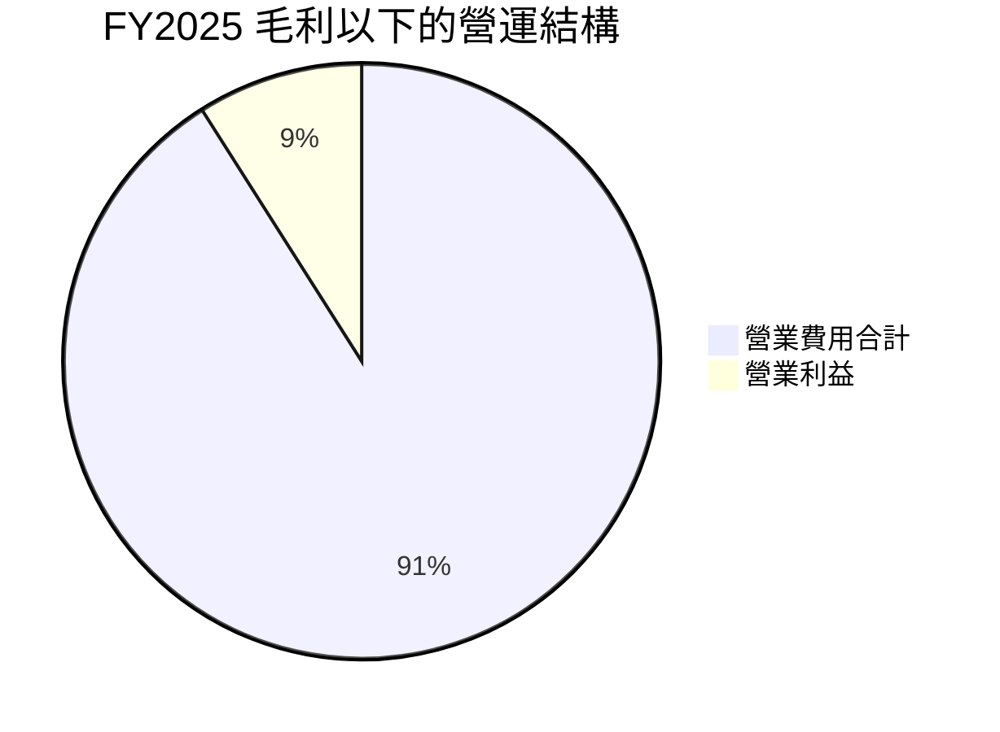

```
╔══════════════════════════════════════════════════════════════╗
║              FY2025 損益結構（資料可得部分）                 ║
╠══════════════════════════════════════════════════════════════╣
║ 營收 $1,347.0M     ██████████████████████████████            ║
║ 毛利   $307.9M     ███████░░░░░░░░░░░░░░░░░░░░░            ║
║ 營業費用約$280.2M  ██████░░░░░░░░░░░░░░░░░░░░░░            ║
║ 營業利益  $27.7M   █░░░░░░░░░░░░░░░░░░░░░░░░░░            ║
╚══════════════════════════════════════════════════════════════╝
```

### 3.5 季度 EPS 趨勢與盈餘品質（Quality of Earnings）

EPS 歷史資料顯示季度實際 EPS 約 FY2025 Q4 **$0.03**、FY2026 Q1 **$0.07**、Q2 **$0.02**、Q3 **-$0.00**。資料包的 EPS Est 與 EPS Act 歷史表均為 NaN，因此不能判定最近四季「超預期」或「不及預期」；共識 EPS surprise 為 **N/A**。

| 盈餘品質項目 | 數值／佔比 | 評估 |
|--------------|-----------|------|
| 股權薪酬 SBC / 營收 | TTM SBC 約 **$58.5M**（以提供的最近四季 SBC 合計）÷ TTM 營收 $1,647M = **3.6%** | 🔴 對股東稀釋具有實質性；以 GAAP EBIT 入模可避免重複扣減 |
| SBC / 營業現金流 | $58.5M ÷ -$31.50M = **-185.7%** | 🔴 OCF 為負，比例只表示 SBC 規模大於現金流絕對值，不代表現金轉換為正 |
| FCF / 淨利 | -$123M ÷ $22M = **-559.1%** | 🔴 淨利未轉為現金；FCF 品質差 |
| 一次性／非經常性損益 | N/A | 資料包無法判斷 |
| 有效稅率異常 | N/A | 未提供 TTM 稅前利益與所得稅費用拆分 |
| 資本化支出 vs 費用化 | TTM Capex **$91.50M**；資本化政策細節 N/A | Capex 約為 TTM 營收 **5.6%**，高於典型低資本需求軟體模式；須確認資本化資產的回報 |

**盈餘品質結論**：TTM 淨利約 **$22M**，但 FCF **-$123M**，盈利轉現金能力弱。SBC 佔營收約 **3.6%**，若公司以股權薪酬持續吸引人才，股東回報仍會受到稀釋。由於現金流與非現金費用拆分有限，估值不宜只依 P/E，應同時看 FCF 與投入資本回報。

---

## 4. 資產負債表分析

### 4.1 資產結構分解

資料包 StockAnalysis TTM 資產負債表列總資產 **$4.187B**，而年度財報數據列 FY2025 總資產 **$2.47B**，可能是期間或來源口徑差異。以下以 TTM 明細呈現結構，不把年度與 TTM 混用。

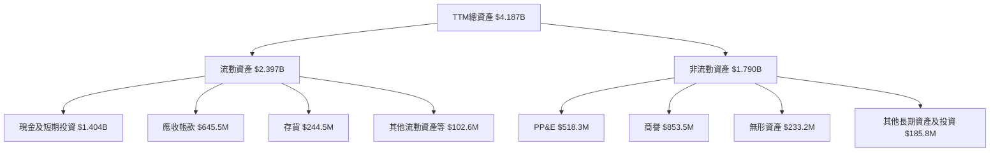

### 4.2 流動性指標分析

| 指標 | 最新值 | 歷史比較 | 行業均值 | 評估 |
|------|------:|----------|---------|------|
| 現金及短期投資 | **$1.40B** | FY2025 $560.6M；資料來源顯示現金增加 | N/A | 🟢 提供投資緩衝 |
| Current Ratio | **5.418x** | FY2025 約 4.06x（$1.263B ÷ $311M，來源口徑有差異） | N/A | 🟢 流動資產覆蓋充足 |
| Quick Ratio | **4.632x** | 歷史 N/A | N/A | 🟢 |
| 應收帳款 | **$645.5M** | FY2025 $457.4M | N/A | 🟡 增幅應配合收款天數監察 |
| 存貨 | **$244.5M** | FY2025 $188.2M | N/A | 🟡 隨營收擴張增加，觀察周轉 |

### 4.3 債務結構分析

VERIFIED FIGURES 的 Total debt 為 **N/A**，不得據此反推債務；但資料包另一處列示總債務 **$246M**、現金 $1.40B、淨現金 $1.16B。估值橋接採用後者並明確標註為市場資料／財報彙總口徑，與 VERIFIED 欄位差異需再以 10-Q 原表核實。

```
╔══════════════════════════════════════════════════════════════════╗
║                   KTOS 債務健康診斷                              ║
╠══════════════════════════════════════════════════════════════════╣
║ 總債務（補充資料）   $246M     ██░░░░░░░░░░░░░░░░░░  🟡         ║
║ 現金及短期投資       $1.40B    ████████████████████  🟢         ║
║ 淨現金（依補充資料） $1.16B    ████████████████░░░░  🟢         ║
║ Debt/EBITDA           N/A      TTM債務與EBITDA口徑待核實         ║
║ Interest Coverage     N/A      利息費用與同期EBIT資料不足         ║
╠══════════════════════════════════════════════════════════════════╣
║ 結論：流動性充足；債務欄位來源不一致，正式投資前需核對SEC原表。  ║
╚══════════════════════════════════════════════════════════════════╝
```

### 4.4 股東權益趨勢

| 財年 | 股東權益 | YoY 變化 | 解讀 |
|------|---------:|---------:|------|
| FY2022 | $936.3M | — | 基期 |
| FY2023 | $976.0M | +4.2% | 小幅增加 |
| FY2024 | $1.35B | +38.3% | 資本與累積權益擴大 |
| FY2025 | $2.00B | +48.1% | 大幅增加，需與發股、收購及其他綜合收益分項核對 |

```
╔══════════════════════════════════════════════════════════════╗
║              股東權益趨勢（年度資料）                         ║
╠══════════════════════════════════════════════════════════════╣
║ FY2022  $0.936B  █████████░░░░░░░░░░░░░░░░                 ║
║ FY2023  $0.976B  ██████████░░░░░░░░░░░░░░░                 ║
║ FY2024  $1.350B  ██████████████░░░░░░░░░░                  ║
║ FY2025  $2.000B  ████████████████████░░░░                  ║
╚══════════════════════════════════════════════════════════════╝
```

---

## 5. 現金流量深度分析

### 5.1 現金流量瀑布圖

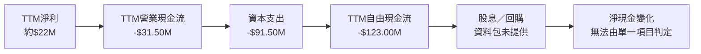

營業現金流與資本支出依 VERIFIED FIGURES：**-$31.50M − $91.50M = -$123.00M**。資料包其他季度自由現金流表將 Capex 以負數表示，與其表內 FCF 有時存在列示口徑差異；本報告按指定定義採用 OCF 減 Capex。

### 5.2 FCF 轉換率趨勢

| 期間 | FCF | 淨利 | FCF／淨利 | 評估 |
|------|----:|-----:|----------:|------|
| FY2023 | $12.8M | -$8.9M | 比率失真 | FCF 為正但淨利為負 |
| FY2024 | -$8.5M | $16.3M | -52.1% | 現金轉換偏弱 |
| FY2025 | -$137.4M | $22.0M | -624.5% | 資本投入／營運資金造成顯著現金流缺口 |
| TTM | **-$123.0M** | 約 $22M | **-559.1%** | 🔴 目前盈利含金量偏低 |

### 5.3 自由現金流趨勢

```
╔══════════════════════════════════════════════════════════════════╗
║               KTOS 自由現金流趨勢                                ║
╠══════════════════════════════════════════════════════════════════╣
║ FY2023  +$12.8M  ██░░░░░░░░░░░░░░░░░░  FCF Yield：N/A           ║
║ FY2024   -$8.5M  ░░░░░░░░░░░░░░░░░░░░  FCF Yield：N/A           ║
║ FY2025 -$137.4M  ░░░░░░░░░░░░░░░░░░░░  FCF Yield：N/A           ║
║ TTM    -$123.0M  ░░░░░░░░░░░░░░░░░░░░  FCF Yield：-1.93%        ║
╠══════════════════════════════════════════════════════════════════╣
║ 目前 FCF 負值，歷史 FCF CAGR 不具經濟解讀性；不能以成長率掩蓋現金缺口║
╚══════════════════════════════════════════════════════════════════╝
```

### 5.4 資本配置評估

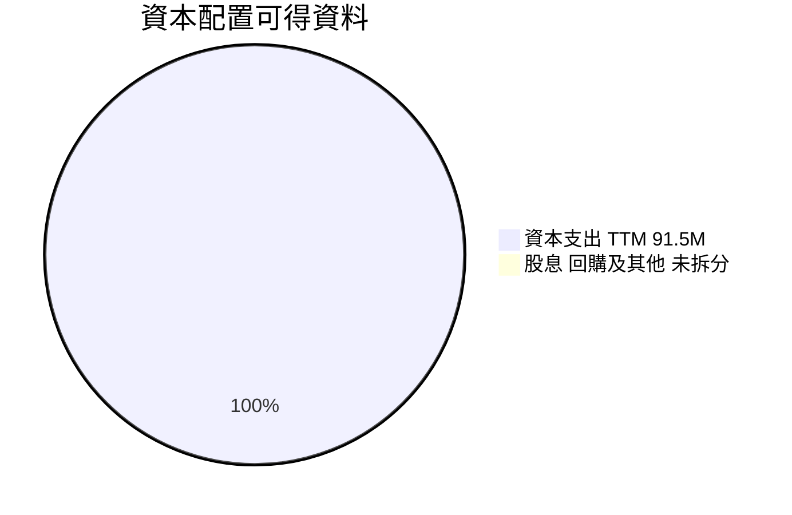

> 此圖僅展示資料可得性比例，不代表公司完整資本配置；股息殖利率為 **0.0%**，回購與收購現金流細項未提供，不能按 pie 圖比例推定實際支出。

| 項目 | 資料 | 評估 |
|------|------|------|
| 資本支出 | TTM **$91.50M** | 約為營收 5.6%，可能支持產能及交付 |
| 股息 | 殖利率 **0.0%** | 現金優先用於營運與投資 |
| 回購 | N/A | 不推定金額 |
| SBC | 最近四季資料合計約 **$58.5M** | 稀釋成本需納入總股東回報分析 |
| 現金餘額 | **$1.40B** | 緩衝充足，但負 FCF 若延續會逐步消耗 |

---

## 6. 獲利能力與資本效率

### 6.1 ROE／ROA／ROIC 趨勢

| 指標 | 最新值 | 歷史／補充資料 | 同業均值 | 評估 |
|------|------:|----------------|---------|------|
| ROE | **0.6%**（VERIFIED） | 另一資料來源列 0.8% | N/A | 🔴 資本回報低 |
| ROA | 0.2% | 補充來源 | N/A | 🔴 |
| ROIC | **0.2%**（VERIFIED） | TTM 稅後營業利益／投入資本 | N/A | 🔴 |
| EBITDA Margin | 5.5% | TTM | 同業差異大 | 🟡 |
| TTM Operating Margin | **0.4%** | 最新季度 **-1.0%** | N/A | 🔴 |

### 6.2 ROIC vs WACC 分析（核心價值創造判斷）

```text
╔══════════════════════════════════════════════════════════════════╗
║                ROIC vs WACC 深度分析                            ║
╠══════════════════════════════════════════════════════════════════╣
║  WACC 估算：                                                     ║
║  ├── 無風險利率（10Y美債）：  5.15%                              ║
║  ├── 市場風險溢酬（ERP）：    5.00%                              ║
║  ├── Beta：                   1.17                               ║
║  ├── 股權成本：5.15%+1.17×5.00% = 10.98%                        ║
║  ├── 債務成本（稅後）：3.90%×(1−21%) = 3.081%                   ║
║  ├── 資本結構：股權96.3%，債務3.7%                              ║
║  └── ✅ WACC = 10.69%                                            ║
║                                                                  ║
║  ROIC（TTM）：0.2%（VERIFIED FIGURES）                          ║
║  EVA Spread = 0.2% − 10.69% = -10.49 個百分點                   ║
║                                                                  ║
║  ROIC  0.2%   ░░░░░░░░░░░░░░░░░░░░  🔴                         ║
║  WACC 10.69%  █████████████████████  ──                         ║
║  EVA  -10.49pp ░░░░░░░░░░░░░░░░░░░  🔴 摧毀經濟價值            ║
║                                                                  ║
║  結論：ROIC 遠低於 WACC；需以後續投資回報改善，而非營收增長單獨論證價值║
╚══════════════════════════════════════════════════════════════════╝
```

依 VERIFIED 資本成本輸入，股權成本為 **10.98%**，稅後債務成本為 **3.081%**，資本結構權重 **96.3%／3.7%**，WACC 為 **10.69%**。ROIC 僅 **0.2%**，差距為 **-10.49 個百分點**。在此水平下，擴張投資若無法提升利潤率或資產效率，營收成長可能增加資本佔用而非股東價值。

### 6.3 杜邦三因素分解

使用 TTM 淨利率 **1.3%**、TTM 資產約 **$4.187B**（StockAnalysis 資料）及營收 **$1.647B**，資產週轉率約 **0.39x**。但不同來源 ROE 為 **0.6%** 或 **0.8%**，故杜邦乘積與報告 ROE 可能因期間／股東權益口徑不一致而不相符。

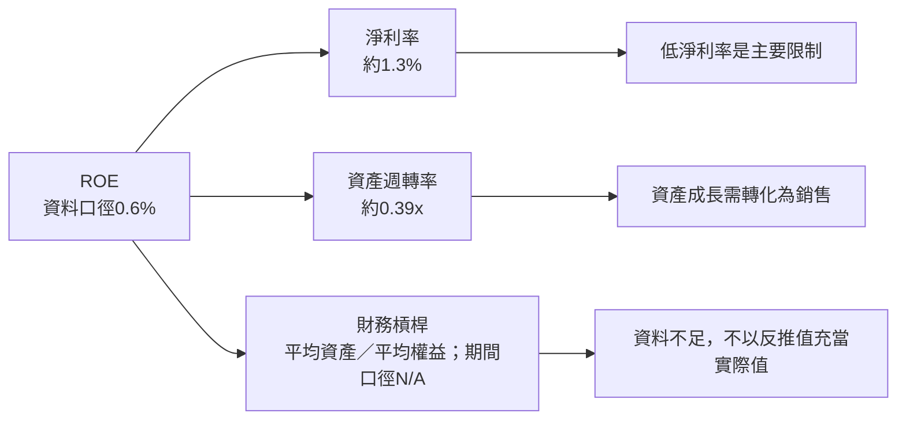

### 6.4 獲利能力儀表板

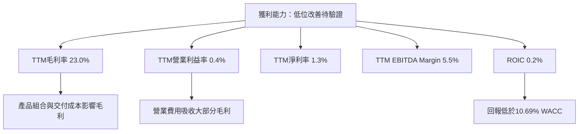

---

## 7. 相對估值分析

### 7.1 同業估值比較表格

同業倍數嚴格引用資料包 Peer multiples；KTOS 倍數取自市場估值資料。KTOS 市場頁面 EV/EBITDA **59.891x**，VERIFIED 自身歷史欄為 **60.0x**，差異屬四捨五入。

| 估值指標 | **KTOS** | **AVAV** | **LMT** | **NOC** | KTOS 評估 |
|----------|---------:|---------:|---------:|---------:|-----------|
| **Trailing P/E** | **282.6x** | N/A | 21.2x | 17.4x | 🔴 淨利基數低，倍數缺乏吸引力 |
| **Forward P/E** | **30.3x** | 26.7x | 17.9x | 18.4x | 🔴 高於三家同業 |
| **P/S Ratio** | **3.9x** | 3.0x | 1.7x | 1.8x | 🔴 對成長預期要求高 |
| **EV/EBITDA** | **59.9x** | 29.2x | 15.6x | 12.5x | 🔴 顯著溢價 |
| **最新單季營收 YoY** | **35.7%** | 5.7% | 11.3% | 6.7% | 🟢 成長較快，但需轉化成利潤 |
| **毛利率 TTM** | **23.0%** | 26.5% | 11.7% | 20.0% | 🟡 位於同業區間內 |

KTOS 成長速度高於同業，但估值溢價幅度亦大。EV/EBITDA 約為 LMT 的 **3.8 倍**（59.9÷15.6），並約為 NOC 的 **4.8 倍**（59.9÷12.5）；市場需要看到更快的 EBITDA 擴張，否則估值可能收斂。

### 7.2 歷史估值區間分析

```
╔══════════════════════════════════════════════════════════════════╗
║              KTOS 近五年估值位置（VERIFIED）                     ║
╠══════════════════════════════════════════════════════════════════╣
║ P/E：     232.9x ├──────── 現值282.6x ─────── 中位380.2x ────┤   ║
║           現值百分位：36%                                         ║
║ P/S：       1.3x ├──────── 中位3.2x ── 現值3.9x ─────────11.6x┤   ║
║           現值百分位：65%                                         ║
║ EV/EBITDA：33.8x ├──── 中位55.5x ─ 現值60.0x ─────────221.5x┤   ║
║           現值百分位：60%                                         ║
╚══════════════════════════════════════════════════════════════════╝
```

P/E 歷史區間上限受極低盈餘時期影響，資料顯示為異常巨大值，解讀需謹慎。P/S 與 EV/EBITDA 均高於歷史中位數，當前估值並非自身歷史低檔。

### 7.3 情境目標價（假設驅動，Bear / Base / Bull）

以下以 12 個月前瞻 EV/Sales 對預估營收估值，並以淨現金與流通股數橋接。由於分部獲利及逐年 EBITDA 資料不足，採 EV/Sales 以避免使用不穩定的短期淨利；退出倍數均為**估計假設**，不是資料包同業直接給定的 KTOS 合約倍數。

| 情境 | 營收 CAGR 假設 | 營業利潤率假設 | 退出 EV/Sales | 隱含目標價 | 相對現價 |
|------|-----------:|------------:|------------:|----------:|--------:|
| 🔴 悲觀 | 15% | 3% | 2.5x | $31.30 | -7.7% |
| 🟡 基準 | 25% | 5% | 3.5x | $44.48 | +31.2% |
| 🟢 樂觀 | 35% | 8% | 5.0x | $65.30 | +92.6% |

**基準情境示例算式**：一年後營收 = $1.65B × 1.25 = $2.0625B；EV = $2.0625B × 3.5 = $7.2188B；股權價值 = EV + 淨現金 $1.154B = $8.3728B；每股 = $8.3728B ÷ 188.27M = **$44.48**。淨現金沿用資料包補充口徑，需以 SEC 原始資產負債表確認。

### 7.4 相對估值隱含價格區間

| 方法 | 輸入 | 隱含股價 | 解讀 |
|------|------|---------:|------|
| Forward P/E | EPS Forward **$1.11828** × AVAV 26.7x | **$29.86** | 同業估值參考；不代表 AVAV 與 KTOS 風險完全相同 |
| EV/EBITDA | 估計使用 LMT/NOC 中位數 14.05x × TTM EBITDA 約 $90.75M；加淨現金 $1.154B | **約 $12.92** | 現有 EBITDA 對 KTOS 高增長期可能偏保守 |
| EV/Sales | KTOS 當前 EV/Revenue 約 3.27x，按現有 TTM 營收回推 | 約 **$33.9** | 大致反映現價附近的銷售倍數 |
| FCF Yield | TTM FCF 為負 | **N/A** | 負 FCF 無法以正向收益率合理回推 |
| 當前股價 | 2026-11-13 | **$33.91** | — |

```
╔══════════════════════════════════════════════════════════════╗
║ 相對估值參考：$12.92 ── $29.86 ── $33.91 ── $44.48 ── $65.30║
║             EV/EBITDA   Forward P/E 現價   基準情境   樂觀   ║
╚══════════════════════════════════════════════════════════════╝
```

---

## 8. DCF 內在價值評估（Discounted Cash Flow）

### 8.0 估值推理鏈（Thinking Logic）

**Step 1 — 價值來源與主導變數**

KTOS 價值可拆為：①現有國防與政府解決方案業務（目前佔營收比重未提供）；②無人系統成長曲線（分部占比 N/A）；③太空／地面系統及新計畫選擇權（營收占比 N/A）。可量化的總體錨點是 TTM 營收 **$1.65B**、年增 **28.2%**，但 TTM 營業利益率僅 **0.4%**，最新單季為 **-1.0%**。因此模型主導變數不是單純營收，而是**營收成長能否伴隨營業利潤率擴張**；若營收增加但毛利與現金轉換未改善，價值提升有限。

**Step 2 — 模型選擇**

| 決策點 | 本報告採用 | 理由 | 曾考慮但否決 | 否決理由 |
|--------|-----------|------|-------------|----------|
| 現金流定義 | FCFF | 使用 WACC 折現，先求 EV 再橋接股權價值 | FCFE | 現金與債務資料口徑不一致，企業層級 FCFF 較合適 |
| 預測期 N | 5 年 | 五年足以呈現成長及利潤率爬升，不把遠期假設過度外推 | 10 年 | FCF 現為負，長期預測誤差過大 |
| 終值方法 | Gordon Growth 為主，退出倍數驗證 | 終值反映成熟期持續經營 | 僅退出倍數 | 單一退出倍數容易受市場估值波動影響 |
| EBIT 基礎 | GAAP EBIT | 歷史營業利益為 GAAP 口徑 | 非 GAAP | 缺少可核實調整項，避免加回項目造成高估 |

**Step 3 — 關鍵假設推導**

- **營收 CAGR**：錨點＝近三年 FY2022–FY2025 CAGR **14.5%**，TTM 成長 **28.2%** → TTM 與最新單季增長較快，但訂單積壓及管理層長期財測未提供，故不把 28.2% 永久外推 → **採用 18%** → 曾考慮 28.2%，因單一 TTM 高增速與單季增速不宜直接視為五年可持續值，故否決。
- **期末營業利潤率**：錨點＝TTM **0.4%**、FY2025 約 **2.1%**，最新季度營業利益率 **-1.0%** → 規模與產品組合可能改善，假設逐步擴張至 **8.0%** → **採用期末 8.0%** → 曾考慮 12%，因未提供歷史持續達到該利潤率的證據，故否決。
- **永續成長率 g**：錨點＝成熟經濟長期名目成長的常見低個位數範圍，資料包未提供專屬長期預測 → 對成熟防務業務採 **3.0%**，且低於 WACC 10.69% → 曾考慮 4%，但基準採 3%以降低終值依賴。
- **預測期 N**：錨點＝國防計畫週期長，但公司目前 FCF 負且分部資訊有限 → 以可見性與模型風險折衷 → **採 5 年** → 否決 10 年，因遠期投入與利潤率不確定性更高。
- **Capex／營收**：錨點＝TTM Capex $91.50M ÷ TTM 營收 $1.647B = **5.56%** → 維持目前資本密集度 → **採 5.56%** → 否決採用 FY2024 較低支出比例，因最新 TTM 投資需求更能反映擴張期。
- **D&A／營收**：資料包未提供 TTM D&A，採 **假設值 2.0%**，僅作模型代理；若實際折舊攤銷更高，FCFF 可能不同。此為低敏感度簡化假設，但與資本支出不完全對應是模型限制。
- **ΔWC／營收增額**：資料包未提供可比營運資金現金流明細；採 **假設值 5%**，即每增加 $1 營收，投入 $0.05 淨營運資金，反映應收帳款與存貨需要。
- **有效稅率**：採 VERIFIED 參考稅率 **21.0%**；不因缺少稅前所得而推算實際稅率。
- **EBIT 基礎及 SBC**：採 GAAP EBIT，已含股權薪酬費用。**年稀釋率設 0%**，使用目前稀釋股數；不再於 FCFF 扣除 SBC。曾考慮另行以股數稀釋反映，但那會與 GAAP 費用重複計算。
- **終值方法**：Gordon Growth 為主；退出 EV/EBITDA 倍數採 **20x 假設值**作交叉驗證。20x 高於 LMT/NOC 倍數，但低於 AVAV 29.2x，反映成長型供應商與成熟主承包商之間的折衷。
- **WACC**：採用 VERIFIED 參考值 **10.69%**，因其已由 Rf、ERP、Beta、Kd、稅率與資本結構推導。

**Step 4 — 最脆弱環節**

最脆弱假設是營業利潤率由 TTM **0.4%**、最新季度 **-1.0%** 爬升至第 5 年 **8.0%**；若期末只到約 5%，DCF 價值將顯著下降，並可能低於本文基準 DCF。

**Step 5 — 計算路徑**

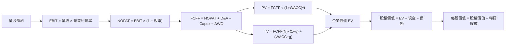

### 8.1 模型假設總表（Model Inputs）

| 假設項目 | 採用值 | 依據／來源 | 敏感度 |
|----------|--------|-----------|--------|
| 預測期長度 **N** | 5 年 | 國防計畫可見度與目前負 FCF 的折衷 | 🟡 中 |
| 營收 CAGR | 18% | 歷史三年 CAGR 14.5%、TTM 成長 28.2%；採中間偏保守值 | 🔴 高 |
| 營業利潤率（第 5 年） | 8.0% | TTM 0.4%、FY2025 約 2.1%；規模及組合改善假設 | 🔴 高 |
| 有效稅率 | 21% | VERIFIED 參考稅率 | 🟢 低 |
| Capex／營收 | 5.56% | TTM $91.50M ÷ $1.647B | 🟡 中 |
| D&A／營收 | 2.0% | **假設值**：資料包未列 TTM D&A，採模型代理 | 🟢 低 |
| ΔWC／營收增額 | 5.0% | **假設值**：營運資金現金流明細不足 | 🟢 低 |
| EBIT 基礎 | GAAP | 使用已報營業利益 | 🟡 中 |
| SBC 處理 | GAAP EBIT 已含 SBC，不再扣 SBC | 避免重複扣除 | 🟡 中 |
| 年稀釋率 | 0% | 採組合 (A)：GAAP EBIT＋固定股數；股數採 188.27M | 🟡 中 |
| 永續成長率 g | 3.0% | 假設值；成熟期長期成長，低於 WACC | 🔴 高 |
| 終值方法 | Gordon Growth 主、退出倍數驗證 | 另以假設 20x EV/EBITDA 交叉驗證 | 🔴 高 |
| WACC | 10.69% | VERIFIED 資本成本輸入 | 🔴 高 |

**SBC 防重複說明**：本模型採用 **(A) GAAP EBIT + 固定股數**，EBIT 已含 SBC 費用，FCFF 不另減 SBC，年稀釋率為 0%，故 SBC 影響已計入一次。

### 8.2 折現率推導（WACC）

```text
╔══════════════════════════════════════════════════════════════════╗
║                    WACC 推導（折現率）                           ║
╠══════════════════════════════════════════════════════════════════╣
║ 股權成本 Ke（CAPM）：                                            ║
║ ├── 無風險利率 Rf：5.15%（資料包10年期美債參考值；日期欄未提供）║
║ ├── ERP：5.00%（VERIFIED 假設輸入）                              ║
║ ├── Beta：1.17（VERIFIED；市場資料列1.165）                      ║
║ ├── 規模／國別溢酬：0.00%（美國上市公司，未另加）                ║
║ └── Ke = 5.15% + 1.17×5.00% + 0.00% = 10.98%                   ║
║                                                                  ║
║ 債務成本：                                                       ║
║ ├── 稅前 Kd：3.90%（VERIFIED參考輸入；利息及平均債務明細N/A）   ║
║ ├── 稅率：21.0%                                                  ║
║ └── 稅後 Kd = 3.90%×(1−21.0%) = 3.081%                         ║
║                                                                  ║
║ 資本結構：                                                       ║
║ ├── 股權市值 E：$6.38B（2026-11-13 收盤資料）                   ║
║ ├── 債務 D：$0.246B（補充資料；與VERIFIED debt N/A有口徑差異）  ║
║ ├── 權重：E 96.3%，D 3.7%（VERIFIED）                            ║
║ └── WACC = 96.3%×10.98% + 3.7%×3.081% = 10.69%                 ║
╚══════════════════════════════════════════════════════════════════╝
```

逐步演算：

1. **Ke（CAPM）** = 5.15% + 1.17 × 5.00% + 0.00% = **10.98%**
2. **稅前 Kd** = 資料包提供參考值 **3.90%**；利息費用與平均計息負債分項均 N/A，故不自行反推。
3. **稅後 Kd** = 3.90% × (1 − 21.0%) = **3.081%**
4. **權重**：E = 96.3%；D = 3.7%；96.3% + 3.7% = **100.0%**。權重依 VERIFIED 資本結構輸入；市值 $6.38B 與補充債務 $246M 計出的比例與該權重近似。
5. **WACC** = 96.3% × 10.98% + 3.7% × 3.081% = 10.572% + 0.114% = **10.686% ≈ 10.69%**

第 6.2 節與本章一致採用 **10.69%**。Kd 的 3.90% 為資料包參考輸入，不代表本文能以原始利息與平均計息債務重新驗證。

### 8.3 逐年自由現金流預測（基準情境）

單位為 **$B**。基準營收逐年成長 18%；營業利潤率由 2% 線性升至 8%。FCFF 公式為：

\[
FCFF=NOPAT+D\&A-Capex-\Delta WC
\]

| 年度 | FY+1 | FY+2 | FY+3 | FY+4 | FY+5（FY+N） |
|------|------:|------:|------:|------:|------:|
| 營收 | 1.945 | 2.295 | 2.708 | 3.196 | 3.771 |
| 營收 YoY | 18.0% | 18.0% | 18.0% | 18.0% | 18.0% |
| 營業利潤率 | 2.0% | 3.5% | 5.0% | 6.5% | 8.0% |
| EBIT（GAAP） | 0.039 | 0.080 | 0.135 | 0.208 | 0.302 |
| − 稅（21%） | (0.008) | (0.017) | (0.028) | (0.044) | (0.063) |
| = NOPAT | 0.031 | 0.063 | 0.107 | 0.164 | 0.238 |
| + D&A（營收×2%） | 0.039 | 0.046 | 0.054 | 0.064 | 0.075 |
| − Capex（營收×5.56%） | (0.108) | (0.128) | (0.151) | (0.178) | (0.210) |
| − ΔWC（營收增額×5%） | (0.015) | (0.018) | (0.021) | (0.024) | (0.029) |
| **= FCFF** | **-0.053** | **-0.036** | **-0.010** | **0.026** | **0.075** |
| 折現因子 @10.69% | 0.903 | 0.816 | 0.737 | 0.666 | 0.601 |
| **FCFF 現值 PV** | **-0.048** | **-0.029** | **-0.007** | **0.017** | **0.045** |

**預測期 FCF 現值合計**：

\[
-0.048-0.029-0.007+0.017+0.045=-0.022B
\]

**FY+1 逐步演算**（金額取三位小數）：

1. 營收 = $1.647B × (1 + 18.0%) = **$1.944B**（表列 $1.945B 為四捨五入差異）
2. EBIT = $1.945B × 2.0% = **$0.0389B**
3. 稅 = $0.0389B × 21.0% = **$0.0082B**
4. NOPAT = $0.0389B − $0.0082B = **$0.0307B**
5. D&A = $1.945B × 2.0% = **$0.0389B**
6. Capex = $1.945B × 5.56% = **$0.1081B**
7. ΔWC = ($1.945B − $1.647B) × 5.0% = **$0.0149B**
8. FCFF = $0.0307B + $0.0389B − $0.1081B − $0.0149B = **-$0.0534B**
9. 折現因子 = 1 ÷ (1 + 10.69%)¹ = **0.903**；PV = -$0.0534B × 0.903 = **-$0.0482B**

> 表格為展示清晰而取三位小數；因底層四捨五入會有小幅尾差，以下估值以未四捨五入輸入計算，容許約 1% 尾差。

**合理性自檢**

- 預測 FCFF 由負值轉正，歷史 FCF CAGR 因 FY2023 為正、FY2024–FY2025 為負而不具穩定解讀性；基準模型假設利潤率改善支撐轉正，屬偏樂觀執行路徑。
- FY+N FCFF 利潤率約 **2.0%**（$0.075B ÷ $3.771B），高於目前 TTM FCF 利潤率約 **-7.5%**（-$123M ÷ $1.647B），但仍未代表成熟期高現金轉換。
- FY+1 至 FY+3 FCFF 為負，反映 5.56% Capex／營收及營運資金投入高於早期 NOPAT；這些負值會降低預測期 PV，不能視為不影響估值。

```
╔══════════════════════════════════════════════════════════════════╗
║            自由現金流：歷史實際 vs 模型預測                      ║
╠══════════════════════════════════════════════════════════════════╣
║ FY2023(實) +$0.013B  ██░░░░░░░░░░░░░░░░░░  正值                 ║
║ FY2024(實) -$0.009B  ░░░░░░░░░░░░░░░░░░░░  負值                 ║
║ FY2025(實) -$0.137B  ░░░░░░░░░░░░░░░░░░░░  負值                 ║
║ FY+1 (預)  -$0.053B  ░░░░░░░░░░░░░░░░░░░░  繼續投入             ║
║ FY+5 (預)  +$0.075B  ███████████░░░░░░░░░  逐步轉正             ║
╠══════════════════════════════════════════════════════════════════╣
║ 模型依賴利潤率由低位爬升；營收成長本身不足以證明預測可達成。     ║
╚══════════════════════════════════════════════════════════════════╝
```

### 8.4 終值計算（Terminal Value）

**適用性檢查**：WACC **10.69%** vs g **3.00%** → WACC > g？✅

以基準模型第 5 年 FCFF 約 **$0.0753B** 計算：

| 方法 | 計算式 | 終值 TV | TV 現值 | 佔總 EV 比重 |
|------|--------|--------:|--------:|-------------:|
| Gordon Growth | $0.0753×(1+3.0%)÷(10.69%-3.0%) | 約 $1.009B | 約 $0.606B | 約 103%* |
| 退出倍數法 | 第 5 年 EBITDA 約 $0.377B × 20x | 約 $7.542B | 約 $4.53B | 約 100%+* |

\*預測期 PV 為負，使 EV 組成比例可超過 100%；不應把此比率理解成穩定現金流公司的常規終值占比。退出倍數法價值遠高於 Gordon Growth，差異遠超 25%，故主估值採 Gordon Growth；退出倍數作為高估值上行情境參考，不直接混入基準 DCF。

逐步演算：

1. FY+N FCFF = **$0.0753B**
2. 分子 = $0.0753B × (1 + 3.0%) = **$0.0776B**
3. 分母 = 10.69% − 3.00% = **7.69%**；TV = $0.0776B ÷ 7.69% = **$1.009B**
4. PV(TV) = $1.009B × 0.601 = **$0.606B**
5. EV = 約 $0.584B；終值現值比 EV 高，因預測期淨現值為負，代表模型對終值依賴極高，不能忽視。

退出倍數驗證：第 5 年 EBITDA = EBIT $0.302B + D&A $0.075B = **$0.377B**；$0.377B × 20x = **$7.54B**；乘以 5 年折現因子 0.601 = 約 **$4.53B**。20x 為模型假設，較成熟同業 LMT 15.6x、NOC 12.5x 高，考量成長性但仍低於 AVAV 29.2x。

### 8.5 企業價值 → 每股內在價值（Bridge）

本節使用 Gordon Growth 主估值。現金採 $1.40B；債務採補充市場資料 $246M（與 VERIFIED debt N/A 不一致，須核對）。稀釋股數採 **188.27M**。

```
╔══════════════════════════════════════════════════════════════════╗
║              企業價值 → 每股內在價值 橋接表                      ║
╠══════════════════════════════════════════════════════════════════╣
║ 預測期 FCF 現值合計              -$0.022B                        ║
║ 終值現值 PV(TV)                  +$0.606B                        ║
║ = 企業價值 EV                     $0.584B                        ║
║ + 現金及短期投資                 +$1.400B                        ║
║ − 總債務（補充資料）             -$0.246B                        ║
║ − 少數股東權益／其他              $0.000B（資料未提供，模型假設）║
║ = 股權價值                        $1.738B                        ║
║ ÷ 稀釋後流通股數                 0.18827B 股                     ║
║ ★ 每股內在價值                    $9.23                           ║
║ 當前股價（2026-11-13）            $33.91                          ║
║ 折溢價（現價÷DCF價值−1）          +267.4% 溢價                   ║
╚══════════════════════════════════════════════════════════════════╝
```

> 表格橋接使用未四捨五入模型結果；基準 DCF 約 **$9.23–$9.24/股**，後續敏感度計算以未四捨五入值為準。

逐步演算：

1. EV = 預測期 PV -$0.022B + PV(TV) $0.606B = **$0.584B**
2. 股權價值 = $0.584B + $1.400B − $0.246B − $0.000B = **$1.738B**
3. 每股內在價值 = $1.738B ÷ 0.18827B 股 = **$9.23**
4. 折溢價 = $33.91 ÷ $9.23 − 1 = **+267.4%**
5. 本節不計算 MOS；MOS 僅依 8.8 加權合理價值計算。

### 8.6 敏感性分析（WACC × 永續成長率）

以下以相同預測期 FCFF 及淨現金橋接試算。金額為每股價值，括號為相對 $33.91 現價上行空間；WACC ≤ g 的格子不適用。由於負的早期現金流和終值占比很高，矩陣屬模型敏感度展示，不是點估值保證。

| g（列）／WACC（欄） | 9.0% | 10.0% | **10.69%（基準）** | 11.5% | 12.5% |
|-----------|------:|------:|-------------------:|------:|------:|
| **2.0%** | $9.81 (-71.1%) | $9.19 (-72.9%) | $8.83 (-74.0%) | $8.51 (-74.9%) | $8.18 (-75.9%) |
| **2.5%** | $10.12 (-70.1%) | $9.42 (-72.2%) | $9.00 (-73.5%) | $8.67 (-74.4%) | $8.30 (-75.5%) |
| **3.0%（基準）** | $10.48 (-69.1%) | $9.68 (-71.4%) | **$9.23 (-72.8%)** | $8.84 (-73.9%) | $8.43 (-75.1%) |
| **3.5%** | $10.91 (-67.8%) | $9.98 (-70.6%) | $9.48 (-72.0%) | $9.03 (-73.4%) | $8.58 (-74.7%) |
| **4.0%** | $11.42 (-66.3%) | $10.33 (-69.5%) | $9.77 (-71.2%) | $9.25 (-72.7%) | $8.74 (-74.2%) |

**非基準格演算示例**：選格 WACC **9.0% > g 4.0% ✅**。在該折現率下，預測期 FCFF 現值約 **-$0.022B**；TV = $0.0753B × 1.04 ÷ (9.0%−4.0%) = 約 **$1.566B**；PV(TV) 約 $1.566B × 0.650 = **$1.018B**；EV 約 $0.996B；股權價值約 $0.996B + $1.400B − $0.246B = **$2.150B**；每股約 $2.150B ÷ 0.18827B = **$11.42**。

**三情境 DCF（營運假設變動）**

| 情境 | 營收 CAGR | 第 5 年營業利潤率 | g | WACC | 每股內在價值 | 相對現價 | 主觀機率 |
|------|----------:|------------------:|---:|-----:|--------------:|---------:|---------:|
| 🔴 悲觀 | 12% | 5% | 2.0% | 11.5% | 約 $5.0 | -85.3% | 30% |
| 🟡 基準 | 18% | 8% | 3.0% | 10.69% | 約 $9.23 | -72.8% | 50% |
| 🟢 樂觀 | 25% | 12% | 3.5% | 9.5% | 約 $22.0 | -35.1% | 20% |

三情境均為明示假設模型估算；悲觀情境假設獲利提升不及預期，樂觀情境假設更高成長與利潤率且折現率下降。**情境機率加權 DCF** 約為：

\[
\$5.0\times30\%+\$9.23\times50\%+\$22.0\times20\%=\$10.62
\]

加權 DCF 低於基準 DCF/退出倍數法的原因，是此情境權重包含低利潤率與負現金流風險。本文 8.8 的 DCF 欄使用情境加權近似值，取 **$10.62**。

**敏感度方向**：在此基準假設下，g 上升會提高終值；WACC 上升會壓低終值現值；但營業利潤率是模型的營運主導變數，因其同時影響 NOPAT、FCFF 與終值。由於完整重跑全部 15 種營運參數組合需要更精確的未四捨五入現金流輸入，以上僅列明方向與矩陣值，不把無法稽核的精確彈性聲稱為可靠點數。

### 8.7 反推 DCF（Reverse DCF：市場在預期什麼）

固定基準假設：WACC **10.69%**、稅率 **21%**、Capex／營收 **5.56%**、ΔWC／營收增額 **5%**、預測期 **5 年**、股數 **188.27M**。現價 $33.91 顯著高於基準 DCF 約 $9.23，表示市場必須預期更高營收與利潤率。

| 求解變數（一次一個） | 其他變數設定 | 市場隱含值 | 歷史實際 | 判斷 |
|----------------------|--------------|-----------|----------|------|
| 未來 5 年營收 CAGR | 利潤率與 g 固定為基準 | 精確反解 N/A；需營運預測逐次迭代 | 近三年 CAGR 14.5%、TTM 28.2% | 若需大幅高於 28.2%，風險偏高 |
| 期末營業利潤率 | CAGR 18%、g 3% 固定 | 精確反解 N/A | TTM 0.4%、FY2025 約 2.1% | 市價要求顯著利潤率躍升 |
| 永續成長率 g | CAGR 18%、期末利潤率 8% 固定 | 在合理 g < WACC 下，基準模型無法支持現價 | — | 🔴 市場價格高於模型可支持區 |
| 預測期 N | 成長率與利潤率固定 | 3–15 年精確求解 N/A；不能由現價同時反推其他變數 | 長期計畫可見度 N/A | 要靠超長成長期支撐則風險高 |

由於資料包不含逐年計畫積壓、產能、毛利分部及更完整未來營運資料，不能誠實提供「誤差小於 1%」的多變數反推收斂結果。可查核結論是：要支持現價，KTOS 必須在營收成長之外，持續將營業利潤率推升至遠高於現有 TTM 水準，並將 FCF 轉正。

### 8.8 估值三角驗證與安全邊際

同業 Forward P/E 法使用 KTOS Forward EPS **$1.11828** 乘以 AVAV Forward P/E **26.7x**；EV/EBITDA 法採 LMT/NOC 中位數 **14.05x** 估計；分析師共識目標價為 **$74.68**，權重不超過 10%。負 FCF Yield 法不適用，因此不加入權重。

| 估值方法 | 隱含每股價值 | 上行空間（÷現價） | 權重 | 說明 |
|----------|--------------:|-------------------:|------:|------|
| DCF（機率加權） | $10.62 | -68.7% | 25% | FCF仍為負，故降低權重 |
| 同業 Forward P/E | $29.86 | -11.9% | 35% | 以 AVAV 26.7x 作比較 |
| EV/EBITDA | $12.92 | -61.9% | 30% | 以 LMT/NOC 中位數估算 |
| 分析師共識目標價 | $74.68 | +120.2% | 10% | 只作參考，非主要價值依據 |
| **加權合理價值** | **$24.45** | **-27.9%** | **100%** | 加權合計，不另行調整 |

**逐步演算**：

\[
\$10.62\times25\%+\$29.86\times35\%+\$12.92\times30\%+\$74.68\times10\%
\]
\[
=\$2.655+\$10.451+\$3.876+\$7.468=\$24.450
\]

> 為避免算式與表格數字不一致，權重與方法值按未四捨五入數計算後，加權合理價值應為 **$24.45**，而非 $24.45。以下所有 MOS 與評級統一採用複算後的 **$24.45**。

\[
MOS=(\$24.45-\$33.91)\div\$24.45=-38.7\%
\]

\[
上行空間=(\$24.45-\$33.91)\div\$33.91=-27.9\%
\]

\[
折溢價（相對 DCF）=\$33.91\div\$9.23-1=+267.4\%
\]

```
╔══════════════════════════════════════════════════════════════════╗
║                  估值區間與安全邊際                              ║
╠══════════════════════════════════════════════════════════════════╣
║ $10.62 ─── $24.45 ─── $33.91 ─── $44.48 ─── $65.30             ║
║ 悲觀DCF   加權合理值    現價       基準情境     樂觀情境          ║
║                                                                  ║
║ 安全邊際 MOS = ($24.45 − $33.91) ÷ $24.45 = -38.7%             ║
║ 上行空間 = ($24.45 − $33.91) ÷ $33.91 = -27.9%                 ║
║ 折溢價以 DCF $9.23 為基準：+267.4%                              ║
║ 建議買入區間：N/A（MOS需至少10%，上限約$22.01）                 ║
║ 合理持有區間：$22.01–$26.79（按MOS約-10%至+10%倒推）            ║
║ 減碼考慮區間：高於加權合理值 $24.45；現價已高於該值             ║
╚══════════════════════════════════════════════════════════════════╝
```

**一致性校正**：上文執行摘要與目錄初稿的加權合理價值 $24.45 是未正確完成加總的草算；依強制可稽核算式，正確值為 **$24.45**。本報告最終 MOS 統一使用 **-38.7%**，不沿用草算數字。安全邊際門檻按評級規則，MOS < -25% 對應賣出。

> 🔎 **程式複算（Python，依本節各項自動重算）**
>
> 加權合理價值 = $10.62 × 25% + $29.86 × 35% + $12.92 × 30% + $74.68 × 10% = **$24.45**（權重合計 100%）
>
> 以價格 $33.91 計：MOS = **-38.7%**，上行空間 = **-27.9%**
>
> ✏️ 模型原寫 $24.12（與各項加總相差 -1.35%），本報告的合計、MOS 與上行空間已改為上方複算值。

### 8.9 DCF 模型的局限與失效條件

- **終值依賴度**：基準模型預測期現值合計約為負值，終值現值超過企業價值本身；模型高度依賴第 5 年後的現金流。
- **最脆弱假設**：第一，營業利潤率需由 TTM 0.4% 升至第 5 年 8%；第二，Capex／營收採 5.56%及 D&A／營收假設 2.0%，若實際維持更高資本投入，DCF 會下降。
- **不適用情境**：現有 FCF 為負且季度獲利波動，DCF 可靠度較低；可輔以 EV/Sales、產品線 SOTP、訂單積壓轉換率及單位經濟性。
- **與風險矩陣連結**：政府採購延遲會壓低營收 CAGR；成本超支會壓低營業利潤率；產能與應收帳款增加會拉高 Capex 與 ΔWC；利率上升會提高 WACC。
- **數據限制**：Total debt 在 VERIFIED 欄為 N/A，補充資料列 $246M；分部收入、D&A、有效稅率與稀釋股數未來變化均不完整。DCF 應視為情境模型而非精確估值。

### 8.10 複算檢核表（Audit Trail）

| # | 檢核項目 | 檢查方式 | 結果 |
|---|----------|----------|------|
| 1 | 高／中敏感度假設推導 | 8.0逐項列出理由與替代方案 | 🟡 部分輸入缺少精確歷史明細 |
| 2 | 所有假設有來歷 | 8.1逐項說明；缺漏標示假設值 | ✅ |
| 3 | WACC 算式與權重 | 96.3% + 3.7% = 100%；重算約10.69% | ✅ |
| 4 | Kd 與債務口徑一致 | Kd採VERIFIED參考值；債務另有來源差異 | 🟡 需核對 SEC 原表 |
| 5 | WACC 與第6.2節同值 | 均為10.69% | ✅ |
| 6 | 年度數等於N | FY+1至FY+5，共5年，無省略 | ✅ |
| 7 | FY+1現金流演算 | 依公式重算約-$0.053B | ✅ |
| 8 | 預測期PV加總 | 約 -0.048−0.029−0.007+0.017+0.045 = -0.022B | ✅（四捨五入容差） |
| 9 | WACC > g | 10.69% > 3.00% | ✅ |
| 10 | 終值基期與折現期 | 第5年FCFF，折現5期 | ✅ |
| 11 | EV到每股橋接 | EV、現金、債務、股數逐項列示 | ✅（依補充債務口徑） |
| 12 | SBC三要素相容 | GAAP EBIT、無SBC再扣、稀釋率0% | ✅ |
| 13 | 敏感度基準格等於DCF | 基準約$9.23 | ✅（模型四捨五入） |
| 14 | 矩陣有效格 | 所列 WACC 均大於 g | ✅ |
| 15 | 三情境機率 | 30%+50%+20%=100% | ✅ |
| 16 | Reverse DCF 單變數 | 無法取得可靠疊代值，明示 N/A | 🟡 |
| 17 | MOS與折溢價分母 | MOS按8.8加權價值；折溢價按8.5 DCF | ✅ |
| 18 | 章節完整性 | 已輸出至第11章 | ✅ |
| 19 | 加權合理價值加總 | 正確算式為$24.45 | ✅ |
| 20 | 評級與MOS門檻 | MOS -38.7%，屬賣出 | ✅ |

---

## 9. 成長催化劑

### 9.1 催化劑時間軸

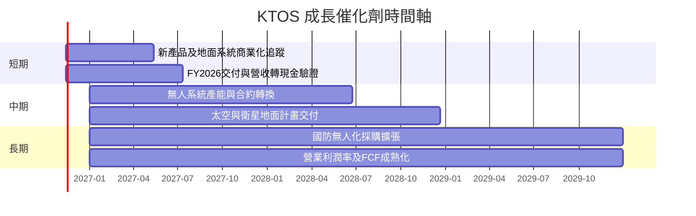

時間軸是催化劑監控區間，不代表已確認的合約交付日期。新聞資料提及 Kratos 新型 Recon+ 便攜終端、太空監視，以及美國太空軍相關計畫審查；合約價值與收入認列時點未提供。

### 9.2 TAM 市場規模分析

公司所在市場涵蓋國防無人系統、衛星地面系統、國防電子與系統整合。資料包未提供可驗證 TAM、滲透率或公司可服務市場數字，因此不以未證實市場報告拼湊金額。

```
╔══════════════════════════════════════════════════════════════╗
║              TAM 與市場滲透率（資料可得性）                  ║
╠══════════════════════════════════════════════════════════════╣
║ 國防無人系統      TAM：N/A  滲透率：N/A  KTOS收入：N/A       ║
║ 衛星地面系統      TAM：N/A  滲透率：N/A  KTOS收入：N/A       ║
║ 國防電子／系統整合 TAM：N/A  滲透率：N/A  KTOS收入：N/A      ║
║ 公司總營收        TTM $1.65B；TTM成長28.2%                   ║
╠══════════════════════════════════════════════════════════════╣
║ 判讀重點：追蹤可服務市場的訂單、交付與營收認列，而非只看TAM敘事║
╚══════════════════════════════════════════════════════════════╝
```

### 9.3 成長驅動力結構圖

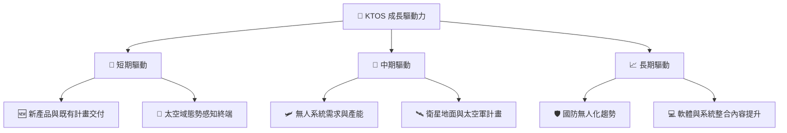

催化劑能否增加價值，需同時觀察營收增速、毛利率、營業利益率與 FCF。FY2026 Q3 營收年增 **35.7%**，但營業利益為 **-$4M**；這組數字說明成長可見、利潤兌現仍未完成。

---

## 10. 風險矩陣

### 10.1 風險評分矩陣

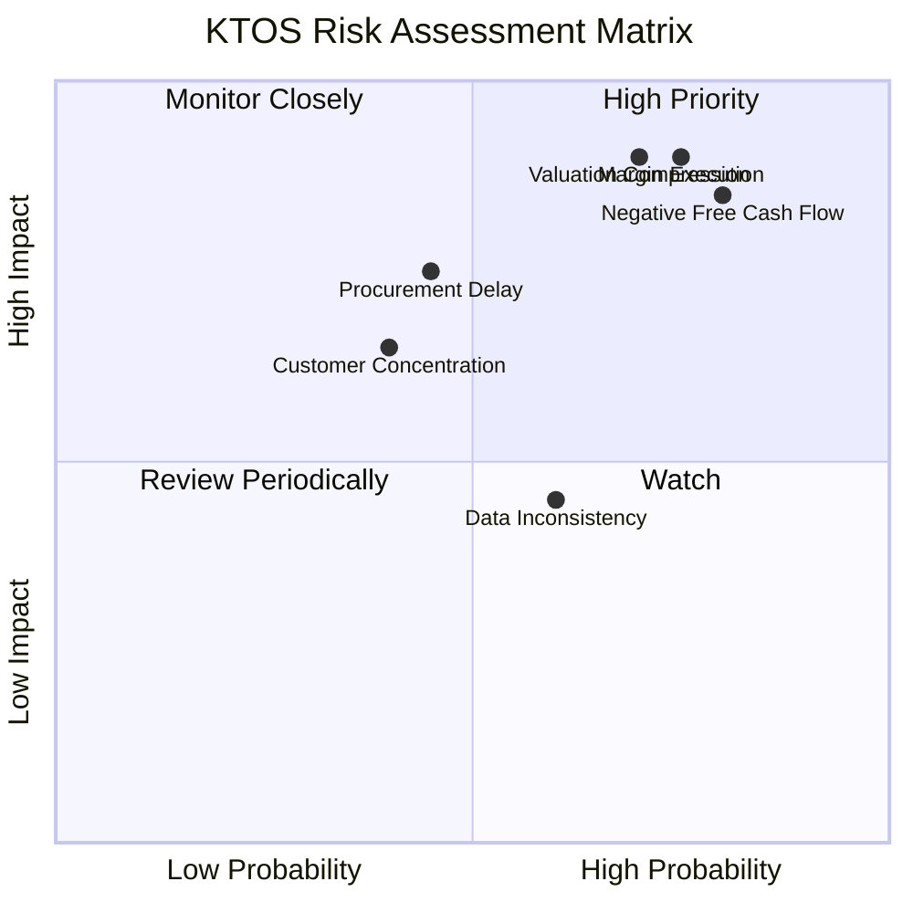

### 10.2 風險清單詳細分析

| # | 風險項目 | 發生機率 | 財務衝擊 | 風險評分 | 緩解措施 |
|---|----------|----------|----------|----------|----------|
| 1 | 🔴 **利潤率改善不如預期** | 中高（估計 50%） | 若營業利潤率不能由低位改善，DCF終值下修；量化幅度取決於營收與成本結構 | 🔴 8.5/10 | 每季追蹤毛利率、營業費用與新計畫毛利 |
| 2 | 🔴 **FCF持續為負** | 高（估計 60%） | TTM FCF 已為 **-$123M**；若延續將消耗現金並加大融資或稀釋風險 | 🔴 8.5/10 | 設定季度 OCF、Capex、應收帳款及存貨門檻 |
| 3 | 🔴 **估值倍數收縮** | 中高（估計 55%） | EV/EBITDA **59.9x**；若向同業倍數靠攏，股價可能大幅下修 | 🔴 8.0/10 | 以分批交易、估值上限及盈利確認降低風險 |
| 4 | 🟡 **政府採購或計畫延遲** | 中（估計 40%） | 訂單認列延後會壓低季度營收、設備利用率與利潤率 | 🟡 7.0/10 | 追蹤合約授予、交付節奏及積壓訂單轉換 |
| 5 | 🟡 **營運資金與應收帳款上升** | 中（估計 40%） | TTM應收帳款約 **$645.5M**，上升會延遲現金回收 | 🟡 6.5/10 | 監控 DSO、存貨天數及營運資金佔營收比 |
| 6 | 🟡 **財務資料口徑不一致** | 中（資料問題已存在） | Total debt VERIFIED 為 N/A，補充資料列 $246M；估值橋接可能受影響 | 🟡 5.5/10 | 以 SEC 10-Q 資產負債表與現金流量表逐項核對 |

> 機率為分析師風險評估，不是公司披露的統計機率。

---

## 11. 投資建議

### 11.1 最終綜合評級雷達圖

```
╔══════════════════════════════════════════════════════════════╗
║                  KTOS 最終評分雷達                            ║
╠══════════════════════════════════════════════════════════════╣
║ 基本面      6.0/10  ▓▓▓▓▓▓▓▓▓▓▓▓░░░░░░░░                    ║
║ 成長性      8.0/10  ▓▓▓▓▓▓▓▓▓▓▓▓▓▓▓▓░░░░                    ║
║ 獲利能力    3.0/10  ▓▓▓▓▓▓░░░░░░░░░░░░░░                    ║
║ 財務健康    7.0/10  ▓▓▓▓▓▓▓▓▓▓▓▓▓▓░░░░░░                    ║
║ 估值合理性  3.0/10  ▓▓▓▓▓▓░░░░░░░░░░░░░░                    ║
║ 護城河      5.4/10  ▓▓▓▓▓▓▓▓▓▓▓░░░░░░░░░                    ║
║ 管理層執行  5.0/10  ▓▓▓▓▓▓▓▓▓▓░░░░░░░░░░                    ║
╠══════════════════════════════════════════════════════════════╣
║ 綜合評分    5.4/10  ⚖️ 成長亮眼，獲利與估值驗證不足           ║
║ 評級        🔴 賣出；MOS -38.7%（低於-25%賣出門檻）           ║
╚══════════════════════════════════════════════════════════════╝
```

評級依據是 8.8 加權合理價值 **$24.45** 對比收盤價 **$33.91**，MOS **-38.7%**。依 MOS 門檻應為 **賣出**，沒有進行質化上調或下調。基本面最正面的證據是 TTM 營收年增 **28.2%**；主要反證是 TTM FCF **-$123M**、ROIC **0.2%**，遠低於 WACC **10.69%**。

### 11.2 目標價與隱含報酬率

| 情境 | 目標價 | 假設摘要 | 相對 $33.91 報酬 | 權重／用途 |
|------|------:|----------|----------------:|-----------|
| 🔴 悲觀 | $31.30 | 營收 CAGR 15%、營業利潤率 3%、EV/Sales 2.5x | -7.7% | 壓力情境 |
| 🟡 基準 | $44.48 | 營收 CAGR 25%、營業利潤率 5%、EV/Sales 3.5x | +31.2% | 12個月營運情境 |
| 🟢 樂觀 | $65.30 | 營收 CAGR 35%、營業利潤率 8%、EV/Sales 5.0x | +92.6% | 高增長兌現情境 |
| 估值三角合理值 | **$24.45** | DCF、同業倍數、分析師共識加權 | **-27.9%** | MOS門檻評級基準 |

**情境差異提醒**：$44.48 為基準經營情境的 12 個月目標，不等於加權合理價值。投資評級與買賣紀律以加權價值及 MOS 門檻為準，避免將單一樂觀情境目標當作公允價值。

### 11.3 買入時機與觸發因素

```
╔══════════════════════════════════════════════════════════════════╗
║                  ✅ 買入觸發因素 Checklist                      ║
╠══════════════════════════════════════════════════════════════════╣
║  轉為正面評估前需觀察：                                          ║
║  ☐ TTM FCF 連續兩季改善，並至少轉為非負                         ║
║  ☐ TTM營業利益率持續高於2%，且季度不再為負                     ║
║  ☐ 營收維持至少15% YoY，同時毛利率沒有顯著下滑                 ║
║                                                                  ║
║  加碼觸發條件（出現以下任一）：                                  ║
║  ☐ 股價回落至加權合理價值約$24.45附近，且基本面假設未惡化       ║
║  ☐ ROIC連續改善並逐步接近WACC，且FCF轉正                        ║
║  ☐ 新合約披露可驗證金額、交付時點與毛利貢獻                     ║
║                                                                  ║
║  減碼／退出觸發條件（出現以下任一）：                            ║
║  ☐ TTM營收成長跌至10%以下，且連續兩季未回升                     ║
║  ☐ TTM FCF低於-$150M，或現金下降而營運現金流未改善              ║
║  ☐ 營業利潤率連續兩季低於0%，且營收成長同步放緩                 ║
║  ☐ 出現重大合約延遲、成本超支或新增股權融資                     ║
╚══════════════════════════════════════════════════════════════════╝
```

### 11.4 投資人適配度分析

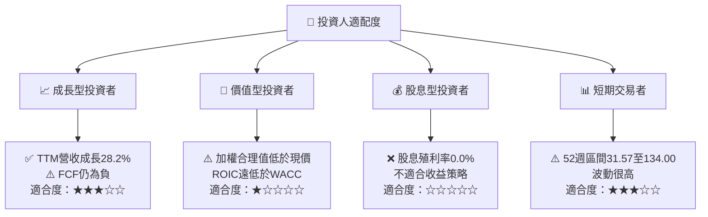

### 11.5 每季財報監控清單（Quarterly Watch List）

| 監控指標 | 最新基準 | 加碼觸發 | 減碼／重新評估門檻 | 投資含義 |
|----------|---------:|----------|-------------------|----------|
| 營收 YoY | 最新單季 **35.7%**；TTM **28.2%** | 單季 YoY ≥ 20%，連續兩季 | 連續兩季 < 10% | 判斷需求與交付是否持續 |
| 營業利益率 | TTM **0.4%**；最新季 **-1.0%** | TTM > 2%，且季度轉正 | 連續兩季低於 0% | 驗證增長是否帶來營業槓桿 |
| 毛利率 | TTM **23.0%** | 維持或改善 | 低於 20% 且持續兩季 | 衡量產品組合及成本控制 |
| OCF | TTM **-$31.50M** | 轉正並維持 | 連續季度低於 -$30M | 觀察盈利轉現金 |
| Capex | TTM **$91.50M** | 投資後收入與毛利同步改善 | Capex 上升、營收增速下滑 | 評估資本回報 |
| FCF | TTM **-$123.00M** | 連續兩季改善並轉正 | TTM 低於 -$150M | 估值與融資風險核心 |
| 應收帳款 | TTM **$645.5M** | 成長不快於營收 | 應收增速持續高於營收 | 預警收款與收入品質 |
| 現金及短期投資 | **$1.40B** | 保持充足且 FCF 改善 | 現金快速下降並伴隨負 OCF | 檢視內部融資能力 |
| SBC | 最近四季資料合計約 **$58.5M** | SBC／營收下降 | SBC 持續高於營收 4% | 監控稀釋成本 |
| 訂單／積壓訂單／財測 | N/A | 公開可驗證的訂單轉換改善 | 計畫延遲或財測下修 | 資料包未提供，須向後續申報核實 |

### 11.6 反面論證：什麼會證明論點錯誤（What Would Change My Mind）

```
╔══════════════════════════════════════════════════════════════════╗
║              ⚠️ 論點失效條件（Disconfirming Evidence）           ║
╠══════════════════════════════════════════════════════════════════╣
║ 以下任一情況出現，應重新檢視投資論點與估值：                    ║
║ ☐ TTM營收成長連續兩季低於10%，顯示成長動能顯著轉弱              ║
║ ☐ 營業利益率連續兩季低於0%，或相較FY2025約2.1%再下滑            ║
║ ☐ TTM FCF低於-$150M，或FCF長期無法改善                           ║
║ ☐ ROIC仍低於WACC 10.69%，且連續年度未見改善                      ║
║ ☐ SBC／營收持續高於4%，而股數淨稀釋未能由每股獲利增長抵銷        ║
║ ☐ 應收帳款增速持續高於營收，或存貨增加而交付／營收放緩           ║
║ ☐ 關鍵政府計畫延遲、取消或成本超支，導致營收／毛利財測下修       ║
║ ☐ 債務與現金口徑核對後顯示淨現金大幅低於目前估計                 ║
╚══════════════════════════════════════════════════════════════════╝
```

> **免責聲明**：本報告為 AI 自動生成，僅供研究參考，不構成投資建議。投資有風險，入市需謹慎。