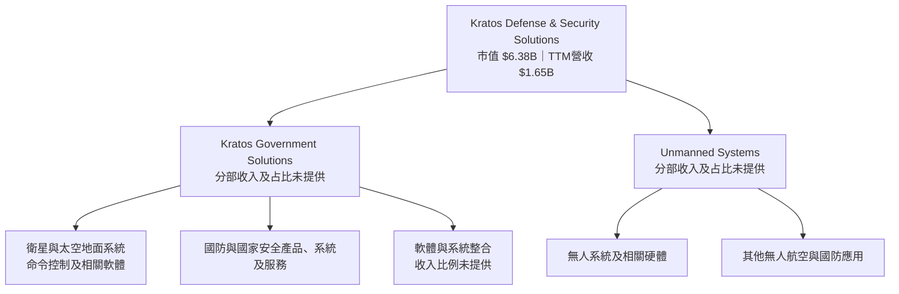
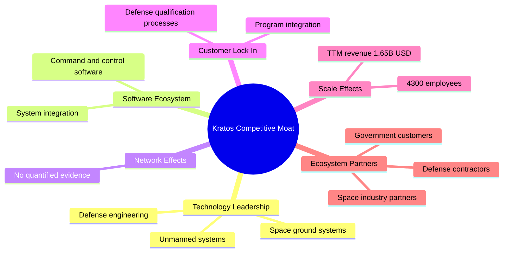
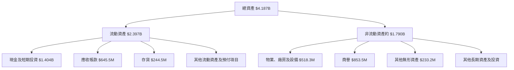
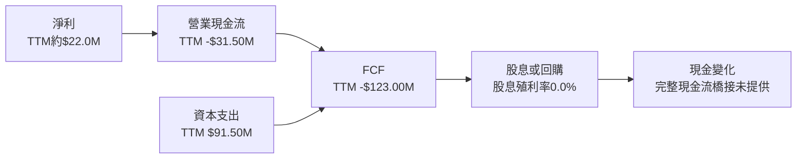
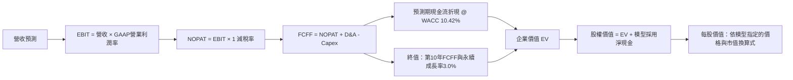
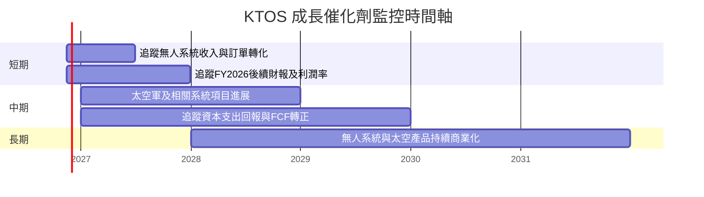
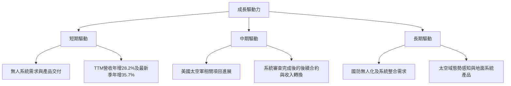
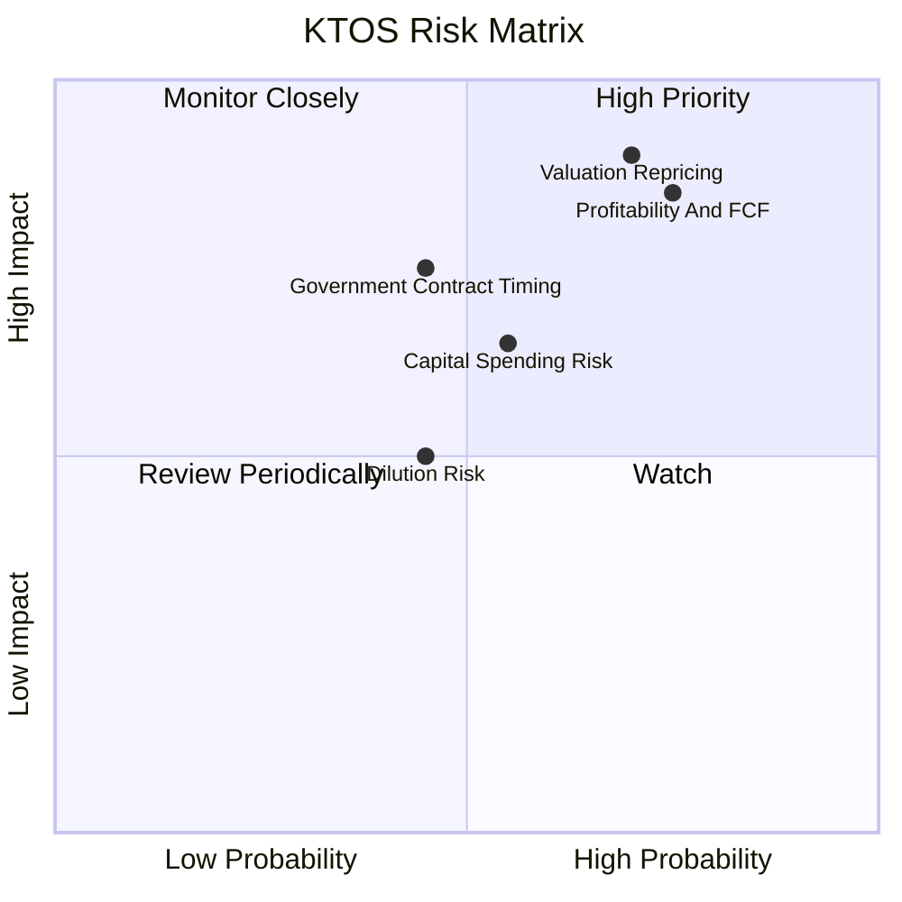
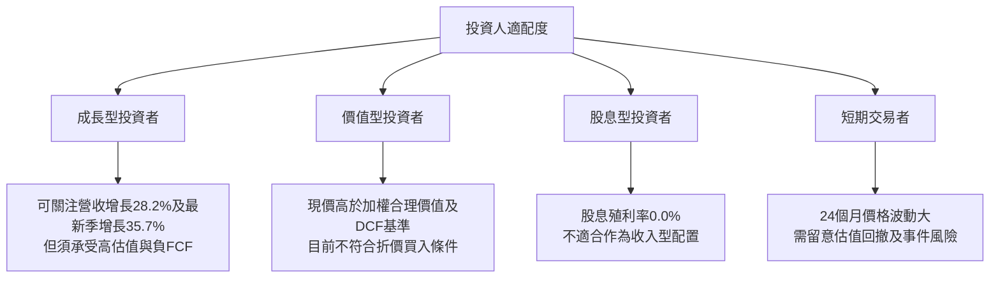

# KTOS 基本面深度分析報告
> **報告日期**：2026-11-15 ｜ **語言**：繁體中文 ｜ **數據來源**：SEC 申報資料 (XBRL)、Yahoo Finance、Finviz、StockAnalysis、Roic.ai ｜ **分析師**：CFA 級機構研究

## 目錄

| # | 章節 | 核心結論 |
|---|------|----------|
| 1 | 執行摘要 | 賣出；加權合理價值 $20.09，MOS -68.8% |
| 2 | 公司概覽與商業模式 | 無人系統與國防科技具成長選擇權，但細分營收未提供，護城河證據有限 |
| 3 | 損益表深度分析 | TTM 營收 $1.65B、年增 28.2%；TTM 營業利益率僅 0.4% |
| 4 | 資產負債表分析 | 現金及短期投資 $1.40B；流動比率 5.418 倍 |
| 5 | 現金流量深度分析 | TTM FCF -$123.00M、FCF Yield -1.93%，現金轉換偏弱 |
| 6 | 獲利能力與資本效率 | ROIC 0.2% 低於 WACC 10.42%，目前未創造足夠經濟價值 |
| 7 | 相對估值分析 | P/S 高於三家同業；自身 P/S 位於五年區間第 65 百分位 |
| 8 | DCF 內在價值評估 | 基準 DCF $9.77；估值高度依賴終值與長期成長假設 |
| 9 | 成長催化劑 | 無人系統、太空領域與國防需求可提供催化劑，但 TAM 數字未提供 |
| 10 | 風險矩陣 | 盈利與 FCF 轉弱、估值偏高及國防訂單波動為主要風險 |
| 11 | 投資建議 | 賣出；現價 $33.91 高於加權合理價值與三個 DCF 情境價值 |

---

## 1. 執行摘要

截至 2026-11-13 收盤，KTOS 股價為 **$33.91**。公司 TTM 營收 **$1.65B**、年增 **28.2%**，最新一季營收年增 **35.7%**，但 TTM 營業利益率僅 **0.4%**，ROIC 為 **0.2%**，遠低於 **10.42% WACC**；TTM FCF 為 **-$123.00M**。DCF 基準價值為 **$9.77**，三種估值方法與分析師共識加權後合理價值為 **$20.09**，依其計算 MOS 為 **-68.8%**，故依規則 20 評級為 **賣出**。分析師共識目標價 $74.68 與 DCF/同業倍數推導值差距很大，不能取代現金流與獲利能力證據。

### 1.0 一頁式投資儀表板

| 項目 | 內容 |
|------|------|
| **投資論點（3 句）** | ① TTM 營收年增 **28.2%**，最新一季年增 **35.7%**，成長動能明確。② TTM 營業利益率僅 **0.4%**、ROIC **0.2%**，低於 WACC **10.42%**，成長尚未轉化為足夠資本回報。③ TTM FCF **-$123.00M**，加權合理價值 **$20.09** 低於現價 **$33.91**。 |
| **綜合評分** | **5.2/10**（引用 1.1 六項平均） |
| **財務健康** | 🟡 現金及短期投資 **$1.40B**、流動比率 **5.418 倍**；但 TTM FCF **-$123.00M**，且品質指標 F-Score 為 **3/8**。 |
| **ROIC vs WACC** | **0.2% vs 10.42%**：目前資本報酬低於資本成本。 |
| **FCF 趨勢** | TTM FCF 為 **-$123.00M**；FCF Yield **-1.93%**。 |
| **估值** | Forward P/E **30.32 倍**｜EV/EBITDA **58.13 倍**｜FCF Yield **-1.93%**。 |
| **DCF 內在價值（基準）** | **$9.77**｜現價相對 DCF 溢價 **247.0%**（現價 ÷ DCF 價值 − 1）。 |
| **安全邊際（MOS）** | **-68.8%**＝($20.09 − $33.91) ÷ $20.09；以第 8.8 節加權合理價值為基準，🔴 無安全邊際。 |
| **預期報酬（基準情境 12M）** | DCF 基準情境 **-$71.2%**（$9.77 相對現價 $33.91）；此為模型估值差距，不代表精確 12 個月預測。 |
| **關鍵風險（前二）** | ① 盈利率與 FCF 未能跟上營收成長。② 現價相對 DCF 與同業估值推導值偏高。 |
| **評級 + 信心度** | 🔴 **賣出**｜信心：中。估值指標訊號一致偏高估，但公司仍有快速成長與國防需求催化劑。 |

### 1.1 綜合評分卡

| 維度 | 評分（1–10） | 主要依據（引用數字與其來源章節） |
|------|--------------|----------------------------------|
| 成長性 | 8.0 | TTM 營收年增 **28.2%**、最新一季年增 **35.7%**（第 3 章）；成長性高但獲利轉換有限。 |
| 獲利能力 | 3.0 | TTM 營業利益率 **0.4%**、ROIC **0.2%**，低於 WACC **10.42%**；F-Score **3/8**（第 6 章）。 |
| 財務健康 | 8.0 | 現金及短期投資 **$1.40B**、流動比率 **5.418 倍**；但 FCF 為 **-$123.00M**（第 4、5 章）。 |
| 估值 | 1.0 | MOS **-68.8%**；P/S **3.9 倍** 高於三家同業中位數 **1.8 倍**（第 7、8 章）。 |
| 護城河 | 6.0 | 國防、無人系統與太空相關產品具專業門檻；但沒有市場份額、分部營收或客戶集中度資料可量化驗證（第 2 章）。 |
| 管理層與資本配置 | 5.0 | 現金部位上升，但 TTM 資本支出 **$91.50M**、FCF 為負；年度稀釋股數測試未通過（第 3、5、6 章）。 |
| **綜合評分** | **5.2** | 六項算術平均：(8.0 + 3.0 + 8.0 + 1.0 + 6.0 + 5.0) ÷ 6 = **5.2**。 |

### 1.2 五大投資論點 + 三大核心風險

| 類型 | 項目 | 具體依據 | 信心度 |
|------|------|----------|--------|
| 🟢 **投資論點①** | 營收增長加速 | TTM 營收年增 **28.2%**，最新一季年增 **35.7%**；若新訂單如期轉化，規模可能持續擴大。 | 🟢 高 |
| 🟢 **投資論點②** | 無人系統與國防需求有長期支撐 | 公司經營 Government Solutions 與 Unmanned Systems；近期資訊包括太空領域系統審查與無人系統產業需求。分部收入及訂單轉換率未提供。 | 🟡 中 |
| 🟢 **投資論點③** | 資產負債表流動性充足 | 現金及短期投資 **$1.40B**，流動比率 **5.418 倍**，提供研發與擴產的財務緩衝。 | 🟢 高 |
| 🟢 **投資論點④** | 毛利額持續增加 | FY2022–FY2025 毛利由 **$226.0M** 升至 **$307.9M**；但 FY2025 毛利率降至 **22.9%**，尚非單向改善。 | 🟡 中 |
| 🟢 **投資論點⑤** | 無股息政策保留再投資能力 | 股息殖利率與派息率皆為 **0.0%**，可將資本留在業務內；再投資回報仍需由未來 ROIC 驗證。 | 🟡 中 |
| 🟡 **風險①** | 營收成長未轉化為現金 | TTM FCF **-$123.00M**、營業現金流 **-$31.50M**，且資本支出 **$91.50M**。 | 🔴 高衝擊 |
| 🔴 **風險②** | 估值遠高於內在價值模型 | 現價 **$33.91**，加權合理價值 **$20.09**，MOS **-68.8%**；DCF 基準值僅 **$9.77**。 | 🔴 高衝擊 |
| 🟡 **風險③** | EPS 預期差資料不足、季度獲利波動 | 最近一季營業利益 **-$4.0M**、淨利 **-$0.2M**；四季 EPS 預估值缺失，無法判定超預期或不及預期。 | 🟡 中 |

### 1.3 快速統計卡片

同業中位數按 AVAV、LMT、NOC 三家公司可用資料計算；獲利率及營收成長採三家公司同一指標的中位數。

| 指標 | 公司實際值（期間） | 同業中位數 | 狀態 |
|------|--------------------|------------|------|
| 營收成長（TTM） | **28.2%** | — | 🟢 |
| 營收成長（最新一季年增） | **35.7%** | **6.7%** | 🟢 |
| 毛利率（TTM） | **23.0%** | **20.0%** | 🟢 |
| 營業利益率（TTM） | **0.4%** | — | 🔴 |
| ROIC（TTM） | **0.2%** | — | 🔴 |
| Forward P/E | **30.32x** | **18.4x** | 🔴 |
| FCF Yield（TTM） | **-1.93%** | — | 🔴 |
| Piotroski F-Score | **3 / 8** | — | 🔴 |

### 1.4 投資結論

```text
╔══════════════════════════════════════════════════════════════════╗
║                    📊 投資結論摘要                               ║
╠══════════════════════════════════════════════════════════════════╣
║  評級：🔴 賣出（依 8.8 MOS -68.8% 與規則 20）                   ║
║  價格（2026-11-13 收盤）：$33.91                                ║
║  DCF 內在價值（基準）：$9.77（現價溢價 247.0%）                 ║
║  安全邊際 MOS：-68.8%（以加權合理價值 $20.09 為分母）           ║
║  加權合理價值（8.8）：$20.09                                    ║
║  DCF 情境價值：                                                  ║
║    悲觀情境：$8.16（-75.9%）                                     ║
║    基準情境：$9.77（-71.2%）                                     ║
║    樂觀情境：$13.38（-60.5%）                                    ║
║  綜合評分：5.2/10（引用 1.1）                                   ║
║  適合投資人：能承受高波動、關注國防科技成長，但能接受估值風險者  ║
╚══════════════════════════════════════════════════════════════════╝
```

---

## 2. 公司概覽與商業模式

### 2.1 業務結構與收入來源

公司主要經營 **Kratos Government Solutions** 與 **Unmanned Systems** 兩個分部，提供國防、國家安全與商業市場所需技術、硬體、系統及軟體。公司總營收與市值如下；分部收入、占比及子業務收入未提供，故不以虛構比例繪圖。



### 2.2 市場份額

市場份額數據未提供，不能可靠估算公司在無人系統、國防電子或衛星地面系統的份額。可觀察到 KTOS TTM 營收年增 **28.2%**、最新一季年增 **35.7%**，高於同業最新季度營收年增中位數 **6.7%**；但較快成長不等同於較大市場份額。

### 2.3 競爭護城河分析



### 2.4 護城河強度

| 護城河項目 | 強度（強／中／弱） | 證據（引用數字或事實） | 會削弱它的情況 |
|------------|--------------------|------------------------|----------------|
| 技術與產品專業性 | 中 | 公司提供國防、無人系統與太空地面系統；員工 **4,300 人**，TTM 營收 **$1.65B**。研發支出 FY2025 為 **$40.0M**。 | 技術迭代落後、項目交付不如競爭者、採購規格改變。 |
| 軟體與系統整合 | 中 | 公司業務包含衛星與太空地面系統及相關命令控制軟體，但軟體收入比例、續約率未提供。 | 軟硬體整合優勢無法形成續約或高毛利收入。 |
| 網路效應 | 弱／未證實 | 未提供使用者數、互通網路規模或網路效應量化指標。 | 客戶選擇更開放、可替代的系統。 |
| 客戶鎖定 | 中 | 國防系統通常涉及認證、整合與採購流程；本公司個別合約續約率未提供。 | 項目取消、預算延遲或客戶多源採購。 |
| 規模效應 | 中 | TTM 營收 **$1.65B**、員工 **4,300 人**；相對 LMT、NOC 規模較小。 | 擴張帶來成本上升，而非單位成本下降。 |
| 生態夥伴 | 中 | 近期公司資訊涵蓋美國太空軍相關項目及太空域態勢感知產品；合約金額與收入占比未提供。 | 政府採購延後或競爭者取得主承包商位置。 |

1.1「護城河」分數為 **6.0/10**：專業產品與政府項目整合提供一定門檻，但欠缺市場份額、續約率及分部經濟性數據，尚不足以證明其能持續帶來高回報。

---

## 3. 損益表深度分析

### 3.1 年度收入成長趨勢（近 4 年）

年度營收由 FY2022 **$898.3M** 增至 FY2025 **$1.35B**。FY2022–FY2025 CAGR 為：
\[
(1.347/0.8983)^{1/3}-1 \approx 14.4\%
\]

```text
╔══════════════════════════════════════════════════════════════════╗
║           Kratos 年度收入趨勢（FY2022-FY2025）                  ║
╠══════════════════════════════════════════════════════════════════╣
║  FY2022  $0.898B  █████████████░░░░░░░░░░░  YoY: +10.7% 🟢    ║
║  FY2023  $1.037B  ███████████████░░░░░░░░░  YoY: +15.5% 🟢    ║
║  FY2024  $1.136B  █████████████████░░░░░░░  YoY: +9.6%  🟢    ║
║  FY2025  $1.347B  ████████████████████░░░░░  YoY: +18.5% 🟢    ║
╠══════════════════════════════════════════════════════════════════╣
║  FY2022–FY2025 營收 CAGR：約 +14.4%                              ║
║  TTM 營收 $1.65B；TTM vs prior TTM 成長 +28.2%                  ║
╚══════════════════════════════════════════════════════════════════╝
```

FY2025 營收年增 **18.5%**，TTM 成長升至 **28.2%**，而最新一季年增 **35.7%**。這顯示近期收入增速高於近三年 CAGR；但訂單、收購與有機成長的拆分未提供，不能假定全部是持續性內生增長。

### 3.2 季度收入趨勢分析

QoQ 為當季營收相對上一季營收變化；YoY 採公司財務資料所列單季年增率。

| 季度 | 營收 | QoQ 成長 | YoY 成長 | 備註 |
|------|------:|---------:|---------:|------|
| 2025 Q4 | $345.1M | **-0.7%** | **21.9%** | 與 2025 Q3 的 $347.6M 比較；年增仍為正。 |
| 2026 Q1 | $371.0M | **+7.5%** | **22.6%** | 收入較上一季回升。 |
| 2026 Q2 | $458.8M | **+23.7%** | **30.5%** | 季增擴大；需持續觀察是否受項目交付時點影響。 |
| 2026 Q3 | $471.8M | **+2.8%** | **35.7%** | YoY 加速，但季度營收增長與獲利未同步。 |

### 3.3 利潤率演變分析

| 利潤率指標 | FY2022 | FY2023 | FY2024 | FY2025 | 趨勢 | 評估 |
|------------|-------:|-------:|-------:|-------:|------|------|
| **毛利率** | 25.2% | 25.9% | 25.3% | 22.9% | FY2025 下滑 2.4 個百分點 | 🟡 |
| **營業利益率** | 0.5% | 3.0% | 2.6% | 2.1% | 2023 高點後連續走低 | 🔴 |
| **淨利率** | -4.1% | -0.9% | 1.4% | 1.6% | 由虧損轉為微幅盈利 | 🟡 |

以上年度利潤率由年度損益表的毛利、營業利益、淨利除以營收計算。最新標準化數據顯示 TTM 營業利益率 **0.4%**、最新一季營業利益率 **-1.0%**，與年度趨勢一併反映目前盈利承壓。

毛利率 FY2025 降至 **22.9%**，雖然毛利額增至 **$307.9M**，但營收增加未完全轉化為毛利率改善。FY2026 Q3 營業利益為 **-$4.0M**，說明研發、銷售管理費用或項目組合的成本吸收仍是關鍵。單憑資料無法區分低毛利項目、擴張費用或交付組合的個別貢獻，後續應追蹤營業費用與分部利潤率。

### 3.4 費用結構分析

完整營業費用細項及各費用占收入比例未提供，無法繪製有數字依據的費用結構圓餅圖。可確認 FY2025 研發支出為 **$40.0M**，約占 FY2025 營收 **3.0%**（$40.0M ÷ $1.347B）；研發是技術投資，但需以後續毛利與營業利潤率改善驗證投資效益。

### 3.5 季度 EPS 趨勢與盈餘品質（Quality of Earnings）

最近四季 EPS 預估值缺失，無法判斷盈餘是否超預期或不及預期。已知季度實際淨利由 Q1 2026 **$11.9M**、Q2 **$4.4M** 降至 Q3 **-$0.2M**；Q3 營收雖達 **$471.8M**，營業利益卻為 **-$4.0M**。

| 盈餘品質項目 | 數值/佔比 | 評估 |
|--------------|-----------|------|
| 股權薪酬 SBC / 營收 | TTM SBC **$58.5M**；約 **3.5%**（$58.5M ÷ $1.65B） | 🟡 SBC 是實質股東成本，會稀釋每股價值；SBC 佔營收比率不能忽略。 |
| SBC / 營業現金流 | 約 **-185.7%**（$58.5M ÷ -$31.50M） | 🔴 比率受營業現金流為負影響；SBC 金額大於營業現金流絕對值，現金獲利能力偏弱。 |
| FCF / 淨利（現金轉換率） | 約 **-559.1%**（-$123.00M ÷ $22.0M） | 🔴 淨利為正，但現金流大幅為負，現金轉換品質差。 |
| 一次性/非經常性損益 | N/A（未提供明確一次性損益拆分） | 無法判定是否有一次性因素美化或壓低盈利。 |
| 有效稅率異常 | N/A（未提供可核實有效稅率） | 無法確認稅務利益是否推高淨利。 |
| 資本化支出 vs 費用化 | TTM 資本支出 **$91.50M**；資本化項目明細未提供 | 資本支出占 TTM 營收約 **5.5%**，高於 DCF 假設的長期收斂水準；需確認其帶來未來產能或收入。 |

**盈餘品質結論**：TTM 淨利約 **$22.0M**，但 FCF **-$123.00M**，SBC 約 **$58.5M**，顯示會計盈利目前未能轉為現金。DCF 使用 GAAP EBIT，避免把 SBC 從費用中加回；估值仍受高資本支出與現金轉換弱的限制。

---

## 4. 資產負債表分析

### 4.1 資產結構分解

TTM 資產負債資料列示總資產 **$4.187B**，其中流動資產 **$2.397B**。現金及短期投資為 **$1.404B**；其他資產細項如下。不同資料源的期間與分類可能有差異，故下圖僅呈現可確認的財務資料，不將未列項目強行補足。



### 4.2 流動性與營運資金分析

最新公司資料列示流動比率 **5.418 倍**、速動比率 **4.632 倍**。年度流動比率可由流動資產除以流動負債計算：FY2025 為 $1.263B ÷ $311.0M = **4.06 倍**；FY2024 為 $872.1M ÷ $296.7M = **2.94 倍**。流動性改善為短期緩衝，但應收帳款與存貨增加可能占用營運資金。

| 指標 | 最新 TTM | 一年前 TTM | 變化 | 解讀 |
|------|----------:|----------:|------:|------|
| DSO 應收帳款天數 | 42 天 | 39 天 | +3 天 | 收款天數延長，可能意味應收帳款轉現稍慢；需留意政府及承包商付款時點。 |
| DIO 存貨天數 | 70 天 | 66 天 | +4 天 | 存貨天數增加，可能反映備料或交付週期拉長，也可能增加營運資金占用。 |
| DPO 應付帳款天數 | 32 天 | 24 天 | +8 天 | 延長供應商付款時間可暫時緩解現金占用，但不能單獨視為議價能力提升。 |
| CCC 現金轉換週期 | 80 天 | 81 天 | -1 天 | CCC 略有改善，主要因 DPO 增幅抵銷 DSO、DIO 上升。 |

### 4.3 債務結構分析

VERIFIED FIGURES 列示總債務 **N/A**、淨現金 **$1.40B**；其他市場資料另列總債務 **$246.00M**、淨現金 **$1.16B**。本報告不把兩組不同來源數字混為同一計算；DCF 橋接依模型指定使用淨現金 **$1.40B**。債務期限、利息保障倍數及契約條款未提供，不作推算。

```text
╔══════════════════════════════════════════════════════════════════╗
║                   KTOS 債務健康診斷                              ║
╠══════════════════════════════════════════════════════════════════╣
║  總債務（標準化數據）：N/A                                      ║
║  總現金及短期投資：$1.40B                                       ║
║  淨現金（依標準化數據）：$1.40B  🟢                             ║
║  其他市場資料總債務：$246.00M（口徑不同，未用於DCF橋接）        ║
║  Debt/EBITDA：N/A（總債務口徑及EBITDA資料不一致）               ║
║  Interest Coverage：N/A（利息費用資料未提供）                   ║
╚══════════════════════════════════════════════════════════════════╝
```

### 4.4 股東權益趨勢

年度股東權益 FY2022 **$936.3M**、FY2023 **$976.0M**、FY2024 **$1.35B**、FY2025 **$2.00B**。FY2024–FY2025 增長較快，但現有資料不足以將變化完全拆分為留存盈餘、發股、收購或其他權益項目。

```text
╔══════════════════════════════════════════════════════════════════╗
║                  KTOS 股東權益趨勢                               ║
╠══════════════════════════════════════════════════════════════════╣
║  FY2022  $0.936B  █████████░░░░░░░░░░░                          ║
║  FY2023  $0.976B  ██████████░░░░░░░░░░░                         ║
║  FY2024  $1.350B  ██████████████░░░░░░░                         ║
║  FY2025  $2.000B  ████████████████████                          ║
╚══════════════════════════════════════════════════════════════════╝
```

---

## 5. 現金流量深度分析

### 5.1 現金流量瀑布圖

季度現金流資料可得；年度營業現金流在來源中為缺失值，不以 FCF 反推營業現金流。



### 5.2 FCF 轉換率趨勢

| 年度 | FCF | 淨利 | FCF / 淨利 | 解讀 |
|------|----:|-----:|-----------:|------|
| FY2022 | -$71.1M | -$36.9M | 192.7% | 負淨利與負 FCF，正比率並不代表現金品質良好。 |
| FY2023 | $12.8M | -$8.9M | -143.8% | 轉正 FCF，但淨利仍虧損，需看後續持續性。 |
| FY2024 | -$8.5M | $16.3M | -52.1% | 盈利未完全轉為自由現金流。 |
| FY2025 | -$137.4M | $22.0M | -624.5% | FCF 大幅為負，可能受高資本支出與營運資金影響；原因拆分資料不足。 |

> FCF / 淨利在淨利接近零或為負時容易失真，需與營業現金流及資本支出合併判讀。

### 5.3 自由現金流趨勢

| 期間 | FCF | FCF Yield |
|------|----:|----------:|
| FY2022 | -$71.10M | N/A |
| FY2023 | $12.80M | N/A |
| FY2024 | -$8.50M | N/A |
| FY2025 | -$137.40M | N/A |
| TTM | **-$123.00M** | **-1.93%** |

TTM FCF 明確定義為營業現金流減資本支出：**-$31.50M − $91.50M = -$123.00M**。年度歷史 FCF 取財務資料原列值，並不自行重建年度 OCF。

```text
╔══════════════════════════════════════════════════════════════════╗
║             自由現金流：歷史實際值                              ║
╠══════════════════════════════════════════════════════════════════╣
║  FY2022  -$71.10M  ◀██████████                                  ║
║  FY2023   $12.80M  ████▶                                        ║
║  FY2024   -$8.50M  ◀█                                            ║
║  FY2025 -$137.40M  ◀████████████████████                        ║
║  TTM    -$123.00M  ◀██████████████████                          ║
║  TTM FCF Yield：-1.93%                                           ║
╚══════════════════════════════════════════════════════════════════╝
```

### 5.4 資本配置評估

股息殖利率與派息率均為 **0.0%**。公司未提供完整回購、收購與現金留存的可核實資金用途拆分；FY2025 資本支出 **$95.3M**，TTM 資本支出 **$91.50M**。因分配比例缺少資料，不繪製資本配置圓餅圖。

| 配置項目 | 可用資料 | 評估 |
|----------|----------|------|
| 資本支出 | FY2025 **$95.3M**；TTM **$91.50M** | 具投資擴張性，但需由新增收入與回報率驗證。 |
| 股息 | 殖利率 **0.0%** | 無現金股息回報。 |
| 回購 | N/A | 回購金額未提供。 |
| 研發 | FY2025 **$40.0M** | 約占 FY2025 營收 **3.0%**；持續研發是否帶來營收與毛利提升仍待驗證。 |

---

## 6. 獲利能力與資本效率

### 6.1 ROE / ROA / ROIC 趨勢

| 指標 | 最新 TTM | 歷史資料 | 評估 |
|------|---------:|----------|------|
| ROE | **0.6%** | 財務資料其他欄位列示 **0.8%**；品質數據採 DuPont **0.6%** | 低回報，且資料源口徑有差異。 |
| ROA | **0.2%** | 歷年完整可比序列未提供 | 資產產生獲利能力偏低。 |
| ROIC | **0.2%** | 未提供完整歷年序列 | 顯著低於資本成本。 |

沒有可核實行業均值數據，不列行業均值比較。

### 6.2 ROIC vs WACC 分析（核心價值創造判斷）

WACC 依財務資料的資本成本區塊採用 **10.42%**；ROIC 採標準化 TTM 值 **0.2%**。兩者差額為 **0.2% − 10.42% = -10.22 個百分點**，表明目前營運回報低於投資人要求報酬。

```text
╔══════════════════════════════════════════════════════════════════╗
║                ROIC vs WACC 深度分析                            ║
╠══════════════════════════════════════════════════════════════════╣
║  WACC 輸入（依資本成本資料採用，不另行建立另一套折現率）：      ║
║  ├── 無風險利率（10Y美債）：             5.15%                   ║
║  ├── 市場風險溢酬：                      5.00%                   ║
║  ├── 原始 Beta：                         1.17                    ║
║  ├── 調整後 Beta：                       1.11                    ║
║  ├── 股權成本：                          10.70%                  ║
║  ├── 稅前債務成本：                      3.90%                   ║
║  ├── 股權／債務權重：                    96.3% / 3.7%             ║
║  └── ✅ WACC：                           10.42%                  ║
║                                                                  ║
║  ROIC（TTM）：                           0.20%                   ║
║  EVA 利差：                              0.20%-10.42%=-10.22pp   ║
║  ROIC   0.20%  ░░░░░░░░░░░░░░░░░░░░░░                           ║
║  WACC  10.42%  ████████████████████                              ║
║                                                                  ║
║  📊 結論：ROIC 低於 WACC，現階段資本投入未創造正經濟利差。     ║
╚══════════════════════════════════════════════════════════════════╝
```

股權成本按 CAPM 輸入檢核：**5.15% + 1.11 × 5.00% = 10.70%**。調整 Beta 為 **⅔ × 1.17 + ⅓ × 1 = 1.11**。標準化資本成本資料列示稅後債務成本所需的稅率為 **21.0%**，股權與債務權重為 **96.3% / 3.7%**；依資料採用的 WACC 為 **10.42%**。總債務在標準化財務資料中為 N/A、其他資料源的債務口徑不同，故本節不另用不一致的債務金額重建 WACC。

### 6.3 杜邦三因素分解

| 因素 | 數值（TTM） | 解讀 |
|------|-------------|------|
| 淨利率 | **1.3%** | 每一美元收入的淨利貢獻有限。 |
| 資產週轉率 | **0.39** | 資產周轉較慢，新增資產須轉化為收入。 |
| 權益乘數 | **1.21** | 財務槓桿不高，ROE 並非主要由槓桿撐起。 |
| **ROE** | **0.6%** | 1.3% × 0.39 × 1.21 約為 **0.6%**；主要瓶頸為低淨利率與資產周轉。 |

### 6.4 財務體質：Piotroski F-Score

Piotroski F-Score 為 **3/8**；因一項測試缺少資料，分母為可判定的八項，而非九項。

| 測試 | 結果 | 解讀 |
|------|------|------|
| ROA > 0 | ✅ 通過 | TTM 資產報酬為正，但僅 **0.2%**。 |
| 營業現金流 > 0 | ❌ 未通過 | TTM OCF **-$31.50M**。 |
| ROA 高於一年前 | ❌ 未通過 | 指標未改善。 |
| 營業現金流 > 淨利（應計品質） | ❌ 未通過 | 現金流低於會計獲利。 |
| 長期負債 ÷ 總資產低於一年前 | — 無法判定 | 長期負債相關資料缺漏。 |
| 流動比率高於一年前 | ✅ 通過 | 流動性改善，最新流動比率 **5.418 倍**。 |
| 稀釋股數未增加 | ❌ 未通過 | 未通過股數穩定測試，存在稀釋風險。 |
| 毛利率高於一年前 | ✅ 通過 | 通過該項年度比較測試；但 FY2025 年度毛利率較 FY2024 下降，須留意比較期間口徑。 |
| 資產週轉率高於一年前 | ❌ 未通過 | 資產使用效率未改善。 |

整體 **3/8** 顯示財務安全並非主要短板，但盈利現金流、應計品質及資產效率需要改善。

---

## 7. 相對估值分析

### 7.1 同業估值比較表格

同業倍數採 Yahoo Finance 數據。KTOS P/E 採提供的市場估值資料；同業中位數使用 AVAV、LMT、NOC 的可用數值。AVAV TTM P/E 為 N/A。

| 估值指標 | **KTOS** | **AVAV** | **LMT** | **NOC** | KTOS 評估 |
|----------|---------:|---------:|--------:|--------:|-----------|
| **Trailing P/E** | **282.6x** | N/A | 21.2x | 17.4x | 🔴 KTOS 盈利基數很低，倍數遠高於可比公司；AVAV 缺值。 |
| **Forward P/E** | **30.3x** | 26.7x | 17.9x | 18.4x | 🔴 三家中位數 **18.4x**，KTOS 溢價明顯。 |
| **P/S Ratio** | **3.9x** | 3.0x | 1.7x | 1.8x | 🔴 三家中位數 **1.8x**；KTOS 成長快，但盈利率尚低。 |
| **EV/EBITDA** | **58.1x** | 28.4x | 15.4x | 12.6x | 🔴 同業中位數 **15.4x**，KTOS 倍數高。 |
| **最新一季營收年增** | **35.7%** | 5.7% | 11.3% | 6.7% | 🟢 KTOS 成長顯著較快，但未抵銷 FCF 與利潤率風險。 |
| **毛利率（TTM）** | **23.0%** | 26.5% | 11.7% | 20.0% | 🟡 KTOS 高於 LMT、NOC，低於 AVAV。 |

### 7.2 歷史估值區間分析

P/E 歷史極值受極低 EPS 影響而異常巨大，不能將其視為正常可比區間。其餘歷史位置顯示 KTOS P/S 高於自身中位數，EV/EBITDA 亦略高於中位數。

```text
╔══════════════════════════════════════════════════════════════════╗
║                 KTOS 自身五年估值位置                            ║
╠══════════════════════════════════════════════════════════════════╣
║  P/E：       現在 282.6x｜中位數 380.2x｜百分位 36%             ║
║              區間 232.9x – 10,595,348,627,336,923,136.0x         ║
║              ⚠️ 極端上界因低 EPS 失去實用比較性                  ║
║  P/S：       現在 3.9x｜中位數 3.2x｜區間 1.3x–11.6x｜第65百分位 ║
║  EV/EBITDA： 現在 60.0x｜中位數 55.5x｜區間 33.8x–221.5x｜第60百分位║
╚══════════════════════════════════════════════════════════════════╝
```

### 7.3 情境價值（Bear / Base / Bull，照抄 DCF MODEL 的 Scenarios）

| 情境 | 第 1 年營收成長 | 期末營業利潤率 | WACC | 每股價值 | 相對現價 | 機率 | 會發生的條件 |
|------|----------------:|---------------:|-----:|---------:|---------:|-----:|--------------|
| 🔴 悲觀 | 14.1% | 1.6% | 11.42% | **$8.16** | **-75.9%** | 25% | 營收成長回落，擴張成本未下降，資本成本或風險溢酬上升。 |
| 🟡 基準 | 28.2% | 1.9% | 10.42% | **$9.77** | **-71.2%** | 50% | 近期 TTM 成長延續初期，之後逐步降速，利潤率緩慢改善。 |
| 🟢 樂觀 | 42.3% | 2.1% | 9.42% | **$13.38** | **-60.5%** | 25% | 訂單轉化與產品交付更快、獲利率改善，資本成本下降。 |

即使採樂觀情境，模型每股價值仍低於 $33.91 現價。三種情境的假設與價值為模型輸出；收入或合約資料不足以驗證這些情境的實現機率。

### 7.4 相對估值隱含價格區間

```text
╔══════════════════════════════════════════════════════════════════╗
║              同業估值法隱含價格與現價位置                       ║
╠══════════════════════════════════════════════════════════════════╣
║  $9.77 ───── $14.29 ───── $20.56 ───── 現價 $33.91             ║
║  DCF基準     EV/EBITDA     Forward P/E                           ║
║                                                                  ║
║  DCF基準：$9.77（10年 FCFF，WACC 10.42%，永續成長 3.0%）         ║
║  同業EV/EBITDA：$14.29（同業中位數 15.4x × TTM EBITDA，加淨現金）║
║  同業Forward P/E：$20.56（同業中位數 18.4x × Forward EPS $1.12） ║
║  現價：$33.91                                                    ║
╚══════════════════════════════════════════════════════════════════╝
```

---

## 8. DCF 內在價值評估（Discounted Cash Flow）

> 本章採用程式計算的 DCF MODEL 數字；DCF 模型各列以 USD billions 表示。輸入資料未提供的項目標明 N/A 或依模型指定處理，不另建模型。

### 8.0 估值推理鏈（Thinking Logic）

**Step 1 — 價值由哪些變數決定？**  
KTOS 價值主要由政府解決方案與太空系統、無人系統兩類業務驅動，但兩者分部營收與占比未提供；因此模型以公司整體 TTM 營收 **$1.65B** 為起點。估值的主要變數為收入成長、GAAP 營業利潤率，以及資本支出和折現率。由於目前營業利潤率只有 **0.4%**、TTM FCF 為負，利潤率與資本支出能否改善對價值尤其重要；敏感度矩陣另顯示終值成長率與 WACC 也會影響估值。

**Step 2 — 模型選擇**

| 決策點 | 本報告採用 | 理由（含數字） | 曾考慮但否決 | 否決理由 |
|--------|-----------|----------------|--------------|----------|
| 現金流定義 | FCFF | 以企業現金流折現至 EV，再加淨現金；模型明確採用此定義。 | FCFE | WACC 折現與企業價值橋接更適合 FCFF。 |
| 預測期 N | 10 年 | 模型輸入固定為 10 年，成長率由 28.2% 線性降至 3.0%。 | 5 年 | 無法沿用既定模型與情境輸出。 |
| 終值方法 | Gordon Growth | 模型使用永續成長率 3.0%，WACC 10.42%。 | 退出倍數 | DCF MODEL 未提供退出倍數估值，不自行補建。 |
| EBIT 基礎 | GAAP EBIT | 模型已明示使用 GAAP EBIT。 | 非 GAAP EBIT | 加回 SBC 會改變模型既定方法與估值結果。 |

**Step 3 — 關鍵假設的推導鏈**

- **營收成長**：錨點＝TTM 營收年增 **28.2%**；調整＝模型將第 1 年成長率由該錨點線性降至第 10 年 **3.0%**，反映成長逐步成熟；**採用第 1 年 28.2%、第 10 年 3.0%**；曾考慮將 28.2% 維持十年，但因模型採用線性遞減而不採此替代方案。
- **期末營業利潤率**：錨點＝TTM GAAP 營業利益率 **0.4%**；調整＝模型逐步回升至最近五個財政年度中位數；**採用第 10 年 1.9%**；曾考慮使用更高成熟期利潤率，但歷史數字未支持，因此不採。
- **永續成長率 g**：錨點＝模型長期終值假設 **3.0%**；採用 **3.0%**，且低於 WACC **10.42%**；更高成長率會提高終值，缺乏可引用的長期市場資料，故不擅自上調。
- **預測期 N**：錨點＝模型指定 **10 年**；採用 **10 年**以涵蓋從高成長向成熟期遞減的路徑；未改用更長期間，因遠期預測不確定性更高。
- **Capex / 營收**：錨點＝TTM **5.6%**；模型由第 1 年 **5.6%** 逐步降至第 10 年 **5.1%**；採用模型給定值，否決更快降至低於折舊的假設，因模型明示保留約 1.1 倍 D&A 的資本支出底線。
- **GAAP EBIT 與 SBC**：錨點＝模型使用 GAAP EBIT；GAAP EBIT 已將 SBC 作為費用，故不在 FCFF 再扣一次 SBC；不使用非 GAAP EBIT 加回 SBC。
- **年稀釋率**：模型採固定股數、不額外稀釋，即 **0%**；理由為模型設定組合 (A)，由 GAAP EBIT 的 SBC 費用反映成本，否決另行放大股數以避免重複計入。
- **終值方法**：採 Gordon Growth，使用第 10 年 FCFF 與 **3.0%** 永續成長率；退出倍數法因模型未提供所需輸入而不自建。
- **WACC**：採用模型與成本資本資料指定的 **10.42%**；不另建折現率，以保持與敏感度矩陣及情境估值一致。

**Step 4 — 最脆弱的一環**  
最脆弱假設是收入成長在前段維持高位、同時營業利潤率改善；若成長轉弱或利潤率不升，DCF 價值將低於 **$9.77**。模型的樂觀情境已顯示即使第 1 年成長 **42.3%**、期末利潤率 **2.1%** 且 WACC 降至 **9.42%**，價值仍為 **$13.38**。

**Step 5 — 計算路徑**



### 8.1 模型假設總表（Model Inputs）

| 假設項目 | 採用值 | 依據 / 來源 | 敏感度 |
|----------|--------|-------------|--------|
| 預測期長度 N | 10 年 | DCF MODEL 指定；涵蓋十年由高成長降至成熟成長的路徑。 | 🟡 中 |
| 營收成長 | 第 1 年 28.2%，第 10 年 3.0%，逐年線性遞減 | 第 1 年依 TTM vs prior TTM **28.2%**；第 10 年為模型終值前成長假設。 | 🔴 高 |
| 營業利潤率 | 第 1 年 0.4% → 第 10 年 1.9% | TTM 營業利益率 **0.4%**，逐步收斂至最近五個財政年度中位數。 | 🔴 高 |
| 有效稅率 | 21.0% | 模型預設稅率；公司實際有效稅率資料未提供。 | 🟢 低 |
| Capex / 營收 | 第 1 年 5.6% → 第 10 年 5.1% | TTM **5.6%**；依模型逐步降至約 1.1×D&A。 | 🟡 中 |
| D&A / 營收 | 4.7% | 模型採 TTM 比率，固定不變。 | 🟢 低 |
| 營運資金變動 | 未建模 | DCF MODEL 明示 working capital is not modelled；缺乏可直接加入的模型值。 | 🟢 低 |
| EBIT 基礎 | GAAP EBIT | DCF MODEL 指定。 | 🟡 中 |
| 股權薪酬 SBC 處理 | 不另扣 SBC | GAAP EBIT 已含 SBC 費用。 | 🟡 中 |
| 年稀釋率 | 0%；固定股數 | 模型採組合 (A)：GAAP EBIT + 固定股數。 | 🟡 中 |
| 永續成長率 g | 3.0% | DCF MODEL 指定；小於 WACC。 | 🔴 高 |
| 終值方法 | Gordon Growth | DCF MODEL 指定，終值占 EV 83.9%。 | 🔴 高 |
| WACC | 10.42% | 成本資本資料與 DCF MODEL 指定值。 | 🔴 高 |

**FCFF 定義**：本模型使用 FCFF = NOPAT + D&A − Capex；營運資金不建模，沒有獨立的 ΔWC 列。  
**SBC 一致性**：本模型採用 **(A) GAAP EBIT + 固定股數**，故 SBC 影響已計入一次；FCFF 不再減 SBC，年稀釋率為 0%。

### 8.2 折現率推導（WACC）

```text
╔══════════════════════════════════════════════════════════════════╗
║                    WACC 推導（折現率）                           ║
╠══════════════════════════════════════════════════════════════════╣
║  股權成本 Ke（CAPM）：                                           ║
║  ├── 無風險利率 Rf（10Y 美債）：      5.15%                      ║
║  ├── 市場風險溢酬 ERP：               5.00%                      ║
║  ├── 原始 Beta（Yahoo）：             1.17                       ║
║  ├── 調整後 Beta：                    1.11                       ║
║  ├── Beta 調整：                      ⅔×1.17 + ⅓×1 = 1.11       ║
║  └── Ke：                             5.15% + 1.11×5.00%=10.70% ║
║                                                                  ║
║  債務成本及資本結構（依成本資本資料採用）：                      ║
║  ├── 稅前債務成本：                   3.90%                      ║
║  ├── 預設稅率：                       21.0%                      ║
║  ├── 資本權重 E / D：                 96.3% / 3.7%                ║
║  └── ✅ WACC（資料指定）：             10.42%                     ║
╚══════════════════════════════════════════════════════════════════╝
```

逐步核對：

1. **Ke（CAPM）** = 5.15% + 1.11 × 5.00% = **10.70%**。
2. **稅前 Kd** = **3.90%**（採用成本資本資料輸入；利息費用及平均計息負債金額未提供，不能重新計算）。
3. **稅後 Kd** = 3.90% × (1 − 21.0%) = **3.081%**。
4. **權重** = 股權 **96.3%**，債務 **3.7%**；合計 **96.3% + 3.7% = 100.0%**。標準化數據中總債務為 N/A，且其他來源的債務口徑不同，故不以帳面數字重新估算權重。
5. **WACC** = 96.3% × 10.70% + 3.7% × 3.081% = 10.3041% + 0.1140% = **10.4181% ≈ 10.42%**。本章及第 6.2 節統一採用 **10.42%**。

Rf 日期、債券利息費用與平均計息負債明細未提供；因此 10Y 無風險利率、ERP、Kd 及權重依成本資本資料照用，不自行替換輸入。此項輸入可作為模型折現率，但債務口徑差異降低獨立複核能力。

### 8.3 逐年自由現金流預測（基準情境）

金額單位為 USD billions；利潤率、成長率與折現因子照模型輸出。稅與 EBIT 同樣按模型表格精度顯示；模型不建模營運資金變動。金額取 2 位小數、折現因子取 3 位小數，故逐列可能有四捨五入尾差。

| 年度 | FY+1 | FY+2 | FY+3 | FY+4 | FY+5 | FY+6 | FY+7 | FY+8 | FY+9 | FY+10 |
|------|-----:|-----:|-----:|-----:|-----:|-----:|-----:|-----:|-----:|------:|
| 營收 | 2.11 | 2.65 | 3.24 | 3.88 | 4.54 | 5.19 | 5.78 | 6.28 | 6.64 | 6.84 |
| 營收 YoY | 28.2% | 25.4% | 22.6% | 19.8% | 17.0% | 14.2% | 11.4% | 8.6% | 5.8% | 3.0% |
| 營業利潤率 | 0.4% | 0.6% | 0.7% | 0.9% | 1.1% | 1.2% | 1.4% | 1.6% | 1.7% | 1.9% |
| 營業利益 EBIT（GAAP） | 0.01 | 0.01 | 0.02 | 0.03 | 0.05 | 0.06 | 0.08 | 0.10 | 0.12 | 0.13 |
| − 稅 | 0.00 | 0.00 | 0.00 | 0.01 | 0.01 | 0.01 | 0.02 | 0.02 | 0.02 | 0.03 |
| = NOPAT | 0.01 | 0.01 | 0.02 | 0.03 | 0.04 | 0.05 | 0.06 | 0.08 | 0.09 | 0.10 |
| + D&A | 0.10 | 0.12 | 0.15 | 0.18 | 0.21 | 0.24 | 0.27 | 0.29 | 0.31 | 0.32 |
| − Capex | (0.12) | (0.15) | (0.18) | (0.21) | (0.24) | (0.28) | (0.31) | (0.33) | (0.34) | (0.35) |
| **= FCFF** | **-0.01** | **-0.01** | **-0.01** | **-0.00** | **0.01** | **0.02** | **0.03** | **0.04** | **0.06** | **0.07** |
| 折現因子 @10.42% | 0.906 | 0.820 | 0.743 | 0.673 | 0.609 | 0.552 | 0.500 | 0.452 | 0.410 | 0.371 |
| **FCFF 現值 PV** | **-0.01** | **-0.01** | **-0.01** | **-0.00** | **0.00** | **0.01** | **0.01** | **0.02** | **0.02** | **0.03** |

模型列示預測期 PV 合計 **$0.07B**。逐年 PV 加總按已顯示的四捨五入數字為：

**-$0.01 − $0.01 − $0.01 − $0.00 + $0.00 + $0.01 + $0.01 + $0.02 + $0.02 + $0.03 = $0.06B**。

模型總和 **$0.07B** 是以未四捨五入數字計算後再顯示至兩位小數；展示列的精度不足以完全重建該總和。這項顯示精度限制須保留，不以調整單列數字使其表面加總一致。

**逐步演算（FY+1 代表年度）**

1. **營收** = $1.65B × (1 + 28.2%) = **$2.11B**（模型顯示值）。
2. **EBIT** = $2.11B × 0.4% = **$0.01B**（未四捨五入約 $0.0084B）。
3. **稅** = EBIT × 21.0% = **$0.00B**（模型顯示值）。
4. **NOPAT** = EBIT − 稅 = **$0.01B**（模型顯示值）。
5. **D&A** = $2.11B × 4.7% = **$0.10B**（模型顯示值）。
6. **Capex** = $2.11B × 5.6% = **$0.12B**（模型顯示值）。
7. **ΔWC** = **不建模**；DCF MODEL 明示 working capital is not modelled。
8. **FCFF** = NOPAT + D&A − Capex = **-$0.01B**（模型顯示值）。
9. **折現因子** = 1 ÷ (1 + 10.42%)¹ = **0.906**；PV = FCFF × 0.906 = **-$0.01B**（模型顯示值）。

**合理性自檢**

- 預測 FCF CAGR：因初期 FCFF 為負，傳統 CAGR **無法有意義計算**；歷史 FY2022–FY2025 FCF 為 -$71.1M、$12.8M、-$8.5M、-$137.4M，波動大，模型末年 FCF **$0.07B** 是逐步轉正假設。
- FY+10 FCF 利潤率：$0.07B ÷ $6.84B 約 **1.0%**；目前 TTM FCF 利潤率約 **-7.5%**（-$123M ÷ $1.65B）。同業最佳 FCF 利潤率資料未提供，不能比較。
- FY+1 至 FY+4 FCFF 為負或接近零；模型假定隨營業利潤率增加、Capex 比率逐步下降，現金流才轉正。

```text
╔══════════════════════════════════════════════════════════════════╗
║            自由現金流：歷史實際 vs 模型預測                      ║
╠══════════════════════════════════════════════════════════════════╣
║  FY2023(實)   $0.013B  ████                                      ║
║  FY2024(實)  -$0.009B  ◀██                                      ║
║  FY2025(實)  -$0.137B  ◀████████████████████                    ║
║  FY+1 (預)   -$0.010B  ◀██                                      ║
║  FY+10(預)    $0.070B  ██████████                                ║
╠══════════════════════════════════════════════════════════════════╣
║  預測現金流由負轉正；歷史波動大，長期改善假設需逐年驗證。       ║
╚══════════════════════════════════════════════════════════════════╝
```

### 8.4 終值計算（Terminal Value）

適用性檢查：**WACC 10.42% vs g 3.0% → WACC > g？✅**

| 方法 | 計算式 | 終值 TV | TV 現值 | 佔總 EV 比重 |
|------|--------|---------|---------|--------------|
| Gordon Growth | FCFF(FY+10) × (1 + g) ÷ (WACC − g) | **$0.98B** | **$0.36B** | **83.9%** |
| 退出倍數法 | N/A（DCF MODEL 未提供退出倍數輸入；不另建模型） | N/A | N/A | N/A |

**逐步演算（依 DCF MODEL 顯示值）**

1. **FY+10 FCFF** = **$0.07B**。
2. **分子** = $0.07B × (1 + 3.0%) = **$0.0721B**。
3. **分母** = 10.42% − 3.0% = **7.42%**；DCF MODEL 列示 TV **$0.98B**。由於模型內部用未四捨五入 FCFF，僅用表內顯示的 $0.07B 無法精確複算出 $0.98B；不以額外小數反推未提供輸入。
4. **PV(TV)** = DCF MODEL 列示 **$0.98B × 0.371 = $0.36B**（按模型未四捨五入終值計算後顯示）。
5. **終值佔比** = PV(TV) ÷ EV = **83.9%**（DCF MODEL 列示）。

⚠️ 本估值高度依賴終值假設，短期現金流貢獻有限。退出倍數法不在既定 DCF MODEL 中，故不自行添加一組終值。

### 8.5 企業價值 → 每股內在價值（Bridge）

```text
╔══════════════════════════════════════════════════════════════════╗
║              企業價值 → 每股內在價值 橋接表                      ║
╠══════════════════════════════════════════════════════════════════╣
║  預測期 FCF 現值合計              +$0.07B                        ║
║  終值現值 PV(TV)                  +$0.36B                        ║
║  = 企業價值 EV                     $0.43B                        ║
║  + 淨現金（模型指定）             +$1.40B                        ║
║  = 股權價值                        $1.84B                        ║
║  每股價值（模型指定換算）          $9.77                          ║
║  當前股價（2026-11-13 收盤）       $33.91                         ║
║  折溢價（現價÷DCF內在價值−1）      +247.0%（溢價）                ║
╚══════════════════════════════════════════════════════════════════╝
```

模型金額取兩位小數，因此顯示值 **$0.43B + $1.40B = $1.83B**，與模型列示股權價值 **$1.84B** 有 $0.01B 的四捨五入差異；依規則照用 DCF MODEL 股權價值與每股價值，不自行改寫模型結果。

1. **EV** = 預測期 PV 合計 $0.07B + PV(TV) $0.36B = **$0.43B**（模型列示）。
2. **股權價值** = 模型列示 EV $0.43B + 淨現金 $1.40B = **$1.84B**（未四捨五入模型輸入加總後顯示）。
3. **每股內在價值** = 模型指定公式：股權價值 × 價格 ÷ 市值 = **$9.77**；模型提供流通股數 **188.27M**，但每股行明確採用價格與市值換算。
4. **折溢價** = $33.91 ÷ $9.77 − 1 = **+247.0%**。
5. **本節不計算 MOS**：安全邊際一律使用 8.8 加權合理價值為分母。

價格為 **2026-11-13 收盤 $33.91**；模型採用淨現金 **$1.40B**。總債務標準化數據為 N/A，模型以指定淨現金作橋接。SBC 採組合 (A)，股數不再稀釋。

### 8.6 敏感性分析（WACC × 永續成長率）

括號為各矩陣價值相對 $33.91 現價的上行／下行幅度；矩陣每股價值照 DCF MODEL，括號百分比按價值 ÷ 現價 − 1 計算。

| g（列）／WACC（欄） | 8.42% | 9.42% | **10.42%（基準）** | 11.42% | 12.42% |
|--------------------|------:|------:|------------------:|-------:|-------:|
| **2.0%** | $10.57 (-68.8%) | $9.97 (-70.6%) | $9.52 (-71.9%) | $9.17 (-72.9%) | $8.90 (-73.8%) |
| **2.5%** | $10.81 (-68.1%) | $10.13 (-70.1%) | $9.63 (-71.6%) | $9.26 (-72.7%) | $8.97 (-73.5%) |
| **3.0%（基準）** | $11.09 (-67.3%) | $10.32 (-69.6%) | **$9.77 (-71.2%)** | $9.35 (-72.4%) | $9.04 (-73.3%) |
| **3.5%** | $11.43 (-66.3%) | $10.54 (-68.9%) | $9.92 (-70.7%) | $9.46 (-72.1%) | $9.12 (-73.1%) |
| **4.0%** | $11.85 (-65.0%) | $10.80 (-68.2%) | $10.09 (-70.2%) | $9.58 (-71.7%) | $9.20 (-72.9%) |

**逐步演算（非基準格：WACC 9.42%、g 3.0%）**

所選格 **WACC 9.42% > g 3.0% ✅**。該格模型每股價值為 **$10.32**。DCF MODEL 未提供敏感度矩陣逐格的預測期 PV、精確未四捨五入 FCFF 與終值明細，因此不能誠實地逐項重算該格 EV 與股權價值；直接引用既有矩陣值，不以自行重建方式改寫。矩陣基準格 **$9.77** 與 DCF 基準內在價值一致。

**三情境 DCF（模型已列示的情境值）**

| 情境 | 第 1 年營收成長 | 期末營業利潤率 | WACC | 每股內在價值 | 相對現價 | 機率 |
|------|----------------:|---------------:|-----:|--------------:|---------:|-----:|
| 🔴 悲觀 | 14.1% | 1.6% | 11.42% | $8.16 | -75.9% | 25% |
| 🟡 基準 | 28.2% | 1.9% | 10.42% | $9.77 | -71.2% | 50% |
| 🟢 樂觀 | 42.3% | 2.1% | 9.42% | $13.38 | -60.5% | 25% |
| **機率加權** | — | — | — | **$10.27** | **-69.7%** | **100%** |

三種情境的 FY+10 營收、FCFF 與各自終值中間值未列於 DCF MODEL，故不自行補造完整情境橋接。機率加權算式可核對為：**$8.16 × 25% + $9.77 × 50% + $13.38 × 25% = $10.27**（以未四捨五入模型值計算後顯示）。

**敏感度結論**

- **g 每增加 1 個百分點**：基準 WACC 下由 g 2.0% 的 **$9.52** 升至 g 3.0% 的 **$9.77**，增加 **$0.25**，約 **2.6%**；由 g 3.0% 升至 4.0% 的模型列示值為 **$10.09**，增加 **$0.32**，約 **3.3%**。
- **WACC 每增加 1 個百分點**：g 3.0% 下由 WACC 9.42% 的 **$10.32** 降至 10.42% 的 **$9.77**，減少 **$0.55**，約 **5.3%**；由 10.42% 升至 11.42% 的 **$9.35**，減少 **$0.42**，約 **4.3%**。
- **期末營業利潤率每增加 1 個百分點**：矩陣沒有該項敏感度輸出，不能用現有資料複算，故為 **N/A**。
- **結論**：在所列矩陣區間中，WACC 變化的影響較大；但終值占 EV **83.9%**，長期現金流與終值假設仍是估值的核心風險，與 8.0 的判斷一致。

### 8.7 反推 DCF（Reverse DCF：市場在預期什麼）

DCF MODEL 僅提供兩個單變數反推結果：第 1 年營收成長率與固定營業利潤率。其餘反推變數及逐次試算軌跡未提供，依規則不自行疊代。

| 求解的變數（一次一個） | 其餘變數設定 | 市場隱含值（令 DCF = 現價） | 公司歷史實際 | 判斷 |
|------------------------|--------------|------------------------------:|--------------|------|
| 第 1 年營收成長率 | 其他輸入固定為基準 | **96.6%** | TTM 成長 **28.2%** | 🔴 顯著高於目前增速 |
| 固定營業利潤率 | 其他輸入固定為基準 | **11.0%** | TTM 營業利益率 **0.4%**；模型期末 **1.9%** | 🔴 遠高於目前及基準路徑 |
| 永續成長率 g | 未提供解 | 未計算 | — | 未計算 |
| 高成長持續年數 N | 未提供解 | 未計算 | — | 未計算 |

收入成長率反推值遠高於模型基準 **28.2%**，固定營業利益率反推值 **11.0%** 也顯著高於模型期末 **1.9%**。逐次試算數列未提供，故不假設試算級距、營收中間值或收斂誤差。按既有反推結果，若只靠目前基準模型的其他輸入，要令現價由 DCF 支持，市場須接受遠高於基準的收入或利潤率假設。

### 8.8 估值三角驗證與安全邊際

| 估值方法 | 隱含每股價值 | 上行空間（÷現價） | 權重 | 說明 |
|----------|--------------:|------------------:|------:|------|
| DCF（基準） | $9.77 | -71.2% | 40% | 10 年 FCFF、WACC 10.42%、g 3.0%。 |
| 同業 Forward P/E | $20.56 | -39.4% | 25% | 同業中位數 18.4x × Forward EPS $1.12。 |
| 同業 EV/EBITDA | $14.29 | -57.9% | 25% | 同業中位數 15.4x × TTM EBITDA，加回淨現金。 |
| 分析師共識目標價 | $74.68 | +120.2% | 10% | 25 位分析師平均目標價；作為參考，不是主要現金流估值依據。 |
| **加權合理價值** | **$20.09** | **-40.8%** | **100%** | 固定權重採 profitable 公司類型。 |

**逐步演算（權重外顯）**

**$9.77 × 40% + $20.56 × 25% + $14.29 × 25% + $74.68 × 10%  
= $3.908 + $5.140 + $3.572 + $7.468  
= $20.088 ≈ $20.09**。

加權合理價值依估值方法權重合計 **100%**；沒有剔除方法或事後折讓。

安全邊際與上行空間計算如下：

- **MOS** = ($20.09 − $33.91) ÷ $20.09 = **-$13.82 ÷ $20.09 = -68.8%**。
- **上行空間** = ($20.09 − $33.91) ÷ $33.91 = **-$13.82 ÷ $33.91 = -40.8%**。
- **DCF 折溢價** = $33.91 ÷ $9.77 − 1 = **+247.0%**。

```text
╔══════════════════════════════════════════════════════════════════╗
║                  估值區間與安全邊際                              ║
╠══════════════════════════════════════════════════════════════════╣
║  $8.16 ───── $13.38 ───── $20.09 ───── $33.91 ───── $74.68     ║
║  悲觀DCF      樂觀DCF      加權合理值     現價       共識目標價   ║
║                                                                  ║
║  安全邊際 MOS = ($20.09 - $33.91) ÷ $20.09 = -68.8%            ║
║  MOS 評估：🔴 無；低於零且未達 10%                              ║
║  上行空間 = ($20.09 - $33.91) ÷ $33.91 = -40.8%                ║
║  DCF 基準價 $9.77；現價相對 DCF 溢價 247.0%                    ║
╚══════════════════════════════════════════════════════════════════╝
```

> 🔎 **程式複算（Python，依本節各項自動重算）**
>
> 加權合理價值 = $9.77 × 40% + $20.56 × 25% + $14.29 × 25% + $74.68 × 10% = **$20.09**（權重合計 100%）
>
> 以價格 $33.91 計：MOS = **-68.8%**，上行空間 = **-40.8%**
>
> ✅ 與本節所寫數值一致。

### 8.9 DCF 模型的局限與失效條件

- **終值依賴度**：終值現值占企業價值 **83.9%**，估值主要取決於預測期後現金流假設，而非近期現金流。
- **最脆弱假設**：收入成長能否按模型路徑由第 1 年 **28.2%** 逐步下降至第 10 年 **3.0%**；營業利益率能否由 **0.4%** 上升至 **1.9%**。若收入增長或利潤改善不成立，估值將低於 **$9.77**，但現有模型未提供對應幅度。
- **不適用情境**：目前 TTM FCF **-$123.00M**，且盈利波動，DCF 可靠度低於已具穩定正現金流的成熟公司。應同時觀察 EV/Sales、訂單轉化與分部盈利，避免單看終值。
- **與第 10 章連結**：政府採購延後會壓低營收成長；產品組合或成本失控會壓低營業利潤率；擴產需求會使 Capex 高於模型路徑；資本市場風險上升則可能推高 WACC。

### 8.10 複算檢核表（Audit Trail）

| # | 檢核項目 | 檢查方式 | 結果 |
|---|----------|----------|------|
| 1 | 所有高／中敏感度輸入均有推導 | 逐項對照 8.0 與 8.1；未提供的股權稀釋等以模型指定值說明 | ✅ |
| 2 | 每個假設都有來歷 | 8.1 列出模型、TTM 或預設稅率來源 | ✅ |
| 3 | WACC 五步算式與加權 | 權重合計 100%；算式核對為約 10.42% | ✅ |
| 4 | Kd 與債務權重口徑一致 | Kd、權重依成本資本輸入；債務明細缺失且其他來源口徑不同，未另造債務值 | ⚠️ |
| 5 | WACC 與第 6.2 節同值 | 兩節皆採用 10.42% | ✅ |
| 6 | 逐年年度數與 N 一致 | FY+1 至 FY+10，共 10 年，無省略 | ✅ |
| 7 | FY+1 算式可複核 | 依模型輸入與四捨五入值展示；模型未提供完整未四捨五入中間值 | ⚠️ |
| 8 | 預測期 PV 加總 | 顯示值加總 $0.06B，模型未四捨五入總和列為 $0.07B；保留精度差異說明 | ⚠️ |
| 9 | WACC > g | 10.42% > 3.0% | ✅ |
| 10 | 終值基期與折現期間 | 以 FY+10 FCFF、折現因子 0.371；採模型列值 | ✅ |
| 11 | EV 至每股橋接 | 模型值 EV $0.43B、淨現金 $1.40B、股權價值 $1.84B、每股 $9.77；有四捨五入差異 | ⚠️ |
| 12 | SBC 組合相容 | GAAP EBIT、不另扣 SBC、固定股數、稀釋率 0% | ✅ |
| 13 | 矩陣基準格等於 DCF 基準 | g 3.0%、WACC 10.42% 格為 $9.77 | ✅ |
| 14 | 矩陣有效格 | 所列 WACC 均大於 g | ✅ |
| 15 | 三情境機率合計 | 25% + 50% + 25% = 100%；加權值 $10.27 | ✅ |
| 16 | 反推每列只放開一項 | 僅呈現模型提供的兩個單變數解；不捏造試算軌跡 | ⚠️ |
| 17 | MOS 與折溢價定義一致 | MOS 以 $20.09 為分母；折溢價以 DCF $9.77 為基準 | ✅ |
| 18 | 報告完整至第 11 章 | 已列完 11 章 | ✅ |
| 19 | 加權合理價值總和 | 四項乘權重合計 $20.088，四捨五入為 $20.09 | ✅ |
| 20 | 評級符合 MOS 規則 | MOS -68.8% < -25%，賣出 | ✅ |

未完全複核項目原因：財務資料只提供 DCF 模型列示值與四捨五入數字，未提供所有未四捨五入中間值、敏感度逐格現金流與反推試算軌跡；本報告保留原模型結果並明確標示精度差異，沒有自行補造輸入。

---

## 9. 成長催化劑

### 9.1 催化劑時間軸

具體催化劑的商業化時間表與收入金額未提供；以下時間軸表示需追蹤的公司與產業進展，不代表已確定的營收貢獻。



近期資訊包括 Knownspace Recon+ 便攜終端，以及美國太空軍相關韌性飛彈預警項目的系統審查進展。合約金額、商業部署時點與收入貢獻未提供，投資者應以後續營收、利潤率及現金流確認。

### 9.2 TAM 市場規模分析

**N/A（TAM 數據未提供）**。KTOS TTM 營收 **$1.65B**，TTM 年增 **28.2%**、最新一季年增 **35.7%**，相較同業最新季度營收年增中位數 **6.7%** 較快。此成長說明公司營收擴張，但在沒有 TAM、訂單及市場份額資料時，不將其換算為市場滲透率。

### 9.3 成長驅動力結構圖



---

## 10. 風險矩陣

### 10.1 風險評分矩陣

機率與衝擊位置為定性評估，資料沒有可直接量化的發生機率或收入衝擊百分比；因此不把圖上座標解讀為財務預測。



### 10.2 風險清單詳細分析

| # | 風險項目 | 發生機率 | 財務衝擊 | 風險評分 | 緩解措施 |
|---|----------|----------|----------|----------|----------|
| 1 | 🔴 **盈利與 FCF 持續弱於營收成長** | 中高；數值機率未提供 | 已觀察到 TTM FCF **-$123.00M**、FCF Yield **-1.93%**；若延續，需更多外部資金支持投資。 | 🔴 高 | 每季追蹤 OCF、Capex、FCF、營業利益率與應收帳款天數；若營收升而 FCF 未改善，調降持倉。 |
| 2 | 🔴 **估值收縮** | 中高；無法精確量化 | 現價 **$33.91**，加權合理價值 **$20.09**、DCF 基準 **$9.77**；相對同業 Forward P/E、EV/EBITDA 均較高。 | 🔴 高 | 分段建倉；以估值區間與獲利改善作為買入前提，不單靠分析師目標價。 |
| 3 | 🟠 **國防採購與項目交付時點變動** | 中；合約數據未提供 | 最新一季營收年增 **35.7%**，但季度營業利益為 **-$4.0M**；若合約延遲，營收與成本吸收都可能受影響。 | 🟠 中高 | 追蹤訂單轉化、合約進度、季度營收波動及應收款。 |
| 4 | 🟡 **資本支出及營運資金佔用升高** | 中 | TTM Capex **$91.50M**；DSO **42 天**、DIO **70 天**，較一年前分別增加 3 天及 4 天。 | 🟡 中 | 監控 Capex／營收、存貨週轉及 CCC；確認投資能否帶來新增產能或收入。 |
| 5 | 🟡 **股權稀釋與 SBC 成本** | 中 | TTM SBC 約 **$58.5M**，約為營收 **3.5%**；F-Score 股數未增加測試未通過。 | 🟡 中 | 追蹤稀釋股數、SBC／營收及每股營收、每股 FCF。 |

---

## 11. 投資建議

### 11.1 最終評級與評分

MOS 為 **-68.8%**，依規則 20 對應 **賣出**；未作質化因素上調或下調。綜合評分為 **5.2/10**，六項分數依序為成長性 **8.0**、獲利能力 **3.0**、財務健康 **8.0**、估值 **1.0**、護城河 **6.0**、管理層與資本配置 **5.0**。

### 11.2 合理價值與隱含報酬率

| 估值 | 每股價值 | 機率 | 相對現價 $33.91 | 說明 |
|------|---------:|-----:|----------------:|------|
| 加權合理價值 | **$20.09** | — | **-40.8%** | 依四種方法固定權重加權。 |
| 🔴 悲觀 DCF | **$8.16** | 25% | **-75.9%** | 第 1 年成長 14.1%、期末利潤率 1.6%、WACC 11.42%。 |
| 🟡 基準 DCF | **$9.77** | 50% | **-71.2%** | 第 1 年成長 28.2%、期末利潤率 1.9%、WACC 10.42%。 |
| 🟢 樂觀 DCF | **$13.38** | 25% | **-60.5%** | 第 1 年成長 42.3%、期末利潤率 2.1%、WACC 9.42%。 |
| 機率加權 DCF（參考） | **$10.27** | 100% | **-69.7%** | 只作情境參考；8.8 的加權合理價值按 DCF 基準值計權。 |

### 11.3 買入時機與觸發因素

```text
╔══════════════════════════════════════════════════════════════════╗
║                  ✅ 買入觸發因素 Checklist                      ║
╠══════════════════════════════════════════════════════════════════╣
║  立即買入觸發條件（賣出評級下不建議立即建立核心倉位）：          ║
║  ☐ FCF 連續兩季改善，且 TTM FCF 趨近轉正                         ║
║  ☐ 營業利益率由 TTM 0.4%持續改善，且不是單季偶發                 ║
║  ☐ 營收增長延續，同時應收帳款與存貨天數不持續惡化                 ║
║                                                                  ║
║  加碼觸發條件（符合基本面且價格更具安全邊際）：                  ║
║  ☐ 股價接近或低於加權合理價值 $20.09，並確認模型假設未惡化      ║
║  ☐ OCF 轉正，Capex 後 FCF 有可持續改善                           ║
║  ☐ ROIC 向 WACC 10.42%收斂，並呈現連續改善                       ║
║                                                                  ║
║  減碼/退出觸發條件：                                             ║
║  ☐ 營收增長連續兩季低於 10%                                      ║
║  ☐ TTM FCF 持續低於 -$123.00M 或 Capex／營收持續上升             ║
║  ☐ 營業利益率再度低於 0%，且營收增長無法帶動毛利改善             ║
║  ☐ 稀釋股數明顯增加，或客戶項目延遲導致收入與現金流下修          ║
╚══════════════════════════════════════════════════════════════════╝
```

### 11.4 投資人適配度分析



成長型投資者可把 KTOS 放入觀察名單，但不宜只以營收成長作為買入依據；價值型投資者應等待估值與現金流改善；股息型投資者不適配；短線交易者須承受較高波動。

### 11.5 每季財報監控清單（Quarterly Watch List）

| 監控指標 | 目前基準 | 觸發加碼的觀察條件 | 觸發減碼／重新評估條件 |
|----------|----------|--------------------|--------------------------|
| 營收成長 | TTM **28.2%**；最新一季 YoY **35.7%** | 營收成長維持雙位數，且季度增長能轉成盈利 | 連續兩季 YoY 低於 **10%** |
| 營業利益率 | TTM **0.4%**；最新一季 **-1.0%** | 營業利益率持續轉正並改善 | 連續兩季營業利益率為負 |
| 毛利率 | TTM **23.0%** | 毛利率穩定或提高，且毛利額增幅不低於營收增幅 | 毛利率持續下降或產品組合惡化 |
| 營業現金流 | TTM **-$31.50M** | 轉正並具連續性 | TTM OCF 持續惡化 |
| Capex 與 FCF | TTM Capex **$91.50M**；FCF **-$123.00M** | Capex 帶來收入後，FCF 縮小負值並逐步轉正 | Capex 上升而 FCF 缺口擴大 |
| 營運資金 | DSO **42 天**、DIO **70 天**、CCC **80 天** | DSO、DIO 穩定或下降 | CCC 明顯高於 **80 天**且 OCF 轉弱 |
| 股權薪酬與稀釋 | TTM SBC 約 **$58.5M**，約營收 **3.5%** | SBC／營收下降、每股指標同步改善 | SBC 比例或稀釋股數持續增加 |
| ROIC | TTM **0.2%** | ROIC 逐步向 WACC **10.42%** 靠攏 | ROIC 長期停留低位或轉負 |
| 管理層財測與項目進度 | 財測數值未提供 | 財測上修且可由財報現金流驗證 | 財測下修、合約延遲或交付里程碑落空 |

### 11.6 反面論證：什麼會證明論點錯誤（What Would Change My Mind）

```text
╔══════════════════════════════════════════════════════════════════╗
║              ⚠️ 論點失效條件（Disconfirming Evidence）           ║
╠══════════════════════════════════════════════════════════════════╣
║  本報告的成長論點若出現以下情況，應重新評估：                    ║
║  ☐ 最新季度營收年增連續兩季低於 10%                              ║
║  ☐ TTM 營業利益率連續兩季低於 0%，且無可見改善                   ║
║  ☐ TTM FCF 低於目前 -$123.00M，或連續兩季營業現金流惡化         ║
║  ☐ DSO 高於目前 42 天、DIO 高於目前 70 天且 CCC 持續延長         ║
║  ☐ ROIC 長期維持在 0.2%附近，無法向 WACC 10.42%收斂              ║
║  ☐ SBC／營收高於目前約 3.5%，且稀釋股數持續增加                  ║
║  ☐ 國防或太空項目延遲，使營收成長未轉化為毛利、營業利潤與現金流  ║
╚══════════════════════════════════════════════════════════════════╝
```

> **免責聲明**：本報告為 AI 自動生成，僅供研究參考，不構成投資建議。投資有風險，入市需謹慎。

---

## 資料與來源

| 項目 | 內容 |
|------|------|
| 價格 | 33.91 USD，2026-11-13 收盤（Yahoo Finance 日線） |
| 財務報表 | SEC 10-Q filed 2026-11-05，最新季度 2026-09-27（FY2026 Q3） |
| 有回應的資料來源 | SEC 申報資料 (XBRL)、Yahoo Finance、Finviz、StockAnalysis、Roic.ai |
| 由程式計算 | TTM 數字、WACC、DCF 模型、估值方法與權重、加權合理價值、MOS、評級門檻、F-Score、杜邦分解、營運資金天數、綜合評分 |
| 撰寫模型 | openai / gpt-6-luna |

> 本區塊由產生報告的程式依實際取得的資料填寫，非模型撰寫。「由程式計算」的數字不是模型的估計；其餘判斷（評分、情境、策略）是模型的分析。
