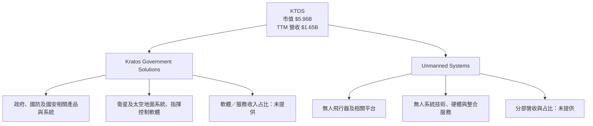
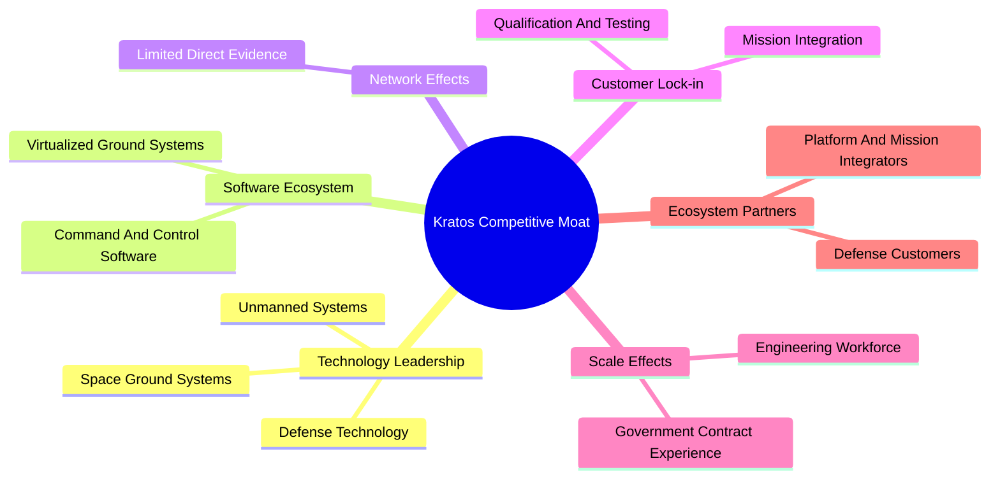
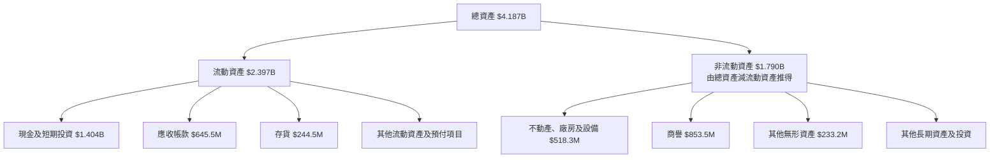
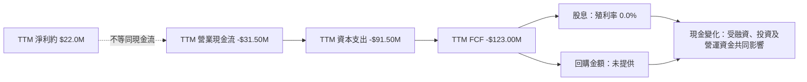
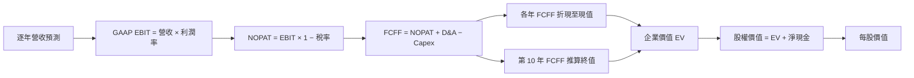
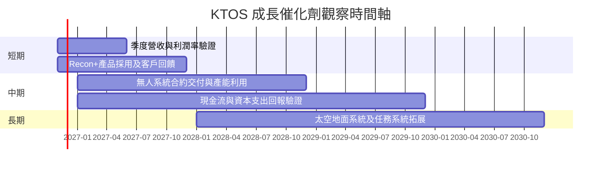
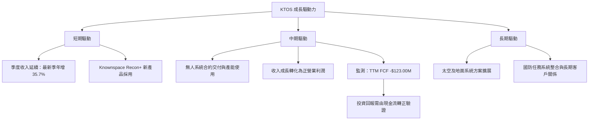
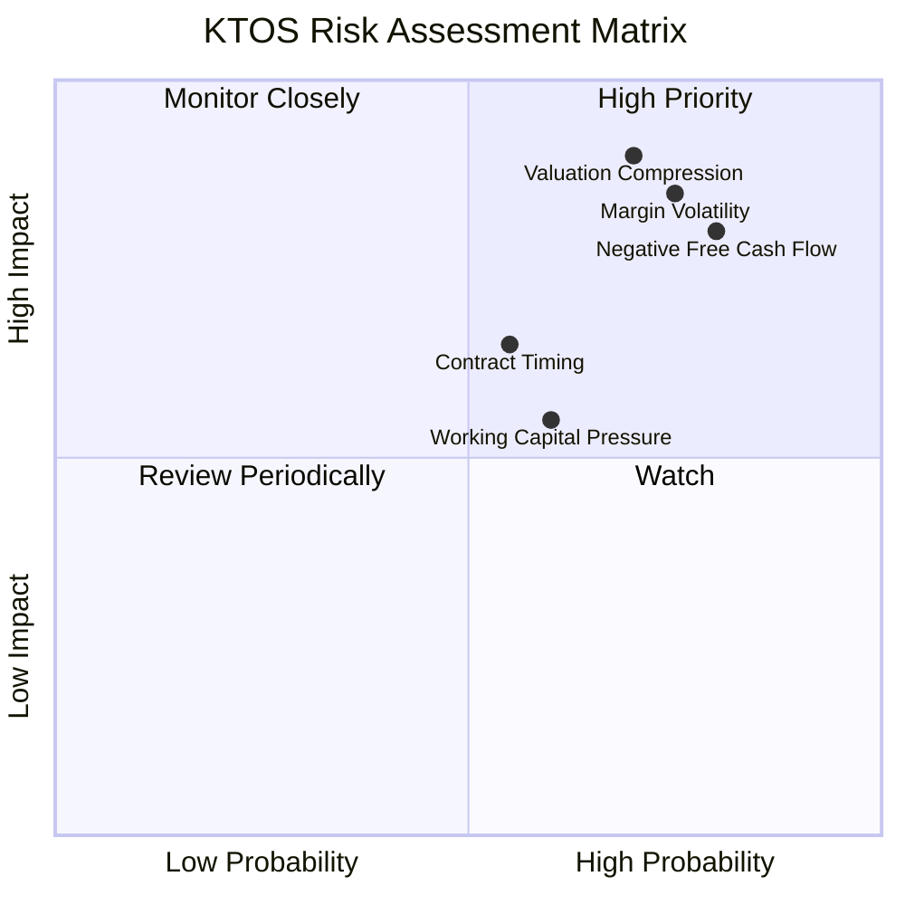
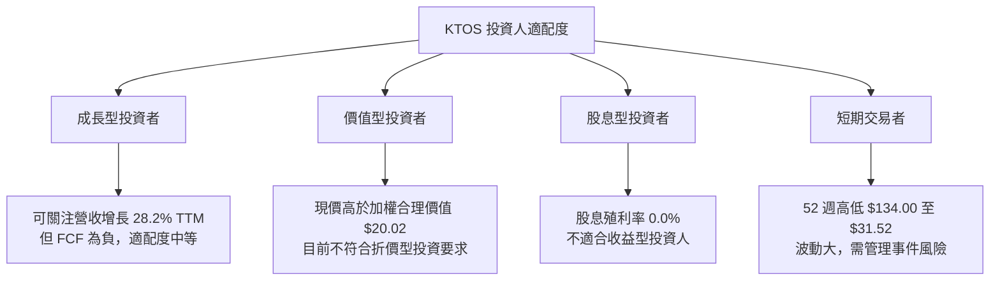

# KTOS 基本面深度分析報告
> **報告日期**：2026-11-17 ｜ **語言**：繁體中文 ｜ **數據來源**：SEC 申報資料 (XBRL)、Yahoo Finance、Finviz、StockAnalysis、Roic.ai ｜ **分析師**：CFA 級機構研究

> **數據口徑說明**：本報告涉及估值、ROIC、FCF、WACC、Piotroski F-Score、杜邦分析與 DCF 的核心數值，優先引用 SEC 申報資料及程式計算的標準化數據。市場資料彙整區存在若干口徑衝突，例如營業利益率、總債務與淨現金；下文會標明差異，不將不同口徑混為一談。DCF 的逐年數值依程式模型原值呈現；因表格只顯示有限小數位，顯示值之間可能有四捨五入差異，不以展示數字反推、改寫模型值。

## 目錄

| # | 章節 | 核心結論 |
|---|------|----------|
| 1 | 執行摘要 | 評級為賣出；加權合理價值 $20.02，MOS -58.1% |
| 2 | 公司概覽與商業模式 | 國防科技與無人系統供應商；市場份額及分部收入比例未提供 |
| 3 | 損益表深度分析 | TTM 營收 $1.65B、年增 28.2%；獲利率低且最新季營業虧損 |
| 4 | 資產負債表分析 | 現金與短期投資 $1.40B；流動性高，但債務口徑有衝突 |
| 5 | 現金流量深度分析 | TTM FCF -$123.00M，FCF Yield -2.06% |
| 6 | 獲利能力與資本效率 | ROIC 0.2% 對 WACC 10.37%，目前未創造足夠資本報酬 |
| 7 | 相對估值分析 | 估值高於多數同業倍數；自有歷史 P/S 亦在中位數以上 |
| 8 | DCF 內在價值評估 | DCF 基準每股 $9.79；估值高度依賴終值，基準假設仍有脆弱性 |
| 9 | 成長催化劑 | 無人系統、國防科技及太空領域具質化催化劑；TAM 數字未提供 |
| 10 | 風險矩陣 | 高估值、負 FCF、利潤率波動為主要風險 |
| 11 | 投資建議 | 依 MOS 評級賣出；以盈利與現金流改善作為重新評估條件 |

## 1. 執行摘要

KTOS 的營收成長已具規模：TTM 營收 $1.65B、TTM 年增 28.2%，最新一季年增 35.7%；但相同期間的獲利與現金流尚未轉化為足夠股東回報，ROIC 僅 0.2%，低於 10.37% 的 WACC，TTM FCF 為 -$123.00M、FCF Yield 為 -2.06%。以 DCF 基準價 $9.79、同業相對估值及分析師共識加權後，合理價值為 $20.02，對照 2026-11-16 收盤價 $31.66，MOS 為 -58.1%。因此，依 MOS 規則 20 評級為 **🔴賣出**；評級未作質化調整。高營收成長支持公司長期投資論點，但現價已高於加權合理價值，且現金流與資本報酬率尚未證明估值所需的獲利轉化能力。

### 1.0 一頁式投資儀表板（Portfolio Manager 30 秒速讀）

| 項目 | 內容 |
|------|------|
| **投資論點（3 句）** | ① TTM 營收 $1.65B、年增 28.2%，且最新一季年增 35.7%，反映需求與交付動能仍在。② TTM 營業利益率僅 0.4%、ROIC 0.2%，對照 WACC 10.37%，成長尚未形成相應資本回報。③ TTM FCF -$123.00M、FCF Yield -2.06%，而加權合理價值 $20.02 低於現價 $31.66。 |
| **綜合評分** | **5.3/10**（引用 1.1 評分卡） |
| **財務健康** | 🟡 現金與短期投資 $1.40B、流動比率 5.418；但 TTM FCF -$123.00M，且總債務資料口徑不一致。 |
| **ROIC vs WACC** | **0.2% vs 10.37%**；目前資本回報低於資本成本，未創造足夠經濟價值。 |
| **FCF 趨勢** | TTM FCF 為負；FCF Yield **-2.06%**。 |
| **估值** | Forward P/E（市場資料）28.3x ｜ EV/EBITDA（TTM）53.42x ｜ FCF Yield（TTM）-2.06%。 |
| **DCF 內在價值（基準）** | **$9.79** ｜ 現價相對 DCF 溢價 **+223.4%**（第 8.5 節）。 |
| **安全邊際（MOS）** | **-58.1%**＝($20.02 − $31.66) ÷ $20.02；以第 8.8 節加權合理價值為基準。🔴 <10% 無安全邊際。 |
| **預期報酬（基準情境 12M）** | DCF 基準情境相對現價 **-69.1%**；這是情境估值差，不是價格保證。 |
| **關鍵風險（前二）** | 營業利潤率不穩、TTM FCF 持續為負；估值倍數對成長與利潤率預期敏感。 |
| **評級 + 信心度** | 🔴 **賣出** ｜ 信心：中（公司成長證據明確，但會計口徑衝突與 DCF 終值依賴限制估值確信度）。 |

### 1.1 綜合評分卡（全報告唯一）

| 維度 | 評分（1–10） | 主要依據（引用數字與其來源章節） |
|------|--------------|----------------------------------|
| 成長性 | 8.0 | TTM 營收年增 28.2%、最新一季年增 35.7%（第 3 章）；成長分數高，但不能替代現金流轉化。 |
| 獲利能力 | 3.0 | TTM 營業利益率 0.4%、ROIC 0.2% 對 WACC 10.37%，Piotroski F-Score 3/8（第 3、6 章）。 |
| 財務健康 | 8.0 | 現金與短期投資 $1.40B、流動比率 5.418；CCC 80 天，總債務資料有口徑衝突（第 4 章）。 |
| 估值 | 2.0 | 加權合理價值 $20.02、MOS -58.1%；Forward P/E 28.3x，EV/EBITDA（市場資料）53.42x（第 7、8 章）。 |
| 護城河 | 6.0 | 國防系統與無人平台業務具技術、任務整合與客戶認證特性，但缺少分部、續約及市場份額數據（第 2 章）。 |
| 管理層與資本配置 | 5.0 | 2025 年 SBC $35.5M；FY2025 FCF -$137.4M，且稀釋股數測試未通過（第 3、5 章）。 |
| **綜合評分** | **5.3** | 六項算術平均：(8.0 + 3.0 + 8.0 + 2.0 + 6.0 + 5.0) ÷ 6 = **5.3**。 |

### 1.2 五大投資論點 + 三大核心風險

| 類型 | 項目 | 具體依據 | 信心度 |
|------|------|----------|--------|
| 🟢 **投資論點①** | 營收增長加速 | TTM 營收年增 28.2%；最新一季收入 $471.8M、年增 35.7%，高於前三季公布的年增率。若非一次性交付，可能支持規模擴張。 | 🟢 高 |
| 🟢 **投資論點②** | 無人系統與國防科技需求受長期任務需求支持 | 公司業務涵蓋政府解決方案及無人系統；新品消息包括 Knownspace Recon+ 便攜式太空態勢感知終端。具質化催化劑，但缺少訂單與營收拆分。 | 🟡 中 |
| 🟢 **投資論點③** | 現金緩衝充足 | 現金及短期投資 $1.40B，流動比率 5.418；可支應投入與短期營運需求，但需追蹤現金消耗。 | 🟢 高 |
| 🟢 **投資論點④** | 毛利率改善 | TTM 毛利率 23.0%；Piotroski 毛利率較一年前提高。若組合向較高毛利產品移動，有望改善營業槓桿。 | 🟡 中 |
| 🟢 **投資論點⑤** | 國防客戶認證及系統整合形成進入障礙 | 國防專案需符合任務、可靠度及採購要求，既有供應商可能受益於認證與整合成本；但財務數據未量化轉換成本。 | 🟡 中 |
| 🟡 **風險①** | 成長未轉為現金流 | TTM 營業現金流 -$31.50M、資本支出 $91.50M、FCF -$123.00M；若延續，將削弱自我融資能力。 | 🔴 高衝擊 |
| 🔴 **風險②** | 獲利率低且季度波動 | TTM 營業利益率 0.4%，最新季度 -1.0%；季度營業利益由 FY2026 Q1 $6.6M 轉為 Q3 -$4.0M。 | 🔴 高衝擊 |
| 🔴 **風險③** | 估值需高成長預期支撐 | 加權合理價值 $20.02 低於現價 $31.66；反推 DCF 顯示現價要求第一年營收成長 93.4%，高於基準 28.2%。 | 🔴 高衝擊 |

### 1.3 快速統計卡片

| 指標 | 公司實際值（期間） | 同業中位數 | 狀態 |
|------|--------------------|------------|------|
| 營收成長（TTM） | **28.2%** | — | 🟢 |
| 營收成長（最新一季年增） | **35.7%** | 6.7%（AVAV、LMT、NOC 中位數） | 🟢 |
| 毛利率（TTM） | **23.0%** | 20.0% | 🟢 |
| 營業利益率（TTM） | **0.4%** | — | 🔴 |
| ROIC（TTM） | **0.2%** | — | 🔴 |
| Forward P/E | **28.3x**（市場資料） | 18.2x（同業中位數） | 🔴 |
| FCF Yield（TTM） | **-2.06%** | — | 🔴 |
| Piotroski F-Score | **3 / 8** | — | 🔴 |

### 1.4 投資結論

```
╔══════════════════════════════════════════════════════════════════╗
║                    📊 投資結論摘要                               ║
╠══════════════════════════════════════════════════════════════════╣
║  評級：🔴 賣出（依 MOS 門檻；未作質化調整）                     ║
║  價格（2026-11-16 收盤）：$31.66                                ║
║  DCF 內在價值（基準）：$9.79（現價溢價 +223.4%）                ║
║  安全邊際 MOS：-58.1%（＝(加權合理價值−現價)÷加權合理價值）    ║
║  加權合理價值（8.8）：$20.02                                    ║
║  DCF 情境價值：                                                   ║
║    悲觀情境：$8.17（-74.2%）                                     ║
║    基準情境：$9.79（-69.1%）                                     ║
║    樂觀情境：$13.45（-57.5%）                                    ║
║  綜合評分：5.3/10（引用 1.1）                                    ║
║  適合投資人：能承受高波動、願意追蹤營運里程碑的成長型投資人；  ║
║              不適合以折價或穩定股息為主的投資人。               ║
╚══════════════════════════════════════════════════════════════════╝
```

## 2. 公司概覽與商業模式

### 2.1 業務結構與收入來源

Kratos Defense & Security Solutions（KTOS）是美國國防與安全科技公司，員工約 4,300 人，經營 Kratos Government Solutions 與 Unmanned Systems 兩個主要部門。公司 TTM 營收為 $1.65B，市值約 $5.96B。各部門營收、部門利潤及軟體／服務收入比例未提供，因此不以推估比例繪製收入占比圖。



商業模式以國防機關及相關機構的產品、系統與服務合約為核心。若合約交付放量，營收可能快速增長；但專案時程、驗收與政府採購周期也可能使季度收入及利潤率波動。

### 2.2 市場份額

市場份額數據未提供，財務數據與新聞摘要中亦沒有可引用的市占率及年份。就可比較數字而言，KTOS 最新一季年增 35.7%，高於 AVAV 的 5.7%、LMT 的 11.3% 與 NOC 的 6.7%；但公司與同業的產品組合及專案周期不同，不能據此推論市場份額。

### 2.3 競爭護城河分析



### 2.4 護城河強度

| 護城河項目 | 強度（強／中／弱） | 證據（引用數字或事實） | 會削弱它的情況 |
|------------|--------------------|------------------------|----------------|
| 技術與產品 | 中 | 公司提供無人系統、國防科技及太空地面系統；員工約 4,300 人。研發支出 FY2025 為 $40.0M。 | 技術迭代落後、平台可靠性不足，或競品取得更佳任務性能。 |
| 軟體生態系統 | 中 | 虛擬化衛星地面系統及指揮軟體可提高系統整合價值；訂閱與續約數據未提供。 | 軟體難以形成持續性收入，或客戶採購傾向內製／更換供應商。 |
| 網路效應 | 弱 | 未提供使用者數、資料網路或平台參與者規模，無法證實直接網路效應。 | 系統間缺乏互通性或客戶可低成本切換。 |
| 客戶鎖定 | 中 | 國防任務整合、認證與驗收可能增加切換成本；合約續約率未提供。 | 合約到期後競標失利、成本超支或驗收延期。 |
| 規模效應 | 中 | 4,300 名員工及跨國業務顯示具一定交付規模；與大型主承包商相比的成本優勢未提供。 | 產能擴張先於訂單，或規模增加但營業利潤率持續低於 1%。 |
| 生態夥伴 | 中 | 國防及太空系統多需與平台、感測器與任務系統整合；具體夥伴收入占比未提供。 | 夥伴自建替代產品或整合主導權轉向大型承包商。 |

**1.1 護城河評分 6.0/10 的理由**：KTOS 的任務整合、國防認證與技術產品提供一定進入障礙，但目前缺少續約率、分部毛利、訂單轉換與市占數據，故不能將質化壁壘等同已證實的定價權或穩定超額報酬。

## 3. 損益表深度分析

### 3.1 年度收入成長趨勢（近4年）

FY2022 至 FY2025 營收由 $898.3M 增至 $1.347B，三年 CAGR 約 14.4%（計算：($1.347B ÷ $0.8983B)^(1/3) − 1）。年度收入及增長率如下：

```
╔══════════════════════════════════════════════════════════════════╗
║         Kratos 年度收入趨勢（FY2022–FY2025）                    ║
╠══════════════════════════════════════════════════════════════════╣
║  FY2022  $0.898B  █████████████████░░░░░░░░░░░  基期            ║
║  FY2023  $1.037B  ████████████████████░░░░░░░░  YoY: +15.5% 🟢 ║
║  FY2024  $1.136B  ██████████████████████░░░░░░  YoY: +9.6%  🟢 ║
║  FY2025  $1.347B  ██████████████████████████░░  YoY: +18.5% 🟢 ║
╠══════════════════════════════════════════════════════════════════╣
║  FY2022–FY2025 累計 CAGR：約 +14.4%                              ║
╚══════════════════════════════════════════════════════════════════╝
```

FY2025 增長加速至 18.5%，TTM 年增再升至 28.2%；若後續增長能由可持續合約交付支撐，可擴大固定成本吸收。但歷史營業利益率仍低，顯示收入增長尚未穩定轉化為營業槓桿。

### 3.2 季度收入趨勢分析

QoQ 依相鄰季度收入計算；YoY 使用季報數據。最新一季收入的 VERIFIED YoY 為 35.7%，與 StockAnalysis 顯示 35.73%一致。

| 季度 | 營收 | QoQ 成長 | YoY 成長 | 備註 |
|------|------:|---------:|---------:|------|
| 2025 Q4 | $345.1M | +14.1%（對 2025 Q3） | +21.9% | QoQ 使用 2025 Q3 $302.6M。 |
| 2026 Q1 | $371.0M | +7.5% | +22.6% | 年增率以 2025 Q1 $302.6M 為比較基期。 |
| 2026 Q2 | $458.8M | +23.7% | +30.5% | 收入增速擴大，須搭配成本及營運資金觀察。 |
| 2026 Q3 | $471.8M | +2.8% | **+35.7%** | QoQ 增速放慢，但年增仍高；季度營業利益 -$4.0M。 |

季度營收連續增長，但最新 Q3 的 QoQ 增幅回落至 2.8%，而營業利益轉負。這意味著需求增長本身不足以確認獲利改善，需進一步拆解產品組合、合約交付節奏與成本。

### 3.3 利潤率演變分析

以下年度利潤率以所列年度收入、毛利及營業利益計算；TTM 標準化營業利益率採用 VERIFIED 數值 0.4%。市場彙整欄位另列 TTM 營業利益率 0.7%，且季度欄位與 SEC 標準化數據有差異，故不混用。

| 利潤率指標 | FY2022 | FY2023 | FY2024 | FY2025 | 趨勢 | 評估 |
|------------|-------:|-------:|-------:|-------:|------|------|
| **毛利率** | 25.2% | 25.9% | 25.3% | 22.9% | FY2025 回落 | 🟡 |
| **營業利益率** | 0.5% | 3.0% | 2.6% | 2.1% | FY2023 高點後下降 | 🔴 |
| **淨利率** | -4.1% | -0.9% | 1.4% | 1.6% | 從虧損轉正 | 🟡 |
| **TTM 營業利益率** | — | — | — | **0.4%** | 低於 FY2025 年度水準 | 🔴 |
| **最新一季營業利益率** | — | — | — | **-1.0%** | 由 TTM 正值轉為單季負值 | 🔴 |

年度營業利益由 FY2023 $31.5M 降至 FY2025 $27.7M，雖然收入同期成長，但營業利益率下降，顯示費用或產品組合對增量營收的吸收尚未改善。FY2025 毛利率亦低於 FY2024，可能與專案組合、交付成本及製造擴張有關；現有資料不足以將變化精確歸因於某一因素。最新季度營業損失 $4.0M 對應收入 $471.8M，進一步凸顯季度利潤率不穩。

### 3.4 費用結構分析

收入、毛利及研發支出有披露，但完整營業費用拆分（例如銷售管理費、研發與其他費用的 TTM 明細）未提供，無法可靠製作費用結構圓餅圖。已知 FY2025 研發支出為 $40.0M，約占當年營收 $1.347B 的 3.0%；此為研發比率，不能代表完整費用結構。

### 3.5 季度 EPS 趨勢與盈餘品質（Quality of Earnings）

過去四季 EPS 實際值約為 2025 Q4 $0.03、2026 Q1 $0.07、Q2 $0.02、Q3 約 $0.00（StockAnalysis 顯示 -$0.00）。四季 EPS 預估值均為缺失，無法判定各季是否超預期或不及預期；不能以空白預估值推定 beat/miss。季度淨利則由 Q1 $11.9M、Q2 $4.4M 降至 Q3 -$0.2M，獲利走弱與 Q3 營業虧損一致。

| 盈餘品質項目 | 數值／佔比 | 評估 |
|--------------|-----------|------|
| 股權薪酬 SBC / 營收 | 近四季 SBC 合計 $58.5M ÷ TTM 營收 $1.647B = **3.6%** | 🟡 SBC 不是極小項目；股數未增加測試未通過，代表股東仍需關注稀釋。 |
| SBC / 營業現金流 | $58.5M ÷ -$31.50M = **-185.7%** | 🔴 分母為負，比例不宜解讀為一般覆蓋率；SBC 大於營業現金流絕對值，現金轉換品質弱。 |
| FCF / 淨利（現金轉換率） | -$123.00M ÷ TTM 淨利約 $22.0M = **-559.1%** | 🔴 會計淨利未轉化為自由現金流；資本支出及營運資金消耗使現金盈餘偏弱。 |
| 一次性／非經常性損益 | 未提供可量化拆分 | 🟡 無法判斷是否有一次性項目美化或壓低盈餘。 |
| 有效稅率異常 | N/A（未提供可比的 TTM 有效稅率） | 🟡 不對稅務利益作推論。 |
| 資本化支出 vs 費用化 | TTM 資本支出 $91.50M；資本化科目明細未提供 | 🟡 資本支出已反映於 FCF 計算，但無法判斷資本化政策是否改變。 |

**盈餘品質結論**：KTOS 的 GAAP 淨利為正，但 TTM FCF 為負且 FCF／淨利為 -559.1%，因此單看 EPS 會高估目前現金獲利的穩定程度。SBC 佔 TTM 營收 3.6%，亦會透過股數變化稀釋每股經濟利益。估值應以營業利潤率及現金流轉正作為核心驗證，而非只依營收增長或 EPS 成長敘事。

## 4. 資產負債表分析

### 4.1 資產結構分解

StockAnalysis 的 TTM 資產負債表顯示總資產 $4.187B、流動資產 $2.397B；非流動資產為兩者差額 $1.790B。個別資產項目與總額可能因資料來源及分類方式存在差異，以下列出已披露項目，不把未列項目反推為精確構成。



### 4.2 流動性與營運資金分析

| 指標 | 最新 TTM | 一年前 TTM | 變化 | 解讀 |
|------|----------|------------|------|------|
| DSO 應收帳款天數 | 42 天 | 39 天 | +3 天 | 收款周期略延長；可能反映合約結算節奏或收入組合變化，應收帳款餘額亦由 FY2025 $457.4M 升至 TTM $645.5M。 |
| DIO 存貨天數 | 70 天 | 66 天 | +4 天 | 存貨周轉稍慢；可能是交付備貨，也可能是需求與交付時點錯配，需追蹤存貨是否快於收入增長。 |
| DPO 應付帳款天數 | 32 天 | 24 天 | +8 天 | 付款天數增加，短期支撐營運資金；但不能單憑此判定議價能力提升。 |
| CCC 現金轉換週期 | 80 天 | 81 天 | -1 天 | 現金轉換周期略改善，主要由 DPO 增加抵銷 DSO、DIO 上升。 |

| 流動性指標 | 數值 | 評估 |
|------------|------|------|
| 流動比率 | 5.418 | 🟢 短期償付緩衝充足。 |
| 速動比率 | 4.632 | 🟢 排除存貨後仍有較高流動性。 |
| 現金與短期投資 | $1.40B | 🟢 提供投資與營運緩衝，但應與 FCF 消耗速度合併觀察。 |

### 4.3 債務結構分析

核心計算資料將總債務列為 N/A、淨現金列為 $1.40B；市場彙整資料另列總債務 $246.0M、現金 $1.40B、淨現金 $1.16B。因債務口徑不一致，採用核心標準化數據時不另行反推債務或債務覆蓋倍數。

```
╔══════════════════════════════════════════════════════════════════╗
║                  KTOS 債務健康診斷                               ║
╠══════════════════════════════════════════════════════════════════╣
║  總債務：        N/A（核心標準化數據未提供）                     ║
║  其他市場口徑：  $246.0M（市場資料，與核心口徑不同）             ║
║  現金+短期投資： $1.40B  ████████████████████  🟢               ║
║  淨現金：        $1.40B（核心標準化數據）         🟢             ║
║                                                                  ║
║  Debt/EBITDA：   N/A（核心總債務缺失，且 EBITDA 口徑未統一）    ║
║  Interest Coverage：N/A（利息費用明細未提供）                    ║
║  流動比率：      5.418  🟢                                       ║
╠══════════════════════════════════════════════════════════════════╣
║  結論：流動性緩衝充足；槓桿分析受總債務口徑差異限制。           ║
╚══════════════════════════════════════════════════════════════════╝
```

### 4.4 股東權益趨勢

歷年股東權益由 FY2022 $936.3M 增至 FY2025 $2.00B。成長部分與股權融資及資產負債表擴張一致，但最新季度股東權益未提供；不能將資產增加直接等同每股股東價值提升。

```
╔══════════════════════════════════════════════════════════════════╗
║                  KTOS 股東權益趨勢                               ║
╠══════════════════════════════════════════════════════════════════╣
║  FY2022  $0.936B  █████████░░░░░░░░░░░░░░░░░░░                 ║
║  FY2023  $0.976B  ██████████░░░░░░░░░░░░░░░░░░                 ║
║  FY2024  $1.350B  ██████████████░░░░░░░░░░░░                   ║
║  FY2025  $2.000B  ████████████████████                         ║
╚══════════════════════════════════════════════════════════════════╝
```

## 5. 現金流量深度分析

### 5.1 現金流量瀑布圖

TMM 淨利與營運現金流及資本支出屬不同現金流量表層級，不能把淨利視為現金流量瀑布中的直接加項；下圖列出數值與關係，並以標準 FCF 定義呈現。



### 5.2 FCF 轉換率趨勢

| 期間 | FCF | 淨利 | FCF / 淨利 | 解讀 |
|------|----:|----:|-----------:|------|
| FY2022 | -$71.1M | -$36.9M | 192.7%（兩者皆負，比例方向易誤讀） | FCF 虧損，不能視為正向現金轉換。 |
| FY2023 | $12.8M | -$8.9M | -143.8% | 淨利為負、FCF 為正，比例不具一般獲利轉換率含義。 |
| FY2024 | -$8.5M | $16.3M | -52.1% | 正淨利未完全轉為 FCF。 |
| FY2025 | -$137.4M | $22.0M | -624.5% | FCF 明顯惡化；資本支出增至 $95.3M。 |
| TTM | -$123.0M | 約 $22.0M | -559.1% | 現金轉換率偏弱，投資者應優先檢視現金流改善。 |

### 5.3 自由現金流趨勢

FY2025 FCF 惡化至 -$137.4M，TTM 為 -$123.00M。FY2025 資本支出 $95.3M，較 FY2024 的 $58.2M 增加，擴張投資提高了當期現金消耗；但若投資未帶來後續毛利與現金流，負 FCF 將對估值形成壓力。

```
╔══════════════════════════════════════════════════════════════════╗
║                 自由現金流趨勢（USD）                            ║
╠══════════════════════════════════════════════════════════════════╣
║  FY2022  -$71.1M  ◀██████████░░░░░░░░░░░░░░░░                    ║
║  FY2023  +$12.8M              ████▶                              ║
║  FY2024   -$8.5M  ◀██░░░░░░░░░░░░░░░░░░░░░                      ║
║  FY2025 -$137.4M  ◀██████████████████████████                    ║
║  TTM    -$123.0M  ◀███████████████████████                       ║
╠══════════════════════════════════════════════════════════════════╣
║  TTM FCF Yield：-2.06%                                           ║
╚══════════════════════════════════════════════════════════════════╝
```

### 5.4 資本配置評估

資本配置比例（投資、回購、股息及現金留存）未提供足夠可比數據，故不繪製比例圓餅圖。已知公司股息殖利率 0.0%、派息率 0.0%；FY2025 資本支出 $95.3M，並支付 SBC $35.5M。股東回報目前主要依賴未來每股盈餘與現金流增長，而非股息。

| 配置項目 | 可得數據 | 評估 |
|----------|----------|------|
| 資本支出 | FY2025 $95.3M；TTM $91.50M | 🟡 投資可能支持產能與產品發展，但 FCF 仍為負。 |
| 股息 | 殖利率 0.0% | 🟡 無現金股息回報。 |
| 股份回購 | 金額未提供 | N/A，不能推定有回購。 |
| SBC | FY2025 $35.5M；近四季約 $58.5M | 🟡 應持續監測稀釋與員工薪酬效率。 |
| 現金留存 | 現金及短期投資 $1.40B | 🟢 提供財務彈性，但需檢視投資回報。 |

## 6. 獲利能力與資本效率

### 6.1 ROE / ROA / ROIC 趨勢

可直接對照的 ROE、ROA、ROIC 歷史序列未完整提供；下表列出最新標準化數值及年度可得資訊，不將不同來源口徑拼成趨勢序列。

| 指標 | 最新值 | 歷史可得數據 | 評估 |
|------|-------:|----------------|------|
| ROE（TTM） | 0.6%（品質數據）；市場彙整另列 0.8% | DuPont TTM ROE 為 0.6% | 🔴 股東權益回報低。 |
| ROA（TTM） | 0.2% | F-Score 指示 ROA 為正，但低於一年前 | 🔴 資產獲利能力有限。 |
| ROIC（TTM） | 0.2% | 可比歷史序列 N/A | 🔴 明顯低於 10.37% WACC。 |

未提供可核實的行業平均 ROIC／ROE，故不列行業均值比較。

### 6.2 ROIC vs WACC 分析（核心價值創造判斷）

核心標準化 ROIC 為 0.2%，WACC 為 10.37%，差距為 -10.17 個百分點。這表示依現有獲利水平，公司尚未取得足以補償資本成本的回報。WACC 依資本成本數據引用；不得從有衝突的債務數字重新推算。

```
╔══════════════════════════════════════════════════════════════════╗
║                ROIC vs WACC 深度分析                            ║
╠══════════════════════════════════════════════════════════════════╣
║  WACC（程式計算資本成本）：                                     ║
║  ├── 無風險利率（10Y 美債）：       5.12%                       ║
║  ├── 市場風險溢酬 ERP：              5.00%                       ║
║  ├── 原始 Beta：                     1.17                        ║
║  ├── 調整後 Beta：                   1.11                        ║
║  ├── 股權成本 Ke：                   10.67%                      ║
║  ├── 稅前債務成本：                   3.90%                      ║
║  ├── 稅率：                           21.0%                      ║
║  ├── 股權／債務權重：                 96.0% / 4.0%               ║
║  └── ✅ WACC：                       10.37%                      ║
║                                                                  ║
║  ROIC（TTM）：                         0.20%                      ║
║  ROIC − WACC：                        -10.17 個百分點            ║
║                                                                  ║
║  ROIC  0.20%  ▓░░░░░░░░░░░░░░░░░░░░░░░░░░░░░░  🔴              ║
║  WACC 10.37%  ▓▓▓▓▓▓▓▓▓▓▓▓▓▓▓▓▓▓▓▓▓▓▓▓▓▓▓▓▓▓  ──              ║
╠══════════════════════════════════════════════════════════════════╣
║  結論：以 TTM ROIC 衡量，KTOS 尚未覆蓋資本成本；若此狀況持續， ║
║        成長本身未必能增加股東經濟價值。                         ║
╚══════════════════════════════════════════════════════════════════╝
```

依資本成本資料，股權成本計算為 `5.12% + 1.11 × 5.00% = 10.67%`；WACC 為 `96.0% × 10.67% + 4.0% × 3.90% × (1 − 21.0%) = 10.37%`。原始 Beta 1.17 按提供的調整方式調整為 1.11。利息費用、平均計息負債及完整資本結構金額未提供一致可核實數據，因此不另做帳面值推算。此處與第 8.2 節採用相同 WACC。

### 6.3 杜邦三因素分解

| 因素 | 數值（TTM） | 解讀 |
|------|-------------|------|
| 淨利率 | 1.3% | 利潤率是 ROE 的主要限制因素。 |
| 資產週轉率 | 0.39 | 每單位資產所產生的收入有限；資產與營收擴張需同步。 |
| 權益乘數 | 1.21 | 財務槓桿不高，不是 ROE 的主要來源。 |
| **ROE** | **0.6%** | 1.3% × 0.39 × 1.21 = 約 0.6%（以原始精度計算後四捨五入）。 |

### 6.4 財務體質：Piotroski F-Score

Piotroski F-Score 為 **3 / 8**；一項因缺少輸入而無法判定，因此評分分母低於標準九項。

| 測試 | 結果 | 解讀 |
|------|------|------|
| ROA > 0 | ✅ 通過 | TTM 資產報酬為正，但僅 0.2%。 |
| 營業現金流 > 0 | ❌ 未通過 | TTM 營業現金流 -$31.50M。 |
| ROA 高於一年前 | ❌ 未通過 | 資產獲利能力較去年同期下降。 |
| 營業現金流 > 淨利（應計品質） | ❌ 未通過 | 現金流低於淨利，盈餘的現金支持不足。 |
| 長期負債 ÷ 總資產低於一年前 | — 無法判定 | 長期負債輸入缺失。 |
| 流動比率高於一年前 | ✅ 通過 | 流動比率改善。 |
| 稀釋股數未增加 | ❌ 未通過 | 股數稀釋測試未通過，需監測 SBC 及股數變化。 |
| 毛利率高於一年前 | ✅ 通過 | 毛利率同比改善。 |
| 資產週轉率高於一年前 | ❌ 未通過 | 資產使用效率同比下降。 |

F-Score 3/8 反映流動性與毛利率改善，但現金流、資產效率及股數變化仍是弱項。對投資者而言，應把現金流轉正和稀釋控制視為成長品質的必要驗證。

## 7. 相對估值分析

### 7.1 同業估值比較表格

同業數據採 Yahoo Finance Peer multiples；KTOS 市場估值來自市場資料欄位。因不同數據供應商的 EV/EBITDA 數值有差異，表格中 KTOS 取提供的市場估值 53.42x，而自有歷史區間分析使用估值歷史資料的 54.9x。

| 估值指標 | **KTOS** | **AVAV** | **LMT** | **NOC** | KTOS 評估 |
|----------|---------:|---------:|---------:|---------:|-----------|
| **Trailing P/E** | 263.8x | N/A | 20.8x | 17.2x | 🔴 KTOS 盈利基數低，倍數不宜孤立比較。 |
| **Forward P/E** | 28.3x | 24.8x | 17.6x | 18.2x | 🔴 高於同業中位數 18.2x，市場預期需靠盈利增長消化。 |
| **P/S Ratio（TTM）** | 3.6x | 2.8x | 1.7x | 1.8x | 🔴 高於同業；需以較高成長或利潤率證明溢價。 |
| **EV/EBITDA（TTM）** | 53.42x | 26.6x | 15.2x | 12.5x | 🔴 明顯高於三家同業；低 EBITDA 基數放大倍數。 |
| **最新一季營收年增** | 35.7% | 5.7% | 11.3% | 6.7% | 🟢 成長較快，但盈利與 FCF 尚未跟上。 |
| **毛利率（TTM）** | 23.0% | 26.5% | 11.7% | 20.0% | 🟡 高於 LMT、NOC，低於 AVAV。 |

同業中位數：Forward P/E 18.2x、P/S 1.8x、EV/EBITDA 15.2x；各自採同業數據中位數。KTOS 的增速較高，但其估值溢價並未被現有營業利潤率與 FCF 支持。

### 7.2 歷史估值區間分析

```
╔══════════════════════════════════════════════════════════════════╗
║              KTOS 自身歷史估值區間（TTM）                        ║
╠══════════════════════════════════════════════════════════════════╣
║  P/E：     歷史區間 232.9x – 10,595,348,627,336,923,136.0x       ║
║            中位數 380.2x ｜ 當前 263.8x ｜ 百分位 27%            ║
║                                                                  ║
║  P/S：     歷史區間 1.3x – 11.6x                                 ║
║            中位數 3.2x ｜ 當前 3.6x ｜ 百分位 65%                ║
║                                                                  ║
║  EV/EBITDA：歷史區間 33.8x – 221.5x                              ║
║            中位數 55.5x ｜ 當前 54.9x ｜ 百分位 50%              ║
╚══════════════════════════════════════════════════════════════════╝
```

P/E 歷史最大值極端，顯示在極低或異常盈利時該指標容易失真；雖然目前 P/E 位於歷史第 27 百分位，但仍高達 263.8x。P/S 3.6x 高於五年中位數 3.2x，顯示營收估值處於偏高位置；EV/EBITDA 54.9x 接近歷史中位數 55.5x，但同業倍數顯著較低。

### 7.3 情境價值（Bear / Base / Bull）

| 情境 | 第 1 年營收成長 | 期末營業利潤率 | WACC | 每股價值 | 相對現價 | 機率 | 會發生的條件 |
|------|----------------:|---------------:|-----:|---------:|---------:|-----:|--------------|
| 🔴 悲觀 | 14.1% | 1.6% | 11.37% | **$8.17** | **-74.2%** | 25% | 營收成長回落至基準約一半，擴產／研發支出延續，且資本成本上升。 |
| 🟡 基準 | 28.2% | 1.9% | 10.37% | **$9.79** | **-69.1%** | 50% | TTM 增速延續後逐步放緩，利潤率漸進改善至模型期末假設。 |
| 🟢 樂觀 | 42.3% | 2.1% | 9.37% | **$13.45** | **-57.5%** | 25% | 新合約與無人系統交付顯著加速，利潤率提高且資本成本下行。 |

即使樂觀情境的每股價值仍低於現價，反映當前價格對長期成長與終值要求較高。機率加權 DCF 為 $10.30（-67.5%），但第 8.8 節按規定採用基準 DCF 作為估值方法輸入，而非機率加權值。

### 7.4 相對估值隱含價格區間

```
╔══════════════════════════════════════════════════════════════════╗
║          同業相對估值每股價值與現價位置（美元）                  ║
╠══════════════════════════════════════════════════════════════════╣
║  $14.18 ────── $20.38 ─────────────── $31.66 ───────── $74.68   ║
║  EV/EBITDA     Forward P/E             現價             分析師共識 ║
╚══════════════════════════════════════════════════════════════════╝
```

| 方法 | 每股價值 | 依據 |
|------|---------:|------|
| 同業 Forward P/E | $20.38 | AVAV、LMT、NOC 同業中位數 18.2x × KTOS Forward EPS $1.12。 |
| 同業 EV/EBITDA | $14.18 | 同業 EV/EBITDA 中位數 15.2x × KTOS TTM EBITDA，再加核心淨現金口徑。 |
| 分析師共識目標價 | $74.68 | 25 位分析師平均目標價；不代表獨立估值，也不應取代現金流驗證。 |

同業 EV/EBITDA 隱含價值受 EBITDA 基數與淨現金口徑影響；分析師共識與其他估值方法差距較大，因此在三角驗證中依固定權重僅占 10%。

## 8. DCF 內在價值評估（Discounted Cash Flow）

### 8.0 估值推理鏈（Thinking Logic）

**Step 1 — 價值來源與主導變數**

KTOS 的價值主要由政府解決方案與無人系統兩個業務板塊的收入增長及其後續營業利潤率決定；兩個分部營收占比未提供，不能量化各自權重。模型顯示即使營收增長，資本支出率及低營業利潤率仍壓低近年 FCFF；在現金流轉正之前，估值對期末營業利潤率與永續成長率 g 尤其敏感。

**Step 2 — 模型選擇**

| 決策點 | 本報告採用 | 理由（含數字） | 曾考慮但否決 | 否決理由 |
|--------|-----------|----------------|--------------|----------|
| 現金流定義 | FCFF | 與 WACC 折現並先估企業價值；TTM 淨現金按模型橋接。 | FCFE | 需對股東融資現金流另行建模，程式模型並未提供。 |
| 預測期 N | 10 年 | 模型假設 10 年收入成長由 28.2% 線性降至 3.0%。 | 5 年 | 高成長與利潤率收斂可能跨越較長期間，且已由模型固定。 |
| 終值方法 | Gordon Growth | DCF 模型使用永續成長率 3.0%。 | 退出倍數 | 程式 DCF 未提供退出倍數終值的數值，不能另建模型。 |
| EBIT 基礎 | GAAP EBIT | TTM 營業利益率 0.4%；SBC 已作費用。 | 非 GAAP EBIT | 加回 SBC 會改變程式模型，不符合原始 DCF。 |

**Step 3 — 關鍵假設推導鏈**

- **營收成長**：錨點＝TTM 年增 28.2%，最新一季年增 35.7%；調整＝單季年增高於 TTM，但避免把單季增速直線外推，模型採首年 28.2%，再線性降至第十年 3.0%；曾考慮以最新一季 35.7% 作為首年值，但因單季可能受合約交付時點影響而不採用。
- **期末營業利潤率**：錨點＝TTM 0.4%、FY2025 年營業利潤率約 2.1%；調整＝模型假設由首年 0.4% 漸升至第十年 1.9%，未假設大幅超越歷史盈利水平；曾考慮回到 FY2023 約 3.0%，但因 FY2024、FY2025 利潤率下降且最新季虧損而否決。
- **永續成長率 g**：錨點＝模型採 3.0%；此為程式既定假設，非公司指引；其低於 WACC 10.37%，公式有效；更高 g 會抬升終值而缺乏公司長期宏觀預測依據，故不改動。
- **預測期 N**：錨點＝程式模型 N=10 年；調整＝不調整，因收入成長及利潤率逐年收斂設計已完整覆蓋 10 年；曾考慮縮至 5 年，但無法與提供的 DCF 模型保持一致。
- **Capex／營收**：錨點＝TTM 5.6%；模型由第一年 5.6% 漸降至第十年 5.1%，並以 D&A 的 1.1 倍作收斂參照；否決更快降至維持性資本支出水準，因公司仍處於投資期，且 TTM FCF 為負。
- **GAAP EBIT 與 SBC**：採組合 (A)，GAAP EBIT 已計入 SBC；不再從 FCFF 另扣 SBC，股數固定、不再加年稀釋。年稀釋率採 0% 是模型設計，不是對實際未來稀釋的預測；其他處理方式會改變既定 DCF。
- **WACC**：採用資本成本資料提供的 10.37%；推導與 Beta 調整詳見 8.2；不另以其他市場資料替代。
- **有效稅率**：採模型既定 21.0%；這是預設稅率，並非公司近年實際有效稅率的估計。
- **D&A／營收**：採 TTM 4.7%，固定不變；資料錨點為 TTM D&A 佔收入比。
- **營運資金**：模型未建模，故沒有 ΔWC 項；這會使現金流預測不完整，尤其 DSO、DIO 及 CCC 反映營運資金需求仍存在。

**Step 4 — 最脆弱之處**

最脆弱環節是低利潤率公司需在 10 年內把營業利潤率從 0.4%逐步提升至 1.9%，並同時維持高於長期趨勢的前期收入增長；若 margin 無法改善，DCF 價值將進一步下降。

**Step 5 — 計算路徑圖**



### 8.1 模型假設總表（Model Inputs）

| 假設項目 | 採用值 | 依據／來源 | 敏感度 |
|----------|--------|-------------|--------|
| 預測期長度 N | 10 年 | DCF 模型期間；成長率及利潤率逐步收斂。 | 🟡 中 |
| 營收增長，首年至第十年 | 28.2% 線性降至 3.0% | 首年採 TTM 年增 28.2%；第十年採模型永續前增長率。 | 🔴 高 |
| 營業利潤率 | 0.4%（FY+1）→ 1.9%（FY+10） | TTM 標準化營業利益率 0.4%；依模型採近五年中位數收斂。 | 🔴 高 |
| 有效稅率 | 21.0% | 模型預設稅率；實際 TTM 有效稅率未提供。 | 🟢 低 |
| Capex／營收 | 5.6% → 5.1% | TTM 5.6%，漸降至模型設計的 1.1 × D&A。 | 🟡 中 |
| D&A／營收 | 4.7% | TTM 比率，模型維持不變。 | 🟢 低 |
| 營運資金變動 | 未建模 | 模型明確未納入；實際 CCC 80 天。 | 🟢 低（但可能造成偏差） |
| EBIT 基礎 | GAAP EBIT | 營業利益率採 GAAP 口徑。 | 🟡 中 |
| SBC 處理 | 組合 (A)：GAAP EBIT、無 SBC 扣除列 | SBC 已作營業費用，避免重複扣除。 | 🟡 中 |
| 年稀釋率 | 0%（模型假設） | 固定股數組合 (A)；未反映未來新增股份，為模型簡化。 | 🟡 中 |
| 永續成長率 g | 3.0% | DCF 模型固定值，低於 WACC 10.37%。 | 🔴 高 |
| 終值方法 | Gordon Growth | DCF 模型列示 Terminal value。 | 🔴 高 |
| WACC | 10.37% | 成本資本程式計算值，詳見 8.2。 | 🔴 高 |

FCFF 定義採用程式模型：`FCFF = NOPAT + D&A − Capex`；模型未納入 ΔWC。**本模型採用 (A)，故 SBC 影響已計入一次**：GAAP EBIT 已包含 SBC、FCFF 不再減 SBC、預測股數不再稀釋。

### 8.2 折現率推導（WACC）

```
╔══════════════════════════════════════════════════════════════════╗
║                    WACC 推導（折現率）                           ║
╠══════════════════════════════════════════════════════════════════╣
║  股權成本 Ke（CAPM）：                                           ║
║  ├── 無風險利率 Rf（10Y 美債）：      5.12%                     ║
║  ├── 市場風險溢酬 ERP：               5.00%                     ║
║  ├── 原始 Beta（Yahoo）：              1.17                      ║
║  ├── 調整後 Beta：                     1.11                      ║
║  ├── Beta 調整：                       ⅔ × 1.17 + ⅓ × 1 = 1.11 ║
║  └── Ke = 5.12% + 1.11 × 5.00% =      10.67%                    ║
║                                                                  ║
║  債務成本：                                                       ║
║  ├── 稅前 Kd（資本成本資料）：          3.90%                     ║
║  ├── 有效稅率：                        21.0%                     ║
║  └── 稅後 Kd = 3.90% × (1 − 21.0%) =  3.081%                    ║
║                                                                  ║
║  資本結構權重（程式計算）：                                      ║
║  ├── 股權權重 E：                      96.0%                     ║
║  ├── 債務權重 D：                       4.0%                     ║
║  └── WACC = 96.0%×10.67% + 4.0%×3.081% = 10.37%                 ║
╚══════════════════════════════════════════════════════════════════╝
```

逐步演算：

1. **Ke（CAPM）** = 5.12% + 1.11 × 5.00% = **10.67%**。
2. **稅前 Kd** = 資本成本資料提供 **3.90%**。利息費用與平均計息負債的金額未提供，不能自行反推。
3. **稅後 Kd** = 3.90% × (1 − 21.0%) = **3.081%**。
4. **權重** = 股權 96.0%、債務 4.0%；兩者相加 = **100.0%**。計算資料已提供市場資本權重，但該權重無法由同一期市值與一致計息負債數據獨立複算。
5. **WACC** = 96.0% × 10.67% + 4.0% × 3.081% = 10.2432% + 0.12324% = **10.36644% ≈ 10.37%**。

Rf 日期未在資本成本資料中標明，故不自行補造日期；ERP 5.00% 為模型假設。沒有加計額外規模／國別溢酬。核心債務口徑與市場資料列示的 $246.0M 不一致，且利息費用與平均計息債務缺失；本節因此採用程式直接提供的 WACC，不用其他債務餘額重算。

### 8.3 逐年自由現金流預測（基準情境）

下表逐年照錄 DCF 模型，金額為 USD billions；折現因子保留三位小數。因顯示金額只到小數點後兩位，個別欄位依未四捨五入模型輸入計算，不能用展示值重算後取代程式結果。

| 年度 | FY+1 | FY+2 | FY+3 | FY+4 | FY+5 | FY+6 | FY+7 | FY+8 | FY+9 | FY+10 |
|------|------:|------:|------:|------:|------:|------:|------:|------:|------:|-------:|
| 營收 | 2.11 | 2.65 | 3.24 | 3.88 | 4.54 | 5.19 | 5.78 | 6.28 | 6.64 | 6.84 |
| 營收 YoY | 28.2% | 25.4% | 22.6% | 19.8% | 17.0% | 14.2% | 11.4% | 8.6% | 5.8% | 3.0% |
| 營業利潤率 | 0.4% | 0.6% | 0.7% | 0.9% | 1.1% | 1.2% | 1.4% | 1.6% | 1.7% | 1.9% |
| EBIT（GAAP） | 0.01 | 0.01 | 0.02 | 0.03 | 0.05 | 0.06 | 0.08 | 0.10 | 0.12 | 0.13 |
| − 稅 | (0.00) | (0.00) | (0.00) | (0.01) | (0.01) | (0.01) | (0.02) | (0.02) | (0.02) | (0.03) |
| NOPAT | 0.01 | 0.01 | 0.02 | 0.03 | 0.04 | 0.05 | 0.06 | 0.08 | 0.09 | 0.10 |
| + D&A | 0.10 | 0.12 | 0.15 | 0.18 | 0.21 | 0.24 | 0.27 | 0.29 | 0.31 | 0.32 |
| − Capex | (0.12) | (0.15) | (0.18) | (0.21) | (0.24) | (0.28) | (0.31) | (0.33) | (0.34) | (0.35) |
| **= FCFF** | **-0.01** | **-0.01** | **-0.01** | **-0.00** | **0.01** | **0.02** | **0.03** | **0.04** | **0.06** | **0.07** |
| 折現因子 @WACC 10.37% | 0.906 | 0.821 | 0.744 | 0.674 | 0.611 | 0.553 | 0.501 | 0.454 | 0.411 | 0.373 |
| **FCFF 現值 PV** | **-0.01** | **-0.01** | **-0.01** | **-0.00** | **0.00** | **0.01** | **0.01** | **0.02** | **0.02** | **0.03** |

預測期 FCF 現值合計：DCF 模型輸出 **$0.07B**。逐年展示 PV 以兩位小數顯示，直接加總展示值會因四捨五入產生差異；不使用展示值重算並覆蓋模型合計。

**FY+1 逐步演算（以模型顯示值示範，精確內部值未提供）**：

1. **營收**：公式＝上年營收 × (1 + 成長率)；代入＝$1.65B × (1 + 28.2%)；模型結果＝**$2.11B**（內部未四捨五入值不可由兩位小數輸入精確複算）。
2. **EBIT**：公式＝營收 × 營業利潤率；代入＝$2.11B × 0.4%；模型結果＝**$0.01B**。
3. **稅**：公式＝EBIT × 21.0%；模型顯示結果＝**$0.00B**。
4. **NOPAT**：公式＝EBIT − 稅；模型結果＝**$0.01B**。
5. **D&A**：公式＝營收 × 4.7%；模型結果＝**$0.10B**。
6. **Capex**：公式＝營收 × 5.6%；模型結果＝**$0.12B**。
7. **ΔWC**：模型未建模，不設數值，也不以其他項目反推。
8. **FCFF**：公式＝NOPAT + D&A − Capex；模型結果＝**-$0.01B**。
9. **折現與 PV**：折現因子＝1 ÷ (1 + 10.37%)^1＝**0.906**；模型 PV＝**-$0.01B**。因中間輸入已四捨五入，不宣稱展示值可精確重現未四捨五入模型。

**合理性自檢**：

- 預測 FCF CAGR：因起始與終端 FCF 有負值、且中間期由負轉正，傳統 CAGR **N/A**；歷史 FY2022 至 FY2025 FCF 亦跨正負，無法用單一 CAGR 概括。
- FY+10 FCF 利潤率＝約 0.07 ÷ 6.84＝約 **1.0%**；TTM FCF 利潤率＝-$123.00M ÷ $1.65B＝約 **-7.5%**。同業「最佳值」未提供，故不填。
- FY+1 至 FY+4 FCFF 為負或接近零；折現後會降低預測期現值合計。若未來實際營運資金需求未獲控制，因模型未列 ΔWC，實際 FCF 可能低於模型。

```
╔══════════════════════════════════════════════════════════════════╗
║            自由現金流：歷史實際 vs 模型預測                      ║
╠══════════════════════════════════════════════════════════════════╣
║  FY2023(實)   +$0.013B  ████▶                                      ║
║  FY2024(實)   -$0.009B  ◀██░░                                     ║
║  FY2025(實)   -$0.137B  ◀████████████████████                     ║
║  FY+1 (預)    -$0.01B   ◀█░░░                                     ║
║  FY+10(預)    +$0.07B   ██████████▶                               ║
╠══════════════════════════════════════════════════════════════════╣
║  歷史 FCF CAGR：N/A（期間跨越正負）；模型終端 FCF 仍低於營收 2%。║
╚══════════════════════════════════════════════════════════════════╝
```

### 8.4 終值計算（Terminal Value）

適用性檢查：**WACC 10.37% vs g 3.0% → WACC > g？✅**

| 方法 | 計算式 | 終值 TV | TV 現值 | 佔總 EV 比重 |
|------|--------|---------|---------|--------------|
| Gordon Growth | 模型以 FY+10 FCFF 及 g=3.0% 計算 | $0.99B | $0.37B | 84.0% |
| 退出倍數法 | DCF 模型未提供退出倍數終值 | N/A（未計算） | N/A（未計算） | N/A |

**模型原值演算（依 DCF 輸出）**：

1. FY+N FCFF：FY+10 模型顯示 **$0.07B**；內部未四捨五入值未提供。
2. 分子：模型展示為 **$0.07B × (1 + 3.0%)**。
3. 分母：10.37% − 3.0% = **7.37%**；模型終值輸出 **$0.99B**。
4. PV(TV)：$0.99B × FY+10 折現因子 0.373 = 模型輸出 **$0.37B**。
5. 終值佔比：模型輸出 **84.0%**。

由於終值現值占企業價值 84.0%，本估值高度依賴終值假設，短期現金流貢獻有限。模型輸出使用未四捨五入的內部 FCFF 與折現因子；因此不可用 $0.07B 等展示值重新運算，並宣稱能精確得到 $0.99B。

### 8.5 企業價值 → 每股內在價值（Bridge）

```
╔══════════════════════════════════════════════════════════════════╗
║              企業價值 → 每股內在價值 橋接表                      ║
╠══════════════════════════════════════════════════════════════════╣
║  預測期 FCF 現值合計            +$0.07B                          ║
║  終值現值 PV(TV)                +$0.37B                          ║
║  ─────────────────────────────────────────────                  ║
║  = 企業價值 EV                   $0.44B                          ║
║  + 淨現金                        +$1.40B                          ║
║  = 股權價值                      $1.84B                          ║
║  每股內在價值                    $9.79                           ║
║  當前股價（2026-11-16）           $31.66                          ║
║  折溢價（現價÷DCF 內在價值−1）    +223.4%（溢價）                 ║
╚══════════════════════════════════════════════════════════════════╝
```

1. **EV**：模型預測期 PV $0.07B + PV(TV) $0.37B = **$0.44B**。
2. **股權價值**：EV $0.44B + 核心模型淨現金 $1.40B = **$1.84B**。
3. **每股內在價值**：模型按「股權價值 × 股價 ÷ 市值」換算：$1.84B × $31.66 ÷ $5.96B = **$9.79**（模型輸出；所用未四捨五入數據有精度差）。
4. **折溢價**：$31.66 ÷ $9.79 − 1 = **+223.4%**，即現價相對 DCF 價值溢價。
5. **本節不計算 MOS**：MOS 固定以第 8.8 節加權合理價值為分母。

模型股數換算等價於參考市場價格與市值比例，市場資料列示流通股數 188.27M 股；本 DCF 採組合 (A)，股數不作預測性稀釋。現金／淨現金採 DCF 模型 $1.40B；與市場彙整總債務 $246.0M、淨現金 $1.16B 的口徑不同，未混用兩者。

### 8.6 敏感性分析（WACC × 永續成長率）

下表每格先列模型每股價值，括號為相對 $31.66 現價的上行空間，按 `(價值 ÷ 31.66) − 1` 計算並四捨五入至一位小數。

| g（列）／WACC（欄） | 8.37% | 9.37% | **10.37%（基準）** | 11.37% | 12.37% |
|-----------|------:|------:|------------------:|-------:|-------:|
| 2.0% | $10.61 (-66.5%) | $9.99 (-68.4%) | $9.54 (-69.9%) | $9.19 (-71.0%) | $8.92 (-71.8%) |
| 2.5% | $10.85 (-65.7%) | $10.16 (-67.9%) | $9.66 (-69.5%) | $9.28 (-70.7%) | $8.98 (-71.6%) |
| 3.0% | $11.14 (-64.8%) | $10.35 (-67.3%) | **$9.79 (-69.1%)** | $9.37 (-70.4%) | $9.05 (-71.4%) |
| 3.5% | $11.49 (-63.7%) | $10.58 (-66.6%) | $9.94 (-68.6%) | $9.48 (-70.1%) | $9.13 (-71.2%) |
| 4.0% | $11.91 (-62.4%) | $10.84 (-65.8%) | $10.12 (-68.0%) | $9.60 (-69.7%) | $9.22 (-70.9%) |

**代表格複算限制**：程式提供完整敏感度矩陣，但未提供各矩陣格的預測期 PV 明細與未四捨五入 FCFF。為遵守不得自建或改寫 DCF 的要求，本報告照錄矩陣原值，不用四捨五入後的逐年表反算新格；讀者可依模型原始未四捨五入輸入重現，僅憑本報告展示值不能精確重建。

**三情境 DCF（營運假設亦改變）**

情境每股價值、機率與相對現價照錄模型。模型未提供各情境 FY+10 營收、FCFF 及終值逐項中間輸出，因此不另造三條數字推導鏈。

| 情境 | 營收假設 | 期末營業利潤率 | g | WACC | 每股內在價值 | 相對現價 | 機率 |
|------|---------:|---------------:|--:|-----:|--------------:|---------:|-----:|
| 🔴 悲觀 | 第 1 年 14.1% | 1.6% | 3.0%（模型基準） | 11.37% | **$8.17** | -74.2% | 25% |
| 🟡 基準 | 第 1 年 28.2% | 1.9% | 3.0% | 10.37% | **$9.79** | -69.1% | 50% |
| 🟢 樂觀 | 第 1 年 42.3% | 2.1% | 3.0%（模型基準） | 9.37% | **$13.45** | -57.5% | 25% |
| **機率加權** | — | — | — | — | **$10.30** | **-67.5%** | **100%** |

機率加權演算：$8.17 × 25% + $9.79 × 50% + $13.45 × 25% = **$10.30**（依未四捨五入情境價值計算後四捨五入）。

- **g 每 +1pp**：在 WACC 10.37% 欄，g 由 2.0% 的 $9.54 升至 3.0% 的 $9.79，約 **+$0.25／+2.6%**；由 3.0% 升至 4.0% 則為 $10.12，約 **+$0.33／+3.4%**。漲幅不完全線性。
- **WACC 每 +1pp**：g=3.0% 時，WACC 9.37% 的 $10.35 降至 10.37% 的 $9.79，約 **-$0.56／-5.4%**；由 10.37% 升至 11.37% 為 $9.37，約 **-$0.42／-4.3%**。
- **期末營業利潤率每 +1pp**：模型未提供同一營收與 WACC 下的利潤率敏感度表，數值為 **N/A**，不另建立新 DCF。
- **敏感度結論**：可量化矩陣顯示 WACC 變化對估值影響明顯；利潤率是另一個重要變數，但資料不足以由矩陣量化其每 1pp 彈性。終值占 EV 84.0%，故 g 與折現率方向上均具有高影響。

### 8.7 反推 DCF（Reverse DCF：市場在預期什麼）

反推結果採模型直接輸出，固定其他變數為基準情境；只列模型確有解出的變數，不對缺少的變數另行求解。

| 求解的變數（一次一個） | 其餘變數設定 | 市場隱含值（令 DCF = 現價） | 對照基準 | 判斷 |
|------------------------|--------------|------------------------------:|----------|------|
| 第 1 年營收成長 | 其他變數固定於基準 | **93.4%** | 基準 28.2%；TTM 實際 28.2% | 🔴 高於近期增長，需極高增速。 |
| 固定營業利潤率 | 其他變數固定於基準 | **10.1%** | 基準路徑 0.4% → 1.9% | 🔴 遠高於模型基準期末利潤率。 |
| 永續成長率 g | 未提供解 | 未計算 | — | N/A |
| 預測期長度 N | 未提供解 | 未計算 | — | N/A |

程式未提供逐步試算軌跡，也未提供上述兩個解的模型內部未四捨五入中間值，因此不捏造迭代點。反推結論是：要使 $31.66 現價符合本模型，需要第一年收入成長達 93.4%，或在其他假設固定時採用 10.1% 固定營業利潤率，兩者都顯著高於現有基準與近期營運數字。投資者需由未來合約收入、產能使用率及持續性利潤改善驗證此預期。

### 8.8 估值三角驗證與安全邊際

| 估值方法 | 隱含每股價值 | 上行空間（÷現價） | 權重 | 說明 |
|----------|--------------:|-------------------:|-----:|------|
| DCF（基準） | $9.79 | -69.1% | 40% | 10 年 FCFF、WACC 10.37%、g 3.0%。 |
| 同業 Forward P/E | $20.38 | -35.6% | 25% | 同業中位數 18.2x × KTOS Forward EPS $1.12。 |
| 同業 EV/EBITDA | $14.18 | -55.2% | 25% | 同業中位數 15.2x × TTM EBITDA，加上模型淨現金。 |
| 分析師共識目標價 | $74.68 | +135.9% | 10% | 25 位分析師平均目標價；僅作參照。 |
| **加權合理價值** | **$20.02** | **-36.8%** | **100%** | 四種方法按公司類型固定權重，不增刪方法。 |

加權合理價值演算：`$9.79 × 40% + $20.38 × 25% + $14.18 × 25% + $74.68 × 10% = $20.024 ≈ $20.02`。權重合計為 40% + 25% + 25% + 10% = **100%**。公司類型為 profitable；四種方法均有計算結果，因此沒有剔除方法。共識目標價與 DCF 及相對估值差距甚大，是加權估值的不確定性來源之一。

MOS 演算：`($20.02 − $31.66) ÷ $20.02 = -$11.64 ÷ $20.02 = -58.1%`。上行空間演算：`($20.02 − $31.66) ÷ $31.66 = -$11.64 ÷ $31.66 = -36.8%`。MOS 分母是加權合理價值，上行空間分母是現價，兩者不可互換。

```
╔══════════════════════════════════════════════════════════════════╗
║                  估值區間與安全邊際                              ║
╠══════════════════════════════════════════════════════════════════╣
║  $8.17 ─── $9.79 ─── $20.02 ─── $31.66 ─── $74.68             ║
║  悲觀DCF    基準DCF   加權合理值    現價       分析師共識        ║
║                                                                  ║
║  MOS = (加權合理價值 − 現價) ÷ 加權合理價值 = -58.1%           ║
║  MOS 評估：🔴 <10% 無安全邊際                                    ║
║  上行空間 = (合理價值 − 現價) ÷ 現價 = -36.8%                   ║
║                                                                  ║
║  以 MOS ≥ 10% 對應的價格上限：                                  ║
║  價格 ≤ $20.02 × (1 − 10%) = $18.02                              ║
║  目前評級為賣出，以下僅為估值條件，不代表立即買入建議。         ║
║  合理持有區間／減碼區間：未以其他價值方法另行推導。             ║
╚══════════════════════════════════════════════════════════════════╝
```

> 🔎 **程式複算（Python，依本節各項自動重算）**
>
> 加權合理價值 = $9.79 × 40% + $20.38 × 25% + $14.18 × 25% + $74.68 × 10% = **$20.02**（權重合計 100%）
>
> 以價格 $31.66 計：MOS = **-58.1%**，上行空間 = **-36.8%**
>
> ✅ 與本節所寫數值一致。

### 8.9 DCF 模型的局限與失效條件

- **終值依賴度**：終值現值占企業價值 **84.0%**，估值主要由 FY+10 以後的現金流假設決定，近年現金流對估值的貢獻有限。
- **最脆弱假設**：第一，利潤率由 0.4%升至 1.9%；若長期停留在 0.4%附近，估值會低於基準。第二，模型沒有營運資金變動列，而公司 CCC 為 80 天，應收帳款及存貨增加可能使現金流低於模型預測。
- **DCF 可靠度**：TTM FCF 為負，且近年 FCF 波動大；DCF 對短期負現金流、資本支出及終值敏感。應以相對估值、合約／分部盈利、營運資金及實際 FCF 轉正共同檢驗，不宜把單一 DCF 價格當成精確點估值。
- **與風險矩陣連結**：合約延遲或取消會壓低收入增長；成本超支會壓低 EBIT margin；營運資金惡化會直接削弱實際 FCFF；利率上升則提高 WACC 並降低估值。

### 8.10 複算檢核表（Audit Trail）

| # | 檢核項目 | 檢查方式 | 結果 |
|---|----------|----------|------|
| 1 | 高／中敏感度輸入都有四段式推導 | 對照 8.0 Step 3 | ⚠️ 主要假設已列推導，但替代假設的定量歷史資料不足。 |
| 2 | 每個假設都有來歷 | 核對 8.1 依據欄 | ✅ 有列資料錨點或明確標示模型假設。 |
| 3 | WACC 算式與權重 | 重算 96.0%×10.67% + 4.0%×3.081% | ✅ 得 10.36644%，四捨五入 10.37%；利息費用金額不可獨立重建。 |
| 4 | Kd 分母與債務權重範圍一致 | 核對計息債務、平均負債與期末負債 | ⚠️ 來源只提供 Kd 與權重，債務口徑有衝突，不能獨立驗證。 |
| 5 | WACC 與第 6.2 節相同 | 兩節數值對照 | ✅ 均為 10.37%。 |
| 6 | 逐年表格年度數等於 N | 檢查 FY+1 至 FY+10 | ✅ 共 10 年，無省略年度。 |
| 7 | FY+1 九步算式可精確複算 | 以未四捨五入模型值核驗 | ⚠️ 內部精度未提供；展示值有四捨五入，不宣稱可精確重現。 |
| 8 | 預測期 PV 加總 | 模型合計與逐年展示值比較 | ⚠️ 模型合計 $0.07B；逐年值已四捨五入，無法只靠展示值精確相加。 |
| 9 | WACC > g | 10.37% 與 3.0% 比較 | ✅ 成立。 |
| 10 | 終值基於 FY+N 並折現 N 期 | 檢查 FY+10 與因子 0.373 | ✅ 模型明確以第 10 年及 10 期折現。 |
| 11 | EV 至每股價值橋接 | 檢查 EV、淨現金、股權價值及換算 | ⚠️ 模型數字已照錄；每股換算依未四捨五入市值／股數資料。 |
| 12 | SBC 組合一致 | GAAP EBIT、無 SBC 列、0%稀釋 | ✅ 符合組合 (A)，SBC 不重複扣除。 |
| 13 | 敏感度矩陣基準格等於 DCF 基準值 | 比對 g=3.0%、WACC=10.37% | ✅ 均為 $9.79。 |
| 14 | 敏感度矩陣有效性 | 檢查所有 WACC 與 g | ✅ 所有格均 WACC > g。 |
| 15 | 三情境機率與加權 | 25%+50%+25% | ✅ 合計 100%；模型加權值 $10.30。 |
| 16 | 反推每列一次一個變數且有迭代軌跡 | 核對來源輸出 | ⚠️ 模型僅提供兩個反推結果，未提供迭代軌跡；未自行編造。 |
| 17 | MOS 分母及折溢價基準 | MOS 對 $20.02；溢價對 $9.79 | ✅ 儀表板與 8.8 MOS 一致；DCF 折溢價採 8.5 基準。 |
| 18 | 報告輸出至第 11 章 | 核對章節 | ✅ 完整。 |
| 19 | 加權合理價值等於方法加權總和 | 四項價值乘權重後相加 | ✅ $20.024，四捨五入 $20.02，無事後調整。 |
| 20 | 評級符合 MOS 門檻 | MOS -58.1% | ✅ 低於 -25%，評級賣出；無質化調整。 |

未能完全獨立複算的項目源自資料只提供四捨五入後 DCF 輸出、缺少逐項內部精度或一致的計息債務底稿；本報告已保留原始程式數值並標示限制，沒有自行替換模型假設。

## 9. 成長催化劑

### 9.1 催化劑時間軸

公司級 TAM、產品交付時程與合約收入拆分未提供，以下僅列已披露或新聞摘要中的質化事項，不假設未披露的商業化日期。



### 9.2 TAM 市場規模分析

N/A（TAM 數據未提供）。公司 TTM 營收為 $1.65B、TTM 年增 28.2%，最新一季年增 35.7%，可作為目前商業化速度的參考，但不能據此計算市場滲透率。未來應追蹤各部門收入、可服務市場定義、合約 backlog 及實際交付轉換率。

### 9.3 成長驅動力結構圖



## 10. 風險矩陣

### 10.1 風險評分矩陣

以下機率座標為質化風險排序，並非公司公布的統計機率；本報告沒有可靠數據可量化精確發生率。



### 10.2 風險清單詳細分析

| # | 風險項目 | 發生機率 | 財務衝擊 | 風險評分 | 緩解措施 |
|---|----------|----------|----------|----------|----------|
| 1 | 🔴 **高估值下的倍數壓縮** | 高（質化） | 高；加權合理價值 $20.02，較現價低 36.8% | 🔴 9/10 | 以分批投資和估值區間控制風險；等待盈利與 FCF 改善後再重估。 |
| 2 | 🔴 **現金流持續為負** | 高（已發生） | 高；TTM FCF -$123.00M，FCF Yield -2.06% | 🔴 9/10 | 追蹤季度 OCF、Capex、應收帳款、存貨及 CCC。 |
| 3 | 🔴 **營業利潤率波動** | 高（已發生） | 高；TTM 0.4%，最新季 -1.0% | 🔴 8/10 | 檢視合約毛利、成本超支及分部利潤率，要求連續改善。 |
| 4 | 🟡 **政府合約時程與採購變動** | 中（質化） | 中至高；延遲可能造成季度收入及現金回款波動 | 🟡 7/10 | 追蹤 backlog、合約授予、交付與驗收資訊；相關數據目前未提供。 |
| 5 | 🟡 **營運資金占用** | 中高（已有指標） | 中；CCC 80 天，DSO 42 天、DIO 70 天 | 🟡 6/10 | 若 DSO 或 DIO 再升、CCC 明顯高於 80 天，需下修現金流預期。 |
| 6 | 🟡 **稀釋與 SBC** | 中 | 中；近四季 SBC 約 $58.5M、約占 TTM 收入 3.6% | 🟡 6/10 | 追蹤稀釋股數與 SBC／營收；避免以不稀釋假設評估長期每股價值。 |
| 7 | 🟡 **債務／財務資料口徑不一致** | 中 | 中；核心總債務 N/A，其他市場資料列 $246.0M | 🟡 5/10 | 以 SEC 10-Q 計息負債及租賃負債明細核實後，再評估淨現金。 |

## 11. 投資建議

### 11.1 最終評級與評分

依加權合理價值 $20.02 與 2026-11-16 收盤價 $31.66，MOS 為 -58.1%，按規則 20 評級為 **🔴賣出**，沒有進行一級質化調整。1.1 綜合評分為 **5.3/10**，六項分數為成長性 8.0、獲利能力 3.0、財務健康 8.0、估值 2.0、護城河 6.0、管理層與資本配置 5.0。

### 11.2 合理價值與隱含報酬率

| 估值項目 | 每股價值 | 相對現價 | 機率／權重 | 說明 |
|----------|---------:|---------:|-----------:|------|
| 加權合理價值 | **$20.02** | **-36.8%** | 估值權重 100% | 第 8.8 節四種估值方法加權。 |
| 悲觀 DCF | $8.17 | -74.2% | 25% | 第 7.3 節模型情境。 |
| 基準 DCF | $9.79 | -69.1% | 50% | 第 7.3 節模型情境。 |
| 樂觀 DCF | $13.45 | -57.5% | 25% | 第 7.3 節模型情境。 |
| DCF 機率加權（參考） | $10.30 | -67.5% | 100% 情境權重 | 情境參考值；第 8.8 節加權合理價值使用 DCF 基準值，不用此機率加權值。 |

### 11.3 買入時機與觸發因素

現價高於加權合理價值；依 MOS ≥10% 計算的估值條件上限為 $18.02。因評級為賣出，以下列出重新評估條件，而非建議立即買入。

```
╔══════════════════════════════════════════════════════════════════╗
║                 ✅ 買入觸發因素 Checklist                       ║
╠══════════════════════════════════════════════════════════════════╣
║  重新評估買入條件（多數符合）：                                  ║
║  ☐ 股價降至 $18.02 或以下，使 MOS 至少達 10%                    ║
║  ☐ TTM FCF 由 -$123.00M 明確改善至接近損益兩平或轉正            ║
║  ☐ TTM 營業利益率高於 0.4%，並非只靠單季波動                    ║
║  ☐ 最新季度營業利益率轉正，且營收仍維持正年增                   ║
║                                                                  ║
║  加碼觸發條件（出現以下任一仍須結合估值）：                      ║
║  ☐ 連續兩季 OCF 為正且資本支出後 FCF 改善                       ║
║  ☐ DSO、DIO 下降，CCC 由 80 天持續縮短                           ║
║  ☐ 公司披露的合約交付／backlog 能支持收入而非只擴大成本         ║
║                                                                  ║
║  減碼／退出觸發條件：                                            ║
║  ☐ TTM 營收成長跌破 15% 且營業利益率維持負值                    ║
║  ☐ TTM FCF 進一步低於 -$123.00M                                  ║
║  ☐ 現金與短期投資明顯下降，且無法由正營運現金流支應投資         ║
║  ☐ 債務核實後顯示槓桿高於核心數據所示或利息負擔上升             ║
╚══════════════════════════════════════════════════════════════════╝
```

### 11.4 投資人適配度分析



### 11.5 每季財報監控清單（Quarterly Watch List）

| 監控指標 | 最新基準 | 觸發加碼／重新評估條件 | 觸發減碼條件 |
|----------|---------|------------------------|--------------|
| 營收年增 | 最新一季 +35.7%；TTM +28.2% | 年增維持 20% 以上，並可由訂單及交付說明 | 連續兩季年增低於 15% |
| 營業利益率 | TTM 0.4%；最新季 -1.0% | 最新季轉正，且 TTM 持續改善 | 連續兩季低於 -1.0%，或 TTM 持續下滑 |
| 營業現金流 | TTM -$31.50M | 連續兩季轉正 | TTM 絕對值進一步惡化 |
| FCF | TTM -$123.00M | 資本支出後 FCF 明顯改善至損益兩平附近或轉正 | TTM FCF 低於 -$123.00M 且現金下降 |
| 資本支出 | TTM $91.50M | Capex 帶來可見產能、收入及毛利提升 | Capex 上升但收入／利潤未改善 |
| 應收與存貨 | DSO 42 天、DIO 70 天 | DSO、DIO 及 CCC 逐步下降 | DSO／DIO 明顯上升，CCC 高於 80 天且惡化 |
| SBC／稀釋股數 | 近四季 SBC 約 $58.5M；稀釋測試未通過 | SBC／營收下降且稀釋放緩 | SBC 快於營收增長、每股價值被稀釋 |
| 財測與合約交付 | 公司財測與 backlog 數字未提供 | 新指引支持收入增長且提高利潤率 | 財測下修、交付延誤或合約取消 |

### 11.6 反面論證：什麼會證明論點錯誤（What Would Change My Mind）

```
╔══════════════════════════════════════════════════════════════════╗
║              ⚠️ 論點失效條件（Disconfirming Evidence）           ║
╠══════════════════════════════════════════════════════════════════╣
║  以下數據若連續出現，應重新檢視成長論點與持倉：                 ║
║  ☐ 最新一季營收年增連續兩季低於 15%                              ║
║  ☐ TTM 營業利益率跌破 0.4%，或連續兩季單季低於 -1.0%            ║
║  ☐ TTM FCF 持續低於 -$123.00M，或現金下降而營運現金流未改善    ║
║  ☐ CCC 高於 80 天並連續惡化，尤其 DSO 或 DIO 明顯上升           ║
║  ☐ ROIC 長期維持低於 WACC 10.37%，未見可量化改善                ║
║  ☐ SBC／營收高於目前約 3.6%，同時稀釋股數持續增加               ║
║  ☐ 合約交付、驗收或客戶需求不足以支撐 28.2% TTM 增長            ║
╚══════════════════════════════════════════════════════════════════╝
```

> **免責聲明**：本報告為 AI 自動生成，僅供研究參考，不構成投資建議。投資有風險，入市需謹慎。

---

## 資料與來源

| 項目 | 內容 |
|------|------|
| 價格 | 31.66 USD，2026-11-16 收盤（Yahoo Finance 即時報價（該交易日已收盤）） |
| 財務報表 | SEC 10-Q filed 2026-11-05，最新季度 2026-09-27（FY2026 Q3） |
| 有回應的資料來源 | SEC 申報資料 (XBRL)、Yahoo Finance、Finviz、StockAnalysis、Roic.ai |
| 由程式計算 | TTM 數字、WACC、DCF 模型、估值方法與權重、加權合理價值、MOS、評級門檻、F-Score、杜邦分解、營運資金天數、綜合評分 |
| 撰寫模型 | openai / gpt-6-luna |

> 本區塊由產生報告的程式依實際取得的資料填寫，非模型撰寫。「由程式計算」的數字不是模型的估計；其餘判斷（評分、情境、策略）是模型的分析。
