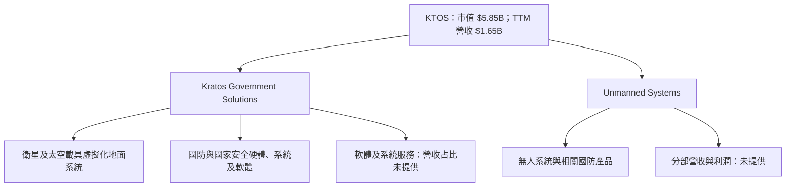
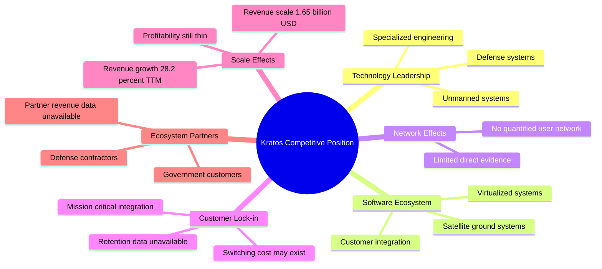
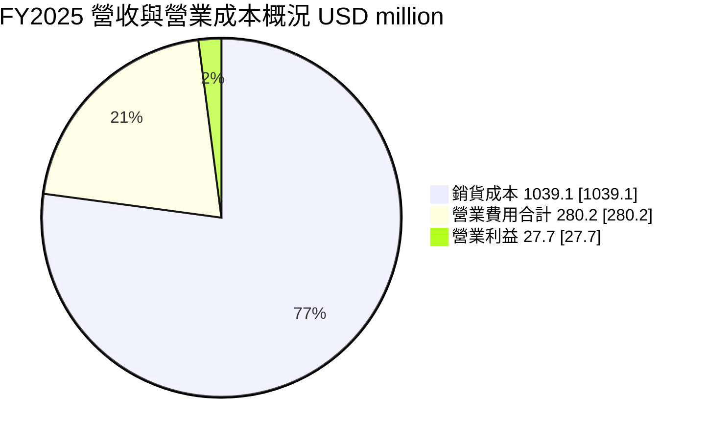
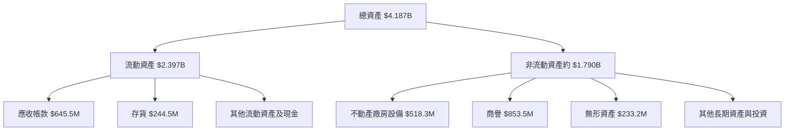
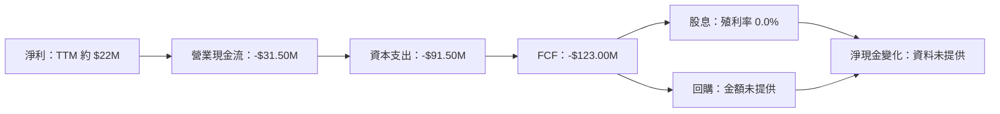
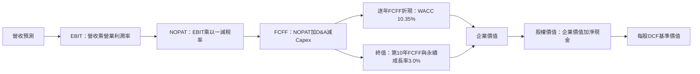
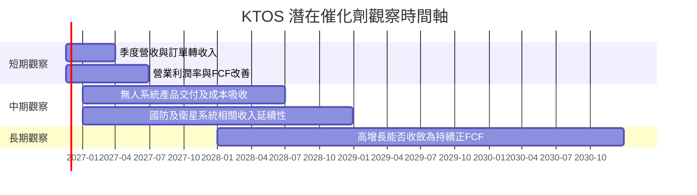
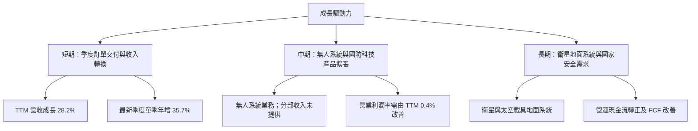
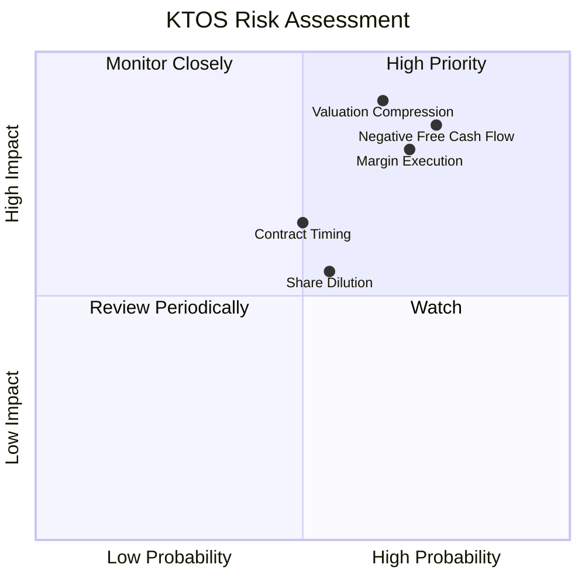
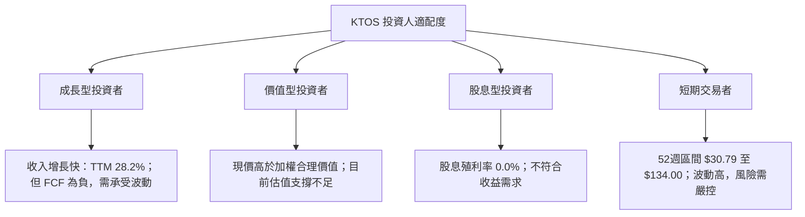

# KTOS 基本面深度分析報告
> **報告日期**：2026-11-18 ｜ **語言**：繁體中文 ｜ **數據來源**：SEC 申報資料 (XBRL)、Yahoo Finance、Finviz、StockAnalysis、Roic.ai ｜ **分析師**：CFA 級機構研究

## 目錄

| # | 章節 | 核心結論 |
|---|------|----------|
| 1 | 執行摘要 | 賣出；加權合理價值 $20.11，MOS -54.5% |
| 2 | 公司概覽與商業模式 | 國防科技與無人系統具需求支撐；細分營收與市場份額未提供 |
| 3 | 損益表深度分析 | TTM 營收 $1.65B、成長 28.2%；利潤率仍薄且最新季營業虧損 |
| 4 | 資產負債表分析 | 現金及短期投資 $1.40B；流動性高，但債務口徑資料有差異 |
| 5 | 現金流量深度分析 | TTM FCF -$123.00M，資本支出高於營業現金流 |
| 6 | 獲利能力與資本效率 | ROIC 0.2% 低於 WACC 10.35%，目前未創造正經濟利潤 |
| 7 | 相對估值分析 | KTOS 倍數高於主要同業；DCF 與相對估值均低於現價 |
| 8 | DCF 內在價值評估 | DCF 基準 $9.80；估值對終值與低利潤率假設敏感 |
| 9 | 成長催化劑 | 國防需求與無人系統是潛在動能；TAM 與訂單量化資料未提供 |
| 10 | 風險矩陣 | 現金流、利潤率執行與估值回歸是主要風險 |
| 11 | 投資建議 | 依 MOS 評級為賣出；等待現金流與獲利轉正或估值下降 |

## 1. 執行摘要

截至 2026-11-17，KTOS 收盤價為 **$31.06**。TTM 營收 $1.65B、年增 28.2%，最新一季營收年增 35.7%；但 TTM 營業利益率僅 0.4%、ROIC 0.2%，均低於 10.35% 的 WACC，TTM FCF 為 -$123.00M。估值方面，DCF 基準價值 $9.80、同業相對估值每股 $14.23–$20.66，加權合理價值 $20.11；現價較加權合理價值高，MOS 為 -54.5%。因此依規則 20 評級為**賣出**，並非以分析師共識或營收成長單獨決定。

### 1.0 一頁式投資儀表板（Portfolio Manager 30 秒速讀）

| 項目 | 內容 |
|------|------|
| **投資論點（3 句）** | ① TTM 營收年增 28.2%，最新一季單季年增 35.7%，顯示需求與交付持續擴張。② TTM FCF -$123.00M、營業現金流 -$31.50M，成長尚未轉化為現金回報。③ 加權合理價值 $20.11，低於 2026-11-17 收盤價 $31.06，MOS -54.5%。 |
| **綜合評分** | **5.0/10**（引用 1.1 評分卡） |
| **財務健康** | 🟡 現金及短期投資 $1.40B、流動比率 5.418，但 TTM FCF 為負，且債務資料口徑不一致。 |
| **ROIC vs WACC** | **0.2% vs 10.35%**；ROIC 低於資本成本，現階段摧毀經濟價值。 |
| **FCF 趨勢** | TTM FCF 為 -$123.00M，FCF Yield -2.10%；近期仍為負值。 |
| **估值** | Forward P/E 27.8x｜EV/EBITDA（TTM，Yahoo Finance）52.1x｜FCF Yield -2.10%。 |
| **DCF 內在價值（基準）** | **$9.80**｜現價相對 DCF 溢價 **216.9%**（折溢價基準為 DCF）。 |
| **安全邊際（MOS）** | **-54.5%**＝($20.11 − $31.06) ÷ $20.11；🔴 無安全邊際，基準為加權合理價值。 |
| **預期報酬（基準情境 12M）** | **-68.4%**（DCF 基準情境 $9.80 相對現價；非公司指引）。 |
| **關鍵風險（前二）** | TTM FCF 持續為負；營業利益率偏低且最新季為 -1.0%。 |
| **評級 + 信心度** | 🔴 **賣出**｜信心：中。估值差距明確，但預測與現金流模型對長期利潤率敏感。 |

### 1.1 綜合評分卡（全報告唯一）

| 維度 | 評分（1–10） | 主要依據（引用數字與其來源章節） |
|------|--------------|----------------------------------|
| 成長性 | 8.0 | TTM 營收成長 28.2%、最新一季單季年增 35.7%（第 3 章）。 |
| 獲利能力 | 3.0 | TTM 營業利益率 0.4%、ROIC 0.2%、F-Score 3/8（第 3、6 章）。 |
| 財務健康 | 8.0 | 現金及短期投資 $1.40B、流動比率 5.418；但 TTM FCF -$123.00M（第 4、5 章）。 |
| 估值 | 1.0 | MOS -54.5%；Forward P/E 27.8x，高於同業中位數 18.5x（第 7、8 章）。 |
| 護城河 | 6.0 | 國防系統、衛星地面系統與無人系統具專業性；但缺少客戶留存、分部利潤及市占率資料（第 2 章）。 |
| 管理層與資本配置 | 4.0 | 2025 年資本支出 $95.3M，SBC $35.5M；近年股數增加，資本投入尚未轉成正 FCF（第 3、5 章）。 |
| **綜合評分** | **5.0** | 六項算術平均：(8.0 + 3.0 + 8.0 + 1.0 + 6.0 + 4.0) ÷ 6 = **5.0**。 |

### 1.2 五大投資論點 + 三大核心風險

| 類型 | 項目 | 具體依據 | 信心度 |
|------|------|----------|--------|
| 🟢 **投資論點①** | 營收成長加速 | TTM 營收年增 28.2%；最新一季單季年增 35.7%，高於此前單季年增率。若增長來自可持續合約交付，可能帶來規模效應。 | 🟢 高 |
| 🟢 **投資論點②** | 國防科技與無人系統曝險 | 公司業務涵蓋 Kratos Government Solutions 與 Unmanned Systems；無人系統及國防科技是業務定位核心，但分部營收未提供。 | 🟡 中 |
| 🟢 **投資論點③** | 現金緩衝充足 | 現金及短期投資 $1.40B，提供營運與投資緩衝；但不代表目前現金流可自我支應。 | 🟢 高 |
| 🟢 **投資論點④** | 年度淨利已轉正 | 2025 年淨利 $22.0M，相較 2023 年 -$8.9M 改善；惟 TTM 淨利率僅 1.3%。 | 🟡 中 |
| 🟢 **投資論點⑤** | 近期季度營收持續增加 | 2026 Q3 營收 $471.8M，較 Q2 $458.8M 高 2.8%；需求擴張仍需觀察毛利與現金轉換。 | 🟡 中 |
| 🟡 **風險①** | FCF 持續為負 | TTM FCF -$123.00M，資本支出 $91.50M；若成長需要長期高投入，估值模型的現金流轉正可能延後。 | 🔴 高衝擊 |
| 🔴 **風險②** | 估值高於基本面支撐 | 加權合理價值 $20.11，較現價低 35.3%；DCF 基準 $9.80，較現價低 68.4%。 | 🔴 高衝擊 |
| 🔴 **風險③** | 利潤率與營運執行 | TTM 營業利益率僅 0.4%，最新一季 -1.0%；營收增長若伴隨低毛利專案或成本上升，難以轉成股東回報。 | 🔴 高衝擊 |

### 1.3 快速統計卡片

| 指標 | 公司實際值（期間） | 同業中位數 | 狀態 |
|------|--------------------|------------|------|
| 營收成長（TTM） | **28.2%** | — | 🟢 |
| 營收成長（最新一季年增） | **35.7%** | 6.7% | 🟢 |
| 毛利率（TTM） | **23.0%** | 20.0% | 🟢 |
| 營業利益率（TTM） | **0.4%** | — | 🔴 |
| ROIC（TTM） | **0.2%** | — | 🔴 |
| Forward P/E | **27.8x** | 18.5x | 🔴 |
| FCF Yield（TTM） | **-2.10%** | — | 🔴 |
| Piotroski F-Score | **3 / 8** | — | 🔴 |

註：同業中位數依 AVAV、LMT、NOC 的 Peer multiples 計算；營收成長中位數為 5.7%、6.7%、11.3% 的中位數，即 6.7%。

### 1.4 投資結論

```text
╔══════════════════════════════════════════════════════════════════╗
║                    📊 投資結論摘要                               ║
╠══════════════════════════════════════════════════════════════════╣
║  評級：賣出（依 MOS 規則 20）                                    ║
║  價格（2026-11-17 收盤）：$31.06                                 ║
║  DCF 內在價值（基準）：$9.80（現價溢價 216.9%）                 ║
║  安全邊際 MOS：-54.5%（以加權合理價值為分母）                   ║
║  加權合理價值（8.8）：$20.11                                     ║
║  DCF 情境價值：                                                  ║
║    悲觀情境：$8.18（-73.7%）                                     ║
║    基準情境：$9.80（-68.4%）                                     ║
║    樂觀情境：$13.48（-56.6%）                                    ║
║  綜合評分：5.0/10（引用 1.1）                                    ║
║  適合投資人：能承受高波動、以成長與國防科技曝險為主的投資人；     ║
║              不適合以價值或穩定現金流為核心的投資組合。          ║
╚══════════════════════════════════════════════════════════════════╝
```

## 2. 公司概覽與商業模式

### 2.1 業務結構與收入來源

公司資料指出 KTOS 經營 Kratos Government Solutions 與 Unmanned Systems，並提供國防、國家安全及商業市場的科技、硬體、產品、系統與軟體。分部營收金額與占比未提供，因此不以估計比例拆分。



### 2.2 市場份額

市場份額數據未提供，亦無可引用的 TAM 或市占率來源。KTOS TTM 營收 $1.65B、年增 28.2%，最新一季單季年增 35.7%；Peer multiples 中 AVAV 最新季年增 5.7%、LMT 11.3%、NOC 6.7%，KTOS 成長較快，但其利潤率和現金流表現尚未同步改善。

### 2.3 競爭護城河分析



### 2.4 護城河強度

| 護城河項目 | 強度（強／中／弱） | 證據（引用數字或事實） | 會削弱它的情況 |
|------------|--------------------|------------------------|----------------|
| 技術與產品專業性 | 中 | 涵蓋無人系統、衛星地面系統及國防科技；R&D 2025 年為 $40.0M。 | 技術迭代落後、產品未能轉成持續訂單。 |
| 軟體與系統整合 | 中 | 公司提供衛星地面系統軟體及虛擬化系統；軟體收入占比未提供。 | 客戶改採標準化或競爭者替代方案。 |
| 網路效應 | 弱 | 無使用者網路規模或交叉銷售數字。 | 若缺少平台型使用者與資料累積，難形成網路效應。 |
| 客戶鎖定 | 中 | 國防、太空與任務系統整合可能提升轉換成本；客戶留存率未提供。 | 合約到期、預算重配或單一客戶依賴。 |
| 規模效應 | 中偏弱 | TTM 營收 $1.65B、成長 28.2%，但 TTM 營業利益率僅 0.4%。 | 成長無法帶來營業槓桿或採購成本優勢。 |
| 生態夥伴 | 中偏弱 | 公司覆蓋國防與國際市場；合作夥伴收入貢獻未提供。 | 供應鏈中斷或關鍵合作關係改變。 |

1.1「護城河」評分為 6.0/10，理由是產品與任務系統專業性提供一定進入障礙，但客戶留存、市占率、分部利潤及軟體收入占比等可驗證資料不足。

## 3. 損益表深度分析

### 3.1 年度收入成長趨勢（近 4 年）

年度營收分別為 2022 年 $898.3M、2023 年 $1.037B、2024 年 $1.136B、2025 年 $1.347B。2022–2025 CAGR 約為 `(1.347 ÷ 0.8983)^(1/3) − 1 = 14.5%`。

```text
╔══════════════════════════════════════════════════════════════════╗
║              Kratos 年度收入趨勢（FY2022–FY2025）                ║
╠══════════════════════════════════════════════════════════════════╣
║  FY2022  $0.898B  █████████████░░░░░░░░░░░░░░░  YoY: —          ║
║  FY2023  $1.037B  ███████████████░░░░░░░░░░░░░  YoY: +15.4% 🟢  ║
║  FY2024  $1.136B  █████████████████░░░░░░░░░░░  YoY: +9.6%  🟡  ║
║  FY2025  $1.347B  ████████████████████░░░░░░░░░  YoY: +18.5% 🟢  ║
║                                                                  ║
║  📊 2022–2025 三年 CAGR：約 +14.5%                               ║
╚══════════════════════════════════════════════════════════════════╝
```

FY2025 營收增長高於 FY2024，且 TTM 成長升至 28.2%。這反映近期交付與需求加速，但在 TTM 營業利益率僅 0.4%、FCF 為負的情況下，尚不能將收入增速直接等同於價值創造。

### 3.2 季度收入趨勢分析

| 季度 | 營收 | QoQ | YoY | 備註 |
|------|------:|----:|----:|------|
| 2025 Q4 | $345.1M | -0.7% | 21.9% | QoQ 以前一季 2025 Q3 $347.6M 計算。 |
| 2026 Q1 | $371.0M | +7.5% | 22.6% | 單季營收較 Q4 回升。 |
| 2026 Q2 | $458.8M | +23.7% | 30.5% | 交付規模快速增加。 |
| 2026 Q3 | $471.8M | +2.8% | **35.7%** | 單季年增率為數據區塊認證值；不得稱作 TTM 成長率。 |

QoQ 以當季營收除以前一季營收減一計算；YoY 以同季去年營收計算。2026 Q2 至 Q3 的 QoQ 增幅放緩，但 Q3 年增率提高，表示比較基期與收入擴張速度共同影響同比數字。

### 3.3 利潤率演變分析

| 利潤率指標 | FY2022 | FY2023 | FY2024 | FY2025 | 趨勢 | 評估 |
|------------|--------|--------|--------|--------|------|------|
| **毛利率** | 25.2% | 25.9% | 25.3% | 22.9% | FY2025 回落約 2.4 個百分點 | 🟡 |
| **營業利益率** | 0.5% | 3.0% | 2.6% | 2.1% | 2023 觸頂後連續回落 | 🔴 |
| **淨利率** | -4.1% | -0.9% | 1.4% | 1.6% | 從虧損轉正 | 🟡 |

年度毛利率以毛利 ÷ 營收計算；年度營業利益率以營業利益 ÷ 營收計算。FY2025 毛利率下降，代表收入擴張未完全帶來較佳產品組合或成本吸收。年度營業利益仍為正，但 TTM 認證營業利益率為 0.4%，最新一季為 -1.0%；另一彙整資料列示不同期間口徑的營業利益率，因此本報告涉及 TTM 與最新季度時，以 SEC 申報資料計算區塊認證值為準。

### 3.4 費用結構分析

FY2025 營收 $1,347.0M、毛利 $307.9M、營業利益 $27.7M。以下分拆為營收、銷貨成本及毛利後的營業費用；營業費用是由毛利減營業利益推導的合計數，不是單一費用科目。



```text
╔══════════════════════════════════════════════════════════════════╗
║               FY2025 營收結構（美元）                            ║
╠══════════════════════════════════════════════════════════════════╣
║  營收        $1,347.0M  ████████████████████                      ║
║  銷貨成本    $1,039.1M  ███████████████░░░░░                      ║
║  毛利          $307.9M  ████░░░░░░░░░░░░░░░                      ║
║  營業費用合計  $280.2M  ████░░░░░░░░░░░░░░░                      ║
║  營業利益       $27.7M  ░░░░░░░░░░░░░░░░░░░                      ║
╚══════════════════════════════════════════════════════════════════╝
```

### 3.5 季度 EPS 趨勢與盈餘品質（Quality of Earnings）

過去四季 EPS 預估值及實際值的資料庫欄位均為缺失，無法判斷超預期或不及預期。實際 EPS 歷史資料列示：2025 Q4 約 $0.03、2026 Q1 約 $0.07、Q2 約 $0.02、Q3 約 -$0.00；季度淨利依序為 $5.9M、$11.9M、$4.4M、-$0.2M。Q3 營收增加但淨利轉負，顯示收入成長尚未保證獲利同步改善。

| 盈餘品質項目 | 數值/佔比 | 評估 |
|--------------|-----------|------|
| 股權薪酬 SBC / 營收 | SBC 約 $58.5M ÷ TTM 營收 $1,647M = **3.6%** | 🔴 SBC 會稀釋股東權益；以收入占比看並非可忽略。 |
| SBC / 營業現金流 | $58.5M ÷ -$31.50M = **-185.7%**；以絕對值觀察為 185.7% | 🔴 營業現金流為負，該比值不具正常覆蓋率意義；SBC 金額高於營業現金流絕對值。 |
| FCF / 淨利（現金轉換率） | -$123M ÷ 約 $22M = **-559%** | 🔴 GAAP 淨利為正，但扣除資本支出後現金流仍為負，盈餘現金含量低。 |
| 一次性/非經常性損益 | N/A（未提供足以判斷的明細） | 🟡 無法排除一次性項目影響，需查閱 10-Q 附註。 |
| 有效稅率異常 | N/A（TTM 有效稅率資料未提供） | 🟡 無法判定是否由稅務利益推動盈餘。 |
| 資本化支出 vs 費用化 | TTM 資本支出 $91.50M；資本化明細 N/A | 🟡 資本支出已反映於 FCF；資本化政策細節須檢視申報附註。 |

**盈餘品質結論**：TTM 淨利約 $22M、FCF -$123M，現金轉換率為負；SBC 佔營收約 3.6%，且股數未維持穩定。現有證據顯示 GAAP 盈利的現金含量偏低，而非現金盈餘足以支持高估值。SBC 已費用化，不代表其股東稀釋成本消失；估值應同時監控自由現金流和稀釋股數。

## 4. 資產負債表分析

### 4.1 資產結構分解

截至 2026 Q3 的資產負債表彙整資料列示總資產 $4.187B。以下資產類別以同一彙整期間數字呈現；分項合計因四捨五入可能略有差異。



### 4.2 流動性與營運資金分析

| 流動性指標 | 最新值 | 歷史／變化 | 評估 |
|------------|------:|-------------|------|
| 流動比率 | 5.418 | 歷史比較值未在同口徑區塊列示 | 🟢 短期資產覆蓋流動負債能力高。 |
| 速動比率 | 4.632 | 歷史比較值未提供 | 🟢 扣除存貨後仍有充足流動性。 |
| 現金及短期投資 | $1.40B | FY2025 年末現金 $560.6M | 🟢 現金緩衝增加；但資金用途與限制需以申報資料確認。 |

**營運資金天數**（依 QUALITY FIGURES 原值）：

| 指標 | 最新 TTM | 一年前 TTM | 變化 | 解讀 |
|------|----------|------------|------|------|
| DSO 應收帳款天數 | 42 天 | 39 天 | +3 天 | 收款天數增加，可能使營收增長對現金流的轉化延後；具體原因未提供。 |
| DIO 存貨天數 | 70 天 | 66 天 | +4 天 | 存貨天數上升，可能反映為履約備貨或存貨周轉放慢，需追蹤減值及交付。 |
| DPO 應付帳款天數 | 32 天 | 24 天 | +8 天 | 付款天數拉長，對現金週轉有利，但不應單獨視為議價力改善證據。 |
| CCC 現金轉換週期 | 80 天 | 81 天 | -1 天 | CCC 略有縮短；DPO 增幅抵銷 DSO、DIO 的上升。 |

CCC 由 81 天縮短至 80 天，整體改善有限。收款與存貨天數同時增加，表示收入擴張伴隨營運資金占用增加；需觀察後續營業現金流能否由負轉正。

### 4.3 債務結構分析

標準化財務區塊列示總債務 N/A、淨現金 $1.40B；其他彙整資料另列總債務 $246M、淨現金 $1.16B。兩者口徑不一致，本報告不以缺少明確同口徑佐證的補充數字取代標準化指標。DCF 亦依模型設定採用淨現金 $1.40B。

```text
╔══════════════════════════════════════════════════════════════════╗
║                 KTOS 債務健康診斷                                ║
╠══════════════════════════════════════════════════════════════════╣
║  總債務：        N/A（標準化財務指標缺值）                       ║
║  現金及短期投資：$1.40B  ████████████████████                     ║
║  淨現金：        $1.40B  ████████████████████  🟢                ║
║  Debt/EBITDA：   N/A（債務口徑資料不一致）                        ║
║  利息保障倍數：  N/A（利息費用與同口徑債務未提供）                ║
║  結論：現金緩衝充足；不可據現金數字推定無債務。                  ║
╚══════════════════════════════════════════════════════════════════╝
```

### 4.4 股東權益趨勢

| 年度 | 股東權益 |
|------|---------:|
| 2022 | $936.3M |
| 2023 | $976.0M |
| 2024 | $1.350B |
| 2025 | $2.000B |

```text
╔══════════════════════════════════════════════════════════════════╗
║                  股東權益趨勢                                    ║
╠══════════════════════════════════════════════════════════════════╣
║  FY2022  $0.936B  █████████░░░░░░░░░░░░░░░                       ║
║  FY2023  $0.976B  ██████████░░░░░░░░░░░░░░                       ║
║  FY2024  $1.350B  ██████████████░░░░░░░░                         ║
║  FY2025  $2.000B  ████████████████████                           ║
╚══════════════════════════════════════════════════════════════════╝
```

FY2025 股東權益增加，但僅憑此資料不能判定主要由留存盈餘、發行股份或其他權益項目所致；年度股數資料顯示稀釋仍需納入股東回報考量。

## 5. 現金流量深度分析

### 5.1 現金流量瀑布圖

營業現金流與資本支出依 TTM 認證值呈現。股息收益率為 0.0%；回購與其他資本配置的 TTM 數字未提供，不推算淨現金變化。



### 5.2 FCF 轉換率趨勢

| 年度 | FCF | 淨利 | FCF / 淨利 | 解讀 |
|------|----:|----:|-----------:|------|
| 2022 | -$71.1M | -$36.9M | +192.7% | 分子與分母皆負，正比率不代表現金品質良好。 |
| 2023 | $12.8M | -$8.9M | -143.8% | 淨利為負，比例不宜用作一般現金轉換判斷。 |
| 2024 | -$8.5M | $16.3M | -52.1% | 正淨利未轉成正 FCF。 |
| 2025 | -$137.4M | $22.0M | -624.5% | 資本支出上升後 FCF 明顯轉負。 |
| TTM | -$123.0M | 約 $22.0M | -559.1% | 依認證 TTM FCF ÷ TTM 淨利估算，現金轉換偏弱。 |

年度 FCF 與淨利來自年度財務表；TTM FCF 為營業現金流減資本支出的標準化定義。年度與 TTM 的期間、會計彙整可能不同，不宜將單一年度的波動當作線性趨勢外推。

### 5.3 自由現金流趨勢

```text
╔══════════════════════════════════════════════════════════════════╗
║                   FCF 歷史與 TTM                                  ║
╠══════════════════════════════════════════════════════════════════╣
║  FY2022  -$71.1M  ◀████████████░░░░░░░░  FCF Yield：N/A          ║
║  FY2023   +$12.8M  ███░░░░░░░░░░░░░░░░░  FCF Yield：N/A          ║
║  FY2024    -$8.5M  ◀██░░░░░░░░░░░░░░░░░  FCF Yield：N/A          ║
║  FY2025  -$137.4M  ◀████████████████████  FCF Yield：N/A          ║
║  TTM     -$123.0M  ◀██████████████████░░  FCF Yield：-2.10%       ║
╚══════════════════════════════════════════════════════════════════╝
```

### 5.4 資本配置評估

精確的回購、收購、研發、股息及現金留存比例資料未提供，不畫比例圓餅圖。可確認的數據是 FY2025 資本支出 $95.3M、SBC $35.5M、R&D $40.0M；TTM 資本支出 $91.50M，股息殖利率 0.0%。

| 資本配置項目 | 可引用數值 | 評估 |
|--------------|-----------:|------|
| 資本支出 | FY2025 $95.3M；TTM $91.50M | 投資規模需要以後續交付與營業現金流驗證回報。 |
| 研發 | FY2025 $40.0M | 支援產品與技術投入，但研發回收期與專案貢獻未提供。 |
| SBC | FY2025 $35.5M；近四季合計約 $58.5M | 為非現金費用，但對股東有稀釋成本。 |
| 股息 | 殖利率 0.0% | 無現金股息回報。 |
| 回購／併購 | N/A | 金額資料未提供。 |

## 6. 獲利能力與資本效率

### 6.1 ROE / ROA / ROIC 趨勢

| 指標 | 最新 TTM | 歷史數據 | 評估 |
|------|---------:|----------|------|
| ROE | 0.6%（QUALITY FIGURES） | 其他資料彙整列 0.8%，口徑有差異 | 🟡 回報仍低。 |
| ROA | 0.2% | — | 🔴 資產獲利效率偏低。 |
| ROIC | 0.2% | — | 🔴 遠低於資本成本。 |

提供資料沒有可核對的同業 ROIC／ROE 均值，因此不填行業均值。ROE 的 0.6% 為 QUALITY FIGURES 原值；其他彙整列出的 0.8%屬不同來源口徑，未混用。

### 6.2 ROIC vs WACC 分析（核心價值創造判斷）

```text
╔══════════════════════════════════════════════════════════════════╗
║                ROIC vs WACC 深度分析                            ║
╠══════════════════════════════════════════════════════════════════╣
║  WACC（認證值）：10.35%                                          ║
║  ├── 無風險利率（10Y 美債）：5.10%                               ║
║  ├── ERP：5.00%                                                  ║
║  ├── Beta 原始值 1.17；調整後採用值 1.11                       ║
║  ├── Ke：5.10% + 1.11 × 5.00% = 10.65%                          ║
║  ├── 稅前 Kd：3.90%；稅率：21.0%                                 ║
║  ├── 股權／債務權重：96.0%／4.0%                                 ║
║  └── WACC：10.35%（直接採用資本成本數據區塊認證值）              ║
║                                                                  ║
║  ROIC（TTM）：0.2%                                               ║
║  EVA spread = ROIC − WACC = 0.20% − 10.35% = -10.15 個百分點    ║
║                                                                  ║
║  ROIC  0.20%  ░░░░░░░░░░░░░░░░░░░░░░░░░░░░░░░░░░░░░░░░░░░░░   ║
║  WACC 10.35%  ▓▓▓▓▓▓▓▓▓▓▓▓▓▓▓▓▓▓▓▓▓▓▓▓▓▓▓▓▓▓▓▓▓▓▓▓▓▓▓▓▓▓▓▓   ║
║                                                                  ║
║  結論：ROIC 遠低於 WACC，現階段未創造足以覆蓋資本成本的回報。   ║
╚══════════════════════════════════════════════════════════════════╝
```

WACC 的組成與權重直接引用資本成本數據：Ke = 10.65%、稅前 Kd = 3.90%、稅率 21.0%、E/D 權重 96.0%/4.0%、WACC 10.35%。核對其四捨五入算式：`96.0% × 10.65% + 4.0% × (3.90% × (1 − 21.0%)) = 10.347% ≈ 10.35%`。原始 Beta 1.17 依規則調整為 `⅔ × 1.17 + ⅓ × 1.00 = 1.11`。債務金額標準化資料為 N/A，因此不以其他口徑重建資本結構金額或利息保障倍數。

### 6.3 杜邦三因素分解

| 因素 | 數值（TTM） | 解讀 |
|------|-------------|------|
| 淨利率 | 1.3% | 低淨利率限制股東權益報酬。 |
| 資產週轉率 | 0.39 | 每單位資產帶來的營收有限，資產擴張仍需轉化為產出。 |
| 權益乘數 | 1.21 | 槓桿倍數不高，ROE 並非主要由高槓桿撐起。 |
| **ROE** | **0.6%** | QUALITY FIGURES 原值：1.3% × 0.39 × 1.21 = 0.6%（四捨五入）。 |

### 6.4 財務體質：Piotroski F-Score

Piotroski F-Score 為 **3/8**。一項測試因輸入缺失不計入，因此分母不是 9，也不能把未判定項目當作通過或失敗。

| 測試 | 結果 | 解讀 |
|------|------|------|
| ROA > 0 | ✅ 通過 | TTM 資產報酬率為正，但僅 0.2%。 |
| 營業現金流 > 0 | ❌ 未通過 | TTM 營業現金流 -$31.50M。 |
| ROA 高於一年前 | ❌ 未通過 | 相較前期未改善。 |
| 營業現金流 > 淨利（應計品質） | ❌ 未通過 | 現金流低於淨利，需關注應計品質。 |
| 長期負債 ÷ 總資產低於一年前 | — 無法判定 | 長期負債測試輸入缺資料。 |
| 流動比率高於一年前 | ✅ 通過 | 流動比率相較一年前改善。 |
| 稀釋股數未增加 | ❌ 未通過 | 稀釋股數增加，SBC 及發行股份影響需監控。 |
| 毛利率高於一年前 | ✅ 通過 | 該測試按原始品質數據通過；年度 FY2025 毛利率回落，期間口徑不同。 |
| 資產週轉率高於一年前 | ❌ 未通過 | 資產使用效率未改善。 |

## 7. 相對估值分析

### 7.1 同業估值比較表格

本節競爭對手倍數一律取自 Peer multiples；公司倍數採提供的市場估值資料。KTOS trailing P/E 258.8x 與 Forward P/E 27.8x 反映當前盈利基數較小，估值容易受利潤變化放大。

| 估值指標 | **KTOS** | **AVAV** | **LMT** | **NOC** | 本公司評估 |
|----------|---------:|---------:|--------:|--------:|-----------|
| **Trailing P/E** | 258.8x | N/A | 21.0x | 17.5x | 🔴 遠高於可比較同業；AVAV 無資料。 |
| **Forward P/E** | 27.8x | 23.7x | 17.7x | 18.5x | 🔴 高於同業中位數 18.5x。 |
| **P/S Ratio** | 3.6x | 2.6x | 1.7x | 1.8x | 🔴 以銷售額衡量亦較貴。 |
| **EV/EBITDA（TTM）** | 52.1x | 25.4x | 15.3x | 12.6x | 🔴 顯著高於同業中位數 15.3x。 |
| **最新季度營收 YoY** | 35.7% | 5.7% | 11.3% | 6.7% | 🟢 增速較快，但利潤率與現金流較弱。 |
| **毛利率（TTM）** | 23.0% | 26.5% | 11.7% | 20.0% | 🟡 低於 AVAV，高於 LMT、NOC。 |

Forward P/E 同業中位數：`median(23.7x, 17.7x, 18.5x) = 18.5x`。EV/EBITDA 中位數為 15.3x。KTOS 的高成長為溢價提供部分理由，但尚未由正 FCF 與更高營業利潤率證明溢價合理。

### 7.2 歷史估值區間分析

```text
╔══════════════════════════════════════════════════════════════════╗
║                   KTOS 五年歷史估值定位                         ║
╠══════════════════════════════════════════════════════════════════╣
║  P/E：       現值 258.8x｜中位數 380.2x｜百分位 27%             ║
║              區間 232.9x 至極端異常高值；上限受極小盈餘影響      ║
║  P/S：       現值 3.6x｜中位數 3.2x｜區間 1.3x–11.6x｜65百分位  ║
║  EV/EBITDA： 現值 53.5x｜中位數 55.5x｜區間 33.8x–221.5x        ║
║                                         百分位 50%              ║
╚══════════════════════════════════════════════════════════════════╝
```

P/E 的歷史區間上限受到極低或異常盈利年份影響，參考價值有限；P/S 位於自身五年區間第 65 百分位且高於中位數，表示營收倍數不便宜。EV/EBITDA 雖約在自身歷史中位位置，但絕對倍數仍高於同業。

### 7.3 情境價值（Bear / Base / Bull，照抄 DCF MODEL 的 Scenarios）

| 情境 | 第 1 年營收成長 | 期末營業利潤率 | WACC | 每股價值 | 相對現價 | 機率 | 會發生的條件 |
|------|----------------:|----------------:|-----:|---------:|---------:|-----:|--------------|
| 🔴 悲觀 | 14.1% | 1.6% | 11.35% | $8.18 | -73.7% | 25% | 訂單轉收入放慢，成本與資本支出壓力延續。 |
| 🟡 基準 | 28.2% | 1.9% | 10.35% | $9.80 | -68.4% | 50% | 短期成長接近 TTM 增速，長期收斂至 3.0%。 |
| 🟢 樂觀 | 42.3% | 2.1% | 9.35% | $13.48 | -56.6% | 25% | 新業務快速放量、利潤率改善，資本成本下行。 |

即使樂觀情境價值 $13.48，仍低於 $31.06 現價。這些情境只代表模型條件推演，不是管理層財測或目標價。

### 7.4 相對估值隱含價格區間

```text
╔══════════════════════════════════════════════════════════════════╗
║                估值方法每股價值比較                              ║
╠══════════════════════════════════════════════════════════════════╣
║  $9.80 ── $14.23 ── $20.66 ───────── $31.06 ───── $74.68       ║
║  DCF       EV/EBITDA  Forward P/E       現價       分析師共識     ║
╚══════════════════════════════════════════════════════════════════╝
```

同業 EV/EBITDA 法：同業中位數 15.3x × KTOS TTM EBITDA，並加回淨現金，模型給出每股 $14.23。Forward P/E 法：同業中位數 18.5x × Forward EPS $1.12，得到 $20.66。兩者均低於現價；分析師共識 $74.68 為 25 位分析師平均目標價，與其他估值方法差距很大，應視為市場預期參考而非現金流模型證據。

## 8. DCF 內在價值評估（Discounted Cash Flow）

### 8.0 估值推理鏈（Thinking Logic）

**Step 1 — 價值來源與主導變數**

KTOS 的價值主要取決於既有國防科技與無人系統業務的收入轉換、營業利潤率能否擴張，以及高資本投入何時轉為正 FCFF。各分部營收占比未提供，不能把任一業務寫成特定比例。基準模型中，主要敏感變數是營收成長與營業利潤率，但由於終值佔 EV 84.1%，永續現金流假設對整體價值尤其重要。

**Step 2 — 模型選擇**

| 決策點 | 本報告採用 | 理由（含數字） | 曾考慮但否決 | 否決理由 |
|--------|-----------|----------------|--------------|----------|
| 現金流定義 | FCFF | 以 WACC 10.35% 折現，求企業價值後加回淨現金。 | FCFE | 模型與 WACC 設定採 FCFF 架構。 |
| 預測期 N | 10 年 | DCF MODEL 固定預測 10 年，營收成長由 28.2% 線性降至 3.0%。 | 5 年 | 不符合程式模型設定，不自行改期。 |
| 終值方法 | Gordon Growth | g = 3.0%，WACC = 10.35%，符合 WACC > g。 | 退出倍數 | DCF MODEL 未提供可引用的退出倍數終值，故不另建。 |
| EBIT 基礎 | GAAP | 模型明示採 GAAP EBIT。 | 非 GAAP EBIT | 會使 SBC 處理與程式模型不同。 |

**Step 3 — 關鍵假設推導鏈**

- **營收成長**：錨點為 TTM 營收成長 28.2% → 模型將第 1 年設為 28.2%，其後線性降至第 10 年 3.0% → **採用模型既定的逐年遞減路徑** → 未採用永續維持 28.2%，因公司目前營收規模已達 $1.65B，且國防專案交付不宜假設長期維持單一高增速。
- **營業利潤率**：錨點為 TTM GAAP 營業利益率 0.4% → 模型假設逐年提升至第 10 年 1.9%，對應過去五個財年中位數 → **採用 0.4% 至 1.9%** → 未假設高於 1.9%，因現有資料未證明更高長期利潤率。
- **永續成長率 g**：模型採 3.0% → 低於 WACC 10.35%，且不高於長期名目經濟成長常見區間上緣 → **採用 3.0%** → 未採用 4.0%，因終值占比已高，較高 g 會放大終值依賴。
- **預測期 N**：模型給定 10 年 → **採用 10 年** → 不改成更短或更長期間，以避免自行重建 DCF。
- **Capex / 營收**：錨點為 TTM 5.6% → 模型自第 1 年 5.6% 緩降至第 10 年 5.1% → **採用模型路徑** → 未快速降至 1.1×D&A 以下，因目前資本投入偏高，不能假設短期消失。
- **EBIT 基礎與 SBC**：採 GAAP EBIT，模型使用已含 SBC 費用的營業利益 → **不再扣一次 SBC** → 未改用非 GAAP EBIT，避免在費用與股數兩處重複處理。
- **年稀釋率**：模型採當期股數且不另稀釋，與 GAAP EBIT 組合 A 相容 → **模型股數假設不再放大** → 未另加稀釋率，因模型明示 SBC 已由 GAAP 費用反映；但這不等於實際未來股數不會上升。
- **終值方法**：採 Gordon Growth → **以模型指定終值為準** → 退出倍數僅在模型有數字時才可交叉驗證，該輸入未提供，故不自行補值。
- **WACC**：採資本成本區塊 10.35% → 其組成為 Rf 5.10%、ERP 5.00%、調整後 Beta 1.11、稅前 Kd 3.90%、權重 96%/4% → **採用 10.35%** → 不另建一個替代 WACC，以確保與第 6.2 節一致。
- **稅率**：模型採 21.0%；此為預設稅率，不是已核實的公司 TTM 有效稅率。
- **D&A / 營收**：採模型設定 4.7%，錨點為 TTM 比率。
- **營運資金變動**：模型未建模 ΔWC；因此不是零增量的經濟結論，而是模型簡化。

**Step 4 — 最脆弱假設**

最脆弱處是營業利潤率改善與終值現金流：終值現值占 EV 84.1%，若成長無法轉成現金，或長期利潤率低於模型路徑，DCF 價值將進一步下降；情境表中基準 $9.80、悲觀 $8.18，均顯著低於現價。

**Step 5 — 計算路徑圖**



### 8.1 模型假設總表（Model Inputs）

| 假設項目 | 採用值 | 依據 / 來源 | 敏感度 |
|----------|--------|-------------|--------|
| 預測期長度 N | 10 年 | DCF MODEL 固定設定；10 年營收成長由 28.2% 遞減至 3.0%。 | 🟡 中 |
| 營收成長 | 第 1 年 28.2%；第 10 年 3.0% | 第 1 年錨定 TTM 成長 28.2%；其後模型線性遞減。 | 🔴 高 |
| 營業利潤率 | 0.4% → 1.9% | TTM GAAP EBIT margin 0.4%，模型收斂至過去五年中位數 1.9%。 | 🔴 高 |
| 有效稅率 | 21.0% | 模型預設稅率；公司實際 TTM 有效稅率 N/A。 | 🟢 低 |
| Capex / 營收 | 5.6% → 5.1% | 模型以 TTM 5.6% 為錨，逐年收斂。 | 🟡 中 |
| D&A / 營收 | 4.7% | 模型採 TTM 比率，固定不變。 | 🟢 低 |
| 營運資金變動 / 增額 | 未建模 | DCF MODEL 明示 Working capital is not modelled。 | 🟢 低 |
| EBIT 基礎 | GAAP | DCF MODEL 註明 GAAP EBIT。 | 🟡 中 |
| SBC 處理 | GAAP EBIT 已含費用，不另扣 SBC | 模型組合 A；不再另計股數稀釋。 | 🟡 中 |
| 年稀釋率 | 0%（模型假設） | 模型股數不另稀釋；不是對未來實際稀釋的預測。 | 🟡 中 |
| 永續成長率 g | 3.0% | DCF MODEL 固定值，且小於 WACC 10.35%。 | 🔴 高 |
| 終值方法 | Gordon Growth | DCF MODEL 提供 Gordon Growth 終值。 | 🔴 高 |
| WACC | 10.35% | 資本成本區塊認證值，詳見 8.2。 | 🔴 高 |

本模型使用 FCFF，公式為 `NOPAT + D&A − Capex`；依指定模型不加入 ΔWC 列。本模型採用 **(A) GAAP EBIT + 固定股數**，故 SBC 影響已透過 GAAP 營業費用計入一次；不得再從 FCFF 扣 SBC 或另加股數稀釋。

### 8.2 折現率推導（WACC）

```text
╔══════════════════════════════════════════════════════════════════╗
║                    WACC 推導（折現率）                           ║
╠══════════════════════════════════════════════════════════════════╣
║  股權成本 Ke（CAPM）：                                           ║
║  ├── 無風險利率 Rf：5.10%（資本成本輸入；觀察日期未提供）       ║
║  ├── ERP：5.00%（模型假設值；來源為資本成本輸入）                ║
║  ├── Beta 原始值：1.17；採調整後 Beta：1.11                     ║
║  ├── 調整方式：⅔ × 1.17 + ⅓ × 1.00 = 1.113 ≈ 1.11             ║
║  └── Ke：5.10% + 1.11 × 5.00% = 10.65%                          ║
║                                                                  ║
║  債務成本 Kd：                                                   ║
║  ├── 稅前 Kd：3.90%（資本成本輸入）                             ║
║  ├── 稅率：21.0%                                                 ║
║  └── 稅後 Kd：3.90% × (1 − 21.0%) = 3.081%                     ║
║                                                                  ║
║  資本結構權重：                                                  ║
║  ├── 股權 E 權重：96.0%                                         ║
║  ├── 債務 D 權重：4.0%                                          ║
║  └── WACC：96.0%×10.65% + 4.0%×3.081% = 10.347% ≈ 10.35%       ║
╚══════════════════════════════════════════════════════════════════╝
```

WACC 五步核對如下：

1. **Ke** = `5.10% + 1.11 × 5.00% = 10.65%`。
2. **稅前 Kd** = 3.90%（直接採用資本成本區塊；利息費用及同口徑平均計息負債金額未提供，因此不另以缺漏數值反推）。
3. **稅後 Kd** = `3.90% × (1 − 21.0%) = 3.081%`。
4. **權重** = 股權 96.0%，債務 4.0%；兩者合計 100%。市值與同口徑債務的美元金額不可由現有資本成本輸入完整核對，故不補算。
5. **WACC** = `96.0% × 10.65% + 4.0% × 3.081% = 10.224% + 0.12324% = 10.34724% ≈ 10.35%`。

10 年期美債利率的觀察日期、ERP 假設的外部來源細節未提供，故沿用資本成本區塊數字，不另行假設日期或風險溢酬。第 6.2 節同樣採用 10.35%。

### 8.3 逐年自由現金流預測（基準情境）

金額單位為美元十億；表格數值照 DCF MODEL 原值列示。由於模型提供的年度金額已四捨五入，年度欄位逐項加總可能與以未四捨五入數據計算的模型合計略有差異。

| 年度 | FY+1 | FY+2 | FY+3 | FY+4 | FY+5 | FY+6 | FY+7 | FY+8 | FY+9 | FY+10 |
|------|-----:|-----:|-----:|-----:|-----:|-----:|-----:|-----:|-----:|------:|
| 營收 | 2.11 | 2.65 | 3.24 | 3.88 | 4.54 | 5.19 | 5.78 | 6.28 | 6.64 | 6.84 |
| 營收 YoY | 28.2% | 25.4% | 22.6% | 19.8% | 17.0% | 14.2% | 11.4% | 8.6% | 5.8% | 3.0% |
| 營業利潤率 | 0.4% | 0.6% | 0.7% | 0.9% | 1.1% | 1.2% | 1.4% | 1.6% | 1.7% | 1.9% |
| 營業利益 EBIT | 0.01 | 0.01 | 0.02 | 0.03 | 0.05 | 0.06 | 0.08 | 0.10 | 0.12 | 0.13 |
| − 稅 | 0.00 | 0.00 | 0.00 | 0.01 | 0.01 | 0.01 | 0.02 | 0.02 | 0.02 | 0.03 |
| = NOPAT | 0.01 | 0.01 | 0.02 | 0.03 | 0.04 | 0.05 | 0.06 | 0.08 | 0.09 | 0.10 |
| + D&A | 0.10 | 0.12 | 0.15 | 0.18 | 0.21 | 0.24 | 0.27 | 0.29 | 0.31 | 0.32 |
| − Capex | 0.12 | 0.15 | 0.18 | 0.21 | 0.24 | 0.28 | 0.31 | 0.33 | 0.34 | 0.35 |
| − ΔWC | 未建模 | 未建模 | 未建模 | 未建模 | 未建模 | 未建模 | 未建模 | 未建模 | 未建模 | 未建模 |
| **= FCFF** | **-0.01** | **-0.01** | **-0.01** | **-0.00** | **0.01** | **0.02** | **0.03** | **0.04** | **0.06** | **0.07** |
| 折現因子 | 0.906 | 0.821 | 0.744 | 0.674 | 0.611 | 0.554 | 0.502 | 0.455 | 0.412 | 0.374 |
| **FCFF 現值 PV** | **-0.01** | **-0.01** | **-0.01** | **-0.00** | **0.00** | **0.01** | **0.01** | **0.02** | **0.02** | **0.03** |

模型列示預測期 PV 合計 **$0.07B**。按表中已四捨五入 PV 逐項相加，結果為 $0.06B；原始未四捨五入資料未提供，無法把差異精確調節至 $0.07B，因此保留模型合計並在 8.10 揭露差異。

**FY+1 逐步演算（依模型假設及表格精度）**

1. **營收** = TTM 營收 $1.65B × (1 + 28.2%) = $2.1153B ≈ **$2.11B**。
2. **EBIT** = $2.11B × 0.4% = $0.00844B ≈ **$0.01B**。
3. **稅** = 未四捨五入 EBIT $0.00844B × 21.0% = $0.0017724B ≈ **$0.00B**。
4. **NOPAT** = $0.00844B − $0.0017724B = $0.0066676B ≈ **$0.01B**。
5. **D&A** = $2.11B × 4.7% = $0.09917B ≈ **$0.10B**。
6. **Capex** = $2.11B × 5.6% = $0.11816B ≈ **$0.12B**。
7. **ΔWC** = 模型未建模，故不納入。
8. **FCFF** = $0.0066676B + $0.09917B − $0.11816B = -$0.0123224B ≈ **-$0.01B**。
9. **折現因子** = `1 ÷ (1 + 10.35%)^1 = 0.9062 ≈ 0.906`；**PV** = -$0.0123224B × 0.9062 = -$0.01117B ≈ **-$0.01B**。

**預測期 PV 合計（模型原值）**：年度未四捨五入 PV 加總 = **$0.07B**。表面列示值相加為 `-0.01 − 0.01 − 0.01 − 0.00 + 0.00 + 0.01 + 0.01 + 0.02 + 0.02 + 0.03 = 0.06B`；差異來自表格已四捨五入，原始精度不可得，不能虛構逐年尾數。

**合理性自檢**

- 預測 FCF CAGR：FY+1 FCFF 為負，至 FY+10 為正，CAGR 不適用；歷史 FCF 亦跨正負，無法用單一 CAGR 合理比較。
- FY+10 FCF 利潤率：`$0.07B ÷ $6.84B ≈ 1.0%`；目前 TTM FCF 利潤率：`-$123M ÷ $1,647M ≈ -7.5%`；同業最佳 FCF 利潤率未提供，不能比較。
- FY+1 至 FY+4 FCFF 為負，之後轉正。前期負值會降低預測期現值；估值仍受終值主導。

```text
╔══════════════════════════════════════════════════════════════════╗
║             自由現金流：歷史實際 vs 模型預測                     ║
╠══════════════════════════════════════════════════════════════════╣
║  FY2023(實)  +$12.8M  ████░░░░░░░░░░░░░░░░  FCF 為正           ║
║  FY2024(實)   -$8.5M  ◀██░░░░░░░░░░░░░░░░  FCF 為負           ║
║  FY2025(實) -$137.4M  ◀████████████████████  資本支出增加       ║
║  FY+1 (預)     -$0.01B  ◀████░░░░░░░░░░░░░░░  模型估值單位       ║
║  FY+10(預)      $0.07B  ████████████████████  模型估值單位       ║
╠══════════════════════════════════════════════════════════════════╣
║  ⚠️ 實際 FCF 波動且 TTM 為 -$123.00M；模型假設後期轉正。       ║
╚══════════════════════════════════════════════════════════════════╝
```

### 8.4 終值計算（Terminal Value）

適用性檢查：`WACC 10.35% vs g 3.0% → WACC > g？✅`

| 方法 | 計算式 | 終值 TV | TV 現值 | 佔總 EV 比重 |
|------|--------|---------|---------|--------------|
| Gordon Growth | $0.07B × (1 + 3.0%) ÷ (10.35% − 3.0%) | $0.99B | $0.37B | 84.1% |
| 退出倍數法 | N/A（DCF MODEL 未提供退出倍數及 FY+10 EBITDA） | N/A | N/A | N/A |

終值逐步演算：

1. **FY+10 FCFF** = **$0.07B**（模型列示值）。
2. **分子** = `$0.07B × (1 + 3.0%) = $0.0721B`。
3. **分母** = `10.35% − 3.0% = 7.35%`；`$0.0721B ÷ 7.35% = $0.9810B ≈ $0.99B`（採模型未四捨五入現金流計算之終值；顯示值因底層精度差異略有差別）。
4. **PV(TV)** = 模型終值 $0.99B × 折現因子 0.374 = **$0.37B**（按模型原值）。
5. **終值佔比** = 模型列示 84.1%。

終值現值佔 EV 84.1%，代表估值高度依賴終值假設，短期現金流貢獻有限。退出倍數法因缺少模型輸入不另行估計。

### 8.5 企業價值 → 每股內在價值（Bridge）

```text
╔══════════════════════════════════════════════════════════════════╗
║              企業價值 → 每股內在價值橋接表                       ║
╠══════════════════════════════════════════════════════════════════╣
║  預測期 FCF 現值合計            +$0.07B（模型列示）               ║
║  終值現值 PV(TV)                +$0.37B                           ║
║  ─────────────────────────────────────────────                  ║
║  = 企業價值 EV                   $0.44B                           ║
║  + 淨現金                        +$1.40B                           ║
║  = 股權價值                      $1.85B（模型列示）               ║
║  每股價值計算採模型公式：股權價值 × 股價 ÷ 市值                   ║
║  ★ 每股 DCF 基準價值             $9.80                             ║
║    2026-11-17 收盤價             $31.06                            ║
║    折溢價（現價÷內在價值−1）     +216.9%（溢價）                 ║
║    本節不計算 MOS；MOS 只在 8.8 計算。                            ║
╚══════════════════════════════════════════════════════════════════╝
```

**橋接演算與資料限制**

1. **EV**：模型列示預測期 PV $0.07B + PV(TV) $0.37B = `$0.44B`。
2. **股權價值**：模型列示 EV $0.44B + 淨現金 $1.40B = `$1.84B`（依顯示精度）；DCF MODEL 列示股權價值 **$1.85B**。兩者差額來自底層未四捨五入金額，不能由已顯示數字精確重建。
3. **每股內在價值**：依 DCF MODEL 原式 `equity value × price ÷ market cap`，模型列示 **$9.80**。模型未以股權價值除稀釋股數作為每股公式，本報告不替換其原式。
4. **折溢價**：`$31.06 ÷ $9.80 − 1 = 216.94% ≈ +216.9%`。
5. **本節不計算 MOS**：安全邊際只以 8.8 加權合理價值為分母。

現金／淨現金依 DCF MODEL 為 $1.40B；標準化資料未提供總債務，因此 DCF 橋接採模型給定的淨現金。市場市值與股數資料為價格庫數值，但模型規定的每股價值公式不是傳統股權價值除以股數，故以模型結果為準並揭露此限制。

### 8.6 敏感性分析（WACC × 永續成長率）

下表價值及情境數字依 DCF MODEL 原值。括號上行空間以 `每股價值 ÷ $31.06 − 1` 計算，四捨五入至一位小數。

| g（列）／WACC（欄） | 8.35% | 9.35% | **10.35%（基準）** | 11.35% | 12.35% |
|-----------|------:|------:|-------------------:|-------:|-------:|
| **2.0%** | $10.62 (-65.8%) | $10.01 (-67.8%) | $9.55 (-69.3%) | $9.20 (-70.4%) | $8.92 (-71.3%) |
| **2.5%** | $10.87 (-65.0%) | $10.17 (-67.3%) | $9.67 (-68.9%) | $9.28 (-70.1%) | $8.99 (-71.1%) |
| **3.0%** | $11.16 (-64.1%) | $10.37 (-66.6%) | **$9.80 (-68.4%)** | $9.38 (-69.8%) | $9.06 (-70.8%) |
| **3.5%** | $11.51 (-62.9%) | $10.59 (-65.9%) | $9.95 (-68.0%) | $9.49 (-69.4%) | $9.14 (-70.6%) |
| **4.0%** | $11.95 (-61.5%) | $10.86 (-65.0%) | $10.13 (-67.4%) | $9.61 (-69.1%) | $9.23 (-70.3%) |

**代表格複算限制**：DCF MODEL 提供 5×5 矩陣，但沒有提供每個 WACC／g 組合下未四捨五入的年度 PV 與終值中間值。故無法在不另建模型的前提下完整重算非基準格；上表只照抄矩陣，不虛構中間算式。可核對基準格為 g 3.0%、WACC 10.35%，價值 $9.80，與 8.5 相同。

- **g +1pp**：基準 WACC 下，g 3.0% 的 $9.80 至 g 4.0% 的 $10.13，變化 `+$0.33`，約 `+$0.33 ÷ $9.80 = +3.4%`。
- **WACC +1pp**：g 3.0% 下，WACC 10.35% 的 $9.80 至 11.35% 的 $9.38，變化 `-$0.42`，約 `-$0.42 ÷ $9.80 = -4.3%`。
- **期末營業利潤率 +1pp**：模型未提供單變數利潤率敏感度，故為 N/A，不自行重建。
- 敏感度矩陣中，WACC/g 設定變動帶來的估值幅度有限，但所有格子仍遠低於現價；營業利潤率與長期現金流假設仍是未被矩陣完整呈現的關鍵風險。

**DCF 三情境（模型原值）**

| 情境 | 第 1 年成長 | 第 10 年營業利潤率 | WACC | g | 每股價值 | 相對現價 | 機率 |
|------|------------:|-------------------:|-----:|--:|---------:|---------:|-----:|
| 🔴 悲觀 | 14.1% | 1.6% | 11.35% | N/A | $8.18 | -73.7% | 25% |
| 🟡 基準 | 28.2% | 1.9% | 10.35% | 3.0% | $9.80 | -68.4% | 50% |
| 🟢 樂觀 | 42.3% | 2.1% | 9.35% | N/A | $13.48 | -56.6% | 25% |

悲觀、樂觀情境的 g、逐年營收、FY+10 FCFF 與 TV 中間值未列於模型資料，故不補造完整中間推導。模型列示機率加權價值為 `$10.31`；按已顯示情境價值計算為 `$8.18 × 25% + $9.80 × 50% + $13.48 × 25% = $10.315 ≈ $10.32`，與模型列示 $10.31 的差異屬各情境未四捨五入值所致。**8.8 仍依規定採基準 DCF $9.80，不採機率加權情境值。**

### 8.7 反推 DCF（Reverse DCF）

市場價格 $31.06 與基準 DCF 差距大。程式計算提供兩個一次放開一個變數的反推結果；其他變數固定在基準，但其完整疊代表及反推後各年度中間值未提供，故不捏造試算點。

| 求解的變數（一次一個） | 其餘變數設定 | 市場隱含值 | 公司歷史實際 | 判斷 |
|------------------------|--------------|-------------:|--------------|------|
| 第 1 年營收成長率 | 其他採基準模型輸入 | 92.4% | TTM 營收成長 28.2%；FY2022–FY2025 CAGR 約 14.5% | 🔴 遠高於歷史錨點 |
| 固定營業利潤率 | 其他採基準模型輸入 | 9.8% | TTM 營業利益率 0.4%；年度最高值 2023 年約 3.0% | 🔴 顯著高於目前及近年水準 |
| 永續成長率 g | N/A | 未計算 | — | N/A（模型未提供此反推解） |
| 預測期長度 N | N/A | 未計算 | — | N/A（模型未提供此反推解） |

市場價格若要由模型解釋，至少需要模型所列的單變數反推值：第 1 年營收成長 92.4%，或固定營業利潤率 9.8%；兩者均明顯高於已知營運錨點。若市場價格是由產品選擇權或其他未建模資產推動，現有 DCF 輸入尚無法量化那部分價值。

### 8.8 估值三角驗證與安全邊際

| 估值方法 | 隱含每股價值 | 上行空間（÷現價） | 權重 | 說明 |
|----------|--------------:|-------------------:|------:|------|
| DCF（基準） | $9.80 | -68.4% | 40% | 10 年 FCFF、WACC 10.35%、g 3.0%。 |
| 同業 Forward P/E | $20.66 | -33.5% | 25% | 同業中位數 18.5x × Forward EPS $1.12。 |
| 同業 EV/EBITDA | $14.23 | -54.2% | 25% | 同業中位數 15.3x × TTM EBITDA，加回淨現金。 |
| 分析師共識目標價 | $74.68 | +140.4% | 10% | 25 位分析師平均目標價；與其他方法差距大，僅作參考。 |
| **加權合理價值** | **$20.11** | **-35.3%** | **100%** | 公司類型：profitable；權重按固定估值方法配置。 |

**逐步演算**：

`$9.80 × 40% + $20.66 × 25% + $14.23 × 25% + $74.68 × 10%`
`= $3.920 + $5.165 + $3.5575 + $7.468`
`= $20.1105 ≈ $20.11`

權重合計 `40% + 25% + 25% + 10% = 100%`。估值方法未有項目被剔除，亦未增刪方法或調整權重。

MOS 與上行空間按定義分別計算：

- `MOS = ($20.11 − $31.06) ÷ $20.11 = -$10.95 ÷ $20.11 = -54.45% ≈ -54.5%`
- `上行空間 = ($20.11 − $31.06) ÷ $31.06 = -$10.95 ÷ $31.06 = -35.25% ≈ -35.3%`

```text
╔══════════════════════════════════════════════════════════════════╗
║                  估值區間與安全邊際                              ║
╠══════════════════════════════════════════════════════════════════╣
║  $8.18 ─────── $20.11 ─────── $31.06 ─────────── $74.68         ║
║  悲觀DCF       加權合理值       現價                分析師共識     ║
║                                                                  ║
║  MOS = ($20.11 − $31.06) ÷ $20.11 = -54.5%                     ║
║  上行空間 = ($20.11 − $31.06) ÷ $31.06 = -35.3%                 ║
║  MOS 評估：🔴 無安全邊際                                         ║
║  DCF 基準值 $9.80；現價相對 DCF 溢價 216.9%。                   ║
║  建議觀察價格：低於 $18.10，對應加權價值至少 10% MOS。           ║
╚══════════════════════════════════════════════════════════════════╝
```

> 🔎 **程式複算（Python，依本節各項自動重算）**
>
> 加權合理價值 = $9.80 × 40% + $20.66 × 25% + $14.23 × 25% + $74.68 × 10% = **$20.11**（權重合計 100%）
>
> 以價格 $31.06 計：MOS = **-54.5%**，上行空間 = **-35.3%**
>
> ✅ 與本節所寫數值一致。

### 8.9 DCF 模型的局限與失效條件

- **終值依賴度**：終值現值佔 EV 84.1%，估值主要由 FY+10 之後的現金流假設決定。
- **最脆弱假設**：一是營業利潤率由 0.4% 升至 1.9%；二是高營收成長逐步轉為正 FCFF。若兩者不成立，價值可能向悲觀情境 $8.18 靠攏。
- **模型限制**：TTM FCF 為 -$123.00M，歷史年度 FCF 在正負間波動；對負 FCF 且處於高再投資期的公司，DCF 可靠度低於已成熟、穩定產生現金流的公司。應同時追蹤 EV/Sales、同業倍數及分部經濟性；可用 SOTP 的分部營收和利潤資料目前未提供。
- **模型未計項目**：營運資金變動未建模；退出倍數交叉驗證未提供；未四捨五入的年度現值與股權價值橋接資料不可得。
- **與第 10 章風險連結**：若國防預算、交付或成本造成收入增速下降，影響營收路徑；若人力、採購或專案成本上升，影響 EBIT margin；若資本需求高於模型假設，影響 Capex 與 FCFF。

### 8.10 複算檢核表（Audit Trail）

| # | 檢核項目 | 檢查方式 | 結果 |
|---|----------|----------|------|
| 1 | 所有高／中敏感度輸入均有推導說明 | 對照 8.0、8.1；已列營收、利潤率、N、Capex、SBC、g、終值、WACC | ✅ |
| 2 | 每個假設都有來歷 | 8.1 逐項列明模型或財務錨點；未提供項目標 N/A | ✅ |
| 3 | WACC 五步算式正確 | 96% × 10.65% + 4% × 3.081% = 10.347% ≈ 10.35% | ✅ |
| 4 | Kd 分母與 D 權重範圍一致 | Kd 與權重採區塊提供值；原始平均計息負債金額缺失，不能獨立核實 | ⚠️ 輸入值採用，但原始金額未提供 |
| 5 | WACC 與第 6.2 節相同 | 兩處均 10.35% | ✅ |
| 6 | 逐年表格年度數等於 N | FY+1 至 FY+10 共 10 年 | ✅ |
| 7 | FY+1 代表年度算式可複算 | 展示未四捨五入中間值後得 FCFF 約 -$0.01B | ✅ |
| 8 | 預測期 PV 加總與模型合計差異不超過 1% | 顯示年度 PV 合計 $0.06B，模型總計 $0.07B；未四捨五入值缺失 | ❌ 已揭露，不能以顯示數字調節 |
| 9 | WACC > g | 10.35% > 3.0% | ✅ |
| 10 | 終值以 FY+10 現金流、折現 10 期 | 模型終值與折現因子 0.374 | ✅ |
| 11 | EV → 每股價值橋接無跳步 | 模型已列 EV、淨現金、股權價值與每股公式；顯示值相加為 $1.84B，模型股權價值為 $1.85B | ⚠️ 底層未四捨五入資料缺失 |
| 12 | SBC 組合相容 | GAAP EBIT、無 −SBC 列、不另放大股數 | ✅ |
| 13 | 敏感性矩陣基準格 = 8.5 | g 3.0%、WACC 10.35% = $9.80 | ✅ |
| 14 | 矩陣示範格與無效格規則 | 所列矩陣均 WACC > g；但原始中間值不足以重算非基準格 | ⚠️ 僅照抄模型矩陣 |
| 15 | 三情境機率合計 100% | 25% + 50% + 25% = 100% | ✅ |
| 16 | 反推每列只放開一個變數 | 只引用模型提供的營收成長及固定利潤率兩個解 | ⚠️ 疊代軌跡未提供 |
| 17 | MOS 與折溢價分母正確 | MOS 用 $20.11；折溢價用 DCF $9.80 | ✅ |
| 18 | 報告完成至第 11 章 | 已列出 11 章 | ✅ |
| 19 | 加權合理價值等於方法加權和 | 精確和 $20.1105，四捨五入 $20.11 | ✅ |
| 20 | 評級符合 MOS 門檻 | MOS -54.5% < -25%，評級賣出 | ✅ |

未能完全複算的主要原因是 DCF MODEL 未提供年度未四捨五入 PV、完整股權價值橋接精度、退出倍數中間值及反推疊代軌跡。已保留模型認證結果，不以自行推導的數字替換；因此 DCF 絕對價值的信心度低於相對估值與現金流方向判斷。

## 9. 成長催化劑

### 9.1 催化劑時間軸

以下時間軸是研究追蹤區間，不代表公司已公告的具體交付日或管理層指引；資料未提供可量化的合約時程。



### 9.2 TAM 市場規模分析

**N/A（TAM 數據未提供）**。KTOS TTM 營收 $1.65B、年增 28.2%，最新一季單季年增 35.7%，相較 AVAV、LMT、NOC 的最新季度增速較高。未有可引用市場規模、滲透率或分部收入資料，故不推算 TAM 或市占率。

### 9.3 成長驅動力結構圖



## 10. 風險矩陣

### 10.1 風險評分矩陣

風險圖的座標為分析師主觀評估，不是公司披露的機率統計；財務衝擊按現有財務結構定性分級。



### 10.2 風險清單詳細分析

| # | 風險項目 | 發生機率 | 財務衝擊 | 風險評分 | 緩解措施 |
|---|----------|----------|----------|----------|----------|
| 1 | 🔴 **自由現金流為負** | 高（主觀 70%） | 高；TTM FCF -$123.00M，若延續將消耗現金或增加融資需求 | 🔴 8.5/10 | 逐季追蹤 OCF、Capex 與 FCF；要求收入增長同時改善現金轉換。 |
| 2 | 🔴 **估值收縮** | 高（主觀 65%） | 高；加權合理價值 $20.11，較現價低 35.3% | 🔴 8.5/10 | 以估值區間分批控制曝險；在利潤與 FCF 未驗證前避免以高增長假設擴大倉位。 |
| 3 | 🔴 **利潤率改善不及預期** | 中高（主觀 70%） | 高；TTM 營業利益率 0.4%，最新季度 -1.0% | 🔴 8.0/10 | 追蹤毛利率、專案組合與營業費用增速；若收入增長但利潤率持續惡化，重估 DCF。 |
| 4 | 🟡 **合約交付或預算時程延後** | 中（主觀 50%） | 中高；營收認列延後會影響短期成長及現金回收 | 🟡 6.5/10 | 監控訂單、積壓訂單及應收帳款；相關分部數據需由季報確認。 |
| 5 | 🟡 **股數稀釋與 SBC** | 中（主觀 55%） | 中；SBC 約佔 TTM 營收 3.6%，F-Score 稀釋測試未通過 | 🟡 6.0/10 | 監控稀釋股數同比、SBC/營收及回購是否真正抵銷稀釋。 |

## 11. 投資建議

### 11.1 最終評級與評分

規則 20 依加權合理價值 $20.11 與 2026-11-17 收盤價 $31.06 計算，MOS -54.5%，對應**賣出**；沒有質化上調或下調評級。1.1 綜合評分為 **5.0/10**，六項分數依序為成長性 8.0、獲利能力 3.0、財務健康 8.0、估值 1.0、護城河 6.0、管理層與資本配置 4.0。

### 11.2 合理價值與隱含報酬率

| 價值基準 | 每股價值 | 相對現價報酬 | 機率 | 說明 |
|----------|---------:|-------------:|-----:|------|
| 加權合理價值 | $20.11 | -35.3% | — | 用於 MOS 與規則 20 評級。 |
| 悲觀 DCF | $8.18 | -73.7% | 25% | 模型原始情境。 |
| 基準 DCF | $9.80 | -68.4% | 50% | 模型基準情境。 |
| 樂觀 DCF | $13.48 | -56.6% | 25% | 模型原始情境。 |
| 分析師共識 | $74.68 | +140.4% | — | 25 位分析師平均目標價；與基本面估值差距大。 |

**價格區間推導**：加權合理價值 $20.11 的 90% 為 `$20.11 × 90% = $18.099 ≈ $18.10`；因此若以至少 10% MOS 作為觀察門檻，買入觀察上限約 $18.10。這是估值門檻計算，不是獨立的 DCF 目標價。

### 11.3 買入時機與觸發因素

```text
╔══════════════════════════════════════════════════════════════════╗
║                  ✅ 買入觸發因素 Checklist                      ║
╠══════════════════════════════════════════════════════════════════╣
║  目前價格判斷：2026-11-17 收盤 $31.06，高於加權合理價 $20.11。  ║
║                                                                  ║
║  重新考慮建倉（建議同時觀察）：                                  ║
║  ☐ 股價回到 $18.10 或以下，對應加權合理價至少 10% MOS。         ║
║  ☐ TTM FCF 由 -$123.00M 改善並持續朝正值靠近。                  ║
║  ☐ 最新季度營業利益率由 -1.0% 回升至正值，且毛利率未惡化。      ║
║                                                                  ║
║  加碼觸發條件（需基本面確認）：                                  ║
║  ☐ 連續兩季營業現金流為正，並且 Capex 後 FCF 改善。             ║
║  ☐ 營收成長仍高於同業，同時營業利潤率與每股股數趨勢改善。       ║
║                                                                  ║
║  減碼／停損觸發條件：                                            ║
║  ☐ 營收增長降至 10% 以下，且營業利益率仍為負。                  ║
║  ☐ TTM FCF 進一步惡化，或現金下降並伴隨債務增加。               ║
║  ☐ 稀釋股數持續上升，且 SBC/營收高於目前約 3.6%。                ║
╚══════════════════════════════════════════════════════════════════╝
```

### 11.4 投資人適配度分析



### 11.5 每季財報監控清單（Quarterly Watch List）

| 監控指標 | 最新基準 | 加碼觀察門檻 | 減碼／重估門檻 |
|----------|---------|--------------|----------------|
| 營收年增率 | 最新季度 35.7%；TTM 28.2% | 年增率保持 20% 以上，並有訂單交付佐證 | 連續兩季低於 10% |
| 營業利益率 | 最新季度 -1.0%；TTM 0.4% | 轉正且連續改善 | 連續兩季低於 -1.0% |
| 毛利率 | TTM 23.0% | 維持或高於 23.0% | 連續兩季下滑且營業利潤同步惡化 |
| 營業現金流 | TTM -$31.50M | 轉正並可持續 | TTM 進一步惡化 |
| FCF | TTM -$123.00M | 資本支出後接近或轉正 | FCF 惡化且現金餘額下降 |
| 資本支出 | TTM $91.50M | 支出增加伴隨交付與利潤改善 | 支出增加但收入或毛利停滯 |
| 應收與存貨週轉 | DSO 42 天、DIO 70 天 | DSO、DIO 持平或下降 | DSO、DIO 持續上升並壓低 OCF |
| SBC 與股數 | 近四季 SBC 約 $58.5M；F-Score 稀釋測試未通過 | SBC/營收下降、股數增長放慢 | SBC/營收高於約 3.6%且稀釋加速 |
| 財測／合約交付 | 具體管理層財測數字未提供 | 交付、訂單與現金回收均支持增長 | 財測下修或專案延遲影響營收認列 |

### 11.6 反面論證：什麼會證明論點錯誤（What Would Change My Mind）

```text
╔══════════════════════════════════════════════════════════════════╗
║              ⚠️ 論點失效條件（Disconfirming Evidence）           ║
╠══════════════════════════════════════════════════════════════════╣
║  ☐ 核心營收成長連續兩季低於 10%，且無訂單轉收入改善。           ║
║  ☐ 營業利益率連續兩季低於 -1.0%，或 TTM 利潤率較 0.4%惡化。    ║
║  ☐ TTM FCF 長期低於 -$123.00M，或資本支出持續增加而 OCF 不改善。║
║  ☐ ROIC 持續低於 WACC 10.35%，且沒有明確改善趨勢。             ║
║  ☐ SBC/營收高於目前約 3.6%，同時稀釋股數繼續增加。             ║
║  ☐ 現金及短期投資明顯下降，並伴隨淨負債或融資需求增加。          ║
║  ☐ 收入增長未轉成毛利、營業利益與正自由現金流。                 ║
╚══════════════════════════════════════════════════════════════════╝
```

> **免責聲明**：本報告為 AI 自動生成，僅供研究參考，不構成投資建議。投資有風險，入市需謹慎。

---

## 資料與來源

| 項目 | 內容 |
|------|------|
| 價格 | 31.06 USD，2026-11-17 收盤（Yahoo Finance 即時報價（該交易日已收盤）） |
| 財務報表 | SEC 10-Q filed 2026-11-05，最新季度 2026-09-27（FY2026 Q3） |
| 有回應的資料來源 | SEC 申報資料 (XBRL)、Yahoo Finance、Finviz、StockAnalysis、Roic.ai |
| 由程式計算 | TTM 數字、WACC、DCF 模型、估值方法與權重、加權合理價值、MOS、評級門檻、F-Score、杜邦分解、營運資金天數、綜合評分 |
| 撰寫模型 | openai / gpt-6-luna |

> 本區塊由產生報告的程式依實際取得的資料填寫，非模型撰寫。「由程式計算」的數字不是模型的估計；其餘判斷（評分、情境、策略）是模型的分析。
