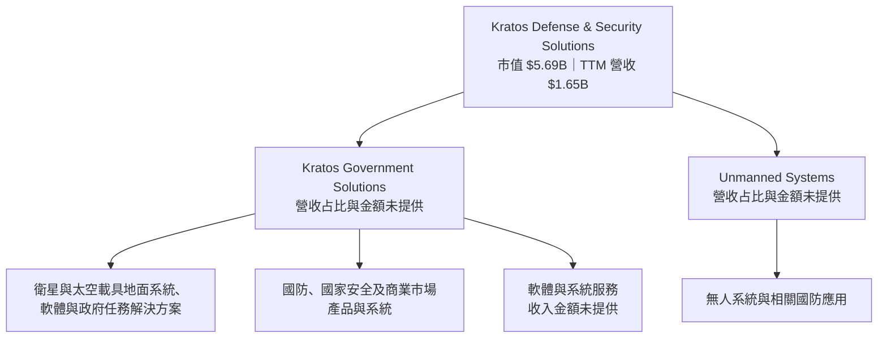
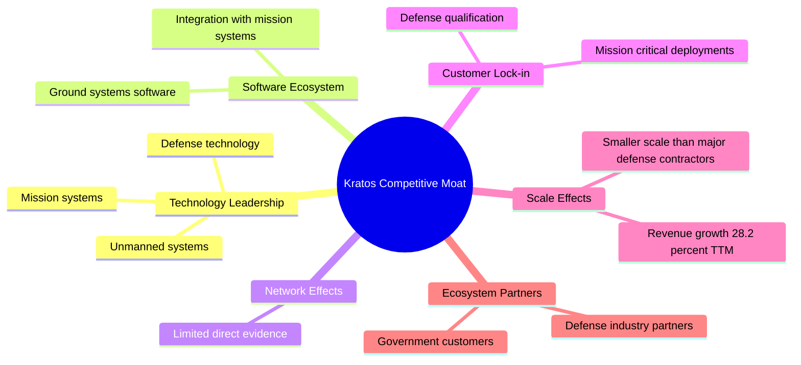
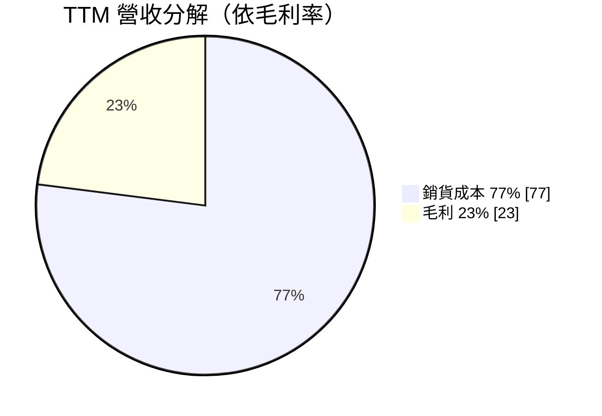
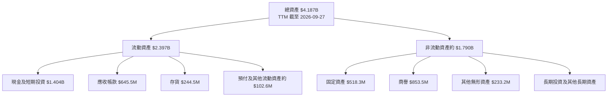
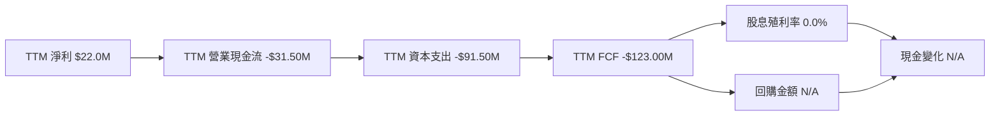
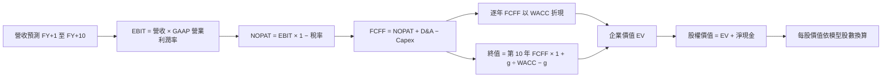
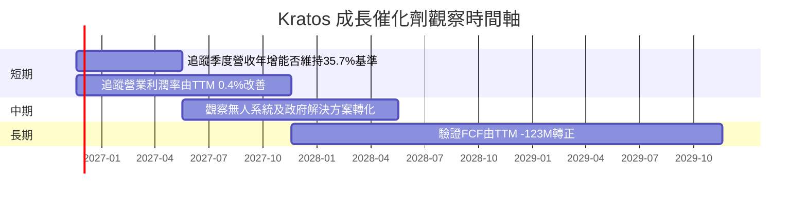
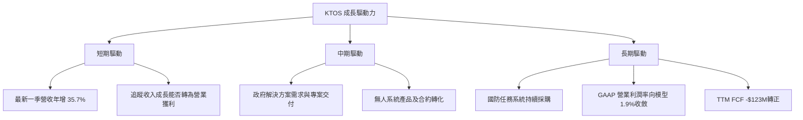
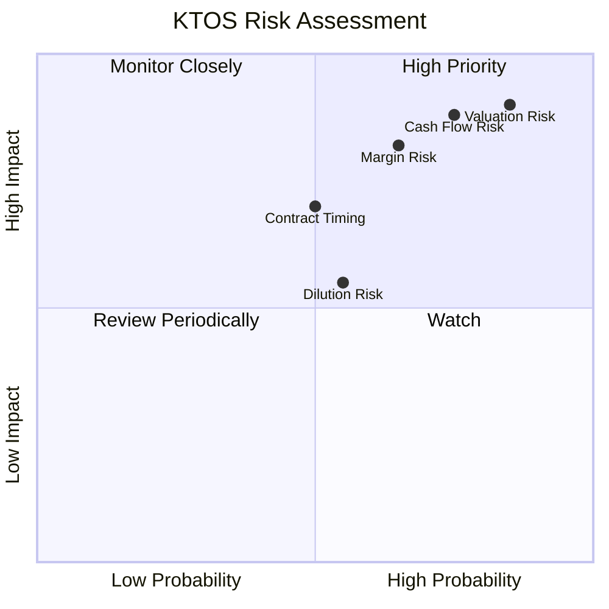
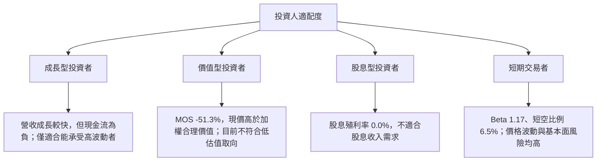

# KTOS 基本面深度分析報告
> **報告日期**：2026-11-19 ｜ **語言**：繁體中文 ｜ **數據來源**：SEC 申報資料 (XBRL)、Yahoo Finance、Finviz、StockAnalysis、Roic.ai ｜ **分析師**：CFA 級機構研究

## 目錄

| # | 章節 | 核心結論 |
|---|------|----------|
| 1 | 執行摘要 | 賣出；加權合理價值 $19.99，MOS -51.3% |
| 2 | 公司概覽與商業模式 | 無人系統與政府解決方案具國防需求支撐，但收入分部數據不足以量化護城河 |
| 3 | 損益表深度分析 | TTM 營收 $1.65B、TTM 成長 28.2%；營業利潤率僅 0.4% |
| 4 | 資產負債表分析 | 現金及短期投資 $1.40B；債務數字來源有差異，依核心財務指標採用淨現金 $1.40B |
| 5 | 現金流量深度分析 | TTM FCF -$123.00M、FCF Yield -2.16%，現金轉換偏弱 |
| 6 | 獲利能力與資本效率 | ROIC 0.2% 低於 WACC 10.30%，目前尚未創造經濟價值 |
| 7 | 相對估值分析 | 估值高於國防大型同業；相對自身歷史 P/S 亦處於中高位置 |
| 8 | DCF 內在價值評估 | 基準 DCF $9.82；加權合理價值 $19.99，MOS -51.3% |
| 9 | 成長催化劑 | 最新一季營收年增 35.7%；具無人系統等增長題材，TAM 數字未提供 |
| 10 | 風險矩陣 | 獲利轉化、現金流與高估值為主要風險 |
| 11 | 投資建議 | 依 MOS 評級為賣出；以季度營收、利潤率與 FCF 驗證投資論點 |

## 1. 執行摘要

### 1.0 一頁式投資儀表板（Portfolio Manager 30 秒速讀）

| 項目 | 內容 |
|------|------|
| **投資論點（3 句）** | ① TTM 營收 $1.65B、年增 28.2%，且最新一季營收年增 35.7%，顯示需求擴張。② 但 TTM 營業利益率僅 0.4%、ROIC 0.2%，明顯低於 10.30% WACC，成長尚未轉化為足夠經濟回報。③ TTM FCF -$123.00M、FCF Yield -2.16%，且加權合理價值 $19.99 低於現價 $30.24。 |
| **綜合評分** | **5.2/10**（引用 1.1 評分卡） |
| **財務健康** | 🟡 現金及短期投資 $1.40B、流動比率 5.418；但 FCF 為負，且債務資料存在來源差異。 |
| **ROIC vs WACC** | **0.2% vs 10.30%**；目前未達資本成本門檻，摧毀而非創造股東價值。 |
| **FCF 趨勢** | TTM FCF 為 **-$123.00M**，FCF Yield **-2.16%**；資本支出高於營業現金流。 |
| **估值** | Forward P/E **27.04x** ｜ EV/EBITDA **50.45x**（另一估值資料來源）｜ FCF Yield **-2.16%** |
| **DCF 內在價值（基準）** | **$9.82** ｜現價相對 DCF 溢價 **208.0%**（使用第 8.5 節 DCF 基準值） |
| **安全邊際（MOS）** | **-51.3%＝($19.99 − $30.24) ÷ $19.99**；🔴 未提供下檔保護（基準為第 8.8 節加權合理價值） |
| **預期報酬（基準情境 12M）** | DCF 基準情境相對現價 **-67.5%**；此為模型價值變動，不是外部股價預測。 |
| **關鍵風險（前二）** | 營收成長未同步帶動獲利及現金流；目前估值對遠期成長與利潤率提升要求高。 |
| **評級 + 信心度** | 🔴 **賣出** ｜信心：中；估值訊號明確，但 DCF 對長期假設敏感，且債務資料不一致。 |

### 1.1 綜合評分卡（全報告唯一）

| 維度 | 評分（1–10） | 主要依據（引用數字與其來源章節） |
|------|--------------|----------------------------------|
| 成長性 | 8.0 | TTM 營收年增 28.2%、最新一季年增 35.7%（第 3 章）；營收成長暫未充分轉化成獲利。 |
| 獲利能力 | 2.5 | TTM 營業利益率 0.4%、ROIC 0.2% 對 WACC 10.30%、Piotroski 3/8（第 3、6 章）。 |
| 財務健康 | 8.5 | 現金及短期投資 $1.40B、流動比率 5.418、CCC 80 天（第 4 章）；但 FCF 為負。 |
| 估值 | 1.0 | MOS -51.3%；Forward P/E 27.04x，高於同業中位數 18.1x（第 7、8 章）。 |
| 護城河 | 6.5 | 國防任務需求、無人系統與政府客戶關係具一定黏著度；分部營收與市占資料未提供（第 2 章）。 |
| 管理層與資本配置 | 4.5 | 股權薪酬 FY2025 為 $35.5M，稀釋股數測試未通過；TTM FCF -$123.00M（第 3、5、6 章）。 |
| **綜合評分** | **5.2** | 六項算術平均： (8.0 + 2.5 + 8.5 + 1.0 + 6.5 + 4.5) ÷ 6 = 5.17，四捨五入為 **5.2/10**。 |

### 1.2 五大投資論點 + 三大核心風險

| 類型 | 項目 | 具體依據 | 信心度 |
|------|------|----------|--------|
| 🟢 **投資論點①** | 國防需求下的營收擴張 | TTM 營收 $1.65B、年增 28.2%；最新一季年增 35.7%。 | 🟢 高 |
| 🟢 **投資論點②** | 無人系統與政府解決方案具策略位置 | 公司有 Kratos Government Solutions 與 Unmanned Systems 兩個主要部門；國防採購與任務系統為業務背景。 | 🟡 中 |
| 🟢 **投資論點③** | 現金緩衝充足 | 現金及短期投資 $1.40B；流動比率 5.418。 | 🟢 高 |
| 🟢 **投資論點④** | 毛利額隨營收增加 | FY2022 毛利 $226.0M，FY2025 為 $307.9M；但 FY2025 毛利率較 FY2024 下滑。 | 🟡 中 |
| 🟢 **投資論點⑤** | 分析師仍看好遠期成長 | 25 位分析師平均目標價 $74.68；此共識與 DCF 及同業倍數法差距大，應視為市場預期而非已實現基本面。 | 🟡 中 |
| 🟡 **風險①** | 營收成長無法轉化為現金 | TTM 營業現金流 -$31.50M、Capex $91.50M、FCF -$123.00M。 | 🔴 高衝擊 |
| 🔴 **風險②** | 估值對成長預期依賴過高 | 加權合理價值 $19.99，低於 $30.24 現價；MOS -51.3%。 | 🔴 高衝擊 |
| 🔴 **風險③** | 資本回報低於資本成本 | ROIC 0.2%，WACC 10.30%；若改善延遲，營收成長可能持續伴隨低資本回報。 | 🔴 高衝擊 |

### 1.3 快速統計卡片

| 指標 | 公司實際值（期間） | 同業中位數 | 狀態 |
|------|--------------------|------------|------|
| 營收成長（TTM） | **28.2%** | — | 🟢 |
| 營收成長（最新一季年增） | **35.7%** | 6.7% | 🟢 |
| 毛利率（TTM） | **23.0%** | 20.0% | 🟡 |
| 營業利益率（TTM） | **0.4%** | — | 🔴 |
| ROIC（TTM） | **0.2%** | — | 🔴 |
| Forward P/E | **27.04x** | 18.1x | 🔴 |
| FCF Yield（TTM） | **-2.16%** | — | 🔴 |
| Piotroski F-Score | **3 / 8** | — | 🔴 |

同業中位數以 AVAV、LMT、NOC 三家公司區塊內數值計算；最新一季營收成長中位數為 6.7%，毛利率中位數為 20.0%，Forward P/E 中位數為 18.1x。

### 1.4 投資結論

```text
╔══════════════════════════════════════════════════════════════════╗
║                    📊 投資結論摘要                               ║
╠══════════════════════════════════════════════════════════════════╣
║  評級：🔴 賣出（依 MOS 規則 20）                                 ║
║  價格（2026-11-18 收盤）：$30.24                                 ║
║  DCF 內在價值（基準）：$9.82（現價溢價 208.0%）                 ║
║  安全邊際 MOS：-51.3%＝($19.99−$30.24)÷$19.99                   ║
║  加權合理價值（8.8）：$19.99                                     ║
║  DCF 情境價值：                                                  ║
║    悲觀情境：$8.18（相對現價 -72.9%）                            ║
║    基準情境：$9.82（相對現價 -67.5%）                            ║
║    樂觀情境：$13.54（相對現價 -55.2%）                          ║
║  綜合評分：5.2/10（引用 1.1）                                    ║
║  適合投資人：能承受高波動、以小部位追蹤國防成長股的投資人；      ║
║              不適合以低估值、穩定 FCF 或股息為核心的投資人。     ║
╚══════════════════════════════════════════════════════════════════╝
```

依 MOS 門檻，評級為**賣出**；不作一級質化調整。主要理由是加權合理價值低於現價，且 ROIC 低於 WACC、TTM FCF 為負。

## 2. 公司概覽與商業模式

### 2.1 業務結構與收入來源



公司提供國防、國家安全及商業市場的技術、硬體、產品、系統與軟體，業務涵蓋美國及國際市場。兩個主要部門為 Kratos Government Solutions 與 Unmanned Systems；各部門營收、分部利潤及軟體服務收入均未提供，因此不能用數字推估各板塊占比。

### 2.2 市場份額

市場份額數據未提供，亦未見可引用的市場規模或年份資料。KTOS TTM 營收為 $1.65B、TTM 成長率 28.2%，最新一季年增 35.7%；這說明公司目前增長快於 AVAV、LMT、NOC 的最新一季營收成長，但不能由此推論其市場份額或市場排名。

### 2.3 競爭護城河分析



### 2.4 護城河強度

| 護城河項目 | 強度（強／中／弱） | 證據（引用數字或事實） | 會削弱它的情況 |
|------------|--------------------|------------------------|----------------|
| 技術與產品 | 中 | 涵蓋政府解決方案、無人系統、衛星地面系統及軟體；具體研發成果與產品收入未拆分。 | 技術迭代落後、競爭者提供更低成本或更成熟產品。 |
| 軟體與系統整合 | 中 | 公司提供衛星與太空載具地面系統及相關軟體；軟體收入占比、續約率未提供。 | 客戶改採標準化第三方產品、整合能力難以轉化為持續服務收入。 |
| 客戶鎖定 | 中 | 國防任務系統通常涉及測試、認證與整合；本報告未取得客戶留存率或合約續約數字。 | 採購取消、競標失利或客戶集中度提高。 |
| 規模效應 | 弱至中 | TTM 營收 $1.65B，低於大型國防承包商的經營規模；但營收成長 28.2%。 | 大型同業憑規模、融資能力及供應鏈議價取得成本優勢。 |
| 網路效應 | 弱 | 未提供使用者數、平台參與者或生態網路效應的量化證據。 | 產品以單一專案交付為主，缺乏可累積網路效應。 |
| 生態夥伴 | 中 | 業務服務政府與國防市場；合作夥伴收入或共同專案金額未提供。 | 關鍵合作夥伴更換供應商或自建替代方案。 |

第 1.1 節「護城河」評分 **6.5/10**，依據是公司具有技術、系統整合及國防客戶關係等門檻，但缺乏分部營收、市占、續約率等數據驗證其持續性。

## 3. 損益表深度分析

### 3.1 年度收入成長趨勢（近4年）

```text
╔══════════════════════════════════════════════════════════════════╗
║          Kratos 年度收入趨勢（FY2022-FY2025）                    ║
╠══════════════════════════════════════════════════════════════════╣
║  FY2022  $0.898B  █████████████░░░░░░░░░░░░░  YoY：基期       ║
║  FY2023  $1.037B  ███████████████░░░░░░░░░░░░  YoY：+15.4% 🟢 ║
║  FY2024  $1.136B  █████████████████░░░░░░░░░░  YoY：+9.6%  🟢 ║
║  FY2025  $1.347B  ████████████████████░░░░░░░  YoY：+18.6% 🟢 ║
║                                                                  ║
║  FY2022 至 FY2025 營收 CAGR：約 14.5%                            ║
║  TTM 營收 $1.65B；TTM 成長 28.2%                                 ║
╚══════════════════════════════════════════════════════════════════╝
```

FY2022 至 FY2025 營收 CAGR 約 14.5%，計算為 \((1.347 ÷ 0.8983)^{1/3}-1\)。TTM 成長升至 28.2%，最新一季年增 35.7%，顯示近期增長加速；但營業利益率仍接近損益兩平，尚未證明增長已帶來相應營業槓桿。

### 3.2 季度收入趨勢分析

| 季度 | 營收 | QoQ 成長 | YoY 成長 | 備註 |
|------|------:|---------:|---------:|------|
| 2025 Q4 | $345.1M | 14.0%* | 21.9% | 相較 2025 Q3 $302.6M；季節性可能影響 QoQ。 |
| 2026 Q1 | $371.0M | 7.5% | 22.6% | 營收高於 2025 Q1 $302.6M。 |
| 2026 Q2 | $458.8M | 23.7% | 30.5% | 相較 2025 Q2 $371.0M；收入擴張加速。 |
| 2026 Q3 | $471.8M | 2.8% | 35.7% | 最新季年增率是**單季**數字，不是 TTM。 |

\*2025 Q4 QoQ 以 StockAnalysis 所列 2025 Q3 $302.6M 計算；季度來源整理口徑可能與其他報表摘要不同。YoY 及 TTM 成長率遵照 SEC 申報資料與已核實財務數字。

### 3.3 利潤率演變分析

| 利潤率指標 | FY2022 | FY2023 | FY2024 | FY2025 | 趨勢 | 評估 |
|------------|-------:|-------:|-------:|-------:|------|------|
| **毛利率** | 25.2% | 25.9% | 25.3% | 22.9% | FY2025 下滑 | 🟡 |
| **營業利益率** | 0.5% | 3.0% | 2.6% | 2.1% | FY2023 高點後收縮 | 🟡 |
| **淨利率** | -4.1% | -0.9% | 1.4% | 1.6% | 由虧損轉正 | 🟡 |
| **EBITDA 利潤率** | 2.9% | 7.5% | 8.2% | 7.6% | FY2024 後小幅回落 | 🟡 |

年度利潤率以年度營收與毛利、營業利益及淨利計算。FY2025 營收成長至 $1.347B，但毛利率由 FY2024 約 25.3% 降至 22.9%，營業利益率亦由約 2.6% 降至 2.1%；可能反映專案及產品組合、成本投入與擴張節奏變化，現有資料不足以將原因拆成價格、材料、人工或整合成本。最新 TTM 營業利益率按核實數字為 0.4%，最新單季則為 -1.0%，說明近期利潤表現較年度趨勢弱。

### 3.4 費用結構分析



此圖是營收分解，不代表完整營業費用明細。TTM 毛利率為 23.0%，即銷貨成本約占營收 77.0%；研發費用 FY2025 為 $40.0M。SG&A 等完整費用結構數據未提供，故不以估計數字繪製費用占比。

### 3.5 季度 EPS 趨勢與盈餘品質（Quality of Earnings）

| 盈餘品質項目 | 數值／佔比 | 評估 |
|--------------|-----------|------|
| 股權薪酬 SBC / 營收 | 約 **3.55%**：TTM SBC $58.5M ÷ TTM 營收 $1.647B | 🔴 SBC 不是現金支出，但會稀釋股東；TTM SBC 以四個季度 $18.1M、$16.3M、$15.0M、$9.1M 加總。 |
| SBC / 營業現金流 | **-185.7%**：$58.5M ÷ -$31.50M | 🔴 OCF 為負，比例方向不宜解讀為正向覆蓋；SBC 規模高於營業現金流的絕對值。 |
| FCF / 淨利（現金轉換率） | 約 **-559.1%**：-$123.00M ÷ $22.0M | 🔴 淨利為正而 FCF 為負，現金轉換較弱。 |
| 一次性／非經常性損益 | N/A（未提供可辨識明細） | 無法判定一次性損益是否影響當期盈餘。 |
| 有效稅率異常 | N/A（未提供 TTM 實際有效稅率） | DCF 使用 21.0% 為預設模型稅率，不能當作實際有效稅率。 |
| 資本化支出 vs 費用化 | TTM Capex $91.50M；資本化支出占營收約 5.56% | 🟡 資本支出高於 TTM OCF；資本化支出細項及費用化政策無足夠資料判斷。 |

季度 EPS beat/miss 歷史中的分析師預期與實際 EPS 欄位為 N/A，因此**過去四季無法判定超預期或不及預期**。可確認的季度淨利為 2025 Q4 $5.9M、2026 Q1 $11.9M、2026 Q2 $4.4M、2026 Q3 -$0.2M；最新季度轉虧，與收入仍成長形成反差，顯示成本和專案組合值得追蹤。

**盈餘品質結論**：GAAP 淨利為正，但 TTM FCF -$123.00M、SBC 約占營收 3.55%，且現金轉換率約 -559.1%。目前不宜只按 EPS 或分析師共識估值；若營業現金流無法回正，GAAP 盈利對可分配股東現金的代表性有限。

## 4. 資產負債表分析

### 4.1 資產結構分解



非流動資產約 $1.790B 以總資產減流動資產計算。子項合計可能因四捨五入及報表分類差異與總額略有出入。

### 4.2 流動性與營運資金分析

| 指標 | 最新 TTM | 一年前 TTM | 變化 | 解讀 |
|------|---------:|----------:|------:|------|
| 流動比率 | 5.418 | N/A | N/A | 短期流動性緩衝充足；比較期未提供同口徑數字。 |
| 速動比率 | 4.632 | N/A | N/A | 排除存貨後仍高，短期償付能力具緩衝。 |
| DSO 應收帳款天數 | 42 天 | 39 天 | +3 天 | 收款週期略延長，可能需要關注應收帳款與收入同步性。 |
| DIO 存貨天數 | 70 天 | 66 天 | +4 天 | 存貨周轉略慢，可能反映備貨或交付週期延長。 |
| DPO 應付帳款天數 | 32 天 | 24 天 | +8 天 | 對供應商付款天數增加，短期抵銷部分應收及庫存壓力。 |
| CCC 現金轉換週期 | 80 天 | 81 天 | -1 天 | 週期略改善；CCC 仍長，營運資金占用仍需追蹤。 |

營運資金天數照抄品質指標計算結果。DSO 增加及 DIO 增加可能使現金較長時間留在應收與存貨中；DPO 上升使 CCC 小幅改善，但沒有客戶帳款賬齡、存貨組成或付款條件資料，不能據此判定議價能力變化。

### 4.3 債務結構分析

```text
╔══════════════════════════════════════════════════════════════════╗
║                  Kratos 債務健康診斷                             ║
╠══════════════════════════════════════════════════════════════════╣
║  總債務：        N/A（核心指標資料未提供）                       ║
║  其他來源列示：   $246.00M（與核心指標口徑不一致）               ║
║  現金+短期投資： $1.40B  ████████████████████  🟢                ║
║  淨現金：        $1.40B（採用核實財務指標）                       ║
║  流動比率：      5.418x  🟢                                       ║
║  Debt/EBITDA：   N/A（總債務核實數值缺漏）                       ║
║  Interest Coverage：N/A（利息費用與可核實債務明細不足）         ║
╠══════════════════════════════════════════════════════════════════╣
║  注意：另一組市場資料列示總債務 $246M、淨現金 $1.16B；           ║
║  本報告估值部分依核實財務指標的淨現金 $1.40B，並披露差異。       ║
╚══════════════════════════════════════════════════════════════════╝
```

### 4.4 股東權益趨勢

```text
╔══════════════════════════════════════════════════════════════════╗
║                股東權益歷年變化                                  ║
╠══════════════════════════════════════════════════════════════════╣
║  FY2022  $936.3M  █████████░░░░░░░░░░░░░░░░                    ║
║  FY2023  $976.0M  █████████░░░░░░░░░░░░░░░░                    ║
║  FY2024  $1.350B  █████████████░░░░░░░░░░░                      ║
║  FY2025  $2.000B  ████████████████████                          ║
╚══════════════════════════════════════════════════════════════════╝
```

FY2025 股東權益增至 $2.00B；同期現金也由 FY2024 的 $329.3M 升至 $560.6M。最新 TTM 資產負債表現金及短期投資為 $1.404B。權益增長可能涉及融資、股權發行或其他權益變化；缺少完整權益變動表，不能把增加全部歸因於營運獲利。

## 5. 現金流量深度分析

### 5.1 現金流量瀑布圖



瀑布中淨利與現金流並非簡單逐項等式；營運資金變動、非現金項目及其他現金流會造成差異。TTM FCF 依統一定義為 OCF 減 Capex，數值為 -$123.00M。

### 5.2 FCF 轉換率趨勢

| 期間 | FCF | 淨利 | FCF / 淨利 | 評估 |
|------|----:|----:|-----------:|------|
| FY2023 | $12.8M | -$8.9M | -143.8% | 淨利為負，比例不具通常的現金轉換解讀。 |
| FY2024 | -$8.5M | $16.3M | -52.1% | 盈利未能轉為正 FCF。 |
| FY2025 | -$137.4M | $22.0M | -624.5% | Capex 擴大，FCF 顯著轉負。 |
| TTM | -$123.00M | $22.0M | -559.1% | 負 FCF 延續，需觀察投入是否帶來產能與收入回報。 |

### 5.3 自由現金流趨勢

```text
╔══════════════════════════════════════════════════════════════════╗
║                 自由現金流趨勢                                   ║
╠══════════════════════════════════════════════════════════════════╣
║  FY2023  +$12.8M   ██░░░░░░░░░░░░░░░░░░                         ║
║  FY2024   -$8.5M   ◀░░░░░░░░░░░░░░░░░░                          ║
║  FY2025 -$137.4M   ◀████████████████████                        ║
║  TTM    -$123.0M   ◀██████████████████                          ║
║  TTM FCF Yield：-2.16%                                           ║
╚══════════════════════════════════════════════════════════════════╝
```

FY2025 FCF 為 -$137.4M，TTM 為 -$123.00M。TTM OCF -$31.50M、Capex $91.50M，表示資本支出是 FCF 為負的重要構成因素；但營業現金流本身也為負，因此不能只以投資擴產解釋現金消耗。

### 5.4 資本配置評估

資本配置金額資料不足，無法製作有可核實比例的資本配置圓餅圖。

| 項目 | 已知數據 | 評估 |
|------|---------|------|
| Capex | TTM $91.50M | 約占 TTM 營收 5.56%；投資回報需以後續營收及利潤率驗證。 |
| 股息 | 殖利率 0.0% | 無現金股息回報。 |
| 回購 | N/A | 未提供 TTM 回購金額。 |
| SBC | TTM 約 $58.5M | 形成股權稀釋成本；需與營收增長及人才留任效果一併評估。 |
| 現金 | $1.40B | 形成資金緩衝；具體併購、投資或融資用途未提供。 |

## 6. 獲利能力與資本效率

### 6.1 ROE / ROA / ROIC 趨勢

| 指標 | FY2025／TTM | 歷史參考 | 評估 |
|------|-------------|----------|------|
| ROE | TTM 0.6%（核實指標） | 年度分年數值未提供同口徑序列 | 🟡 正但偏低；資產與股東資本尚未帶來高回報。 |
| ROA | TTM 0.2% | F-Score 顯示 ROA 高於零，但低於一年前 | 🔴 資產回報偏低且同比未改善。 |
| ROIC | TTM 0.2% | 過往可比序列 N/A | 🔴 遠低於 WACC 10.30%。 |

另有市場資料列示 ROE 0.8%，與核實品質指標的 ROE 0.6%不一致；本節引用品質指標 ROE 0.6%。未提供可比同行 ROIC、ROA 或 ROE 的同口徑數據，因此不列行業均值。

### 6.2 ROIC vs WACC 分析（核心價值創造判斷）

```text
╔══════════════════════════════════════════════════════════════════╗
║                ROIC vs WACC 深度分析                            ║
╠══════════════════════════════════════════════════════════════════╣
║  WACC（直接採用資本成本資料）：10.30%                            ║
║  ├── 無風險利率（10Y 美債）： 5.07%                              ║
║  ├── 市場風險溢酬 ERP：       5.00%                              ║
║  ├── 原始 Beta：              1.17                               ║
║  ├── 調整後 Beta：            1.11                               ║
║  ├── 股權成本 Ke：            10.62%                             ║
║  ├── 稅前債務成本：           3.90%                              ║
║  ├── 股權／債務權重：         95.9%／4.1%                       ║
║  └── 採用 WACC：              10.30%                             ║
║                                                                  ║
║  ROIC（TTM）：0.2%                                                ║
║  EVA 差額 = ROIC − WACC = 0.2% − 10.30% = -10.10 個百分點        ║
║                                                                  ║
║  ROIC  0.2%   ░░░░░░░░░░░░░░░░░░░░░░░░░░░░░░                   ║
║  WACC 10.30%  ▓▓▓▓▓▓▓▓▓▓▓▓▓▓▓▓▓▓▓▓▓▓▓▓▓▓▓▓                     ║
║                                                                  ║
║  結論：ROIC 低於 WACC，現階段未創造足以覆蓋資本成本的回報。      ║
╚══════════════════════════════════════════════════════════════════╝
```

Beta 調整方式為 \(\frac{2}{3}×1.17+\frac{1}{3}×1=1.11\)。股權成本採 CAPM 輸入值 10.62%；資本成本資料的債務成本與權重採用稅前 Kd 3.90%、股權 95.9%、債務 4.1%，WACC 使用預先計算值 10.30%。以報表所列已四捨五入輸入值重算可能出現 0.01 個百分點差異，因此不另替換核實 WACC。ROIC 與 WACC 差距為 **-10.10 個百分點**，反映目前資本投入尚未產生高於資本成本的營業回報。

### 6.3 杜邦三因素分解

| 因素 | 數值（TTM） | 解讀 |
|------|-------------|------|
| 淨利率 | 1.3% | 獲利率偏薄，盈餘對成本及收入組合變化敏感。 |
| 資產週轉率 | 0.39 | 每單位資產創造的營收有限；資產擴張與營收變現速度需追蹤。 |
| 權益乘數 | 1.21 | 槓桿程度不高，ROE 並非主要由高財務槓桿支撐。 |
| **ROE** | **0.6%** | QUALITY FIGURES 原值：1.3% × 0.39 × 1.21 = 0.6%（四捨五入）。 |

### 6.4 財務體質：Piotroski F-Score

Piotroski F-Score 為 **3/8**；九項測試中一項因缺少輸入無法判定，因此可判定分母為 8。

| 測試 | 結果 | 解讀 |
|------|------|------|
| ROA > 0 | ✅ 通過 | TTM 資產回報為正。 |
| 營業現金流 > 0 | ❌ 未通過 | TTM OCF -$31.50M。 |
| ROA 高於一年前 | ❌ 未通過 | 資產回報同比下降。 |
| 營業現金流 > 淨利 | ❌ 未通過 | OCF 為負，低於正淨利；應計品質偏弱。 |
| 長期負債 ÷ 總資產低於一年前 | — 無法判定 | 缺少測試所需一致口徑資料。 |
| 流動比率高於一年前 | ✅ 通過 | 流動性測試改善。 |
| 稀釋股數未增加 | ❌ 未通過 | 稀釋股數增加，需關注股權薪酬稀釋。 |
| 毛利率高於一年前 | ✅ 通過 | 此項比較通過；但年度毛利率與最新 TTM 仍應分期間解讀。 |
| 資產週轉率高於一年前 | ❌ 未通過 | 資產利用效率同比未改善。 |

## 7. 相對估值分析

### 7.1 同業估值比較表格

| 估值指標 | **KTOS** | **AVAV** | **LMT** | **NOC** | KTOS 評估 |
|----------|---------:|---------:|--------:|--------:|-----------|
| **Trailing P/E** | 252.0x | N/A | 20.5x | 17.1x | 🔴 遠高於可比較盈利同業；KTOS 本身 EPS 基數低。 |
| **Forward P/E** | 27.04x | 22.9x | 17.4x | 18.1x | 🔴 KTOS 高於同業中位數 18.1x。 |
| **P/S Ratio** | 3.46x | 2.6x | 1.7x | 1.8x | 🔴 高於三家同業。 |
| **EV/EBITDA** | 50.45x | 24.6x | 15.0x | 12.4x | 🔴 倍數偏高；KTOS 成長較快，但現金流與利潤率仍弱。 |
| **最新一季營收 YoY** | 35.7% | 5.7% | 11.3% | 6.7% | 🟢 成長明顯較快，但能否維持及提升獲利仍待驗證。 |
| **TTM 毛利率** | 23.0% | 26.5% | 11.7% | 20.0% | 🟡 約在同業範圍內；與 AVAV 相比偏低。 |

KTOS 的營收成長明顯快於可比公司，但估值倍數也更高。成長溢價要成立，必須逐步反映為營業利潤率及自由現金流改善，而非僅有收入規模擴張。

### 7.2 歷史估值區間分析

```text
╔══════════════════════════════════════════════════════════════════╗
║                 KTOS 五年估值位置                                ║
╠══════════════════════════════════════════════════════════════════╣
║  P/E：      232.9x ── 現值 252.0x ── 中位數 380.2x               ║
║             當前歷史百分位：27%                                  ║
║  P/S：      1.3x ──── 中位數 3.2x ── 現值 3.5x ── 11.6x         ║
║             當前歷史百分位：60%                                  ║
║  EV/EBITDA：33.8x ── 現值 51.7x ── 中位數 55.5x ── 221.5x       ║
║             當前歷史百分位：50%                                  ║
╚══════════════════════════════════════════════════════════════════╝
```

P/E 歷史區間上限出現極端值，代表歷史盈利基數可能極低，因此 P/E 百分位解讀須謹慎。P/S 現值 3.5x 高於歷史中位數 3.2x；EV/EBITDA 51.7x 接近自身歷史中位數 55.5x，但仍高於同業中位數。

### 7.3 情境價值（Bear / Base / Bull，照抄 DCF MODEL 的 Scenarios）

| 情境 | 第 1 年營收成長 | 期末營業利潤率 | WACC | 每股價值 | 相對現價 | 機率 | 會發生的條件 |
|------|----------------|----------------|------|----------|----------|------|--------------|
| 🔴 悲觀 | 14.1% | 1.6% | 11.30% | $8.18 | -72.9% | 25% | 成長率較基準低、利潤率改善受限，且風險折現率提高。 |
| 🟡 基準 | 28.2% | 1.9% | 10.30% | $9.82 | -67.5% | 50% | 按基準收入增速起步，利潤率緩慢改善至模型假設。 |
| 🟢 樂觀 | 42.3% | 2.1% | 9.30% | $13.54 | -55.2% | 25% | 早期收入成長高於基準，期末利潤率改善，資本成本下降。 |

### 7.4 相對估值隱含價格區間

```text
╔══════════════════════════════════════════════════════════════════╗
║           估值方法隱含價格與目前價格位置                         ║
╠══════════════════════════════════════════════════════════════════╣
║  $9.82 ── $14.11 ── $20.28 ── 現價 $30.24 ───── $74.68           ║
║  DCF       EV/EBITDA  Forward P/E  ▲現價          分析師共識       ║
╚══════════════════════════════════════════════════════════════════╝
```

| 方法 | 每股價值 | 相對現價 | 依據 |
|------|---------:|---------:|------|
| 同業 Forward P/E | $20.28 | -32.9% | AVAV、LMT、NOC 同業中位數 18.1x × KTOS Forward EPS $1.12。 |
| 同業 EV/EBITDA | $14.11 | -53.3% | 同業 EV/EBITDA 中位數 15.0x × KTOS TTM EBITDA，再加淨現金。 |

## 8. DCF 內在價值評估（Discounted Cash Flow）

### 8.0 估值推理鏈（Thinking Logic）

**核心命題**：KTOS 的估值取決於現有政府解決方案與無人系統收入能否持續成長，並將收入增長轉化為高於資本成本的營業利潤與現金流；目前兩部門的收入占比均未提供，無法分別估算其價值或營收份額。模型敏感度中，終值占企業價值 84.1%，因此長期 FCFF 能否提高、以及 WACC 與永續成長率之差，是估值關鍵。

| 決策點 | 本報告採用 | 理由（含數字） | 曾考慮但否決 | 否決理由 |
|--------|-----------|----------------|--------------|----------|
| 現金流定義 | FCFF | 以 WACC 折現，對應企業價值 EV；模型公式為 NOPAT + D&A − Capex。 | FCFE | 模型已採用 FCFF，不另改定義。 |
| 預測期 N | 10 年 | DCF MODEL 固定為 10 年；可涵蓋營收增速及營業利潤率逐年淡化過程。 | 5 年 | 與程式提供的唯一模型不一致。 |
| 終值方法 | Gordon Growth | 模型已列 TV 與現值；g 3.0% 小於 WACC 10.30%。 | 退出倍數法 | 模型未提供退出倍數終值，不另造數字。 |
| EBIT 基礎 | GAAP EBIT | 模型明示 GAAP EBIT；TTM 營業利益率 0.4%。 | 非 GAAP EBIT | 未提供可對照的非 GAAP EBIT 模型。 |

**關鍵假設推導鏈：**

- **營收成長**：錨點為 TTM 成長 28.2% → 由最新單季年增 35.7% 支持近期動能，但模型要求十年逐年淡化 → 採用 FY+1 28.2%、FY+10 3.0% → 曾考慮以最新單季年增率 35.7%作起點，但否決，因單季增速不能直接當作 TTM 或長期成長率。
- **營業利潤率**：錨點為 TTM 0.4% → 模型以過去五個財年中位數作長期收斂目標 → 採用 FY+1 0.4%至 FY+10 1.9% → 未採用較高利潤率，因現有數據未證明近期能持續擴張；最新一季營業利益率為 -1.0%。
- **永續成長率 g**：錨點為模型採用 3.0% → 需保持低於 WACC，且終值依賴度已達 84.1% → 採用 3.0% → 不採用更高 g，因會進一步放大終值占比及模型敏感度。
- **預測期 N**：錨點為模型設定 10 年 → 公司所在國防業務可能具有長週期，但合同能見度資料未提供 → 採用 10 年 → 不採用較短期限，因與核定模型不同；亦不另延長以增加終值。
- **Capex／營收**：錨點為 TTM Capex $91.50M ÷ TTM 營收 $1.65B，約 5.6% → 模型逐步下降至 D&A 的 1.1 倍 → 採用 FY+1 5.6%至 FY+10 5.1% → 不假設大幅低於維持資產所需支出，因 TTM FCF 已為負。
- **GAAP EBIT、SBC 與稀釋**：錨點為 GAAP EBIT 已將 SBC 作費用處理 → 模型固定股數且不再另扣 SBC → 採用組合 **(A)**：GAAP EBIT、無額外 SBC 列、年稀釋率 0% → 不採用加回 SBC 的非 GAAP 口徑，避免改動程式模型。
- **有效稅率與 D&A**：採用模型稅率 21.0%、D&A／營收 4.7%；依據為 DCF MODEL 的預設稅率及 TTM D&A 占比，實際 TTM 有效稅率未提供。
- **營運資金**：模型不納入 ΔWC。公司 CCC 為 80 天，但模型未提供營運資金變動金額；不自行補造 ΔWC。
- **WACC**：錨點為資本成本模型 WACC 10.30% → 使用調整後 Beta 1.11 與既定資本權重 → 採用 10.30% → 不以外部自行重算值取代，因本報告必須沿用資本成本與 DCF 模型所列 WACC。

最脆弱環節是 GAAP 營業利潤率能否從目前低水平穩定改善至長期 1.9%；若改善失敗，模型價值將下行，而基準 DCF 已低於現價 67.5%。



### 8.1 模型假設總表（Model Inputs）

| 假設項目 | 採用值 | 依據／來源 | 敏感度 |
|----------|--------|-------------|--------|
| 預測期長度 **N** | 10 年 | DCF MODEL 固定預測期；模型以 FY+1 至 FY+10 逐年淡化。 | 🟡 中 |
| 營收成長 | FY+1 28.2% → FY+10 3.0% | 起點為 TTM 成長 28.2%；逐年線性淡化至模型終點。 | 🔴 高 |
| 營業利潤率 | FY+1 0.4% → FY+10 1.9% | 起點為 TTM GAAP 營業利益率；終值採近五個財年中位數。 | 🔴 高 |
| 有效稅率 | 21.0% | DCF MODEL 預設稅率；實際 TTM 有效稅率未提供。 | 🟢 低 |
| Capex / 營收 | FY+1 5.6% → FY+10 5.1% | 起點依 TTM Capex／營收，逐步淡化至 D&A 的 1.1 倍。 | 🟡 中 |
| D&A / 營收 | 4.7% | DCF MODEL 的 TTM 比率，模型固定。 | 🟢 低 |
| 營運資金變動 | 未建模 | 模型明示 Working capital is not modelled；不另設輸入值。 | 🟢 低 |
| EBIT 基礎 | GAAP | 模型使用 GAAP EBIT。 | 🟡 中 |
| 股權薪酬 SBC 處理 | 不另扣 SBC | GAAP EBIT 已費用化 SBC。 | 🟡 中 |
| 年稀釋率 | 0% | 模型採固定股數，屬組合 (A)。 | 🟡 中 |
| 永續成長率 g | 3.0% | DCF MODEL 固定假設，且低於 WACC 10.30%。 | 🔴 高 |
| 終值方法 | Gordon Growth | DCF MODEL 提供 Gordon Growth 終值；未提供退出倍數終值。 | 🔴 高 |
| WACC | 10.30% | 資本成本輸入值；見 8.2。 | 🔴 高 |

**本模型採用 (A)：GAAP EBIT + 固定股數 + 不再扣減 SBC；因此 SBC 影響已計入一次。** FCFF 公式為 **NOPAT + D&A − Capex**，不納入 ΔWC，也不另扣 SBC。

### 8.2 折現率推導（WACC）

```text
╔══════════════════════════════════════════════════════════════════╗
║                    WACC 推導（折現率）                           ║
╠══════════════════════════════════════════════════════════════════╣
║  股權成本 Ke（CAPM）：                                           ║
║  ├── 無風險利率 Rf：               5.07%                        ║
║  ├── 市場風險溢酬 ERP：            5.00%                        ║
║  ├── 原始 Beta（Yahoo）：           1.17                         ║
║  ├── 調整後 Beta：                  1.11                         ║
║  ├── Beta 調整：                    2/3×1.17 + 1/3×1 = 1.11     ║
║  └── Ke = 5.07% + 1.11×5.00% = 10.62%                          ║
║                                                                  ║
║  債務成本：                                                      ║
║  ├── 稅前 Kd：                      3.90%                        ║
║  ├── 模型稅率：                     21.0%                        ║
║  └── 稅後 Kd = 3.90%×(1−21.0%) = 3.081%                       ║
║                                                                  ║
║  資本結構（核實輸入權重）：                                      ║
║  ├── 股權權重：                     95.9%                        ║
║  ├── 債務權重：                     4.1%                         ║
║  └── 採用 WACC：                    10.30%                       ║
╚══════════════════════════════════════════════════════════════════╝
```

逐步演算如下：

1. **Ke（CAPM）** = Rf + β × ERP = 5.07% + 1.11 × 5.00% = **10.62%**。
2. **稅前 Kd** = **3.90%**（資本成本資料直接提供計算結果；利息費用及平均計息負債金額未提供，因此不能獨立重建其分子、分母）。
3. **稅後 Kd** = 3.90% × (1 − 21.0%) = **3.081%**。
4. **權重** = 股權 95.9%、債務 4.1%；95.9% + 4.1% = **100.0%**。市值及計息負債絕對值無法依同一口徑由現有數據完整核實，故不反推。
5. **WACC** = 95.9% × 10.62% + 4.1% × 3.081% = 10.18458% + 0.126321% = 10.310901%；資本成本模型採用值為 **10.30%**。因提供輸入已四捨五入且要求使用既定 WACC，本報告後續一致採用 10.30%，不以重算的 10.31% 替換。

### 8.3 逐年自由現金流預測（基準情境）

金額單位：$B。以下逐年數字、折現因子與 PV 均照 DCF MODEL 原值列示；金額取兩位小數，折現因子取三位小數。模型未包含 ΔWC 列。

| 年度 | FY+1 | FY+2 | FY+3 | FY+4 | FY+5 | FY+6 | FY+7 | FY+8 | FY+9 | FY+10 |
|------|------:|------:|------:|------:|------:|------:|------:|------:|------:|-------:|
| 營收 | 2.11 | 2.65 | 3.24 | 3.88 | 4.54 | 5.19 | 5.78 | 6.28 | 6.64 | 6.84 |
| 營收 YoY | 28.2% | 25.4% | 22.6% | 19.8% | 17.0% | 14.2% | 11.4% | 8.6% | 5.8% | 3.0% |
| 營業利潤率 | 0.4% | 0.6% | 0.7% | 0.9% | 1.1% | 1.2% | 1.4% | 1.6% | 1.7% | 1.9% |
| EBIT | 0.01 | 0.01 | 0.02 | 0.03 | 0.05 | 0.06 | 0.08 | 0.10 | 0.12 | 0.13 |
| − 稅 | 0.00 | 0.00 | 0.00 | 0.01 | 0.01 | 0.01 | 0.02 | 0.02 | 0.02 | 0.03 |
| NOPAT | 0.01 | 0.01 | 0.02 | 0.03 | 0.04 | 0.05 | 0.06 | 0.08 | 0.09 | 0.10 |
| + D&A | 0.10 | 0.12 | 0.15 | 0.18 | 0.21 | 0.24 | 0.27 | 0.29 | 0.31 | 0.32 |
| − Capex | 0.12 | 0.15 | 0.18 | 0.21 | 0.24 | 0.28 | 0.31 | 0.33 | 0.34 | 0.35 |
| **FCFF** | **-0.01** | **-0.01** | **-0.01** | **-0.00** | **0.01** | **0.02** | **0.03** | **0.04** | **0.06** | **0.07** |
| 折現因子 @10.30% | 0.907 | 0.822 | 0.745 | 0.676 | 0.612 | 0.555 | 0.503 | 0.456 | 0.414 | 0.375 |
| **FCFF 現值 PV** | **-0.01** | **-0.01** | **-0.01** | **-0.00** | **0.00** | **0.01** | **0.01** | **0.02** | **0.02** | **0.03** |

FCFF 現值合計照模型提供值為 **$0.07B**。表格各年 PV 經四捨五入後相加會有尾差，不以顯示後的兩位小數重新覆蓋模型精度；逐年 PV 未四捨五入的完整小數未提供，因此無法用表內顯示值精確重建該合計。

**FY+1 逐步演算示範**：

1. **營收** = $1.65B × (1 + 28.2%) = $2.1153B ≈ **$2.11B**（模型列值）。
2. **EBIT** = $2.11B × 0.4% ≈ **$0.01B**（模型列值；原始未四捨五入營收與利潤率共同決定精確值）。
3. **稅** = EBIT × 21.0% ≈ **$0.00B**（模型列值）。
4. **NOPAT** = EBIT − 稅 ≈ **$0.01B**。
5. **D&A** = 營收 × 4.7% ≈ **$0.10B**。
6. **Capex** = 營收 × 5.6% ≈ **$0.12B**。
7. **ΔWC** = 模型未建模，未列入 FCFF。
8. **FCFF** = NOPAT + D&A − Capex = 約 $0.01B + $0.10B − $0.12B ≈ **-$0.01B**。
9. **折現因子** = 1 ÷ (1 + 10.30%)¹ = 0.907；**PV** = FY+1 FCFF × 0.907 ≈ **-$0.01B**（依模型列值）。

以上逐年模型格採用 DCF MODEL 原值。部分內部未四捨五入數字未公開，故除模型輸出外不能假稱所有兩位小數算式都能精確復原。FY+1 至 FY+4 FCFF 為負，會拉低預測期現值，但模型終值仍為正。

**合理性自檢：**

- 模型 FY+1 至 FY+10 FCFF 由 -$0.01B 增至 $0.07B；由於起始 FCF 為負，FCF CAGR 不具一般意義。歷史 FY2023 至 FY2025 FCF 亦由 +$12.8M 轉為 -$137.4M，模型反映的是未來逐漸轉正，而非延續歷史正向 CAGR。
- FY+10 FCF 利潤率約為 $0.07B ÷ $6.84B = **約 1.0%**；目前 TTM FCF 利潤率約 -$123M ÷ $1.65B = **約 -7.5%**。同業最佳 FCF 利潤率數據未提供，無法比較。
- FY+1 至 FY+4 FCFF 為負；因後續現金流及終值為正，DCF 可計算，但短期投入使估值更依賴長期改善。

```text
╔══════════════════════════════════════════════════════════════════╗
║            自由現金流：歷史實際 vs 模型預測                      ║
╠══════════════════════════════════════════════════════════════════╣
║  FY2023(實)  +$0.013B  ██░░░░░░░░░░░░░░░░░░                    ║
║  FY2024(實)  -$0.009B  ◀█░░░░░░░░░░░░░░░░░░                     ║
║  FY2025(實)  -$0.137B  ◀████████████████████                    ║
║  TTM(實)     -$0.123B  ◀██████████████████                      ║
║  FY+1(預)    -$0.010B  ◀█░░░░░░░░░░░░░░░░░░                     ║
║  FY+10(預)   +$0.070B  ██████████░░░░░░░░░░                     ║
╠══════════════════════════════════════════════════════════════════╣
║  模型假設現金流由前期負值逐步轉正；與歷史 FCF 波動相比，         ║
║  需持續驗證營收增長是否能帶動利潤及現金轉換改善。               ║
╚══════════════════════════════════════════════════════════════════╝
```

### 8.4 終值計算（Terminal Value）

**適用性檢查**：WACC **10.30%** vs g **3.0%** → **WACC > g？✅**

| 方法 | 計算式 | 終值 TV | TV 現值 | 佔總 EV 比重 |
|------|--------|---------|---------|--------------|
| Gordon Growth | FY+10 FCFF × (1 + g) ÷ (WACC − g) | $1.00B | $0.37B | 84.1% |
| 退出倍數法 | N/A（DCF MODEL 未提供退出倍數終值） | N/A | N/A | N/A |

逐步演算（Gordon Growth）：

1. **FY+N FCFF** = FY+10 FCFF **$0.07B**（照模型列值）。
2. **分子** = FCFF × (1 + g) = $0.07B × (1 + 3.0%)。
3. **分母** = 10.30% − 3.0% = **7.30%**。
4. 模型以未四捨五入 FCFF 計算，列示 **TV $1.00B**；PV(TV) = $1.00B × 0.375 = **$0.37B**（依模型列值）。
5. **終值佔比** = 84.1%（DCF MODEL 原值）。

以表格顯示的 $0.07B 直接重算會因底層 FCFF 及折現值已四捨五入，與模型列示 TV 出現尾差。依規則 19，估值採用程式模型原值，不以顯示數字重建替換。退出倍數輸入未提供，不能補造。由於 TV 占 EV **84.1%**，本估值高度依賴終值假設，短期現金流貢獻有限。

### 8.5 企業價值 → 每股內在價值（Bridge）

```text
╔══════════════════════════════════════════════════════════════════╗
║              企業價值 → 每股內在價值橋接表                      ║
╠══════════════════════════════════════════════════════════════════╣
║  預測期 FCF 現值合計            +$0.07B                          ║
║  終值現值 PV(TV)                +$0.37B                          ║
║  = 企業價值 EV                   $0.44B                          ║
║  + 淨現金                         +$1.40B                         ║
║  = 股權價值（模型列值）          $1.85B                          ║
║  每股價值（DCF MODEL 原值）      $9.82                           ║
║  2026-11-18 收盤價               $30.24                          ║
║  折溢價：$30.24 ÷ $9.82 − 1      +208.0%（溢價）                 ║
╠══════════════════════════════════════════════════════════════════╣
║  註：EV、淨現金及股權價值採模型輸出；原始精確底層值未完整提供，  ║
║  顯示值相加有四捨五入差異；不反推或覆寫模型每股價值。             ║
╚══════════════════════════════════════════════════════════════════╝
```

模型橋接的逐項顯示值為：EV $0.44B + 淨現金 $1.40B = $1.84B；模型股權價值列示 $1.85B，差額來自未四捨五入底層輸入。模型每股換算原式為 **股權價值 × 價格 ÷ 市值**，模型給定每股基準值 **$9.82**。由於財務指標總債務為 N/A，橋接採模型提供的淨現金 $1.40B，不另推估債務。

**折溢價** = 現價 ÷ DCF 基準價 − 1 = $30.24 ÷ $9.82 − 1 = **+208.0%**。本節不計算 MOS；MOS 一律以第 8.8 節加權合理價值為分母。模型採 GAAP EBIT、固定股數及零年稀釋率，與 8.1 的組合 (A) 相容；絕對稀釋股數未由 DCF 模型完整列示，不另估算替代股數。

### 8.6 敏感性分析（WACC × 永續成長率）

以下每股價值照模型原值；括號為相對現價 $30.24 的上行空間。

| g（列）／WACC（欄） | 8.30% | 9.30% | **10.30%（基準）** | 11.30% | 12.30% |
|-----------|------:|------:|------------------:|-------:|-------:|
| **2.0%** | $10.65 (-64.8%) | $10.03 (-66.8%) | $9.57 (-68.4%) | $9.21 (-69.5%) | $8.93 (-70.5%) |
| **2.5%** | $10.90 (-64.0%) | $10.20 (-66.3%) | $9.69 (-68.0%) | $9.30 (-69.2%) | $9.00 (-70.2%) |
| **3.0%** | $11.20 (-63.0%) | $10.40 (-65.6%) | **$9.82 (-67.5%)** | $9.40 (-68.9%) | $9.07 (-70.0%) |
| **3.5%** | $11.56 (-61.8%) | $10.63 (-64.9%) | $9.98 (-67.0%) | $9.51 (-68.6%) | $9.15 (-69.7%) |
| **4.0%** | $12.00 (-60.3%) | $10.90 (-64.0%) | $10.16 (-66.4%) | $9.63 (-68.2%) | $9.24 (-69.4%) |

基準格為 g 3.0%、WACC 10.30%，每股價值 $9.82，與 8.5 相同。敏感性矩陣為模型既定輸出；預測期逐年未四捨五入現金流與敏感度計算底稿未提供，故不虛構矩陣格的完整重算過程。

**敏感度結論：**

- g 從 2.0% 升至 3.0%，WACC 10.30% 不變：每股價值 $9.57 → $9.82，增加 **$0.25**，約 **2.6%**。
- WACC 從 10.30% 升至 11.30%，g 3.0% 不變：$9.82 → $9.40，減少 **$0.42**，約 **4.3%**。
- 期末營業利潤率每 +1 個百分點的敏感度數字未由矩陣提供，標記 **N/A（模型未提供該敏感度輸出）**。
- 就已列敏感度而言，WACC 變動的影響大於上述 g 變動；但第 8.0 節所指出的終值及長期現金流依賴，仍是估值主導因素。

**三情境 DCF：**模型提供每股價值、機率、起始增長率、期末營業利潤率與 WACC，但沒有提供三情境各自逐年營收、FY+10 FCFF 及 TV 明細，因此不另造中間步驟。

| 情境 | 營收假設 | 期末營業利潤率 | WACC | 每股內在價值 | 相對現價 | 機率 |
|------|---------|----------------|------|--------------|----------|------|
| 🔴 悲觀 | Year-1 成長 14.1% | 1.6% | 11.30% | $8.18 | -72.9% | 25% |
| 🟡 基準 | Year-1 成長 28.2% | 1.9% | 10.30% | $9.82 | -67.5% | 50% |
| 🟢 樂觀 | Year-1 成長 42.3% | 2.1% | 9.30% | $13.54 | -55.2% | 25% |
| **機率加權** | — | — | — | **$10.34** | **-65.8%** | **100%** |

機率加權算式為 **$8.18 × 25% + $9.82 × 50% + $13.54 × 25% = $10.34**。第 8.8 節依規定採基準 DCF $9.82，而非機率加權值。

### 8.7 反推 DCF（Reverse DCF：市場在預期什麼）

模型以現價 $30.24 為目標，反推結果照 DCF MODEL 原值；模型未提供每一列完整迭代底稿，因此不另宣稱特定步進法或補造逐步試算數字。

| 求解的變數（一次一個） | 其餘變數設定 | 市場隱含值（令 DCF = 現價） | 公司歷史實際 | 判斷 |
|------------------------|--------------|------------------------------|--------------|------|
| Year-1 營收成長 | 其他設定依基準模型 | 91.0% | TTM 成長 28.2%；最新一季年增 35.7% | 🔴 顯著高於近期成長 |
| 固定營業利潤率 | 其他設定依基準模型 | 9.4% | TTM 0.4%；FY2025 約 2.1% | 🔴 遠高於歷史及基準模型 |
| 永續成長率 g | 未由模型解出 | 未計算 | — | N/A |
| 預測期長度 N | 未由模型解出 | 未計算 | — | N/A |

Reverse DCF 結論：在模型其餘基準設定下，現價隱含的 Year-1 營收成長率為 91.0%，或固定營業利潤率為 9.4%；兩者均大幅高於目前數據。市場價格因此要求公司快速達成遠超現有營業利潤率的成長與獲利轉化。

### 8.8 估值三角驗證與安全邊際

| 估值方法 | 隱含每股價值 | 上行空間（÷現價） | 權重 | 說明 |
|----------|--------------|-------------------|------|------|
| DCF（基準） | $9.82 | -67.5% | 40% | 10 年 FCFF、WACC 10.30%、g 3.0%。 |
| 同業 Forward P/E | $20.28 | -32.9% | 25% | 同業中位數 18.1x × Forward EPS $1.12。 |
| 同業 EV/EBITDA | $14.11 | -53.3% | 25% | 同業中位數 15.0x × TTM EBITDA，再加淨現金。 |
| 分析師共識目標價 | $74.68 | +147.0% | 10% | 25 位分析師平均目標價；僅占 10% 權重。 |
| **加權合理價值** | **$19.99** | **-33.9%** | **100%** | 估值方法權重依公司類型設定。 |

逐步演算：  
**$9.82 × 40% + $20.28 × 25% + $14.11 × 25% + $74.68 × 10%**  
= $3.928 + $5.070 + $3.5275 + $7.468  
= $19.9935 ≈ **$19.99**（模型原列值；未四捨五入總和為 $19.9935）。權重合計 40% + 25% + 25% + 10% = **100%**。公司類型為 profitable；沒有其他方法被剔除。

```text
╔══════════════════════════════════════════════════════════════════╗
║                  估值區間與安全邊際                              ║
╠══════════════════════════════════════════════════════════════════╣
║  $8.18 ───── $19.99 ───── $30.24 ───── $74.68                  ║
║  悲觀DCF      加權合理值    現價        分析師共識                 ║
║                                                                  ║
║  安全邊際 MOS = ($19.99 − $30.24) ÷ $19.99 = -51.3%             ║
║  MOS 評估：🔴 缺乏下檔保護                                       ║
║  上行空間 = ($19.99 − $30.24) ÷ $30.24 = -33.9%                ║
║  折溢價（以 DCF $9.82 為基準）= $30.24 ÷ $9.82 − 1 = +208.0%   ║
║                                                                  ║
║  MOS ≥ 10% 的價格門檻：$19.99 × (1 − 10%) = $17.99             ║
║  建議買入區間：低於或等於 $17.99（估值門檻，不代表保證價格）     ║
║  合理持有區間：$17.99 至 $21.99（MOS 約 -10% 至 +10% 邊界）     ║
║  減碼考慮區間：高於 $21.99；現價 $30.24 已高於此區間             ║
╚══════════════════════════════════════════════════════════════════╝
```

MOS 算式依未四捨五入加權值約為 \((19.9935-30.24)÷19.9935=-51.25\%\)，採模型輸出 **-51.3%**。MOS 以加權合理價值為分母；折溢價則以 DCF 基準價為分母，兩者用途不同。

> 🔎 **程式複算（Python，依本節各項自動重算）**
>
> 加權合理價值 = $9.82 × 40% + $20.28 × 25% + $14.11 × 25% + $74.68 × 10% = **$19.99**（權重合計 100%）
>
> 以價格 $30.24 計：MOS = **-51.3%**，上行空間 = **-33.9%**
>
> ✅ 與本節所寫數值一致。

### 8.9 DCF 模型的局限與失效條件

- **終值依賴度**：終值現值占企業價值 **84.1%**，估值主要由第 10 年後的現金流與永續成長率決定。
- **最脆弱假設**：營業利潤率由 FY+1 0.4%逐步升至 FY+10 1.9%；若成長持續但利潤率未改善，DCF 將低於基準 $9.82。模型未提供單獨下調利潤率後的每股價值，不能填造數字。
- **現金流與再投資**：TTM FCF -$123.00M、Capex $91.50M，且早期預測 FCFF 為負，使 DCF 的可預測性較成熟、穩定現金流公司低。可與同業 EV/EBITDA、Forward P/E 交叉檢驗。
- **營運資金未建模**：CCC 為 80 天；若增長需要更多應收帳款與存貨，未納入 ΔWC 可能高估 FCFF。
- **稀釋成本**：模型採 GAAP EBIT 並固定股數；SBC 已以費用反映，但未來實際稀釋仍可能影響股東每股價值。
- **與第 10 章連結**：國防採購延誤可能降低營收成長；產品組合或交付成本不利可能壓低營業利潤率；供應鏈及資本投入上升可能提高 Capex、令 FCF 偏離模型。

### 8.10 複算檢核表（Audit Trail）

| # | 檢核項目 | 檢查方式 | 結果 |
|---|----------|----------|------|
| 1 | 高／中敏感度輸入均有推導 | 對照 8.0、8.1 | ✅ 已逐項說明；未提供的營運資料已明示限制。 |
| 2 | 每個假設都有來歷 | 核對 8.1 依據欄 | ✅ 使用模型假設與已知歷史錨點。 |
| 3 | WACC 五步與算式 | 以列示四捨五入值重算 | ⚠️ 已列計算；重算 10.31% 與核實採用值 10.30% 相差 0.01 pp，依規則保留 10.30%。 |
| 4 | Kd 分母與債務權重範圍一致 | 核對可用債務資料 | ⚠️ Kd 3.90%及權重採資本成本輸入；利息費用與平均計息負債明細未提供，無法獨立驗證分母。 |
| 5 | WACC 與第 6.2 節一致 | 比對兩節 | ✅ 均採 10.30%。 |
| 6 | 逐年表格年數與 N 一致 | 核對年度欄位 | ✅ FY+1 至 FY+10，共 10 年。 |
| 7 | FY+1 代表年度演算 | 使用模型列示值 | ⚠️ 算式及中間值已列；原始未四捨五入數字未完整提供，無法逐格完全重建。 |
| 8 | 預測期 PV 合計 | 對照模型 PV 總和 | ⚠️ 模型合計 $0.07B；各年度顯示值經四捨五入後不能精確重建。 |
| 9 | WACC > g | 比較 10.30% 與 3.0% | ✅ WACC 大於 g。 |
| 10 | 終值基期及折現期 | 核對 FY+10 與折現因子 | ✅ 使用 FY+10，折現因子 0.375。 |
| 11 | EV、股權價值與每股價值橋接 | 依模型列示值檢查 | ⚠️ 未四捨五入底層輸入未提供；顯示值相加為 $1.84B，模型股權價值列示 $1.85B。 |
| 12 | SBC 組合相容性 | GAAP EBIT、無 SBC 再扣、零稀釋 | ✅ 採組合 (A)。 |
| 13 | 敏感矩陣基準格等於 8.5 | 比對兩處 | ✅ $9.82。 |
| 14 | 敏感矩陣有效性 | 核對 WACC 大於 g | ✅ 整個矩陣 WACC 均高於 g。 |
| 15 | 三情境機率合計 | 25% + 50% + 25% | ✅ 100%；機率加權值 $10.34。 |
| 16 | Reverse DCF 一次解一變數 | 核對模型輸出 | ✅ 僅列模型已解出的 Year-1 成長率與固定利潤率；其他未計算。 |
| 17 | MOS 與折溢價基準 | 比對 1.0、8.5、8.8 | ✅ MOS -51.3% 以 $19.99 為分母；折溢價 +208.0% 以 $9.82 為基準。 |
| 18 | 報告完整至第 11 章 | 檢查章節 | ✅ 已完整列出。 |
| 19 | 加權價值未事後調整 | 重算加權總和 | ✅ $19.9935，模型列值 $19.99。 |
| 20 | 評級符合 MOS 門檻 | MOS -51.3% 對照規則 | ✅ 賣出；未作一級調整。 |

需注意的差異已在本節標示：WACC 的四捨五入重算、DCF 未四捨五入底稿缺漏，以及股權價值橋接的列示尾差。估值數字遵循模型原值，不以自建模型替換。

## 9. 成長催化劑

### 9.1 催化劑時間軸

可引用資料只支持近期營收加速與無人系統、政府解決方案的業務定位；具體合約金額及交付時點未提供，因此時間軸標示為待驗證節點，而非確定財務催化劑。



### 9.2 TAM 市場規模分析

**N/A（TAM 數據未提供）**。公司 TTM 營收 $1.65B、TTM 成長 28.2%，最新一季營收年增 35.7%，顯示近期需求擴張；但沒有可引用的市場規模、滲透率或公司市占數據，因此不估算 TAM 金額。

### 9.3 成長驅動力結構圖



## 10. 風險矩陣

### 10.1 風險評分矩陣

以下機率與衝擊座標為分析者的定性判斷，不是公司財務事實；風險項目以英文標籤配合圖表語法。



### 10.2 風險清單詳細分析

| # | 風險項目 | 發生機率 | 財務衝擊 | 風險評估 | 緩解措施 |
|---|----------|----------|----------|----------|----------|
| 1 | 🔴 自由現金流持續為負 | 中高 | TTM FCF -$123.00M；若收入不能轉現金，可能增加融資或削減投資需求。 | 🔴 高 | 按季追蹤 OCF、Capex、CCC；確認 FCF 轉負是否源於一次性營運資金波動。 |
| 2 | 🔴 營業利潤率改善失敗 | 中高 | TTM 營業利益率 0.4%，最新單季 -1.0%；低利潤率削弱成長對估值的支持。 | 🔴 高 | 追蹤毛利率、營業費用率與分部盈利；若連續兩季惡化，重新檢視估值假設。 |
| 3 | 🔴 高估值回歸 | 高 | 加權合理價值 $19.99、MOS -51.3%；現價相對基準 DCF $9.82 溢價 208.0%。 | 🔴 高 | 不以分析師共識取代現金流驗證；以分批與估值門檻控制風險。 |
| 4 | 🟡 合約與交付時程變化 | 中 | 項目交付可能影響季度收入與營運資金；合約 backlog 數據未提供。 | 🟡 中 | 追蹤季度收入、應收帳款、存貨與管理層財測。 |
| 5 | 🟡 股權薪酬與稀釋 | 中 | TTM SBC 約 $58.5M，約占營收 3.55%；Piotroski 稀釋股數測試未通過。 | 🟡 中 | 每季追蹤稀釋股數與 SBC／營收，要求股權薪酬與單位經濟效益相稱。 |

## 11. 投資建議

### 11.1 最終評級與評分

KTOS 依加權合理價值 $19.99、現價 $30.24 計算的 MOS 為 -51.3%，符合規則 20 的**賣出**門檻；沒有作一級調整。公司綜合評分為 **5.2/10**，六項分數依序為成長性 8.0、獲利能力 2.5、財務健康 8.5、估值 1.0、護城河 6.5、管理層與資本配置 4.5，均引用第 1.1 節。

### 11.2 合理價值與隱含報酬率

| 估值項目 | 每股價值 | 相對現價 $30.24 | 機率／權重 |
|----------|---------:|----------------:|-----------:|
| 加權合理價值 | $19.99 | -33.9% 上行空間 | 估值方法加權 100% |
| 悲觀 DCF 情境 | $8.18 | -72.9% | 25% |
| 基準 DCF 情境 | $9.82 | -67.5% | 50% |
| 樂觀 DCF 情境 | $13.54 | -55.2% | 25% |
| DCF 機率加權參考值 | $10.34 | -65.8% | 100% 機率加權；非第 8.8 節合理價值 |

### 11.3 買入時機與觸發因素

```text
╔══════════════════════════════════════════════════════════════════╗
║                  ✅ 買入觸發因素 Checklist                      ║
╠══════════════════════════════════════════════════════════════════╣
║  目前策略：不因營收增長單一因素追價；現價高於加權合理價值。      ║
║                                                                  ║
║  重新評估買入條件（多數符合）：                                  ║
║  ☐ 股價回到 MOS ≥10% 的價值門檻，即約 $17.99 或以下             ║
║  ☐ TTM FCF 由 -$123.00M 明確改善，並逐步接近轉正                ║
║  ☐ TTM 營業利益率由 0.4%上升，且最新季度不再為負                ║
║  ☐ DSO、DIO 與 CCC 未出現持續惡化                                ║
║                                                                  ║
║  加碼觸發條件（需財務數據確認）：                                ║
║  ☐ 至少兩季營業現金流為正                                        ║
║  ☐ 營業利潤率改善同時伴隨毛利率穩定或上升                       ║
║                                                                  ║
║  減碼／退出觸發條件：                                            ║
║  ☐ 連續兩季營收年增低於 15%                                      ║
║  ☐ TTM FCF 進一步惡化，且無法由可核實的成長投資解釋             ║
║  ☐ 營業利潤率持續為負或 ROIC 未見向 WACC 收斂                   ║
╚══════════════════════════════════════════════════════════════════╝
```

$17.99 是以 $19.99 加權合理價值及 MOS 10% 門檻計算：$19.99 × (1 − 10%) = $17.991。此為估值條件，不代表價格必然觸及或構成獨立保證。

### 11.4 投資人適配度分析



### 11.5 每季財報監控清單（Quarterly Watch List）

| 追蹤指標 | 最新基準 | 觸發加碼／重新評估 | 觸發減碼／重新檢視 |
|----------|----------|--------------------|--------------------|
| 營收年增率 | 最新一季 35.7%；TTM 28.2% | 年增維持 20%以上，且利潤同步改善 | 連續兩季低於 15% |
| 營業利益率 | TTM 0.4%；最新一季 -1.0% | 轉正並連續改善 | 連續兩季低於 -1.0%或持續惡化 |
| 營業現金流 | TTM -$31.50M | TTM 轉正並持續改善 | TTM 絕對值進一步惡化 |
| Capex | TTM $91.50M | 投資帶動營收、毛利與產能利用改善 | Capex 增加但收入和利潤率未跟上 |
| FCF | TTM -$123.00M；Yield -2.16% | FCF 逐季收斂至零並轉正 | FCF 惡化且無明確投資回報證據 |
| 毛利率 | TTM 23.0% | 持平或上升，支持營業槓桿 | 連續兩季下降 |
| DSO／DIO／CCC | 42／70／80 天 | CCC 維持或下降 | CCC 持續高於 90 天 |
| SBC 與稀釋股數 | SBC 約 $58.5M TTM；稀釋股數測試未通過 | SBC／營收下降或稀釋趨緩 | 稀釋股數持續增加且現金流未改善 |
| 管理層財測 | 本資料未提供可量化財測 | 財測上調且有後續實際數據驗證 | 財測下調或交付延後 |

### 11.6 反面論證：什麼會證明論點錯誤（What Would Change My Mind）

```text
╔══════════════════════════════════════════════════════════════════╗
║              ⚠️ 論點失效條件（Disconfirming Evidence）           ║
╠══════════════════════════════════════════════════════════════════╣
║  以下任一條件出現，應重新檢視估值或退出原有成長論點：            ║
║                                                                  ║
║  ☐ 最新季度營收年增連續兩季低於 15%                              ║
║  ☐ TTM 營業利益率低於 0%，且連續兩季未改善                       ║
║  ☐ TTM FCF 持續低於 -$123.00M，且 Capex 未帶來收入或利潤改善     ║
║  ☐ ROIC 持續低於 WACC 10.30%，且無可驗證收斂趨勢                ║
║  ☐ CCC 由 80 天持續升至 90 天以上，並伴隨應收或存貨增加          ║
║  ☐ 稀釋股數持續增加，SBC／營收高於目前約 3.55%                   ║
║  ☐ 基於新財務數據計算的加權合理價值仍顯著低於市價，且估值溢價    ║
║     未由利潤率或 FCF 改善支撐                                    ║
╚══════════════════════════════════════════════════════════════════╝
```

> **免責聲明**：本報告為 AI 自動生成，僅供研究參考，不構成投資建議。投資有風險，入市需謹慎。

---

## 資料與來源

| 項目 | 內容 |
|------|------|
| 價格 | 30.24 USD，2026-11-18 收盤（Yahoo Finance 即時報價（該交易日已收盤）） |
| 財務報表 | SEC 10-Q filed 2026-11-05，最新季度 2026-09-27（FY2026 Q3） |
| 有回應的資料來源 | SEC 申報資料 (XBRL)、Yahoo Finance、Finviz、StockAnalysis、Roic.ai |
| 由程式計算 | TTM 數字、WACC、DCF 模型、估值方法與權重、加權合理價值、MOS、評級門檻、F-Score、杜邦分解、營運資金天數、綜合評分 |
| 撰寫模型 | openai / gpt-6-luna |

> 本區塊由產生報告的程式依實際取得的資料填寫，非模型撰寫。「由程式計算」的數字不是模型的估計；其餘判斷（評分、情境、策略）是模型的分析。
