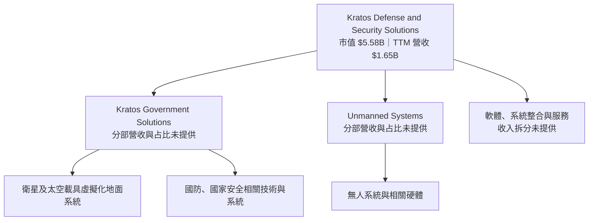
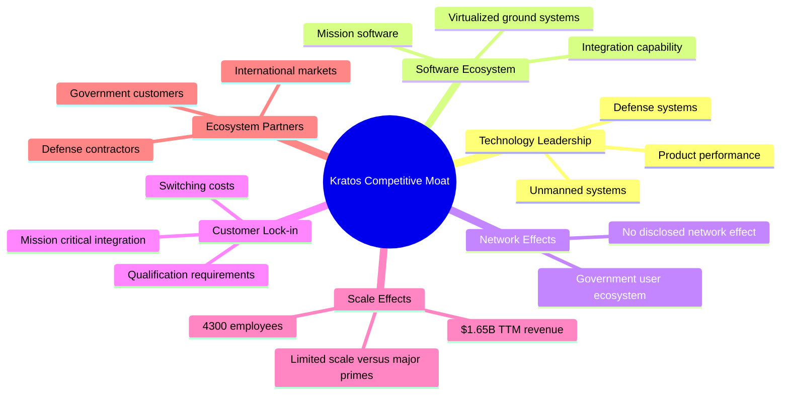
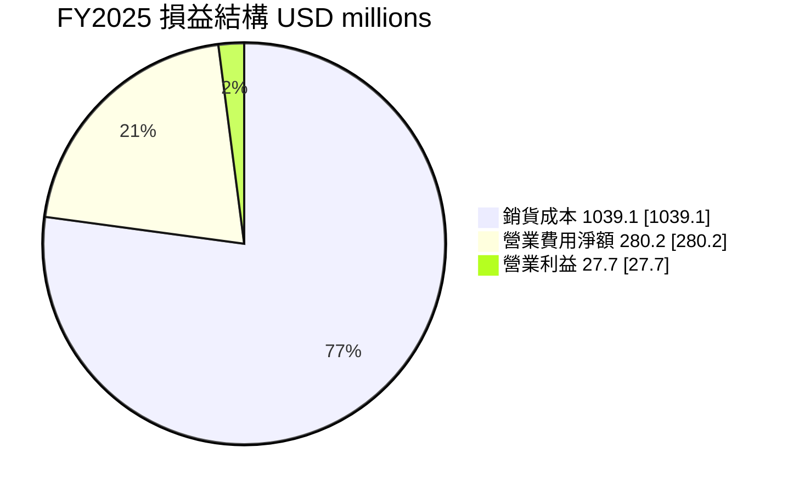
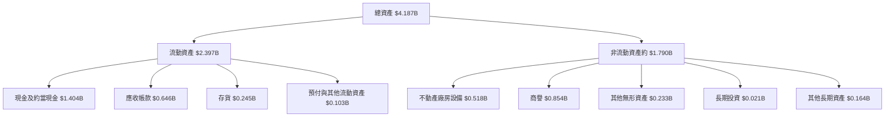
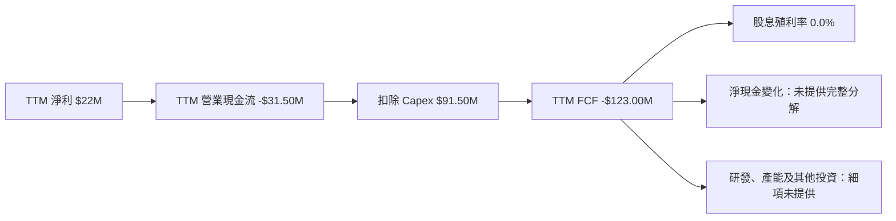
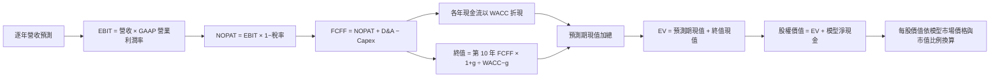
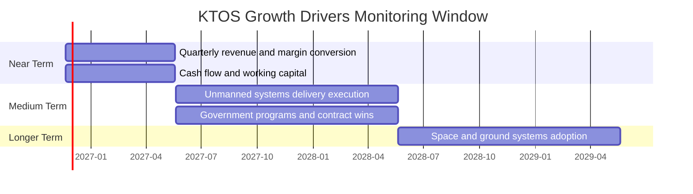
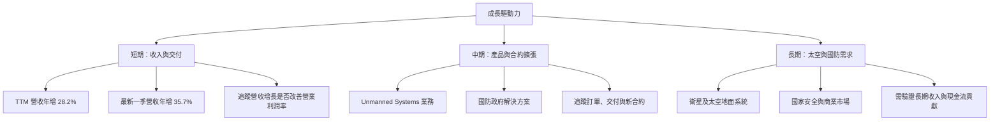
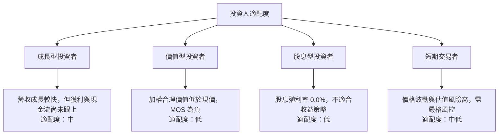

# KTOS 基本面深度分析報告
> **報告日期**：2026-11-20 ｜ **語言**：繁體中文 ｜ **數據來源**：SEC 申報資料 (XBRL)、Yahoo Finance、Finviz、StockAnalysis、Roic.ai ｜ **分析師**：CFA 級機構研究

## 目錄

| # | 章節 | 核心結論 |
|---|------|----------|
| 1 | 執行摘要 | 賣出；加權合理價值 $19.97；MOS -48.5% |
| 2 | 公司概覽與商業模式 | 國防科技與無人系統有需求支撐，但分部營收明細未提供，護城河證據有限 |
| 3 | 損益表深度分析 | TTM 營收 $1.65B、年增 28.2%；但 TTM 營業利益率僅 0.4% |
| 4 | 資產負債表分析 | 現金及短期投資 $1.40B；流動性充裕，但債務口徑存在資料差異 |
| 5 | 現金流量深度分析 | TTM FCF -$123.00M、FCF Yield -2.20%，成長尚未轉化為自由現金流 |
| 6 | 獲利能力與資本效率 | ROIC 0.2% 明顯低於 WACC 10.28%，目前未創造經濟價值 |
| 7 | 相對估值分析 | KTOS 倍數高於多數同業，股價處於自身歷史估值區間中段偏上 |
| 8 | DCF 內在價值評估 | DCF 基準每股 $9.83；加權合理價值 $19.97，現價高於兩者 |
| 9 | 成長催化劑 | 無人系統、國防需求與太空業務可能提供成長；但缺乏可量化 TAM 與催化時程 |
| 10 | 風險矩陣 | 獲利轉化、估值下修與營運資金／資本支出是主要風險 |
| 11 | 投資建議 | 依 MOS 評級為賣出；以現金流改善與營業利潤率回升作為重新評估條件 |

---

## 1. 執行摘要

截至 2026-11-19 收盤，KTOS 股價為 **$29.65**。公司 TTM 營收為 **$1.65B**、年增 **28.2%**，最新一季營收年增 **35.7%**，顯示需求與交付規模在擴大；但 TTM 營業利益率只有 **0.4%**、最新一季為 **-1.0%**，營業現金流 **-$31.50M**、FCF **-$123.00M**。ROIC **0.2%** 低於 WACC **10.28%**，而 DCF 基準價值為 **$9.83**，加權合理價值為 **$19.97**。因此依 MOS **-48.5%** 對應規則，評級為 **🔴 賣出**；不是因公司沒有成長，而是目前股價已要求高成長轉化為利潤與現金流，財務數據尚未證明這一轉化。

### 1.0 一頁式投資儀表板（Portfolio Manager 30 秒速讀）

| 項目 | 內容 |
|------|------|
| **投資論點（3 句）** | ① TTM 營收年增 **28.2%**，最新一季年增 **35.7%**，需求成長是多頭基礎。② TTM 營業利益率僅 **0.4%**、ROIC 僅 **0.2%**，成長尚未形成與資本成本相稱的回報。③ TTM FCF 為 **-$123.00M**，而加權合理價值 **$19.97** 低於現價 **$29.65**。 |
| **綜合評分** | **5.1/10**（引用 1.1 評分卡） |
| **財務健康** | 🟡 現金及短期投資 **$1.40B**、流動比率 **5.418**；但 TTM FCF 為負，且債務資料存在口徑差異。 |
| **ROIC vs WACC** | **0.2% vs 10.28%**：目前資本回報低於資本成本，經濟價值為負。 |
| **FCF 趨勢** | TTM FCF **-$123.00M**，FCF Yield **-2.20%**；近年年度 FCF 波動且 2025 年為負。 |
| **估值** | Forward P/E **26.51x** ｜ EV/EBITDA **49.21x**（估值資料來源）｜ FCF Yield **-2.20%** |
| **DCF 內在價值（基準）** | **$9.83** ｜相對現價溢價 **201.6%**（現價 ÷ DCF 基準價值 − 1） |
| **安全邊際（MOS）** | **-48.5%＝($19.97 − $29.65) ÷ $19.97**｜🔴 <10% 無 |
| **預期報酬（基準情境 12M）** | **N/A**：DCF 情境為長期內在價值推算，不等同 12 個月價格目標；加權合理價值相對現價上行空間為 **-32.6%**。 |
| **關鍵風險（前二）** | 營收成長未轉為營業利潤／正 FCF；高估值面臨倍數收縮。 |
| **評級 + 信心度** | 🔴 **賣出** ｜ 信心：中（估值與現金流訊號清楚；但未提供分部、訂單與最新債務明細） |

### 1.1 綜合評分卡（全報告唯一）

| 維度 | 評分（1–10） | 主要依據（引用數字與其來源章節） |
|------|--------------|----------------------------------|
| 成長性 | 8.0 | TTM 營收年增 **28.2%**、最新一季年增 **35.7%**；第 3 章。 |
| 獲利能力 | 2.5 | TTM 營業利益率 **0.4%**、ROIC **0.2%**，低於 WACC **10.28%**；F-Score **3/8**；第 3、6 章。 |
| 財務健康 | 8.0 | 現金及短期投資 **$1.40B**、流動比率 **5.418**、速動比率 **4.632**；但 FCF 為負、總債務資料不一致；第 4、5 章。 |
| 估值 | 1.0 | MOS **-48.5%**，現價 $29.65 高於加權合理價值 $19.97；KTOS EV/EBITDA **49.21x**，高於同業中位數 **14.9x**；第 7、8 章。 |
| 護城河 | 6.0 | 國防、安全與無人系統產品具專業與採購門檻；但分部營收、續約率、訂單與市場份額數據未提供；第 2 章。 |
| 管理層與資本配置 | 5.0 | SBC TTM 估算 **$58.5M**，約為 TTM 營收 **3.6%**；稀釋股數測試未通過，且 TTM FCF 為負；第 3、5 章。 |
| **綜合評分** | **5.1** | 六項算術平均：(8.0 + 2.5 + 8.0 + 1.0 + 6.0 + 5.0) ÷ 6 = **5.1**。 |

### 1.2 五大投資論點 + 三大核心風險

| 類型 | 項目 | 具體依據 | 信心度 |
|------|------|----------|--------|
| 🟢 **投資論點①** | 營收成長加速 | TTM 營收年增 **28.2%**；最新一季年增 **35.7%**，高於前幾季的 **22.6%**、**30.5%**。 | 🟢 高 |
| 🟢 **投資論點②** | 現金緩衝充足 | 現金及短期投資 **$1.40B**，流動比率 **5.418**，可支撐研發與產能投入。 | 🟢 高 |
| 🟢 **投資論點③** | 市場需求有結構性支撐 | 公司服務國防、國家安全、太空與無人系統市場；公司概覽披露兩個主要業務板塊，但分部數據未提供。 | 🟡 中 |
| 🟢 **投資論點④** | 近年毛利額增加 | 年營收由 2022 年 **$898.3M** 增至 2025 年 **$1.347B**；同期毛利由 **$226.0M** 增至 **$307.9M**。 | 🟡 中 |
| 🟢 **投資論點⑤** | 分析師仍給予較高共識目標價 | 25 位分析師平均目標價 **$74.68**，但此共識與 DCF、相對估值差距大，不能單獨視為價值證據。 | 🟡 中 |
| 🟡 **風險①** | 成長未轉化為利潤與現金 | TTM 營業利益率 **0.4%**、TTM OCF **-$31.50M**、FCF **-$123.00M**。 | 🔴 高衝擊 |
| 🔴 **風險②** | 估值對未來執行要求高 | Forward P/E **26.51x**；DCF 基準價值 **$9.83**，較現價低 **66.8%**。 | 🔴 高衝擊 |
| 🔴 **風險③** | 資本支出與稀釋壓力 | TTM Capex **$91.50M**；SBC TTM 約 **$58.5M**，F-Score 股數測試未通過。 | 🟠 中高 |

### 1.3 快速統計卡片

| 指標 | 公司實際值（期間） | 同業中位數 | 狀態 |
|------|--------------------|------------|------|
| 營收成長（TTM） | **28.2%** | — | 🟢 |
| 營收成長（最新一季年增） | **35.7%** | **6.7%** | 🟢 |
| 毛利率（TTM） | **23.0%** | **20.0%** | 🟢 |
| 營業利益率（TTM） | **0.4%** | — | 🔴 |
| ROIC（TTM） | **0.2%** | — | 🔴 |
| Forward P/E | **26.51x** | **18.1x** | 🔴 |
| FCF Yield（TTM） | **-2.20%** | — | 🔴 |
| Piotroski F-Score | **3 / 8** | — | 🔴 |

> 同業中位數依 Peer multiples 計算：AVAV、LMT、NOC；僅列有可比較資料的指標。

### 1.4 投資結論

```text
╔══════════════════════════════════════════════════════════════════╗
║                    📊 投資結論摘要                              ║
╠══════════════════════════════════════════════════════════════════╣
║  評級：🔴 賣出（依 MOS 門檻；未作質化調整）                      ║
║  價格（2026-11-19 收盤）：$29.65                                 ║
║  DCF 內在價值（基準）：$9.83（現價溢價 201.6%）                  ║
║  安全邊際 MOS：-48.5%＝($19.97−$29.65)÷$19.97                  ║
║  加權合理價值（8.8）：$19.97                                     ║
║  DCF 情境價值：悲觀 $8.19（-72.4%）                              ║
║                基準 $9.83（-66.8%）                              ║
║                樂觀 $13.56（-54.3%）                             ║
║  綜合評分：5.1/10（引用 1.1）                                    ║
║  適合投資人：能承受高波動、且願意等待盈利轉化的成長型投資人；   ║
║              不適合以估值安全邊際或股息收入為主要目標者。       ║
╚══════════════════════════════════════════════════════════════════╝
```

---

## 2. 公司概覽與商業模式

### 2.1 業務結構與收入來源

KTOS 提供國防、國家安全與商業市場所需的技術、硬體、系統及軟體，主要分為 Kratos Government Solutions 與 Unmanned Systems。財務資料未提供兩分部收入與占比，因此不以估計比例繪製分部營收。



### 2.2 市場份額

市場份額數據未提供，近期新聞標題也未包含可核實的市場份額數字，因此不繪製市場份額圖。KTOS TTM 營收為 **$1.65B**、年增 **28.2%**，最新一季年增 **35.7%**；相比 AVAV、LMT、NOC 最新一季營收成長率 **5.7%**、**11.3%**、**6.7%**，KTOS 的成長率較高，但規模與獲利能力不可只憑成長率等同比較。

### 2.3 競爭護城河分析



### 2.4 護城河強度

| 護城河項目 | 強度（強／中／弱） | 證據（引用數字或事實） | 會削弱它的情況 |
|------------|--------------------|------------------------|----------------|
| 技術與產品專業 | 中 | 公司提供國防、無人系統、太空地面系統及軟體；員工數 **4,300**。 | 產品性能或交付無法滿足任務需求，或技術被替代。 |
| 軟體與系統整合 | 中 | 虛擬化地面系統涉及軟體及系統整合，可能形成導入與轉換成本；續約及軟體收入數據未提供。 | 軟體收入占比低、產品同質化或客戶轉向其他架構。 |
| 客戶鎖定與採購門檻 | 中 | 國防與國家安全採購通常涉及資格審查、系統整合與認證；公司客戶集中度與合約續約率未提供。 | 重要計畫取消、預算轉移、合約延誤或競標失利。 |
| 規模效應 | 弱至中 | TTM 營收 **$1.65B**；低於大型防務承包商 LMT、NOC 的企業規模，但仍有一定產品和交付基礎。 | 規模不足導致成本、供應鏈或競標能力落後。 |
| 網路效應 | 弱 | 沒有可量化的使用者網路、平台效應或訂閱數資料。 | 不適用；若產品缺少互通性或生態合作，平台價值可能更弱。 |
| 生態夥伴 | 中 | 業務面向美國及國際國防市場；具體合作夥伴、收入貢獻未提供。 | 夥伴自研替代產品或合作關係中止。 |

> 1.1 護城河評分 **6.0/10**，反映技術、整合與採購門檻具質化支撐，但欠缺分部營收、續約率、訂單與份額資料，尚不足以判定為強護城河。

---

## 3. 損益表深度分析

### 3.1 年度收入成長趨勢（近 4 年）

| 年度 | 營收 | YoY |
|------|------|-----|
| 2022 | $898.30M | — |
| 2023 | $1.037B | +15.45% |
| 2024 | $1.136B | +9.56% |
| 2025 | $1.347B | +18.52% |

```text
╔══════════════════════════════════════════════════════════════════╗
║          Kratos 年度收入趨勢（FY2022–FY2025）                    ║
╠══════════════════════════════════════════════════════════════════╣
║  FY2022  $0.898B  █████████████░░░░░░░░░░░  YoY：N/A            ║
║  FY2023  $1.037B  ███████████████░░░░░░░░░  YoY：+15.45% 🟢     ║
║  FY2024  $1.136B  █████████████████░░░░░░░  YoY：+9.56%  🟡     ║
║  FY2025  $1.347B  ████████████████████░░░░  YoY：+18.52% 🟢     ║
╠══════════════════════════════════════════════════════════════════╣
║  FY2022–FY2025 營收 CAGR：(1.347 ÷ 0.8983)^(1/3)−1 ≈ 14.5%      ║
╚══════════════════════════════════════════════════════════════════╝
```

2024 年增速放緩至 **9.56%**，2025 年回升至 **18.52%**；TTM 年增 **28.2%** 又高於 2025 全年增速，代表近期擴張加快。但營收加速是否來自可持續訂單、併購、交付時點或產品組合，資料未提供分項，需避免把單一成長率直接外推。

### 3.2 季度收入趨勢分析

| 季度 | 營收 | QoQ | YoY | 備註 |
|------|------|-----|-----|------|
| 2025 Q4 | $345.1M | — | +21.90% | 年增率依 StockAnalysis 季度資料。 |
| 2026 Q1 | $371.0M | +7.50% | +22.60% | QoQ = 371.0 ÷ 345.1 − 1。 |
| 2026 Q2 | $458.8M | +23.67% | +30.53% | QoQ = 458.8 ÷ 371.0 − 1。 |
| 2026 Q3 | $471.8M | +2.83% | +35.73% | 單季年增率，不是 TTM 成長率；QoQ = 471.8 ÷ 458.8 − 1。 |

Q3 2026 的營收仍年增 **35.73%**，但季增放慢至 **2.83%**。單季變化可能受到交付時點影響，不能只用 QoQ 推斷需求轉弱；需同步追蹤訂單、合約 backlog 與後續季度交付，但這些資料未提供。

### 3.3 利潤率演變分析

| 利潤率指標 | FY2022 | FY2023 | FY2024 | FY2025 | 趨勢 | 評估 |
|------------|--------|--------|--------|--------|------|------|
| **毛利率** | 25.2% | 25.9% | 25.3% | 22.9% | 2023 小幅上升後回落 | 🟡 |
| **營業利益率** | 0.5% | 3.0% | 2.6% | 2.1% | FY2023 高點後連續回落 | 🔴 |
| **淨利率** | -4.1% | -0.9% | 1.4% | 1.6% | 從虧損轉正 | 🟡 |

> 年度毛利率與營業利益率按年度財務報表金額計算；TTM 營業利益率則依經核實數據為 **0.4%**，不能與 FY2025 的年度比率混用。

FY2025 毛利率較 FY2024 下降約 **2.4 個百分點**，營業利益率也由 **2.6%** 降至 **2.1%**。TTM 營業利益率進一步降至 **0.4%**，最新一季為 **-1.0%**。現有資料不能拆解是產品組合、成本通膨、產能投資或合約執行造成；但毛利額增加而利潤率下滑，意味新增營收尚未帶來足夠營業槓桿。若研發、投標與產能投入仍高於收入轉化速度，成長可能繼續以低獲利換取。

### 3.4 費用結構分析

以下為 **FY2025** 可由年度營收、毛利及營業利益推導的損益結構；營業費用為毛利減營業利益的推導值，並非公司單獨披露的費用科目拆分。



```text
╔══════════════════════════════════════════════════════════════════╗
║                   FY2025 損益結構                               ║
╠══════════════════════════════════════════════════════════════════╣
║  營收          $1,347.0M                                        ║
║  毛利            $307.9M ＝ 營收 − 銷貨成本                     ║
║  營業費用淨額    $280.2M ＝ 毛利 − 營業利益                     ║
║  營業利益         $27.7M                                         ║
╚══════════════════════════════════════════════════════════════════╝
```

### 3.5 季度 EPS 趨勢與盈餘品質（Quality of Earnings）

過去四季 EPS 預估值均未提供，因此無法判定季度 EPS 是超預期或不及預期。以下只列實際季度盈餘，並明確區分 EPS 驚喜資料缺失與實際盈餘變化。

| 季度 | 實際淨利 | EPS 實際 | EPS 預估／驚喜 | 備註 |
|------|----------|----------|----------------|------|
| 2025 Q4 | $5.9M | $0.03 | N/A | EPS estimate 為缺值，不能判定 beat/miss。 |
| 2026 Q1 | $11.9M | $0.07 | N/A | 淨利高於前一季；原因拆分未提供。 |
| 2026 Q2 | $4.4M | $0.02 | N/A | 盈利回落。 |
| 2026 Q3 | -$0.2M | -$0.00 | N/A | 轉為小額淨損；EPS estimate 缺失。 |

| 盈餘品質項目 | 數值／佔比 | 評估 |
|--------------|-----------|------|
| 股權薪酬 SBC / 營收 | 最近四季 SBC 約 **$58.5M**；除以 TTM 營收 **$1.647B** ≈ **3.6%** | 🟡 SBC 對股東有實質稀釋成本；最近四季 SBC 由季度資料加總。 |
| SBC / 營業現金流 | $58.5M ÷ -$31.50M ≈ **-185.7%** | 🔴 OCF 為負，這個比率不代表正向覆蓋；SBC 金額大於 OCF 的絕對值。 |
| FCF / 淨利（現金轉換率） | -$123.00M ÷ $22.00M ≈ **-559.1%** | 🔴 以目前 TTM 淨利為分母，FCF 顯著為負，現金轉換不足。 |
| 一次性／非經常性損益 | N/A（未提供可核實拆分） | 不能判定一次性項目是否美化或壓低本期獲利。 |
| 有效稅率異常 | N/A（未提供可核實 TTM 有效稅率） | DCF 採用 21.0% 為模型假設，不代表實際有效稅率。 |
| 資本化支出 vs 費用化 | TTM Capex **$91.50M**；研發支出 FY2025 **$40.0M** | 未提供資本化研發或資本化政策明細，不能判定是否遞延成本。 |

**盈餘品質結論**：TTM 淨利為 **$22M**，但 FCF 為 **-$123M**，且營業現金流為負，當前 GAAP 獲利的現金支持偏弱。SBC 約佔 TTM 營收 **3.6%**，應視為對既有股東的經濟成本。估值上不宜只依 EPS 外推，應要求營業現金流與 FCF 先改善。

---

## 4. 資產負債表分析

### 4.1 資產結構分解

以 StockAnalysis 2026 年 9 月資料列示資產明細；單位為 USD billions。明細加總與總資產的微小尾差來自披露數字四捨五入。



商譽約 **$853.5M**，約占總資產 **20.4%**，併購資產的商譽減損風險值得留意；應收帳款 **$645.5M** 高於 FY2025 的 **$457.4M**，需觀察後續收款與營收成長是否一致。

### 4.2 流動性與營運資金分析

| 指標 | 最新值 | 歷史比較 | 評估 |
|------|--------|----------|------|
| 流動比率 | **5.418** | 歷史序列未提供 | 🟢 短期流動性充裕。 |
| 速動比率 | **4.632** | 歷史序列未提供 | 🟢 即使排除存貨仍有流動性緩衝。 |
| 現金及短期投資 | **$1.40B** | FY2025 年末現金 $560.6M | 🟢 現金水位增加；增幅不能直接視為營運造現金，因 TTM OCF 為負。 |

| 指標 | 最新 TTM | 一年前 TTM | 變化 | 解讀 |
|------|----------|------------|------|------|
| DSO 應收帳款天數 | **42 天** | **39 天** | **+3 天** | 收款時間略延長，可能由客戶付款時點或業務組合引起；需追蹤應收款成長。 |
| DIO 存貨天數 | **70 天** | **66 天** | **+4 天** | 存貨占用增加，可能是備料或交付節奏影響；若轉為滯銷會增加現金壓力。 |
| DPO 應付帳款天數 | **32 天** | **24 天** | **+8 天** | 對供應商付款期延長，短期有助資金管理，但不能據此判定議價力提升。 |
| CCC 現金轉換週期 | **80 天** | **81 天** | **-1 天** | 略有改善，主要由 DPO 增加抵銷 DSO、DIO 上升。 |

### 4.3 債務結構分析

經核實核心數據列示總債務 **N/A**、淨現金 **$1.40B**；其他市場資料則列出總債務 **$246.0M**、淨現金 **$1.16B**。因債務口徑和報表時點可能不同，本節不將兩組數值混算；DCF 依其模型輸入採用淨現金 **$1.40B**。

```text
╔══════════════════════════════════════════════════════════════════╗
║                 Kratos 債務健康診斷                              ║
╠══════════════════════════════════════════════════════════════════╣
║  總債務：        N/A（核心財務資料未提供可核實總額）             ║
║  其他市場資料：  $246.00M（不同來源口徑，未與核心數據混算）      ║
║  現金及短期投資：$1.40B                                           ║
║  淨現金：        $1.40B（依核心數據列示）                         ║
║  Debt / EBITDA：N/A（債務口徑未能核實）                           ║
║  利息保障倍數：  N/A（利息費用與可比債務資料未提供）              ║
║  評估：🟡 現金緩衝充足；債務明細需要以最新 SEC 報表核對。        ║
╚══════════════════════════════════════════════════════════════════╝
```

### 4.4 股東權益趨勢

| 年度 | 股東權益 | YoY 變化 |
|------|----------|----------|
| 2022 | $936.3M | — |
| 2023 | $976.0M | +4.2% |
| 2024 | $1.350B | +38.3% |
| 2025 | $2.000B | +48.1% |

```text
╔══════════════════════════════════════════════════════════════════╗
║                   股東權益變化                                  ║
╠══════════════════════════════════════════════════════════════════╣
║  FY2022  $0.936B  █████████░░░░░░░░░░░░░  🟡                    ║
║  FY2023  $0.976B  ██████████░░░░░░░░░░░░  🟡                    ║
║  FY2024  $1.350B  ██████████████░░░░░░░░  🟢                    ║
║  FY2025  $2.000B  ████████████████████░░  🟢                    ║
╚══════════════════════════════════════════════════════════════════╝
```

股東權益增加有助資產負債表緩衝，但來源拆分未提供，不能把權益增長全視為留存獲利；同時，F-Score 的稀釋股數測試未通過，需追蹤每股價值是否同步改善。

---

## 5. 現金流量深度分析

### 5.1 現金流量瀑布圖

TTM 淨利為 **$22M**，但 TTM OCF 為 **-$31.50M**，Capex **$91.50M**，所以依固定定義 FCF = OCF − Capex = **-$123.00M**。股息殖利率為 **0.0%**；回購金額與淨現金變化的完整分解未提供。



### 5.2 FCF 轉換率趨勢

| 年度／期間 | FCF | 淨利 | FCF / 淨利 | 解讀 |
|------------|-----|------|------------|------|
| FY2022 | -$71.1M | -$36.9M | 192.7% | 兩者均為負，比例不宜解讀為健康轉換。 |
| FY2023 | $12.8M | -$8.9M | -143.8% | FCF 為正、淨利為負，比率因分母符號而失去一般解讀意義。 |
| FY2024 | -$8.5M | $16.3M | -52.1% | 正淨利未轉成正 FCF。 |
| FY2025 | -$137.4M | $22.0M | -624.5% | FCF 明顯低於會計獲利。 |
| TTM 至 2026-09-27 | -$123.00M | $22.0M | -559.1% | 現金轉換仍弱；TTM FCF 是營業現金流減 Capex。 |

### 5.3 自由現金流趨勢

```text
╔══════════════════════════════════════════════════════════════════╗
║             自由現金流趨勢（年度與 TTM）                         ║
╠══════════════════════════════════════════════════════════════════╣
║  FY2022  -$71.1M  ◀██████████░░░░░░░░░░  負值                  ║
║  FY2023   $12.8M  ███░░░░░░░░░░░░░░░░░░  正值                  ║
║  FY2024   -$8.5M  ◀██░░░░░░░░░░░░░░░░░░  負值                  ║
║  FY2025 -$137.4M  ◀████████████████████  負值                  ║
║  TTM    -$123.0M  ◀██████████████████░░  FCF Yield -2.20%      ║
╠══════════════════════════════════════════════════════════════════╣
║  FY2025 年度與 TTM 不是同一期間；歷史 FCF 波動大，尚未形成穩定正值。║
╚══════════════════════════════════════════════════════════════════╝
```

### 5.4 資本配置評估

資本配置分配比例圖所需的完整現金流項目未提供，故不繪製資本配置圓餅圖。可核實項目如下：

| 項目 | 已知數值 | 評估 |
|------|----------|------|
| TTM Capex | **$91.50M** | 約為 TTM 營收的 **5.6%**（DCF 模型採用值）；支出可能支持產能與設備，但回報尚未反映於正 FCF。 |
| FY2025 SBC | **$35.5M** | 股權薪酬是非現金列報項目，但會稀釋既有股東。 |
| 股息 | 殖利率 **0.0%** | 未以股息回饋股東。 |
| 回購 | N/A | 未提供可核實回購金額。 |
| TTM FCF | **-$123.00M** | 尚無可持續的自由現金流供分配。 |

---

## 6. 獲利能力與資本效率

### 6.1 ROE / ROA / ROIC 趨勢

| 指標 | 歷史數據 | 最新 TTM | 評估 |
|------|----------|----------|------|
| ROE | 歷史連續序列未提供 | **0.6%**（QUALITY FIGURES；其他來源列 0.8%） | 🟡 回報很低；本報告杜邦與核心質量分析採用 0.6%。 |
| ROA | 歷史連續序列未提供 | **0.2%** | 🔴 資產獲利能力偏低。 |
| ROIC | 歷史連續序列未提供 | **0.2%** | 🔴 大幅低於 WACC **10.28%**。 |

未提供可核實的行業平均值，故不加入行業均值欄。ROE 不同來源存在 **0.6%** 與 **0.8%** 的差異；依品質指標區塊，DuPont ROE 為 **0.6%**，故以下以該值為準。

### 6.2 ROIC vs WACC 分析（核心價值創造判斷）

```text
╔══════════════════════════════════════════════════════════════════╗
║                  ROIC vs WACC 深度分析                           ║
╠══════════════════════════════════════════════════════════════════╣
║  WACC（依 Cost of capital inputs）：                             ║
║  ├── 無風險利率（10Y 美債）：5.05%                               ║
║  ├── 市場風險溢酬 ERP：5.00%                                     ║
║  ├── 調整後 Beta：1.11；原始 Beta：1.17                          ║
║  ├── 股權成本：5.05% + 1.11 × 5.00% = 10.60%                   ║
║  ├── 稅前債務成本：3.90%；稅後：3.90% × (1−21.0%) = 3.08%       ║
║  ├── 權重：股權 95.8%，債務 4.2%                                 ║
║  └── WACC：95.8%×10.60% + 4.2%×3.08% = 10.28%                   ║
║                                                                  ║
║  資本回報：                                                       ║
║  ├── ROIC（TTM）：0.2%                                           ║
║  ├── WACC：10.28%                                                ║
║  ├── ROIC − WACC：0.2% − 10.28% = -10.08 個百分點               ║
║  └── 判斷：🟡 至 🔴 目前每單位投入資本的回報低於資本成本。       ║
╚══════════════════════════════════════════════════════════════════╝
```

ROIC 僅為 WACC 的約 **0.02 倍**（0.2% ÷ 10.28%），顯示目前尚未創造經濟利潤。這個差距不應被簡化為公司長期必然摧毀價值：目前獲利率低、仍有投資支出，若未來規模擴大且利潤率提升，ROIC 可改善；但在營運數據證明改善以前，估值不能先假設資本回報已達成熟水平。

### 6.3 杜邦三因素分解

| 因素 | 數值（TTM） | 解讀 |
|------|-------------|------|
| 淨利率 | **1.3%** | 低淨利率限制股東報酬。 |
| 資產週轉率 | **0.39** | 每單位資產帶來的營收有限，反映資產密集及營運資金需求。 |
| 權益乘數 | **1.21** | 槓桿程度不高，ROE 並非主要靠財務槓桿撐起。 |
| **ROE** | **0.6%** | 1.3% × 0.39 × 1.21 ≈ **0.6%**；差異為四捨五入。 |

### 6.4 財務體質：Piotroski F-Score

Piotroski F-Score 為 **3 / 8**。一項因缺少輸入而無法判定，因此分母為 8，不應改寫成 3/9。

| 測試 | 結果 | 解讀 |
|------|------|------|
| ROA > 0 | ✅ 通過 | TTM ROA 為正，但僅 **0.2%**。 |
| 營業現金流 > 0 | ❌ 未通過 | TTM OCF 為 **-$31.50M**。 |
| ROA 高於一年前 | ❌ 未通過 | 相較一年前未改善。 |
| 營業現金流 > 淨利 | ❌ 未通過 | OCF 為負而 TTM 淨利為正，應計品質較弱。 |
| 長期負債 ÷ 總資產低於一年前 | — 無法判定 | 缺少可比較輸入。 |
| 流動比率高於一年前 | ✅ 通過 | 流動比率測試通過。 |
| 稀釋股數未增加 | ❌ 未通過 | 股數增加或測試未通過，對每股價值可能有稀釋。 |
| 毛利率高於一年前 | ✅ 通過 | 毛利率測試通過。 |
| 資產週轉率高於一年前 | ❌ 未通過 | 資產使用效率未改善。 |

總分 **3/8** 反映流動性與部分獲利指標尚可，但現金生成、應計品質、股數變化及資產週轉是主要弱點。

---

## 7. 相對估值分析

### 7.1 同業估值比較表格

| 估值指標 | **KTOS** | **AVAV** | **LMT** | **NOC** | 本公司評估 |
|----------|----------|---------|---------|---------|-----------|
| **Trailing P/E** | **247.1x** | N/A | 20.3x | 17.1x | 🔴 遠高於有資料同業；KTOS 盈利基數小，倍數對盈利變化敏感。 |
| **Forward P/E** | **26.51x** | 21.8x | 17.2x | 18.1x | 🔴 高於同業中位數 **18.1x**。 |
| **P/S Ratio** | **3.39x** | 2.4x | 1.7x | 1.8x | 🔴 高於同業中位數 **1.8x**。 |
| **EV/EBITDA** | **49.21x** | 23.4x | 14.9x | 12.4x | 🔴 高於同業中位數 **14.9x**。 |
| **最新一季營收年增** | **35.7%** | 5.7% | 11.3% | 6.7% | 🟢 成長速度較快，但需轉為利潤與現金流。 |
| **TTM 毛利率** | **23.0%** | 26.5% | 11.7% | 20.0% | 🟢 高於 LMT、NOC，低於 AVAV。 |

同業估值倍數依 Yahoo Finance Peer multiples。KTOS 高成長可合理支持一定溢價，但現時溢價並非只有 Forward P/E：P/S、EV/EBITDA 也明顯較高，而 TTM FCF 為負，故估值要求公司持續維持高速成長並提升利潤率。

### 7.2 歷史估值區間分析

```text
╔══════════════════════════════════════════════════════════════════╗
║             KTOS 五年估值區間（資料庫歷史值）                    ║
╠══════════════════════════════════════════════════════════════════╣
║  P/E：現在 247.1x｜中位數 380.2x｜百分位 27%                    ║
║       區間 232.9x 至 10,595,348,627,336,923,136.0x              ║
║       ⚠️ 高端極值明顯受極低盈利／異常值影響，區間不具經濟可比性。║
║                                                                  ║
║  P/S：現在 3.4x｜中位數 3.2x｜區間 1.3x–11.6x｜百分位 60%       ║
║  EV/EBITDA：現在 50.3x｜中位數 55.5x｜區間 33.8x–221.5x｜45%   ║
╚══════════════════════════════════════════════════════════════════╝
```

P/E 現值低於歷史中位數，但歷史 P/E 高端極值失真，不能據此認定便宜。P/S 高於歷史中位數 **3.2x**，EV/EBITDA 低於歷史中位數 **55.5x**，但仍處 **50.3x** 高位，且同業中位數為 **14.9x**。

### 7.3 情境價值（Bear / Base / Bull，依 DCF MODEL）

| 情境 | 第 1 年營收成長 | 期末營業利潤率 | WACC | 每股價值 | 相對現價 | 機率 | 會發生的條件 |
|------|----------------|----------------|------|----------|----------|------|--------------|
| 🔴 悲觀 | 14.1% | 1.6% | 11.28% | **$8.19** | -72.4% | 25% | 需求與交付成長降至基準以下，同時利潤率改善有限、風險折現率上升。 |
| 🟡 基準 | 28.2% | 1.9% | 10.28% | **$9.83** | -66.8% | 50% | 近期 TTM 成長延續後逐年減速，利潤率逐步提高至模型目標。 |
| 🟢 樂觀 | 42.3% | 2.1% | 9.28% | **$13.56** | -54.3% | 25% | 訂單快速轉成交付、盈利改善，且市場要求報酬率下降。 |

三個情境的每股價值均低於 $29.65。這並非 12 個月目標價，而是 DCF 假設下的內在價值情境；其主要訊息是現價對高速成長和長期利潤改善已有很高要求。

### 7.4 相對估值隱含價格區間

```text
╔══════════════════════════════════════════════════════════════════╗
║                相對估值與參考價格                               ║
╠══════════════════════════════════════════════════════════════════╣
║  DCF 基準              $9.83                                    ║
║  同業 EV/EBITDA       $14.04                                    ║
║  同業 Forward P/E     $20.25                                    ║
║  現價                 $29.65                                    ║
║  分析師共識目標價     $74.68                                    ║
║                                                                  ║
║  $9.83 ── $14.04 ── $20.25 ── [$29.65 現價] ───────── $74.68    ║
╚══════════════════════════════════════════════════════════════════╝
```

- **同業 Forward P/E：$20.25**，依同業中位數 **18.1x** × KTOS Forward EPS **$1.12**。
- **同業 EV/EBITDA：$14.04**，依同業中位數 **14.9x** × TTM EBITDA，再加回模型所用淨現金。
- 分析師共識目標價 **$74.68** 為 25 位分析師平均值，與內在估值方法差距很大，屬參考訊號而不是模型推導出的基本面價值。

---

## 8. DCF 內在價值評估（Discounted Cash Flow）

> 本章 DCF 預測、敏感度、情境與反推值依程式計算模型列示；模型使用的未四捨五入底層數據未完整提供。為避免自行重建或改動模型輸出，以下保留其數值並指出可複算精度的限制。

### 8.0 估值推理鏈（Thinking Logic）

**Step 1 — 價值由哪些變數決定？**  
KTOS 的 DCF 價值主要由既有國防政府業務與無人系統業務的收入持續性、低基期下的營業利潤率提升，以及資本支出強度共同決定。分部收入占比未提供，不能將任何特定產品線假定為目前營收的固定比例。就模型敏感度而言，WACC、永續成長率及終值利潤能力會主導價值；終值現值佔企業價值 **84.2%**，與此判斷一致。

**Step 2 — 模型選擇**

| 決策點 | 本報告採用 | 理由（含數字） | 曾考慮但否決 | 否決理由 |
|--------|-----------|----------------|--------------|----------|
| 現金流定義 | FCFF | 使用 GAAP EBIT、稅後營業利益、D&A 與 Capex，對應 WACC 折現至 EV。 | FCFE | 模型提供的是 FCFF 預測與企業價值橋接，不改用股東現金流。 |
| 預測期 N | 10 年 | DCF 模型固定為 10 年，並由 TTM 成長逐步遞減至第 10 年 3.0%。 | 5 年 | 短期預測期會更依賴終值，且偏離既有模型輸出。 |
| 終值方法 | Gordon Growth | 模型以永續成長率 3.0% 計算終值。 | 單一退出倍數 | DCF 模型未提供可直接採用的退出倍數模型輸出，不另造模型。 |
| EBIT 基礎 | GAAP | 模型明確採 GAAP EBIT，SBC 已包含在費用中。 | 非 GAAP | 避免把 SBC 加回後又以股數稀釋處理造成重複或漏計。 |

**Step 3 — 關鍵假設推導鏈**

- **營收成長**：錨點＝TTM 營收年增 **28.2%**；模型將年 1 設為 **28.2%**，之後線性降至年 10 **3.0%**，反映當前高成長不應永久延續；採用值為模型逐年序列 **28.2%、25.4%、22.6%、19.8%、17.0%、14.2%、11.4%、8.6%、5.8%、3.0%**。曾考慮將 28.2% 維持十年，但與成熟期成長收斂邏輯不符，未採用。
- **期末營業利潤率**：錨點＝TTM **0.4%**；模型以歷史五年中位數作收斂依據，期末採 **1.9%**，逐年升至目標；不假設高毛利科技公司的利潤率，因 KTOS TTM 營業利益率仍低。曾考慮較高的成熟期利潤率，但模型沒有足夠分部證據支持。
- **永續成長率 g**：錨點＝長期名目經濟成長常用估值上限約 3%–4%（估值方法假設，非公司財測）；採用 **3.0%**，並低於 WACC **10.28%**；不採用 4.0% 作基準，因其會提高終值依賴度。
- **預測期 N**：模型輸入固定 **10 年**；用意是讓 28.2% 的近期成長逐步衰減至 3.0%，而非假定短期增速持續；不另縮短或延長，避免改動程式模型。
- **Capex／營收**：錨點＝TTM Capex／營收約 **5.6%**；模型以 **5.6%** 起步並遞減至 **5.1%**，後者按模型規則向 1.1 倍 D&A 收斂；不採用快速降至資產輕型公司的低投資比率，因目前 Capex 強度仍高。
- **GAAP EBIT、SBC 與股數**：模型採 GAAP EBIT，SBC 已作為費用計入；不另扣 SBC，股數不另做年稀釋。**本模型採用 (A)，故 SBC 影響已計入一次。**
- **WACC**：採用資料庫提供的 **10.28%**，不另估算替代折現率；其 CAPM 參數與權重見 8.2。
- **D&A／營收**：模型採 **4.7%**，依據為 TTM D&A／營收。
- **營運資金**：模型未建模 ΔWC；此為模型限制，不以額外假設值補入。

**Step 4 — 最脆弱假設**  
模型最脆弱處是未建模營運資金且假設營收成長能逐步帶來正 FCFF；若新增營收繼續伴隨應收帳款、存貨和 Capex 增長，現金流價值可能低於基準，而非高於基準。

**Step 5 — 計算路徑**



### 8.1 模型假設總表（Model Inputs）

| 假設項目 | 採用值 | 依據／來源 | 敏感度 |
|----------|--------|-------------|--------|
| 預測期長度 **N** | **10 年** | DCF MODEL 固定期限，FY+1 至 FY+10。 | 🟡 中 |
| 營收成長 | 年 1 **28.2%**，年 10 **3.0%**，逐年線性下降 | 起點為 TTM 年增 **28.2%**；末端為模型成熟期假設。 | 🔴 高 |
| 營業利潤率 | 年 1 **0.4%** → 年 10 **1.9%** | 起點 TTM **0.4%**；期末採最近五個財年中位數模型值。 | 🔴 高 |
| 有效稅率 | **21.0%** | 模型預設稅率；非公司 TTM 實際有效稅率。 | 🟢 低 |
| Capex／營收 | 年 1 **5.6%** → 年 10 **5.1%** | TTM Capex／營收起點，依模型規則收斂。 | 🟡 中 |
| D&A／營收 | **4.7%** | 模型採 TTM 比率並維持固定。 | 🟢 低 |
| ΔWC／營收增額 | 未建模 | DCF MODEL 未納入營運資金變化；資料不足，不補造數值。 | 🔴 高 |
| EBIT 基礎 | GAAP | DCF MODEL 指明 GAAP EBIT。 | 🟡 中 |
| SBC 處理 | GAAP EBIT 已含 SBC，不另扣 SBC | 符合組合 (A)。 | 🟡 中 |
| 年稀釋率 | **0%** | 組合 (A)：以 GAAP 費用反映 SBC，不再加股數稀釋。 | 🟡 中 |
| 永續成長率 g | **3.0%** | 模型假設，低於 WACC **10.28%**。 | 🔴 高 |
| 終值方法 | Gordon Growth | DCF MODEL 指定終值計算方法。 | 🔴 高 |
| WACC | **10.28%** | Cost of capital inputs；見 8.2。 | 🔴 高 |

模型使用 FCFF = NOPAT + D&A − Capex；**沒有 ΔWC 列**。相較標準 FCFF 模型，忽略營運資金變化可能高估或低估現金流；依目前 DSO、DIO 上升的方向，若應收與存貨繼續增加，忽略 ΔWC 更可能高估可分配現金。

### 8.2 折現率推導（WACC）

```text
╔══════════════════════════════════════════════════════════════════╗
║                    WACC 推導（折現率）                           ║
╠══════════════════════════════════════════════════════════════════╣
║  股權成本 Ke（CAPM）：                                           ║
║  ├── 無風險利率 Rf（10Y 美債）：5.05%                            ║
║  ├── ERP：5.00%（Cost of capital inputs 假設值）                 ║
║  ├── 原始 Beta：1.17；調整後 Beta：1.11                          ║
║  ├── Beta 調整：⅔×1.17 + ⅓×1 = 1.1133 ≈ 1.11                   ║
║  ├── 規模／國別溢酬：0.00%（未另加，沿用指定 CAPM）              ║
║  └── Ke = 5.05% + 1.11×5.00% = 10.60%                          ║
║                                                                  ║
║  債務成本 Kd：                                                   ║
║  ├── 稅前 Kd：3.90%（指定成本資本輸入）                          ║
║  ├── 有效稅率：21.0%（模型預設）                                 ║
║  └── 稅後 Kd = 3.90%×(1−21.0%) = 3.081% ≈ 3.08%                 ║
║                                                                  ║
║  資本結構：股權權重 95.8%；債務權重 4.2%                         ║
║  └── WACC = 95.8%×10.60% + 4.2%×3.081%                         ║
║            = 10.1548% + 0.1294% = 10.2842% ≈ 10.28%            ║
╚══════════════════════════════════════════════════════════════════╝
```

**逐步演算與資料限制：**

1. **Ke** = 5.05% + 1.11 × 5.00% + 0.00% = **10.60%**。
2. **稅前 Kd** = **3.90%（直接採用指定輸入）**。利息費用與平均計息負債未完整提供，因此無法獨立以利息費用 ÷ 平均計息負債複算。
3. **稅後 Kd** = 3.90% × (1 − 21.0%) = **3.081%**。
4. **權重** = 股權 **95.8%**、債務 **4.2%**，兩者合計 **100.0%**。最新市場資料市值為 **$5.58B**；債務總額在核心財務資料中為 N/A，故不反推債務金額或重算權重。
5. **WACC** = 95.8% × 10.60% + 4.2% × 3.081% = 10.1548% + 0.129402% = **10.284202% ≈ 10.28%**。

本章與第 6.2 節使用同一 WACC。10 年期美債利率資料未附精確觀測日，報告日期為 2026-11-20，故不另宣稱該殖利率的特定日期。模型 WACC 取經核實成本資本輸入，沒有自行限制或替換。

### 8.3 逐年自由現金流預測（基準情境）

單位：$B；折現因子依模型列示至小數三位。各欄數字照 DCF MODEL 抄錄。

| 年度 | FY+1 | FY+2 | FY+3 | FY+4 | FY+5 | FY+6 | FY+7 | FY+8 | FY+9 | FY+10 |
|------|------|------|------|------|------|------|------|------|------|-------|
| 營收 | 2.11 | 2.65 | 3.24 | 3.88 | 4.54 | 5.19 | 5.78 | 6.28 | 6.64 | 6.84 |
| 營收 YoY | 28.2% | 25.4% | 22.6% | 19.8% | 17.0% | 14.2% | 11.4% | 8.6% | 5.8% | 3.0% |
| 營業利潤率 | 0.4% | 0.6% | 0.7% | 0.9% | 1.1% | 1.2% | 1.4% | 1.6% | 1.7% | 1.9% |
| EBIT（GAAP） | 0.01 | 0.01 | 0.02 | 0.03 | 0.05 | 0.06 | 0.08 | 0.10 | 0.12 | 0.13 |
| − 稅（21.0%） | (0.00) | (0.00) | (0.00) | (0.01) | (0.01) | (0.01) | (0.02) | (0.02) | (0.02) | (0.03) |
| = NOPAT | 0.01 | 0.01 | 0.02 | 0.03 | 0.04 | 0.05 | 0.06 | 0.08 | 0.09 | 0.10 |
| + D&A | 0.10 | 0.12 | 0.15 | 0.18 | 0.21 | 0.24 | 0.27 | 0.29 | 0.31 | 0.32 |
| − Capex | (0.12) | (0.15) | (0.18) | (0.21) | (0.24) | (0.28) | (0.31) | (0.33) | (0.34) | (0.35) |
| **= FCFF** | **-0.01** | **-0.01** | **-0.01** | **-0.00** | **0.01** | **0.02** | **0.03** | **0.04** | **0.06** | **0.07** |
| 折現因子 @10.28% | 0.907 | 0.822 | 0.746 | 0.676 | 0.613 | 0.556 | 0.504 | 0.457 | 0.414 | 0.376 |
| **FCFF 現值 PV** | **-0.01** | **-0.01** | **-0.01** | **-0.00** | **0.00** | **0.01** | **0.01** | **0.02** | **0.02** | **0.03** |

**預測期現值合計**：模型未四捨五入的逐年現值合計為 **$0.07B**。由於表內每年數字已四捨五入至 $0.01B，直接相加可得 -0.01 − 0.01 − 0.01 − 0.00 + 0.00 + 0.01 + 0.01 + 0.02 + 0.02 + 0.03 = **$0.06B**；與模型未四捨五入總和相差 **$0.01B**。為遵守模型輸出，本報告保留 DCF MODEL 合計 **$0.07B**，但披露僅憑表格精度不能完全複算該差額。

**FY+1 逐步演算（模型輸入及輸出均按其顯示精度）：**

1. **營收** = 上年 TTM 營收 $1.65B × (1 + 28.2%) = $1.65 × 1.282 = **$2.1153B ≈ $2.11B**。
2. **EBIT** = $2.11B × 0.4% = **$0.00844B ≈ $0.01B**。
3. **稅** = $0.00844B × 21.0% = **$0.0017724B ≈ $0.00B**。
4. **NOPAT** = $0.00844B − $0.0017724B = **$0.0066676B ≈ $0.01B**。
5. **D&A** = $2.11B × 4.7% = **$0.09917B ≈ $0.10B**。
6. **Capex** = $2.11B × 5.6% = **$0.11816B ≈ $0.12B**。
7. **ΔWC** = **未建模**，不另扣除。
8. **FCFF** = $0.0066676B + $0.09917B − $0.11816B = **-$0.0123224B ≈ -$0.01B**。
9. **折現因子** = 1 ÷ (1 + 10.28%)¹ = **0.9068 ≈ 0.907**；PV = -$0.0123224B × 0.9068 = **-$0.01117B ≈ -$0.01B**。

**合理性自檢：**

- 歷史年度 FCF 由 FY2022 **-$71.1M**、FY2023 **$12.8M**、FY2024 **-$8.5M** 至 FY2025 **-$137.4M**，波動大且有負值；因歷史 FCF CAGR 在正負值切換下不具經濟解釋力，不給單一 CAGR。預測從負 FCFF 轉正，主要依賴營業利潤率提升與 Capex 比率下降。
- FY+10 FCFF 利潤率 = $0.07B ÷ $6.84B ≈ **1.0%**；目前 TTM FCF 利潤率 = -$0.123B ÷ $1.65B ≈ **-7.5%**。未提供同業最佳 FCF 利潤率，不能作同業優劣比較。
- FY+1 至 FY+4 FCFF 為負或接近零；其折現後仍納入模型，會降低預測期現值。模型後期的正現金流及終值彌補前期負值。

```text
╔══════════════════════════════════════════════════════════════════╗
║            自由現金流：歷史實際 vs 模型預測                      ║
╠══════════════════════════════════════════════════════════════════╣
║  FY2023(實)    $0.013B  ██░░░░░░░░░░░░░░░░░░  正值              ║
║  FY2024(實)   -$0.009B  ◀█░░░░░░░░░░░░░░░░░░  負值              ║
║  FY2025(實)   -$0.137B  ◀████████████████████  負值              ║
║  FY+1 (預)    -$0.01B   ◀██░░░░░░░░░░░░░░░░░░  負值              ║
║  FY+10 (預)    $0.07B   ██████████░░░░░░░░░░  正值              ║
╠══════════════════════════════════════════════════════════════════╣
║  模型預測轉正，但年度歷史波動高，且 ΔWC 未建模。                 ║
╚══════════════════════════════════════════════════════════════════╝
```

### 8.4 終值計算（Terminal Value）

**適用性檢查**：WACC **10.28%** vs g **3.0%** → WACC > g？✅

DCF MODEL 只提供 Gordon Growth 終值結果，未提供退出倍數終值，因此不另建退出倍數模型。

| 方法 | 計算式 | 終值 TV | TV 現值 | 佔總 EV 比重 |
|------|--------|---------|---------|--------------|
| Gordon Growth | 依模型內未四捨五入 FY+10 FCFF × (1 + 3.0%) ÷ (10.28% − 3.0%) | **$1.00B** | **$0.38B** | **84.2%** |
| 退出倍數法 | N/A（模型未提供該方法輸出） | N/A | N/A | N/A |

**逐步演算（依模型輸出顯示精度）：**

1. FY+10 FCFF 表列 **$0.07B**；模型終值計算使用未四捨五入底層 FCFF。
2. 分子按模型公式為 FCFF × (1 + g)；依模型顯示值約為 **$0.07B × 1.03**，但若直接用表格兩位小數不能完全得到模型終值。
3. 分母 = 10.28% − 3.0% = **7.28%**；模型列示 TV **$1.00B**。由於未提供未四捨五入第 10 年 FCFF，不能以表內 $0.07B 精確重算至 $1.00B。
4. PV(TV) = 模型 TV **$1.00B** × 年 10 折現因子 **0.376** = **$0.376B ≈ $0.38B**。
5. TV 現值佔 EV = 模型列示 **84.2%**。按顯示值 $0.38B ÷ $0.45B 得 84.4%，差異來自未四捨五入底層數據；本報告保留模型原值 **84.2%**。

終值現值佔企業價值 **84.2%**，故本估值高度依賴終值假設，短期現金流貢獻有限。

### 8.5 企業價值 → 每股內在價值（Bridge）

```text
╔══════════════════════════════════════════════════════════════════╗
║              企業價值 → 每股內在價值 橋接表                      ║
╠══════════════════════════════════════════════════════════════════╣
║  預測期 FCF 現值合計             +$0.07B                         ║
║  終值現值 PV(TV)                 +$0.38B                         ║
║  ─────────────────────────────────────────────                  ║
║  = 企業價值 EV                    $0.45B                         ║
║  + 淨現金（模型輸入）             +$1.40B                         ║
║  = 股權價值                       $1.85B                         ║
║  每股價值換算                     $1.85B×$29.65÷$5.58B           ║
║  ★ DCF 基準每股內在價值            $9.83                         ║
║    現價（2026-11-19 收盤）          $29.65                        ║
║    現價相對 DCF 折溢價              +201.6% 溢價                  ║
╚══════════════════════════════════════════════════════════════════╝
```

1. **EV** = 預測期 PV 合計 $0.07B + PV(TV) $0.38B = **$0.45B**。
2. **股權價值** = EV $0.45B + 模型淨現金 $1.40B = **$1.85B**。
3. **每股內在價值** = 股權價值 $1.85B × 現價 $29.65 ÷ 市值 $5.58B = **$9.83**（依模型指定換算式）。
4. **折溢價** = 現價 $29.65 ÷ DCF 基準內在價值 $9.83 − 1 = **+201.6%**。
5. **本節不計算 MOS**；MOS 一律以 8.8 加權合理價值為分母。

股數與每股價值採用 DCF MODEL 指定的「股權價值 × 價格 ÷ 市值」方式，不另行反推出股數。模型淨現金取模型輸入 **$1.40B**；這與其他市場資料列出的淨現金 **$1.16B** 有差異，故 DCF 橋接僅依模型值，差異列為資料限制。

### 8.6 敏感性分析（WACC × 永續成長率）

格內為模型每股價值；括號為相對現價 $29.65 的上行空間，按顯示值計算並四捨五入至一位小數。

| g（列）／WACC（欄） | 8.28% | 9.28% | **10.28%（基準）** | 11.28% | 12.28% |
|-----------|------|------|------------------|-------|-------|
| 2.0% | $10.67（-64.0%） | $10.04（-66.1%） | $9.57（-67.7%） | $9.22（-68.9%） | $8.94（-69.8%） |
| 2.5% | $10.92（-63.2%） | $10.21（-65.6%） | $9.69（-67.3%） | $9.31（-68.6%） | $9.00（-69.6%） |
| 3.0% | $11.22（-62.2%） | $10.41（-64.9%） | **$9.83（-66.8%）** | $9.40（-68.3%） | $9.08（-69.4%） |
| 3.5% | $11.58（-60.9%） | $10.64（-64.1%） | $9.99（-66.3%） | $9.52（-67.9%） | $9.16（-69.1%） |
| 4.0% | $12.03（-59.4%） | $10.92（-63.2%） | $10.17（-65.7%） | $9.64（-67.5%） | $9.25（-68.8%） |

**矩陣示範格**：所選格 WACC **9.28% > g 2.5% ✅**。依 DCF MODEL 矩陣直接抄錄，該格每股價值 **$10.21**。模型未提供該格完整未四捨五入逐年 FCFF 現值，因此不能在不重建模型的前提下獨立重算新的 PV 合計、TV 與股權價值；不能把基準年度現值代入替代值。該格模型輸出相對現價為 $10.21 ÷ $29.65 − 1 = **-65.5%**，以表格一位小數約為 **-65.6%**。

**三情境 DCF（營運假設與折現率均變動）**

| 情境 | 第 1 年營收成長 | 期末營業利潤率 | 永續成長率 g | WACC | 每股內在價值 | 相對現價 | 主觀機率 |
|------|----------------|----------------|--------------|------|--------------|----------|----------|
| 🔴 悲觀 | 14.1% | 1.6% | 3.0% | 11.28% | **$8.19** | -72.4% | 25% |
| 🟡 基準 | 28.2% | 1.9% | 3.0% | 10.28% | **$9.83** | -66.8% | 50% |
| 🟢 樂觀 | 42.3% | 2.1% | 3.0% | 9.28% | **$13.56** | -54.3% | 25% |
| **機率加權** | — | — | — | — | **$10.35** | **-65.1%** | 100% |

DCF MODEL 未提供三情境完整逐年營收、FCFF 及終值的未四捨五入明細，因此以下只能展示模型已有的情境輸入與價值，不能偽稱重新完整推導：

- **悲觀**：年 1 成長 **14.1%** → 期末營業利潤率 **1.6%** → WACC **11.28%** → **$8.19**。成立條件是成長大幅低於 TTM、利潤率改善有限且折現率上升。
- **基準**：年 1 成長 **28.2%** → 期末營業利潤率 **1.9%** → WACC **10.28%** → **$9.83**。成立條件是當前高成長逐年正常化，並實現模型的利潤率收斂。
- **樂觀**：年 1 成長 **42.3%** → 期末營業利潤率 **2.1%** → WACC **9.28%** → **$13.56**。成立條件是營收增長超過當前 TTM、利潤率高於基準且風險折現率下降。
- **機率加權** = $8.19 × 25% + $9.83 × 50% + $13.56 × 25% = $2.0475 + $4.9150 + $3.3900 = **$10.3525 ≈ $10.35**。8.8 依規則採用基準 DCF，而非機率加權值。

**敏感度結論：**在所給矩陣中，g 從 2.5% 至 3.5%、WACC 固定 10.28%，每股價值由 $9.69 升至 $9.99，增加 **$0.30**；WACC 從 9.28% 升至 11.28%、g 固定 3.0%，價值由 $10.41 降至 $9.40，減少 **$1.01**。模型沒有營業利潤率 ±1pp 矩陣或單變量估值，故該項彈性 **N/A**，不自行重建。已提供的資料顯示 WACC 變化在指定範圍內影響較大，與「終值折現與終值假設主導估值」的判斷一致。

### 8.7 反推 DCF（Reverse DCF：市場在預期什麼）

反推模型固定其餘基準輸入，一次只解一個變數。可核實的 DCF MODEL 僅提供年 1 營收成長與固定營業利潤率兩個反推結果；g 與預測期 N 未提供解，不自行試算。

| 求解的變數（一次一個） | 其餘變數設定 | 市場隱含值（令 DCF = 現價） | 公司歷史實際 | 判斷 |
|------------------------|--------------|------------------------------|--------------|------|
| 年 1 營收成長 | 利潤率與其他基準假設固定 | **90.0%** | TTM 營收成長 **28.2%** | 🔴 高於目前成長水準，要求偏激進。 |
| 固定營業利潤率 | 成長率與其他基準假設固定 | **9.2%** | TTM 營業利益率 **0.4%**；最近五財年中位數模型值至 1.9% | 🔴 遠高於目前與模型基準。 |
| 永續成長率 g | 未計算 | 未提供 | — | N/A；不得自行反解。 |
| 預測期長度 N | 未計算 | 未提供 | 護城河可支撐年數未提供 | N/A；不得自行反解。 |

**逐步演算軌跡**：資料來源未提供逐次試算值、對應 FY+10 營收與 FCFF，也未提供收斂誤差；所以不能編造試算表或宣稱獨立收斂。可披露的模型結果是年 1 營收成長 **90.0%**、固定營業利潤率 **9.2%**，分別遠高於基準年 1 成長 **28.2%**、期末營業利潤率 **1.9%**。

**反推結論**：在該模型框架下，若要讓 DCF 價值等於現價，KTOS 必須實現約 **90.0%** 的年 1 營收成長，或約 **9.2%** 的固定營業利潤率；目前數據不支持把這些要求視為已實現。因此現價反映的市場預期明顯高於模型基準。

### 8.8 估值三角驗證與安全邊際

| 估值方法 | 隱含每股價值 | 上行空間（÷現價） | 權重 | 說明 |
|----------|--------------|-------------------|------|------|
| DCF（基準） | **$9.83** | **-66.8%** | **40%** | 10 年 FCFF、WACC 10.28%、終值成長率 3.0%。 |
| 同業 Forward P/E | **$20.25** | **-31.7%** | **25%** | 同業中位數 18.1x × KTOS Forward EPS 1.12。 |
| 同業 EV/EBITDA | **$14.04** | **-52.6%** | **25%** | 同業中位數 14.9x × TTM EBITDA，再加回模型淨現金。 |
| 分析師共識目標價 | **$74.68** | **+151.9%** | **10%** | 25 位分析師平均目標價；參考性權重。 |
| **加權合理價值** | **$19.97** | **-32.6%** | **100%** | 公司類型為 profitable；方法與權重照估值模型固定輸入。 |

**逐步演算：**  
加權合理價值 = $9.83 × 40% + $20.25 × 25% + $14.04 × 25% + $74.68 × 10%  
= $3.932 + $5.0625 + $3.510 + $7.468  
= **$19.9725 ≈ $19.97**。權重合計 40% + 25% + 25% + 10% = **100%**。此公司類型採 profitable 公司固定權重；模型列出的四種估值方法均保留，沒有方法被剔除。

```text
╔══════════════════════════════════════════════════════════════════╗
║                  估值區間與安全邊際                              ║
╠══════════════════════════════════════════════════════════════════╣
║  $8.19 ── $9.83 ── $13.56 ── $19.97 ── [$29.65 現價]── $74.68   ║
║  悲觀DCF  基準DCF  樂觀DCF   加權合理值                共識目標價 ║
║                                                                  ║
║  MOS = ($19.97 − $29.65) ÷ $19.97 = -48.5%                     ║
║  MOS 評估：🔴 <10% 無                                            ║
║  上行空間 = ($19.97 − $29.65) ÷ $29.65 = -32.6%                ║
║                                                                  ║
║  MOS ≥ 10% 的價格條件：價格 ≤ $19.97×90% = $17.97               ║
║  建議買入區間（數學條件）：$0–$17.97                             ║
║  MOS -10% 至 +10% 對應區間：約 $17.97–$21.97                   ║
║  現價 $29.65 高於加權合理價值，屬減碼／避免追價區域。            ║
╚══════════════════════════════════════════════════════════════════╝
```

> 🔎 **程式複算（Python，依本節各項自動重算）**
>
> 加權合理價值 = $9.83 × 40% + $20.25 × 25% + $14.04 × 25% + $74.68 × 10% = **$19.97**（權重合計 100%）
>
> 以價格 $29.65 計：MOS = **-48.5%**，上行空間 = **-32.6%**
>
> ✅ 與本節所寫數值一致。

### 8.9 DCF 模型的局限與失效條件

- **終值依賴度**：終值現值佔企業價值 **84.2%**，代表價值主要受 FY+10 之後的現金流假設影響。
- **最脆弱的假設**：① TTM 成長 **28.2%** 能否逐步轉為營業利潤與正 FCF；② DCF 未納入營運資金變化，而 DIO **70 天**、DSO **42 天**均較一年前上升。若營收成長導致應收與存貨占用增加，模型可能高估自由現金流。
- **現金流適用性**：公司 TTM FCF 為 **-$123.00M**，歷史年度 FCF 亦正負波動，標準 DCF 的可靠度低於成熟、穩定正 FCF 公司。應輔以同業 EV/EBITDA、Forward P/E、P/S 及訂單與交付資料判斷；SOTP 因分部財務資料缺失無法建立。
- **模型輸入差異**：DCF 採淨現金 **$1.40B**，其他市場資料列示總債務 **$246M**、淨現金 **$1.16B**；未提供足夠一致的資產負債表口徑以調和。
- **風險連結**：國防預算或計畫延遲會降低營收成長輸入；成本超支會拖累營業利潤率；資本支出與營運資金需求上升會壓低 FCFF；估值倍數收縮則與第 10 章估值風險相連。

### 8.10 複算檢核表（Audit Trail）

| # | 檢核項目 | 檢查方式 | 結果 |
|---|----------|----------|------|
| 1 | 所有 🔴高 / 🟡中敏感度輸入均有推導 | 對照 8.0 與 8.1；部分假設因底層資料缺失已披露限制。 | ⚠️ 部分受資料限制 |
| 2 | 每個假設都有來歷 | 8.1 依據欄逐項列出模型或財務錨點。 | ✅ |
| 3 | WACC 五步與計算 | CAPM、稅後 Kd、權重及 WACC 加權算式列出；Kd 來源直接採用指定輸入。 | ✅ |
| 4 | Kd 分母與債務權重口徑一致 | 利息費用、平均計息負債及期末債務明細未提供，無法獨立核實。 | ⚠️ |
| 5 | WACC 與第 6.2 節同值 | 兩處皆採 **10.28%**。 | ✅ |
| 6 | 逐年年度數等於 N、無省略 | 列出 FY+1 至 FY+10 共 10 年。 | ✅ |
| 7 | FY+1 算式可複算 | 以模型顯示值示範營收、EBIT、稅、NOPAT、D&A、Capex、FCFF、折現因子與 PV。 | ✅ |
| 8 | 預測期 PV 逐項相加 | 顯示精度逐項合計 $0.06B，模型未四捨五入合計 $0.07B；底層精度未提供。 | ⚠️ 尾差 $0.01B |
| 9 | WACC > g | 10.28% > 3.0%。 | ✅ |
| 10 | 終值基於 FY+N 並折現 N 期 | 使用 FY+10、折現因子 0.376；未四捨五入 FCFF 未提供。 | ✅／有精度限制 |
| 11 | EV、股權價值及每股橋接 | $0.07B + $0.38B = $0.45B；加模型淨現金 $1.40B 得 $1.85B；每股值依模型公式為 $9.83。 | ✅ |
| 12 | SBC 組合相容 | GAAP EBIT、無額外 SBC 扣除、年稀釋率 0%，採組合 (A)。 | ✅ |
| 13 | 敏感性基準格等於 DCF 基準 | g 3.0%、WACC 10.28% 格為 **$9.83**。 | ✅ |
| 14 | 矩陣有效格符合 WACC > g | 所有格均 WACC 大於 g。 | ✅ |
| 15 | 情境機率與加權值 | 25% + 50% + 25% = 100%；加權價值 $10.35。 | ✅ |
| 16 | 反推每列只放開一個變數 | 列示模型提供的兩個單變數結果；試算軌跡未提供，未編造。 | ⚠️ |
| 17 | MOS 與折溢價分母一致 | MOS 用 8.8 $19.97；折溢價用 DCF $9.83。 | ✅ |
| 18 | 報告完整至第 11 章 | 全部十一章列出。 | ✅ |
| 19 | 加權價值等於方法加總 | 各方法乘權重合計 $19.9725，顯示為 $19.97。 | ✅ |
| 20 | 評級符合 MOS 門檻 | MOS -48.5%，對應賣出；未作質化調整。 | ✅ |

**未能完全複算的原因**：逐年現值、終值及反推 DCF 的未四捨五入底層資料與試算軌跡未提供；本報告保留模型原值，不以自行重建的估計值替代。DCF 數值因此應視為模型情境，而非精確可重建的單點真值。

---

## 9. 成長催化劑

### 9.1 催化劑時間軸

公司未提供具體催化劑日期、訂單交付日或量化指引；以下以觀察窗口表達，不代表公司已公告時程。



### 9.2 TAM 市場規模分析

N/A（TAM 數據未提供）。公司 TTM 營收 **$1.65B**、年增 **28.2%**，最新一季年增 **35.7%**，顯示業務擴張；但缺少無人系統、衛星地面系統等細分市場 TAM、公司份額與可服務市場定義，不能量化滲透率或市場容量。

### 9.3 成長驅動力結構圖



---

## 10. 風險矩陣

### 10.1 風險評分矩陣

可核實財務數據沒有提供各風險的發生機率百分比與財務衝擊估值。依規則不以無來源機率或損失金額製作量化 quadrantChart；主要風險以 10.2 的定性表格呈現。

### 10.2 風險清單詳細分析

| # | 風險項目 | 發生機率 | 財務衝擊 | 風險評估 | 緩解措施 |
|---|----------|----------|----------|----------|----------|
| 1 | 🔴 成長未轉為利潤及正 FCF | 中高；TTM 營業利益率僅 **0.4%**，最新季 **-1.0%** | 高；TTM FCF **-$123.00M** | 🔴 高 | 連續追蹤季度營業利益率、OCF、Capex 與 FCF；營收增長應同步帶動毛利額與營業利潤。 |
| 2 | 🔴 高估值與倍數收縮 | 高；Forward P/E **26.51x**，EV/EBITDA **49.21x** | 高；DCF 基準 **$9.83**，加權合理價值 **$19.97** 均低於現價。 | 🔴 高 | 不以分析師共識單獨作買入依據；以估值折讓與基本面現金流改善確認風險報酬。 |
| 3 | 🟠 營運資金與存貨上升 | 中；DIO **70 天**、DSO **42 天**，均較一年前增加 | 中高；TTM OCF 為負 | 🟠 中高 | 追蹤應收帳款、存貨與 CCC；若營收成長但現金收款惡化，降低對收入品質的評價。 |
| 4 | 🟠 資本支出維持高位 | 中；TTM Capex **$91.50M** | 中高；Capex 加深 FCF 負值 | 🟠 中高 | 追蹤 Capex／營收與新增產能利用率，要求投資後現金流回報。 |
| 5 | 🟡 SBC 與股數稀釋 | 中；最近四季 SBC 約 **$58.5M**，約佔 TTM 營收 **3.6%** | 中；稀釋降低每股價值 | 🟡 中 | 每季監控稀釋股數與 SBC／營收，評估每股營收與每股 FCF，而非僅看公司總營收。 |
| 6 | 🟡 計畫、合約與交付時點 | 中；國防與政府計畫可能受預算、採購及認證時程影響 | 中至高；可能推遲收入確認 | 🟡 中 | 追蹤合約授予、backlog、交付時程及管理層財測；目前可核實數據未提供 backlog。 |

---

## 11. 投資建議

### 11.1 最終評級與評分

依 8.8 加權合理價值 **$19.97** 與 2026-11-19 收盤 **$29.65** 計算，MOS 為 **-48.5%**，按規則 20 評級為 **🔴 賣出**，沒有因質化因素調整一級。1.1 綜合評分為 **5.1/10**；其中成長性 8.0、獲利能力 2.5、財務健康 8.0、估值 1.0、護城河 6.0、管理層與資本配置 5.0。

### 11.2 合理價值與隱含報酬率

| 價值參考 | 每股價值 | 相對現價報酬 | 機率／權重 | 說明 |
|----------|----------|--------------|------------|------|
| 加權合理價值 | **$19.97** | **-32.6%** | 固定估值權重 100% | MOS 計算基準。 |
| DCF 悲觀情境 | **$8.19** | **-72.4%** | 25% | 成長放慢、利潤率改善受限、WACC 上升。 |
| DCF 基準情境 | **$9.83** | **-66.8%** | 50% | 依 DCF MODEL 基準假設。 |
| DCF 樂觀情境 | **$13.56** | **-54.3%** | 25% | 高於基準成長、利潤率改善、WACC 下降。 |
| DCF 機率加權參考 | **$10.35** | **-65.1%** | 100% 情境機率 | 僅情境參考；8.8 加權估值仍使用 DCF 基準值。 |

### 11.3 買入時機與觸發因素

```text
╔══════════════════════════════════════════════════════════════════╗
║                  ✅ 買入觸發因素 Checklist                       ║
╠══════════════════════════════════════════════════════════════════╣
║  重新評估／開始分批買入前，建議多數條件同時成立：                ║
║  ☐ 股價進入 $17.97 以下，對應加權合理價值的 MOS 至少 10%。       ║
║  ☐ TTM 或連續季度 FCF 明顯改善，並朝正值收斂。                  ║
║  ☐ 營業利益率由 TTM 0.4% 回升，且連續兩季為正。                 ║
║  ☐ 營收增長不再伴隨 DSO、DIO 同步惡化。                         ║
║                                                                  ║
║  加碼觸發條件（需先確認估值仍合理）：                            ║
║  ☐ 連續兩季營業現金流為正，且 Capex 後 FCF 改善。               ║
║  ☐ 營業利益率逐季上升，並未由一次性項目帶動。                    ║
║  ☐ SBC／營收下降，稀釋股數增速收斂。                             ║
║                                                                  ║
║  減碼／停損觸發條件：                                             ║
║  ☐ 營收年增連續兩季低於 15%，同時營業利潤率再度轉負。           ║
║  ☐ TTM FCF 持續惡化，或應收帳款與存貨增速持續高於營收。         ║
║  ☐ 關鍵合約延遲、取消，或公司下調營運展望。                     ║
╚══════════════════════════════════════════════════════════════════╝
```

以上觸發門檻是投資監控規則，不是公司財測。若評級為賣出，應避免把技術性下跌自動視為買入訊號；需同時檢查基本面與估值。

### 11.4 投資人適配度分析



### 11.5 每季財報監控清單（Quarterly Watch List）

| 監控項目 | 目前基準 | 加碼／改善訊號 | 減碼／警戒訊號 |
|----------|----------|---------------|---------------|
| 營收年增 | 最新一季 **35.7%**；TTM **28.2%** | 維持成長且毛利額同步增加 | 連續兩季低於 **15%**，且訂單或指引轉弱 |
| 營業利益率 | TTM **0.4%**；最新季 **-1.0%** | 連續兩季改善並轉正 | 連續兩季低於 **0%**，或 TTM 進一步下降 |
| 毛利率 | TTM **23.0%** | 毛利率穩定，營業費用率下降 | 毛利率連續兩季下降且收入仍增長 |
| OCF | TTM **-$31.50M** | 連續兩季轉正 | 現金流持續惡化 |
| Capex | TTM **$91.50M** | Capex 對新增收入有可見回報 | Capex 上升但營收、毛利與現金流未改善 |
| FCF | TTM **-$123.00M**；Yield **-2.20%** | FCF 逐季改善並趨近正值 | TTM FCF 再惡化或 Capex 後現金消耗擴大 |
| 應收帳款／DSO | DSO **42 天** | DSO 回落至接近或低於 **39 天** | DSO 繼續上升且高於營收增速 |
| 存貨／DIO | DIO **70 天** | DIO 回落至接近或低於 **66 天** | DIO 持續上升、交付未同步增加 |
| SBC 與稀釋 | SBC 約佔 TTM 營收 **3.6%**；F-Score 股數測試未通過 | SBC／營收下降、稀釋趨緩 | SBC 占比升高或流通股數加速增加 |
| 管理層財測與訂單 | 可核實 backlog 未提供 | 指引提高、訂單轉交付且收款正常 | 下調財測、合約延遲或取消 |

### 11.6 反面論證：什麼會證明論點錯誤（What Would Change My Mind）

```text
╔══════════════════════════════════════════════════════════════════╗
║              ⚠️ 論點失效條件（Disconfirming Evidence）            ║
╠══════════════════════════════════════════════════════════════════╣
║  即使看好長期國防與無人系統需求，若以下情況發生，應重估論點：   ║
║  ☐ 最新一季營收年增連續兩季低於 15%，且訂單或財測同步下修。     ║
║  ☐ TTM 營業利益率連續兩季低於 0%，或收入增長而毛利率持續下降。  ║
║  ☐ TTM FCF 進一步惡化，或營業現金流連續四季為負。              ║
║  ☐ DSO 高於 42 天且 DIO 高於 70 天，並持續惡化兩季以上。        ║
║  ☐ SBC／營收高於目前約 3.6%，且稀釋股數增速未收斂。             ║
║  ☐ ROIC 長期低於 WACC 10.28%，且營業利潤率未向模型 1.9% 收斂。 ║
║  ☐ 重要計畫延遲或取消，導致成長、利潤率與現金流假設下修。     ║
╚══════════════════════════════════════════════════════════════════╝
```

以上條件中的百分比與天數以目前已知數據為監控錨點；若任一核心條件被觸發，應重新檢視成長假設、現金流品質與估值，而非僅因股價下跌而維持原有論點。

> **免責聲明**：本報告為 AI 自動生成，僅供研究參考，不構成投資建議。投資有風險，入市需謹慎。

---

## 資料與來源

| 項目 | 內容 |
|------|------|
| 價格 | 29.65 USD，2026-11-19 收盤（Yahoo Finance 即時報價（該交易日已收盤）） |
| 財務報表 | SEC 10-Q filed 2026-11-05，最新季度 2026-09-27（FY2026 Q3） |
| 有回應的資料來源 | SEC 申報資料 (XBRL)、Yahoo Finance、Finviz、StockAnalysis、Roic.ai |
| 由程式計算 | TTM 數字、WACC、DCF 模型、估值方法與權重、加權合理價值、MOS、評級門檻、F-Score、杜邦分解、營運資金天數、綜合評分 |
| 撰寫模型 | openai / gpt-6-luna |

> 本區塊由產生報告的程式依實際取得的資料填寫，非模型撰寫。「由程式計算」的數字不是模型的估計；其餘判斷（評分、情境、策略）是模型的分析。
