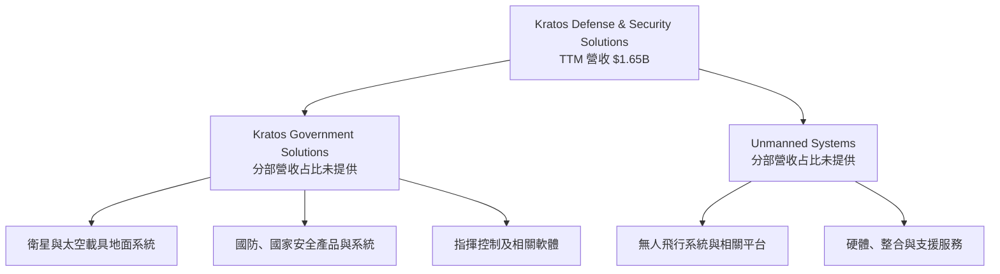
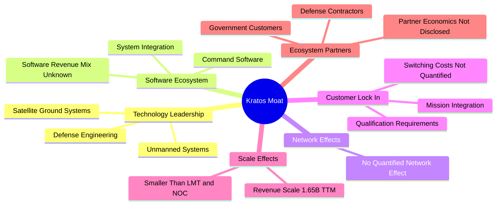
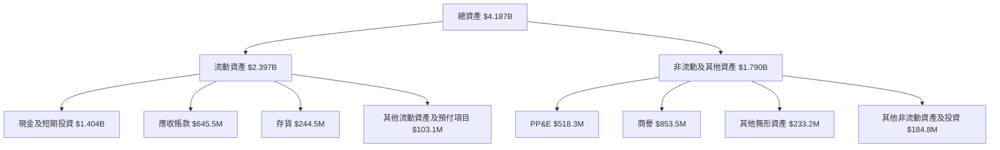
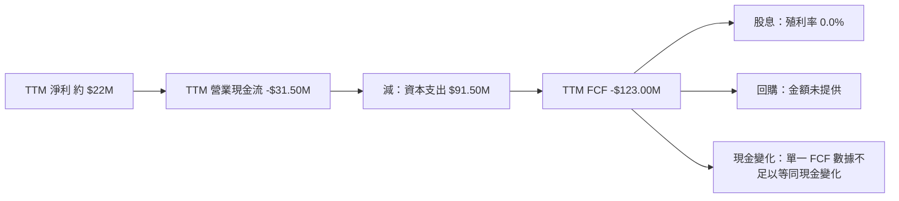
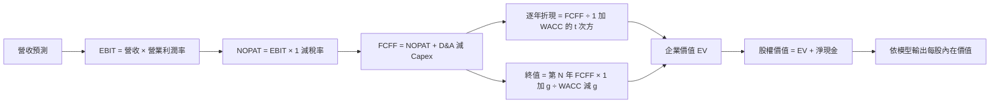
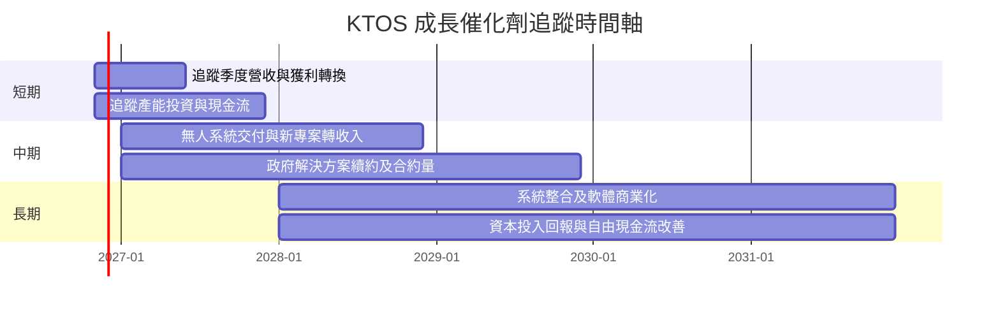
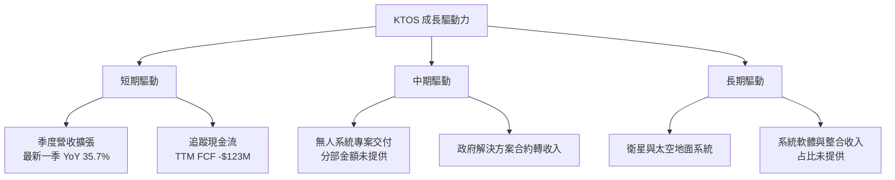
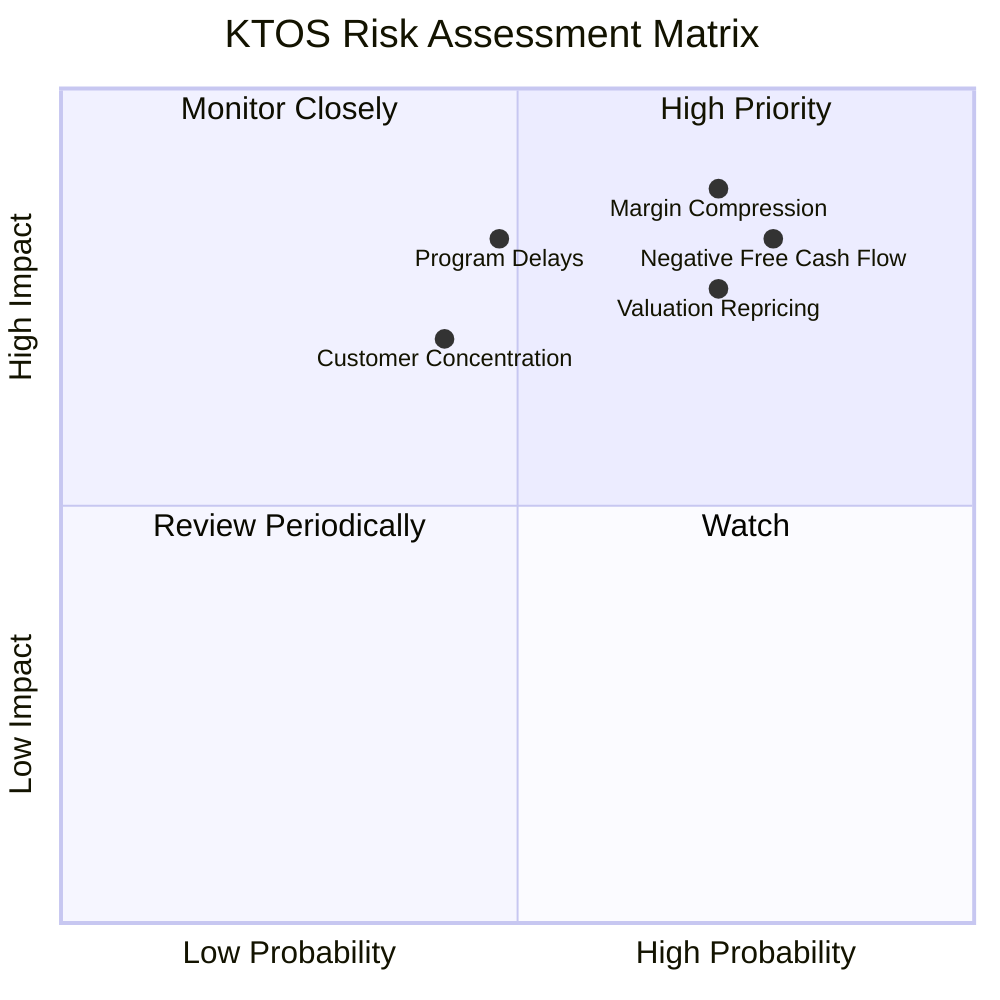
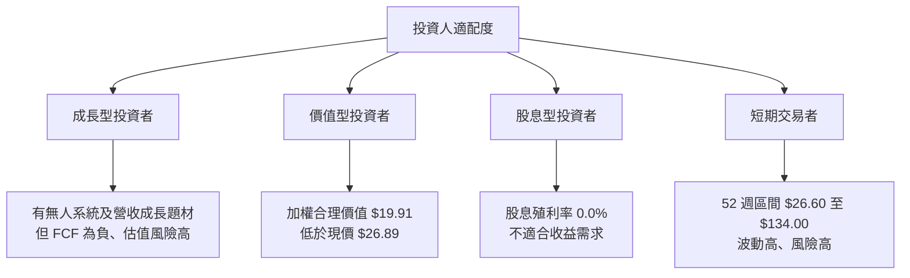

# KTOS 基本面深度分析報告
> **報告日期**：2026-11-21 ｜ **語言**：繁體中文 ｜ **數據來源**：SEC 申報資料 (XBRL)、Yahoo Finance、Finviz、StockAnalysis、Roic.ai ｜ **分析師**：CFA 級機構研究

## 目錄

| # | 章節 | 核心結論 |
|---|------|----------|
| 1 | 執行摘要 | 賣出；加權合理價值 $19.91，MOS -35.1% |
| 2 | 公司概覽與商業模式 | 無人系統、政府解決方案具專業門檻，但分部數據不足以驗證護城河轉化率 |
| 3 | 損益表深度分析 | TTM 營收 $1.65B、成長 28.2%；營業利益率僅 0.4% |
| 4 | 資產負債表分析 | 現金及短期投資 $1.40B；總債務 N/A，流動性指標偏高 |
| 5 | 現金流量深度分析 | TTM FCF -$123.00M，FCF Yield -2.43% |
| 6 | 獲利能力與資本效率 | ROIC 0.2% 對 WACC 10.12%，目前未創造經濟價值 |
| 7 | 相對估值分析 | 多數倍數高於傳統軍工同業，DCF 模型估值亦低於現價 |
| 8 | DCF 內在價值評估 | 基準 DCF $9.91；三角驗證加權合理價值 $19.91 |
| 9 | 成長催化劑 | 無人系統與國防需求提供成長機會，但 TAM 與分部數字未提供 |
| 10 | 風險矩陣 | 獲利率、現金流轉換及高估值是主要風險 |
| 11 | 投資建議 | 依 MOS 評級為賣出；待價格與現金流改善後重新評估 |

---

## 1. 執行摘要

KTOS 的營收成長具吸引力，但目前成長尚未轉化為足夠獲利與現金流：TTM 營收 $1.65B、TTM 成長 28.2%，最新一季單季營收年增 35.7%；然而 TTM 營業利益率僅 0.4%、ROIC 0.2%，低於 10.12% 的 WACC，TTM FCF 為 -$123.00M。以 2026-11-20 收盤價 $26.89 計，加權合理價值為 $19.91，MOS 為 -35.1%，依規則 20 評級為 **🔴 賣出**；DCF 基準價值 $9.91，相對現價溢價 171.2%。公司現金部位提供流動性緩衝，但現價仍要求營收成長、利潤率與現金流改善同時兌現。

### 1.0 一頁式投資儀表板

| 項目 | 內容 |
|------|------|
| **投資論點（3 句）** | ① TTM 營收成長 28.2%，最新一季單季年增 35.7%，顯示需求與交付擴張。② TTM 營業利益率 0.4%、ROIC 0.2%，對照 WACC 10.12%，成長目前未創造足夠經濟利潤。③ TTM FCF -$123.00M、FCF Yield -2.43%，現金轉換仍是主要驗證點。 |
| **綜合評分** | **5.2/10**（引用 1.1 評分卡） |
| **財務健康** | 🟡 現金及短期投資 $1.40B、流動比率 5.418；但 TTM FCF 為 -$123.00M，總債務在核心數據中為 N/A。 |
| **ROIC vs WACC** | **0.2% vs 10.12%**；目前摧毀經濟價值。 |
| **FCF 趨勢** | 近期現金流為負；TTM FCF Yield **-2.43%**。 |
| **估值** | Forward P/E 24.05x ｜ EV/EBITDA 43.43x（市場數據）｜ FCF Yield -2.43%。 |
| **DCF 內在價值（基準）** | **$9.91** ｜ 現價相對 DCF 溢價 **171.2%**（以 DCF 基準價值計）。 |
| **安全邊際（MOS）** | **-35.1%＝($19.91 − $26.89) ÷ $19.91**｜🔴 無安全邊際（加權合理價值來自 8.8）。 |
| **預期報酬（基準情境 12M）** | DCF 基準情境相對現價 **-63.1%**；非保證報酬預測。 |
| **關鍵風險（前二）** | 營收成長無法轉成營業利潤；負 FCF 與高資本支出延續。 |
| **評級 + 信心度** | 🔴 **賣出** ｜ 信心：中（估值方法彼此分歧，且 DCF 對終值敏感）。 |

### 1.1 綜合評分卡

| 維度 | 評分（1–10） | 主要依據（引用數字與其來源章節） |
|------|--------------|----------------------------------|
| 成長性 | 8.0 | TTM 營收成長 28.2%、最新一季單季年增 35.7%（第 3 章）。 |
| 獲利能力 | 3.0 | TTM 營業利益率 0.4%、ROIC 0.2%，低於 WACC 10.12%；Piotroski 3/8（第 3、6 章）。 |
| 財務健康 | 8.0 | 現金及短期投資 $1.40B、流動比率 5.418；但 TTM FCF -$123.00M（第 4、5 章）。 |
| 估值 | 2.0 | MOS -35.1%；EV/EBITDA 43.43x，對比 LMT 14.7x、NOC 12.2x（第 7、8 章）。 |
| 護城河 | 6.0 | 國防系統與無人平台具專業技術與客戶導入門檻，但分部營收及續約數據未提供（第 2 章）。 |
| 管理層與資本配置 | 4.0 | 2025 年 SBC $35.5M，約占當年營收 2.6%；FY2025 FCF -$137.4M，資本支出 $95.3M（第 3、5 章）。 |
| **綜合評分** | **5.2** | 六項算術平均：\((8.0+3.0+8.0+2.0+6.0+4.0)÷6=5.2\)。 |

### 1.2 五大投資論點 + 三大核心風險

| 類型 | 項目 | 具體依據 | 信心度 |
|------|------|----------|--------|
| 🟢 **投資論點①** | 營收成長加速 | TTM 營收 $1.65B、TTM 成長 28.2%；最新一季單季營收年增 35.7%。 | 🟢 高 |
| 🟢 **投資論點②** | 無人系統與國防電子市場需求 | 公司業務涵蓋政府解決方案及無人系統；國防、國家安全需求提供長期需求基礎，但分部收入占比未提供。 | 🟡 中 |
| 🟢 **投資論點③** | 現金緩衝可支應投資 | 現金及短期投資 $1.40B；相較 TTM FCF -$123.00M，現金提供資本投資與營運緩衝。 | 🟢 高 |
| 🟢 **投資論點④** | 毛利率有一定穩定性 | TTM 毛利率 23.0%；FY2025 毛利率約 22.9%（$307.9M ÷ $1.347B），規模成長伴隨毛利額上升。 | 🟡 中 |
| 🟢 **投資論點⑤** | 產品與任務專業性 | 公司提供無人系統、衛星地面系統等國防相關產品與軟體，採購認證與整合可能形成轉換成本；量化留存資料未提供。 | 🟡 中 |
| 🟡 **風險①** | 成長未轉化為獲利 | TTM 營業利益率 0.4%、最新一季營業利益率 -1.0%；若低毛利專案占比提高，營收成長可能不帶動 EPS。 | 🔴 高衝擊 |
| 🔴 **風險②** | 現金流與資本支出壓力 | TTM OCF -$31.50M、Capex $91.50M、FCF -$123.00M；若設備與產能投入持續高於營運現金生成，估值將承壓。 | 🔴 高衝擊 |
| 🟡 **風險③** | 估值對執行力要求高 | 現價 $26.89，高於加權合理價值 $19.91；反向 DCF 顯示現價需要遠高於基準的成長或利潤率假設。 | 🔴 高 |

### 1.3 快速統計卡片

| 指標 | 公司實際值（期間） | 同業中位數 | 狀態 |
|------|--------------------|------------|------|
| 營收成長（TTM） | **28.2%** | — | 🟢 |
| 營收成長（最新一季年增） | **35.7%** | 6.7% | 🟢 |
| 毛利率（TTM） | **23.0%** | 20.0% | 🟢 |
| 營業利益率（TTM） | **0.4%** | — | 🔴 |
| ROIC（TTM） | **0.2%** | — | 🔴 |
| Forward P/E | **24.05x** | 17.8x（同業 Forward P/E 中位數） | 🟡 |
| FCF Yield（TTM） | **-2.43%** | — | 🔴 |
| Piotroski F-Score | **3 / 8** | — | 🔴 |

### 1.4 投資結論

╔══════════════════════════════════════════════════════════════════╗  
║                    📊 投資結論摘要                               ║  
╠══════════════════════════════════════════════════════════════════╣  
║  評級：🔴 賣出（MOS -35.1%，依規則 20）                         ║  
║  價格（2026-11-20 收盤）：$26.89                                ║  
║  DCF 內在價值（基準）：$9.91（現價溢價 171.2%）                 ║  
║  安全邊際 MOS：-35.1%（＝($19.91−$26.89)÷$19.91）               ║  
║  加權合理價值（8.8）：$19.91                                    ║  
║  DCF 情境價值：                                                  ║  
║    悲觀情境：$8.21（-69.5%）                                     ║  
║    基準情境：$9.91（-63.1%）                                     ║  
║    樂觀情境：$13.79（-48.7%）                                    ║  
║  綜合評分：5.2/10（引用 1.1）                                    ║  
║  適合投資人：可承受高波動、看好國防無人系統長期需求者；不適合    ║  
║  以低估值、現金流或股息為主要篩選條件者。                        ║  
╚══════════════════════════════════════════════════════════════════╝

---

## 2. 公司概覽與商業模式

Kratos Defense & Security Solutions, Inc.（KTOS）為美國國防與安全技術公司，員工約 4,300 人，營運分為 Kratos Government Solutions 與 Unmanned Systems。公司提供無人系統、衛星及太空載具地面系統、硬體、軟體及相關服務；客戶包含美國及國際國防、國家安全與商業市場。TTM 營收 $1.65B，但分部營收、訂單、毛利和客戶集中度資料未提供，因此無法判斷各業務對成長與利潤的貢獻比例。

### 2.1 業務結構與收入來源

分部占比及金額未提供，不以推估比例製作圖表。

### 2.2 市場份額

**市場份額數據未提供。** KTOS TTM 營收 $1.65B、TTM 成長 28.2%，規模明顯小於大型主承包商 LMT 與 NOC，但最新一季單季營收年增 35.7%，高於本報同業資料中的 AVAV 5.7%、LMT 11.3% 與 NOC 6.7%。此比較是公司整體單季增長對同業最新季度數據，不代表市場份額或相同產品組合。

### 2.3 競爭護城河分析

### 2.4 護城河強度

| 護城河項目 | 強度（強／中／弱） | 證據（引用數字或事實） | 會削弱它的情況 |
|------------|--------------------|------------------------|----------------|
| 技術與系統整合 | 中 | 產品涉及無人系統、衛星地面系統與國防技術；TTM 營收 $1.65B，但研發支出與分部回報未提供。 | 競品達成相近效能、專案延期或技術替代。 |
| 軟體生態系統 | 中 | 提供衛星與太空系統相關軟體及指揮控制能力；軟體收入占比未提供。 | 軟體無法形成續約收入，或系統採購轉向開放架構。 |
| 網路效應 | 弱 | 無可量化使用者、資料或平台網路效應指標。 | 客戶與合作夥伴採用集中在其他平台。 |
| 客戶鎖定 | 中 | 國防系統認證、整合及任務適配可能提高轉換成本，但續約率與合約年期未提供。 | 採購標案競爭、客戶內製或多來源供應增加。 |
| 規模效應 | 中偏弱 | TTM 營收 $1.65B；相較 LMT、NOC 等大型承包商，整體規模有限。 | 同業以規模、採購議價或研發預算壓縮成本。 |
| 生態夥伴 | 中 | 政府與國防產業鏈為重要市場；合作夥伴收入貢獻與集中度未提供。 | 對單一主承包商或政府專案依賴過高。 |

護城河評分採用 1.1 的 **6.0/10**：專業產品、系統整合與採購門檻提供一定優勢，但收入組成、續約與客戶依賴資料不足，無法證明優勢已轉化為穩定高回報。

---

## 3. 損益表深度分析

### 3.1 年度收入成長趨勢（近 4 年）

以下年度數字以公司財務報表所列年度營收為準。四年營收由 $898.3M 增至 $1.347B，三年 CAGR 約 14.4%；計算為 \((1.347÷0.8983)^{1/3}-1\)。

╔══════════════════════════════════════════════════════════════════╗  
║              Kratos 年度收入趨勢（FY2022–FY2025）                ║  
╠══════════════════════════════════════════════════════════════════╣  
║  FY2022  $0.898B  █████████████░░░░░░░░░  YoY：+10.7% 🟢       ║  
║  FY2023  $1.037B  ███████████████░░░░░░░  YoY：+15.5% 🟢       ║  
║  FY2024  $1.136B  █████████████████░░░░░  YoY：+9.6%  🟡       ║  
║  FY2025  $1.347B  ████████████████████░░  YoY：+18.5% 🟢       ║  
╠══════════════════════════════════════════════════════════════════╣  
║  FY2022–FY2025 CAGR：約 +14.4%                                   ║  
╚══════════════════════════════════════════════════════════════════╝  

年度營收增長與 TTM 成長 28.2% 的方向一致但速度較低，反映最新四季增長高於過往年度。持續性仍取決於專案交付與訂單轉收入，不能僅以單季高成長外推。

### 3.2 季度收入趨勢分析

| 季度 | 營收 | QoQ 成長 | YoY 成長 | 備註 |
|------|------:|---------:|---------:|------|
| 2025 Q4 | $345.1M | 14.1% | 21.9% | QoQ 以 2025 Q3 $302.6M 為比較基期；季節性可能影響。 |
| 2026 Q1 | $371.0M | 7.5% | 22.6% | YoY 以 2025 Q1 $302.6M 計。 |
| 2026 Q2 | $458.8M | 23.7% | 30.5% | YoY 以 2025 Q2 $351.5M 計。 |
| 2026 Q3 | $471.8M | 2.8% | 35.7% | YoY 以 2025 Q3 $347.6M 計；QoQ 增速放慢但年增加速。 |

QoQ 算式例：2026 Q3 \((471.8÷458.8)-1=2.8\%\)。季度營收連續上升，但營業利益由 2026 Q1 的 $6.6M 降至 Q2 -$0.8M、Q3 -$4.0M；收入增長未同步轉成營業利潤，可能反映成本、專案組合或擴產費用增加，現有資料不足以拆分原因。

### 3.3 利潤率演變分析

年度毛利率以毛利÷營收計算；營業利益率以營業利益÷營收計算。

| 利潤率指標 | FY2022 | FY2023 | FY2024 | FY2025 | 趨勢 | 評估 |
|------------|-------:|-------:|-------:|-------:|------|------|
| **毛利率** | 25.2% | 25.9% | 25.3% | 22.9% | FY2025 下降約 2.4 個百分點 | 🟡 |
| **營業利益率** | 0.5% | 3.0% | 2.6% | 2.1% | 高於 FY2022，但近年走弱 | 🟡 |
| **淨利率** | -4.1% | -0.9% | 1.4% | 1.6% | 由虧損轉正，改善但仍薄 | 🟡 |

FY2025 毛利率回落而收入成長加速，表示產品組合、專案成本或價格／成本匹配值得追蹤；現有資料沒有分部毛利、定價或原料成本資料，不能將下降單一歸因於特定因素。營業利益率亦由 FY2023 的 3.0% 降至 FY2025 的 2.1%，最新 TTM 核心數據為 0.4%，最新一季則為 -1.0%，顯示近期費用與交付結構對營運槓桿構成壓力。

### 3.4 費用結構分析

分部費用、銷售管理費與研發費用的完整 TTM 明細未提供，不製作費用結構圓餅圖，以免將未披露項目當成完整分解。已知 FY2025 研發支出 $40.0M，約為當年營收 $1.347B 的 3.0%；研發投入有助產品開發，但其商業化回報需由後續合約與利潤率驗證。

### 3.5 季度 EPS 趨勢與盈餘品質（Quality of Earnings）

**最近四季 EPS 超預期／不及預期：N/A。** EPS Est 與 EPS Act 的歷史資料均為缺失值，因此不能判斷四季盈餘是否超預期。季度淨利分別為 2025 Q4 $5.9M、2026 Q1 $11.9M、Q2 $4.4M、Q3 -$0.2M，最新季度轉為小幅虧損。

| 盈餘品質項目 | 數值／佔比 | 評估 |
|--------------|-----------|------|
| 股權薪酬 SBC / 營收 | FY2025：$35.5M ÷ $1.347B = **2.6%** | 🟡 SBC 是實際稀釋成本；FY2025 SBC 高於淨利 $22.0M。 |
| SBC / 營業現金流 | TTM OCF -$31.50M，比例無可解讀的正向現金轉換值 | 🔴 分母為負，SBC 不能由營業現金流覆蓋；不把此比率解讀為正向品質指標。 |
| FCF / 淨利（現金轉換率） | TTM 淨利約 $22M；\(-$123M÷$22M≈-559\%\) | 🔴 淨利為正但 FCF 顯著為負，現金轉換弱。 |
| 一次性／非經常性損益 | N/A（未提供完整調節表） | 🟡 不假設存在或不存在重大一次性項目。 |
| 有效稅率異常 | N/A（未提供可核對的 TTM 現金稅與稅前利潤明細） | 🟡 無法判斷稅務利益是否影響淨利。 |
| 資本化支出 vs 費用化 | TTM Capex $91.50M；資本化與費用化項目細節 N/A | 🟡 資本支出較高且拉低 FCF；無法據此推斷費用被資本化而虛增利潤。 |

**盈餘品質結論：** GAAP 淨利存在，但 TTM FCF 為 -$123.00M，且 FY2025 SBC $35.5M 高於 FY2025 淨利 $22.0M，表明帳面獲利尚未成為可分配現金。由於最新季度 EPS 共識資料與有效稅率明細缺失，對單季獲利變化不作超出資料的歸因。估值上應降低對當期 EPS 倍數的依賴，並要求營業現金流轉正及 FCF 收斂。

---

## 4. 資產負債表分析

### 4.1 資產結構分解

最新 TTM 資產資料列示總資產 $4.187B；現金及短期投資 $1.404B、應收帳款 $645.5M、存貨 $244.5M、商譽 $853.5M、無形資產 $233.2M。以下金額為 StockAnalysis 資料，期末為 2026-09-27。

### 4.2 流動性與營運資金分析

| 指標 | 最新 TTM | 一年前 TTM | 變化 | 解讀 |
|------|----------|------------|------|------|
| 流動比率 | 5.418 | N/A | N/A | 流動資產對短期負債覆蓋高；不代表營運現金流已改善。 |
| 速動比率 | 4.632 | N/A | N/A | 不含存貨仍有流動性緩衝。 |
| DSO 應收帳款天數 | 42 天 | 39 天 | +3 天 | 收款天數增加，可能令現金回收稍慢；須結合應收帳款帳齡觀察。 |
| DIO 存貨天數 | 70 天 | 66 天 | +4 天 | 存貨天數增加，可能反映備料或交付節奏；若需求落空，庫存資金占用風險上升。 |
| DPO 應付帳款天數 | 32 天 | 24 天 | +8 天 | 延長付款天數提供短期資金支持，但不能單獨解讀為議價能力提升。 |
| CCC 現金轉換週期 | 80 天 | 81 天 | -1 天 | 整體週期略縮短，主要方向由應付帳款天數增加所抵銷；仍需管理應收與存貨。 |

### 4.3 債務結構分析

核心計算資料列示現金及短期投資 $1.40B、總債務 **N/A**、淨現金 $1.40B。另一市場資料區段列出總債務 $246.0M、淨現金／債務 $1.16B；由於各來源口徑不一致，本報告依規則以 VERIFIED FIGURES 的總債務 N/A、淨現金 $1.40B 為主，不以另一口徑重算或混用。

╔══════════════════════════════════════════════════════════════════╗  
║                   KTOS 債務健康診斷                              ║  
╠══════════════════════════════════════════════════════════════════╣  
║  總債務：        N/A（核心計算資料未提供）                        ║  
║  現金+短期投資： $1.40B                                          ║  
║  淨現金：        $1.40B（依核心計算口徑）🟢                      ║  
║  Debt/EBITDA：   N/A（債務口徑缺漏）                              ║  
║  利息保障倍數：  N/A（利息費用與債務數據不足）                    ║  
║  判讀：現金充足，但近期 FCF 為負，現金消耗仍應追蹤。              ║  
╚══════════════════════════════════════════════════════════════════╝

### 4.4 股東權益趨勢

╔══════════════════════════════════════════════════════════════════╗  
║              股東權益趨勢（FY2022–FY2025）                       ║  
╠══════════════════════════════════════════════════════════════════╣  
║  FY2022  $0.936B  █████████░░░░░░░░░░░░░                        ║  
║  FY2023  $0.976B  ██████████░░░░░░░░░░░░                        ║  
║  FY2024  $1.350B  ██████████████░░░░░░░                        ║  
║  FY2025  $2.000B  ████████████████████░                        ║  
╚══════════════════════════════════════════════════════════════════╝

FY2024 至 FY2025 股東權益上升，但來源可能包含股權發行、併購及其他會計項目；現有資料未提供完整權益變動表，故不把增加完全歸因於留存盈餘。另需留意稀釋股數未通過 Piotroski 測試，股東權益增加不等同每股價值同比增加。

---

## 5. 現金流量深度分析

### 5.1 現金流量瀑布圖

TTM 現金流數據為營業現金流 -$31.50M、資本支出 $91.50M、FCF -$123.00M。淨利與現金流呈現落差；股息殖利率 0.0%，近年未提供回購金額。

### 5.2 FCF 轉換率趨勢

| 期間 | FCF | 淨利 | FCF / 淨利 | 趨勢與解讀 |
|------|----:|----:|-----------:|-----------|
| FY2022 | -$71.1M | -$36.9M | 192.7%（兩者皆負） | 負值 FCF 並非正向轉換；淨利虧損使倍數不宜單獨解讀。 |
| FY2023 | $12.8M | -$8.9M | -143.8% | FCF 為正而淨利為負，比率方向不具可比性。 |
| FY2024 | -$8.5M | $16.3M | -52.1% | 獲利未轉成正 FCF。 |
| FY2025 | -$137.4M | $22.0M | -624.5% | 資本支出升至 $95.3M，FCF 大幅轉負。 |
| TTM | -$123.0M | 約 $22M | 約 -559% | FCF 明顯低於淨利，現金轉換偏弱。 |

### 5.3 自由現金流趨勢

╔══════════════════════════════════════════════════════════════════╗  
║                 自由現金流歷史趨勢                               ║  
╠══════════════════════════════════════════════════════════════════╣  
║  FY2022  -$71.1M   ◀██████████░░░░░░░░░░  FCF 負值              ║  
║  FY2023   $12.8M   ████░░░░░░░░░░░░░░░░  FCF 正值              ║  
║  FY2024   -$8.5M   ◀██░░░░░░░░░░░░░░░░░░  FCF 負值              ║  
║  FY2025 -$137.4M   ◀████████████████████  FCF 負值              ║  
║  TTM    -$123.0M   ◀██████████████████░░  FCF Yield -2.43%      ║  
╚══════════════════════════════════════════════════════════════════╝

FY2025 Capex $95.3M，高於 FY2024 的 $58.2M；同期 FCF 由 -$8.5M 轉為 -$137.4M。投資支出可能與擴產或產能需求相關，但由於資本支出回報與分部投資計畫未提供，投資者需要以後續營收、毛利與 OCF 驗證投入效率。

### 5.4 資本配置評估

資本配置的完整用途比例與回購金額未提供，因此不繪製比例圓餅圖。

| 項目 | 可用數據 | 評估 |
|------|----------|------|
| 資本支出 | TTM $91.50M；FY2025 $95.30M | 投資金額增加，短期壓低 FCF；須追蹤投資後的營收與毛利回報。 |
| 股權薪酬 | FY2025 $35.50M | 約占 FY2025 營收 2.6%，是持續股東成本。 |
| 股息 | 殖利率 0.0% | 無現金股息回饋，資本優先用於營運與投資。 |
| 回購 | 金額未提供 | 不推定公司有實質回購。 |
| 併購與其他投資 | 具體金額未提供 | 資產與無形資產增加，但缺少完整現金流用途明細。 |

---

## 6. 獲利能力與資本效率

### 6.1 ROE / ROA / ROIC 趨勢

歷史 ROE、ROA 與 ROIC 完整年度序列未提供；下表僅列可靠的 TTM 數字，不推估行業均值。

| 指標 | TTM | 歷史趨勢資料 | 評估 |
|------|----:|--------------|------|
| ROE | 0.6%（QUALITY FIGURES） | 完整連續序列 N/A | 低回報；DuPont 顯示淨利率僅 1.3%。 |
| ROA | 0.2% | TTM 對一年前的 Piotroski 測試未通過「ROA 高於一年前」 | 資產使用的獲利產出偏低。 |
| ROIC | 0.2% | 完整連續序列 N/A | 明顯低於 WACC 10.12%。 |

不同資料截面中亦出現 ROE 0.8% 等數值；本節依 QUALITY FIGURES 使用 ROE 0.6%，不混合不同口徑。

### 6.2 ROIC vs WACC 分析（核心價值創造判斷）

╔══════════════════════════════════════════════════════════════════╗  
║                ROIC vs WACC 深度分析                            ║  
╠══════════════════════════════════════════════════════════════════╣  
║  WACC（依資本成本資料採用）：10.12%                               ║  
║  ├── 無風險利率（10Y 美債）：4.91%                                ║  
║  ├── 市場風險溢酬 ERP：5.00%                                      ║  
║  ├── Beta 原始值：1.17；調整後採用值：1.11                       ║  
║  ├── 股權成本 Ke：10.46%                                          ║  
║  ├── 稅前債務成本：3.90%；稅率：21.0%                            ║  
║  ├── 股權／債務權重：95.4%／4.6%                                  ║  
║  └── WACC：10.12%                                                 ║  
║                                                                  ║  
║  ROIC（TTM）：0.2%                                                ║  
║  EVA spread = ROIC − WACC = 0.2% − 10.12% = -9.92 個百分點       ║  
║                                                                  ║  
║  ROIC  0.2%    ░░░░░░░░░░░░░░░░░░░░░░░░░░░░░░░░░░░░░░░░░      ║  
║  WACC 10.12%   ▓▓▓▓▓▓▓▓▓▓▓▓▓▓▓▓▓▓▓▓▓▓▓▓▓▓▓▓▓▓▓▓▓▓▓▓▓▓▓▓      ║  
║  結論：ROIC 低於資本成本，現階段摧毀股東經濟價值。               ║  
╚══════════════════════════════════════════════════════════════════╝

此處直接採用資本成本資料所列 WACC 10.12%，不另算替代 WACC。ROIC 0.2% 與 WACC 相差 -9.92 個百分點，表示即使營收成長維持，若利潤率與資本周轉沒有改善，擴大投入仍可能增加低回報資本，而非創造價值。

### 6.3 杜邦三因素分解

| 因素 | 數值（TTM） | 解讀 |
|------|-------------|------|
| 淨利率 | 1.3% | 獲利率偏薄，提升 ROE 的空間主要在營業與淨利改善。 |
| 資產週轉率 | 0.39 | 每單位資產對應營收有限，仍需觀察新增資產能否形成收入。 |
| 權益乘數 | 1.21 | 槓桿程度不高，ROE 並非主要靠高財務槓桿支撐。 |
| **ROE** | **0.6%** | 1.3% × 0.39 × 1.21 ≈ 0.6%（使用已提供之 DuPont 數值）。 |

### 6.4 財務體質：Piotroski F-Score

**Piotroski F-Score：3 / 8。** 其中一項因缺少輸入無法判定，測試數低於九項。

| 測試 | 結果 | 解讀 |
|------|------|------|
| ROA > 0 | ✅ 通過 | TTM 資產報酬為正，但幅度僅 0.2%。 |
| 營業現金流 > 0 | ❌ 未通過 | TTM OCF -$31.50M。 |
| ROA 高於一年前 | ❌ 未通過 | 獲利效率未改善。 |
| 營業現金流 > 淨利（應計品質） | ❌ 未通過 | 現金流低於會計淨利，獲利轉現能力弱。 |
| 長期負債 ÷ 總資產低於一年前 | — 無法判定 | 缺少可比較負債資料。 |
| 流動比率高於一年前 | ✅ 通過 | 流動性指標改善。 |
| 稀釋股數未增加 | ❌ 未通過 | 股數增加可能稀釋既有持股比例。 |
| 毛利率高於一年前 | ✅ 通過 | 測試結果為通過，但 FY2025 年度毛利率低於 FY2024；期間與口徑不同，不應混為一談。 |
| 資產週轉率高於一年前 | ❌ 未通過 | 資產效率比較未改善。 |

---

## 7. 相對估值分析

### 7.1 同業估值比較表格

同業倍數均採用 Yahoo Finance 同業資料；同業中位數依 AVAV、LMT、NOC 三家計算。KTOS 指標使用市場數據區段；部分 EV/EBITDA 因來源口徑差異與驗證數據的歷史倍數資料有所不同，應避免跨來源直接作精確套利比較。

| 估值指標 | **KTOS** | **AVAV** | **LMT** | **NOC** | KTOS 評估 |
|----------|--------:|--------:|-------:|-------:|-----------|
| **Trailing P/E** | 224.1x | N/A | 20.1x | 16.9x | 🔴 KTOS 盈利基數很低，P/E 可比性弱。 |
| **Forward P/E** | 24.05x | 19.7x | 17.0x | 17.8x | 🟡 高於同業中位數 17.8x。 |
| **P/S Ratio** | 3.07x | 2.2x | 1.7x | 1.7x | 🔴 KTOS 有成長溢價，但利潤率尚低。 |
| **EV/EBITDA（TTM）** | 43.43x | 21.3x | 14.7x | 12.2x | 🔴 明顯高於三家同業。 |
| **最新一季營收年增** | 35.7% | 5.7% | 11.3% | 6.7% | 🟢 成長高，但需觀察能否轉為利潤。 |
| **毛利率（TTM）** | 23.0% | 26.5% | 11.7% | 20.0% | 🟡 高於 LMT、NOC，低於 AVAV。 |

三家同業 Forward P/E 中位數為 17.8x，計算為排序後中間值 17.8x；同業 EV/EBITDA 中位數為 14.7x。KTOS 的成長溢價有一定基本面支持，但市場目前以遠高於成熟軍工同業的 EV/EBITDA 評價，要求利潤率與現金流改善。

### 7.2 歷史估值區間分析

╔══════════════════════════════════════════════════════════════════╗  
║              KTOS 自身歷史估值位置（TTM）                        ║  
╠══════════════════════════════════════════════════════════════════╣  
║  P/E        現值 224.1x｜5年中位數 380.2x｜百分位 0%             ║  
║  P/S        現值   3.1x｜5年中位數   3.2x｜百分位 45%            ║  
║  EV/EBITDA  現值  44.1x｜5年中位數  55.5x｜百分位 20%            ║  
║                                                                  ║  
║  注意：P/E 歷史範圍受到極端高值影響，歷史百分位解讀需審慎。      ║  
╚══════════════════════════════════════════════════════════════════╝

P/E 五年區間上限受極端值影響，雖當前百分位為 0%，不能據此認定絕對便宜；更重要的是 TTM 盈利偏低。P/S 現值 3.1x 接近歷史中位數 3.2x，EV/EBITDA 現值 44.1x 低於歷史中位數 55.5x，但仍高於 AVAV、LMT 與 NOC 的同業數據。

### 7.3 情境價值（Bear / Base / Bull，照抄 DCF MODEL 的 Scenarios）

| 情境 | 第 1 年營收成長 | 期末營業利潤率 | WACC | 每股價值 | 相對現價 | 機率 | 會發生的條件 |
|------|----------------|----------------|------|----------|----------|------|--------------|
| 🔴 悲觀 | 14.1% | 1.6% | 11.12% | $8.21 | -69.5% | 25% | 成長從 TTM 28.2% 快速降溫，投入與成本令利潤率改善受限，風險溢價上升。 |
| 🟡 基準 | 28.2% | 1.9% | 10.12% | $9.91 | -63.1% | 50% | 成長依基準假設逐步衰減，利潤率回到歷史五年中位水準。 |
| 🟢 樂觀 | 42.3% | 2.1% | 9.12% | $13.79 | -48.7% | 25% | 訂單與產能快速放量、規模效率提升且資本成本降低。 |

三種情境的每股價值皆低於 2026-11-20 收盤價 $26.89，顯示在此模型設定下，即使樂觀營運假設仍未支持現價。

### 7.4 相對估值隱含價格區間

╔══════════════════════════════════════════════════════════════════╗  
║             同業估值方法隱含價值與現價                           ║  
╠══════════════════════════════════════════════════════════════════╣  
║  $13.97  同業 EV/EBITDA ─── $19.96 同業 Forward P/E ─── $26.89 現價  ║  
║  依據：14.7x × TTM EBITDA，    17.8x × Forward EPS $1.12       ║  
╚══════════════════════════════════════════════════════════════════╝

- **同業 Forward P/E：$19.96/股**，以 AVAV、LMT、NOC 的同業中位數 17.8x 乘 KTOS Forward EPS $1.12。
- **同業 EV/EBITDA：$13.97/股**，以同業 EV/EBITDA 中位數 14.7x 乘 TTM EBITDA，再加回淨現金。
- 兩種相對估值均低於現價 $26.89，且均未反映分析師共識目標價 $74.68。

---

## 8. DCF 內在價值評估（Discounted Cash Flow）

> 本節依程式計算的 DCF 模型原值列示，不另建模型或改動輸入。DCF 數字以十億美元為單位；表中金額依來源精度呈現。模型不納入營運資金變動，使用 GAAP EBIT，並以模型指定的每股價值輸出為準。

### 8.0 估值推理鏈（Thinking Logic）

**Step 1 — 價值由哪些變數決定？**  
核心價值來自政府解決方案與無人系統相關收入、未來利潤率轉換，以及高資本支出後形成的自由現金流。公司未披露兩個分部營收占比，故不能將 $1.65B TTM 營收拆分或為第二成長曲線賦予獨立比例。模型中最主導估值的變數為長期現金流與終值：基準終值現值占企業價值 84.5%，而 WACC 與永續成長率會顯著改變終值。

**Step 2 — 模型選擇**

| 決策點 | 本報告採用 | 理由（含數字） | 曾考慮但否決 | 否決理由 |
|--------|-----------|----------------|--------------|----------|
| 現金流定義 | FCFF | 模型採用 NOPAT + D&A − Capex，並以 WACC 折現至 EV。 | FCFE | 模型已設定 WACC 與 EV 橋接，不改換方法。 |
| 預測期 N | 10 年 | 依模型提供的 10 年預測；收入成長由 28.2% 線性遞減至 3.0%。 | 5 年 | 會改變既定模型期間與終值起算年。 |
| 終值方法 | Gordon Growth | 模型採 3.0% 永續成長率。 | 退出倍數 | DCF MODEL 未提供退出倍數終值計算，不自行建模。 |
| EBIT 基礎 | GAAP EBIT | 模型以 GAAP EBIT 作 FCFF 起點。 | 非 GAAP EBIT | 避免自行調整 SBC 或改動模型輸出。 |

**Step 3 — 關鍵假設推導鏈**

- **營收成長**：錨點＝TTM 成長率 28.2%；調整＝模型將第 1 年維持 28.2%，再線性降至第 10 年 3.0%；**採用模型提供的逐年成長率**；曾考慮直接以最新一季 35.7% 年增延伸，但否決，因單季成長不能直接代表長期 TTM 成長。
- **期末營業利潤率**：錨點＝TTM 營業利益率 0.4%；調整＝模型將利潤率從第 1 年 0.4% 緩步升至第 10 年 1.9%，依據為過去五個財政年度中位數（模型假設）；**採用 1.9%**；曾考慮以更高的同業利潤率作終值，但否決，因 KTOS 目前營業利益率遠低於成熟同業，沒有足夠資料支持快速收斂。
- **永續成長率 g**：錨點＝長期名目經濟成長假設約 3%（模型採用值）；**採用 3.0%**，且低於 WACC 10.12%；曾考慮更高 g，但否決，因永續增長率必須低於折現率且長期不可無限高於經濟成長。
- **預測期 N**：錨點＝模型明列 10 年；調整＝不另作調整；**採用 10 年**；曾考慮縮短預測期，但否決，因會改變模型既有現金流序列及終值起算點。
- **Capex／營收**：錨點＝TTM 約 5.6%（模型列值）；調整＝模型由第 1 年 5.6% 漸降至第 10 年 5.1%，以 1.1 倍 D&A 為下限條件；**採用模型逐年值**；否決更快降至較低比例，因當前實際資本支出高且公司仍處於投入階段。
- **D&A／營收**：錨點＝TTM 4.7%；**採用 4.7% 並固定**。屬模型固定參數；對其未來變化沒有足夠資料作精確估計。
- **稅率**：錨點＝預設稅率 21.0%；**採用 21.0%**。有效稅率歷史明細不足，不另用短期實際稅率替代。
- **營運資金變動**：模型明示未建模，故 ΔWC 未列入現金流。這是缺漏簡化而非假設實際無營運資金需求；若 CCC 增長或應收、存貨占用加大，實際價值可能低於模型。
- **EBIT 與 SBC**：錨點＝模型採 GAAP EBIT；**採用組合 (A)：GAAP EBIT + 固定股數，不另扣 SBC，年稀釋率設為 0%**。SBC 已反映在 GAAP 費用中，避免重複扣除；代價是未逐年擴大股數。
- **年稀釋率**：組合 (A) 下採模型固定股數，年稀釋率 0%；這是模型機制，不代表未來實際稀釋為零。近年股數增加且 Piotroski 稀釋股數測試未通過，構成模型風險。
- **終值方法**：錨點＝模型採 Gordon Growth；**採用 Gordon Growth**，以 FY+10 FCFF 推終值；曾考慮退出倍數交叉驗證，但模型未提供該法計算值，不自行補建。
- **WACC**：錨點＝資本成本資料提供 10.12%；**採用 10.12%**；不另建折現率，避免與 ROIC/WACC 分析不一致。

**Step 4 — 最脆弱的一環**  
模型最脆弱處是以低營業利潤率預測、但終值仍占 EV 84.5%；若長期現金流或 g 不成立，價值會顯著下降，這與 8.6 敏感度矩陣及 8.9 所述終值依賴一致。

**Step 5 — 計算路徑**

### 8.1 模型假設總表（Model Inputs）

| 假設項目 | 採用值 | 依據／來源 | 敏感度 |
|----------|--------|-------------|--------|
| 預測期長度 **N** | 10 年 | DCF MODEL 固定預測期；收入與利潤率逐年變化。 | 🟡 中 |
| 營收成長（起點至終點） | 第 1 年 28.2% → 第 10 年 3.0% | 第 1 年採 TTM 成長 28.2%；其後線性遞減。 | 🔴 高 |
| 營業利潤率（GAAP EBIT） | 第 1 年 0.4% → 第 10 年 1.9% | 起點為 TTM；期末為模型採用的近五個財政年度中位數。 | 🔴 高 |
| 有效稅率 | 21.0% | 模型預設稅率；公司有效稅率明細不足。 | 🟢 低 |
| Capex / 營收 | 第 1 年 5.6% → 第 10 年 5.1% | TTM 水準，逐步趨向 1.1 倍 D&A 條件。 | 🟡 中 |
| D&A / 營收 | 4.7% | TTM 模型輸入，保持固定。 | 🟢 低 |
| ΔWC / 營收增額 | 未建模 | DCF MODEL 明示 working capital is not modelled。 | 🟢 低 |
| EBIT 基礎 | GAAP | 模型指定 GAAP EBIT。 | 🟡 中 |
| SBC 處理 | 組合 (A)：GAAP EBIT，不另扣 SBC | SBC 已包含於 GAAP EBIT 費用。 | 🟡 中 |
| 年稀釋率 | 0%（模型固定股數） | 與組合 (A) 相容；模型不另放大股數。 | 🟡 中 |
| 永續成長率 g | 3.0% | DCF MODEL 指定，且低於 WACC。 | 🔴 高 |
| 終值方法 | Gordon Growth | 以 FY+10 FCFF 及 g 計算。 | 🔴 高 |
| WACC | 10.12% | 資本成本資料指定值；見 8.2。 | 🔴 高 |

本模型使用 **FCFF = NOPAT + D&A − Capex**，不扣 ΔWC，因模型未建模。SBC 組合為 **(A)**：GAAP EBIT 已包含 SBC，不另扣 SBC、也不在模型內逐年稀釋股數；SBC 影響在模型中反映一次。

### 8.2 折現率推導（WACC）

╔══════════════════════════════════════════════════════════════════╗  
║                    WACC 推導（折現率）                           ║  
╠══════════════════════════════════════════════════════════════════╣  
║  股權成本 Ke（CAPM）：                                            ║  
║  ├── 無風險利率 Rf：4.91%                                        ║  
║  ├── 市場風險溢酬 ERP：5.00%                                     ║  
║  ├── 原始 Beta：1.17；調整後 Beta：1.11                          ║  
║  ├── 規模／國別溢酬：0.00%（未另加）                              ║  
║  └── Ke = 4.91% + 1.11 × 5.00% = 10.46%                          ║  
║                                                                  ║  
║  債務成本：                                                       ║  
║  ├── 稅前 Kd：3.90%（資本成本資料列值）                           ║  
║  ├── 稅率：21.0%                                                  ║  
║  └── 稅後 Kd = 3.90% × (1 − 21.0%) = 3.081%                     ║  
║                                                                  ║  
║  資本權重：E 95.4% / D 4.6%                                      ║  
║  WACC = 95.4% × 10.46% + 4.6% × 3.081% = 10.12%                 ║  
╚══════════════════════════════════════════════════════════════════╝

**逐步演算與資料限制**

1. **Ke（CAPM）**：\(4.91\% + 1.11×5.00\% = 10.46\%\)。調整後 Beta 的計算方式為 \(⅔×1.17+⅓×1=1.11\)。
2. **稅前 Kd**：採資本成本資料提供值 **3.90%**。利息費用與一致口徑的平均計息負債金額未提供，故不能獨立重算「利息費用÷平均計息負債」。
3. **稅後 Kd**：\(3.90\%×(1-21.0\%)=3.081\%\)。
4. **權重**：採資本成本資料所列股權 95.4%、債務 4.6%，合計 100.0%。市值權重與債務口徑無法由已列資料獨立復算；不能把總負債或應付帳款當成計息債務補齊。
5. **WACC**：\(95.4\%×10.46\%+4.6\%×3.081\%=9.97884\%+0.141726\%=10.120566\%\)，四捨五入為 **10.12%**。

Rf 資料未提供特定觀察日期，故僅列 4.91% 而不另稱某日殖利率；ERP 5.00% 為資本成本資料的假設值。WACC 與第 6.2 節一致。

### 8.3 逐年自由現金流預測（基準情境）

下表逐年照錄模型輸出，金額單位 $B；折現因子保留三位小數。由於來源表格採兩位小數，列示後的加總可能與使用未四捨五入底層數字的模型合計有小幅差異。

| 年度 | FY+1 | FY+2 | FY+3 | FY+4 | FY+5 | FY+6 | FY+7 | FY+8 | FY+9 | FY+10 |
|------|------:|------:|------:|------:|------:|------:|------:|------:|------:|-------:|
| 營收 | 2.11 | 2.65 | 3.24 | 3.88 | 4.54 | 5.19 | 5.78 | 6.28 | 6.64 | 6.84 |
| 營收 YoY | 28.2% | 25.4% | 22.6% | 19.8% | 17.0% | 14.2% | 11.4% | 8.6% | 5.8% | 3.0% |
| 營業利潤率 | 0.4% | 0.6% | 0.7% | 0.9% | 1.1% | 1.2% | 1.4% | 1.6% | 1.7% | 1.9% |
| EBIT（GAAP） | 0.01 | 0.01 | 0.02 | 0.03 | 0.05 | 0.06 | 0.08 | 0.10 | 0.12 | 0.13 |
| − 稅 | (0.00) | (0.00) | (0.00) | (0.01) | (0.01) | (0.01) | (0.02) | (0.02) | (0.02) | (0.03) |
| = NOPAT | 0.01 | 0.01 | 0.02 | 0.03 | 0.04 | 0.05 | 0.06 | 0.08 | 0.09 | 0.10 |
| + D&A | 0.10 | 0.12 | 0.15 | 0.18 | 0.21 | 0.24 | 0.27 | 0.29 | 0.31 | 0.32 |
| − Capex | (0.12) | (0.15) | (0.18) | (0.21) | (0.24) | (0.28) | (0.31) | (0.33) | (0.34) | (0.35) |
| **= FCFF** | **-0.01** | **-0.01** | **-0.01** | **-0.00** | **0.01** | **0.02** | **0.03** | **0.04** | **0.06** | **0.07** |
| 折現因子 @10.12% | 0.908 | 0.825 | 0.749 | 0.680 | 0.618 | 0.561 | 0.509 | 0.462 | 0.420 | 0.381 |
| **FCFF 現值 PV** | **-0.01** | **-0.01** | **-0.01** | **-0.00** | **0.00** | **0.01** | **0.01** | **0.02** | **0.02** | **0.03** |

模型列示的預測期現值合計為 **$0.07B**。依表格已四捨五入 PV 逐項相加為 \(-0.01-0.01-0.01-0.00+0.00+0.01+0.01+0.02+0.02+0.03=0.06B\)；模型合計使用未四捨五入數據為 $0.07B，顯示兩位小數無法完全復現底層總和，故保留模型總值並揭露尾差。

**逐步演算（FY+1，使用模型列示精度）**

1. **營收**：\(1.65×(1+28.2\%)=2.1153B\)，模型列示 **$2.11B**。
2. **EBIT**：\(2.11×0.4\%=0.00844B\)，模型列示 **$0.01B**。
3. **稅**：\(0.00844×21.0\%=0.0017724B\)，模型列示 **$0.00B**。
4. **NOPAT**：\(0.00844-0.0017724=0.0066676B\)，模型列示 **$0.01B**。
5. **D&A**：\(2.11×4.7\%=0.09917B\)，模型列示 **$0.10B**。
6. **Capex**：模型採 FY+1 Capex/營收約 5.6%；\(2.11×5.6\%\approx0.1182B\)，模型列示 **$0.12B**。
7. **ΔWC**：未建模，沒有獨立列值。
8. **FCFF**：使用未四捨五入中間值 \(0.0066676+0.09917-0.1182\approx-0.0124B\)，模型列示 **-$0.01B**。
9. **折現與 PV**：\(1÷(1+10.12\%)^1=0.908\)；模型以未四捨五入 FCFF 計算 PV，列示 **-$0.01B**。

**合理性自檢**

- 預測 FCF CAGR：FY+1 FCFF 為負、FY+10 為正，無法用常規 CAGR 計算；歷史 FY2022–FY2025 FCF 亦正負交替，歷史 FCF CAGR N/A。
- FY+10 FCFF 利潤率：\(0.07÷6.84≈1.0\%\)；目前 TTM FCF 利潤率 \(-0.123÷1.65≈-7.5\%\)。同業最佳 FCF 利潤率未提供，不能作數值比較。
- FY+1 至 FY+4 FCFF 為負或接近零，對折現現值貢獻為負；模型價值主要依賴後期轉正現金流及終值。

╔══════════════════════════════════════════════════════════════════╗  
║            自由現金流：歷史實際 vs 模型預測                      ║  
╠══════════════════════════════════════════════════════════════════╣  
║  FY2023(實)   $0.013B   ████░░░░░░░░░░░░░░░░  正值              ║  
║  FY2024(實)  -$0.009B   ◀██░░░░░░░░░░░░░░░░░  負值              ║  
║  FY2025(實)  -$0.137B   ◀████████████████████  負值              ║  
║  FY+1 (預)   -$0.010B   ◀██░░░░░░░░░░░░░░░░░  模型值            ║  
║  FY+10 (預)   $0.070B   ██████████░░░░░░░░░░  模型值            ║  
╠══════════════════════════════════════════════════════════════════╣  
║  FY2022–FY2025 FCF 正負交替，CAGR 不適用；預測仍需驗證。          ║  
╚══════════════════════════════════════════════════════════════════╝

### 8.4 終值計算（Terminal Value）

**適用性檢查：** WACC **10.12%** vs g **3.0%** → WACC > g？✅

| 方法 | 計算式 | 終值 TV | TV 現值 | 佔總 EV 比重 |
|------|--------|---------|---------|--------------|
| Gordon Growth | \(0.07×(1+3.0\%)÷(10.12\%-3.0\%)\) | $1.02B | $0.39B | 84.5% |
| 退出倍數法 | N/A（模型未提供退出倍數法計算） | N/A | N/A | N/A |

**逐步演算（Gordon Growth）**

1. FY+N 的 FCFF：模型列示 **$0.07B**。
2. 分子：\(0.07×(1+3.0\%)=0.0721B\)。
3. 分母：\(10.12\%-3.0\%=7.12\%\)；以模型未四捨五入現金流計算，終值列示 **$1.02B**。以已四捨五入的 0.07B 計算會有小幅差異。
4. PV(TV)：模型列示 \(1.02×0.381=\$0.39B\)。
5. 終值占比：模型列示 **84.5%**。此估值高度依賴終值假設，短期現金流貢獻有限。

### 8.5 企業價值 → 每股內在價值（Bridge）

模型橋接數據如下；每股內在價值 **$9.91** 為 DCF MODEL 原值。模型以未四捨五入底層值計算，且其每股輸出採價格與市值比率換算；已提供的四捨五入橋接項目不足以獨立復算每股值到分。

╔══════════════════════════════════════════════════════════════════╗  
║              企業價值 → 每股內在價值 橋接表                      ║  
╠══════════════════════════════════════════════════════════════════╣  
║  預測期 FCF 現值合計             +$0.07B                         ║  
║  終值現值 PV(TV)                 +$0.39B                         ║  
║  = 企業價值 EV                    $0.46B                         ║  
║  + 淨現金                         +$1.40B                         ║  
║  = 股權價值                       $1.87B                         ║  
║  每股內在價值（模型輸出）          $9.91                           ║  
║  當前股價（2026-11-20 收盤）      $26.89                          ║  
║  折溢價：現價相對 DCF 溢價        +171.2%                         ║  
╚══════════════════════════════════════════════════════════════════╝

逐步演算：

1. **EV**：模型提供預測期現值合計 $0.07B，PV(TV) $0.39B，EV $0.46B；各項為四捨五入數，模型合計採未四捨五入底層值。
2. **股權價值**：模型提供 EV $0.46B、加淨現金 $1.40B，股權價值列示 $1.87B；尾差來自底層數字四捨五入。
3. **每股內在價值**：DCF MODEL 原值 **$9.91**。模型列示換算關係為股權價值 × 股價 ÷ 市值，需未四捨五入市值與未四捨五入橋接值才能逐分復算。
4. **折溢價**：\($26.89÷$9.91)-1=171.2\%\)（四捨五入）。
5. **本節不計算 MOS**：MOS 僅以 8.8 加權合理價值為分母；此處只列 DCF 折溢價。

股數不另行稀釋，符合模型組合 (A)。模型淨現金採用 $1.40B；核心資料沒有提供可一致核對的總債務數字，故不另外拆出債務再橋接。

### 8.6 敏感性分析（WACC × 永續成長率）

下表每股價值直接照錄 DCF MODEL；括號內上行／下行依現價 $26.89 表示。基準格使用模型所列 $9.91。

| g（列）／WACC（欄） | 8.12% | 9.12% | **10.12%（基準）** | 11.12% | 12.12% |
|-----------|------:|------:|------------------:|------:|------:|
| **2.0%** | $10.79 (-59.9%) | $10.13 (-62.3%) | $9.64 (-64.1%) | $9.27 (-65.5%) | $8.98 (-66.6%) |
| **2.5%** | $11.06 (-58.9%) | $10.31 (-61.7%) | $9.77 (-63.7%) | $9.36 (-65.2%) | $9.05 (-66.3%) |
| **3.0%（基準）** | $11.39 (-57.6%) | $10.52 (-60.9%) | **$9.91 (-63.1%)** | $9.47 (-64.8%) | $9.12 (-66.1%) |
| **3.5%** | $11.78 (-56.2%) | $10.77 (-60.0%) | $10.08 (-62.5%) | $9.58 (-64.4%) | $9.21 (-65.7%) |
| **4.0%** | $12.27 (-54.4%) | $11.07 (-58.8%) | $10.28 (-61.8%) | $9.72 (-63.8%) | $9.31 (-65.4%) |

矩陣演算示範：所選格 WACC **9.12% > g 3.0% ✅**。DCF MODEL 對應此格每股價值為 **$10.52**；該格完整現金流折現細項未提供，依規則照錄模型矩陣，不自行重建另一套模型。

**三情境 DCF（模型原值）**

| 情境 | 營收 CAGR 起點 | 期末營業利潤率 | 永續 g | WACC | 每股內在價值 | 相對現價 | 機率 |
|------|--------------:|---------------:|-------:|-----:|--------------:|---------:|-----:|
| 🔴 悲觀 | 14.1% | 1.6% | 3.0%（基準模型值） | 11.12% | $8.21 | -69.5% | 25% |
| 🟡 基準 | 28.2% | 1.9% | 3.0%（基準模型值） | 10.12% | $9.91 | -63.1% | 50% |
| 🟢 樂觀 | 42.3% | 2.1% | 3.0%（基準模型值） | 9.12% | $13.79 | -48.7% | 25% |
| **機率加權** | — | — | — | — | **$10.46** | **-61.1%** | 100% |

三情境模型只提供每股結果與部分營運假設，未提供各情境完整 FY+10 營收、FCFF、終值逐項底稿，故不虛構逐情境演算鏈；依要求照錄模型情境價值。機率加權算式：\($8.21×25\%+$9.91×50\%+$13.79×25\%=$10.455\)，四捨五入 **$10.46**。

**敏感度結論**

- g 從 2.5% 升至 3.5%（基準 WACC 10.12%），價值由 $9.77 升至 $10.08：增加 **$0.31／3.2%**。
- WACC 從 9.12% 升至 11.12%（基準 g 3.0%），價值由 $10.52 降至 $9.47：減少 **$1.05／10.0%**。
- 期末營業利潤率每 +1 個百分點的單獨敏感度數字未提供；三情境利潤率分別 1.6%、1.9%、2.1%，而每股價值亦同時受成長及 WACC 變動，不能用情境差額單獨歸因於利潤率。
- 目前可量化的敏感度中 WACC 變化影響較大；與 8.0 Step 1 指出的長期現金流／終值主導相容。

### 8.7 反推 DCF（Reverse DCF：市場在預期什麼）

反推 DCF 使用程式提供的兩個單變數解，其他完整輸入的固定值未逐項列出，故不補造。市場隱含值為模型解出的結果；營收成長反推 84.7% 明顯高於基準第 1 年 28.2%，顯示現價要求比基準更積極的營收成長。

| 求解的變數（一次一個） | 其餘變數設定 | 市場隱含值（令 DCF = 現價） | 公司歷史實際 | 判斷 |
|------------------------|--------------|------------------------------|--------------|------|
| 第 1 年營收成長率 | 其他變數固定於模型基準 | **84.7%** | TTM 成長 28.2%；最新一季單季年增 35.7% | 🔴 高於近期觀察成長，要求很高。 |
| 固定營業利潤率 | 其他變數固定於模型基準 | **7.9%** | TTM 營業利益率 0.4%；近年年度最高約 3.0%（FY2023） | 🔴 顯著高於現況與年度歷史值。 |
| 永續成長率 g | 未提供模型解 | 未計算 | — | N/A。 |
| 高成長持續年數 N | 未提供模型解 | 未計算 | — | N/A。 |

模型提供反推結果，但未提供營收成長率的疊代軌跡與對應年度營收、FCFF、每股價值序列，不能在不另建模型的前提下造出收斂表。反推結論是：要使現價由基準模型現金流支持，公司需要非常高的短期成長或大幅提高營業利潤率；目前單季收入增長雖快，但最新一季營業利益為 -$4.0M，尚未證明可達 7.9% 固定營業利潤率。

### 8.8 估值三角驗證與安全邊際

| 估值方法 | 隱含每股價值 | 上行空間（÷現價） | 權重 | 說明 |
|----------|--------------:|------------------:|-----:|------|
| DCF（基準） | $9.91 | -63.1% | 40% | 10 年 FCFF、WACC 10.12%、終值成長 3.0%。 |
| 同業 Forward P/E | $19.96 | -25.8% | 25% | 同業中位數 17.8x × KTOS Forward EPS $1.12。 |
| 同業 EV/EBITDA | $13.97 | -48.0% | 25% | 同業中位數 14.7x × TTM EBITDA，加回淨現金。 |
| 分析師共識目標價 | $74.68 | +177.7% | 10% | 25 位分析師平均目標價，作參考而非核心估值。 |
| **加權合理價值** | **$19.91** | **-26.0%** | **100%** | 程式列示加權值。 |

逐步演算：  
\[
\$9.91×40\%+\$19.96×25\%+\$13.97×25\%+\$74.68×10\%
=\$3.964+\$4.990+\$3.4925+\$7.468
=\$19.9145\approx \$19.91
\]
權重合計 \(40\%+25\%+25\%+10\%=100\%\)。公司類型採估值方法資料所列 **profitable** 類型固定權重；本組方法無法計算而剔除者：無。

╔══════════════════════════════════════════════════════════════════╗  
║                  估值區間與安全邊際                              ║  
╠══════════════════════════════════════════════════════════════════╣  
║  $8.21 ───── $19.91 ───── [$26.89] ───── $74.68                  ║  
║  悲觀 DCF    加權合理值     現價          分析師共識目標價        ║  
║                                                                  ║  
║  MOS = ($19.91 − $26.89) ÷ $19.91 = -35.1%                     ║  
║  MOS 評估：🔴 無安全邊際                                         ║  
║  上行空間 = ($19.91 − $26.89) ÷ $26.89 = -26.0%                 ║  
║                                                                  ║  
║  買入區間：依賣出評級不建議建立新倉；重新評估需先見估值或基本面改善 ║  
║  現價高於加權合理價值，MOS 為負                                  ║  
╚══════════════════════════════════════════════════════════════════╝

以加權合理價值 $19.91 為基準，MOS = \((19.91-26.89)÷19.91=-35.1\%\)；上行空間 = \((19.91-26.89)÷26.89=-26.0\%\)。兩者採用不同分母，不能互換。

> 🔎 **程式複算（Python，依本節各項自動重算）**
>
> 加權合理價值 = $9.91 × 40% + $19.96 × 25% + $13.97 × 25% + $74.68 × 10% = **$19.91**（權重合計 100%）
>
> 以價格 $26.89 計：MOS = **-35.1%**，上行空間 = **-26.0%**
>
> ✅ 與本節所寫數值一致。

### 8.9 DCF 模型的局限與失效條件

- **終值依賴度：**終值現值占 EV 84.5%，代表估值主要由 FY+10 以後的現金流假設決定，短期預測現值貢獻有限。
- **最脆弱假設：**若長期現金流持續受資本支出壓制，或 3.0% 終值成長假設無法成立，價值可能向敏感度矩陣低端靠攏；在 WACC 12.12%、g 2.0% 時矩陣值為 $8.98。
- **模型適用性：**KTOS TTM FCF 為 -$123.00M，近年 FCF 正負交替；負 FCF 及高再投資使 DCF 可靠度下降。相對估值、EV/Sales、專案現金流與分部估值可作交叉參考，但缺少分部數據時不應自建 SOTP。
- **營運資金：**模型未納入 ΔWC；最新 CCC 80 天、較一年前 81 天，若應收或存貨快速增加，模型可能高估現金流。
- **與第 10 章風險連結：**專案延誤或毛利惡化會壓低 EBIT；產能支出加大會提高 Capex；應收與庫存占用上升會令實際 FCFF 低於模型。

### 8.10 複算檢核表（Audit Trail）

| # | 檢核項目 | 檢查方式 | 結果 |
|---|----------|----------|------|
| 1 | 高／中敏感度輸入有推導說明 | 對照 8.0 Step 3；缺失資料已標明 | ✅ |
| 2 | 每個模型假設有來源 | 8.1 依據欄列模型值或缺漏 | ✅ |
| 3 | WACC 算式與權重 | 採提供權重及成本，總權重 100%，重算為 10.12% | ✅ |
| 4 | Kd 分母與債務權重口徑 | Kd 取提供值，平均計息負債明細缺失；未自行用總負債替代 | ⚠️ |
| 5 | WACC 與第 6.2 節一致 | 兩處均 10.12% | ✅ |
| 6 | 逐年表格年度數 = N | FY+1 至 FY+10 共 10 年，無省略 | ✅ |
| 7 | FY+1 代表年度演算 | 使用模型值與明示四捨五入精度 | ✅ |
| 8 | 預測期 PV 加總 | 列示數據加總 $0.06B；模型未四捨五入合計 $0.07B | ⚠️ |
| 9 | WACC > g | 10.12% > 3.0% | ✅ |
| 10 | 終值基於 FY+N 並折現 | 採 FY+10 FCFF，模型折現因子 0.381 | ✅ |
| 11 | EV 至每股價值橋接 | EV、股權價值與每股值使用模型原值；原始未四捨五入股數／市值不足以逐分復算 | ⚠️ |
| 12 | SBC 三要素組合相容 | GAAP EBIT、無額外 SBC 扣除、固定股數 | ✅ |
| 13 | 矩陣基準格與 DCF 基準值 | 模型基準列值 $9.91；矩陣基準格 $9.91 | ✅ |
| 14 | 矩陣有效格 | 提供矩陣均為 WACC 高於 g 的組合 | ✅ |
| 15 | 情境機率合計與加權值 | 25%+50%+25%=100%；加權 $10.46 | ✅ |
| 16 | 反推變數及試算軌跡 | 單變數反推值提供；迭代軌跡未提供，未自行補造 | ⚠️ |
| 17 | MOS 與折溢價基準 | MOS 用 $19.91；折溢價用 DCF $9.91 | ✅ |
| 18 | 報告完整至第 11 章 | 章節完整 | ✅ |
| 19 | 加權價值等於各項加權和 | 未四捨五入合計 $19.9145，模型列示 $19.91 | ✅ |
| 20 | 評級符合 MOS 門檻 | MOS -35.1%，評級賣出 | ✅ |

未能完全複算的項目已標示：WACC 的平均計息負債底稿、PV 兩位小數加總、DCF 每股橋接所需未四捨五入股數／市值，以及反推 DCF 迭代軌跡；因此對 DCF 絕對價值的信心度低於對估值方向的信心度。

---

## 9. 成長催化劑

### 9.1 催化劑時間軸

公司未提供可量化的專案交付時間表，以下時間軸屬質化追蹤框架，不代表確定的公司財測或特定合約公告。

### 9.2 TAM 市場規模分析

**N/A（TAM 數據未提供）。** KTOS TTM 營收 $1.65B、TTM 成長 28.2%，代表現有業務擴張具規模，但沒有可引用的無人系統、衛星地面系統或國防市場 TAM 與年份資料，不能計算市場滲透率。

### 9.3 成長驅動力結構圖

---

## 10. 風險矩陣

### 10.1 風險評分矩陣

下列座標為分析師定性排序，非公司披露的統計機率；採用規則要求以英文標示圖表節點。

### 10.2 風險清單詳細分析

| # | 風險項目 | 發生機率 | 財務衝擊 | 風險評分 | 緩解措施 |
|---|----------|----------|----------|----------|----------|
| 1 | 🔴 **利潤率無法跟上營收成長** | 高；分析師定性估計 60% | 中高；營收增長但營業利益率仍可能接近 0.4% 或轉負 | 🔴 8.5/10 | 每季追蹤毛利率、GAAP 營業利益及專案成本；避免僅按營收成長給溢價。 |
| 2 | 🔴 **FCF 長期為負** | 高；分析師定性估計 65% | 高；TTM FCF -$123.00M，FCF Yield -2.43% | 🔴 8.5/10 | 追蹤 OCF、Capex/營收與現金餘額；若 Capex 增而營運現金流未改善，降低預期。 |
| 3 | 🔴 **估值下修** | 中高；分析師定性估計 55% | 高；加權合理價值 $19.91，較現價低 26.0% | 🔴 8.0/10 | 要求估值折價或營業利潤率、FCF 的實際改善確認。 |
| 4 | 🟡 **專案交付／政府採購延遲** | 中；分析師定性估計 45% | 中高；延遲可能推遲收入確認並擴大營運資金占用 | 🟡 7.5/10 | 追蹤訂單、交付、合約資產與應收帳款；客戶集中度資料需後續補充。 |
| 5 | 🟡 **應收及庫存占用增加** | 中；分析師定性估計 45% | 中；DSO 42 天、DIO 70 天，分別較一年前增加 3 天、4 天 | 🟡 6.5/10 | 追蹤帳齡、存貨周轉、CCC；若 DSO 或 DIO 持續擴張，重估現金需求。 |

---

## 11. 投資建議

### 11.1 最終評級與評分

2026-11-20 收盤價 $26.89，相對加權合理價值 $19.91 的 MOS 為 -35.1%，落在規則 20 的 **🔴 賣出**區間；不作質化上調或下調。公司 1.1 綜合評分為 **5.2/10**，六項子評分依序為成長性 8.0、獲利能力 3.0、財務健康 8.0、估值 2.0、護城河 6.0、管理層與資本配置 4.0。

### 11.2 合理價值與隱含報酬率

| 方法／情境 | 每股價值 | 相對現價 | 機率 |
|------------|---------:|---------:|-----:|
| 加權合理價值 | $19.91 | -26.0% | — |
| 🔴 悲觀 DCF | $8.21 | -69.5% | 25% |
| 🟡 基準 DCF | $9.91 | -63.1% | 50% |
| 🟢 樂觀 DCF | $13.79 | -48.7% | 25% |
| DCF 機率加權值（情境參考） | $10.46 | -61.1% | 100% |
| 分析師共識目標價 | $74.68 | +177.7% | 25 位分析師平均 |

共識目標價與 DCF／同業相對估值差距很大，應視為市場預期分歧，而非直接採用的合理價值。

### 11.3 買入時機與觸發因素

╔══════════════════════════════════════════════════════════════════╗  
║                  ✅ 買入觸發因素 Checklist                       ║  
╠══════════════════════════════════════════════════════════════════╣  
║  目前建議：不因營收成長單一指標追價；先等待以下驗證。             ║  
║                                                                  ║  
║  建立／加碼前的確認條件：                                        ║  
║  ☐ 單季營業利益率回正，並連續兩季改善                            ║  
║  ☐ TTM OCF 轉正，FCF 相較 -$123.00M 明顯收斂                    ║  
║  ☐ Capex 增幅放緩，且投資後毛利或營業利益改善                    ║  
║  ☐ 應收與存貨天數停止上升，CCC 不高於 80 天                      ║  
║  ☐ 股價回到或低於加權合理價值附近，或基本面顯著上修估值           ║  
║                                                                  ║  
║  減碼／退出觸發條件：                                            ║  
║  ☐ TTM FCF 持續惡化且現金部位連續下降                            ║  
║  ☐ 單季營業利益率連續兩季低於 -1.0%                              ║  
║  ☐ 最新一季營收年增降至 10% 以下且毛利率同步下滑                  ║  
║  ☐ DSO 或 DIO 持續上升，CCC 顯著高於 80 天                       ║  
╚══════════════════════════════════════════════════════════════════╝

買入區間需與賣出評級保持一致：在 MOS 為負、現價高於加權合理價值、且 DCF 基準值低於現價的情況下，本報告不給出高於現價的買入上限。重新評估的核心不是單一價格點，而是價格折讓與營運現金流改善是否同時出現。

### 11.4 投資人適配度分析

### 11.5 每季財報監控清單（Quarterly Watch List）

| 監控指標 | 最新基準 | 加碼觸發門檻 | 減碼／重新評估門檻 | 為何重要 |
|----------|---------|--------------|------------------|----------|
| 營收年增 | 最新一季 35.7% | 維持高於 20%，且交付支持明確 | 連續兩季低於 10% | 驗證成長是否可持續，而非單季波動。 |
| 毛利率 | TTM 23.0% | 穩定或逐季改善 | 連續兩季下滑並伴隨營收放慢 | 毛利決定營收增長可否轉成 EBIT。 |
| 營業利益率 | TTM 0.4%；最新一季 -1.0% | 轉正並連續兩季改善 | 連續兩季低於 -1.0% | 目前估值最缺乏的獲利驗證。 |
| 營業現金流 | TTM -$31.50M | TTM 轉正 | TTM 再擴大為負 | 衡量會計獲利是否形成現金。 |
| FCF | TTM -$123.00M | 連續季度收斂並朝正值改善 | FCF 惡化且現金減少 | 衡量資本投資後的股東現金回報。 |
| Capex | TTM $91.50M | Capex 增加同時帶動營收／毛利 | Capex 上升而營收或利潤率下滑 | 防止產能投入成為低回報資本。 |
| DSO／DIO／CCC | 42／70／80 天 | CCC 不高於 80 天且 DSO、DIO 穩定 | CCC 持續上升，或 DSO、DIO 同步增加 | 監控應收及庫存資金占用。 |
| SBC／稀釋股數 | FY2025 SBC $35.5M；Piotroski 稀釋股數測試未通過 | SBC 占營收下降且股數穩定 | SBC 占比上升、稀釋持續加快 | 估算每股價值是否被稀釋。 |
| 財測與訂單 | 財測及訂單明細未提供 | 合約轉收入、交付與利潤率同步改善 | 財測下修或重大專案延遲 | 國防業務的收入確認與專案交付具不確定性。 |

### 11.6 反面論證：什麼會證明論點錯誤（What Would Change My Mind）

╔══════════════════════════════════════════════════════════════════╗  
║              ⚠️ 論點失效條件（Disconfirming Evidence）           ║  
╠══════════════════════════════════════════════════════════════════╣  
║  多頭論點需在下列情況成立時重新檢視或退出：                      ║  
║  ☐ 最新一季營收年增連續兩季低於 10%                              ║  
║  ☐ TTM 營業利益率低於 0.4%，且未呈逐季改善                      ║  
║  ☐ TTM FCF 低於目前 -$123.00M，或 FCF Yield 進一步低於 -2.43%   ║  
║  ☐ DSO 或 DIO 持續上升，CCC 明顯高於最新的 80 天                 ║  
║  ☐ SBC／營收高於 FY2025 的 2.6%，且稀釋股數持續增加              ║  
║  ☐ ROIC 長期低於 WACC 10.12%，且營業利潤率未朝模型 1.9% 期末值改善║  
║  ☐ Capex 上升但收入、毛利與營業現金流未改善                      ║  
╚══════════════════════════════════════════════════════════════════╝

**免責聲明：**本報告為 AI 自動生成，僅供研究參考，不構成投資建議。投資有風險，入市需謹慎。

---

## 資料與來源

| 項目 | 內容 |
|------|------|
| 價格 | 26.89 USD，2026-11-20 收盤（Yahoo Finance 日線） |
| 財務報表 | SEC 10-Q filed 2026-11-05，最新季度 2026-09-27（FY2026 Q3） |
| 有回應的資料來源 | SEC 申報資料 (XBRL)、Yahoo Finance、Finviz、StockAnalysis、Roic.ai |
| 由程式計算 | TTM 數字、WACC、DCF 模型、估值方法與權重、加權合理價值、MOS、評級門檻、F-Score、杜邦分解、營運資金天數、綜合評分 |
| 撰寫模型 | openai / gpt-6-luna |

> 本區塊由產生報告的程式依實際取得的資料填寫，非模型撰寫。「由程式計算」的數字不是模型的估計；其餘判斷（評分、情境、策略）是模型的分析。
