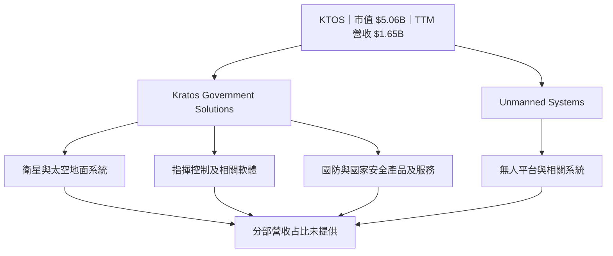
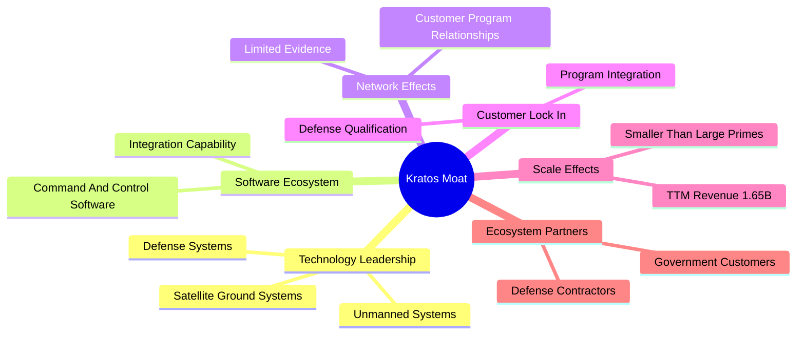
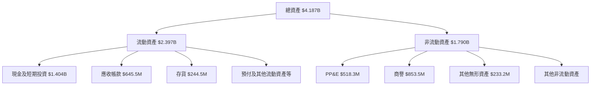
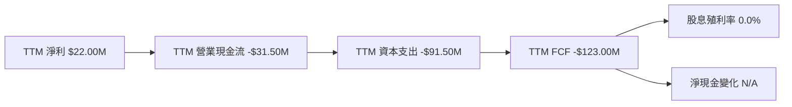
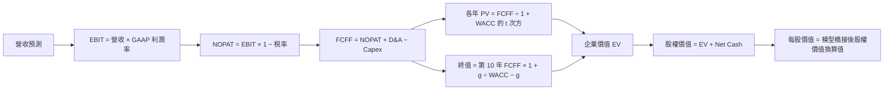
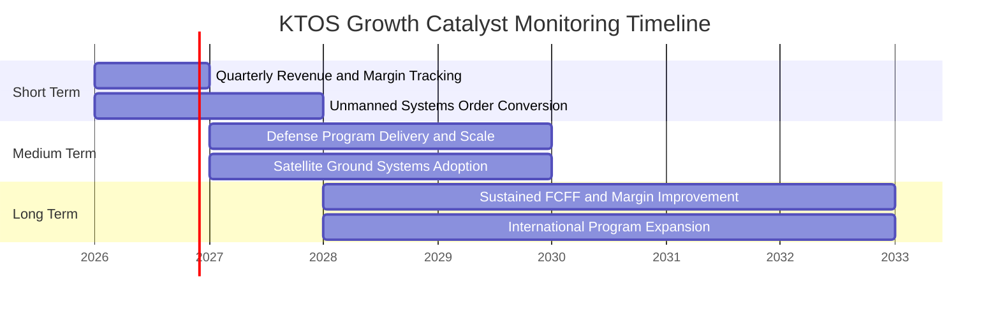
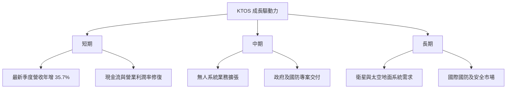
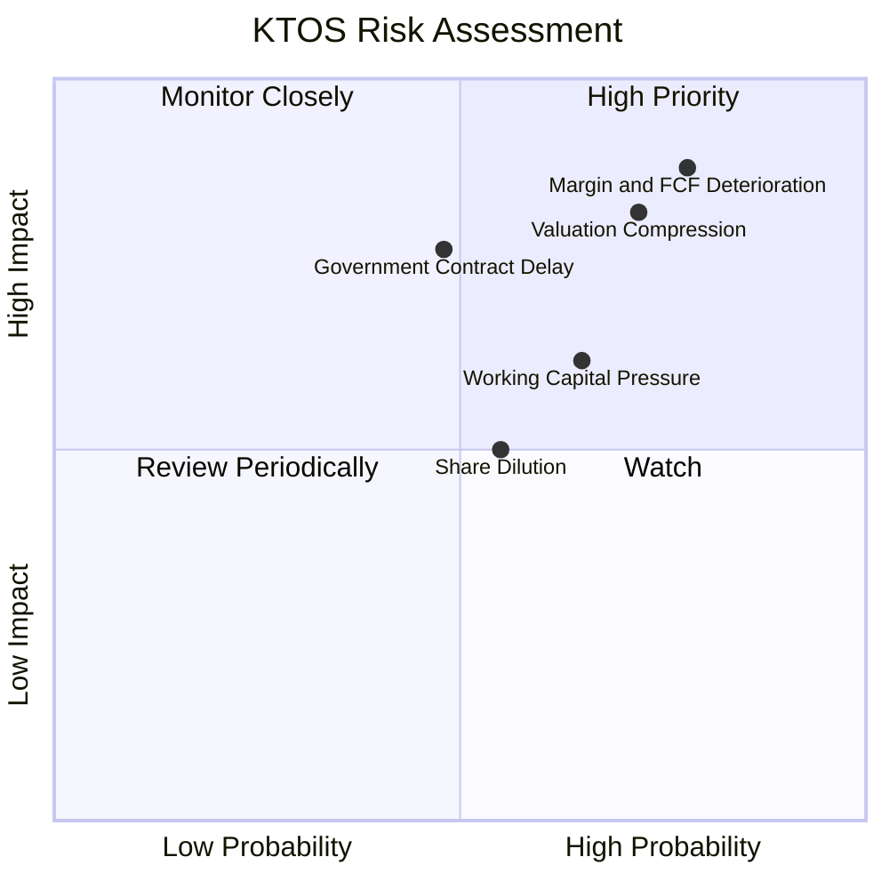
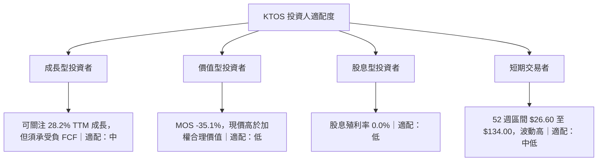

# KTOS 基本面深度分析報告
> **報告日期**：2026-11-21 ｜ **語言**：繁體中文 ｜ **數據來源**：SEC 申報資料 (XBRL)、Yahoo Finance、Finviz、StockAnalysis、Roic.ai ｜ **分析師**：CFA 級機構研究

## 目錄

| # | 章節 | 核心結論 |
|---|------|----------|
| 1 | 執行摘要 | 評級：賣出；加權合理價值 $19.91；MOS -35.1% |
| 2 | 公司概覽與商業模式 | 國防科技與無人系統具成長機會，但細分營收與市場份額數據不足 |
| 3 | 損益表深度分析 | TTM 營收 $1.65B、TTM 成長 28.2%；現金流與季度營業獲利承壓 |
| 4 | 資產負債表分析 | 現金及短期投資 $1.40B；流動性高，部分債務數據來源口徑不一致 |
| 5 | 現金流量深度分析 | TTM FCF -$123.00M、FCF Yield -2.43% |
| 6 | 獲利能力與資本效率 | ROIC 0.2% 明顯低於 WACC 10.12%，目前未創造經濟價值 |
| 7 | 相對估值分析 | KTOS 估值高於主要同業中位數，且現價高於多數估值方法結果 |
| 8 | DCF 內在價值評估 | DCF 基準價值 $9.91；加權合理價值 $19.91，MOS -35.1% |
| 9 | 成長催化劑 | 無人系統、衛星地面系統與國防需求可支持成長，但缺少可量化 TAM |
| 10 | 風險矩陣 | 獲利與現金流轉弱、估值偏高及政府採購風險為主要風險 |
| 11 | 投資建議 | 賣出；待估值回落或利潤率、FCF 明確改善後再評估 |

---

## 1. 執行摘要

最新季度營收年增 35.7%，TTM 營收年增 28.2%，顯示需求與交付仍有增長；但 TTM 營業利益率僅 0.4%、最新季度營業利益率為 -1.0%，TTM 營業現金流 -$31.50M、FCF -$123.00M，且 ROIC 0.2% 低於 10.12% 的 WACC。估值方面，DCF 基準價值為 $9.91、加權合理價值 $19.91，低於 2026-11-20 收盤價 $26.89；依 MOS -35.1% 對應規則 20，評級為**賣出**。儘管增長具吸引力，現階段現金流品質與估值風險使風險報酬比不利。

### 1.0 一頁式投資儀表板（Portfolio Manager 30 秒速讀）

| 項目 | 內容 |
|------|------|
| **投資論點（3 句）** | ① TTM 營收年增 28.2%、最新季度年增 35.7%，增長動能明確。② TTM 營業利益率僅 0.4%，最新季度為 -1.0%，增長尚未轉化為穩定營業槓桿。③ TTM FCF 為 -$123.00M、ROIC 0.2% 對比 WACC 10.12%，資本效率及現金流仍是核心疑慮。 |
| **綜合評分** | **4.8/10**（引用 1.1 評分卡） |
| **財務健康** | 🟡 現金及短期投資 $1.40B、流動比率 5.418；但 TTM FCF -$123.00M。 |
| **ROIC vs WACC** | 0.2% vs 10.12%：目前低於資本成本，經濟價值遭侵蝕。 |
| **FCF 趨勢** | 🔴 TTM FCF -$123.00M；FCF Yield -2.43%。 |
| **估值** | Forward P/E 24.05x ｜ EV/EBITDA 43.43x（市場資料）｜ FCF Yield -2.43%。 |
| **DCF 內在價值（基準）** | $9.91 ｜現價相對 DCF 溢價 **171.3%**（折溢價 = $26.89 ÷ $9.91 − 1）。 |
| **安全邊際（MOS）** | **-35.1%**＝($19.91 − $26.89) ÷ $19.91；以 8.8 加權合理價值為基準，🔴 不足。 |
| **預期報酬（基準情境 12M）** | DCF 基準情境相對現價 **-63.1%**；此為模型情境價值比較，不等同分析師一年期共識。 |
| **關鍵風險（前二）** | ① 營收增長未轉化為營業獲利與正 FCF。② 現價高於 DCF 與同業相對估值結果。 |
| **評級 + 信心度** | 🔴 **賣出** ｜信心：中（獲利與現金流證據明確，但細分業務、訂單及管理層財測資料不足）。 |

### 1.1 綜合評分卡（全報告唯一）

| 維度 | 評分（1–10） | 主要依據（引用數字與其來源章節） |
|------|--------------|----------------------------------|
| 成長性 | 8.0 | TTM 營收成長 28.2%、最新季度年增 35.7%（第 3 章）；但增長能否持續仍需觀察。 |
| 獲利能力 | 3.0 | TTM 營業利益率 0.4%、ROIC 0.2% 低於 WACC 10.12%，F-Score 3/8（第 3、6 章）。 |
| 財務健康 | 8.0 | 現金及短期投資 $1.40B、流動比率 5.418；但 FCF 為 -$123.00M（第 4、5 章）。 |
| 估值 | 2.0 | 加權合理價值 $19.91、MOS -35.1%；Forward P/E 24.05x 高於同業中位數 17.8x（第 7、8 章）。 |
| 護城河 | 5.0 | 國防系統、無人平台與客戶資格具一定進入障礙，但缺少收入分部及續約資料驗證（第 2 章）。 |
| 管理層與資本配置 | 5.0 | 2025 年 Capex $95.30M、SBC $35.50M；TTM 資料未提供完整回購及現金配置明細（第 3、5 章）。 |
| **綜合評分** | **5.2** | 六項算術平均：(8.0 + 3.0 + 8.0 + 2.0 + 5.0 + 5.0) ÷ 6 = **5.2**。 |

### 1.2 五大投資論點 + 三大核心風險

| 類型 | 項目 | 具體依據 | 信心度 |
|------|------|----------|--------|
| 🟢 **投資論點①** | 國防科技需求帶動營收增長 | TTM 營收 $1.65B，TTM 年增 28.2%；最新季度年增 35.7%。 | 🟢 高 |
| 🟢 **投資論點②** | 無人系統具增長選擇權 | 公司設有 Unmanned Systems 業務，但未提供分部營收，無法量化其對總體增長的貢獻。 | 🟡 中 |
| 🟢 **投資論點③** | 現金部位提供投資與抗壓空間 | 現金及短期投資 $1.40B；淨現金依 VERIFIED figures 為 $1.40B。 | 🟢 高 |
| 🟢 **投資論點④** | 最近季度收入規模持續提升 | 2026 Q3 營收 $471.80M，高於 2026 Q2 的 $458.80M。 | 🟢 高 |
| 🟢 **投資論點⑤** | 分析師共識仍偏正面 | 25 位分析師平均目標價 $74.68，但其與模型估值差距大，不能取代基本面檢驗。 | 🟡 中 |
| 🟡 **風險①** | 增長與獲利脫鉤 | 最新季度營收年增 35.7%，但季度營業利益率為 -1.0%，TTM FCF 為 -$123.00M。 | 🔴 高衝擊 |
| 🔴 **風險②** | 估值對未來執行要求高 | 現價 $26.89 高於加權合理價值 $19.91，MOS -35.1%；反向 DCF 要求首年營收增長 84.7%。 | 🔴 高衝擊 |
| 🟡 **風險③** | 應收與存貨占用營運資金 | DSO 42 天、DIO 70 天，CCC 80 天；季度現金流持續為負。 | 🟡 中至高 |

### 1.3 快速統計卡片

| 指標 | 公司實際值（期間） | 同業中位數 | 狀態 |
|------|--------------------|------------|------|
| 營收成長（TTM） | **28.2%** | — | 🟢 |
| 營收成長（最新一季年增） | **35.7%** | 6.7% | 🟢 |
| 毛利率（TTM） | **23.0%** | 20.0% | 🟢 |
| 營業利益率（TTM） | **0.4%** | — | 🔴 |
| ROIC（TTM） | **0.2%** | — | 🔴 |
| Forward P/E | **24.05x** | 17.8x | 🔴 |
| FCF Yield（TTM） | **-2.43%** | — | 🔴 |
| Piotroski F-Score | **3 / 8** | — | 🔴 |

> 最新季度營業利益率採 SEC 10-Q 計算區塊的 2026 Q3 數值 -1.0%；其他彙整資料列出的 0.8% 與該值不一致。本報告涉及「最新季度」之該指標時依 VERIFIED figures 採用 -1.0%。

### 1.4 投資結論

╔══════════════════════════════════════════════════════════════════╗  
║                    📊 投資結論摘要                               ║  
╠══════════════════════════════════════════════════════════════════╣  
║  評級：🔴 賣出（MOS -35.1%，符合規則 20）                       ║  
║  價格（2026-11-20 收盤）：$26.89                                ║  
║  DCF 內在價值（基準）：$9.91（現價溢價 171.3%）                 ║  
║  安全邊際 MOS：-35.1%（以加權合理價值 $19.91 為分母）          ║  
║  加權合理價值（8.8）：$19.91                                    ║  
║  DCF 情境價值：                                                   ║  
║    悲觀情境：$8.21（-69.5%）                                     ║  
║    基準情境：$9.91（-63.1%）                                     ║  
║    樂觀情境：$13.79（-48.7%）                                    ║  
║  綜合評分：5.2/10（引用 1.1）                                    ║  
║  適合投資人：能承受高波動、以長期國防科技成長為主題的投資人；   ║  
║              不適合以估值折價、現金流或股息作為主要篩選條件者。║  
╚══════════════════════════════════════════════════════════════════╝

---

## 2. 公司概覽與商業模式

### 2.1 業務結構與收入來源

Kratos Defense & Security Solutions（KTOS）服務國防、國家安全與商業市場，營運分為 Kratos Government Solutions 與 Unmanned Systems。公司提供衛星與太空載具地面系統、指揮控制軟體及無人系統等產品。TTM 營收為 $1.65B，但未提供分部營收，因此不拆分板塊占比或推算金額。

### 2.2 市場份額

市場份額數據未提供，因此不繪製市占圖、不估算份額。KTOS TTM 營收 $1.65B、TTM 成長 28.2%，高於 AVAV、LMT、NOC 的最新季度營收年增率，但季度與 TTM 的期間不同，不能直接當成同口徑市場排名。

### 2.3 競爭護城河分析

### 2.4 護城河強度

| 護城河項目 | 強度（強／中／弱） | 證據（引用數字或事實） | 會削弱它的情況 |
|------------|--------------------|------------------------|----------------|
| 技術與產品能力 | 中 | 業務涵蓋無人系統、太空地面系統與國防產品；但未提供分部營收或產品市占。 | 技術替代、產品性能未達客戶需求、競爭者快速追趕。 |
| 軟體與系統整合 | 中 | 公司提供衛星地面系統與指揮控制軟體，可能形成整合成本。 | 客戶改採標準化平台，或軟體收入與續約率偏低。 |
| 網路效應 | 弱 | 未提供使用者、互通平台規模或網路效應量化資料。 | 客戶選擇多供應商架構、互通性標準化。 |
| 客戶鎖定 | 中 | 國防系統認證與整合通常有轉換成本，但未提供合約期限、續約率或客戶集中度。 | 主要合約流失、競標失利或採購政策轉變。 |
| 規模效應 | 弱至中 | TTM 營收 $1.65B；小於大型國防承包商，且 TTM 營業利益率僅 0.4%。 | 競爭者以規模壓低報價，或產能擴張未帶來利潤率改善。 |
| 生態夥伴 | 中 | 服務美國及國際市場，業務與政府及國防採購體系相關；具體合作夥伴資料未提供。 | 合作方轉向競爭供應商、供應鏈中斷或出口限制。 |

**護城河評分引用 1.1 的 5.0/10：**公司具技術、認證及整合門檻，但缺少續約率、分部增長及客戶依賴度等可驗證數據。

---

## 3. 損益表深度分析

### 3.1 年度收入成長趨勢（近 4 年）

年度收入由 2022 財年的 $898.30M 增至 2025 財年的 $1.35B。2022–2025 三年 CAGR 約為 14.5%，計算式為 \((1.347 ÷ 0.8983)^{1/3} - 1\)。

╔══════════════════════════════════════════════════════════════════╗  
║              Kratos 年度收入趨勢（FY2022–FY2025）                ║  
╠══════════════════════════════════════════════════════════════════╣  
║ FY2022  $0.898B  ███████████████                 起點            ║  
║ FY2023  $1.037B  █████████████████               YoY: +15.4% 🟢  ║  
║ FY2024  $1.136B  ███████████████████             YoY: +9.6%  🟢  ║  
║ FY2025  $1.347B  ███████████████████████         YoY: +18.5% 🟢  ║  
╠══════════════════════════════════════════════════════════════════╣  
║ 2022–2025 三年收入 CAGR：約 +14.5%                                ║  
╚══════════════════════════════════════════════════════════════════╝

收入成長在 FY2024 放緩後於 FY2025 回升。TTM 成長 28.2%、最新一季年增 35.7%，顯示近期增長加速；不過收入增長尚未充分反映在營業獲利與現金流上。

### 3.2 季度收入趨勢分析

QoQ 計算方式為本季收入 ÷ 前季收入 − 1；最新季度 YoY 直接引用 SEC 10-Q 對應資料。

| 季度 | 營收 | QoQ 成長 | YoY 成長 | 備註 |
|------|------:|---------:|---------:|------|
| 2025 Q4 | $345.10M | 14.0% | 21.9% | QoQ 以 2025 Q3 $302.60M 計算。 |
| 2026 Q1 | $371.00M | 7.5% | 22.6% | 年增持續高於 20%。 |
| 2026 Q2 | $458.80M | 23.7% | 30.5% | 單季收入明顯擴大。 |
| 2026 Q3 | $471.80M | 2.8% | 35.7% | 年增加速，但 QoQ 增速較 Q2 降溫。 |

Q3 YoY 成長加速，代表交付規模與需求仍在擴大；但當季營業利益為 -$4.00M，收入增長並未伴隨營業獲利同步改善，需追蹤合約組合、成本超支及人力與研發投入。

### 3.3 利潤率演變分析

| 利潤率指標 | FY2022 | FY2023 | FY2024 | FY2025 | 趨勢 | 評估 |
|------------|--------:|--------:|--------:|--------:|------|------|
| **毛利率** | 25.2% | 25.9% | 25.3% | 22.8% | FY2025 回落 | 🟡 |
| **營業利益率** | 0.5% | 3.0% | 2.6% | 2.1% | 高於 FY2022，但近年下滑 | 🔴 |
| **淨利率** | -4.1% | -0.9% | 1.4% | 1.6% | 自虧損轉正 | 🟡 |
| **EBITDA Margin** | 2.9% | 7.5% | 8.2% | 7.6% | FY2025 小幅回落 | 🟡 |

年度毛利率、營業利益率以各年度毛利／營收、營業利益／營收計算；TTM 綜合資料列示毛利率 23.0%、營業利益率 0.4%，與年度序列反映不同滾動期間。最新季度營業利益率依 VERIFIED figures 為 -1.0%。

**利潤率演變深度解析：**FY2025 毛利率由 FY2024 的 25.3% 降至 22.8%，毛利額仍從 $287.20M 增至 $307.90M，表示營收擴張但毛利率承壓。可能涉及產品組合、專案交付成本或價格競爭；目前資料不足以將變化精確歸因於某一因素。FY2026 Q3 營業利益為 -$4.00M，意味費用成長、專案成本或交付組合足以抵銷收入擴張帶來的毛利額增加。

### 3.4 費用結構分析

完整費用結構（例如銷售管理費、研發、利息與一次性項目）未提供可在同一期間完整加總的數字，因此不製作圓餅圖，避免用部分項目代表整體。可確認 FY2025 研發費用為 $40.00M，約占 FY2025 營收 $1.35B 的 3.0%；資本化費用與各費用科目完整明細需以 SEC 10-K 附註核對。

### 3.5 季度 EPS 趨勢與盈餘品質（Quality of Earnings）

| 盈餘品質項目 | 數值／佔比 | 評估 |
|--------------|-----------|------|
| 股權薪酬 SBC / 營收 | TTM SBC 約 $58.50M ÷ TTM 營收 $1.647B = **3.6%** | 🟡 SBC 為非現金費用但具股東稀釋成本；Piotroski 顯示稀釋股數增加。 |
| SBC / 營業現金流 | $58.50M ÷ -$31.50M = **-185.7%** | 🔴 分母為負，比例不宜視為一般負擔率；SBC 金額大於營業現金流絕對值。 |
| FCF / 淨利（現金轉換率） | -$123.00M ÷ $22.00M = **-559.1%** | 🔴 會計淨利尚未轉化為自由現金流。 |
| 一次性／非經常性損益 | **N/A**（未提供可核實明細） | 無法判斷是否有一次性項目美化或壓低盈餘。 |
| 有效稅率異常 | **N/A**（未提供 TTM 現金稅與稅前利潤明細） | 不將預設稅率 21.0% 誤當實際有效稅率。 |
| 資本化支出 vs 費用化 | TTM Capex $91.50M；完整資本化軟體與研發明細 N/A | Capex 約占 TTM 營收 5.6%，投資需求高；未能判定有無過度資本化。 |

過去四季 EPS surprise 資料為 nan，預估 EPS 與實際 EPS 均無有效值，因此「超預期／不及預期」及其原因為 N/A，不能從空值推論盈餘超預期。可確認季度淨利由 2026 Q2 $4.40M 轉為 2026 Q3 -$0.20M。

**盈餘品質結論：**TTM 淨利 $22.00M 相對於 -$123.00M FCF，現金轉換明顯不足；且 SBC 約占 TTM 營收 3.6%，股數增加使股東承受額外稀釋。現階段估值不宜只依 EPS 或 forward P/E，必須要求現金流轉正並確認營運利潤率改善。

---

## 4. 資產負債表分析

### 4.1 資產結構分解

TTM 資產負債表彙整數據列示總資產 $4.187B、流動資產 $2.397B、現金及短期投資 $1.404B、應收帳款 $645.5M、存貨 $244.5M。非流動資產細項可列者包括 PP&E $518.3M、商譽 $853.5M、其他無形資產 $233.2M。

上述細項包含資料庫期末數值，且流動資產細分項目因四捨五入及其他科目未完整列示，不能將展示值相加後視為精確總額。

### 4.2 流動性與營運資金分析

| 指標 | 最新 TTM | 一年前 TTM | 變化 | 解讀 |
|------|----------|------------|------|------|
| DSO 應收帳款天數 | 42 天 | 39 天 | +3 天 | 收款天數增加，可能反映應收款增長快於收入；需留意客戶回款與合約資產。 |
| DIO 存貨天數 | 70 天 | 66 天 | +4 天 | 庫存周轉略慢，可能與備貨或交付節奏相關，需追蹤存貨變現。 |
| DPO 應付帳款天數 | 32 天 | 24 天 | +8 天 | 付款天數延長，短期有助現金保留，但不宜單獨視為議價力改善。 |
| CCC 現金轉換週期 | 80 天 | 81 天 | -1 天 | 整體週期大致持平，DPO 增加抵銷 DSO、DIO 上升。 |

流動比率 5.418、速動比率 4.632，流動性緩衝充足；但不能抵銷持續負 FCF。應收款從 FY2025 $457.4M 增至 TTM 資料列示 $645.5M，與 DSO 上升方向一致，值得在季度報表中追蹤。

### 4.3 債務結構分析

來源口徑存在差異：VERIFIED figures 列示「總債務 N/A、淨現金 $1.40B」；補充市場資料則列示總債務 $246.00M、現金 $1.40B、淨現金 $1.16B。依規則以 VERIFIED figures 的淨現金為主要口徑，但不將缺失的總債務自行反推。

╔══════════════════════════════════════════════════════════════════╗  
║                   KTOS 債務健康診斷                              ║  
╠══════════════════════════════════════════════════════════════════╣  
║  總債務：        N/A（VERIFIED figures 未提供）                   ║  
║  總現金+短期投資：$1.40B                                          ║  
║  淨現金：        $1.40B（VERIFIED figures 口徑） 🟢               ║  
║  Debt/EBITDA：   N/A（總債務口徑與 EBITDA 不足以一致複算）        ║  
║  Interest Coverage：N/A（利息費用資料未提供）                    ║  
║  流動比率：      5.418x 🟢                                        ║  
║  速動比率：      4.632x 🟢                                        ║  
╚══════════════════════════════════════════════════════════════════╝

### 4.4 股東權益趨勢

年度股東權益由 FY2022 $936.30M 增至 FY2025 $2.00B，期間增長與盈利、增資或其他股東權益變動共同相關；缺少完整股東權益變動表，無法將增幅完全歸因於留存盈餘。

╔══════════════════════════════════════════════════════════════════╗  
║               KTOS 歷年股東權益（年度）                          ║  
╠══════════════════════════════════════════════════════════════════╣  
║ FY2022  $0.936B  █████████                                       ║  
║ FY2023  $0.976B  ██████████                                      ║  
║ FY2024  $1.350B  ██████████████                                  ║  
║ FY2025  $2.000B  ████████████████████                            ║  
╚══════════════════════════════════════════════════════════════════╝

---

## 5. 現金流量深度分析

### 5.1 現金流量瀑布圖

淨利與營業現金流屬不同現金流量表概念，資料未提供 TTM 淨利到 OCF 的完整調節項目，因此不填入未提供金額。

### 5.2 FCF 轉換率趨勢

| 財年 | FCF | 淨利 | FCF／淨利 | 解讀 |
|------|----:|----:|----------:|------|
| FY2022 | -$71.10M | -$36.90M | 192.7% | 兩者皆為負，比例不代表良好現金轉換。 |
| FY2023 | $12.80M | -$8.90M | -143.8% | FCF 為正但淨利為負，比例不適合一般解讀。 |
| FY2024 | -$8.50M | $16.30M | -52.1% | 淨利未轉化成正 FCF。 |
| FY2025 | -$137.40M | $22.00M | -624.5% | FCF 顯著轉弱；需核對資本支出與營運資金變動。 |
| TTM | -$123.00M | $22.00M | -559.1% | 依 TTM FCF 與 TTM 淨利計算，現金轉換仍弱。 |

### 5.3 自由現金流趨勢

╔══════════════════════════════════════════════════════════════════╗  
║                KTOS 自由現金流趨勢                                ║  
╠══════════════════════════════════════════════════════════════════╣  
║ FY2022  -$71.10M  ◀███████░░░░░░░░░░░░░░░░░░░░                 ║  
║ FY2023   $12.80M  █                                                    ║  
║ FY2024   -$8.50M  ◀█                                                   ║  
║ FY2025 -$137.40M  ◀██████████████                                     ║  
║ TTM     -$123.00M ◀████████████                                       ║  
╠══════════════════════════════════════════════════════════════════╣  
║ TTM FCF Yield：-2.43%｜TTM OCF：-$31.50M｜TTM Capex：$91.50M     ║  
╚══════════════════════════════════════════════════════════════════╝

FY2025 FCF -$137.40M 與 TTM FCF -$123.00M 均為負。FY2025 Capex 為 $95.30M；TTM Capex 為 $91.50M。投資支出可能支持產能與新產品，但若收入增長無法帶來更高毛利與回款，擴張會延長負 FCF。

### 5.4 資本配置評估

未提供完整回購、收購、股息及現金用途的同期金額，因此不以不完整資料繪製資本配置圓餅圖。已知 FY2025 Capex $95.30M、SBC $35.50M；股息殖利率 0.0%、派息率 0.0%。以目前負 FCF 及股數增加情況，後續應同時檢視資本支出的回報與 SBC 稀釋，而非只看現金餘額。

---

## 6. 獲利能力與資本效率

### 6.1 ROE / ROA / ROIC 趨勢

| 指標 | 最新 TTM | 歷史可比資料 | 評估 |
|------|---------:|----------------|------|
| ROE | 0.6%（QUALITY FIGURES） | 另一彙整來源列示 0.8%；口徑不一致 | 🟡 獲利相對權益規模偏低。 |
| ROA | 0.2% | 歷史年度未提供完整同口徑序列 | 🔴 資產獲利能力低。 |
| ROIC | 0.2% | 歷史同口徑序列未提供 | 🔴 顯著低於 WACC。 |

本表 ROE 及 ROIC 採 QUALITY FIGURES；另一資料來源的 ROE 為 0.8%，不混用不同計算口徑。未提供可比的行業均值，故不列行業比較欄。

### 6.2 ROIC vs WACC 分析（核心價值創造判斷）

╔══════════════════════════════════════════════════════════════════╗  
║                ROIC vs WACC 深度分析                             ║  
╠══════════════════════════════════════════════════════════════════╣  
║  WACC（依資本成本資料）：10.12%                                  ║  
║  ├── 無風險利率（10Y 美債）：4.91%                               ║  
║  ├── 市場風險溢酬 ERP：5.00%                                     ║  
║  ├── Beta 原始值：1.17；調整後採用值：1.11                       ║  
║  ├── 股權成本：10.46%                                            ║  
║  ├── 稅前債務成本：3.90%；預設稅率：21.0%                        ║  
║  ├── 股權／債務權重：95.4%／4.6%                                 ║  
║  └── WACC：10.12%                                                ║  
║                                                                  ║  
║  ROIC（TTM）：0.2%                                                ║  
║  EVA Spread = ROIC − WACC = 0.2% − 10.12% = -9.92 個百分點      ║  
║                                                                  ║  
║  ROIC  0.2%  ░░░░░░░░░░░░░░░░░░░░░░░░░░░░░░░░░░░░░░░░░░       ║  
║  WACC 10.12% ▓▓▓▓▓▓▓▓▓▓▓▓▓▓▓▓▓▓▓▓▓▓▓▓▓▓▓▓▓▓▓▓▓▓▓▓▓▓▓▓       ║  
║                                                                  ║  
║  📊 結論：ROIC 約為 WACC 的 0.02 倍，現階段低於資本成本，       ║  
║  資本投入尚未產生足以補償資金成本的回報。                        ║  
╚══════════════════════════════════════════════════════════════════╝

公司資料列示原始 Beta 1.17，調整後 Beta 按 \(⅔ × 1.17 + ⅓ × 1.00\) 得 1.11。股權成本為 \(4.91\% + 1.11 × 5.00\% = 10.46\%\)。債務權重及債務成本引用資本成本資料；因總債務在 VERIFIED figures 中為 N/A，不能獨立重建其債務金額及權重。

### 6.3 杜邦三因素分解

| 因素 | 數值（TTM） | 解讀 |
|------|-------------|------|
| 淨利率 | 1.3% | 淨利率薄弱，盈利對成本與項目組合變化敏感。 |
| 資產週轉率 | 0.39 | 每一單位資產產生的收入有限，部分與資產擴張有關。 |
| 權益乘數 | 1.21 | 槓桿程度不高，ROE 並非主要靠高槓桿撐起。 |
| **ROE** | **0.6%** | 依 QUALITY FIGURES：1.3% × 0.39 × 1.21 = 0.6132%，四捨五入為 0.6%。 |

### 6.4 財務體質：Piotroski F-Score

F-Score 為 **3 / 8**；一項測試因缺少輸入而無法判定，故分母為 8，而非 9。

| 測試 | 結果 | 解讀 |
|------|------|------|
| ROA > 0 | ✅ 通過 | 當期資產報酬為正。 |
| 營業現金流 > 0 | ❌ 未通過 | TTM 營業現金流 -$31.50M。 |
| ROA 高於一年前 | ❌ 未通過 | 獲利改善未達此測試門檻。 |
| 營業現金流 > 淨利（應計品質） | ❌ 未通過 | 現金流未支持帳面淨利。 |
| 長期負債 ÷ 總資產低於一年前 | — 無法判定 | 缺少該項必要輸入。 |
| 流動比率高於一年前 | ✅ 通過 | 流動性測試通過。 |
| 稀釋股數未增加 | ❌ 未通過 | 股數有增加，稀釋對每股價值不利。 |
| 毛利率高於一年前 | ✅ 通過 | 毛利率測試通過。 |
| 資產週轉率高於一年前 | ❌ 未通過 | 資產效率未改善。 |

---

## 7. 相對估值分析

### 7.1 同業估值比較表格

同業倍數採 Yahoo Finance 同業資料。AVAV 的 trailing P/E 為 N/A；本公司倍數採提供的市場估值欄位，與同業比較時需留意不同資料來源的口徑差異。

| 估值指標 | **KTOS** | **AVAV** | **LMT** | **NOC** | 本公司評估 |
|----------|---------:|---------:|--------:|--------:|-----------|
| **Trailing P/E** | 224.1x | N/A | 20.1x | 16.9x | 🔴 KTOS 倍數遠高；低基期 EPS 使比較特別敏感。 |
| **Forward P/E** | 24.05x | 19.7x | 17.0x | 17.8x | 🔴 高於三家同業中位數 17.8x。 |
| **P/S Ratio** | 3.07x | 2.2x | 1.7x | 1.7x | 🔴 高於同業中位數 1.7x。 |
| **EV/EBITDA** | 43.43x | 21.3x | 14.7x | 12.2x | 🔴 顯著高於同業中位數 14.7x。 |
| **最新季度營收年增** | 35.7% | 5.7% | 11.3% | 6.7% | 🟢 KTOS 增長明顯較快，但須驗證獲利轉換。 |
| **TTM 毛利率** | 23.0% | 26.5% | 11.7% | 20.0% | 🟡 高於 LMT、NOC，低於 AVAV。 |

### 7.2 歷史估值區間分析

╔══════════════════════════════════════════════════════════════════╗  
║               KTOS 五年歷史估值定位（TTM）                       ║  
╠══════════════════════════════════════════════════════════════════╣  
║ P/E：現在 224.1x｜歷史中位數 380.2x｜當前百分位 0%              ║  
║ P/S：現在 3.1x  ｜歷史中位數 3.2x  ｜當前百分位 45%             ║  
║ EV/EBITDA：44.1x｜歷史中位數 55.5x｜當前百分位 20%              ║  
╚══════════════════════════════════════════════════════════════════╝

歷史 P/E 區間上限受到極端資料值影響，所列歷史範圍為 232.9x–10,595,348,627,336,923,136.0x，實務上不適合當作正常估值錨。即使 P/E 百分位顯示 0%，當前 P/E 仍為 224.1x，且 TTM 獲利薄弱；相較之下，P/S 3.1x 接近自身歷史中位數 3.2x，EV/EBITDA 44.1x 仍高於同業中位數。

### 7.3 情境價值（Bear / Base / Bull，照抄 DCF MODEL 的 Scenarios）

| 情境 | 第 1 年營收成長 | 期末營業利潤率 | WACC | 每股價值 | 相對現價 | 機率 | 會發生的條件 |
|------|----------------|----------------|------|----------|----------|------|--------------|
| 🔴 悲觀 | 14.1% | 1.6% | 11.12% | $8.21 | -69.5% | 25% | 增長由 TTM 28.2% 明顯降速，利潤率僅小幅改善，資本成本上升。 |
| 🟡 基準 | 28.2% | 1.9% | 10.12% | $9.91 | -63.1% | 50% | 首年延續 TTM 成長，之後逐步降至第 10 年 3.0%，利潤率漸進改善。 |
| 🟢 樂觀 | 42.3% | 2.1% | 9.12% | $13.79 | -48.7% | 25% | 新業務與交付顯著加速，資本成本回落且利潤率高於基準。 |

程式計算的機率加權情境價值為 $10.46（相對現價 -61.1%），此數字僅作情境參考；第 8.8 節仍採 DCF 基準值及固定估值權重。

### 7.4 相對估值隱含價格區間

╔══════════════════════════════════════════════════════════════════╗  
║                 估值方法隱含每股價值                             ║  
╠══════════════════════════════════════════════════════════════════╣  
║ DCF 基準                 $9.91                                    ║  
║ 同業 Forward P/E         $19.96                                   ║  
║ 同業 EV/EBITDA           $13.97                                   ║  
║ 分析師共識目標價         $74.68                                   ║  
║ 2026-11-20 收盤價        $26.89                                   ║  
╚══════════════════════════════════════════════════════════════════╝

- **同業 Forward P/E：$19.96**，使用 AVAV、LMT、NOC 的同業中位數 17.8x × KTOS forward EPS $1.12。
- **同業 EV/EBITDA：$13.97**，使用同業中位數 14.7x × TTM EBITDA，並加回淨現金。
- 分析師共識 $74.68 是 25 位分析師的平均目標價，與模型及相對估值差距大，須視為高分歧參考，不應直接當作基本面內在價值。

---

## 8. DCF 內在價值評估（Discounted Cash Flow）

### 8.0 估值推理鏈（Thinking Logic：在算之前先想清楚）

#### Step 1 — 價值由哪些變數決定？

KTOS 的模型價值主要由「既有政府與國防業務收入底盤、無人系統等業務的增長，以及增長能否轉化為正 FCFF」決定。TTM 總營收為 $1.65B，但兩個主要分部各自的營收占比未提供，故不能把任一項拆成精確占比。模型最敏感的核心變數是營業利潤率與終值現金流：因預測終值 PV 占 EV 84.5%，而現有 TTM 營業利益率只有 0.4%。

#### Step 2 — 模型選擇

| 決策點 | 本報告採用 | 理由（含數字） | 曾考慮但否決 | 否決理由 |
|--------|-----------|----------------|--------------|----------|
| 現金流定義 | FCFF | 以 WACC 10.12% 折現，直接估企業價值，再橋接現金。 | FCFE | 資本結構與債務金額存在來源口徑差異，FCFF 較適合固定企業價值框架。 |
| 預測期 N | 10 年 | DCF MODEL 固定為 10 年；收入成長由 28.2% 線性降至 3.0%。 | 5 年 | 會縮短模型設定的增長遞減期，不符合指定模型。 |
| 終值方法 | Gordon Growth | DCF MODEL 已給定永續成長率 3.0%。 | 退出倍數法 | 模型未提供退出倍數終值，不能自行新增。 |
| EBIT 基礎 | GAAP EBIT | DCF MODEL 明示採 GAAP EBIT，SBC 已作費用。 | 非 GAAP EBIT | 會加回 SBC，與模型指定計算方式不一致。 |

#### Step 3 — 關鍵假設推導鏈

- **營收成長路徑**：錨點＝TTM 成長 28.2%、最新季度年增 35.7% → 調整＝最新季度增速高於 TTM，但單季增幅不宜直接外推，模型令成長由 28.2% 線性淡化至第 10 年 3.0% → **採用 FY+1 28.2%、FY+10 3.0%** → 不採用 35.7% 持續十年，因單季成長不能代表長期穩態。
- **預測期 N**：錨點＝模型指定 10 年；歷史資料只有 FY2022–FY2025 年營收及部分季資料 → 調整＝給予國防專案與新產品較長轉化期間，但遠期可見度下降 → **採用 10 年** → 不縮至短期預測期，因會與指定模型不一致；也不延長超過 10 年，以避免增長可見度被過度外推。
- **期末營業利潤率**：錨點＝TTM GAAP 營業利益率 0.4%；FY2022–FY2025 年營業利益率約 0.5%–3.0% → 調整＝假設規模與組合改善，但最新季度營業利益率 -1.0% 說明短期仍有執行波動 → **採用第 10 年 1.9%** → 不採用歷史較高年度比率作終值，因近期 TTM 獲利率偏低。
- **Capex／營收**：錨點＝TTM Capex $91.50M ÷ TTM 營收 $1.65B，約 5.6% → 調整＝模型將比率逐步降至 5.1%，但仍高於 D&A 約 4.7% → **採用 FY+1 5.6% 至 FY+10 5.1%** → 不採用更低的維持性 Capex，因模型假設公司仍在投資階段。
- **永續成長率 g**：錨點＝模型採 3.0%；公司收入增長不可能永久維持目前 28.2% → 調整＝採長期成熟後的低速增長假設，且低於 WACC 10.12% → **採用 3.0%** → 不採用接近 WACC 的高 g，避免終值公式對微小差異過度敏感。
- **WACC**：錨點＝成本資本資料列示 10.12%，股權成本 10.46%、調整後 Beta 1.11 → 調整＝不另行自建折現率，避免與既定資本結構及利率口徑不一致 → **採用 10.12%** → 不以更低 WACC 美化長期終值。
- **稅率、D&A、營運資金**：錨點＝模型預設稅率 21.0%、D&A／營收 4.7%；營運資金變動未建模 → **照模型採用**。營運資金不列入 FCFF，不得把它視為零成本的實際經營結論。
- **EBIT 基礎與 SBC**：錨點＝模型明示 GAAP EBIT，SBC 已包含於費用，股數不再稀釋 → **採用組合 (A)**：GAAP EBIT、FCFF 不再扣 SBC、年稀釋率 0%。SBC 影響已計入一次，避免重複扣除。
- **終值方法**：錨點＝DCF MODEL 用 Gordon Growth，g 3.0% → **採用模型提供的 Gordon Growth**；退出倍數未提供，不能自行添加或更換。

#### Step 4 — 最脆弱的一環

最脆弱假設是利潤率能從 TTM 0.4% 改善至第 10 年 1.9%；若營運持續接近低利潤率，終值及 DCF 價值將承壓，DCF 基準 $9.91 已顯示現價與基本面模型存在大幅落差。

#### Step 5 — 計算路徑圖

### 8.1 模型假設總表（Model Inputs）

| 假設項目 | 採用值 | 依據／來源 | 敏感度 |
|----------|--------|-------------|--------|
| 預測期長度 N | 10 年 | DCF MODEL 假設；營收成長由 28.2% 淡化至 3.0%。 | 🟡 中 |
| 營收成長路徑 | FY+1 28.2% → FY+10 3.0% | TTM 成長 28.2%；模型線性淡化。 | 🔴 高 |
| 營業利潤率 | FY+1 0.4% → FY+10 1.9% | TTM 營業利益率 0.4%；模型採近五年中位數作期末錨點。 | 🔴 高 |
| 有效稅率 | 21.0% | DCF MODEL 預設稅率；不是歷史實際有效稅率。 | 🟢 低 |
| Capex／營收 | 5.6% → 5.1% | TTM Capex／營收約 5.6%；模型逐步淡化。 | 🟡 中 |
| D&A／營收 | 4.7% | DCF MODEL 的 TTM 假設。 | 🟢 低 |
| 營運資金變動 | 未建模 | 模型指定 FCFF 不包含 ΔWC；歷史營運資金天數可見 CCC 80 天。 | 🟡 中 |
| EBIT 基礎 | GAAP | DCF MODEL 明示採 GAAP EBIT。 | 🟡 中 |
| SBC 處理 | 組合 (A)：不另扣 SBC | GAAP EBIT 已含 SBC；模型固定股數，不二次扣除。 | 🟡 中 |
| 年稀釋率 | 0%（模型固定股數） | DCF MODEL 組合 (A)；不是對實際稀釋趨勢的預測。 | 🟡 中 |
| 永續成長率 g | 3.0% | DCF MODEL 假設；低於 WACC 10.12%。 | 🔴 高 |
| 終值方法 | Gordon Growth | DCF MODEL 唯一已提供的終值方法。 | 🔴 高 |
| WACC | 10.12% | 成本資本資料；不另行重算或替換。 | 🔴 高 |

**FCF 定義：**FCFF = NOPAT + D&A − Capex；模型未包含營運資金變動。依組合 (A)，GAAP EBIT 已含 SBC，FCFF 不再扣 SBC，股數亦不額外放大。

### 8.2 折現率推導（WACC）

╔══════════════════════════════════════════════════════════════════╗  
║                    WACC 推導（折現率）                           ║  
╠══════════════════════════════════════════════════════════════════╣  
║ 股權成本 Ke（CAPM）：                                             ║  
║ ├── 無風險利率 Rf（10Y 美債）：4.91%                             ║  
║ ├── 市場風險溢酬 ERP：5.00%                                      ║  
║ ├── 原始 Beta：1.17；調整後 Beta：1.11                            ║  
║ ├── 規模／國別溢酬：未另加計                                       ║  
║ └── Ke = 4.91% + 1.11 × 5.00% = 10.46%                           ║  
║                                                                  ║  
║ 債務成本 Kd：                                                     ║  
║ ├── 稅前 Kd：3.90%（成本資本資料）                                ║  
║ ├── 預設稅率：21.0%                                               ║  
║ └── 稅後 Kd = 3.90% × (1 − 21.0%) = 3.081%                       ║  
║                                                                  ║  
║ 資本結構（資本成本資料）：股權 95.4%／債務 4.6%                    ║  
║ WACC：95.4% × 10.46% + 4.6% × 3.081% = 10.12%                   ║  
╚══════════════════════════════════════════════════════════════════╝

**WACC 五步演算與資料限制：**

1. **Ke（CAPM）** = 4.91% + 1.11 × 5.00% = 4.91% + 5.55% = **10.46%**。原始 Beta 為 1.17，調整後值按 \(⅔ × 1.17 + ⅓ × 1.00 = 1.113\)，資料列示為 1.11。無風險利率資料未附觀測日，故不能替它另標日期。
2. **稅前 Kd** = **3.90%**，引用成本資本資料。該資料未提供利息費用與平均計息負債金額，因此無法用兩項絕對金額重新相除驗證。
3. **稅後 Kd** = 3.90% × (1 − 21.0%) = **3.081%**。
4. **資本權重** = 股權 95.4%、債務 4.6%，合計 100.0%。最新收盤價 $26.89、流通股數 188.27M、報價市值 $5.06B；但 VERIFIED figures 的總債務為 N/A，且成本資本區塊沒有提供債務絕對值，因此不反推債務金額，也不能獨立複算 E、D 的美元權重。
5. **WACC** = 95.4% × 10.46% + 4.6% × 3.081% = 9.97884% + 0.141726% = **10.120566%，採用 10.12%**。

第 6.2 節與本節均採用 WACC 10.12%。資本成本組成為既定資料；總債務金額缺漏使權重無法從原始美元值獨立重建，故保留並引用其提供的權重。

### 8.3 逐年自由現金流預測（基準情境）

單位：$B；折現因子採模型列示值。表中金額依 DCF MODEL 照列；因原模型只提供四捨五入後數值，個別列相加可能與其未四捨五入的模型總值略有差異。

| 年度 | FY+1 | FY+2 | FY+3 | FY+4 | FY+5 | FY+6 | FY+7 | FY+8 | FY+9 | FY+10 |
|------|------:|------:|------:|------:|------:|------:|------:|------:|------:|-------:|
| 營收 | 2.11 | 2.65 | 3.24 | 3.88 | 4.54 | 5.19 | 5.78 | 6.28 | 6.64 | 6.84 |
| 營收 YoY | 28.2% | 25.4% | 22.6% | 19.8% | 17.0% | 14.2% | 11.4% | 8.6% | 5.8% | 3.0% |
| 營業利潤率 | 0.4% | 0.6% | 0.7% | 0.9% | 1.1% | 1.2% | 1.4% | 1.6% | 1.7% | 1.9% |
| 營業利益 EBIT（GAAP） | 0.01 | 0.01 | 0.02 | 0.03 | 0.05 | 0.06 | 0.08 | 0.10 | 0.12 | 0.13 |
| − 稅（21.0%） | 0.00 | 0.00 | 0.00 | 0.01 | 0.01 | 0.01 | 0.02 | 0.02 | 0.02 | 0.03 |
| = NOPAT | 0.01 | 0.01 | 0.02 | 0.03 | 0.04 | 0.05 | 0.06 | 0.08 | 0.09 | 0.10 |
| + D&A | 0.10 | 0.12 | 0.15 | 0.18 | 0.21 | 0.24 | 0.27 | 0.29 | 0.31 | 0.32 |
| − Capex | (0.12) | (0.15) | (0.18) | (0.21) | (0.24) | (0.28) | (0.31) | (0.33) | (0.34) | (0.35) |
| **= FCFF** | **-0.01** | **-0.01** | **-0.01** | **-0.00** | **0.01** | **0.02** | **0.03** | **0.04** | **0.06** | **0.07** |
| 折現因子 @10.12% | 0.908 | 0.825 | 0.749 | 0.680 | 0.618 | 0.561 | 0.509 | 0.462 | 0.420 | 0.381 |
| **FCFF 現值 PV** | **-0.01** | **-0.01** | **-0.01** | **-0.00** | **0.00** | **0.01** | **0.01** | **0.02** | **0.02** | **0.03** |

**模型預測期現值合計：**DCF MODEL 列示 **$0.07B**。若以表中已四捨五入的 PV 格子直接相加，會得到 $0.06B；差額源自各年未四捨五入原值未提供，不能自行補造精度或改寫模型合計。

**逐步演算（FY+1，按列示精度示範）：**

1. **營收** = $1.65B × (1 + 28.2%) = $2.1153B，模型列示 **$2.11B**。
2. **EBIT** = $2.11B × 0.4% = $0.00844B，模型列示 **$0.01B**。
3. **稅** = $0.00844B × 21.0% = $0.0017724B，模型列示 **$0.00B**。
4. **NOPAT** = $0.00844B − $0.0017724B = $0.0066676B，模型列示 **$0.01B**。
5. **D&A** = $2.11B × 4.7% = $0.09917B，模型列示 **$0.10B**。
6. **Capex** = $2.11B × 5.6% = $0.11816B，模型列示 **$0.12B**。
7. **ΔWC** = 未建模；模型不包含該項，並非假設實際營運資金需求為零。
8. **FCFF** = NOPAT + D&A − Capex；按未四捨五入近似值為 $0.0066676B + $0.09917B − $0.11816B = -$0.0123224B，模型列示 **-$0.01B**。
9. **折現因子及 PV** = 1 ÷ (1 + 10.12%)¹ = 0.908；以表列 FCFF -$0.01B 計，PV 列示 **-$0.01B**。

**合理性自檢：**

- 基準模型的預測期 FCF 由首年負值逐步轉正；由於沒有提供模型完整未四捨五入序列及相同定義的歷史 FCF CAGR，預測 FCF CAGR 對歷史 CAGR 的比較為 **N/A**。
- FY+10 FCF 利潤率 = $0.07B ÷ $6.84B ≈ **1.0%**；目前 TTM FCF 利潤率 = -$0.123B ÷ $1.65B ≈ **-7.5%**。同業最佳 FCF 利潤率資料未提供。
- FY+1 至 FY+4 FCFF 為負或接近零，削低預測期現值；終值占 EV 84.5%，故總估值對遠期假設高度敏感。

╔══════════════════════════════════════════════════════════════════╗  
║          自由現金流：歷史實際 vs 模型預測（單位 $B）              ║  
╠══════════════════════════════════════════════════════════════════╣  
║ FY2023（實）  +0.013  ▓                                         ║  
║ FY2024（實）  -0.009  ◀█                                        ║  
║ FY2025（實）  -0.137  ◀██████████████                           ║  
║ FY+1（預）    -0.010  ◀█                                        ║  
║ FY+10（預）   +0.070  ▓▓▓▓▓▓▓                                   ║  
╠══════════════════════════════════════════════════════════════════╣  
║ 歷史 FCF 波動大且 FY2025 明顯轉負；模型預測逐步轉正，但預測期   ║  
║ PV 僅 $0.07B，總價值主要來自終值。                              ║  
╚══════════════════════════════════════════════════════════════════╝

### 8.4 終值計算（Terminal Value）

**適用性檢查：**WACC 10.12% vs g 3.0% → WACC > g？✅

| 方法 | 計算式 | 終值 TV | TV 現值 | 佔總 EV 比重 |
|------|--------|---------|---------|--------------|
| Gordon Growth | FCFF(FY+10) × (1 + 3.0%) ÷ (10.12% − 3.0%) | $1.02B | $0.39B | 84.5% |
| 退出倍數法 | N/A（DCF MODEL 未提供退出倍數終值） | N/A | N/A | N/A |

**逐步演算（Gordon Growth）：**

1. **FY+10 FCFF** = 模型列示 $0.07B；實際終值使用未四捨五入模型值。
2. **分子** = FCFF × (1 + g)；依模型未四捨五入輸入計算後，終值列示 **$1.02B**。
3. **分母** = 10.12% − 3.0% = **7.12%**；模型列示 TV **$1.02B**。
4. **PV(TV)** = TV × FY+10 折現因子 0.381 = 模型列示 **$0.39B**。
5. **終值占比** = PV(TV) ÷ EV = **84.5%**。

因模型表格的 FCFF 只顯示至 $0.01B，直接以顯示的 $0.07B 重算 TV 會受到四捨五入影響；為遵守模型原值，本報告照列 $1.02B 與 $0.39B，不以表面精度改寫。終值 PV 超過 EV 的 75%，估值高度依賴終值假設，短期現金流貢獻有限。

### 8.5 企業價值 → 每股內在價值（Bridge）

╔══════════════════════════════════════════════════════════════════╗  
║              企業價值 → 每股內在價值 橋接表                      ║  
╠══════════════════════════════════════════════════════════════════╣  
║ 預測期 FCF 現值合計             +$0.07B（模型列示）               ║  
║ 終值現值 PV(TV)                 +$0.39B                           ║  
║ = 企業價值 EV                    $0.46B                           ║  
║ + Net cash                      +$1.40B                           ║  
║ = 股權價值                       $1.87B（模型列示）               ║  
║ 每股內在價值（模型基準）         $9.91                            ║  
║ 2026-11-20 收盤價                $26.89                           ║  
║ 折溢價 = $26.89 ÷ $9.91 − 1      +171.3%（溢價）                  ║  
╚══════════════════════════════════════════════════════════════════╝

1. **EV** = 預測期 PV $0.07B + PV(TV) $0.39B = **$0.46B**。
2. **股權價值** = EV $0.46B + Net cash $1.40B = **$1.86B**；模型列示股權價值為 **$1.87B**，差異來自顯示值四捨五入。
3. **每股內在價值**：模型明示使用 `股權價值 × 價格 ÷ 市值` 的換算方式，並列示 **$9.91**；因輸入值精度及模型市場資本化口徑不完整，不以 $1.87B 除以 188.27M 股重建或替換該值。
4. **折溢價** = $26.89 ÷ $9.91 − 1 = **+171.3%**。
5. **本節不計算 MOS**；MOS 僅在 8.8 以加權合理價值計算。

模型採組合 (A)：GAAP EBIT 已計入 SBC，股數不額外稀釋。現金採 2026-09-27 TTM 資料列示的現金及短期投資；債務總額在 VERIFIED figures 中為 N/A，模型橋接按列示 Net cash $1.40B 使用。每股值按 DCF MODEL 原值引用。

### 8.6 敏感性分析（WACC × 永續成長率）

下表照抄 DCF MODEL 的每股值。括號為相對現價 $26.89 的上行／下行空間，依 \((價值 ÷ 26.89) - 1\) 計算並四捨五入至一位小數；基準格照模型列示 $9.91。

| g（列）／WACC（欄） | 8.12% | 9.12% | **10.12%（基準）** | 11.12% | 12.12% |
|-----------|------:|------:|------------------:|-------:|-------:|
| **2.0%** | $10.79 (-59.9%) | $10.13 (-62.3%) | $9.64 (-64.1%) | $9.27 (-65.5%) | $8.98 (-66.6%) |
| **2.5%** | $11.06 (-58.9%) | $10.31 (-61.7%) | $9.77 (-63.7%) | $9.36 (-65.2%) | $9.05 (-66.3%) |
| **3.0%（基準）** | $11.39 (-57.6%) | $10.52 (-60.9%) | **$9.91 (-63.1%)** | $9.47 (-64.8%) | $9.12 (-66.1%) |
| **3.5%** | $11.78 (-56.2%) | $10.77 (-60.0%) | $10.08 (-62.5%) | $9.58 (-64.4%) | $9.21 (-65.7%) |
| **4.0%** | $12.27 (-54.4%) | $11.07 (-58.8%) | $10.28 (-61.8%) | $9.72 (-63.9%) | $9.31 (-65.4%) |

**逐步演算限制：**Sensitivity matrix 是程式已計算的完整結果；由於各格重新折現所需的未四捨五入逐年 FCFF 未提供，無法用已顯示的 2 位小數 FCFF 精確重建矩陣格值。本報告照抄其原值，不製造中間數字。基準格與 DCF 基準值採模型的 $9.91；模型敏感度矩陣基準格列示 $9.91。

**三情境 DCF（照抄模型輸出）：**

| 情境 | 首年營收成長 | 第 10 年營業利潤率 | g | WACC | 每股內在價值 | 相對現價 | 機率 |
|------|-------------:|------------------:|---:|-----:|--------------:|---------:|-----:|
| 🔴 悲觀 | 14.1% | 1.6% | 模型未列出情境別 g | 11.12% | $8.21 | -69.5% | 25% |
| 🟡 基準 | 28.2% | 1.9% | 3.0% | 10.12% | $9.91 | -63.1% | 50% |
| 🟢 樂觀 | 42.3% | 2.1% | 模型未列出情境別 g | 9.12% | $13.79 | -48.7% | 25% |
| **機率加權** | — | — | — | — | **$10.46** | **-61.1%** | **100%** |

DCF MODEL 的情境輸出只提供首年成長、期末利潤率、WACC、每股價值與機率，未提供各情境 FY+10 營收、FCFF 及情境別終值，因此不能另造「CAGR → FY+10 FCFF → TV」計算鏈。可複算的機率加權為：$8.21 × 25% + $9.91 × 50% + $13.79 × 25% = $2.0525 + $4.9550 + $3.4475 = $10.455，四捨五入 **$10.46**。

**敏感度結論：**

- **g 每 +1pp：**基準 WACC 10.12% 時，g 由 2.5% 的 $9.77 上升至 3.5% 的 $10.08，變動 **+$0.31**，相對 $9.77 為 **+3.2%**。
- **WACC 每 +1pp：**基準 g 3.0% 時，WACC 9.12% 的 $10.52 降至 11.12% 的 $9.47，變動 **-$1.05**，相對 $10.52 為 **-10.0%**。
- **期末營業利潤率每 +1pp：**模型未提供單變數利潤率敏感度矩陣或獨立重算輸入，故 **N/A**，不自行估算。
- 就已提供矩陣而言，WACC 在 ±1pp 的影響大於 g 在 2.5%–3.5% 的變化；但 8.0 指出的主導因素是低營業利潤率與終值現金流，單變數利潤率敏感度未提供，不能量化其排序。

### 8.7 反推 DCF（Reverse DCF：市場在預期什麼）

依 DCF MODEL，固定其他基準輸入、一次只反解一個變數：

| 求解的變數（一次一個） | 其餘變數設定 | 市場隱含值（令 DCF = 現價） | 公司歷史實際 | 判斷 |
|------------------------|--------------|------------------------------|--------------|------|
| 第 1 年營收成長 | 其他輸入維持基準 | **84.7%** | TTM 成長 28.2%；最新季度年增 35.7% | 🔴 高於目前增長甚多。 |
| 固定營業利潤率 | 其他輸入維持基準 | **7.9%** | TTM 0.4%；年度近年最高值約 3.0% | 🔴 明顯高於近期及歷史年度數據。 |
| 永續成長率 g | 未由模型解出 | 未計算 | — | N/A（程式只提供以上兩項反推解）。 |
| 預測期 N | 未由模型解出 | 未計算 | — | N/A（不能將其他反推結果當成 N 的解）。 |

模型只提供反推解的結果，沒有提供試算軌跡、相應收入與 FCFF 序列或誤差，因此不能虛構收斂表。反推結果顯示：若其他基準假設不變，要以 DCF 支持 $26.89，市場需接受首年收入增長約 84.7%，或固定營業利潤率約 7.9%；兩者都顯著高於目前利潤率及歷史資料所示區間，故現價包含較高的執行預期。

### 8.8 估值三角驗證與安全邊際

| 估值方法 | 隱含每股價值 | 上行空間（÷現價） | 權重 | 說明 |
|----------|--------------:|------------------:|------:|------|
| DCF（基準） | $9.91 | -63.1% | 40% | 10 年 FCFF、WACC 10.12%、g 3.0%。 |
| 同業 Forward P/E | $19.96 | -25.8% | 25% | 同業中位數 17.8x × forward EPS $1.12。 |
| 同業 EV/EBITDA | $13.97 | -48.0% | 25% | 同業中位數 14.7x × TTM EBITDA，加回淨現金。 |
| 分析師共識目標價 | $74.68 | +177.7% | 10% | 25 位分析師平均目標價；作為參考而非主要估值錨。 |
| **加權合理價值** | **$19.91** | **-26.0%** | **100%** | 公司類型為 profitable，採固定方法權重。 |

**逐步演算：**

\[
\$9.91 × 40\% + \$19.96 × 25\% + \$13.97 × 25\% + \$74.68 × 10\%
\]
\[
= \$3.964 + \$4.990 + \$3.4925 + \$7.468 = \$19.9145 \approx \mathbf{\$19.91}
\]

權重合計為 \(40\% + 25\% + 25\% + 10\% = 100\%\)。四種估值方法均有值，沒有方法被剔除。由於分析師共識價 $74.68 遠高於三種模型／相對估值法，10% 權重仍對加權價值提供明顯上推。

- **安全邊際 MOS** = ($19.91 − $26.89) ÷ $19.91 = -$6.98 ÷ $19.91 = **-35.1%**。
- **上行空間** = ($19.91 − $26.89) ÷ $26.89 = -$6.98 ÷ $26.89 = **-26.0%**。
- **折溢價**（以 DCF 基準 $9.91 為分母）= $26.89 ÷ $9.91 − 1 = **+171.3%**。

╔══════════════════════════════════════════════════════════════════╗  
║                  估值區間與安全邊際                              ║  
╠══════════════════════════════════════════════════════════════════╣  
║ $8.21 ───── $19.91 ───── [$26.89] ───── $74.68                  ║  
║ 悲觀 DCF   加權合理值    現價        分析師共識                    ║  
║                                                                  ║  
║ MOS = ($19.91 − $26.89) ÷ $19.91 = -35.1%                       ║  
║ 上行空間 = ($19.91 − $26.89) ÷ $26.89 = -26.0%                  ║  
║ DCF 基準 $9.91；現價相對 DCF 溢價 171.3%。                      ║  
║                                                                  ║  
║ 建議買入區間上限（MOS ≥ 10%）：$19.91 × 90% = $17.92             ║  
║ 參考買入區間：$8.21–$17.92；區間下限參考悲觀 DCF 情境。          ║  
╚══════════════════════════════════════════════════════════════════╝

> 🔎 **程式複算（Python，依本節各項自動重算）**
>
> 加權合理價值 = $9.91 × 40% + $19.96 × 25% + $13.97 × 25% + $74.68 × 10% = **$19.91**（權重合計 100%）
>
> 以價格 $26.89 計：MOS = **-35.1%**，上行空間 = **-26.0%**
>
> ✅ 與本節所寫數值一致。

### 8.9 DCF 模型的局限與失效條件

- **終值依賴度：**終值現值占 EV **84.5%**，估值主要由第 10 年後假設決定，短期現金流折現貢獻有限。
- **最脆弱假設：**第 10 年營業利益率 1.9% 及長期 FCFF；目前 TTM 營業利益率 0.4%、最新季度 -1.0%。模型敏感度表提供基準 DCF $9.91；若參數惡化，矩陣低值約 $8.98（g 2.0%、WACC 12.12%），但該格是多因素敏感度，不應當作單一利潤率變動的精確影響。
- **負 FCF 的限制：**TTM FCF -$123.00M、FY2025 -$137.40M，基準模型前四年 FCFF 為負或近零，因此 DCF 對遠期獲利轉正假設的可靠度較低。應與 P/S、同業 EV/EBITDA、合約及單位經濟性一併檢驗。
- **模型缺項：**未建模營運資金變動；總債務在 VERIFIED figures 為 N/A；股數固定且不另計稀釋；退出倍數法及完整未四捨五入現金流未提供。
- **風險連結：**政府合約延遲或取消會壓低營收成長；專案成本超支會壓低營業利潤率；應收與存貨增加會使實際現金流低於未建模營運資金的模型結果。

### 8.10 複算檢核表（Audit Trail）

| # | 檢核項目 | 檢查方式 | 結果 |
|---|----------|----------|------|
| 1 | 所有 🔴 高／🟡 中敏感度假設均有推導 | 對照 8.0 Step 3 與 8.1 | ✅ |
| 2 | 每個假設有來源或明確資料限制 | 檢查 8.1 依據欄 | ✅ |
| 3 | WACC 五步算式、權重及計算 | 權重相加 100%；採用資料列示 WACC | ✅（保留原值 10.12%） |
| 4 | Kd 分母與 D 權重口徑一致且可重建 | 總債務及利息絕對值缺漏，僅能引用既有權重與 Kd | ⚠️ 不可獨立重建 |
| 5 | WACC 與第 6.2 節一致 | 比對兩節 | ✅ 10.12% |
| 6 | 逐年表格年度數為 N，無省略 | FY+1 至 FY+10 共 10 年 | ✅ |
| 7 | FY+1 代表年度算式可依顯示精度複核 | 逐步演算列示，原模型精度受四捨五入限制 | ⚠️ |
| 8 | 預測期 PV 合計等於逐年列示相加 | 原模型總值 $0.07B；列示 PV 格子相加為 $0.06B | ⚠️ 未四捨五入原值未提供 |
| 9 | WACC > g | 10.12% > 3.0% | ✅ |
| 10 | 終值以 FY+10 現金流並折現 10 期 | 引用模型終值與折現因子 | ✅（未四捨五入輸入不可重建） |
| 11 | 橋接值與每股價值可獨立重建 | 模型 EV $0.46B、Net cash $1.40B；美元股數橋接精度不足 | ⚠️ 僅引用模型每股值 $9.91 |
| 12 | SBC 組合與股數假設相容 | GAAP EBIT、無 SBC 再扣、固定股數 | ✅ 組合 (A) |
| 13 | 敏感度矩陣基準格等於 DCF 基準價 | 比對基準格與 DCF 基準 | ✅ $9.91 |
| 14 | 矩陣 WACC > g 且可用格有效 | 最低 WACC 8.12% 仍高於最高 g 4.0% | ✅ |
| 15 | 情境機率合計 100%，加權值 | 25% + 50% + 25%；結果 $10.46 | ✅ |
| 16 | 反推每列一次放開一個變數 | 僅列模型提供的營收成長與固定利潤率解 | ✅；試算軌跡未提供 |
| 17 | MOS、折溢價採指定分母 | MOS 用 $19.91；折溢價用 DCF $9.91 | ✅ |
| 18 | 報告完成至第 11 章 | 檢查章節 | ✅ |
| 19 | 加權合理價值等於逐項加權總和 | $19.9145 四捨五入至 $19.91 | ✅ |
| 20 | 評級符合 MOS 門檻 | MOS -35.1% < -25% | ✅ 賣出 |

未能完全重建項目已在 8.2、8.3、8.4、8.5 及本表揭露；缺少未四捨五入模型輸入時，保留程式計算原值，不以推算替換。

---

## 9. 成長催化劑

### 9.1 催化劑時間軸

已知資料未提供明確合約交付時程或量化里程碑；以下以業務類別表示可能的短中長期追蹤方向，不代表公司已公布的財測。

### 9.2 TAM 市場規模分析

**N/A（TAM 數據未提供）。**公司 TTM 營收 $1.65B、TTM 成長 28.2%，最新季度年增 35.7%，顯示收入擴張速度較三家直接參考同業的最新季度年增率高。由於沒有市場規模、公司市占或合約可服務市場數字，不能據此推算滲透率或長期 TAM。

### 9.3 成長驅動力結構圖

短期最大催化劑不是單純營收增速，而是營收能否轉成正營業現金流及 FCF。若未來季度營收維持年增而營業利益率仍為負，增長對股東價值的意義會受限。

---

## 10. 風險矩陣

### 10.1 風險評分矩陣

下列座標為定性風險位置，不代表財務模型測算出的事件機率；量化門檻與財務影響見 10.2。

### 10.2 風險清單詳細分析

| # | 風險項目 | 發生機率 | 財務衝擊 | 風險評分 | 緩解措施 |
|---|----------|----------|----------|----------|----------|
| 1 | 🔴 營業利潤率與 FCF 持續偏弱 | 高（主觀） | 高；TTM FCF -$123.00M，FY2025 FCF -$137.40M | 🔴 高 | 追蹤季度毛利率、營業利潤率、營業現金流及 Capex；若收入增長未改善現金流，降低持倉。 |
| 2 | 🔴 估值倍數收縮 | 高（主觀） | 高；現價 $26.89 高於加權合理價值 $19.91，MOS -35.1% | 🔴 高 | 分批配置，避免以分析師共識目標價取代現金流估值；等待估值或基本面提供安全墊。 |
| 3 | 🟡 政府採購、合約延遲或取消 | 中（無公司事件機率數據） | 高；可能同步影響營收增長、產能使用率與收款 | 🟠 中高 | 追蹤已公布合約、交付進度、客戶集中度與延期資訊；目前集中度資料 N/A。 |
| 4 | 🟡 營運資金及應收存貨增加 | 中至高 | 中高；DSO 42 天、DIO 70 天，TTM CCC 80 天 | 🟠 中高 | 監控 DSO、DIO、CCC 及應收帳齡；避免以銷售增長取代現金回收品質。 |
| 5 | 🟡 股權薪酬與稀釋 | 中 | 中；TTM SBC 約 $58.50M，約占 TTM 營收 3.6%；稀釋股數測試未通過 | 🟡 中 | 追蹤稀釋股數、SBC／營收及每股 FCF；要求增長同步提升每股經濟價值。 |

---

## 11. 投資建議

### 11.1 最終評級與評分

依 8.8 加權合理價值 $19.91 計算，MOS 為 -35.1%，低於 -25% 的規則門檻，因此評級為**賣出**，未作質化調整。綜合評分引用 1.1 的 **5.2/10**；六項分數依序為成長性 8.0、獲利能力 3.0、財務健康 8.0、估值 2.0、護城河 5.0、管理層與資本配置 5.0。

### 11.2 合理價值與隱含報酬率

| 方法／情境 | 每股價值 | 相對現價 $26.89 | 機率／權重 |
|------------|---------:|----------------:|-----------:|
| DCF 悲觀情境 | $8.21 | -69.5% | 25% |
| DCF 基準情境 | $9.91 | -63.1% | 50% |
| DCF 樂觀情境 | $13.79 | -48.7% | 25% |
| 機率加權 DCF 情境參考 | $10.46 | -61.1% | 100% |
| **8.8 加權合理價值** | **$19.91** | **-26.0%** | **估值方法權重合計 100%** |

分析師平均目標價 $74.68 由 25 位分析師提供，但與 DCF 基準、同業 Forward P/E 及同業 EV/EBITDA 結果差距很大。建議以 $19.91 加權合理價值作 MOS 分母，以 $9.91 DCF 基準值作 DCF 折溢價分母，不混用兩者。

### 11.3 買入時機與觸發因素

╔══════════════════════════════════════════════════════════════════╗  
║                  ✅ 買入觸發因素 Checklist                       ║  
╠══════════════════════════════════════════════════════════════════╣  
║  重新考慮買入前，優先確認以下條件：                              ║  
║  ☐ 股價回落至 $17.92 或以下，對加權合理價值形成至少 10% MOS      ║  
║  ☐ TTM FCF 由 -$123.00M 持續改善並轉正                           ║  
║  ☐ 最新季度營業利益率由 -1.0% 回到正值且連續兩季改善             ║  
║                                                                  ║  
║  加碼觸發條件（須與估值條件同時考慮）：                          ║  
║  ☐ TTM 營業現金流轉正，且 Capex 後 FCF 不再為負                  ║  
║  ☐ DSO 回落至 42 天以下、DIO 回落至 70 天以下                     ║  
║  ☐ 營收增長保持正值，並伴隨毛利率或營業利潤率改善                ║  
║                                                                  ║  
║  減碼／停損觸發條件：                                            ║  
║  ☐ 營收年增明顯放緩且營業利潤率仍為負                            ║  
║  ☐ TTM FCF 持續惡化或長期無法轉正                                ║  
║  ☐ DSO、DIO 連續上升且 CCC 同步擴大                              ║  
║  ☐ 稀釋股數增加速度高於每股營收或每股 FCF 增長                    ║  
╚══════════════════════════════════════════════════════════════════╝

$17.92 為加權合理價值 $19.91 的 90%，即符合至少 10% MOS 的價格上限；這是估值條件，不保證該價位必然具投資吸引力。現價 $26.89 高於加權合理價值及所有 DCF 情境價值，故當前不建議僅因股價從 52 週高點回落而追買。

### 11.4 投資人適配度分析

### 11.5 每季財報監控清單（Quarterly Watch List）

| 監控指標 | 最新基準 | 加碼觸發條件 | 減碼／重新評估條件 |
|----------|---------|--------------|---------------------|
| 營收年增 | 最新季度 35.7%；TTM 28.2% | 連續成長且毛利率、現金流同步改善 | 連續兩季低於 15%，且營業利益率轉差 |
| 毛利率 | TTM 23.0% | 高於 23.0% 並連續改善 | 低於 22.0% 且伴隨營業損失 |
| 營業利益率 | TTM 0.4%；最新季度 -1.0% | 最新季度轉正並連續兩季改善 | 連續兩季為負或 TTM 持續低於 0.4% |
| 營業現金流 | TTM -$31.50M | TTM 轉正 | TTM 進一步惡化 |
| FCF | TTM -$123.00M | TTM 轉正，且非單季一次性改善 | FCF 維持負值並惡化 |
| Capex | TTM $91.50M | Capex 帶動後續毛利、產能利用或 FCF 改善 | Capex 高企但營收或現金流沒有相應回報 |
| DSO／DIO／CCC | 42／70／80 天 | DSO ≤42、DIO ≤70 且 CCC 下降 | DSO、DIO 連續上升，CCC 超過 80 天 |
| SBC／營收及稀釋股數 | SBC 約占 TTM 營收 3.6%；稀釋股數測試未通過 | SBC 占比下降、每股營收與 FCF 增長 | SBC 占比上升且股數持續增加 |
| 管理層財測 | 可量化財測未提供 | 公布可追蹤財測且實際交付達標 | 財測下修、合約延遲或交付指引轉弱 |

### 11.6 反面論證：什麼會證明論點錯誤（What Would Change My Mind）

╔══════════════════════════════════════════════════════════════════╗  
║              ⚠️ 論點失效條件（Disconfirming Evidence）            ║  
╠══════════════════════════════════════════════════════════════════╣  
║  以下情況將推翻或大幅削弱本報告對 KTOS 的審慎論點：              ║  
║  ☐ TTM 營收年增連續兩季低於 15%，顯示近期增長不可持續            ║  
║  ☐ 最新季度營業利益率連續兩季低於 -1.0%，且毛利率下降            ║  
║  ☐ TTM FCF 持續低於 -$123.00M，或資本支出增加但收入未改善         ║  
║  ☐ DSO 高於 42 天、DIO 高於 70 天且 CCC 超過 80 天並持續惡化       ║  
║  ☐ 股權稀釋持續增加，且每股營收或每股 FCF 未同步改善              ║  
║  ☐ ROIC 持續低於 WACC 10.12%，且營業利潤率未向模型 1.9% 靠攏      ║  
║                                                                  ║  
║  反之，若 FCF 轉正、營業利潤率連續改善且股價低於 $17.92，        ║  
║  將重新檢視估值與投資評級。                                      ║  
╚══════════════════════════════════════════════════════════════════╝

---

> **免責聲明**：本報告為 AI 自動生成，僅供研究參考，不構成投資建議。投資有風險，入市需謹慎。

---

## 資料與來源

| 項目 | 內容 |
|------|------|
| 價格 | 26.89 USD，2026-11-20 收盤（Yahoo Finance 日線） |
| 財務報表 | SEC 10-Q filed 2026-11-05，最新季度 2026-09-27（FY2026 Q3） |
| 有回應的資料來源 | SEC 申報資料 (XBRL)、Yahoo Finance、Finviz、StockAnalysis、Roic.ai |
| 由程式計算 | TTM 數字、WACC、DCF 模型、估值方法與權重、加權合理價值、MOS、評級門檻、F-Score、杜邦分解、營運資金天數、綜合評分 |
| 撰寫模型 | openai / gpt-6-luna |

> 本區塊由產生報告的程式依實際取得的資料填寫，非模型撰寫。「由程式計算」的數字不是模型的估計；其餘判斷（評分、情境、策略）是模型的分析。
