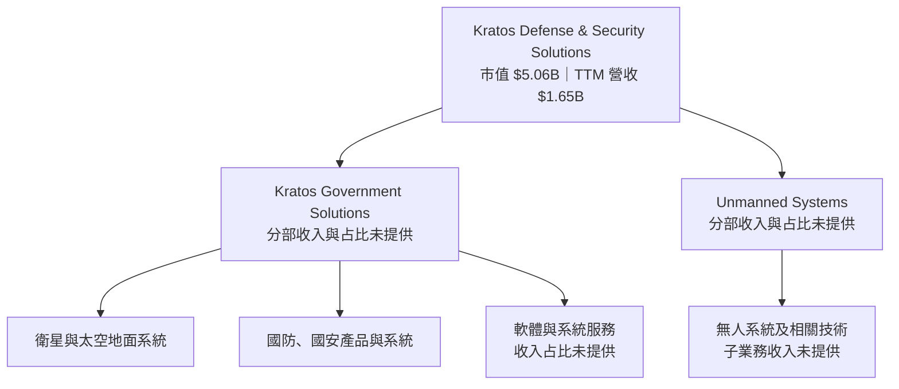
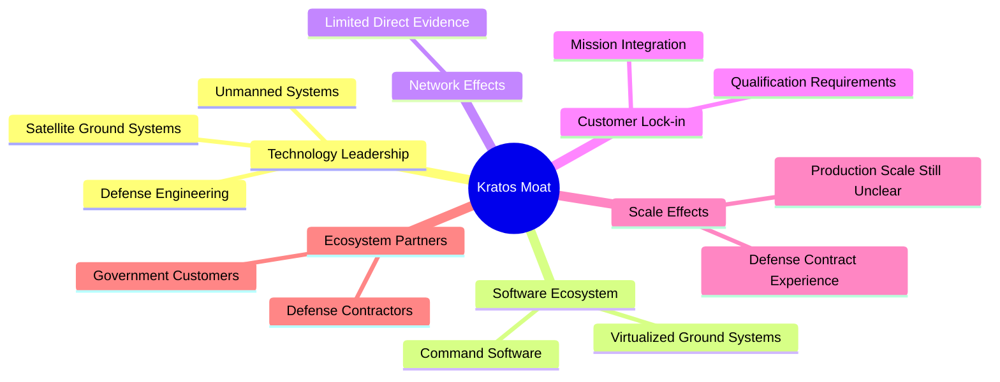
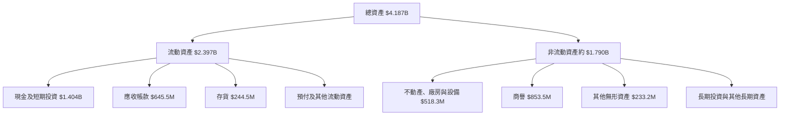
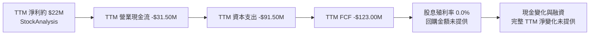
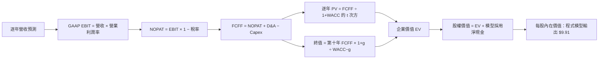
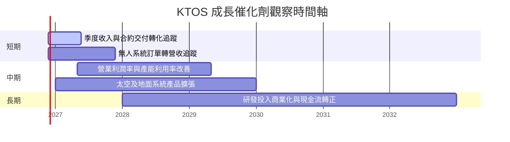
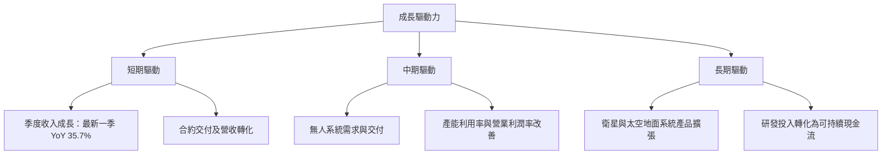
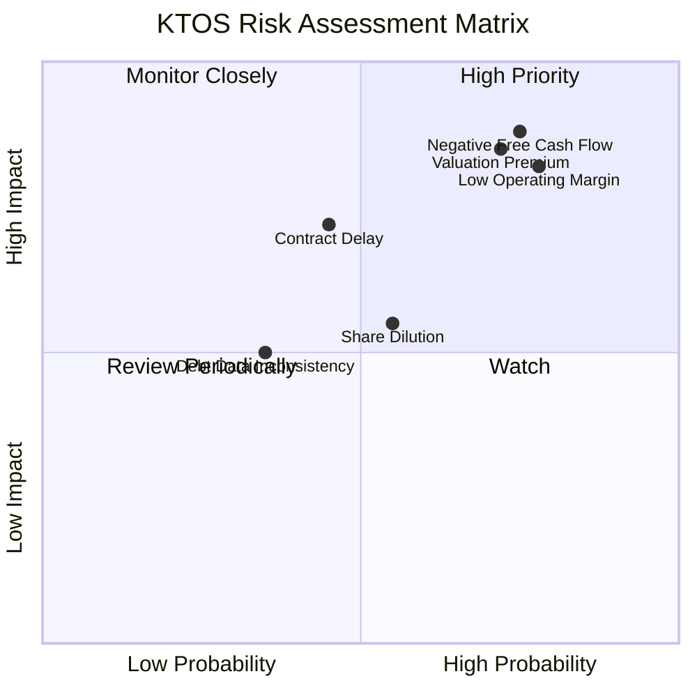
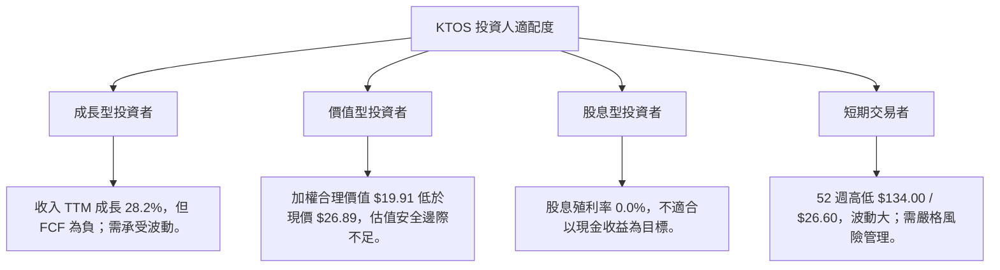

# KTOS 基本面深度分析報告
> **報告日期**：2026-11-23 ｜ **語言**：繁體中文 ｜ **數據來源**：SEC 申報資料 (XBRL)、Yahoo Finance、Finviz、StockAnalysis、Roic.ai ｜ **分析師**：CFA 級機構研究

## 目錄

| # | 章節 | 核心結論 |
|---|------|----------|
| 1 | 執行摘要 | 賣出；加權合理價值 $19.91，MOS -35.1% |
| 2 | 公司概覽與商業模式 | 國防科技與無人系統需求提供成長機會，但分部營收占比未提供 |
| 3 | 損益表深度分析 | TTM 營收 $1.65B、年增 28.2%；營業利潤率僅 0.4% |
| 4 | 資產負債表分析 | 現金與短期投資 $1.40B；債務數據來源不一致，需留意 |
| 5 | 現金流量深度分析 | TTM FCF -$123.00M，FCF Yield -2.43% |
| 6 | 獲利能力與資本效率 | ROIC 0.2% 低於 WACC 10.12%，目前未創造經濟價值 |
| 7 | 相對估值分析 | KTOS 估值高於多數同業；歷史 P/S 接近中位數 |
| 8 | DCF 內在價值評估 | DCF 基準值 $9.91；模型高度依賴終值，且部分輸出有四捨五入／橋接差異 |
| 9 | 成長催化劑 | 國防需求、無人系統與太空相關業務為可能驅動力；TAM 數據未提供 |
| 10 | 風險矩陣 | 現金流轉負、低利潤率與高估值為主要風險 |
| 11 | 投資建議 | 依規則 20 評級為賣出；監控利潤率、現金流與訂單轉化 |

## 1. 執行摘要

### 1.0 一頁式投資儀表板（Portfolio Manager 30 秒速讀）

| 項目 | 內容 |
|------|------|
| **投資論點（3 句）** | ① TTM 營收 $1.65B、年增 28.2%，最新一季年增 35.7%，顯示需求與交付仍在擴張。② TTM 營業利益率僅 0.4%、ROIC 0.2% 對 WACC 10.12%，目前成長尚未轉化成相應的資本報酬。③ TTM FCF -$123.00M、FCF Yield -2.43%，而 2026-11-20 收盤價 $26.89 高於加權合理價值 $19.91。 |
| **綜合評分** | **5.1/10**（引用 1.1 評分卡） |
| **財務健康** | 🟡 現金與短期投資 $1.40B、流動比率 5.418；但 TTM FCF -$123.00M，且總債務資料來源存在差異。 |
| **ROIC vs WACC** | **0.2% vs 10.12%**；差距 -9.92 個百分點，目前為價值耗損。 |
| **FCF 趨勢** | TTM FCF 為負，FCF Yield **-2.43%**；2025 年 FCF -$137.4M，現金轉換尚未穩定。 |
| **估值** | Forward P/E 24.05x｜EV/EBITDA 43.43x（Verified Figures 歷史估值口徑為 44.1x）｜FCF Yield -2.43%。 |
| **DCF 內在價值（基準）** | **$9.91**；以 DCF 基準值計，現價溢價 **171.2%**（$26.89 ÷ $9.91 − 1）。 |
| **安全邊際（MOS）** | **-35.1%**＝($19.91 − $26.89) ÷ $19.91；基準為 8.8 加權合理價值。🔴 小於 10%。 |
| **預期報酬（基準情境 12M）** | DCF 基準情境每股價值 $9.91，相對現價 **-63.1%**；非 12 個月目標價，僅作模型情境參考。 |
| **關鍵風險（前二）** | TTM FCF -$123.00M；營業利潤率低且最新季度為 -1.0%。 |
| **評級 + 信心度** | 🔴 **賣出**｜信心：中。MOS -35.1% 達賣出門檻；但估值模型終值占比高，降低對精確價值點的信心。 |

### 1.1 綜合評分卡（全報告唯一）

| 維度 | 評分（1–10） | 主要依據（引用數字與其來源章節） |
|------|--------------|----------------------------------|
| 成長性 | 8.0 | TTM 營收年增 28.2%、最新一季年增 35.7%（第 3 章）；成長加速值得肯定，但分部貢獻未提供。 |
| 獲利能力 | 3.0 | TTM 營業利益率 0.4%、ROIC 0.2% 低於 WACC 10.12%，F-Score 3/8（第 3、6 章）。 |
| 財務健康 | 8.5 | 現金與短期投資 $1.40B、流動比率 5.418、速動比率 4.632（第 4 章）；扣分原因是現金流轉負及債務數據不一致。 |
| 估值 | 2.0 | MOS -35.1%；P/S 3.1x，EV/EBITDA 約 44x，高於多數同業倍數（第 7、8 章）。 |
| 護城河 | 6.0 | 國防與國安產品具認證、任務整合及客戶轉換成本特性；但可量化分部、合約留存與市占資料未提供（第 2 章）。 |
| 管理層與資本配置 | 5.0 | 2025 年 SBC $35.5M；近年資本支出增加，TTM FCF -$123.00M；回購與股利資料未顯示明確支持（第 3、5 章）。 |
| **綜合評分** | **5.4** | 六項算術平均：(8.0 + 3.0 + 8.5 + 2.0 + 6.0 + 5.0) ÷ 6 = **5.4**。 |

### 1.2 五大投資論點 + 三大核心風險

| 類型 | 項目 | 具體依據 | 信心度 |
|------|------|----------|--------|
| 🟢 **投資論點①** | 營收動能加快 | TTM 營收 $1.65B、年增 28.2%；最新一季營收年增 35.7%。若增長來自可持續的交付與訂單轉化，可能提高固定成本吸收。 | 🟢 高 |
| 🟢 **投資論點②** | 無人系統與國防科技需求 | 公司業務包含政府解決方案及無人系統；國防採購與自主系統需求可構成長線機會，但分部收入及訂單數據未提供。 | 🟡 中 |
| 🟢 **投資論點③** | 現金緩衝高 | 現金與短期投資 $1.40B，提供投資與營運緩衝；但現金不能替代正向營運現金流。 | 🟢 高 |
| 🟢 **投資論點④** | 毛利額擴張 | TTM 毛利 $379.1M，高於 FY2025 $307.9M；若收入組合和交付效率改善，可能支持利潤率回升。 | 🟡 中 |
| 🟢 **投資論點⑤** | 分析師仍偏正面 | 25 位分析師平均目標價 $74.68；此共識與 DCF、相對估值差距很大，應視為市場預期而非已實現價值。 | 🟡 中 |
| 🟡 **風險①** | 現金流惡化 | TTM 營業現金流 -$31.50M、資本支出 $91.50M、FCF -$123.00M。 | 🔴 高衝擊 |
| 🔴 **風險②** | 獲利率與資本回報偏低 | TTM 營業利益率 0.4%、ROIC 0.2%，遠低於 WACC 10.12%；成長未轉化成股東價值。 | 🔴 高衝擊 |
| 🔴 **風險③** | 估值與預期落差 | 加權合理價值 $19.91，低於現價 $26.89；MOS -35.1%。若成長或利潤率不及預期，估值可能進一步下修。 | 🔴 高衝擊 |

### 1.3 快速統計卡片

| 指標 | 公司實際值（期間） | 同業中位數 | 狀態 |
|------|--------------------|------------|------|
| 營收成長（TTM） | **28.2%** | — | 🟢 |
| 營收成長（最新一季年增） | **35.7%** | **6.7%** | 🟢 |
| 毛利率（TTM） | **23.0%** | **20.0%** | 🟢 |
| 營業利益率（TTM） | **0.4%** | — | 🔴 |
| ROIC（TTM） | **0.2%** | — | 🔴 |
| Forward P/E | **24.05x** | **17.8x** | 🔴 |
| FCF Yield（TTM） | **-2.43%** | — | 🔴 |
| Piotroski F-Score | **3 / 8** | — | 🔴 |

> 同業中位數依 AVAV、LMT、NOC 的 Peer multiples 計算。營收年增率中位數為 6.7%，毛利率中位數為 20.0%；Forward P/E 中位數為 17.8x。

### 1.4 投資結論

```text
╔══════════════════════════════════════════════════════════════════╗
║                    📊 投資結論摘要                               ║
╠══════════════════════════════════════════════════════════════════╣
║  評級：賣出（MOS -35.1%，符合規則 20）                           ║
║  價格（2026-11-20 收盤）：$26.89                                 ║
║  DCF 內在價值（基準）：$9.91（現價較 DCF 溢價 171.2%）          ║
║  安全邊際 MOS：-35.1%（＝(加權合理價值−現價)÷加權合理價值）     ║
║  加權合理價值（8.8）：$19.91                                     ║
║  DCF 情境價值（照抄模型）：                                      ║
║    悲觀情境：$8.21（-69.5%）                                     ║
║    基準情境：$9.91（-63.1%）                                     ║
║    樂觀情境：$13.79（-48.7%）                                    ║
║  綜合評分：5.4/10（引用 1.1）                                    ║
║  適合投資人：可承受高波動、以成長選擇權為主的投資人；不適合價值 ║
║  型或股息型投資人，因 FCF 為負且估值高於模型與同業基準。        ║
╚══════════════════════════════════════════════════════════════════╝
```

## 2. 公司概覽與商業模式

### 2.1 業務結構與收入來源

公司總覽可確認為美國國防與安全科技公司，主要透過 Kratos Government Solutions 與 Unmanned Systems 兩個分部提供產品與服務。現有財務資料未列出各分部收入、占比或軟體／服務收入拆分，因此不推估分部金額。



### 2.2 市場份額

市場份額數據未提供，因此不製作市占率圖表。KTOS TTM 營收為 $1.65B、TTM 成長 28.2%，最新一季年增 35.7%，增速高於 AVAV、LMT 與 NOC 的最新季度營收增速；但規模與產品組合差異大，不能據此推斷市場份額。

### 2.3 競爭護城河分析



### 2.4 護城河強度

| 護城河項目 | 強度（強／中／弱） | 證據（引用數字或事實） | 會削弱它的情況 |
|------------|--------------------|------------------------|----------------|
| 技術與任務系統整合 | 中 | 公司提供國防、國安、衛星地面系統及無人系統；TTM 營收 $1.65B，但研發支出 FY2025 為 $40.0M，未有產品層級份額資料。 | 技術替代、競標失利、產品可靠度或交付不達標。 |
| 客戶鎖定與認證 | 中 | 國防與太空任務系統常涉及認證與系統整合，可能提高轉換成本；資料未披露續約率或客戶集中度。 | 採購延遲、合約取消、政府轉向其他供應商。 |
| 軟體生態系統 | 弱至中 | 公司有軟體與虛擬化地面系統產品；軟體收入占比、續約率與毛利未提供。 | 軟體商品化、客戶改用替代平台、系統互通性降低。 |
| 網路效應 | 弱 | 未見使用者規模或資料網路效應的量化證據。 | 顧客與合作夥伴無法形成互相增值的生態。 |
| 規模效應 | 中 | FY2025 營收 $1.35B；相對大型主承包商規模仍較小。 | 產能不足、成本高於大型競爭者、供應鏈瓶頸。 |
| 生態夥伴 | 中 | 公司參與國防與太空供應鏈，但具體夥伴收入貢獻未提供。 | 大型承包商改為自製或替換次級供應商。 |

護城河分數引用 1.1 的 **6.0/10**：業務具技術、任務整合及客戶轉換成本特徵，但缺少市占、續約與分部經濟數據證明其可持續性。

## 3. 損益表深度分析

### 3.1 年度收入成長趨勢（近4年）

下圖收入採公司年報數據；百分比為依相鄰年度收入計算的 YoY。2022–2025 三年收入 CAGR 約 14.4%。

```text
╔══════════════════════════════════════════════════════════════════╗
║     Kratos 年度收入趨勢（FY2022–FY2025，單位：USD）              ║
╠══════════════════════════════════════════════════════════════════╣
║  FY2022  $0.898B  ███████████████░░░░░░░░░░  YoY：—              ║
║  FY2023  $1.037B  █████████████████░░░░░░░░  YoY：+15.4% 🟢      ║
║  FY2024  $1.136B  ███████████████████░░░░░░  YoY：+9.6%  🟡      ║
║  FY2025  $1.347B  ███████████████████████░░  YoY：+18.6% 🟢      ║
║                                                                  ║
║  📊 FY2022–FY2025 收入 CAGR：約 +14.4%                           ║
╚══════════════════════════════════════════════════════════════════╝
```

收入成長在 FY2024 放緩至 9.6%，FY2025 回升至 18.6%。TTM 年增 28.2% 顯示近期動能加快，但收入成長是否由高毛利產品帶動，需等待分部收入與毛利披露。

### 3.2 季度收入趨勢分析

QoQ 依相鄰季度收入計算；YoY 採 StockAnalysis 季度數列及 Verified Figures 最新季度數值。FY2026 Q3 YoY 35.7%為**單季**年增，不是 TTM 成長率。

| 季度 | 營收 | QoQ | YoY | 備註 |
|------|------:|----:|----:|------|
| FY2025 Q4 | $345.1M | 14.0% | 21.9% | 相較 FY2025 Q3 $302.6M 增長。 |
| FY2026 Q1 | $371.0M | 7.5% | 22.6% | 較 FY2025 Q4 $345.1M 增長。 |
| FY2026 Q2 | $458.8M | 23.7% | 30.5% | 季度收入明顯增加，可能含交付時點因素。 |
| FY2026 Q3 | $471.8M | 2.8% | 35.7% | 年增擴大，但單季營業利益率為 -1.0%。 |

YoY 由 FY2025 Q1 的 9.2%逐步升至 FY2026 Q3 的 35.7%，反映營收動能擴大；然而 FY2026 Q3 營業利益為 -$4.0M，顯示銷售增長尚未穩定轉化為營業槓桿。

### 3.3 利潤率演變分析

下表年度利潤率依年報收入、毛利與營業利益計算，四捨五入至一位小數；TTM 指標使用 SEC／Verified Figures 口徑。

| 利潤率指標 | FY2022 | FY2023 | FY2024 | FY2025 | 趨勢 | 評估 |
|------------|-------:|-------:|-------:|-------:|------|------|
| **毛利率** | 25.2% | 25.9% | 25.3% | 22.9% | FY2025 下滑 | 🟡 |
| **營業利益率** | 0.5% | 3.0% | 2.6% | 2.1% | FY2023 後收縮 | 🔴 |
| **淨利率** | -4.1% | -0.9% | 1.4% | 1.6% | 由虧轉盈 | 🟡 |
| **EBITDA 利潤率** | 2.9% | 7.5% | 8.2% | 7.6% | FY2025 略降 | 🟡 |

FY2025 毛利率由 FY2024 約 25.3% 降至 22.9%，但現有資料沒有成本細項與分部組合，無法確認是低毛利產品比重增加、專案成本、價格或其他因素。近年營業利潤率在 FY2023 達約 3.0% 後回落；TTM 只有 0.4%，而最新季度為 -1.0%，增長與利潤品質仍不同步。

### 3.4 費用結構分析

資料提供研發費用 FY2025 $40.0M、收入 $1.347B；但未提供足以完整拆分銷貨成本、銷售管理費、研發費及其他營業費用的同期間表格。為避免用不完整數字拼出費用占比，不製作 Mermaid pie 或費用結構圖。FY2025 研發費約為收入的 3.0%（$40.0M ÷ $1.347B），表明研發投入具實質規模，但產品回報與商業化效率仍需觀察。

### 3.5 季度 EPS 趨勢與盈餘品質（Quality of Earnings）

| 季度 | EPS 實際值 | EPS 預估 | 超預期／不及預期 |
|------|-----------:|---------:|------------------|
| FY2025 Q4 | $0.03 | N/A | N/A：估計值未提供。 |
| FY2026 Q1 | $0.07 | N/A | N/A：估計值未提供。 |
| FY2026 Q2 | $0.02 | N/A | N/A：估計值未提供。 |
| FY2026 Q3 | 約 $0.00 | N/A | N/A：估計值未提供。 |

近四季 EPS 估計值與實際值欄位未提供有效數據，因此不能判定超預期或不及預期。FY2026 Q3 淨利為 -$0.2M，營業利益為 -$4.0M，與收入增長形成落差。

| 盈餘品質項目 | 數值／佔比 | 評估 |
|--------------|------------|------|
| 股權薪酬 SBC / 營收 | 約 **3.6%**：估計 TTM SBC $58.5M ÷ TTM 營收 $1,647M；SBC 由最近四季季度數據加總 | 🔴 SBC 具實質稀釋成本；數值為依季度 SBC 加總的估計值。 |
| SBC / 營業現金流 | **-185.7%**：$58.5M ÷ -$31.50M | 🔴 分母為負，比例僅呈示算式，經濟解讀有限；SBC 規模大於該期 OCF 絕對值。 |
| FCF / 淨利（現金轉換率） | 約 **-559.1%**：-$123.00M ÷ $22.0M | 🔴 TTM 淨利依 StockAnalysis $22M；負 FCF 表示現金轉換弱。 |
| 一次性／非經常性損益 | N/A：未提供可核對的調整項目明細 | 無法判斷非經常項是否美化盈餘。 |
| 有效稅率異常 | N/A：未提供 TTM 稅前所得與所得稅明細 | 無法判斷稅率是否受稅務利益影響。 |
| 資本化支出 vs 費用化 | TTM 資本支出 $91.50M；資本化政策與費用化明細未提供 | 資本支出占用現金，無證據可判定存在成本遞延。 |

**盈餘品質結論**：GAAP 淨利尚不足以代表可分配現金，因 TTM FCF -$123.00M、營業現金流 -$31.50M，且 SBC 約為收入 3.6%。當前估值不宜只看 EPS 成長或分析師目標價，需等現金流轉正與營業利潤率改善。

## 4. 資產負債表分析

### 4.1 資產結構分解

最新季度 StockAnalysis 資產負債表列總資產 $4.187B、流動資產 $2.397B；非流動資產為兩者差額。細項數據含商譽 $853.5M、PP&E $518.3M、無形資產 $233.2M。



流動資產細項可能因資料來源分類與四捨五入而不完全相加；圖中各單項依 StockAnalysis，並未將缺項反推為新數值。

### 4.2 流動性與營運資金分析

| 指標 | 最新 TTM | 一年前 TTM | 變化 | 解讀 |
|------|----------:|----------:|------:|------|
| DSO 應收帳款天數 | 42 天 | 39 天 | +3 天 | 收款天數延長，可能增加應收資金占用；需與客戶交付及請款節點核對。 |
| DIO 存貨天數 | 70 天 | 66 天 | +4 天 | 存貨天數上升，可能反映備貨或交付週期拉長，也可能增加周轉資金需求。 |
| DPO 應付帳款天數 | 32 天 | 24 天 | +8 天 | 付款期限延長，短期有助資金，但單獨不能證明供應商議價力提升。 |
| CCC 現金轉換週期 | 80 天 | 81 天 | -1 天 | 略有改善，主要抵銷因素包括 DPO 增加；週期仍約 80 天。 |

流動比率 5.418、速動比率 4.632，流動性緩衝充足；但 DSO、DIO 同比增加，且營業現金流為負，應優先追蹤應收與存貨能否轉成現金。

### 4.3 債務結構分析

Verified Figures 的總債務為 N/A、淨現金為 $1.40B；其他財務資料則列總債務 $246.0M、淨現金 $1.16B。由於來源與口徑不一致，以下債務覆蓋倍數不推算。

```text
╔══════════════════════════════════════════════════════════════════╗
║                   KTOS 債務健康診斷                              ║
╠══════════════════════════════════════════════════════════════════╣
║  現金 + 短期投資： $1.40B  ████████████████████  🟢              ║
║  Verified 總債務： N/A     無法可靠比較                          ║
║  Verified 淨現金： $1.40B  🟢（按 Verified Figures 原值引用）    ║
║  交叉來源債務：    $246M   Yahoo／合併財務資料口徑               ║
║  交叉來源淨現金：  $1.16B  與 Verified 淨現金數據不一致          ║
║  Debt / EBITDA：   N/A     債務口徑不一致且 Verified 債務缺漏    ║
║  Interest Coverage：N/A    利息費用明細未提供                    ║
╚══════════════════════════════════════════════════════════════════╝
```

兩組數據不應混為同一口徑。估值模型依程式輸出採用淨現金 $1.40B；投資者需在下一份 10-Q 核實期末計息負債、融資租賃與淨現金定義。

### 4.4 股東權益趨勢

```text
╔══════════════════════════════════════════════════════════════════╗
║                 歷年股東權益（財報列示）                         ║
╠══════════════════════════════════════════════════════════════════╣
║  FY2022  $0.936B  ██████████░░░░░░░░░░                          ║
║  FY2023  $0.976B  ██████████░░░░░░░░░░                          ║
║  FY2024  $1.350B  ██████████████░░░░░░                          ║
║  FY2025  $2.000B  ████████████████████                          ║
╚══════════════════════════════════════════════════════════════════╝
```

FY2024 至 FY2025 權益增加，但同期間資料亦顯示股數增加；權益增加不能直接等同每股內在價值提升，仍需扣除股權稀釋與現金流品質因素。

## 5. 現金流量深度分析

### 5.1 現金流量瀑布圖



### 5.2 FCF 轉換率趨勢

| 年度 | FCF | 淨利 | FCF / 淨利 | 解讀 |
|------|----:|----:|-----------:|------|
| FY2022 | -$71.1M | -$36.9M | 不能作一般正向轉換率解讀 | 淨利與 FCF 同為負值，現金流另受資本支出影響。 |
| FY2023 | $12.8M | -$8.9M | 負淨利，不具直觀可比性 | FCF 轉正但會計仍虧損。 |
| FY2024 | -$8.5M | $16.3M | -52.1% | 獲利未完全轉為現金。 |
| FY2025 | -$137.4M | $22.0M | -624.5% | 資本支出及營運資金消耗使 FCF 明顯轉弱。 |
| TTM | -$123.00M | 約 $22M | 約 -559.1% | TTM FCF 使用 OCF − capex 定義，轉換率為負。 |

FY2025 FCF 與 TTM FCF 來自不同期間口徑，勿直接視為相鄰年度的 QoQ 或同口徑趨勢。

### 5.3 自由現金流趨勢

```text
╔══════════════════════════════════════════════════════════════════╗
║                    自由現金流趨勢                                ║
╠══════════════════════════════════════════════════════════════════╣
║  FY2022  -$71.1M  ◀██████████░░░░░░░░░░                           ║
║  FY2023   $12.8M  ███░░░░░░░░░░░░░░░░░                           ║
║  FY2024   -$8.5M  ◀█░░░░░░░░░░░░░░░░░                           ║
║  FY2025 -$137.4M  ◀████████████████████                          ║
║  TTM    -$123.0M  ◀██████████████████                            ║
║                                                                  ║
║  TTM FCF Yield：-2.43%｜股息殖利率：0.0%                         ║
╚══════════════════════════════════════════════════════════════════╝
```

### 5.4 資本配置評估

股息殖利率為 0.0%；FY2025 資本支出 $95.3M、SBC $35.5M；季度資料顯示 FY2026 Q1–Q3 資本支出合計 $67.3M（$19.9M + $17.2M + $30.2M）。缺少完整回購、併購與留存現金分配資料，因此不以推估比例繪製資本配置圓餅圖。

| 配置項目 | 可確認數據 | 評估 |
|----------|------------|------|
| 資本支出 | FY2025 $95.3M；TTM $91.50M | 高投資期可能支持產能與交付，但短期壓低 FCF。 |
| 股利 | 殖利率 0.0% | 現金回報主要仰賴股價升值。 |
| 回購 | N/A：金額未提供 | 無法判定回購是否抵銷股權稀釋。 |
| SBC | FY2025 $35.5M；近四季合計約 $58.5M | 是需要計入的股東經濟成本。 |

## 6. 獲利能力與資本效率

### 6.1 ROE / ROA / ROIC 趨勢

| 指標 | FY2025／最新 TTM | 歷史可比數據 | 評估 |
|------|------------------:|--------------|------|
| ROE | TTM 0.6%（Verified） | 年度序列未提供一致口徑 | 🟡 略為正值，但回報低。 |
| ROA | TTM 0.2% | F-Score 測試顯示 ROA 未高於一年前 | 🔴 資產獲利效率低。 |
| ROIC | TTM 0.2% | 歷史序列缺少可比的近期數字 | 🔴 明顯低於資本成本。 |

本資料不包含可引用的行業均值，故不填行業均值欄。杜邦 ROE 採品質指標的 0.6%，與其他摘要欄位的 ROE 0.8%存在來源口徑差異，本節依 Verified Quality Figures。

### 6.2 ROIC vs WACC 分析（核心價值創造判斷）

```text
╔══════════════════════════════════════════════════════════════════╗
║                ROIC vs WACC 深度分析                            ║
╠══════════════════════════════════════════════════════════════════╣
║  資本成本輸入（採用程式提供的 Cost of capital）：                ║
║  ├── 無風險利率（10Y 美債）：      4.91%                         ║
║  ├── 股權風險溢酬 ERP：            5.00%                         ║
║  ├── 原始 Beta：                   1.17                          ║
║  ├── 調整後 Beta：                 1.11                          ║
║  ├── 股權成本 Ke：                 10.46%                        ║
║  ├── 稅前債務成本：                3.90%                         ║
║  ├── E / D 權重：                  95.4% / 4.6%                  ║
║  └── 採用 WACC：                   10.12%                        ║
║                                                                  ║
║  ROIC（TTM）：                     0.2%                          ║
║  ROIC − WACC：                     0.2% − 10.12% = -9.92 pp     ║
║                                                                  ║
║  ROIC  0.2%    ▓░░░░░░░░░░░░░░░░░░░░░░░░░░░░░░░░  🔴           ║
║  WACC 10.12%   ▓▓▓▓▓▓▓▓▓▓▓▓▓▓▓▓▓▓▓▓▓▓▓▓▓▓▓▓▓▓▓▓  ──           ║
║                                                                  ║
║  結論：ROIC 低於 WACC 約 9.92 個百分點，當期投資回報不足以       ║
║  覆蓋資本成本；若無法提升營業利潤率，擴張可能增加價值耗損。      ║
╚══════════════════════════════════════════════════════════════════╝
```

Cost of capital 提供的組成與 WACC 採用值直接引用。按已列示的四捨五入權重與成本重新計算，數字會有小幅差異，因此本報告不另以自行重算結果取代 Verified WACC；第 8.2 節再揭露算術複核限制。

### 6.3 杜邦三因素分解

| 因素 | 數值（TTM） | 解讀 |
|------|-------------|------|
| 淨利率 | 1.3% | 薄利潤率限制 ROE。 |
| 資產週轉率 | 0.39 | 每單位資產產生的營收有限。 |
| 權益乘數 | 1.21 | 槓桿不高，ROE 並非主要靠借款撐起。 |
| **ROE** | **0.6%** | 品質指標原值：1.3% × 0.39 × 1.21 = 0.6%。 |

ROE 偏低的主要因素是淨利率與資產週轉率，而不是過度槓桿。

### 6.4 財務體質：Piotroski F-Score

**Piotroski F-Score：3 / 8**。來源註明缺失輸入的測試不計入分母；因此分母為 8，並非固定 9。

| 測試 | 結果 | 解讀 |
|------|------|------|
| ROA > 0 | ✅ 通過 | TTM 資產報酬仍為正。 |
| 營業現金流 > 0 | ❌ 未通過 | TTM OCF -$31.50M。 |
| ROA 高於一年前 | ❌ 未通過 | 資產獲利未改善。 |
| 營業現金流 > 淨利 | ❌ 未通過 | OCF 為負而淨利約為正，應計品質較弱。 |
| 長期負債 ÷ 總資產低於一年前 | — 無法判定 | 缺少可比債務輸入。 |
| 流動比率高於一年前 | ✅ 通過 | 流動性測試通過。 |
| 稀釋股數未增加 | ❌ 未通過 | 稀釋股數增加，降低每股價值分享。 |
| 毛利率高於一年前 | ✅ 通過 | 依品質測試比較口徑通過。 |
| 資產週轉率高於一年前 | ❌ 未通過 | 資產利用效率未改善。 |

## 7. 相對估值分析

### 7.1 同業估值比較表格

KTOS 市場資料 Forward P/E 為 24.05x；Peer multiples 的 AVAV、LMT、NOC 倍數均依同一區塊引用。

| 估值指標 | **KTOS** | **AVAV** | **LMT** | **NOC** | 本公司評估 |
|----------|---------:|---------:|--------:|--------:|-----------|
| **Trailing P/E** | 224.1x | N/A | 20.1x | 16.9x | 🔴 盈利基數較小，倍數缺乏吸引力。 |
| **Forward P/E** | 24.05x | 19.7x | 17.0x | 17.8x | 🔴 高於同業中位數 17.8x。 |
| **P/S Ratio** | 3.07x | 2.2x | 1.7x | 1.7x | 🔴 KTOS 對收入估值較高。 |
| **EV/EBITDA** | 44.1x* | 21.3x | 14.7x | 12.2x | 🔴 高於同業中位數 14.7x。 |
| **最新一季營收 YoY** | 35.7% | 5.7% | 11.3% | 6.7% | 🟢 增速較高，但尚未反映為高營業利潤率。 |
| **TTM 毛利率** | 23.0% | 26.5% | 11.7% | 20.0% | 🟡 約在同業區間內。 |

\* Verified history 區塊 EV/EBITDA 為 44.1x；其他市場估值摘要列 43.43x，採規則要求的 Verified 歷史估值數字，並提示來源口徑存在差異。

### 7.2 歷史估值區間分析

```text
╔══════════════════════════════════════════════════════════════════╗
║             KTOS 五年估值歷史位置（TTM 倍數）                    ║
╠══════════════════════════════════════════════════════════════════╣
║  P/E        現值 224.1x｜中位數 380.2x｜百分位 0%                 ║
║             區間 232.9x – 10595348627336923136.0x                 ║
║             ⚠️ 歷史範圍受極端低／負獲利資料影響，解讀價值有限。  ║
║                                                                  ║
║  P/S        現值 3.1x  ｜中位數 3.2x  ｜百分位 45%                ║
║             區間 1.3x – 11.6x                                     ║
║                                                                  ║
║  EV/EBITDA  現值 44.1x｜中位數 55.5x｜百分位 20%                 ║
║             區間 33.8x – 221.5x                                  ║
╚══════════════════════════════════════════════════════════════════╝
```

P/E 歷史區間的上限極端，不適合作為常態估值錨。P/S 低於五年中位數 3.2x、百分位 45%；EV/EBITDA 雖低於歷史中位數 55.5x，但 44.1x 仍高於同業中位數。

### 7.3 情境價值（Bear / Base / Bull，照抄 DCF MODEL）

| 情境 | 第 1 年營收成長 | 期末營業利潤率 | WACC | 每股價值 | 相對現價 | 機率 | 會發生的條件 |
|------|----------------:|----------------:|-----:|---------:|---------:|-----:|--------------|
| 🔴 悲觀 | 14.1% | 1.6% | 11.12% | $8.21 | -69.5% | 25% | 成長由基準 28.2% 放緩，利潤率改善有限且風險折現率上升。 |
| 🟡 基準 | 28.2% | 1.9% | 10.12% | $9.91 | -63.1% | 50% | 初期延續 TTM 增長，之後逐年放緩至 3.0%，利潤率升至近五年中位水準。 |
| 🟢 樂觀 | 42.3% | 2.1% | 9.12% | $13.79 | -48.7% | 25% | 初期增速高於 TTM，利潤率改善且折現率下降。 |

即使樂觀情境仍低於現價，表示模型中營收成長提升並未抵銷低利潤率與高資本投入的影響。

### 7.4 相對估值隱含價格區間

```text
╔══════════════════════════════════════════════════════════════════╗
║              相對估值與共識隱含每股價值                         ║
╠══════════════════════════════════════════════════════════════════╣
║  $9.91       $13.97       $19.96       $26.89       $74.68       ║
║  DCF 基準    EV/EBITDA    Forward P/E   現價         分析師共識   ║
║                                                                  ║
║  Forward P/E：同業中位數 17.8x × Forward EPS $1.12 = $19.96     ║
║  EV/EBITDA：同業中位數 14.7x × TTM EBITDA，加回淨現金 = $13.97  ║
║  分析師共識：25 位分析師平均目標價 $74.68                        ║
╚══════════════════════════════════════════════════════════════════╝
```

DCF $9.91、同業 Forward P/E $19.96、同業 EV/EBITDA $13.97 與分析師共識 $74.68 分歧很大。共識目標價反映分析師對中長期成長的較高預期，並非由目前現金流或同業倍數直接支持。

## 8. DCF 內在價值評估（Discounted Cash Flow）

### 8.0 估值推理鏈（Thinking Logic）

**Step 1 — 價值來源與主導變數**

KTOS 的價值主要由現有政府解決方案與無人系統業務的現金流、收入成長轉化為營業利潤率的能力，以及成長期後的終值構成。兩分部的營收占比未提供，因此不能可靠地把 $1.65B TTM 營收拆成分部比例。模型敏感度顯示終值占企業價值 84.5%，因此主要估值變數是長期現金流與終值假設，而不是單一年份收入。

**Step 2 — 模型選擇**

| 決策點 | 本報告採用 | 理由（含數字） | 曾考慮但否決 | 否決理由 |
|--------|-----------|----------------|--------------|----------|
| 現金流定義 | FCFF | 與 WACC 10.12% 折現相匹配；模型依 FCFF = NOPAT + D&A − Capex | FCFE | 融資結構口徑不確定，且模型已設定 FCFF。 |
| 預測期 N | 10 年 | 模型假設收入增速由 28.2% 線性降至 3.0%，利潤率由 0.4%升至 1.9% | 5 年 | 未能覆蓋模型設定的成長淡出過程；本報告遵循程式模型。 |
| 終值方法 | Gordon Growth | 永續成長 3.0%，低於 WACC 10.12% | 僅退出倍數 | 模型未提供退出倍數終值輸出，不能另造。 |
| EBIT 基礎 | GAAP EBIT | 模型以 GAAP EBIT 為基礎，已含 SBC 費用 | 非 GAAP EBIT | 無權自行重建調整後 EBIT。 |

**Step 3 — 關鍵假設推導鏈**

- **營收成長**：錨點＝TTM 營收年增 28.2%；模型把第一年增長設為 28.2%，之後線性降至第十年 3.0%，反映近年快速增長但長期不宜永久維持高增速。採用值為 FY+1 28.2%、FY+10 3.0%；替代情況若將 28.2%維持十年，會高估遠期收入，故未採用。
- **期末營業利潤率**：錨點＝TTM 0.4%；模型第十年採 1.9%，依據為近五個財年的中位數（模型假設）。這是有限回升而非高利潤率假設；未採用更高利潤率，因歷史營業利潤率與近期季度獲利波動尚未證明可持續擴張。
- **永續成長率 g**：採用 3.0%，低於 WACC 10.12%；模型未提供 GDP 與通膨的拆分來源。採用值遵循程式輸出；未採用高於 3.0%的終值成長，以降低終值過度膨脹。
- **預測期 N**：採用 10 年；這是程式模型指定期間，用來讓 28.2%初期增長逐年淡化至 3.0%。不改用其他年數，避免另建模型。
- **Capex / 營收**：採用 FY+1 5.6%逐步降至 FY+10 5.1%；錨點為 TTM 資本支出 $91.50M 與 TTM 營收 $1.65B，約 5.6%。模型以 1.1 倍 D&A 為後期下限，未直接假設資本支出大幅低於折舊。
- **GAAP EBIT 與 SBC**：模型採 GAAP EBIT，SBC 已列入費用，且不再增加股數；採用 SBC 處理組合 **(A)**，故 SBC 影響計入一次，FCFF 不再扣 SBC，股數年稀釋率為 0%。
- **WACC**：採用程式提供的 10.12%，詳細組成見 8.2；不自行替換成其他資本成本。
- **D&A / 營收**：錨點及採用值均為 TTM 4.7%，模型固定。
- **營運資金**：模型明確不建模 Working Capital；不能因模板提及 ΔWC 而自創數值。

**Step 4 — 最脆弱的一環**

最脆弱的假設是營業利潤率能從 TTM 0.4%回升至第十年 1.9%；若營收成長仍在而利潤率無法改善，FCFF 與終值將更低。模型基準 DCF 為 $9.91，而各情境為 $8.21–$13.79，顯示情境價值仍遠低於現價。

**Step 5 — 計算路徑圖**



### 8.1 模型假設總表（Model Inputs）

| 假設項目 | 採用值 | 依據／來源 | 敏感度 |
|----------|--------|-------------|--------|
| 預測期長度 **N** | 10 年 | DCF MODEL 固定預測期；期間內收入增長淡化至 3.0%。 | 🟡 中 |
| 營收成長 | FY+1 28.2%，FY+10 3.0% | FY+1 錨定 TTM vs prior TTM 成長 28.2%；其後線性淡出。 | 🔴 高 |
| 營業利潤率（GAAP EBIT） | FY+1 0.4% → FY+10 1.9% | TTM 營業利潤率 0.4%；期末值為模型採用近五年中位數。 | 🔴 高 |
| 有效稅率 | 21.0% | 模型預設稅率；非歷史有效稅率實測值。 | 🟢 低 |
| Capex / 營收 | 5.6% → 5.1% | TTM 資本支出 $91.50M ÷ $1.65B 營收約 5.6%；模型後期依規則淡化。 | 🟡 中 |
| D&A / 營收 | 4.7% | DCF MODEL 的 TTM 比率，預測期固定。 | 🟢 低 |
| 營運資金變動 | 不建模 | DCF MODEL 明確未建模營運資金。 | 🟡 中 |
| EBIT 基礎 | GAAP | DCF MODEL 使用 GAAP EBIT。 | 🟡 中 |
| SBC 處理 | 組合 (A)：GAAP EBIT；不再扣 SBC；股數固定 | SBC 已反映於 GAAP EBIT；模型未再稀釋股數。 | 🟡 中 |
| 年稀釋率 | 0%（模型股數不另稀釋） | 與組合 (A) 一致。 | 🟡 中 |
| 永續成長率 g | 3.0% | DCF MODEL 假設；低於 WACC 10.12%。 | 🔴 高 |
| 終值方法 | Gordon Growth | DCF MODEL 以第十年 FCFF 與 g 推算終值；未提供退出倍數終值輸出。 | 🔴 高 |
| WACC | 10.12% | 直接採用 Cost of capital 輸出。 | 🔴 高 |

FCFF 口徑為 **NOPAT + D&A − Capex**；Working Capital 不建模。模型採用組合 **(A)**，故 SBC 影響已計入 GAAP EBIT 一次，不另扣 SBC，也不另計年稀釋。

### 8.2 折現率推導（WACC）

```text
╔══════════════════════════════════════════════════════════════════╗
║                    WACC 推導（折現率）                           ║
╠══════════════════════════════════════════════════════════════════╣
║  股權成本 Ke（CAPM）：                                           ║
║  ├── 無風險利率 Rf（10Y 美債）：      4.91%                      ║
║  ├── 市場風險溢酬 ERP：               5.00%                      ║
║  ├── 原始 Beta（Yahoo）：              1.17                       ║
║  ├── 調整 Beta：                       1.11 = 2/3×1.17 + 1/3    ║
║  ├── 規模／國別溢酬：                  0.00%（未另加）            ║
║  └── Ke = 4.91% + 1.11×5.00% = 10.46%                          ║
║                                                                  ║
║  債務成本：                                                       ║
║  ├── 稅前 Kd：                         3.90%                      ║
║  ├── 稅率：                            21.0%                      ║
║  └── 稅後 Kd = 3.90%×(1−21.0%) = 3.081%                         ║
║                                                                  ║
║  資本結構權重（Cost of capital 原值）：                          ║
║  ├── 股權 E 權重：                     95.4%                      ║
║  ├── 債務 D 權重：                     4.6%                       ║
║  └── 採用 WACC：                       10.12%                     ║
╚══════════════════════════════════════════════════════════════════╝
```

**逐步演算與輸入來歷**

1. **Ke（CAPM）**：`4.91% + 1.11 × 5.00% = 10.46%`。Beta 調整依提供公式 `⅔ × 1.17 + ⅓ = 1.11`；ERP 為模型假設 5.00%，無風險利率採用 10 年期美債 4.91%。額外規模與國別溢酬採 0.00%，未另加。
2. **稅前 Kd**：採用成本資本資料的 3.90%；利息費用及平均計息負債的明細未提供，無法獨立重建分子、分母。
3. **稅後 Kd**：`3.90% × (1 − 21.0%) = 3.081%`。
4. **權重**：直接引用 E/D 權重 95.4% / 4.6%，合計 `95.4% + 4.6% = 100.0%`。市值與總債務口徑未提供可完全核對的同一期計息負債明細，故不反推金額。
5. **WACC**：按已列示、四捨五入後的數字，`95.4%×10.46% + 4.6%×3.081% = 9.97884% + 0.141726% = 10.120566%`，而採用值為 **10.12%**。注意第一項乘法正確結果應為 9.97884%，兩項相加為 10.120566%；四捨五入為 10.12%。

> 成本資本區塊的債務成本、權重使用程式計算口徑。由於缺少同一期計息負債及利息費用原始明細，不能重建債務成本的平均負債分母；本報告保留模型輸入，不把其他來源的 $246M 總債務直接混入 WACC。

### 8.3 逐年自由現金流預測（基準情境）

金額單位 USD billions；下列逐年數據照 DCF MODEL 原值列示。模型未計入營運資金變動，故不列 ΔWC 行。金額取 0.01B，折現因子取三位小數。

| 年度 | FY+1 | FY+2 | FY+3 | FY+4 | FY+5 | FY+6 | FY+7 | FY+8 | FY+9 | FY+10 |
|------|-----:|-----:|-----:|-----:|-----:|-----:|-----:|-----:|-----:|------:|
| 營收 | 2.11 | 2.65 | 3.24 | 3.88 | 4.54 | 5.19 | 5.78 | 6.28 | 6.64 | 6.84 |
| 營收 YoY | 28.2% | 25.4% | 22.6% | 19.8% | 17.0% | 14.2% | 11.4% | 8.6% | 5.8% | 3.0% |
| 營業利潤率 | 0.4% | 0.6% | 0.7% | 0.9% | 1.1% | 1.2% | 1.4% | 1.6% | 1.7% | 1.9% |
| EBIT | 0.01 | 0.01 | 0.02 | 0.03 | 0.05 | 0.06 | 0.08 | 0.10 | 0.12 | 0.13 |
| − 稅 | 0.00 | 0.00 | 0.00 | 0.01 | 0.01 | 0.01 | 0.02 | 0.02 | 0.02 | 0.03 |
| NOPAT | 0.01 | 0.01 | 0.02 | 0.03 | 0.04 | 0.05 | 0.06 | 0.08 | 0.09 | 0.10 |
| + D&A | 0.10 | 0.12 | 0.15 | 0.18 | 0.21 | 0.24 | 0.27 | 0.29 | 0.31 | 0.32 |
| − Capex | 0.12 | 0.15 | 0.18 | 0.21 | 0.24 | 0.28 | 0.31 | 0.33 | 0.34 | 0.35 |
| **FCFF** | **-0.01** | **-0.01** | **-0.01** | **-0.00** | **0.01** | **0.02** | **0.03** | **0.04** | **0.06** | **0.07** |
| 折現因子 | 0.908 | 0.825 | 0.749 | 0.680 | 0.618 | 0.561 | 0.509 | 0.462 | 0.420 | 0.381 |
| FCFF 現值 PV | -0.01 | -0.01 | -0.01 | -0.00 | 0.00 | 0.01 | 0.01 | 0.02 | 0.02 | 0.03 |

**模型提供的預測期 PV 合計：$0.07B。** 表中逐年 PV 以兩位小數顯示，直接逐項相加會受四捨五入影響；不以已取整數字反推未取整合計。

**FY+1 代表年度算式（模型輸出精度）**

1. 營收：`$1.65B × (1 + 28.2%) = $2.1153B`，模型表列 **$2.11B**。
2. EBIT：`$2.11B × 0.4% ≈ $0.00844B`，模型表列 **$0.01B**。
3. 稅：`$0.00844B × 21.0% ≈ $0.00177B`，模型表列 **$0.00B**。
4. NOPAT：`$0.00844B − $0.00177B ≈ $0.00667B`，模型表列 **$0.01B**。
5. D&A：`$2.11B × 4.7% ≈ $0.0992B`，模型表列 **$0.10B**。
6. Capex：`$2.11B × 5.6% ≈ $0.1182B`，模型表列 **$0.12B**。
7. ΔWC：DCF MODEL 不建模，故不扣除。
8. FCFF：按未四捨五入中間值約為 `$0.00667B + $0.0992B − $0.1182B ≈ -$0.0123B`；模型表列 **-$0.01B**。
9. 折現因子與 PV：`1 ÷ (1 + 10.12%)^1 = 0.908`；`-$0.0123B × 0.908 ≈ -$0.0112B`，模型表列 **-$0.01B**。

**合理性自檢**

- 預測 FCF CAGR：未提供唯一可計算的 CAGR，因前期 FCFF 為負；不可用負值起點計算一般 CAGR。FY2022–FY2025 年度 FCF 亦大幅波動（-$71.1M、$12.8M、-$8.5M、-$137.4M）。
- FY+10 FCF 利潤率：模型值 `0.07 ÷ 6.84 = 約 1.0%`；目前 TTM FCF 利潤率 `-$123.00M ÷ $1.65B = -7.5%`。同業最佳 FCF 利潤率未提供，不作比較。
- FY+1 至 FY+4 FCFF 為負，反映高資本支出及低營業利潤率；負現金流仍進入折現合計，會降低企業價值。

```text
╔══════════════════════════════════════════════════════════════════╗
║            自由現金流：歷史實際 vs 模型預測                      ║
╠══════════════════════════════════════════════════════════════════╣
║  FY2022(實)  -$0.071B  ◀████████░░░░░░░░░░                        ║
║  FY2023(實)   $0.013B    ██░░░░░░░░░░░░░░                         ║
║  FY2024(實)  -$0.009B  ◀█░░░░░░░░░░░░░░                           ║
║  FY2025(實)  -$0.137B  ◀████████████████████                      ║
║  FY+1 (預)   -$0.01B   ◀█░░░░░░░░░░░░░░                           ║
║  FY+10(預)    $0.07B     ██████████░░░░░░                         ║
╠══════════════════════════════════════════════════════════════════╣
║  ⚠️ 歷史 FCF 波動且 TTM 為 -$123.00M；預測轉正取決於利潤率改善。║
╚══════════════════════════════════════════════════════════════════╝
```

### 8.4 終值計算（Terminal Value）

**適用性檢查**：`WACC 10.12% vs g 3.0% → WACC > g？✅`

| 方法 | 計算式 | 終值 TV | TV 現值 | 佔總 EV 比重 |
|------|--------|---------:|--------:|-------------:|
| Gordon Growth | 第十年 FCFF × (1 + g) ÷ (WACC − g) | $1.02B | $0.39B | 84.5% |
| 退出倍數法 | N/A：DCF MODEL 未提供退出倍數終值 | N/A | N/A | N/A |

**逐步演算（採用程式模型輸出）**

1. FY+N FCFF：第十年 **$0.07B**。
2. 分子：`$0.07B × (1 + 3.0%) = $0.0721B`；模型終值使用未取整中間值。
3. 分母：`10.12% − 3.0% = 7.12%`；模型列示 `0.07 × 1.03 ÷ (10.12% − 3.0%) = $1.02B`。
4. PV(TV)：`$1.02B × 0.381 = $0.38862B`，模型列示 **$0.39B**。
5. 終值占比：模型列示 PV(TV) 為企業價值的 **84.5%**。

**終值現值占 EV 84.5%**，高於 75%警戒線；本估值高度依賴終值假設，短期現金流貢獻有限。DCF MODEL 未提供退出倍數終值與依據，故不另建交叉驗證估值。

### 8.5 企業價值 → 每股內在價值（Bridge）

```text
╔══════════════════════════════════════════════════════════════════╗
║              企業價值 → 每股內在價值 橋接表                      ║
╠══════════════════════════════════════════════════════════════════╣
║  預測期 FCF 現值合計            +$0.07B                          ║
║  終值現值 PV(TV)                +$0.39B                          ║
║  ─────────────────────────────────────────────                  ║
║  = 企業價值 EV                   $0.46B                          ║
║  + 淨現金（模型採用）            +$1.40B                         ║
║  = 模型股權價值                  $1.87B（模型輸出）              ║
║  ÷ 模型隱含每股換算              程式換算，非直接股數除法         ║
║  ★ 每股 DCF 基準內在價值         $9.91                           ║
║    當前股價（2026-11-20 收盤）   $26.89                          ║
║    現價相對 DCF 溢價             +171.2%                         ║
╚══════════════════════════════════════════════════════════════════╝
```

DCF MODEL 指定的每股換算為 `股權價值 × 價格 ÷ 市值`，並輸出 $9.91。本報告照抄程式輸出，不用其他公式覆蓋。

**逐步演算與一致性說明**

1. `EV = 預測期 PV $0.07B + PV(TV) $0.39B = $0.46B`（模型輸出，為四捨五入後數值）。
2. `股權價值 = 模型 EV + 淨現金`；模型輸出 EV $0.46B、淨現金 $1.40B、股權價值 $1.87B。以顯示至兩位小數的數字直接相加得 $1.86B，與模型輸出差 $0.01B，屬未取整中間值或呈示精度差異；不能由顯示數字精確重建。
3. 每股內在價值依模型原式：`股權價值 × 價格 ÷ 市值 = $9.91`。市值 $5.06B、價格 $26.89，使用已取整顯示數字代入會得到約 $9.94，而非 $9.91；模型可能使用較高精度底層數據。故 $9.91 保留為官方模型輸出，並列為複算差異。
4. 折溢價：`$26.89 ÷ $9.91 − 1 = 171.24% ≈ +171.2%`。
5. 本節不計算 MOS；MOS 僅以第 8.8 節加權合理價值為分母。

股數與現金／債務來源：DCF 模型採固定股數、不另稀釋，SBC 依 GAAP EBIT 計入一次；模型採用淨現金 $1.40B。市場資料列流通股數 188.27M，但 DCF 每股換算並非單純以 188.27M 除股權價值，故其每股數值存在上述模型換算差異。

### 8.6 敏感性分析（WACC × 永續成長率）

以下每股價值照抄 DCF MODEL。括號內上行空間以 `$每股價值 ÷ $26.89 − 1` 計算；百分比四捨五入至一位小數。基準格依模型為 $9.91。

| g（列）／WACC（欄） | 8.12% | 9.12% | **10.12%（基準）** | 11.12% | 12.12% |
|-----------|------:|------:|------------------:|-------:|-------:|
| 2.0% | $10.79（-59.9%） | $10.13（-62.3%） | $9.64（-64.1%） | $9.27（-65.5%） | $8.98（-66.6%） |
| 2.5% | $11.06（-58.9%） | $10.31（-61.7%） | $9.77（-63.7%） | $9.36（-65.2%） | $9.05（-66.3%） |
| 3.0% | $11.39（-57.6%） | $10.52（-60.9%） | **$9.91（-63.1%）** | $9.47（-64.8%） | $9.12（-66.1%） |
| 3.5% | $11.78（-56.2%） | $10.77（-60.0%） | $10.08（-62.5%） | $9.58（-64.4%） | $9.21（-65.7%） |
| 4.0% | $12.27（-54.4%） | $11.07（-58.8%） | $10.28（-61.8%） | $9.72（-63.8%） | $9.31（-65.4%） |

**逐步演算限制**：選取有效非基準格 `WACC 9.12% > g 3.0% ✅`。模型提供該格每股價值 **$10.52**，但沒有提供其新折現率下的預測期 PV 合計、終值精確中間值或股權價值，不能在不另建模型的前提下完成同一格的完整橋接重算；故照抄矩陣值並將其標記為無法獨立複算。

**三情境 DCF**：情境每股價值、增長率、期末利潤率、WACC、機率均見第 7.3 節。程式未提供每個情境逐年收入、FCFF 與 TV 中間值，因此不自行重建逐情境運算鏈。

| 情境 | 每股價值 | 機率 |
|------|---------:|-----:|
| 悲觀 | $8.21 | 25% |
| 基準 | $9.91 | 50% |
| 樂觀 | $13.79 | 25% |
| 機率加權 | $10.46 | 100% |

機率加權複核：`$8.21×25% + $9.91×50% + $13.79×25% = $2.0525 + $4.955 + $3.4475 = $10.455 ≈ $10.46`。

**敏感度結論**

- g 從 2.5%升至 3.5%、WACC 固定 10.12%：`$10.08 − $9.77 = +$0.31`，約 `+$0.31 ÷ $9.77 = +3.2%`。
- WACC 從 9.12%升至 10.12%、g 固定 3.0%：`$9.91 − $10.52 = -$0.61`，約 `-$0.61 ÷ $10.52 = -5.8%`。
- 期末營業利潤率每 +1pp 的價值變化：DCF MODEL 未提供相應單變數敏感度，**N/A**，不另建模型。
- 已提供矩陣中 WACC 的 1pp 變化影響可見；終值佔 EV 84.5%則顯示長期現金流假設更重要。與 8.0 指出的「終值與利潤率轉化」主導因素方向一致，但模型未提供可精確量化的利潤率彈性。

### 8.7 反推 DCF（Reverse DCF：市場在預期什麼）

固定基準輸入：WACC 10.12%、稅率 21.0%、D&A／營收 4.7%、預測期 10 年、Capex 按模型設定、g 3.0%；ΔWC 不建模；股數按模型固定。程式只提供兩項反推結果，其他變數不自行求解。

| 求解變數（一次一個） | 其餘變數設定 | 市場隱含值（令 DCF = 現價） | 公司歷史實際 | 判斷 |
|----------------------|--------------|------------------------------:|--------------|------|
| 第 1 年營收成長率 | 利潤率與其他輸入固定基準值 | 84.7% | TTM 成長 28.2% | 🔴 要求遠高於目前增長。 |
| 固定營業利潤率 | 收入增長與其他輸入固定基準值 | 7.9% | TTM 0.4%；模型期末 1.9% | 🔴 要求遠高於目前及模型期末水準。 |
| 永續成長率 g | 未計算 | N/A | — | 模型未提供反推值。 |
| 預測期長度 N | 未計算 | N/A | — | 模型未提供反推值。 |

**迭代軌跡**：DCF MODEL 未提供反推營收成長率的試算點、相應 FY+N 營收、FCFF 或收斂誤差；因此只照抄程式反推結果 84.7%，不編造收斂路徑。

反推結果表示，在其他基準輸入不變下，若只靠營收成長解釋現價，第一年增長須達 84.7%；若只靠固定營業利潤率解釋，則須達 7.9%。兩者均遠高於模型基準假設，顯示現價隱含較樂觀的營運改善或市場給予更高成長選擇權價值。

### 8.8 估值三角驗證與安全邊際

| 估值方法 | 隱含每股價值 | 上行空間（÷現價） | 權重 | 說明 |
|----------|--------------:|-------------------:|-----:|------|
| DCF（基準） | $9.91 | -63.1% | 40% | 10 年 FCFF、WACC 10.12%、終值成長 3.0%。 |
| 同業 Forward P/E | $19.96 | -25.8% | 25% | 同業中位數 17.8x × Forward EPS $1.12。 |
| 同業 EV/EBITDA | $13.97 | -48.0% | 25% | 同業中位數 14.7x × TTM EBITDA，加回模型採用淨現金。 |
| 分析師共識目標價 | $74.68 | +177.7% | 10% | 25 位分析師平均目標價；僅作參考。 |
| **加權合理價值** | **$19.91** | **-26.0%** | **100%** | 公司類型為 profitable；固定權重照程式輸出。 |

加權合理價值算式：  
`$9.91×40% + $19.96×25% + $13.97×25% + $74.68×10%`  
`= $3.964 + $4.990 + $3.4925 + $7.468`  
`= $19.9145 ≈ $19.91`。

權重合計：`40% + 25% + 25% + 10% = 100%`。方法數量與權重均照程式提供；本節沒有方法因無法計算而剔除。

```text
╔══════════════════════════════════════════════════════════════════╗
║                  估值區間與安全邊際                              ║
╠══════════════════════════════════════════════════════════════════╣
║  $8.21 ───── $19.91 ───── [$26.89] ───── $9.91 ───── $13.79    ║
║  悲觀DCF     加權合理值       現價          基準DCF       樂觀DCF ║
║                                                                  ║
║  安全邊際 MOS = ($19.91 − $26.89) ÷ $19.91 = -35.1%             ║
║  MOS 評估：🔴 小於 10%，無安全邊際                               ║
║  上行空間 = ($19.91 − $26.89) ÷ $26.89 = -26.0%                ║
║  DCF 基準值 $9.91；現價相對 DCF 溢價 171.2%                     ║
║  建議買入區間：N/A（規則 20 評級為賣出，不給買入區間）           ║
║  合理持有區間：以加權合理價值 $19.91 作為估值錨，不代表價格預測   ║
║  減碼考慮區間：高於 $19.91 且基本面未改善時，估值風險偏高        ║
╚══════════════════════════════════════════════════════════════════╝
```

**MOS 計算**：`($19.91 − $26.89) ÷ $19.91 = -$6.98 ÷ $19.91 = -35.06% ≈ -35.1%`。  
**上行空間計算**：`($19.91 − $26.89) ÷ $26.89 = -$6.98 ÷ $26.89 = -25.96% ≈ -26.0%`。

> 🔎 **程式複算（Python，依本節各項自動重算）**
>
> 加權合理價值 = $9.91 × 40% + $19.96 × 25% + $13.97 × 25% + $74.68 × 10% = **$19.91**（權重合計 100%）
>
> 以價格 $26.89 計：MOS = **-35.1%**，上行空間 = **-26.0%**
>
> ✅ 與本節所寫數值一致。

### 8.9 DCF 模型的局限與失效條件

- **終值依賴度**：終值現值占 EV 84.5%，代表估值主要由第十年以後的現金流假設決定。
- **最脆弱假設**：營業利潤率由 0.4%升至 1.9%；若無法實現，價值低於基準 $9.91 的方向明確，但具體下跌幅度未在單變數敏感度中提供。WACC 上升、g 下降時，矩陣顯示價值可降至 $8.98（g 2.0%、WACC 12.12%）。
- **模型可靠度**：公司 TTM FCF 為負，營業利潤率低且季度波動；DCF 依賴未來轉盈與終值假設，精確值可靠度有限。可輔以 EV/Sales、同業 Forward P/E 與 EV/EBITDA，不應單獨依賴 DCF。
- **風險連結**：國防採購延遲、成本超支與交付問題會壓低收入成長及營業利潤率；資本支出維持高位會壓低 FCFF；資本市場風險上升則會推高 WACC。

### 8.10 複算檢核表（Audit Trail）

| # | 檢核項目 | 檢查方式 | 結果 |
|---|----------|----------|------|
| 1 | 所有 🔴高／🟡中敏感度輸入有推導 | 對照 8.0 與 8.1；若干來源只有模型假設，已揭露其有限錨點 | ✅ |
| 2 | 每個假設都有來歷 | 8.1 依據欄逐項列示；ΔWC 明確為不建模 | ✅ |
| 3 | WACC 五步算式與相乘相加 | 權重總和 100%；按顯示數字重算為 10.120566%，四捨五入 10.12% | ✅ |
| 4 | Kd 分母與權重 D 為同一計息負債範圍 | 平均計息負債與期末計息負債明細未提供，無法獨立核實 | ❌：採用程式 WACC，未以其他債務來源替代 |
| 5 | WACC 與第 6.2 節同值 | 兩處均 10.12% | ✅ |
| 6 | 逐年表格年度數等於 N，無省略 | FY+1 至 FY+10，共 10 年 | ✅ |
| 7 | 代表年度 FCFF 與 PV 可複算 | 未取整中間值可近似重建；顯示值有四捨五入 | ✅ |
| 8 | 預測期 PV 逐項加總 | 兩位小數逐項相加與未取整模型合計不同，模型合計 $0.07B | ❌：不以四捨五入列值反推底層精度 |
| 9 | WACC > g | 10.12% > 3.0% | ✅ |
| 10 | 終值以 FY+N FCFF 為基礎並折現 N 期 | 採 FY+10 FCFF、折現因子 0.381 | ✅ |
| 11 | EV 至每股價值橋接 | 顯示數字橋接有約 $0.01B 與每股換算差異 | ❌：保留 DCF MODEL 輸出，不另改模型值 |
| 12 | SBC 組合相容 | GAAP EBIT、不另扣 SBC、股數不另稀釋，組合 A | ✅ |
| 13 | 矩陣基準格等於 DCF 基準值 | g 3.0%、WACC 10.12% 為 $9.91 | ✅ |
| 14 | 矩陣示範格有效、無 WACC ≤ g 數字 | 全部 WACC 均高於矩陣 g | ✅ |
| 15 | 情境機率與加權結果 | 25%+50%+25%=100%；加權約 $10.46 | ✅ |
| 16 | 反推每列只放開一個變數 | 已照抄兩個程式反推值；試算軌跡未提供 | ❌：未編造不存在的試算點 |
| 17 | MOS 分母與折溢價基準 | MOS 用 $19.91；折溢價用 $9.91 | ✅ |
| 18 | 完整到第 11 章 | 11 章均列出 | ✅ |
| 19 | 加權合理價值等於各方法加權和 | $19.9145，四捨五入 $19.91 | ✅ |
| 20 | 評級符合 MOS 門檻 | MOS -35.1% 對應賣出；未作質化調整 | ✅ |

**未通過項目說明**：複算差異來自模型只提供取整輸出、橋接每股換算精度及缺少債務原始分母；本報告保留程式提供的 DCF 值，不擅自修改，但因此降低 DCF 點估值的複算信心。

## 9. 成長催化劑

### 9.1 催化劑時間軸

資料未提供明確產品量產、合約交付或商業化的指定日期；下列為依業務特性排列的觀察時間軸，不代表已確認的公司指引。



### 9.2 TAM 市場規模分析

**N/A（TAM 數據未提供）**。公司 TTM 營收 $1.65B、年增 28.2%，最新一季年增 35.7%，顯示收入增長空間仍在擴大；但沒有可引用的無人系統、國防科技或太空地面系統市場規模數據，故不估算 TAM 與滲透率。

### 9.3 成長驅動力結構圖



## 10. 風險矩陣

### 10.1 風險評分矩陣

以下座標為分析者的定性風險評估，不是財務數據；採英文節點名稱以符合圖表語法要求。



### 10.2 風險清單詳細分析

| # | 風險項目 | 發生機率 | 財務衝擊 | 風險評分 | 緩解措施 |
|---|----------|----------|----------|----------|----------|
| 1 | 🔴 **負自由現金流延續** | 高（定性） | TTM FCF -$123.00M；若持續，將減少自我融資能力並提高資本需求 | 🔴 9/10 | 追蹤季度 OCF、Capex、應收與存貨；要求新增收入轉化成現金。 |
| 2 | 🔴 **營業利潤率未改善** | 高（定性） | TTM 營業利益率 0.4%、最新季度 -1.0%；獲利改善延遲會降低 DCF 價值 | 🔴 9/10 | 逐季檢查毛利率、固定成本吸收與專案成本；若成長伴隨利潤率持續惡化，降低預期。 |
| 3 | 🔴 **估值回落** | 中高（定性） | MOS -35.1%；Forward P/E 24.05x 高於同業中位數 17.8x | 🔴 8/10 | 以估值與現金流共同設定倉位，避免只依賴分析師共識目標價。 |
| 4 | 🟡 **合約與交付時程變化** | 中（定性） | 最新季度營收增長 35.7%，但營業利益仍為負；交付延誤可同時影響收入與固定成本 | 🟠 7/10 | 追蹤訂單、backlog、交付與客戶付款條件；相關明細未提供，需讀取後續申報。 |
| 5 | 🟡 **股權稀釋與 SBC** | 中（定性） | FY2025 SBC $35.5M；品質測試指出稀釋股數增加 | 🟠 6/10 | 追蹤稀釋股數增幅、SBC／營收及回購是否抵銷稀釋。 |
| 6 | 🟡 **資產負債表口徑不一致** | 中（定性） | Verified 淨現金 $1.40B；另一財務來源列總債務 $246M、淨現金 $1.16B | 🟡 5/10 | 以 SEC 10-Q 同期資產負債表核對現金、融資租賃及計息債務。 |

## 11. 投資建議

### 11.1 最終評級與評分

依加權合理價值 $19.91 與 2026-11-20 收盤價 $26.89 計算，MOS 為 -35.1%，依規則 20 評級為 **賣出**，未作質化調整。1.1 綜合評分為 **5.4/10**；六項分數依序為成長性 8.0、獲利能力 3.0、財務健康 8.5、估值 2.0、護城河 6.0、管理層與資本配置 5.0。

### 11.2 合理價值與隱含報酬率

| 價值參考 | 每股價值 | 相對現價 | 機率 |
|----------|---------:|---------:|-----:|
| 加權合理價值（8.8） | $19.91 | -26.0% | — |
| DCF 悲觀情境 | $8.21 | -69.5% | 25% |
| DCF 基準情境 | $9.91 | -63.1% | 50% |
| DCF 樂觀情境 | $13.79 | -48.7% | 25% |
| DCF 情境機率加權（參考） | $10.46 | -61.1% | 100% |
| 分析師平均目標價 | $74.68 | +177.7% | 25 位分析師均值 |

加權合理價值採用固定權重估值方法；分析師共識與 DCF 差距顯著，應視為樂觀預期而非基準內在價值。

### 11.3 買入時機與觸發因素

```text
╔══════════════════════════════════════════════════════════════════╗
║                  ✅ 買入觸發因素 Checklist                      ║
╠══════════════════════════════════════════════════════════════════╣
║  目前立場：以估值與現金流證據為主，不因單季收入增長追價。        ║
║                                                                  ║
║  重新評估買入條件（多數符合）：                                  ║
║  ☐ TTM FCF 轉正，且連續兩季 OCF 為正                            ║
║  ☐ TTM 營業利潤率由 0.4%提高，最新季度不再為負                  ║
║  ☐ 營收成長能帶動毛利額與營業利益同步改善                        ║
║  ☐ 債務與淨現金數據可由 SEC 10-Q 同期口徑核實                    ║
║                                                                  ║
║  加碼觸發條件（需同時確認估值）：                                ║
║  ☐ 實際季度 FCF 改善且非單靠延長應付帳款                          ║
║  ☐ DSO、DIO 不再上升，CCC 維持或改善                             ║
║  ☐ 股數稀釋速度下降，SBC／營收占比趨勢改善                       ║
║                                                                  ║
║  減碼／退出觸發條件：                                            ║
║  ☐ 連續兩季營業利益率為負，或 TTM FCF 持續低於 -$123M            ║
║  ☐ 最新一季收入 YoY 低於 20% 且毛利率同步下滑                    ║
║  ☐ 稀釋股數加速增加，且回購無法抵銷                              ║
║  ☐ 合約延遲、成本超支或流動性指標顯著惡化                        ║
╚══════════════════════════════════════════════════════════════════╝
```

### 11.4 投資人適配度分析



### 11.5 每季財報監控清單（Quarterly Watch List）

| 監控指標 | 目前參考值 | 觸發加碼／改善訊號 | 觸發減碼／警戒訊號 |
|----------|------------|-------------------|-------------------|
| 營收成長 | TTM 28.2%；最新一季 YoY 35.7% | YoY 保持 20%以上且毛利額同步增長 | 連續兩季 YoY 低於 20%，尤其同時毛利下滑 |
| 營業利益率 | TTM 0.4%；最新一季 -1.0% | 最新季度轉正並逐季改善 | 連續兩季為負或 TTM 低於 0% |
| 毛利率 | TTM 23.0% | 維持或高於 23.0%，並轉化成營業利益 | 低於 23.0%且連續下滑 |
| 營業現金流 | TTM -$31.50M | 單季轉正並提升 TTM OCF | 連續兩季負值且負值擴大 |
| FCF | TTM -$123.00M；FCF Yield -2.43% | 逐季改善並轉正 | TTM FCF 維持或低於 -$123.00M |
| Capex | TTM $91.50M | 投資增加伴隨收入與產能效率提升 | Capex 增加但收入或毛利不增 |
| DSO／DIO／CCC | 42／70／80 天 | DSO、DIO 持平或下降 | DSO 或 DIO 再升、CCC 明顯延長 |
| SBC 與股數 | FY2025 SBC $35.5M；稀釋股數測試未通過 | SBC／營收下降、稀釋股數增幅放緩 | SBC 占比升高或每股收益被稀釋 |
| 訂單與財測 | 可比訂單／backlog 數據未提供 | SEC 申報與管理層指引顯示交付能見度提高 | 指引下修、合約延後或取消 |

### 11.6 反面論證：什麼會證明論點錯誤（What Would Change My Mind）

```text
╔══════════════════════════════════════════════════════════════════╗
║              ⚠️ 論點失效條件（Disconfirming Evidence）           ║
╠══════════════════════════════════════════════════════════════════╣
║  即使目前評級為賣出，若下列條件持續改善，應重新檢視估值：        ║
║  ☐ 連續兩季單季營收 YoY <20%，且 TTM 成長降至 20% 以下           ║
║  ☐ TTM 營業利益率仍低於 0.4%，或連續兩季營業利益為負             ║
║  ☐ TTM FCF 未能從 -$123.00M 改善，或 FCF 繼續惡化                ║
║  ☐ ROIC 持續低於 WACC 10.12%；目前差距為 -9.92 個百分點          ║
║  ☐ DSO 高於 42 天、DIO 高於 70 天且 CCC 高於 80 天並持續惡化      ║
║  ☐ SBC／營收高於目前估計約 3.6%，稀釋股數持續增加                ║
║  ☐ 債務、淨現金或合約交付資料出現重大不利變化                    ║
╚══════════════════════════════════════════════════════════════════╝
```

> **免責聲明**：本報告為 AI 自動生成，僅供研究參考，不構成投資建議。投資有風險，入市需謹慎。

---

## 資料與來源

| 項目 | 內容 |
|------|------|
| 價格 | 26.89 USD，2026-11-20 收盤（Yahoo Finance 日線） |
| 財務報表 | SEC 10-Q filed 2026-11-05，最新季度 2026-09-27（FY2026 Q3） |
| 有回應的資料來源 | SEC 申報資料 (XBRL)、Yahoo Finance、Finviz、StockAnalysis、Roic.ai |
| 由程式計算 | TTM 數字、WACC、DCF 模型、估值方法與權重、加權合理價值、MOS、評級門檻、F-Score、杜邦分解、營運資金天數、綜合評分 |
| 撰寫模型 | openai / gpt-6-luna |

> 本區塊由產生報告的程式依實際取得的資料填寫，非模型撰寫。「由程式計算」的數字不是模型的估計；其餘判斷（評分、情境、策略）是模型的分析。
