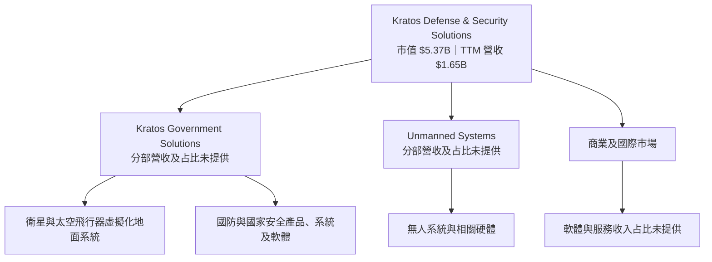
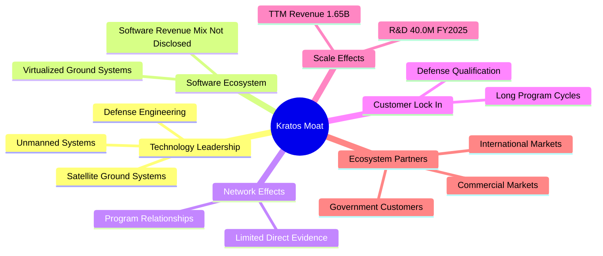
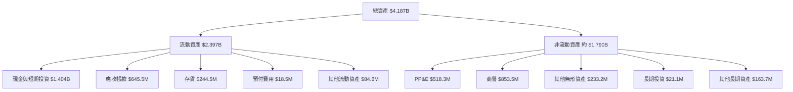
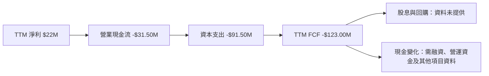
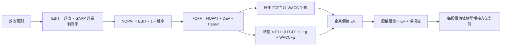
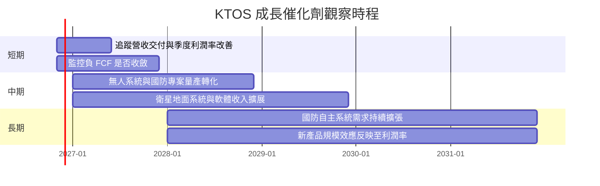
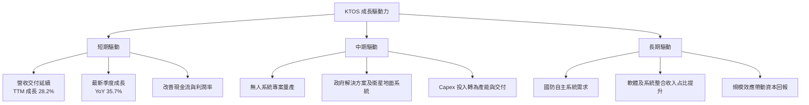
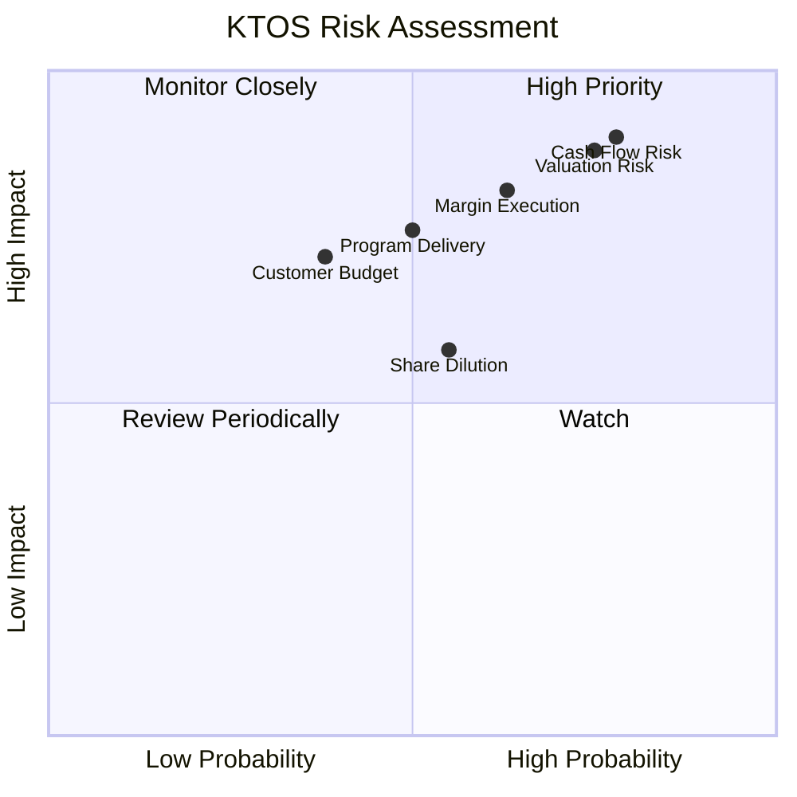
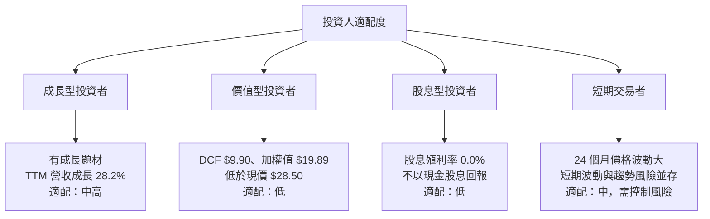

# KTOS 基本面深度分析報告
> **報告日期**：2026-11-24 ｜ **語言**：繁體中文 ｜ **數據來源**：SEC 申報資料 (XBRL)、Yahoo Finance、Finviz、StockAnalysis、Roic.ai ｜ **分析師**：CFA 級機構研究

## 目錄

| # | 章節 | 核心結論 |
|---|------|----------|
| 1 | 執行摘要 | 賣出；加權合理價值 $19.89；MOS -43.3% |
| 2 | 公司概覽與商業模式 | 無人系統及國防科技具成長潛力，但市場份額資料未提供 |
| 3 | 損益表深度分析 | TTM 營收 $1.65B、年增 28.2%；獲利率薄且最新一季營業虧損 |
| 4 | 資產負債表分析 | 現金及短期投資 $1.40B；流動性充足，營運資金仍需監控 |
| 5 | 現金流量深度分析 | TTM FCF -$123.00M，資本支出高於營業現金流 |
| 6 | 獲利能力與資本效率 | ROIC 0.2% 低於 WACC 10.14%，目前未創造經濟價值 |
| 7 | 相對估值分析 | 公司倍數高於同業中位數，市場估值仍有下修風險 |
| 8 | DCF 內在價值評估 | DCF 基準價值 $9.90；估值高度依賴終值與長期成長假設 |
| 9 | 成長催化劑 | 國防無人化、衛星地面系統與自主系統提供成長機會；TAM 數據未提供 |
| 10 | 風險矩陣 | 獲利及現金流轉化、估值回落、執行與資本投入為主要風險 |
| 11 | 投資建議 | 現價高於加權合理價值；等待價格或基本面改善再評估 |

## 1. 執行摘要

KTOS 於 **2026-11-23 收盤價 $28.50**，TTM 營收 $1.65B、TTM 營收年增 28.2%，最新一季營收年增 35.7%；但 TTM 營業利益率僅 0.4%、ROIC 0.2%，低於 WACC 10.14%，且 TTM FCF 為 -$123.00M。DCF 基準價值為 $9.90，三種估值方法加權後合理價值為 $19.89，按規則 20 計算 MOS 為 -43.3%，因此評級為 **賣出**。此結論主要反映現價估值與獲利、自由現金流之間的落差；公司業務成長仍是正面因素，但目前尚未轉化為足以支撐市場價格的回報。

### 1.0 一頁式投資儀表板（Portfolio Manager 30 秒速讀）

| 項目 | 內容 |
|------|------|
| **投資論點（3 句）** | ① TTM 營收年增 28.2%、最新一季年增 35.7%，反映需求及交付持續擴張。② 現金及短期投資 $1.40B，流動性提供擴產與產品開發緩衝。③ ROIC 0.2%、TTM FCF -$123.00M，成長尚未轉化為經濟回報及正現金流。 |
| **綜合評分** | **5.3/10**（引用 1.1） |
| **財務健康** | 🟡 現金及短期投資 $1.40B、流動比率 5.418；但 FCF 為負，總債務於核心財務數據中為 N/A。 |
| **ROIC vs WACC** | **0.2% vs 10.14%**；目前資本回報低於資本成本，屬於摧毀股東價值。 |
| **FCF 趨勢** | TTM FCF -$123.00M；FCF Yield **-2.29%**。 |
| **估值** | Forward P/E 25.54x｜EV/EBITDA 46.79x（財務數據估值欄）｜FCF Yield -2.29%。 |
| **DCF 內在價值（基準）** | **$9.90**｜現價相對 DCF 基準溢價 **187.9%**（即折溢價 +187.9%，依第 8.5 節）。 |
| **安全邊際（MOS）** | **-43.3%**＝($19.89 − $28.50) ÷ $19.89；🔴 無安全邊際。分母為 8.8 加權合理價值。 |
| **預期報酬（基準情境 12M）** | DCF 基準情境相對現價 **-65.3%**；非 12 個月價格預測，僅作模型情境參考。 |
| **關鍵風險（前二）** | TTM FCF 持續為負；TTM 營業利益率與 ROIC 過低，現價估值對未來獲利改善依賴高。 |
| **評級 + 信心度** | 🔴 **賣出**｜信心：中。評級由 MOS 門檻決定，模型與財務數據存在精度及來源口徑限制。 |

> **折溢價與 MOS 的口徑**：折溢價以 DCF 基準價值 $9.90 為分母；MOS 以 8.8 的加權合理價值 $19.89 為分母。兩者不是同一指標。

### 1.1 綜合評分卡（全報告唯一）

| 維度 | 評分（1–10） | 主要依據（引用數字與其來源章節） |
|------|--------------|----------------------------------|
| 成長性 | 8.0 | TTM 營收成長 28.2%、最新一季年增 35.7%（第 3 章）；成長有量，但尚未證明能穩定轉成現金。 |
| 獲利能力 | 2.5 | TTM 營業利益率 0.4%、ROIC 0.2% 對比 WACC 10.14%；F-Score 3/8（第 6 章）。 |
| 財務健康 | 8.0 | 現金及短期投資 $1.40B、流動比率 5.418；CCC 80 天（第 4 章）。總債務資料有來源差異，降低確定性。 |
| 估值 | 2.0 | MOS -43.3%；Forward P/E 25.54x，高於三家同業 Forward P/E 中位數 18.1x（第 7–8 章）。 |
| 護城河 | 7.0 | 國防客戶、無人系統、衛星地面系統等業務具技術與認證門檻；但缺少分部營收與市場份額資料（第 2 章）。 |
| 管理層與資本配置 | 4.0 | 股權薪酬 TTM 約 $58.5M、約占 TTM 營收 3.6%；稀釋股數未通過 F-Score 測試，TTM FCF 為負。 |
| **綜合評分** | **5.3** | 六項算術平均：$(8.0+2.5+8.0+2.0+7.0+4.0)÷6=5.25$，四捨五入至一位小數為 **5.3**。 |

### 1.2 五大投資論點 + 三大核心風險

| 類型 | 項目 | 具體依據 | 信心度 |
|------|------|----------|--------|
| 🟢 **投資論點①** | 營收增長具動能 | TTM 營收 $1.65B、年增 28.2%；最新一季營收 $471.8M、年增 35.7%。 | 🟢 高 |
| 🟢 **投資論點②** | 國防無人化需求提供長期空間 | 公司業務包括無人系統與政府解決方案；產業需求具長期支持，但公司未提供可引用 TAM 或分部占比。 | 🟡 中 |
| 🟢 **投資論點③** | 資產負債表現金緩衝充足 | 現金及短期投資 $1.40B；核心數據列示淨現金 $1.40B。 | 🟡 中 |
| 🟢 **投資論點④** | 最新季度營收加速 | Q3 2026 營收較 Q2 2026 增加約 2.8%，年增 35.7%；能否持續需看訂單交付與毛利轉化。 | 🟡 中 |
| 🟢 **投資論點⑤** | 歷史營收連續成長 | FY2022–FY2025 營收由 $898.3M 增至 $1.347B，三年 CAGR 約 14.5%。 | 🟢 高 |
| 🟡 **風險①** | 高成長未轉成自由現金流 | TTM OCF -$31.50M、Capex $91.50M，TTM FCF -$123.00M；擴張若持續需依靠現金儲備或融資。 | 🔴 高 |
| 🔴 **風險②** | 估值對利潤率躍升要求過高 | DCF 基準價值 $9.90，現價 $28.50；ROIC 0.2% 對比 WACC 10.14%。 | 🔴 高 |
| 🟡 **風險③** | 資本支出及稀釋壓力 | TTM Capex $91.50M；最新四季股權薪酬合計約 $58.5M，F-Score 稀釋股數測試未通過。 | 🟡 中 |

### 1.3 快速統計卡片

| 指標 | 公司實際值（期間） | 同業中位數 | 狀態 |
|------|--------------------|------------|------|
| 營收成長（TTM） | **28.2%** | — | 🟢 |
| 營收成長（最新一季年增） | **35.7%** | 6.7% | 🟢 |
| 毛利率（TTM） | **23.0%** | 20.0% | 🟢 |
| 營業利益率（TTM） | **0.4%** | — | 🔴 |
| ROIC（TTM） | **0.2%** | — | 🔴 |
| Forward P/E | **25.54x** | 18.1x | 🔴 |
| FCF Yield（TTM） | **-2.29%** | — | 🔴 |
| Piotroski F-Score | **3 / 8** | — | 🔴 |

> 同業中位數依 AVAV、LMT、NOC 的 Peer multiples 計算。公司營業利益率採核心財務數據所列 TTM 0.4%；其他資料來源的營業利益率口徑不一致，詳見第 3 章。

### 1.4 投資結論

```text
╔══════════════════════════════════════════════════════════════════╗
║                    📊 投資結論摘要                               ║
╠══════════════════════════════════════════════════════════════════╣
║  評級：賣出（MOS -43.3%，依規則 20）                             ║
║  價格（2026-11-23 收盤）：$28.50                                 ║
║  DCF 內在價值（基準）：$9.90（折溢價 +187.9%）                  ║
║  安全邊際 MOS：-43.3%（＝($19.89−$28.50)÷$19.89）               ║
║  加權合理價值（8.8）：$19.89                                     ║
║  DCF 情境價值：                                                   ║
║    悲觀情境：$8.21（-71.2%）                                     ║
║    基準情境：$9.90（-65.3%）                                     ║
║    樂觀情境：$13.76（-51.7%）                                    ║
║  綜合評分：5.3/10（引用 1.1）                                    ║
║  適合投資人：能承受高波動、願意追蹤國防科技成長的投資人；        ║
║              不適合以估值折價或現金回報為主要要求者。            ║
╚══════════════════════════════════════════════════════════════════╝
```

## 2. 公司概覽與商業模式

### 2.1 業務結構與收入來源

公司概覽描述 Kratos Defense & Security Solutions 提供國防、國家安全與商業市場的技術、硬體、產品、系統及軟體，營運分為 Kratos Government Solutions 與 Unmanned Systems。資料未提供分部營收或占比，因此不臆造各板塊金額與比例。



### 2.2 市場份額

市場份額數據未提供，亦無可引用的市場規模或年份資料，因此不繪製市場份額圖。KTOS TTM 營收 $1.65B、年增 28.2%，增長速度高於 Peer multiples 所列 AVAV、LMT、NOC 最新一季營收年增率；但不能據此推定其市場份額或競爭排名。

### 2.3 競爭護城河分析



### 2.4 護城河強度

| 護城河項目 | 強度（強／中／弱） | 證據（引用數字或事實） | 會削弱它的情況 |
|------------|--------------------|------------------------|----------------|
| 技術與產品 | 中 | 業務涵蓋無人系統、衛星地面系統及國防軟硬體；FY2025 研發費用 $40.0M。 | 競品追平技術、產品未能取得計畫採用或量產。 |
| 軟體生態系統 | 中 | 公司提供虛擬化地面系統及軟體；軟體收入占比未提供。 | 軟體收入未形成可重複、高毛利的服務收入。 |
| 網路效應 | 弱 | 未提供網路效應、使用者數或平台互通資料。 | 平台未形成使用者或資料累積優勢。 |
| 客戶鎖定 | 中 | 國防計畫及資格認證可能形成轉換障礙；具體合約期限、續約率未提供。 | 主要計畫取消、預算轉移或採購規格變更。 |
| 規模效應 | 中 | TTM 營收 $1.65B；但 TTM 營業利益率僅 0.4%，規模尚未顯著反映於利潤。 | 營收增長但成本、Capex 同步上升，未出現營業槓桿。 |
| 生態夥伴 | 弱至中 | 面向政府、國防及國際市場；合作夥伴與收入占比未提供。 | 對單一客戶、供應商或合作體系依賴度提高。 |

1.1「護城河」評分為 **7.0/10**，主要依據國防產品、無人系統及相關軟體帶來的技術與採購門檻；缺少分部占比、合約續約率及市場份額證據，限制了評分的確定性。

## 3. 損益表深度分析

### 3.1 年度收入成長趨勢（近 4 年）

| 財年 | 營收 | YoY 成長 | 評估 |
|------|------|----------|------|
| FY2022 | $898.30M | +10.70% | 🟡 |
| FY2023 | $1.037B | +15.45% | 🟢 |
| FY2024 | $1.136B | +9.56% | 🟡 |
| FY2025 | $1.347B | +18.52% | 🟢 |

```text
╔══════════════════════════════════════════════════════════════════╗
║           Kratos Defense 年度收入趨勢（FY2022-FY2025）           ║
╠══════════════════════════════════════════════════════════════════╣
║  FY2022  $0.898B  ██████████████░░░░░░░░░░  YoY +10.70%  🟡    ║
║  FY2023  $1.037B  █████████████████░░░░░░░  YoY +15.45%  🟢    ║
║  FY2024  $1.136B  ███████████████████░░░░░  YoY +9.56%   🟡    ║
║  FY2025  $1.347B  ████████████████████████  YoY +18.52%  🟢    ║
║                                                                  ║
║  FY2022-FY2025 三年 CAGR：約 14.5%                               ║
╚══════════════════════════════════════════════════════════════════╝
```

三年 CAGR 算式：$(1.347÷0.8983)^{1/3}-1≈14.5\%$。FY2025 增長加快，與當年度營收增量 $211M 相符；若新計畫持續交付，營收基礎擴大可支持後續增長，但毛利率未同步大幅提升，暫不能等同獲利能力改善。

### 3.2 季度收入趨勢分析

| 季度 | 營收 | QoQ 成長 | YoY 成長 | 備註 |
|------|------|----------|----------|------|
| Q4 2025 | $345.1M | -0.72% | 21.90% | 對比 Q3 2025 的 $347.6M，季減；年增仍高。 |
| Q1 2026 | $371.0M | +7.50% | 22.60% | 營收回升。 |
| Q2 2026 | $458.8M | +23.67% | 30.53% | 季增較快，可能反映交付時點與專案組合。 |
| Q3 2026 | $471.8M | +2.83% | 35.73% | YoY 加速，但 QoQ 增速低於 Q2；季度收入具交付波動性。 |

QoQ 以本季營收除以前季營收減一計算；YoY 採同季度資料。Q3 2026 營收較 Q3 2025 的 $347.6M 增加約 $124.2M，意味增長動能仍在，但高基期下需追蹤後續季度年增率與營業利潤率。

### 3.3 利潤率演變分析

| 利潤率指標 | FY2022 | FY2023 | FY2024 | FY2025 | 趨勢 | 評估 |
|------------|--------|--------|--------|--------|------|------|
| **毛利率** | 25.2% | 25.9% | 25.3% | 22.9% | FY2025 下滑約 2.4 個百分點 | 🔴 |
| **營業利益率** | 0.5% | 3.0% | 2.6% | 2.1% | FY2023 高點後下滑 | 🟡 |
| **淨利率** | -4.1% | -0.9% | 1.4% | 1.6% | 由虧轉盈 | 🟡 |

年度利潤率依年度損益表的營收、毛利、營業利益與淨利計算。例如 FY2025 毛利率 = $307.9M ÷ $1.347B = 22.9%；營業利益率 = $27.7M ÷ $1.347B = 2.1%。

TTM 核心數據顯示營業利益率 0.4%，最新一季營業利益率 -1.0%；另一彙整數據列有 TTM 0.7%、最新一季 0.8%。由於口徑不一致，本報告執行摘要與估值採核心財務數據的 **TTM 0.4%、最新一季 -1.0%**，不混用其他來源。年度毛利率於 FY2025 下滑，可能與產品組合、專案成本或交付結構相關；資料未提供分部毛利，因此不能定量拆解成因。最新一季營業虧損顯示營收擴張尚未形成穩定營業槓桿。

### 3.4 費用結構分析

資料提供年度研發費用，但未提供可完整相加、口徑一致的成本與費用明細；因此不繪製費用占比圓餅圖，以免產生未有來源的比例。FY2025 研發費用為 $40.0M，約占當年營收 3.0%（$40.0M ÷ $1.347B）；其餘費用項目及股權薪酬的損益表分類未提供。

### 3.5 季度 EPS 趨勢與盈餘品質（Quality of Earnings）

| 季度 | 淨利 | EPS 實際 | EPS 預估 | 超預期／不及預期 |
|------|------|----------|----------|------------------|
| Q4 2025 | $5.9M | $0.03 | N/A | N/A：估計值與驚喜幅度未提供 |
| Q1 2026 | $11.9M | $0.07 | N/A | N/A：估計值與驚喜幅度未提供 |
| Q2 2026 | $4.4M | $0.02 | N/A | N/A：估計值與驚喜幅度未提供 |
| Q3 2026 | -$0.2M | 約 -$0.00 | N/A | N/A：估計值與驚喜幅度未提供 |

EPS surprise 資料中估計值與實際值均為缺漏，因此不能判定過去四季超預期或不及預期。季度淨利由 Q1 2026 的 $11.9M 降至 Q3 的 -$0.2M；收入成長並未帶來單季獲利持續上升，部分原因可能是成本及專案時點，但現有資料不足以歸因。

| 盈餘品質項目 | 數值／佔比 | 評估 |
|--------------|-----------|------|
| 股權薪酬 SBC / 營收 | 約 $58.5M ÷ $1.647B = **3.6%** | 🔴 對股東有實質稀釋成本；TTM SBC 以最近四季季度數字加總。 |
| SBC / 營業現金流 | 約 $58.5M ÷ -$31.50M = **-185.7%** | 🔴 OCF 為負，該比例不適合當作正向轉換指標，但顯示 SBC 規模大於營業現金流絕對值。 |
| FCF / 淨利（現金轉換率） | -$123.00M ÷ $22.00M = **-559.1%** | 🔴 會計獲利未轉化為自由現金流。 |
| 一次性／非經常性損益 | N/A（資料未提供可辨識明細） | 無法判斷是否有一次性項目顯著影響盈餘。 |
| 有效稅率異常 | N/A（有效稅率資料未提供） | 不判定稅務利益是否帶動獲利。 |
| 資本化支出 vs 費用化 | TTM Capex $91.50M；資本化項目拆分 N/A | 資本支出金額可觀，但無法據此判斷有無不當資本化或遞延費用。 |

**盈餘品質結論**：TTM 淨利 $22M 為正，但 OCF -$31.50M、FCF -$123.00M，FCF/淨利為 -559.1%，現金獲利品質偏弱。股權薪酬約占營收 3.6%，且股數稀釋測試未通過，股東回報應考慮稀釋成本。故估值不宜只依據 EPS 成長，應更重視現金流轉正與利潤率改善。

## 4. 資產負債表分析

### 4.1 資產結構分解

以下採 TTM 資產資料，總資產 $4.187B；各細項按報表列示，金額合計因四捨五入可能略有差異。



### 4.2 流動性與營運資金分析

| 流動性指標 | 最新值 | 歷史參考 | 評估 |
|------------|--------|----------|------|
| 流動比率 | 5.418 | FY2025 以流動資產 $1.26B ÷ 流動負債 $311.0M 約為 4.05 | 🟢 流動資產覆蓋短期負債能力充足。 |
| 速動比率 | 4.632 | N/A（同口徑歷史值未提供） | 🟢 現金、應收等速動資產提供流動性緩衝。 |
| 現金及短期投資 | $1.40B | FY2025 現金 $560.6M | 🟢 現金儲備明顯增加；營業現金流仍為負，需觀察消耗速度。 |

營運資金天數依 QUALITY FIGURES 原值列示：

| 指標 | 最新 TTM | 一年前 TTM | 變化 | 解讀 |
|------|----------|------------|------|------|
| DSO 應收帳款天數 | 42 天 | 39 天 | +3 天 | 收款週期略拉長，可能反映客戶結算或營收結構變化；應收帳款升至 $645.5M。 |
| DIO 存貨天數 | 70 天 | 66 天 | +4 天 | 存貨周轉稍慢，須確認增庫存是否配合已確認的訂單與交付。 |
| DPO 應付帳款天數 | 32 天 | 24 天 | +8 天 | 延長供應商付款期可緩和現金壓力，但不能單獨視為議價能力提升。 |
| CCC 現金轉換週期 | 80 天 | 81 天 | -1 天 | CCC 小幅改善，主要受 DPO 拉長抵銷 DSO、DIO 上升影響。 |

### 4.3 債務結構分析

核心財務數據將總債務列為 N/A、淨現金列為 $1.40B；其他市場資料另列總債務 $246.0M、淨現金 $1.16B。因債務口徑存在差異，本節以核心數據原值呈列，不能反推或補算缺失債務。亦不計算 Debt/EBITDA 或利息保障倍數，因總債務及利息費用細項不足以一致驗證。

```text
╔══════════════════════════════════════════════════════════════════╗
║                 Kratos Defense 債務健康診斷                      ║
╠══════════════════════════════════════════════════════════════════╣
║  總債務：        N/A       核心財務數據未提供                     ║
║  現金+短期投資： $1.40B    提供流動性緩衝                         ║
║  淨現金：        $1.40B    依核心財務數據原值                     ║
║                                                                  ║
║  Debt/EBITDA：   N/A       總債務資料不可用                        ║
║  Interest Coverage：N/A    利息費用及一致口徑資料未提供            ║
║  債務資料註記：另有資料列債務 $246.0M、淨現金 $1.16B；未混用。     ║
╚══════════════════════════════════════════════════════════════════╝
```

### 4.4 股東權益趨勢

| 財年 | 股東權益 | YoY 變化 | 說明 |
|------|----------|----------|------|
| FY2022 | $936.3M | — | 基期。 |
| FY2023 | $976.0M | +4.2% | 緩步增加。 |
| FY2024 | $1.350B | +38.3% | 股東權益擴大；增幅不宜直接等同營運獲利。 |
| FY2025 | $2.000B | +48.1% | 權益規模大幅上升，伴隨股數稀釋測試未通過；應進一步核對股權發行與其他權益變動。 |

```text
╔══════════════════════════════════════════════════════════════════╗
║                股東權益趨勢（FY2022-FY2025）                     ║
╠══════════════════════════════════════════════════════════════════╣
║  FY2022  $0.936B  ███████████                                    ║
║  FY2023  $0.976B  ████████████                                   ║
║  FY2024  $1.350B  █████████████████                              ║
║  FY2025  $2.000B  █████████████████████████                      ║
╚══════════════════════════════════════════════════════════════════╝
```

## 5. 現金流量深度分析

### 5.1 現金流量瀑布圖

最新可引用 TTM 淨利 $22M；營業現金流 -$31.50M，資本支出 $91.50M，FCF -$123.00M。資料未提供 TTM 股息或回購金額，亦不把年度資本配置項目推定為最新 TTM。



### 5.2 FCF 轉換率趨勢

| 財年 | FCF | 淨利 | FCF / 淨利 | 趨勢解讀 |
|------|-----|------|------------|----------|
| FY2022 | -$71.1M | -$36.9M | 192.7% | 負淨利下比例方向性有限，現金流仍為負。 |
| FY2023 | $12.8M | -$8.9M | -143.8% | FCF 轉正但淨利仍虧損，比率不宜作常態轉換率。 |
| FY2024 | -$8.5M | $16.3M | -52.1% | 獲利未轉成正 FCF。 |
| FY2025 | -$137.4M | $22.0M | -624.5% | FCF 明顯低於會計淨利，投資支出與營運資金需求需追蹤。 |

上述年度 FCF/淨利由年度 FCF 與淨利直接計算；年度 OCF 顯示為缺漏，故不以 FCF 反推 OCF 或資本支出。

### 5.3 自由現金流趨勢

| 期間 | FCF | FCF Yield |
|------|-----|-----------|
| FY2022 | -$71.1M | N/A |
| FY2023 | $12.8M | N/A |
| FY2024 | -$8.5M | N/A |
| FY2025 | -$137.4M | N/A |
| TTM | **-$123.00M** | **-2.29%** |

```text
╔══════════════════════════════════════════════════════════════════╗
║              自由現金流趨勢（歷史年度及 TTM）                    ║
╠══════════════════════════════════════════════════════════════════╣
║  FY2022  -$71.1M   ◀█████████████░░░░░░░░░░░░                    ║
║  FY2023   $12.8M   ███                                            ║
║  FY2024   -$8.5M   ◀██                                            ║
║  FY2025 -$137.4M   ◀████████████████████████                     ║
║  TTM     -$123.0M  ◀██████████████████████                       ║
║                                                                  ║
║  TTM FCF Yield：-2.29%｜負值代表現金流收益率為負                 ║
╚══════════════════════════════════════════════════════════════════╝
```

### 5.4 資本配置評估

資料未提供完整 TTM 股息、回購及投資支出分類，故不繪製資本配置圓餅圖。已知 FY2025 Capex 為 $95.3M，TTM Capex 為 $91.50M；TTM 現金流仍為負，且沒有股息支付。資本配置的重點應是提升既有產能利用率、改善營運現金流，以及確認新增投資能否轉成可持續利潤，而非只看營收擴張。

## 6. 獲利能力與資本效率

### 6.1 ROE / ROA / ROIC 趨勢

| 指標 | FY2022 | FY2023 | FY2024 | FY2025／TTM | 評估 |
|------|--------|--------|--------|-------------|------|
| ROE | N/A | N/A | N/A | TTM 0.6%（品質數據） | 🟡 回報很低；此數值與另一彙整值 0.8% 不同，採 QUALITY FIGURES 原值。 |
| ROA | N/A | N/A | N/A | TTM 0.2% | 🔴 資產獲利能力低。 |
| ROIC | N/A | N/A | N/A | TTM 0.2% | 🔴 顯著低於 WACC 10.14%。 |

可比歷史年度 ROIC、ROA、ROE 序列未提供，亦不填入無來源的行業均值。FY2025 淨利 $22.0M、總資產 $2.47B；TTM 資產基礎已增至 $4.187B，資產增加若未帶來相應營業利潤，會壓低資本回報。

### 6.2 ROIC vs WACC 分析（核心價值創造判斷）

```text
╔══════════════════════════════════════════════════════════════════╗
║                ROIC vs WACC 深度分析                            ║
╠══════════════════════════════════════════════════════════════════╣
║  WACC（程式計算原值）：10.14%                                   ║
║  ├── 無風險利率（10Y 美債）：4.92%                              ║
║  ├── 市場風險溢酬 ERP：5.00%                                    ║
║  ├── 原始 Beta：1.17；調整 Beta：1.11                           ║
║  ├── 股權成本 Ke：10.47%                                        ║
║  ├── 稅前債務成本：3.90%；稅率：21.0%                           ║
║  ├── 股權／債務權重：95.6%／4.4%                                ║
║  └── WACC：10.14%                                               ║
║                                                                  ║
║  ROIC（TTM，核心財務數據）：0.2%                                ║
║  經濟價值差額：ROIC − WACC = 0.2% − 10.14% = -9.94 個百分點     ║
║                                                                  ║
║  ROIC  0.2%    ░░░░░░░░░░░░░░░░░░░░░░░░░░░░░░░░                ║
║  WACC 10.14%   ▓▓▓▓▓▓▓▓▓▓▓▓▓▓▓▓▓▓▓▓▓▓▓▓▓▓▓▓▓▓▓▓                ║
║                                                                  ║
║  結論：ROIC 低於 WACC，依目前 TTM 資料尚未創造經濟價值。       ║
╚══════════════════════════════════════════════════════════════════╝
```

依 CAPM，Ke = 4.92% + 1.11 × 5.00% = 10.47%（財務數據已採調整 Beta）；WACC 直接採程式計算的 10.14%，不另建 WACC。以顯示的已四捨五入輸入驗算，$95.6\%×10.47\%+4.4\%×3.90\%×(1−21.0\%)≈10.15\%$；與採用值相差約 0.01 個百分點，屬於未四捨五入底層輸入造成的差異。ROIC 0.2% 比 WACC 低 9.94 個百分點，若此差距持續，新增資本投入會降低而非提升企業經濟價值。

### 6.3 杜邦三因素分解

| 因素 | 數值（TTM） | 解讀 |
|------|-------------|------|
| 淨利率 | 1.3% | 正淨利率但幅度薄，獲利對成本變動敏感。 |
| 資產週轉率 | 0.39 | 資產每年產生約 0.39 倍營收；資產擴大未同步反映在資本回報。 |
| 權益乘數 | 1.21 | 槓桿程度不高，ROE 並非主要由財務槓桿撐起。 |
| **ROE** | **0.6%** | QUALITY FIGURES 原值：1.3% × 0.39 × 1.21 = 約 0.6%。 |

### 6.4 財務體質：Piotroski F-Score

Piotroski F-Score 為 **3/8**；九項中一項因輸入缺失無法判定，分母依原資料為 8。結果表照抄 QUALITY FIGURES。

| 測試 | 結果 | 解讀 |
|------|------|------|
| ROA > 0 | ✅ 通過 | TTM 資產報酬為正，但僅 0.2%。 |
| 營業現金流 > 0 | ❌ 未通過 | TTM OCF -$31.50M，內部現金產生能力偏弱。 |
| ROA 高於一年前 | ❌ 未通過 | 資產回報未改善。 |
| 營業現金流 > 淨利（應計品質） | ❌ 未通過 | OCF 未覆蓋淨利，現金盈餘品質弱。 |
| 長期負債 ÷ 總資產低於一年前 | — 無法判定 | 缺少所需的可比負債輸入。 |
| 流動比率高於一年前 | ✅ 通過 | 流動性指標改善。 |
| 稀釋股數未增加 | ❌ 未通過 | 股東持份受到稀釋壓力，需留意 SBC 與股權發行。 |
| 毛利率高於一年前 | ✅ 通過 | 該項測試通過；但 FY2025 年度毛利率較 FY2024 下滑，期間口徑不同。 |
| 資產週轉率高於一年前 | ❌ 未通過 | 新增資產尚未轉化成較高營收效率。 |

## 7. 相對估值分析

### 7.1 同業估值比較表格

同業倍數採 Peer multiples 原值。KTOS 的 P/E、P/S 與 EV/EBITDA 採市場估值資料；Forward P/E 的市場欄為 25.54x，歷史估值資料亦提供 P/E TTM 237.5x。

| 估值指標 | **KTOS** | **AVAV** | **LMT** | **NOC** | KTOS 評估 |
|----------|----------|---------|---------|---------|-----------|
| **Trailing P/E** | 237.5x | N/A | 20.1x | 17.1x | 🔴 KTOS 盈餘基數很低，倍數不宜單獨解讀。 |
| **Forward P/E** | 25.54x | 20.6x | 17.2x | 18.1x | 🔴 高於同業中位數 18.1x。 |
| **P/S Ratio** | 3.26x | 2.3x | 1.7x | 1.8x | 🔴 高於同業；市場預先反映成長。 |
| **EV/EBITDA** | 46.79x | 22.2x | 14.9x | 12.4x | 🔴 高於同業中位數 14.9x；利潤尚未支撐倍數。 |
| 最新一季營收年增 | 35.7% | 5.7% | 11.3% | 6.7% | 🟢 KTOS 成長速度較快，但增長品質仍須以現金流檢驗。 |
| TTM 毛利率 | 23.0% | 26.5% | 11.7% | 20.0% | 🟡 位於同業區間，略低於 AVAV。 |

不同來源的 KTOS EV/EBITDA 有 46.79x 與歷史資料區塊 47.7x 兩種呈現；前者用於本表，後者為自身五年歷史區塊原值，並列而不混算。

### 7.2 歷史估值區間分析

```text
╔══════════════════════════════════════════════════════════════════╗
║             KTOS 五年估值區間（TTM 倍數）                       ║
╠══════════════════════════════════════════════════════════════════╣
║  P/E：       當前 237.5x｜中位數 380.2x｜百分位 18%              ║
║              區間 232.9x – 10595348627336923136.0x               ║
║              ⚠️ 極端上限顯示歷史 P/E 分母可能接近零或異常。       ║
║                                                                  ║
║  P/S：       當前 3.3x｜中位數 3.2x｜百分位 60%                   ║
║              區間 1.3x – 11.6x                                   ║
║                                                                  ║
║  EV/EBITDA： 當前 47.7x｜中位數 55.5x｜百分位 35%                ║
║              區間 33.8x – 221.5x                                 ║
╚══════════════════════════════════════════════════════════════════╝
```

P/E 當前值處於自身歷史百分位 18%，但由於歷史高值極端且盈利基數小，該百分位的可比性有限。P/S 3.3x 略高於歷史中位數 3.2x，EV/EBITDA 47.7x 雖低於自身中位數 55.5x，仍遠高於同業中位數 14.9x，顯示「低於自身歷史」不等於便宜。

### 7.3 情境價值（Bear / Base / Bull，照抄 DCF MODEL 的 Scenarios）

| 情境 | 第 1 年營收成長 | 期末營業利潤率 | WACC | 每股價值 | 相對現價 | 機率 | 會發生的條件 |
|------|----------------|----------------|------|----------|----------|------|--------------|
| 🔴 悲觀 | 14.1% | 1.6% | 11.14% | $8.21 | -71.2% | 25% | 專案交付放緩、成本高企，且資本成本上升。 |
| 🟡 基準 | 28.2% | 1.9% | 10.14% | $9.90 | -65.3% | 50% | 延續近期 TTM 營收成長，但長期利潤率只回到近五年中位水平。 |
| 🟢 樂觀 | 42.3% | 2.1% | 9.14% | $13.76 | -51.7% | 25% | 高增長持續且毛利、營業槓桿改善，折現率下降。 |

上述情境的每股價值與機率直接採模型情境原值。逐年情境營收、FCFF 及情境內終值明細未提供，故不推造中間結果；情境價格不是可獨立重算的完整模型表。

### 7.4 相對估值隱含價格區間

```text
╔══════════════════════════════════════════════════════════════════╗
║              估值方法隱含每股價值（USD）                        ║
╠══════════════════════════════════════════════════════════════════╣
║  $9.90        $14.04        $20.20          $28.50               ║
║  DCF 基準     EV/EBITDA     Forward P/E      現價                 ║
║  ────────────────────────────────────────────────────────────    ║
║  分析師共識目標價：$73.69（26 位分析師平均）                     ║
╚══════════════════════════════════════════════════════════════════╝
```

- 同業 Forward P/E：同業中位數 18.1x × KTOS Forward EPS $1.12 = 每股 $20.20（採估值方法區塊原值）。
- 同業 EV/EBITDA：同業中位數 14.9x × TTM EBITDA，再加回淨現金，回推每股 $14.04（原方法區塊值；不自行反推 EBITDA 或橋接項目）。
- DCF 基準：$9.90。
- 分析師共識平均目標價：$73.69；屬分析師預期，不等同可驗證的內在現金流價值。

## 8. DCF 內在價值評估（Discounted Cash Flow）

> 本節逐年 FCFF、估值橋接、矩陣及情境價值採模型原值。模型金額以 USD billions 為單位並四捨五入至 0.01；折現因子保留三位小數。由於底層未四捨五入數值未提供，部分算式以表內圓整數字重算會有小幅差異，以下均明示，不以反推數值替換原值。

### 8.0 估值推理鏈（Thinking Logic）

**Step 1 — 價值的主要來源**

KTOS 的價值取決於既有政府解決方案、無人系統與衛星地面系統的營收成長，及該成長能否帶動營業利潤率與現金流改善。分部營收占比未提供，因此無法量化各業務對總營收的貢獻；模型以 TTM 營收 $1.65B 為總體起點。最主導估值的變數是**長期營業利潤率及終值現金流**：基準模型終值現值占 EV 84.4%，表示預測期短期現金流貢獻有限。

**Step 2 — 模型選擇**

| 決策點 | 本報告採用 | 理由（含數字） | 曾考慮但否決 | 否決理由 |
|--------|-----------|----------------|--------------|----------|
| 現金流定義 | FCFF | 模型以 WACC 折現，計算 EV 後再加淨現金；原模型 FCFF = NOPAT + D&A − Capex。 | FCFE | 不符合既有模型設定。 |
| 預測期 N | 10 年 | 模型給定 10 年，營收成長由 28.2% 線性降至 3.0%。 | 5 年 | 會改動程式模型設定，且無資料支持替換。 |
| 終值方法 | Gordon Growth | 原模型使用 3.0% 永續成長率、10.14% WACC。 | 單用退出倍數 | 原 DCF 模型未提供退出倍數終值。 |
| EBIT 基礎 | GAAP | 模型採 GAAP EBIT，SBC 已計入費用。 | 非 GAAP | 模型未提供調整後 EBIT，且可能造成 SBC 遺漏或重複扣除。 |

**Step 3 — 關鍵假設推導鏈**

- **營收成長**：錨點＝TTM vs prior TTM 成長 28.2%，最新一季 YoY 35.7%；調整＝預測第 1 年採 28.2%，再線性降至第 10 年 3.0%，反映高增長需隨基期擴大而正常化；**採用模型值 28.2% 起步、3.0% 終點**；曾考慮延續最新一季 35.7%，但資料沒有證明此單季增速能持續十年。
- **期末營業利潤率**：錨點＝TTM GAAP 營業利益率 0.4%，近四個年度營業利益率約 0.5%–3.0%；調整＝模型以近五財年（含 TTM）中位水準作終點；**採用第 10 年 1.9%**；曾考慮高於 3.0%，但近年年度營業利益率走弱、最新一季為 -1.0%，不足以支持更高值。
- **預測期 N**：錨點＝原 DCF 模型 10 年；調整＝不另改期限，以保留既有營收淡出路徑；**採用 10 年**；曾考慮 5 年，但會縮短成長淡出期且不符合模型原設定。
- **Capex/營收**：錨點＝TTM Capex $91.50M ÷ TTM 營收 $1.65B，約 5.5%，原模型採 5.6%；調整＝逐年降至 5.1%，模型假設 Capex 強度逐步淡化；**採用 5.6% 降至 5.1%**；曾考慮更快降至維持性投資，但目前 FCF 為負，沒有證據支持大幅降低。
- **終值成長率 g**：錨點＝原模型 3.0%，低於 WACC 10.14%；調整＝不超出模型長期成長設定；**採用 3.0%**；曾考慮更高 g，但長期成長率接近折現率會使終值敏感度過高。
- **WACC**：錨點＝Cost of capital 程式計算 10.14%；調整＝不作額外主觀調整；**採用 10.14%**；曾考慮使用其他折現率，但規定直接沿用程式計算值。
- **EBIT 基礎與 SBC**：錨點＝TTM SBC 約 $58.5M，年報 FY2025 SBC $35.5M；調整＝依原模型使用 GAAP EBIT；**採用組合 (A)：GAAP EBIT + 固定股數、年稀釋率 0%**；不採非 GAAP 加回 SBC，避免成本在獲利與股數兩處重複計算。
- **D&A/營收**：錨點＝TTM 4.7%；**採用 4.7% 固定**，原模型未提供調整理由或替代值，亦不另行修改。
- **營運資金變動**：原模型明示 Working capital is not modelled；**採用不建模，沒有 ΔWC 列**。這是模型簡化，不代表營運資金真實需求為零。
- **退出倍數**：原模型使用 Gordon Growth；**採用 Gordon Growth**，未提供退出倍數終值，不另造交叉驗證數字。

**Step 4 — 最脆弱一環**

最脆弱的假設是利潤率與終值現金流：模型終值現值占 EV 84.4%，且 FY+10 營業利益率假設為 1.9%；若增長未能轉成利潤或 Capex 維持高位，估值會進一步下修。

**Step 5 — 計算路徑圖**



### 8.1 模型假設總表（Model Inputs）

| 假設項目 | 採用值 | 依據／來源 | 敏感度 |
|----------|--------|-------------|--------|
| 預測期長度 N | 10 年 | DCF 模型設定；營收成長由 28.2% 淡化至 3.0%。 | 🟡 中 |
| 營收成長路徑 | 第 1 年 28.2% → 第 10 年 3.0% | 起點依 TTM YoY 成長；終點依模型假設，期間線性淡出。 | 🔴 高 |
| 營業利潤率 | 0.4% → 1.9% | 起點依 TTM GAAP 營業利潤率；終點依近五財年中位數的模型設定。 | 🔴 高 |
| 有效稅率 | 21.0% | DCF 模型 default tax rate；公司歷史有效稅率未提供。 | 🟢 低 |
| Capex / 營收 | 5.6% → 5.1% | 模型起點接近 TTM Capex/營收；終點依模型淡化設定。 | 🟡 中 |
| D&A / 營收 | 4.7% | DCF 模型 TTM 比率，固定不變。 | 🟢 低 |
| 營運資金變動 | 不建模 | DCF 模型明示 Working capital is not modelled；沒有 ΔWC 列。 | 🔴 高 |
| EBIT 基礎 | GAAP | 模型採 GAAP EBIT。 | 🟡 中 |
| SBC 處理 | 組合 (A)：GAAP EBIT 已含 SBC，不另扣 SBC | 模型原設定；固定股數，年稀釋率 0%。 | 🟡 中 |
| 稀釋股數 | 固定；年稀釋率 0% | 採模型組合 (A)；模型每股價值依其指定橋接公式計算。 | 🟡 中 |
| 永續成長率 g | 3.0% | DCF 模型原值；低於 WACC 10.14%。 | 🔴 高 |
| 終值方法 | Gordon Growth | DCF 模型以第 10 年 FCFF 計算終值。 | 🔴 高 |
| WACC | 10.14% | Cost of capital 程式計算原值；見 8.2。 | 🔴 高 |

本模型採用 **(A)**：GAAP EBIT 已含 SBC 費用，因此不再減 SBC，且不另計年稀釋率；SBC 影響在模型內計入一次。原模型未納入營運資金變動，故與實際現金轉換週期可能有偏差。

### 8.2 折現率推導（WACC）

```text
╔══════════════════════════════════════════════════════════════════╗
║                    WACC 推導（折現率）                           ║
╠══════════════════════════════════════════════════════════════════╣
║  股權成本 Ke（CAPM）：                                           ║
║  ├── 無風險利率 Rf（10Y 美債）：4.92%                            ║
║  ├── 市場風險溢酬 ERP：5.00%（假設值，採成本資本資料設定）       ║
║  ├── 原始 Beta：1.17；調整後 Beta：1.11                          ║
║  ├── 調整方式：⅔ × 1.17 + ⅓ × 1.00 = 1.11                       ║
║  └── Ke = 4.92% + 1.11 × 5.00% = 10.47%                         ║
║                                                                  ║
║  債務成本：稅前 3.90%；有效稅率 21.0%                            ║
║  稅後 Kd = 3.90% × (1−21.0%) = 3.081%                            ║
║                                                                  ║
║  資本權重：股權 95.6%／債務 4.4%                                 ║
║  採用 WACC：10.14%（程式計算原值）                               ║
╚══════════════════════════════════════════════════════════════════╝
```

Rf 與 ERP 採成本資本資料所列數字；資料未提供 10 年期殖利率觀測日期，因此不另指定日期。未加計額外規模或國別溢酬。核心財務數據的總債務為 N/A，因此下列 WACC 權重直接採程式計算值，不自行用市值或負債重新估算。

**逐步演算與資料限制**

1. **Ke（CAPM）** = 4.92% + 1.11 × 5.00% = **10.47%**。
2. **稅前 Kd** = **3.90%**（Cost of capital 原值）；利息費用及平均計息負債細項未提供，無法獨立重算。
3. **稅後 Kd** = 3.90% × (1 − 21.0%) = **3.081%**。
4. **權重**：E 權重 **95.6%**、D 權重 **4.4%**，合計 100%；但計算權重所用市值與計息負債底層金額未由 WACC 區塊逐項披露，故不反推。
5. **WACC**：依未四捨五入輸入由程式計算為 **10.14%**。以顯示值代入：95.6% × 10.47% + 4.4% × 3.081% = 約 10.15%；0.01 個百分點差異來自顯示值四捨五入，估值採用原值 10.14%。

第 6.2 節與本節一致採用 WACC 10.14%。

### 8.3 逐年自由現金流預測（基準情境）

金額單位：USD billions。原模型不列 ΔWC，採 FCFF = NOPAT + D&A − Capex。

| 年度 | FY+1 | FY+2 | FY+3 | FY+4 | FY+5 | FY+6 | FY+7 | FY+8 | FY+9 | FY+10 |
|------|------|------|------|------|------|------|------|------|------|-------|
| 營收 | 2.11 | 2.65 | 3.24 | 3.88 | 4.54 | 5.19 | 5.78 | 6.28 | 6.64 | 6.84 |
| 營收 YoY | 28.2% | 25.4% | 22.6% | 19.8% | 17.0% | 14.2% | 11.4% | 8.6% | 5.8% | 3.0% |
| 營業利潤率 | 0.4% | 0.6% | 0.7% | 0.9% | 1.1% | 1.2% | 1.4% | 1.6% | 1.7% | 1.9% |
| EBIT（GAAP） | 0.01 | 0.01 | 0.02 | 0.03 | 0.05 | 0.06 | 0.08 | 0.10 | 0.12 | 0.13 |
| − 稅（21.0%） | 0.00 | 0.00 | 0.00 | 0.01 | 0.01 | 0.01 | 0.02 | 0.02 | 0.02 | 0.03 |
| = NOPAT | 0.01 | 0.01 | 0.02 | 0.03 | 0.04 | 0.05 | 0.06 | 0.08 | 0.09 | 0.10 |
| + D&A | 0.10 | 0.12 | 0.15 | 0.18 | 0.21 | 0.24 | 0.27 | 0.29 | 0.31 | 0.32 |
| − Capex | 0.12 | 0.15 | 0.18 | 0.21 | 0.24 | 0.28 | 0.31 | 0.33 | 0.34 | 0.35 |
| **= FCFF** | **-0.01** | **-0.01** | **-0.01** | **-0.00** | **0.01** | **0.02** | **0.03** | **0.04** | **0.06** | **0.07** |
| 折現因子 @10.14% | 0.908 | 0.824 | 0.748 | 0.679 | 0.617 | 0.560 | 0.508 | 0.462 | 0.419 | 0.381 |
| **FCFF 現值 PV** | **-0.01** | **-0.01** | **-0.01** | **-0.00** | **0.00** | **0.01** | **0.01** | **0.02** | **0.02** | **0.03** |

模型提供的預測期 PV 合計為 **$0.07B**。表格中四捨五入後的各年度 PV 直接相加約為 $0.06B；底層未四捨五入數字未提供，約 $0.01B 差異無法從顯示表格完全重建，故保留模型原合計，不用圓整值替換。

**逐步演算（FY+1，依模型表內圓整值示範）**

1. 營收 = TTM 營收 $1.65B × (1 + 28.2%) = $2.1153B，模型列示 **$2.11B**。
2. EBIT = $2.11B × 0.4% = $0.00844B，列示 **$0.01B**。
3. 稅 = $0.00844B × 21.0% = $0.0017724B，列示 **$0.00B**。
4. NOPAT = $0.00844B − $0.0017724B = $0.0066676B，列示 **$0.01B**。
5. D&A = $2.11B × 4.7% = $0.09917B，列示 **$0.10B**。
6. Capex = $2.11B × 5.6% = $0.11816B，列示 **$0.12B**。
7. ΔWC = 未建模，原模型無此列。
8. FCFF = $0.0066676B + $0.09917B − $0.11816B = -$0.0123224B，列示 **-$0.01B**。
9. 折現因子 = 1 ÷ (1 + 10.14%)¹ = 0.908；PV = -$0.0123224B × 0.908 = -$0.01119B，列示 **-$0.01B**。

**合理性自檢**

- 預測 FCF CAGR：FY+1 FCFF 為負、FY+10 為正，故一般 CAGR **無法定義**；年度歷史 FCF 波動亦不適合作單一 CAGR 比較。
- FY+10 FCF 利潤率 = $0.07B ÷ $6.84B 約 **1.0%**；目前 TTM FCF 利潤率 = -$123M ÷ $1.65B 約 **-7.5%**；同業最佳 FCF 利潤率資料未提供，不能比較是否超越同業。
- FY+1 至 FY+4 FCFF 為負，表示初期 Capex 高於 NOPAT 加 D&A；負值會降低預測期現值，但後續轉正的模型假設依賴營收成長與費用率改善。

```text
╔══════════════════════════════════════════════════════════════════╗
║            自由現金流：歷史實際 vs 模型預測                      ║
╠══════════════════════════════════════════════════════════════════╣
║  FY2023(實)   $0.013B   ██░░░░░░░░░░░░░░░░░░░░                  ║
║  FY2024(實)  -$0.009B   ◀█                                       ║
║  FY2025(實)  -$0.137B   ◀████████████████████████                ║
║  FY+1 (預)   -$0.010B   ◀██                                       ║
║  FY+10(預)    $0.070B   ████████████                             ║
╠══════════════════════════════════════════════════════════════════╣
║  歷史 FCF 波動大且 FY2025 為負；模型預測靠後期正 FCF 支撐終值。  ║
╚══════════════════════════════════════════════════════════════════╝
```

### 8.4 終值計算（Terminal Value）

**適用性檢查**：WACC **10.14%** vs g **3.0%** → WACC > g？✅

| 方法 | 計算式 | 終值 TV | TV 現值 | 佔總 EV 比重 |
|------|--------|---------|---------|--------------|
| Gordon Growth | FY+10 FCFF × (1+g) ÷ (WACC − g) | $1.02B | $0.39B | 84.4% |
| 退出倍數法 | N/A（模型未提供退出倍數終值） | N/A | N/A | N/A |

**逐步演算**

1. FY+N 的 FCFF = FY+10 **$0.07B**。
2. 分子 = FCFF × (1 + g)；依表內已四捨五入數字，$0.07B × 1.03 = $0.0721B。
3. 分母 = 10.14% − 3.0% = **7.14%**；用顯示值估算 TV = $0.0721B ÷ 7.14% 約 $1.01B；模型原值 **$1.02B**，差異來自模型使用未四捨五入 FCFF。
4. PV(TV) = 模型 TV $1.02B × FY+10 折現因子 0.381 = 約 $0.39B，模型原值 **$0.39B**。
5. 終值占比 = $0.39B ÷ $0.46B = **84.8%**；模型原值 **84.4%**，差異來自 EV、PV(TV) 顯示精度。模型指出終值占比 84.4%。

模型終值占 EV 超過 75%，因此估值高度依賴終值假設，短期現金流貢獻有限。模型未提供退出倍數法，依規定不另造終值交叉驗證。

### 8.5 企業價值 → 每股內在價值（Bridge）

```text
╔══════════════════════════════════════════════════════════════════╗
║              企業價值 → 每股內在價值 橋接表                      ║
╠══════════════════════════════════════════════════════════════════╣
║  預測期 FCF 現值合計            +$0.07B                           ║
║  終值現值 PV(TV)                +$0.39B                           ║
║  ─────────────────────────────────────────────                  ║
║  = 企業價值 EV                   $0.46B                           ║
║  + 淨現金                       +$1.40B                           ║
║  = 股權價值                      $1.86B                           ║
║  每股價值：模型原值               $9.90                            ║
║  當前股價（2026-11-23 收盤）     $28.50                            ║
║  折溢價（現價÷DCF價值−1）        +187.9%（溢價）                  ║
╚══════════════════════════════════════════════════════════════════╝
```

1. EV = $0.07B + $0.39B = **$0.46B**。
2. 股權價值 = $0.46B + $1.40B 淨現金 = **$1.86B**。模型以淨現金原值作橋接；總債務在核心數據中為 N/A。
3. 每股內在價值依 DCF MODEL 原式：股權價值 × 報價與市值橋接因子 = **$9.90**。公司股數為 188.27M，但模型明確指定以「equity value × price ÷ market cap」計算每股價值；以表格的圓整股權價值及市場資料重新計算會出現精度差異，故引用模型原值。
4. 折溢價 = $28.50 ÷ $9.90 − 1 = **187.9%**。
5. 本節不計算 MOS；MOS 僅在 8.8 以加權合理價值為分母。

股數與 SBC：模型採 GAAP EBIT，股權薪酬已包含於費用，固定股數不另加年稀釋率。每股價值使用 DCF MODEL 指定橋接法；模型底層股數或市值輸入未完整列示，故不改寫其每股結果。

### 8.6 敏感性分析（WACC × 永續成長率）

下表照抄 DCF 模型敏感度矩陣。括號內上行空間以 $28.50 現價計算；中央基準格照模型原值為 $9.90。

| g（列）／WACC（欄） | 8.14% | 9.14% | **10.14%（基準）** | 11.14% | 12.14% |
|-----------|------|------|------------------|-------|-------|
| 2.0% | $10.77（-62.2%） | $10.12（-64.5%） | $9.63（-66.2%） | $9.26（-67.5%） | $8.97（-68.5%） |
| 2.5% | $11.04（-61.3%） | $10.30（-63.9%） | $9.76（-65.8%） | $9.35（-67.2%） | $9.04（-68.3%） |
| 3.0% | $11.36（-60.1%） | $10.51（-63.1%） | **$9.90（-65.3%）** | $9.46（-66.8%） | $9.12（-68.0%） |
| 3.5% | $11.75（-58.8%） | $10.75（-62.3%） | $10.07（-64.7%） | $9.57（-66.4%） | $9.20（-67.7%） |
| 4.0% | $12.23（-57.1%） | $11.05（-61.2%） | $10.26（-64.0%） | $9.71（-65.9%） | $9.30（-67.4%） |

**逐步演算說明**：選格 WACC **9.14% > g 3.0% ✅**。模型敏感度表列該格每股價值 **$10.51**。該格所需新折現因子、逐年 PV 合計及 TV 未在 DCF 模型區塊逐項列示，依「敏感度矩陣照抄、不得另建模型」要求，不自行推造中間值。

**三情境 DCF（照抄模型原值）**

| 情境 | 營收成長假設 | 期末營業利潤率 | g | WACC | 每股內在價值 | 相對現價 | 主觀機率 |
|------|-------------|----------------|---|------|--------------|----------|----------|
| 🔴 悲觀 | 第 1 年 14.1% | 1.6% | N/A（情境區塊未列） | 11.14% | $8.21 | -71.2% | 25% |
| 🟡 基準 | 第 1 年 28.2% | 1.9% | 3.0% | 10.14% | $9.90 | -65.3% | 50% |
| 🟢 樂觀 | 第 1 年 42.3% | 2.1% | N/A（情境區塊未列） | 9.14% | $13.76 | -51.7% | 25% |
| **機率加權** | — | — | — | — | **$10.44** | **-63.4%** | 100% |

情境逐年營收、FY+10 FCFF 與終值的明細未提供，無法逐情境展示完整推導而不另造模型。情境機率加權可驗算：$8.21×25% + $9.90×50% + $13.76×25% = $10.4425，四捨五入為 **$10.44**。

**敏感度結論**

- 永續成長率變動：於 WACC 10.14% 下，g 2.0% 對應 $9.63，g 3.0% 對應 $9.90，g 4.0% 對應 $10.26；g 每 +1 個百分點，價值約增加 $0.27–$0.36，幅度依測試區間而異。
- WACC 每 +1 個百分點：基準 g 3.0% 下，$9.90 降至 $9.46，減少 **$0.44，約 -4.4%**。
- 期末營業利潤率每 +1 個百分點：模型未提供獨立利潤率敏感度表，數值 **N/A**，不另建模型。
- g 與 WACC 的矩陣顯示估值受折現假設影響，但終值占比達 84.4%，因此對 FY+10 現金流及利潤率更敏感；與 8.0 指出的長期利潤率、終值主導判斷一致。

### 8.7 反推 DCF（Reverse DCF：市場在預期什麼）

DCF 模型提供兩個一變數反推結果：年 1 營收成長率 87.4%，或固定營業利潤率 8.6%，才可在其餘基準設定下使 DCF 價值等於現價。模型未提供可重建的固定輸入明細及迭代軌跡，故不補造試算點。

| 求解的變數（一次一個） | 其餘變數設定 | 市場隱含值 | 公司歷史實際／基準 | 判斷 |
|------------------------|--------------|--------------|--------------------|------|
| 年 1 營收成長率 | 其餘基準輸入固定 | **87.4%** | 基準成長 28.2%；最新一季 YoY 35.7% | 🔴 顯著高於目前及基準成長。 |
| 固定營業利潤率 | 其餘基準輸入固定 | **8.6%** | TTM 0.4%；FY2023 年度約 3.0% | 🔴 顯著高於近期及提供的歷史年度水準。 |
| 永續成長率 g | 未提供反推結果 | 未計算 | — | N/A |
| 高成長持續年數 N | 未提供反推結果 | 未計算 | — | N/A |

**迭代軌跡**：模型只提供求解結果，未提供不同 CAGR 試算值、FY+N 營收、FCFF 或每股價值序列；依規定不虛構收斂軌跡。反推結果意味：按該模型架構，要使 $28.50 現價成立，須假設非常高的營收成長或大幅高於近期歷史的持續營業利潤率。由於 87.4% 與 8.6% 均遠高於目前經營表現，現價對長期執行成功的要求偏高。

### 8.8 估值三角驗證與安全邊際

| 估值方法 | 隱含每股價值 | 上行空間（÷現價） | 權重 | 說明 |
|----------|--------------|-------------------|------|------|
| DCF（基準） | $9.90 | -65.3% | 40% | 10 年 FCFF、WACC 10.14%、g 3.0%。 |
| 同業 Forward P/E | $20.20 | -29.1% | 25% | 同業中位數 18.1x × Forward EPS $1.12。 |
| 同業 EV/EBITDA | $14.04 | -50.7% | 25% | 同業中位數 14.9x × TTM EBITDA，再加回淨現金；引用方法區塊原值。 |
| 分析師共識目標價 | $73.69 | +158.6% | 10% | 26 位分析師平均目標價；僅供參考。 |
| **加權合理價值** | **$19.89** | **-30.2%** | **100%** | 估值方法組合對應公司類型 profitable。 |

**加權計算**：$9.90×40% + $20.20×25% + $14.04×25% + $73.69×10% = $3.960 + $5.050 + $3.510 + $7.369 = **$19.889 ≈ $19.89**。權重合計 40% + 25% + 25% + 10% = **100%**。沒有可計算方法被剔除。

**MOS 與上行空間**

- MOS = ($19.89 − $28.50) ÷ $19.89 = -$8.61 ÷ $19.89 = **-43.3%**。
- 上行空間 = ($19.89 − $28.50) ÷ $28.50 = -$8.61 ÷ $28.50 = **-30.2%**。
- DCF 折溢價 = $28.50 ÷ $9.90 − 1 = **+187.9%**。

```text
╔══════════════════════════════════════════════════════════════════╗
║                  估值區間與安全邊際                              ║
╠══════════════════════════════════════════════════════════════════╣
║  $8.21 ─── $9.90 ─── $19.89 ─── $28.50 ─── $73.69              ║
║  悲觀DCF   基準DCF   加權合理值     現價      分析師共識           ║
║                                                                  ║
║  MOS = ($19.89 − $28.50) ÷ $19.89 = -43.3%                      ║
║  上行空間 = ($19.89 − $28.50) ÷ $28.50 = -30.2%                 ║
║                                                                  ║
║  建議買入區間：$0 – $17.90（MOS 至少 10% 的價格上限）            ║
║  合理持有區間：$17.90 – $21.88                                   ║
║  減碼考慮區間：高於 $21.88；現價 $28.50 已高於此區間             ║
╚══════════════════════════════════════════════════════════════════╝
```

價格門檻依加權合理價值 $19.89 計算：MOS ≥ 10% 對應價格上限 $19.89 × 90% = $17.901；MOS = -10% 對應價格 $19.89 × 110% = $21.879。因評級為賣出，不適用「買入評級買入區間上限不得低於現價」條件。

> 🔎 **程式複算（Python，依本節各項自動重算）**
>
> 加權合理價值 = $9.90 × 40% + $20.20 × 25% + $14.04 × 25% + $73.69 × 10% = **$19.89**（權重合計 100%）
>
> 以價格 $28.50 計：MOS = **-43.3%**，上行空間 = **-30.2%**
>
> ✅ 與本節所寫數值一致。

### 8.9 DCF 模型的局限與失效條件

- **終值依賴度**：模型列示終值現值占企業價值 **84.4%**，估值主要取決於 FY+10 以後現金流假設。
- **最脆弱假設**：第 10 年營業利潤率 1.9% 與 g 3.0%。敏感度矩陣中，基準 WACC 下 g 2.0% 時每股 $9.63，g 4.0% 時 $10.26；其他較大幅度的利潤率變動因模型未提供矩陣，無法量化。
- **適用性限制**：TTM FCF -$123.00M，且 FY+1 至 FY+4 模型 FCFF 為負；在高 Capex、營運資金變動未建模的情況下，DCF 可靠度下降。可搭配 EV/Sales、分部估值與專案單位經濟性，但本報告不另建新估值。
- **風險連結**：交付延後會影響營收成長；專案成本超支會壓低營業利潤率；Capex 超出假設會降低 FCFF；資本成本上升會提高 WACC，直接壓低終值現值。
- **價格換算精度**：每股價值按模型指定橋接公式提供，但模型未列未四捨五入股數、市值與完整橋接輸入，限制外部逐分複算。

### 8.10 複算檢核表（Audit Trail）

| # | 檢核項目 | 檢查方式 | 結果 |
|---|----------|----------|------|
| 1 | 所有高／中敏感度輸入都有推導 | 對照 8.0 Step 3；部分模型未提供完整資料，已明示限制。 | ⚠️ 部分受限 |
| 2 | 每個假設都有來歷 | 依模型原值、TTM 或明列資料缺漏。 | ✅ |
| 3 | WACC 算式與 WACC 原值 | 顯示輸入按四捨五入重算約 10.15%，採用程式原值 10.14%。 | ⚠️ 圓整差異已揭露 |
| 4 | Kd 分母與權重 D 範圍一致 | 未提供底層計息負債及權重金額，不能獨立核實。 | ⚠️ 資料不足 |
| 5 | WACC 與第 6.2 節相同 | 兩處均採 10.14%。 | ✅ |
| 6 | 逐年預測欄數等於 N | FY+1 至 FY+10 共 10 年。 | ✅ |
| 7 | FY+1 算式可複算 | 以表內圓整輸入重算，FCFF 與 PV 均約為 -$0.01B。 | ✅（圓整精度） |
| 8 | 預測期 PV 合計 | 模型合計 $0.07B；逐項圓整後約 $0.06B，差額源於底層精度。 | ⚠️ 已揭露 |
| 9 | WACC > g | 10.14% > 3.0%。 | ✅ |
| 10 | 終值基於 FY+N 並折現 N 期 | 模型使用 FY+10 FCFF 與折現因子 0.381。 | ✅ |
| 11 | 橋接 EV 至每股價值 | EV $0.46B + 淨現金 $1.40B = 股權價值 $1.86B；每股值引用模型原值。 | ⚠️ 每股橋接底層精度未完整提供 |
| 12 | SBC 組合合法且相容 | GAAP EBIT、不另扣 SBC、固定股數及年稀釋率 0%。 | ✅ |
| 13 | 敏感度基準格等於 8.5 | 基準格 $9.90，與 DCF 基準值一致。 | ✅ |
| 14 | 敏感度矩陣有效性 | 所列 WACC 均高於 g。 | ✅ |
| 15 | 三情境機率加總 | 25% + 50% + 25% = 100%；加權值約 $10.44。 | ✅ |
| 16 | Reverse DCF 每列只解一個變數 | 模型只提供兩個單變數結果，無迭代軌跡。 | ⚠️ 迭代資料未提供 |
| 17 | MOS 與折溢價基準正確 | MOS 以 $19.89；折溢價以 $9.90。 | ✅ |
| 18 | 報告完整至第 11 章 | 已列第 1–11 章。 | ✅ |
| 19 | 加權合理價值無事後調整 | 四項加權合計 $19.889，列示 $19.89。 | ✅ |
| 20 | 評級符合 MOS 門檻 | MOS -43.3% < -25%，評級賣出。 | ✅ |

需留意的限制是：WACC 顯示輸入四捨五入後與程式原值相差約 0.01 個百分點；DCF 年度現值及終值的圓整數字不能完全重建底層結果；Reverse DCF 未提供迭代軌跡。以上限制已揭露，故估值結論信心度為中。

## 9. 成長催化劑

### 9.1 催化劑時間軸

下列時間軸為質化觀察框架，不代表公司已公布具體完成日期。



### 9.2 TAM 市場規模分析

**N/A（TAM 數據未提供）**。KTOS TTM 營收 $1.65B、TTM 年增 28.2%，最新一季年增 35.7%，顯示其可服務市場需求有支撐，但缺少市場規模與公司滲透率的可引用數字。成長空間評估應以訂單、積壓合約、分部營收及交付能力作後續驗證。

### 9.3 成長驅動力結構圖



## 10. 風險矩陣

### 10.1 風險評分矩陣

機率與影響座標為研究分析的質化排序，不是公司已披露的統計概率；財務衝擊門檻在 10.2 以監控條件呈現。



### 10.2 風險清單詳細分析

| # | 風險項目 | 發生機率 | 財務衝擊 | 風險評分 | 緩解措施 |
|---|----------|----------|----------|----------|----------|
| 1 | 🔴 **FCF 長期為負** | 高（質化排序） | TTM FCF -$123.00M、FCF Yield -2.29%；若支出延續，現金儲備下降或外部融資需求增加。 | 🔴 高 | 每季核對 OCF、Capex、應收帳款及存貨；只有在 FCF 明確改善後上調估值。 |
| 2 | 🔴 **估值重估** | 高（質化排序） | DCF $9.90、加權合理價值 $19.89，均低於現價 $28.50；估值調整可壓低倍數。 | 🔴 高 | 以估值區間分批管理部位，不以分析師共識目標價取代現金流估值。 |
| 3 | 🟠 **利潤率改善不如預期** | 中高（質化排序） | TTM 營業利益率 0.4%，最新一季 -1.0%；若營收成長未帶來營業槓桿，終值會下修。 | 🟠 高 | 追蹤季度營業利益率、毛利率及新增專案成本。 |
| 4 | 🟡 **專案交付及政府預算時點** | 中（質化排序） | Q2 2026 營收 QoQ +23.67%，Q3 僅 +2.83%，呈現交付時點波動。 | 🟡 中高 | 追蹤訂單、交付、合約延遲及客戶預算訊號。 |
| 5 | 🟡 **應收與存貨占用資金** | 中（質化排序） | DSO 42 天、DIO 70 天；應收 $645.5M、存貨 $244.5M。 | 🟡 中 | 觀察 DSO、DIO、CCC；若 CCC 持續拉長，要求管理層說明原因。 |
| 6 | 🟡 **股權稀釋** | 中（質化排序） | TTM SBC 約 $58.5M、約占營收 3.6%；F-Score 稀釋股數測試未通過。 | 🟡 中 | 追蹤稀釋股數增幅與 SBC 占營收，評估每股營收、每股 FCF 的實際進展。 |

## 11. 投資建議

### 11.1 最終評級與評分

依加權合理價值 $19.89 與 2026-11-23 收盤價 $28.50 計算，MOS 為 -43.3%，低於 -25% 門檻，評級為 **賣出**；沒有作一級質化調整。1.1 綜合評分為 **5.3/10**，六項分數依序為成長性 8.0、獲利能力 2.5、財務健康 8.0、估值 2.0、護城河 7.0、管理層與資本配置 4.0。

### 11.2 合理價值與隱含報酬率

| 估值情境 | 每股價值 | 相對現價報酬／上行空間 | 機率 |
|----------|----------|------------------------|------|
| 加權合理價值 | $19.89 | -30.2% | — |
| 🔴 悲觀 DCF | $8.21 | -71.2% | 25% |
| 🟡 基準 DCF | $9.90 | -65.3% | 50% |
| 🟢 樂觀 DCF | $13.76 | -51.7% | 25% |
| 機率加權 DCF（參考） | $10.44 | -63.4% | 100% |

情境價值引用模型原值；機率加權 DCF 為參考，估值三角驗證採用的加權合理價值仍為 **$19.89**。

### 11.3 買入時機與觸發因素

```text
╔══════════════════════════════════════════════════════════════════╗
║                  ✅ 買入觸發因素 Checklist                      ║
╠══════════════════════════════════════════════════════════════════╣
║  目前判斷：現價 $28.50 高於加權合理價值 $19.89；不符合買入條件。 ║
║                                                                  ║
║  重新評估觸發條件（需多數符合）：                                ║
║  ☐ 股價回到 $17.90 以下，對應加權合理價值至少 10% MOS。          ║
║  ☐ TTM FCF 明確改善，且至少一季 OCF 轉正並非單靠應付帳款拉長。   ║
║  ☐ TTM 營業利益率連續改善，最新季度不再低於零。                  ║
║  ☐ ROIC 相對 0.2% 的現況持續上升，並縮小與 WACC 10.14% 的差距。 ║
║                                                                  ║
║  加碼觸發條件（出現以下任一，仍需檢查估值）：                    ║
║  ☐ FCF 轉正且 Capex/營收降至可持續水準。                         ║
║  ☐ 營收增長維持同時，營業利益率較 TTM 0.4% 明確擴張。            ║
║                                                                  ║
║  減碼／退出觸發條件（出現以下任一）：                             ║
║  ☐ 連續兩季營收年增低於 10%。                                    ║
║  ☐ TTM FCF 持續低於 -$123.00M 且現金下降。                        ║
║  ☐ 最新一季營業利益率低於 -1.0% 且惡化。                          ║
║  ☐ 稀釋股數快速增加，或管理層未能說明新增投資回報。               ║
╚══════════════════════════════════════════════════════════════════╝
```

### 11.4 投資人適配度分析



### 11.5 每季財報監控清單（Quarterly Watch List）

| 監控指標 | 目前基準 | 加碼／改善訊號 | 減碼／警戒訊號 |
|----------|----------|----------------|----------------|
| 營收年增率 | TTM +28.2%；最新一季 +35.7% | 保持正成長且交付持續 | 連續兩季低於 10% |
| 營業利益率 | TTM 0.4%；最新一季 -1.0% | 季度恢復正值並持續改善 | 連續兩季低於 -1.0% |
| 毛利率 | TTM 23.0% | 不低於目前 TTM 水準且產品組合改善 | 連續兩季較 TTM 基準下滑 |
| 營業現金流 | TTM -$31.50M | 轉正並由營運獲利支持 | 負值擴大且現金下降 |
| FCF | TTM -$123.00M | 連續改善、Capex 轉化為交付能力 | 低於 -$123.00M 且無明確改善路徑 |
| Capex | TTM $91.50M | 新增投資帶來營收與毛利改善 | Capex 上升但營收／毛利未改善 |
| 應收、存貨與 CCC | DSO 42 天、DIO 70 天、CCC 80 天 | CCC 持平或下降 | DSO、DIO 持續增加且 CCC 拉長 |
| 股權薪酬及稀釋 | SBC 約占營收 3.6%；稀釋測試未通過 | SBC 占比下降、股數趨穩 | SBC 占比上升或每股指標落後營收 |
| 財測與計畫交付 | 管理層財測未提供可引用數值 | 財測可驗證且按期交付 | 下修、延遲或取消主要計畫 |

### 11.6 反面論證：什麼會證明論點錯誤（What Would Change My Mind）

```text
╔══════════════════════════════════════════════════════════════════╗
║              ⚠️ 論點失效條件（Disconfirming Evidence）           ║
╠══════════════════════════════════════════════════════════════════╣
║  本報告對高估值及低現金流的判斷，若以下情況出現應重新檢視：       ║
║  ☐ TTM 營收增長維持 28.2% 左右，且連續兩季營業利益率轉正。       ║
║  ☐ TTM FCF 由 -$123.00M 顯著改善至正值，且非由付款延後造成。     ║
║  ☐ ROIC 從 0.2% 持續升高，並逐步接近或超過 WACC 10.14%。         ║
║  ☐ Capex/營收下降同時，交付能力及收入增長沒有轉弱。              ║
║  ☐ 稀釋股數停止增加，SBC/營收從約 3.6% 持續下降。                 ║
║                                                                  ║
║  若反向出現下列情況，則多頭論點應被削弱：                         ║
║  ☐ 核心營收年增率連續兩季低於 10%。                              ║
║  ☐ 營業利益率連續兩季低於 -1.0%，或 TTM 進一步低於 0.4%。        ║
║  ☐ TTM FCF 低於 -$123.00M，且現金及短期投資由 $1.40B 持續下滑。 ║
║  ☐ ROIC 長期維持低於 WACC 10.14%，資本回報沒有改善。             ║
╚══════════════════════════════════════════════════════════════════╝
```

> **免責聲明**：本報告為 AI 自動生成，僅供研究參考，不構成投資建議。投資有風險，入市需謹慎。

---

## 資料與來源

| 項目 | 內容 |
|------|------|
| 價格 | 28.50 USD，2026-11-23 收盤（Yahoo Finance 日線） |
| 財務報表 | SEC 10-Q filed 2026-11-05，最新季度 2026-09-27（FY2026 Q3） |
| 有回應的資料來源 | SEC 申報資料 (XBRL)、Yahoo Finance、Finviz、StockAnalysis、Roic.ai |
| 由程式計算 | TTM 數字、WACC、DCF 模型、估值方法與權重、加權合理價值、MOS、評級門檻、F-Score、杜邦分解、營運資金天數、綜合評分 |
| 撰寫模型 | openai / gpt-6-luna |

> 本區塊由產生報告的程式依實際取得的資料填寫，非模型撰寫。「由程式計算」的數字不是模型的估計；其餘判斷（評分、情境、策略）是模型的分析。
