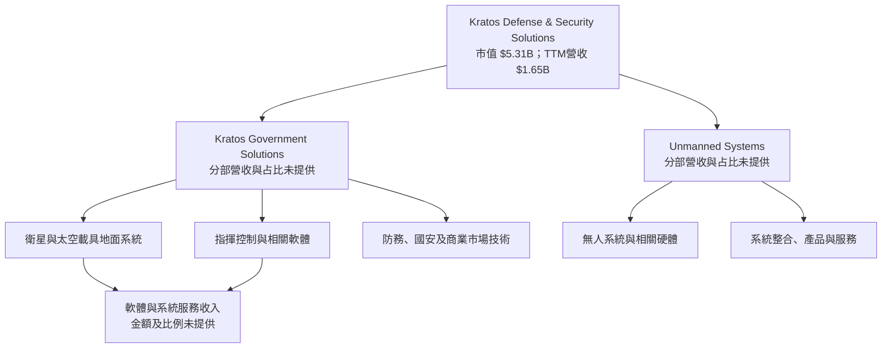
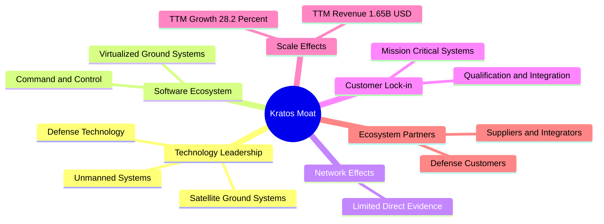
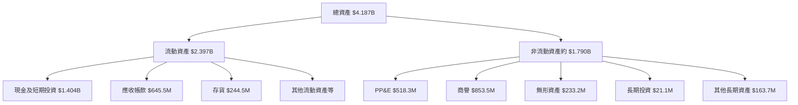
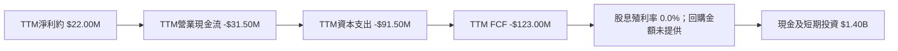
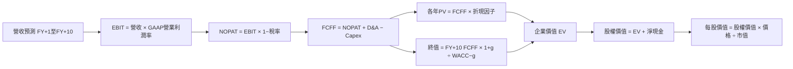
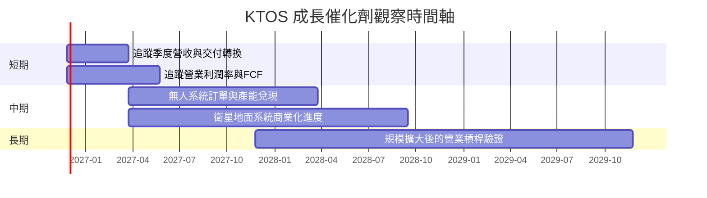
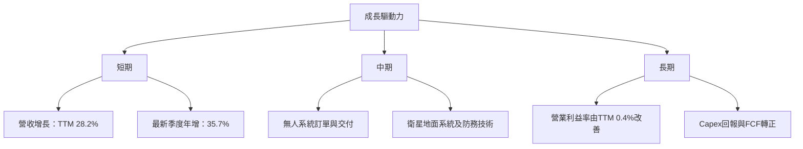
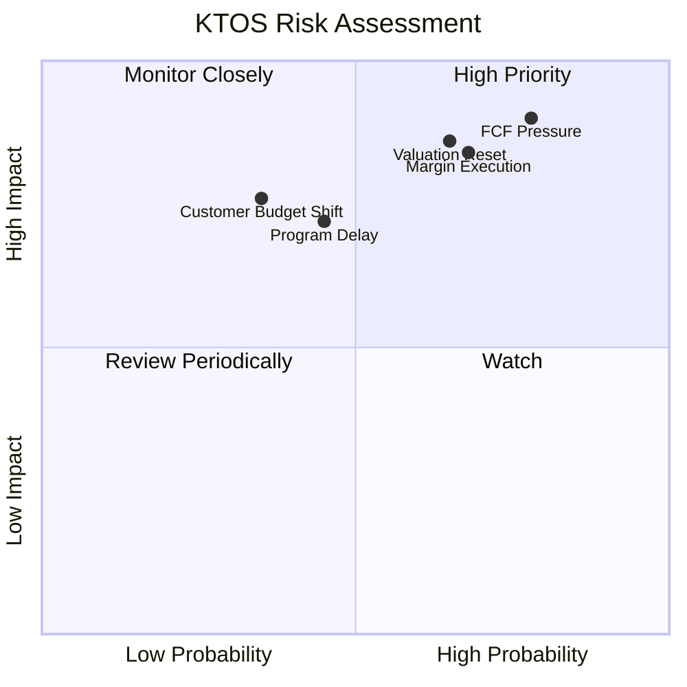
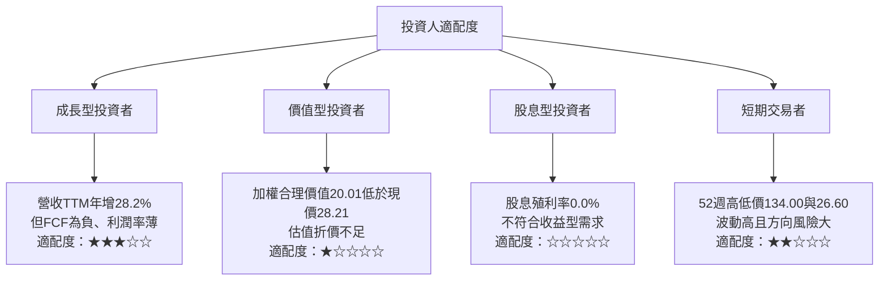

# KTOS 基本面深度分析報告
> **報告日期**：2026-11-25 ｜ **語言**：繁體中文 ｜ **數據來源**：SEC 申報資料 (XBRL)、Yahoo Finance、Finviz、StockAnalysis、Roic.ai ｜ **分析師**：CFA 級機構研究

## 目錄

| # | 章節 | 核心結論 |
|---|------|----------|
| 1 | 執行摘要 | 賣出；加權合理價值 $20.01；MOS -41.0% |
| 2 | 公司概覽與商業模式 | 無人系統與國防技術具專業化優勢，但分部營收資料不足以量化護城河 |
| 3 | 損益表深度分析 | TTM 營收 $1.65B、年增 28.2%；快速成長尚未轉化為穩定營業獲利 |
| 4 | 資產負債表分析 | 現金及短期投資 $1.40B；資產流動性充足，但債務資料有來源差異 |
| 5 | 現金流量深度分析 | TTM FCF -$123.00M、FCF Yield -2.32%，資本投入仍高於營運現金流 |
| 6 | 獲利能力與資本效率 | ROIC 0.2% 對 WACC 10.13%，目前尚未創造足以覆蓋資本成本的報酬 |
| 7 | 相對估值分析 | KTOS 的成長較快，但高於同業的估值溢價與極低利潤率形成落差 |
| 8 | DCF 內在價值評估 | DCF 基準值 $9.91；加權合理價值 $20.01；現價相對加權價值溢價 |
| 9 | 成長催化劑 | 無人系統、衛星地面系統與國防需求可能支撐成長，但 TAM 數字未提供 |
| 10 | 風險矩陣 | 現金流轉負、低利潤率與估值回歸是主要風險 |
| 11 | 投資建議 | 依 MOS 為賣出；後續應以 FCF、營業利益率與現金轉換作為核心監控 |

---

## 1. 執行摘要

### 1.0 一頁式投資儀表板（Portfolio Manager 30 秒速讀）

KTOS 的 TTM 營收為 **$1.65B**、TTM 年增 **28.2%**，最新一季營收年增 **35.7%**；但 TTM 營業利益率僅 **0.4%**，ROIC **0.2%**，遠低於 **10.13% WACC**。TTM 營業現金流 **-$31.50M**、資本支出 **$91.50M**，據此 FCF 為 **-$123.00M**，表示營收擴張目前伴隨較大的現金投入，而非已成熟的自由現金流產生能力。

| 項目 | 內容 |
|------|------|
| **投資論點（3 句）** | ① TTM 營收年增 **28.2%**、最新一季年增 **35.7%**，顯示需求和交付仍在擴張。② TTM 營業利益率僅 **0.4%**、ROIC **0.2%**，低於 **10.13% WACC**，目前尚未證明成長能創造經濟利潤。③ TTM FCF **-$123.00M**，且 DCF 基準值 **$9.91**、加權合理價值 **$20.01** 均低於 **$28.21** 現價。 |
| **綜合評分** | **4.8/10**（引用 1.1 評分卡） |
| **財務健康** | 🟡 現金及短期投資 **$1.40B**、流動比率 **5.418**，但 TTM FCF **-$123.00M**。 |
| **ROIC vs WACC** | **0.2% vs 10.13%**：目前低於資本成本，未創造經濟價值。 |
| **FCF 趨勢** | TTM FCF **-$123.00M**；FCF Yield **-2.32%**，現金流為負。 |
| **估值** | Forward P/E **25.281403x** ｜ EV/EBITDA（TTM，VERIFIED FIGURES）**47.1x** ｜ FCF Yield **-2.32%** |
| **DCF 內在價值（基準）** | **$9.91** ｜相對 DCF 的折溢價 **+184.5%**（現價高於 DCF） |
| **安全邊際（MOS）** | **-41.0%＝($20.01 − $28.21) ÷ $20.01**；基準為第 8.8 節加權合理價值。🔴 |
| **預期報酬（基準情境 12M）** | DCF 基準情境 **$9.91** 對現價 **$28.21**，相對現價 **-64.9%**；這是模型情境價值，不是保證的 12 個月報酬。 |
| **關鍵風險（前二）** | TTM FCF **-$123.00M**；營業利益率低且最新一季為 **-1.0%**。 |
| **評級 + 信心度** | 🔴 **賣出** ｜信心：中（資料源存在局部口徑差異，且 DCF 對長期假設敏感） |

> 評級依 MOS **-41.0%** 落入「賣出」門檻。此結論亦受 ROIC **0.2%** 低於 WACC **10.13%**、FCF 為負及相對估值偏高支持；未作質化調整。

### 1.1 綜合評分卡（全報告唯一）

| 維度 | 評分（1–10） | 主要依據（引用數字與其來源章節） |
|------|--------------|----------------------------------|
| 成長性 | 8.0 | TTM 營收年增 **28.2%**、最新一季年增 **35.7%**（第 3 章）；增長佳，但季度營收不等於利潤成長。 |
| 獲利能力 | 2.0 | TTM 營業利益率 **0.4%**、ROIC **0.2%** 對 WACC **10.13%**，Piotroski **3/8**（第 3、6 章）。 |
| 財務健康 | 8.0 | 現金及短期投資 **$1.40B**、流動比率 **5.418**；但 FCF **-$123.00M**、Piotroski 營業現金流項目未通過（第 4、5、6 章）。 |
| 估值 | 1.0 | MOS **-41.0%**；Forward P/E **25.281403x**，高於 Peer forward P/E 中位數 **18.4x**（第 7、8 章）。 |
| 護城河 | 6.0 | 政府國防客戶、無人系統與衛星地面系統等專業產品構成進入門檻；但缺少分部營收、續約率及市場份額資料（第 2 章）。 |
| 管理層與資本配置 | 4.0 | FY2025 資本支出 **$95.30M**、SBC **$35.50M**，TTM 現金流轉負且稀釋股數未通過 Piotroski 測試（第 3、5 章）。 |
| **綜合評分** | **4.8** | 六項算術平均：**(8.0 + 2.0 + 8.0 + 1.0 + 6.0 + 4.0) ÷ 6 = 4.833… ≈ 4.8**。 |

### 1.2 五大投資論點 + 三大核心風險

| 類型 | 項目 | 具體依據 | 信心度 |
|------|------|----------|--------|
| 🟢 **投資論點①** | 營收成長加速 | TTM 營收 **$1.65B**、TTM 年增 **28.2%**；最新一季年增 **35.7%**。若新增交付能轉化為較高毛利與營業槓桿，獲利可能改善。 | 🟡 中 |
| 🟢 **投資論點②** | 現金儲備提供投資彈性 | 現金及短期投資 **$1.40B**，可支應產能與產品投資，也為負 FCF 提供緩衝。 | 🟢 高 |
| 🟢 **投資論點③** | 毛利額隨規模增加 | 年營收由 FY2022 **$898.30M** 增至 FY2025 **$1.35B**；毛利由 **$226.00M** 增至 **$307.90M**。但毛利率沒有同步提升，代表規模效應尚未充分傳至營業利潤。 | 🟡 中 |
| 🟢 **投資論點④** | 專業化國防產品具客戶認證與整合門檻 | 公司涵蓋無人系統、衛星地面系統與防務技術，國防系統導入通常涉及測試、認證及整合；量化客戶集中度與訂單轉換資料未提供。 | 🟡 中 |
| 🟢 **投資論點⑤** | 現金狀況較高負債風險低 | VERIFIED FIGURES 的淨現金為 **$1.40B**，沒有顯示淨負債壓力；但同一資料包其他欄位有債務數值差異，須持續核對。 | 🟡 中 |
| 🟡 **風險①** | 現金消耗與資本支出偏高 | TTM 營業現金流 **-$31.50M**、Capex **$91.50M**、FCF **-$123.00M**；若現金轉換持續惡化，估值折現與自我融資能力均受壓。 | 🔴 高衝擊 |
| 🔴 **風險②** | 利潤率不足以支撐高估值 | TTM 營業利益率 **0.4%**、EBITDA margin **5.5%**，而 EV/EBITDA 約 **47.1x**；稍有交付延誤或成本超支，獲利可能大幅波動。 | 🔴 高衝擊 |
| 🟡 **風險③** | 估值與市場預期落差 | DCF 基準每股價值 **$9.91**，加權合理價值 **$20.01**，均低於 **$28.21** 現價；分析師共識目標價 **$73.69** 與基本面模型差距很大。 | 🔴 高衝擊 |

### 1.3 快速統計卡片

| 指標 | 公司實際值（期間） | 同業中位數 | 狀態 |
|------|--------------------|------------|------|
| 營收成長（TTM） | **28.2%** | — | 🟢 |
| 營收成長（最新一季年增） | **35.7%** | **6.7%** | 🟢 |
| 毛利率（TTM） | **23.0%** | **20.0%** | 🟢 |
| 營業利益率（TTM） | **0.4%** | — | 🔴 |
| ROIC（TTM） | **0.2%** | — | 🔴 |
| Forward P/E | **25.281403x** | **18.4x** | 🔴 |
| FCF Yield（TTM） | **-2.32%** | — | 🔴 |
| Piotroski F-Score | **3 / 8** | — | 🔴 |

同業中位數僅採三家 peer 的數據計算：最新一季營收成長率中位數為 **6.7%**，毛利率中位數為 **20.0%**，Forward P/E 中位數為 **18.4x**。

### 1.4 投資結論

```text
╔══════════════════════════════════════════════════════════════════╗
║                    📊 投資結論摘要                               ║
╠══════════════════════════════════════════════════════════════════╣
║  評級：賣出（MOS -41.0%，依規則 20）                             ║
║  價格（2026-11-24 收盤）：$28.21                                 ║
║  DCF 內在價值（基準）：$9.91（現價溢價 +184.5%）                ║
║  安全邊際 MOS：-41.0%（＝(加權合理價值−現價)÷加權合理價值）     ║
║  加權合理價值（8.8）：$20.01                                     ║
║  DCF 情境價值：                                                   ║
║    悲觀情境：$8.21（-70.9%）                                     ║
║    基準情境：$9.91（-64.9%）                                     ║
║    樂觀情境：$13.78（-51.1%）                                    ║
║  綜合評分：4.8/10（引用 1.1）                                    ║
║  適合投資人：能承受高波動、願意追蹤現金流與交付進度的成長型投資人║
╚══════════════════════════════════════════════════════════════════╝
```

---

## 2. 公司概覽與商業模式

### 2.1 業務結構與收入來源

公司簡介列出 Kratos Government Solutions 與 Unmanned Systems 兩個營運分部，並涉及衛星與太空載具虛擬化地面系統、指揮控制軟體、無人系統及其他國防技術。分部營收與收入占比沒有提供，因此不臆估各分部營收或比例。



### 2.2 市場份額

市場份額數據未提供，不能據此繪製市占率圖或推估滲透率。KTOS TTM 營收為 **$1.65B**，最新一季營收年增 **35.7%**，高於 AVAV、LMT、NOC 最新一季年增率中位數 **6.7%**；但營收增速並不能直接證明市占率提升，仍需分部訂單與競標資料驗證。

### 2.3 競爭護城河分析



### 2.4 護城河強度

| 護城河項目 | 強度（強／中／弱） | 證據（引用數字或事實） | 會削弱它的情況 |
|------------|--------------------|------------------------|----------------|
| 技術與產品專業化 | 中 | 公司提供無人系統、衛星地面系統及防務技術；TTM 營收 **$1.65B**。研發支出 FY2025 **$40.00M**。 | 技術替代、競標失利，或研發投入未能轉成可交付產品。 |
| 軟體與系統整合 | 中 | 公司業務包含虛擬化地面系統、指揮與控制相關軟體；收入與續約占比未提供。 | 客戶改採內部開發、標準化平台或競爭者整合方案。 |
| 網路效應 | 弱／證據有限 | 未提供使用者規模、資料網路或平台參與者數量。 | 若產品缺乏跨客戶資料或使用者外部性，規模擴大不必然形成網路效應。 |
| 客戶鎖定 | 中 | 國防系統認證、測試與整合通常提高轉換成本；公司服務國防與國安市場。客戶留存率未提供。 | 主要合約到期、採購優先序改變，或競爭者通過相同資格認證。 |
| 規模效應 | 中 | TTM 營收年增 **28.2%**，營收擴張有助分攤固定成本；但 TTM 營業利益率僅 **0.4%**，規模利益尚未充分反映。 | 新增產能與研發支出持續快於毛利增長，規模擴大反而加重現金消耗。 |
| 生態夥伴 | 弱／資料有限 | 公司面向多區域防務與商業市場；合作夥伴、合約金額及共同交付數據未提供。 | 供應鏈集中、合作關係中斷或關鍵零件交期惡化。 |

1.1 的護城河評分為 **6.0/10**，理由是專業技術、系統整合與政府客戶導入門檻具一定價值，但客戶留存、市占率、軟體收入與訂單轉換的量化證據不足。

---

## 3. 損益表深度分析

### 3.1 年度收入成長趨勢（近 4 年）

依年度損益表，FY2022 至 FY2025 營收由 **$898.30M** 增至 **$1.35B**，三年 CAGR 約 **14.5%**。計算方式為 \((1,347.0 ÷ 898.3)^{1/3}-1\)，約 **14.5%**。這表示長期收入底盤在擴大，但年度營收成長與盈利能力尚未同步改善。

```text
╔══════════════════════════════════════════════════════════════════╗
║             Kratos 年度收入趨勢（FY2022-FY2025）                ║
╠══════════════════════════════════════════════════════════════════╣
║  FY2022  $0.90B  █████████████░░░░░░░░░░░░░  YoY: 基期          ║
║  FY2023  $1.04B  ███████████████░░░░░░░░░░░  YoY: +15.4% 🟢    ║
║  FY2024  $1.14B  █████████████████░░░░░░░░░  YoY: +9.6%  🟡    ║
║  FY2025  $1.35B  ████████████████████░░░░░░  YoY: +18.5% 🟢    ║
╠══════════════════════════════════════════════════════════════════╣
║  三年累計 CAGR：約 +14.5%                                        ║
╚══════════════════════════════════════════════════════════════════╝
```

### 3.2 季度收入趨勢分析

| 季度 | 營收 | QoQ 成長 | YoY 成長 | 備註 |
|------|------:|---------:|---------:|------|
| 2025 Q4 | $345.10M | +14.0% | +21.9% | QoQ 比較 2025 Q3 的 $302.60M；YoY 依 StockAnalysis 季度資料。 |
| 2026 Q1 | $371.00M | +7.5% | +22.6% | 同比 2025 Q1 的 $302.60M。 |
| 2026 Q2 | $458.80M | +23.7% | +30.5% | 同比 2025 Q2 的 $351.50M。 |
| 2026 Q3 | $471.80M | +2.8% | **+35.7%** | 最新一季年增率以 VERIFIED FIGURES 原值引用；QoQ 增速較 Q2 放緩。 |

季度收入在 2026 年前兩季加速，第三季 QoQ 成長回落至 **2.8%**，但同比仍達 **35.7%**。營收增長未直接帶來穩定盈利：2026 Q3 營業利益為 **-$4.00M**，反映交付成本、產品組合或固定成本吸收尚未跟上收入增長；各項原因的分部拆解未提供。

### 3.3 利潤率演變分析

下表年度毛利率與營業利益率依年度毛利、營業利益除以營收計算；TTM 數據採 VERIFIED FIGURES。不同來源的 TTM 營業利益率數字有差異，本文依嚴格要求採用 VERIFIED FIGURES 的 **0.4%**。

| 利潤率指標 | FY2022 | FY2023 | FY2024 | FY2025 | 趨勢 | 評估 |
|------------|-------:|-------:|-------:|-------:|------|------|
| **毛利率** | 25.2% | 25.9% | 25.3% | 22.9% | FY2025 下滑約 2.4 個百分點，毛利額增加但收入組合或成本壓力拖累毛利率。 | 🟡 |
| **營業利益率** | 0.5% | 3.0% | 2.6% | 2.1% | FY2023 改善後連續回落；固定成本、研發與營運投入可能抵銷毛利額成長。 | 🔴 |

TTM 毛利率 **23.0%**，TTM 營業利益率 **0.4%**，兩者相差 **22.6 個百分點**。FY2025 毛利率由 FY2024 的約 **25.3%** 降至 **22.9%**，表示成本增速或收入組合不利，沒有從營收成長中充分取得價格或規模利益。季度營業利益更呈現波動：2026 Q1 **$6.60M**、Q2 **-$0.80M**、Q3 **-$4.00M**。若該波動來自交付時點，後續季度可能回升；若為持續性成本超支，則增長的股東價值會低於營收增幅所暗示的水準。

### 3.4 費用結構分析

費用科目缺少完整、可對帳的 TTM 損益表細項，不適合繪製費用比例圓餅圖。已知 FY2025 研發費用 **$40.00M**，約為 FY2025 營收 **$1.347B** 的 **3.0%**；該比例依年度披露值計算。其他銷售、管理及其他營業費用的完整金額未提供。

```text
╔══════════════════════════════════════════════════════════════════╗
║                    費用結構可得資料                              ║
╠══════════════════════════════════════════════════════════════════╣
║ FY2025 研發費用：$40.00M                                        ║
║ FY2025 營收：    $1.347B                                         ║
║ 研發費用率：    $40.00M ÷ $1,347M ≈ 3.0%                       ║
║ 其他費用明細：未提供，故不製作比例圖                            ║
╚══════════════════════════════════════════════════════════════════╝
```

### 3.5 季度 EPS 趨勢與盈餘品質（Quality of Earnings）

最近四季 EPS 預估值與實際值均未提供；季度 EPS beats/misses 欄位均為 nan，因此不能宣稱超預期或不及預期。季度淨利可作為盈利趨勢參考，但不能替代一致口徑的 EPS surprise 數據。

| 季度 | EPS 預估／實際 | 淨利 | 營業利益 | EPS 表現 |
|------|----------------|-----:|---------:|----------|
| 2025 Q4 | N/A | $5.90M | $10.10M | 預估與實際 EPS 未提供，無法判定 beat/miss。 |
| 2026 Q1 | N/A | $11.90M | $6.60M | 預估與實際 EPS 未提供，無法判定 beat/miss。 |
| 2026 Q2 | N/A | $4.40M | -$0.80M | 預估與實際 EPS 未提供，無法判定 beat/miss。 |
| 2026 Q3 | N/A | -$0.20M | -$4.00M | 預估與實際 EPS 未提供，無法判定 beat/miss。 |

| 盈餘品質項目 | 數值／佔比 | 評估 |
|--------------|-----------|------|
| 股權薪酬 SBC / 營收 | TTM SBC 以最近四季數字合計為 **$58.50M**；除以 TTM 營收 **$1.65B** 約 **3.5%**。 | 🟡 SBC 是實質股東成本；若以股權發放，可能造成稀釋。Piotroski 的「稀釋股數未增加」未通過。 |
| SBC / 營業現金流 | **$58.50M ÷ -$31.50M = -185.7%** | 🔴 分母為負，比例不宜視作正常覆蓋率；SBC 規模大於營業現金流絕對值。 |
| FCF / 淨利（現金轉換率） | **-$123.00M ÷ $22.00M = -559.1%** | 🔴 TTM 淨利為正而 FCF 為負，會計利潤尚未轉化為自由現金流。 |
| 一次性／非經常性損益 | N/A（未提供可辨識的一次性損益拆解） | 無法判斷是否有一次性項目美化或壓低當期盈餘。 |
| 有效稅率異常 | N/A（未提供可核對的 TTM 所得稅費用與稅前利潤明細） | 不推定稅務利益或異常稅率。 |
| 資本化支出 vs 費用化 | TTM Capex **$91.50M**；資本化研發等細項未提供。 | 資本支出約為 TTM 營收 **5.5%**；是否有成本遞延或資本化政策變更，資料不足以判定。 |

**盈餘品質結論：** TTM 淨利約 **$22.00M**，但營業現金流 **-$31.50M**、FCF **-$123.00M**，顯示現金轉換弱。SBC 約為 TTM 營收 **3.5%**，且稀釋股數測試未通過。現階段 GAAP 獲利不能單獨代表可分配給股東的經濟盈餘，估值應更重視現金流恢復與股數變化。

---

## 4. 資產負債表分析

### 4.1 資產結構分解

最新可用資產結構以 StockAnalysis 的 TTM 資產列示；其明細合計受四捨五入及報表分類影響，總資產為 **$4.187B**。



流動資產占總資產約 **57.3%**（$2.397B ÷ $4.187B），現金與短期投資約占總資產 **33.5%**。商譽 **$853.5M** 與無形資產 **$233.2M** 也占有一定比重，若收購資產的預期現金流未達標，未來可能面臨減損風險；減損金額與測試假設未提供。

### 4.2 流動性與營運資金分析

| 指標 | 最新 TTM | 一年前 TTM | 變化 | 解讀 |
|------|----------|------------|------|------|
| DSO 應收帳款天數 | **42 天** | **39 天** | **+3 天** | 收款週期延長，可能反映應收帳款增長快於營收；應追蹤政府客戶付款節奏與應收帳齡。 |
| DIO 存貨天數 | **70 天** | **66 天** | **+4 天** | 存貨周轉略慢，可能為交付前備料或需求預期增加；若後續未轉為銷售，會占用現金並提高存貨風險。 |
| DPO 應付帳款天數 | **32 天** | **24 天** | **+8 天** | 公司延長供應商付款時間，短期改善營運資金，但不能直接等同於議價力提升。 |
| CCC 現金轉換週期 | **80 天** | **81 天** | **-1 天** | 週期略縮短，主要由 DPO 增加抵銷 DSO、DIO 上升；改善幅度有限。 |

流動比率 **5.418**、速動比率 **4.632**，顯示帳面短期流動性充足。但 CCC **80 天**意味著營運資金仍會被應收帳款及存貨占用；與 TTM 負營業現金流合併看，流動資產充裕不等於營運現金流已改善。

### 4.3 債務結構分析

不同數據來源的債務欄位不一致：VERIFIED FIGURES 明確列示總債務 **N/A**、淨現金 **$1.40B**；市場資料摘要則列示總債務 **$246.00M**、淨現金／債務 **$1.16B**。本報告在需要引用 VERIFIED FIGURES 的位置以其原值為準，不以其他欄位覆寫，也不據此推導 Debt/EBITDA 或利息保障倍數。

```text
╔══════════════════════════════════════════════════════════════════╗
║                  Kratos 債務健康診斷                              ║
╠══════════════════════════════════════════════════════════════════╣
║  總債務：        N/A（VERIFIED FIGURES）                          ║
║  總現金+短期投資：$1.40B                                          ║
║  淨現金：        $1.40B（VERIFIED FIGURES；非自行推算）           ║
║  Debt/EBITDA：   N/A（總債務依指定來源為 N/A）                    ║
║  Interest Coverage：N/A（未提供可核對的利息費用與 EBIT）          ║
║  補充來源差異：市場資料另列總債務 $246.00M、淨現金 $1.16B        ║
╚══════════════════════════════════════════════════════════════════╝
```

### 4.4 股東權益趨勢

| 年度 | 股東權益 | YoY 變化 | 解讀 |
|------|---------:|---------:|------|
| 2022 | $936.30M | — | 基期。 |
| 2023 | $976.00M | +4.2% | 緩步增加。 |
| 2024 | $1.35B | +38.3% | 權益明顯增加；成因需結合股本、累積盈餘及其他權益變動核對。 |
| 2025 | $2.00B | +48.1% | 增長較快，但非現金權益增加不能替代自由現金流改善。 |

```text
╔══════════════════════════════════════════════════════════════════╗
║                   股東權益趨勢（年度）                            ║
╠══════════════════════════════════════════════════════════════════╣
║  2022  $0.936B  █████████░░░░░░░░░░░░░░                         ║
║  2023  $0.976B  ██████████░░░░░░░░░░░░░                        ║
║  2024  $1.350B  ██████████████░░░░░░░░                          ║
║  2025  $2.000B  ████████████████████                             ║
╚══════════════════════════════════════════════════════════════════╝
```

---

## 5. 現金流量深度分析

### 5.1 現金流量瀑布圖

股息殖利率與 payout ratio 均為 **0.0%**。回購金額與 TTM 淨現金變化未提供，故不在瀑布圖填入未確認金額。



### 5.2 FCF 轉換率趨勢

| 年度／期間 | FCF | 淨利 | FCF / 淨利 | 解讀 |
|------------|----:|----:|-----------:|------|
| FY2023 | $12.80M | -$8.90M | -143.8%* | 淨利為負，該比率方向容易誤讀；FCF 為正但低於零的淨利基數。 |
| FY2024 | -$8.50M | $16.30M | -52.1% | 淨利為正而 FCF 為負，現金轉換偏弱。 |
| FY2025 | -$137.40M | $22.00M | -624.5% | 資本支出與營運資金需求使 FCF 顯著低於淨利。 |
| TTM | **-$123.00M** | **$22.00M** | **-559.1%** | 仍未轉化為正自由現金流。 |

\* 分母為負，僅展示計算結果，不代表一般正向現金轉換率。年度營業現金流資料有缺漏，不以 FCF 反推 OCF 或 Capex。

### 5.3 自由現金流趨勢

| 年度／期間 | FCF | FCF Yield |
|------------|----:|----------:|
| FY2022 | -$71.10M | N/A |
| FY2023 | $12.80M | N/A |
| FY2024 | -$8.50M | N/A |
| FY2025 | -$137.40M | N/A |
| TTM | **-$123.00M** | **-2.32%** |

歷史 FCF 正負交替，FY2025 與 TTM 均為大幅負值；這使以現金流為基礎的估值更依賴未來的營業槓桿與投資回報，而不是當前現金收益率。

```text
╔══════════════════════════════════════════════════════════════════╗
║                    自由現金流趨勢                                ║
╠══════════════════════════════════════════════════════════════════╣
║  FY2022  -$71.10M  ◀██████████████░░░░░░░░░░░░░░░░░             ║
║  FY2023   $12.80M  ████░░░░░░░░░░░░░░░░░░░░░░░░░                ║
║  FY2024   -$8.50M  ◀██░░░░░░░░░░░░░░░░░░░░░░░░░                ║
║  FY2025 -$137.40M  ◀████████████████████████████                 ║
║  TTM    -$123.00M  ◀█████████████████████████  Yield: -2.32%     ║
╚══════════════════════════════════════════════════════════════════╝
```

### 5.4 資本配置評估

已披露 FY2025 Capex **$95.30M**、SBC **$35.50M**，TTM Capex **$91.50M**；股息殖利率 **0.0%**。回購、併購與債務償還的完整期間金額未提供，因此不以假定比例繪製資本配置圓餅圖。

| 配置項目 | 可得數據 | 評估 |
|----------|----------|------|
| 資本支出 | FY2025 **$95.30M**；TTM **$91.50M** | 投入規模較大，需以後續產能利用率及 FCF 改善驗證回報。 |
| 研發 | FY2025 **$40.00M** | 對國防技術公司具策略性，但回報周期與分部成果未提供。 |
| 股權薪酬 | FY2025 **$35.50M**；TTM 約 **$58.50M** | 需監控股數稀釋及薪酬占營收比重。 |
| 股息 | 殖利率 **0.0%** | 未以股息回饋股東。 |
| 回購／併購／留存用途 | N/A（缺少可對帳資料） | 無法完整評估資本配置優先序。 |

---

## 6. 獲利能力與資本效率

### 6.1 ROE / ROA / ROIC 趨勢

| 指標 | FY2023／歷史資料 | FY2024／歷史資料 | FY2025／歷史資料 | TTM（VERIFIED FIGURES） | 評估 |
|------|------------------|------------------|------------------|-------------------------|------|
| ROE | N/A | N/A | N/A | **0.6%** | 股東權益回報偏低。 |
| ROA | N/A | N/A | N/A | **N/A** | VERIFIED FIGURES 未提供 TTM ROA；Piotroski 測試只提供通過狀態，不補算比率。 |
| ROIC | N/A | N/A | N/A | **0.2%** | 顯著低於資本成本。 |

行業均值未提供，因此不填造同業 ROE／ROA／ROIC 均值。其他來源有不同口徑的 ROE/ROA 數值，本表依 VERIFIED FIGURES 原值引用。

### 6.2 ROIC vs WACC 分析（核心價值創造判斷）

```text
╔══════════════════════════════════════════════════════════════════╗
║                ROIC vs WACC 深度分析                            ║
╠══════════════════════════════════════════════════════════════════╣
║  WACC 組成（Cost of capital）：                                  ║
║  ├── 無風險利率（10Y美債）：  4.90%                              ║
║  ├── 市場風險溢酬 ERP：       5.00%                              ║
║  ├── 原始 Beta：              1.17                               ║
║  ├── 調整後 Beta：            1.11                               ║
║  ├── 股權成本 Ke：            10.45%                             ║
║  ├── 稅前債務成本：           3.90%                              ║
║  ├── E / D 權重：             95.6% / 4.4%                       ║
║  └── ✅ WACC：                10.13%                             ║
║                                                                  ║
║  ROIC（TTM，VERIFIED FIGURES）：0.2%                             ║
║  EVA spread = ROIC − WACC = 0.2% − 10.13% = -9.93 個百分點       ║
║                                                                  ║
║  ROIC  0.2%    ░░░░░░░░░░░░░░░░░░░░░░░░░░░░░░░░░░░░░░░░       ║
║  WACC 10.13%   ▓▓▓▓▓▓▓▓▓▓▓▓▓▓▓▓▓▓▓▓▓▓▓▓▓▓▓▓▓▓▓▓▓▓▓▓           ║
║  EVA   -9.93pp 🔴                                                 ║
╠══════════════════════════════════════════════════════════════════╣
║  結論：目前 ROIC 低於 WACC，投入資本的稅後營業報酬未覆蓋資本成本║
╚══════════════════════════════════════════════════════════════════╝
```

WACC 原值為 **10.13%**；ROIC **0.2%**。差額為 **0.2% − 10.13% = -9.93 個百分點**。這代表以當前 TTM 回報衡量，公司尚未證明增量資本能產生高於資本成本的收益。ROIC 可能因前置投資或擴產而暫時偏低，但若利潤率與資產週轉率未改善，營收增長將難以帶來價值創造。

### 6.3 杜邦三因素分解

| 因素 | 數值（TTM） | 解讀 |
|------|-------------|------|
| 淨利率 | **1.3%** | 獲利率薄，淨利對成本與交付波動敏感。 |
| 資產週轉率 | **0.39** | 每單位資產產生的營收有限，資產擴張可能暫時壓低 ROE。 |
| 權益乘數 | **1.21** | 槓桿程度相對有限，ROE 並非主要由高財務槓桿推升。 |
| **ROE** | **0.6%** | QUALITY FIGURES 原值：**1.3% × 0.39 × 1.21 = 0.6%**。 |

淨利率是 ROE 的主要限制因素；權益乘數 **1.21** 並未顯示靠高槓桿撐高回報。

### 6.4 財務體質：Piotroski F-Score

Piotroski F-Score 為 **3 / 8**。測試欄位有一項因資料缺漏無法判定，因此分母低於常見的九項總測試。

| 測試 | 結果 | 解讀 |
|------|------|------|
| ROA > 0 | ✅ 通過 | 顯示期間資產報酬為正，但不代表回報已覆蓋資本成本。 |
| 營業現金流 > 0 | ❌ 未通過 | 與 TTM OCF **-$31.50M** 一致，營運未產生正現金流。 |
| ROA 高於一年前 | ❌ 未通過 | 資產獲利能力未較去年改善。 |
| 營業現金流 > 淨利 | ❌ 未通過 | 應計品質偏弱，且 OCF 為負、淨利為正。 |
| 長期負債 ÷ 總資產低於一年前 | — 無法判定 | 缺少可比較的負債輸入。 |
| 流動比率高於一年前 | ✅ 通過 | 流動性相對改善。 |
| 稀釋股數未增加 | ❌ 未通過 | 股數稀釋會攤薄每股經濟價值。 |
| 毛利率高於一年前 | ✅ 通過 | 毛利率測試按品質指標計算結果通過；不同年度彙總口徑仍應與季度組合資料核對。 |
| 資產週轉率高於一年前 | ❌ 未通過 | 資產增長尚未帶來更高的營收轉換效率。 |

---

## 7. 相對估值分析

### 7.1 同業估值比較表格

以下同業倍數來自 Peer multiples；同業中位數為 AVAV、LMT、NOC 的中位數。KTOS 市場數據中的 Forward P/E 為 **25.281403x**；Trailing P/E 與 EV/EBITDA 使用 VERIFIED FIGURES 的相應口徑。

| 估值指標 | **KTOS** | **AVAV** | **LMT** | **NOC** | KTOS 評估 |
|----------|---------:|---------:|---------:|---------:|-----------|
| **Trailing P/E** | **235.1x** | N/A | 20.8x | 17.4x | 🔴 KTOS 獲利基數很低，P/E 高於兩家有數值的同業。 |
| **Forward P/E** | **25.281403x** | 20.3x | 17.6x | 18.4x | 🔴 同業中位數 **18.4x**；KTOS 約高 **37.4%**。 |
| **P/S Ratio** | **3.2x** | 2.3x | 1.7x | 1.8x | 🔴 KTOS 高於同業中位數 **1.8x**，市場為成長支付溢價。 |
| **EV/EBITDA** | **47.1x** | 21.9x | 15.2x | 12.6x | 🔴 KTOS 高於同業中位數 **15.2x**，而其 TTM EBITDA margin 僅 **5.5%**。 |
| **最新一季營收年增** | **35.7%** | 5.7% | 11.3% | 6.7% | 🟢 KTOS 成長明顯較快；但成長若未轉化為現金流，溢價難以長期維持。 |
| **TTM 毛利率** | **23.0%** | 26.5% | 11.7% | 20.0% | 🟡 KTOS 高於 LMT、NOC，低於 AVAV；毛利優勢尚未傳至營業利潤率。 |

### 7.2 歷史估值區間分析

```text
╔══════════════════════════════════════════════════════════════════╗
║                 KTOS 五年歷史估值位置                            ║
╠══════════════════════════════════════════════════════════════════╣
║ P/E：      232.9x ── 現值 235.1x ─────────────────────────────  ║
║            五年中位數 380.2x；當前百分位 9%                     ║
║            歷史區間上限受極端低獲利期間影響，區間參考性有限      ║
║                                                                  ║
║ P/S：        1.3x ───── 中位數 3.2x / 現值 3.2x ─────── 11.6x   ║
║            當前百分位 55%                                        ║
║                                                                  ║
║ EV/EBITDA： 33.8x ── 現值 47.1x ── 中位數 55.5x ───── 221.5x  ║
║            當前百分位 35%                                        ║
╚══════════════════════════════════════════════════════════════════╝
```

KTOS 的 P/S **3.2x** 等於其五年中位數；EV/EBITDA **47.1x** 低於五年中位數 **55.5x**，但仍高於同業中位數 **15.2x**。P/E 當前百分位 **9%** 看似低於歷史中位數，卻受到盈利接近損益兩平影響，不宜把低歷史百分位視作便宜訊號。

### 7.3 情境價值（Bear / Base / Bull，照抄 DCF MODEL 的 Scenarios）

| 情境 | 第 1 年營收成長 | 期末營業利潤率 | WACC | 每股價值 | 相對現價 | 機率 | 會發生的條件 |
|------|----------------:|----------------:|-----:|---------:|---------:|-----:|--------------|
| 🔴 悲觀 | 14.1% | 1.6% | 11.13% | **$8.21** | **-70.9%** | 25% | 成長低於 TTM 增速，利潤率改善較慢且資本成本偏高。 |
| 🟡 基準 | 28.2% | 1.9% | 10.13% | **$9.91** | **-64.9%** | 50% | 首年延續 TTM 成長率，長期營業利益率回到近五年中位數假設。 |
| 🟢 樂觀 | 42.3% | 2.1% | 9.13% | **$13.78** | **-51.1%** | 25% | 需求與交付顯著加速、利潤率改善且資本成本降低。 |

三種情境的模型價值均低於 **$28.21** 現價，顯示這個 DCF 架構即使採較樂觀成長與折現率，也未支持當前價格。情境是模型假設組合，不是股價保證。

### 7.4 相對估值隱含價格區間

```text
╔══════════════════════════════════════════════════════════════════╗
║              相對估值隱含每股價值（美元）                        ║
╠══════════════════════════════════════════════════════════════════╣
║ DCF基準 $9.91 ─ EV/EBITDA $14.19 ─ Forward P/E $20.53           ║
║                                            現價 $28.21            ║
║ 分析師共識目標價 $73.69                                          ║
╚══════════════════════════════════════════════════════════════════╝
```

| 方法 | 每股價值 | 相對現價 | 依據 |
|------|---------:|---------:|------|
| DCF（基準） | **$9.91** | -64.9% | 10 年 FCFF、WACC **10.13%**、永續成長率 **3.0%**。 |
| 同業 Forward P/E | **$20.53** | -27.2% | 同業中位數 **18.4x** × KTOS Forward EPS **$1.12**。 |
| 同業 EV/EBITDA | **$14.19** | -49.7% | 同業中位數 **15.2x** × TTM EBITDA，再加淨現金。 |
| 分析師共識目標價 | **$73.69** | +161.2% | 26 位分析師平均目標價；市場預期參考值，與基本面估值分歧很大。 |

---

## 8. DCF 內在價值評估（Discounted Cash Flow）

> DCF 數字依程式計算模型原值呈現；以下為對其假設與輸出的解讀，不另建模型或改動模型值。模型貨幣單位為 USD billions，股價以 USD 計。

### 8.0 估值推理鏈（Thinking Logic）

#### Step 1 — 價值由哪些變數決定？

核心命題是：KTOS 的價值由目前 **$1.65B TTM 營收**形成的主業基礎、無人系統與政府方案的後續擴張，以及利潤率能否從 **0.4% TTM GAAP EBIT margin** 提升所決定。分部營收比例未提供，不能把第二成長曲線或軟體收入任意拆成營收占比。估值最敏感的變數是長期可持續的自由現金流與終值，因模型終值現值占企業價值 **84.4%**。

#### Step 2 — 模型選擇

| 決策點 | 本報告採用 | 理由（含數字） | 曾考慮但否決 | 否決理由 |
|--------|-----------|----------------|--------------|----------|
| 現金流定義 | FCFF | 模型以 WACC 折現，得出 EV，再加淨現金橋接至股權價值。 | FCFE | 模型提供的固定現金流定義是 FCFF，不能任意換模型。 |
| 預測期 N | **10 年** | DCF MODEL 固定預測期 10 年，收入增速由 **28.2%** 線性降至 **3.0%**。 | 5 年 | 與程式模型不同，且無法照抄指定模型結果。 |
| 終值方法 | Gordon Growth | 模型以 **3.0%** 永續成長率計算終值，且 WACC **10.13% > 3.0%**。 | 單獨退出倍數終值 | DCF MODEL 未提供退出倍數終值，不能自建或改動。 |
| EBIT 基礎 | GAAP EBIT | TTM 營業利益率 **0.4%**；模型已標明 GAAP EBIT。 | 非 GAAP EBIT | 未提供可核對的調整項目，亦非模型設定。 |

#### Step 3 — 主要假設推導鏈

- **營收增長**：錨點＝TTM 營收年增 **28.2%**，最新一季年增 **35.7%** → 調整＝預測期增速由首年 **28.2%** 線性降至第十年 **3.0%**，反映高基期與長期增長收斂 → **採用模型給定的首年 28.2%、第十年 3.0%** → 曾考慮以最新一季 **35.7%** 作首年增長，但否決，因單季成長率不是完整年度成長率且模型以 TTM 增長作錨。
- **期末營業利潤率**：錨點＝TTM 營業利益率 **0.4%** → 調整＝模型使用近五年財年（含 TTM）中位數作第十年落點，反映一定程度營業槓桿，但歷史年度營業利益率並非持續向上 → **採用第十年 1.9%** → 曾考慮採用更高利潤率，但模型沒有提供支持較高目標的分部利潤或管理層財測，故不採用。
- **永續成長率 g**：錨點＝長期成熟企業通常不能永久維持高於經濟體長期增長的增速；本模型採 **3.0%** → 調整＝低於 WACC **10.13%**，令 Gordon Growth 公式有效 → **採用 3.0%** → 曾考慮更高 g，但越接近 WACC，終值越不穩定，因此不採用。
- **預測期 N**：錨點＝模型明列 **10 年**，並呈現收入增速逐步收斂 → 調整＝與長週期防務產品導入及投資回收相容，但這只是模型設定，非管理層財測 → **採用 10 年** → 曾考慮較短期，但與既定 DCF 模型不一致。
- **Capex／營收**：錨點＝TTM Capex／TTM 營收約 **5.6%**，模型給定首年 **5.6%** → 調整＝逐步降至第十年 **5.1%**，但仍略高於模型設定的 D&A／營收 **4.7%** → **採用首年 5.6% 至第十年 5.1%** → 曾考慮將 Capex 降至 D&A 水平，但模型採取較高再投資要求，不自行下修。
- **D&A／營收**：錨點＝模型註明 TTM **4.7%** → 採用 **4.7%** 並固定；這是模型給定值，未自行調整。
- **有效稅率**：錨點＝模型預設 **21.0%** → 採用 **21.0%**；實際 TTM 有效稅率資料未提供，故不得宣稱是歷史實際稅率。
- **EBIT、SBC 與股數**：錨點＝模型採 GAAP EBIT；GAAP 已將 SBC 作為費用 → 採用組合 **(A)**，不在 FCFF 再扣 SBC，股數不另作年稀釋 → 曾考慮加回 SBC 並另行計稀釋，但會改變模型且可能重複計成本，故否決。
- **營運資金變動**：模型明確不建模營運資金；採用 **未納入**，不是以零值宣稱營運資金無影響。實際 CCC **80 天**、一年前 **81 天**，表示此處省略可能影響短期現金流。
- **WACC**：錨點＝Cost of capital 原值 **10.13%** → 採用 **10.13%**，不另建 WACC → 不以其他口徑重新估算，避免與程式 DCF 分歧。

#### Step 4 — 最脆弱的一環

最脆弱的環節是以 TTM 負 FCF 為起點，卻假設長期營業利潤率可升至 **1.9%** 並使終值占 EV **84.4%**；若利潤率改善未實現，估值將低於基準值，敏感性表與悲觀情境顯示基準以外的價值可落至 **$8.21** 至 **$9.64** 一帶，視 WACC 與 g 組合而定。

#### Step 5 — 計算路徑圖



### 8.1 模型假設總表（Model Inputs）

| 假設項目 | 採用值 | 依據／來源 | 敏感度 |
|----------|--------|-------------|--------|
| 預測期長度 **N** | **10 年** | DCF MODEL 固定期數。 | 🟡 中 |
| 營收增長（預測期） | 首年 **28.2%**，第十年 **3.0%**，逐年線性遞減 | TTM revenue growth **28.2%**；第十年採模型的長期收斂值。 | 🔴 高 |
| 營業利潤率（GAAP EBIT） | 首年 **0.4%** → 第十年 **1.9%** | TTM 營業利益率 **0.4%**，逐步收斂至近五年財年中位數模型假設。 | 🔴 高 |
| 有效稅率 | **21.0%** | DCF 模型預設稅率；非已核實 TTM 實際稅率。 | 🟢 低 |
| Capex／營收 | **5.6%** → **5.1%** | TTM Capex／營收約 **5.6%**；模型逐步收斂。 | 🟡 中 |
| D&A／營收 | **4.7%** | DCF MODEL 標示為 TTM 比例，固定使用。 | 🟢 低 |
| 營運資金變動／營收增額 | **未建模** | DCF MODEL 明確不納入營運資金變動；實際 CCC 為 **80 天**。 | 🟢 低 |
| EBIT 基礎 | **GAAP EBIT** | DCF MODEL 明列 GAAP EBIT。 | 🟡 中 |
| SBC 處理 | **組合 (A)：GAAP EBIT、不再扣 SBC、股數不另稀釋** | GAAP EBIT 已含 SBC 費用；模型採固定股數假設。 | 🟡 中 |
| 年稀釋率 | **0%（模型處理）** | DCF MODEL 指定股數不再稀釋；這不代表公司實際稀釋為零。 | 🟡 中 |
| 永續成長率 g | **3.0%** | DCF MODEL 原值，且低於 WACC **10.13%**。 | 🔴 高 |
| 終值方法 | **Gordon Growth** | DCF MODEL 直接採用；未提供退出倍數交叉估值。 | 🔴 高 |
| WACC | **10.13%** | Cost of capital 原值，詳見 8.2。 | 🔴 高 |

**FCFF 定義：** 本模型使用企業自由現金流 FCFF，公式為 **FCFF = NOPAT + D&A − Capex**；依模型規則不列 ΔWC 項。  
**SBC 防呆：** 本模型採用 **(A) GAAP EBIT + 固定股數**，因此 SBC 影響已反映於 GAAP EBIT 一次；FCFF 不再減 SBC，模型股數也不再逐年放大。

### 8.2 折現率推導（WACC）

Cost of capital 給定無風險利率 **4.90%**、ERP **5.00%**、原始 Beta **1.17**，調整後 Beta 依「⅔ × 原始 Beta + ⅓」為 **1.11**。無風險利率對應資料包中的 10Y Treasury 輸入，未提供更精確觀察日期，因此不臆造日期。

```text
╔══════════════════════════════════════════════════════════════════╗
║                    WACC 推導（折現率）                           ║
╠══════════════════════════════════════════════════════════════════╣
║  股權成本 Ke（CAPM）：                                           ║
║  ├── 無風險利率 Rf：                 4.90%                      ║
║  ├── 市場風險溢酬 ERP：              5.00%                      ║
║  ├── 原始 Beta：                     1.17                       ║
║  ├── 調整後 Beta：                   1.11                       ║
║  ├── 規模／國別溢酬：                0.00%（未另加）            ║
║  └── Ke：4.90% + 1.11 × 5.00% = 10.45%                         ║
║                                                                  ║
║  債務成本 Kd：                                                   ║
║  ├── 稅前 Kd（輸入值）：             3.90%                      ║
║  ├── 稅率：                          21.0%                      ║
║  └── 稅後 Kd：3.90% × (1−21.0%) = 3.081%                       ║
║                                                                  ║
║  資本結構權重（輸入值）：                                        ║
║  ├── 股權權重 E：                    95.6%                      ║
║  ├── 債務權重 D：                    4.4%                       ║
║  └── WACC：95.6%×10.45% + 4.4%×3.081% = 10.13%                 ║
╚══════════════════════════════════════════════════════════════════╝
```

**逐步演算（WACC）：**

1. **Ke（CAPM）** = Rf + β × ERP = **4.90% + 1.11 × 5.00% = 10.45%**。
2. **稅前 Kd** = **3.90%**（Cost of capital 輸入值）；利息費用與平均計息負債明細未提供，不能另行反推。
3. **稅後 Kd** = **3.90% × (1 − 21.0%) = 3.081%**。
4. **權重** = 股權 **95.6%**、債務 **4.4%**；兩者合計 **95.6% + 4.4% = 100.0%**。市值與計息債務絕對金額權重採成本資本資料所給定的權重，不自行重算。
5. **WACC** = **95.6% × 10.45% + 4.4% × 3.081% = 9.9902% + 0.135564% = 10.125764% ≈ 10.13%**。

成本資本資料只提供債務成本與 E/D 權重，沒有提供利息費用、平均計息債務或完整期末計息負債拆分，因此不能用 8.2 範例式反推負債金額。WACC 採用值與第 6.2 節一致，為 **10.13%**。

### 8.3 逐年自由現金流預測（基準情境）

**四捨五入規則：** 金額以 USD billions 顯示至小數點後兩位；折現因子至小數點後三位；百分比依模型原值呈現。表內數字照抄 DCF MODEL；由於各年度 FCFF 與 PV 已四捨五入，表格可見數字直接相加可能與模型未四捨五入的合計略有差異。

| 年度 | FY+1 | FY+2 | FY+3 | FY+4 | FY+5 | FY+6 | FY+7 | FY+8 | FY+9 | FY+10 |
|------|-----:|-----:|-----:|-----:|-----:|-----:|-----:|-----:|-----:|------:|
| 營收 | 2.11 | 2.65 | 3.24 | 3.88 | 4.54 | 5.19 | 5.78 | 6.28 | 6.64 | 6.84 |
| 營收 YoY | 28.2% | 25.4% | 22.6% | 19.8% | 17.0% | 14.2% | 11.4% | 8.6% | 5.8% | 3.0% |
| 營業利潤率 | 0.4% | 0.6% | 0.7% | 0.9% | 1.1% | 1.2% | 1.4% | 1.6% | 1.7% | 1.9% |
| EBIT（GAAP） | 0.01 | 0.01 | 0.02 | 0.03 | 0.05 | 0.06 | 0.08 | 0.10 | 0.12 | 0.13 |
| − 稅（21.0%） | (0.00) | (0.00) | (0.00) | (0.01) | (0.01) | (0.01) | (0.02) | (0.02) | (0.02) | (0.03) |
| = NOPAT | 0.01 | 0.01 | 0.02 | 0.03 | 0.04 | 0.05 | 0.06 | 0.08 | 0.09 | 0.10 |
| + D&A | 0.10 | 0.12 | 0.15 | 0.18 | 0.21 | 0.24 | 0.27 | 0.29 | 0.31 | 0.32 |
| − Capex | (0.12) | (0.15) | (0.18) | (0.21) | (0.24) | (0.28) | (0.31) | (0.33) | (0.34) | (0.35) |
| **= FCFF** | **-0.01** | **-0.01** | **-0.01** | **-0.00** | **0.01** | **0.02** | **0.03** | **0.04** | **0.06** | **0.07** |
| 折現因子 @10.13% | 0.908 | 0.825 | 0.749 | 0.680 | 0.617 | 0.561 | 0.509 | 0.462 | 0.420 | 0.381 |
| **FCFF 現值 PV** | **-0.01** | **-0.01** | **-0.01** | **-0.00** | **0.00** | **0.01** | **0.01** | **0.02** | **0.02** | **0.03** |

模型列示預測期 PV 合計為 **$0.07B**。表內已四捨五入 PV 逐項相加的呈現值可能與未四捨五入原始數字不同，故此處不將顯示值重新相加取代模型原值。

**逐步演算（FY+1，示範模型公式與輸出）：**

1. **營收** = 前期 TTM 營收 **$1.65B × (1 + 28.2%)**；模型列示 **$2.11B**。
2. **EBIT** = FY+1 營收 **$2.11B × 0.4%**；模型列示 **$0.01B**。
3. **稅** = EBIT × **21.0%**；模型列示 **$0.00B**（因顯示精度四捨五入）。
4. **NOPAT** = EBIT − 稅；模型列示 **$0.01B**。
5. **D&A** = 營收 × **4.7%**；模型列示 **$0.10B**。
6. **Capex** = 營收 × **5.6%**；模型列示 **$0.12B**。
7. **ΔWC** = DCF MODEL 明確未建模，故此項不列入模型 FCFF。
8. **FCFF** = NOPAT + D&A − Capex；模型列示 **-$0.01B**。
9. **折現因子** = **1 ÷ (1 + 10.13%)¹ = 0.908**；**PV** = FY+1 FCFF × **0.908**，模型列示 **-$0.01B**。

FY+1 至 FY+10 預測 FCF 現值合計，模型原值為 **$0.07B**；各年公開顯示值經四捨五入，無法用兩位小數的表格數字逐項還原未四捨五入加總，故不以錯誤等式宣稱可精確相加。

**合理性自檢：**

- 預測 FCF CAGR：模型未提供精確未四捨五入的 FCF CAGR；預測期由 **-$0.01B** 轉至 **$0.07B**，起點為負值，CAGR 在數學上不具可解釋性。歷史 FCF 亦正負交替，不能以單一 CAGR 比較。
- FY+10 FCFF 利潤率：模型列示 **$0.07B ÷ $6.84B ≈ 1.0%**；當前 FCF 為負，無正向利潤率可比。同業最佳 FCF 利潤率未提供，不能比較。
- FY+1 至 FY+4 FCFF 為負，反映 D&A 雖大，但 Capex 高於 NOPAT 加 D&A；負現金流已納入折現，會減少預測期現值。

```text
╔══════════════════════════════════════════════════════════════════╗
║            自由現金流：歷史實際 vs 模型預測                      ║
╠══════════════════════════════════════════════════════════════════╣
║  FY2023(實)   $0.013B  ████░░░░░░░░░░░░░░░░░░  FCF為正         ║
║  FY2024(實)  -$0.009B  ◀██░░░░░░░░░░░░░░░░░░  FCF轉負         ║
║  FY2025(實)  -$0.137B  ◀████████████████████  FCF惡化         ║
║  TTM(實)     -$0.123B  ◀██████████████████    Yield -2.32%     ║
║  FY+1(預)    -$0.010B  ◀██░░░░░░░░░░░░░░░░░░                  ║
║  FY+10(預)    $0.070B  ██████████░░░░░░░░░░                    ║
╠══════════════════════════════════════════════════════════════════╣
║  預測依賴未來利潤率改善與 Capex 收斂；負值起點使 CAGR 不適用   ║
╚══════════════════════════════════════════════════════════════════╝
```

### 8.4 終值計算（Terminal Value）

**適用性檢查：** **WACC 10.13% vs g 3.0% → WACC > g？✅**

| 方法 | 計算式 | 終值 TV | TV 現值 | 佔總 EV 比重 |
|------|--------|---------:|--------:|-------------:|
| Gordon Growth | FY+10 FCFF × (1 + g) ÷ (WACC − g) | **$1.02B** | **$0.39B** | **84.4%** |
| 退出倍數法 | N/A（DCF MODEL 未提供退出倍數終值） | N/A | N/A | N/A |

**逐步演算（Gordon Growth，依模型原值）：**

1. **FY+N FCFF** = FY+10 FCFF 模型列示 **$0.07B**。
2. **分子** = FCFF × (1 + g)；模型列示終值計算所用結果為 **$1.02B**。
3. **分母** = **10.13% − 3.0% = 7.13%**；模型原列示：**$0.07 × (1 + 3.0%) ÷ (10.13% − 3.0%) = $1.02B**。由於 FCFF 僅顯示至兩位小數，使用顯示值自行重算會有四捨五入差異，終值遵照模型原值。
4. **PV(TV)** = **$1.02B × 0.381 = $0.39B**（以模型折現因子及原值列示）。
5. **終值占比** = **$0.39B ÷ $0.46B = 84.8%**；模型列示 **84.4%**。差異來自表內 EV、PV(TV) 與中間值經四捨五入，故採模型原列示占比 **84.4%**。

終值占 EV 超過 75%，本估值高度依賴終值假設，短期現金流貢獻有限。模型沒有提供退出倍數終值輸入，故不另行假設同業倍數計算第二種 TV。

### 8.5 企業價值 → 每股內在價值（Bridge）

```text
╔══════════════════════════════════════════════════════════════════╗
║              企業價值 → 每股內在價值 橋接表                      ║
╠══════════════════════════════════════════════════════════════════╣
║  預測期 FCF 現值合計             +$0.07B                         ║
║  終值現值 PV(TV)                 +$0.39B                         ║
║  ─────────────────────────────────────────────                  ║
║  = 企業價值 EV                    $0.46B                         ║
║  + 淨現金                         +$1.40B                         ║
║  = 股權價值（模型列示）           $1.87B                         ║
║  每股價值（模型列示）             $9.91                          ║
║  當前股價（2026-11-24 收盤）      $28.21                         ║
║  折溢價（現價÷DCF內在價值−1）     +184.5% 溢價                   ║
╚══════════════════════════════════════════════════════════════════╝
```

**逐步演算（橋接）：**

1. **EV** = 模型列示預測期 PV **$0.07B** + 終值 PV **$0.39B** = **$0.46B**。
2. **股權價值** = EV **$0.46B** + 淨現金 **$1.40B** = 算術上 **$1.86B**；DCF MODEL 以未四捨五入數據列示股權價值 **$1.87B**。差異為公開欄位四捨五入所致。
3. **每股內在價值** = 模型指定公式「股權價值 × 價格 ÷ 市值」；DCF MODEL 列示 **$9.91**。市場價格 **$28.21**、市值 **$5.31B** 為已顯示四捨五入值，因此不能由這些顯示數字精確重建模型內部未四捨五入結果。
4. **折溢價** = **$28.21 ÷ $9.91 − 1 = +184.6%**；DCF MODEL 原列示 **+184.5%**，沿用原值 **+184.5%**，差異來自內部未四捨五入數值。
5. **本節不計算 MOS**：安全邊際只使用第 8.8 節加權合理價值為分母。

**股數與現金口徑：** DCF MODEL 使用公式「股權價值 × 價格 ÷ 市值」，沒有直接以稀釋股數列示；組合 (A) 假設股數不再逐年稀釋。現金與債務橋接依 DCF MODEL 的淨現金 **$1.40B**，而非另行採用其他來源的債務數字。

### 8.6 敏感性分析（WACC × 永續成長率）

矩陣數值與 DCF MODEL 原表一致；括號內為相對 **$28.21** 現價的上行空間，計算口徑為「每股價值 ÷ 現價 − 1」。基準格 **g 3.0%、WACC 10.13% = $9.91**。

| g（列）／WACC（欄） | 8.13% | 9.13% | **10.13%（基準）** | 11.13% | 12.13% |
|---|---:|---:|---:|---:|---:|
| **2.0%** | $10.79（-61.7%） | $10.12（-64.1%） | $9.64（-65.8%） | $9.27（-67.1%） | $8.98（-68.2%） |
| **2.5%** | $11.06（-60.8%） | $10.31（-63.5%） | $9.77（-65.4%） | $9.36（-66.8%） | $9.05（-67.9%） |
| **3.0%（基準）** | $11.38（-59.7%） | $10.52（-62.7%） | **$9.91（-64.9%）** | $9.46（-66.5%） | $9.12（-67.7%） |
| **3.5%** | $11.77（-58.3%） | $10.77（-61.8%） | $10.08（-64.3%） | $9.58（-66.0%） | $9.21（-67.4%） |
| **4.0%** | $12.26（-56.5%） | $11.06（-60.8%） | $10.27（-63.6%） | $9.71（-65.6%） | $9.30（-67.0%） |

**逐步演算（示範有效非基準格）：**

所選格 **WACC 9.13% > g 3.0% ✅**。DCF MODEL 直接列示該格每股價值 **$10.52**；因模型未提供該格未四捨五入的逐年 PV 與 EV 橋接數字，本報告不另建模型重算中間值，以免改動程式矩陣。

**三情境 DCF（模型輸出）**

| 情境 | 第一年成長 | 第十年營業利潤率 | g | WACC | 每股內在價值 | 相對現價 | 主觀機率 |
|------|-----------:|-----------------:|--:|-----:|-------------:|---------:|---------:|
| 🔴 悲觀 | 14.1% | 1.6% | 3.0%（模型基準） | 11.13% | $8.21 | -70.9% | 25% |
| 🟡 基準 | 28.2% | 1.9% | 3.0%（模型基準） | 10.13% | $9.91 | -64.9% | 50% |
| 🟢 樂觀 | 42.3% | 2.1% | 3.0%（模型基準） | 9.13% | $13.78 | -51.1% | 25% |
| **機率加權** | — | — | — | — | **$10.45** | **-62.9%** | **100%** |

模型已提供三情境每股價值，但沒有逐情境 FY+10 營收、FCFF 與 TV 中間表。依照不得另建模型的要求，不推算或改寫情境中間值。模型機率加權原值：**$8.21 × 25% + $9.91 × 50% + $13.78 × 25% = $10.4525 ≈ $10.45**；機率合計 **25% + 50% + 25% = 100%**。第 8.8 節固定採 DCF 基準值，不用機率加權值替代。

**敏感度結論：**

- **g 每 +1pp（3.0% 至 4.0%，WACC 10.13%）**：每股價值由 **$9.91** 升至 **$10.27**，變動 **$10.27 − $9.91 = +$0.36**，約 **+$0.36 ÷ $9.91 = +3.6%**。
- **WACC 每 +1pp（10.13% 至 11.13%，g 3.0%）**：每股價值由 **$9.91** 降至 **$9.46**，變動 **$9.46 − $9.91 = -$0.45**，約 **-$0.45 ÷ $9.91 = -4.5%**。
- **期末營業利潤率每 +1pp**：DCF MODEL 未提供單一變數敏感度值，故 **N/A（未提供，不能自行試算）**。
- 在已提供的 g 與 WACC 網格內，WACC 變化的可見影響幅度較 g 變化略大；不過整個估值更脆弱的來源是長期現金流與終值占比 **84.4%**，與 8.0 指出的終值依賴一致。

### 8.7 反推 DCF（Reverse DCF：市場在預期什麼）

模型固定其他變數為基準值，一次只求解一個變數。已提供的反推結果如下；模型沒有提供收斂試算軌跡，不能在不另建模型的前提下填造迭代格。

| 求解的變數（一次一個） | 固定條件 | 市場隱含值（令 DCF = 現價） | 比較錨點 | 判斷 |
|------------------------|----------|------------------------------:|----------|------|
| 第一年營收成長率 | 其餘輸入採基準 | **86.8%** | 基準 **28.2%**；TTM 年增 **28.2%** | 🔴 顯著高於目前增速，需要大幅加速。 |
| 固定營業利潤率 | 其餘輸入採基準 | **8.4%** | 基準 TTM **0.4%** → FY+10 **1.9%** | 🔴 遠高於模型期末利潤率，且高於已提供的歷史營業利益率範圍。 |
| 永續成長率 g | N/A（模型未提供反推解） | 未計算 | — | N/A |
| 預測期 N | N/A（模型未提供反推解） | 未計算 | — | N/A |

DCF MODEL 指出年一收入成長率需達 **86.8%**，或固定營業利潤率需達 **8.4%**，才能在其他基準輸入不變時支持現價。由於逐點試算軌跡未提供，本報告不虛構「0.5pp 級距」收斂表。這兩個市場隱含要求均明顯高於目前 TTM 營收成長率與模型基準營業利潤率，表示現價需要比基準 DCF 更大的成長或利潤率上修。

### 8.8 估值三角驗證與安全邊際

| 估值方法 | 隱含每股價值 | 上行空間（÷現價） | 權重 | 說明 |
|----------|--------------:|-------------------:|-----:|------|
| DCF（基準） | **$9.91** | -64.9% | 40% | 10 年 FCFF、WACC **10.13%**、g **3.0%**。 |
| 同業 Forward P/E | **$20.53** | -27.2% | 25% | 同業 Forward P/E 中位數 **18.4x** × Forward EPS **$1.12**。 |
| 同業 EV/EBITDA | **$14.19** | -49.7% | 25% | 同業 EV/EBITDA 中位數 **15.2x** × TTM EBITDA，並加回淨現金。 |
| 分析師共識目標價 | **$73.69** | +161.2% | 10% | 26 位分析師平均目標價；作參考，與基本面估值差距大。 |
| **加權合理價值** | **$20.01** | **-29.1%** | **100%** | 公司類型為 profitable；權重依估值方法表固定。 |

**加權演算：**

\[
9.91 \times 40\% + 20.53 \times 25\% + 14.19 \times 25\% + 73.69 \times 10\%
= 3.964 + 5.1325 + 3.5475 + 7.369
= 20.013
\approx \mathbf{\$20.01}
\]

權重合計 **40% + 25% + 25% + 10% = 100%**。本估值方法列表未列其他未計算項目，故不自行增刪方法或調整權重。

```text
╔══════════════════════════════════════════════════════════════════╗
║                  估值區間與安全邊際                              ║
╠══════════════════════════════════════════════════════════════════╣
║  $8.21 ───── $20.01 ───── $28.21 ───── $73.69                   ║
║ 悲觀DCF      加權合理值      現價       分析師共識目標價          ║
║                                                                  ║
║  安全邊際 MOS = ($20.01 − $28.21) ÷ $20.01 = -41.0%             ║
║  MOS 評估：🔴 無安全邊際；現價高於加權合理價值                   ║
║  上行空間 = ($20.01 − $28.21) ÷ $28.21 = -29.1%                 ║
║  DCF基準折溢價 = $28.21 ÷ $9.91 − 1 = +184.5%                   ║
║                                                                  ║
║  參考買入觀察價：加權合理價值的90%＝$20.01×90%＝$18.01           ║
║  評級為賣出，並非目前建議買入區間；需先確認基本面改善          ║
╚══════════════════════════════════════════════════════════════════╝
```

MOS 的分母為加權合理價值 **$20.01**；折溢價分母則為 DCF 基準值 **$9.91**，兩者用途與數字不同。以加權合理價值的 **90%** 作為 10% MOS 的參考價格：**$20.01 × 90% = $18.009 ≈ $18.01**；這是數學觀察門檻，不是買入評級或正式目標價。

> 🔎 **程式複算（Python，依本節各項自動重算）**
>
> 加權合理價值 = $9.91 × 40% + $20.53 × 25% + $14.19 × 25% + $73.69 × 10% = **$20.01**（權重合計 100%）
>
> 以價格 $28.21 計：MOS = **-41.0%**，上行空間 = **-29.1%**
>
> ✅ 與本節所寫數值一致。

### 8.9 DCF 模型的局限與失效條件

- **終值依賴度：** 終值現值占企業價值 **84.4%**，估值主要由第十年之後的假設決定，短期 FCFF 貢獻有限。
- **最脆弱假設：** 第一，利潤率由 TTM **0.4%** 升至第十年 **1.9%**；若改善停滯，FCFF 與終值均低於基準。第二，永續成長率 **3.0%** 與 WACC 差距 **7.13 個百分點**，敏感性矩陣中 g 及 WACC 變動均會改變估值。
- **不適用情境：** TTM FCF **-$123.00M**、前期 FCF 正負波動，使 DCF 對長期盈利成熟時間敏感。評估應與 EV/Sales、同業 EV/EBITDA 與情境分析交叉檢驗，而非依賴單一 DCF 點估值。
- **可能失效的風險連結：** 國防交付延遲或成本超支會壓低營業利潤率；Capex 持續高於營運現金流會延後 FCF 轉正；若利率上升，WACC 可能增加；客戶預算與採購排程改變則可能令模型首年收入成長假設過高。

### 8.10 複算檢核表（Audit Trail）

| # | 檢核項目 | 檢查方式 | 結果 |
|---|----------|----------|------|
| 1 | 所有 🔴高／🟡中敏感度假設都有推導 | 對照 8.0 Step 3 與 8.1 | ✅ 主要假設已列錨點、採用值與替代理由；部分未提供的逐年中間資料已明示。 |
| 2 | 每個假設都有來歷 | 檢查 8.1 依據欄 | ✅ 未提供者標示模型值或資料缺漏。 |
| 3 | WACC 算式與權重 | 95.6% + 4.4%；重算 WACC | ✅ 權重 100%；未四捨五入 WACC 10.125764%，採用 10.13%。 |
| 4 | Kd 分母與債務權重同範圍 | 檢查計息負債餘額與權重來源 | ⚠️ 成本資本資料未提供利息費用、平均計息負債及絕對 E/D；採用給定 WACC 與權重，不另反推。 |
| 5 | WACC 與第 6.2 節一致 | 對照數字 | ✅ 均為 10.13%。 |
| 6 | 逐年表格年度數等於 N | 表格列 FY+1 至 FY+10 | ✅ 10 個年度，無省略。 |
| 7 | FY+1 代表年度算式可核對 | 依表中顯示精度重算 | ⚠️ EBIT、稅、FCFF 只有兩位小數，未四捨五入底數未提供，故僅能核對模型列示值。 |
| 8 | 預測期 PV 加總 | 逐項相加未四捨五入 PV | ⚠️ 模型提供 PV 合計 $0.07B，但未提供足夠精度重建全部加總；採模型原值並揭露四捨五入限制。 |
| 9 | WACC > g | 比較 10.13% 與 3.0% | ✅ |
| 10 | TV 使用 FY+N 並折現 N 期 | 核對 DCF MODEL | ✅ 模型指定 FY+10 與折現因子 0.381。 |
| 11 | EV 至每股價值橋接 | 檢查 EV、淨現金及股價換算 | ⚠️ 顯示數字 $0.46B + $1.40B = $1.86B，模型未四捨五入股權價值列 $1.87B；每股計算亦依模型原值 $9.91。 |
| 12 | SBC 三要素相容 | GAAP EBIT／不扣 SBC／不另放大股數 | ✅ 採組合 (A)。 |
| 13 | 矩陣基準格等於 DCF 基準 | 比較 10.13%、g 3.0% | ✅ 矩陣 $9.91，基準 DCF $9.91。 |
| 14 | 矩陣有效格與 WACC > g | 檢視矩陣所有 g、WACC | ✅ 所列格皆滿足 WACC > g。 |
| 15 | 情境機率與加權 | 25% + 50% + 25%；重算價值 | ✅ 機率 100%，加權約 $10.45。 |
| 16 | 反推 DCF 一次一個變數 | 檢查模型反推項目 | ✅ 提供的兩個解各自放開單一變數；逐點迭代軌跡未提供，未自行補造。 |
| 17 | MOS 與折溢價基準 | MOS 用 $20.01；折溢價用 $9.91 | ✅ 執行摘要及第 8 章一致，採用模型原列示比率。 |
| 18 | 完整至第 11 章 | 核對章節 | ✅ |
| 19 | 加權合理價值等於加權合計 | 重算方法價值×權重 | ✅ 未四捨五入總和 $20.013，顯示 $20.01。 |
| 20 | MOS 對應評級 | MOS -41.0% 對照規則 | ✅ 賣出，未作質化調整。 |

---

## 9. 成長催化劑

### 9.1 催化劑時間軸

新聞資料提及衛星監視、無人系統及分析師評級，但未提供可驗證的具體交付日期或已簽訂合約金額，因此以下時間軸代表追蹤週期，不代表公司指引。



### 9.2 TAM 市場規模分析

**N/A（TAM 數據未提供）**。公司 TTM 營收 **$1.65B**，年增 **28.2%**，最新一季年增 **35.7%**，代表目前收入仍在擴張；但沒有可靠市場規模、公司市占率與分部 TAM 數字，不能據此計算滲透率或長期市場空間。

### 9.3 成長驅動力結構圖



短期增長已出現在營收數據中，但是否具持續性須由新訂單、交付與毛利變化確認；中長期估值的關鍵不是收入規模本身，而是營業利益率與 FCF 能否同步改善。

---

## 10. 風險矩陣

### 10.1 風險評分矩陣

以下機率和衝擊位置為研究判斷，不是財務報表中的統計頻率；矩陣節點採英文標籤以符合圖表語法。



### 10.2 風險清單詳細分析

| # | 風險項目 | 發生機率 | 財務衝擊 | 風險評估 | 緩解措施 |
|---|----------|----------|----------|----------|----------|
| 1 | 🔴 **負自由現金流延續** | 中高（研究判斷） | TTM FCF **-$123.00M**；若持續，現金儲備下降、外部融資需求上升 | 🔴 高 | 季度追蹤 OCF、Capex、應收與存貨；以 FCF 連續轉正作為改善證據。 |
| 2 | 🔴 **營業利潤率改善不及預期** | 中高（研究判斷） | TTM 營業利益率 **0.4%**，最新一季 **-1.0%**；對薄利公司而言成本波動可快速侵蝕盈利 | 🔴 高 | 監控毛利率、固定費用率、分部營業利潤率及交付成本。 |
| 3 | 🔴 **估值回歸** | 中高（研究判斷） | Forward P/E **25.281403x**，對照同業中位數 **18.4x**；DCF 基準 **$9.91** 對現價 **$28.21** | 🔴 高 | 只有在利潤率與現金流改善能被數據驗證時，才重新評估溢價。 |
| 4 | 🟡 **大型專案延遲或成本超支** | 中（研究判斷） | 若季度營收交付延後，收入節奏與毛利可能受影響；合約與 backlog 數字未提供 | 🟡 中高 | 追蹤 backlog、合約交付里程碑、應收與存貨變化。 |
| 5 | 🟡 **政府預算或採購優先序改變** | 中（研究判斷） | 防務與國安市場受預算、採購排程影響；客戶集中度資料未提供 | 🟡 中高 | 監控政府預算、合約授予及客戶集中度披露。 |
| 6 | 🟡 **股權稀釋與 SBC** | 中（研究判斷） | TTM SBC 約 **$58.50M**，約占 TTM 營收 **3.5%**；稀釋股數測試未通過 | 🟡 中 | 追蹤稀釋股數、SBC／營收、回購是否足以抵銷新增股數。 |

---

## 11. 投資建議

### 11.1 最終評級與評分

KTOS 評級為 **賣出**：加權合理價值 **$20.01** 相對 **$28.21** 現價的 MOS 為 **-41.0%**，達規則 20 的賣出門檻，未作一級質化調整。1.1 綜合評分為 **4.8/10**，六項分數依序為成長性 **8.0**、獲利能力 **2.0**、財務健康 **8.0**、估值 **1.0**、護城河 **6.0**、管理層與資本配置 **4.0**。

### 11.2 合理價值與隱含報酬率

| 價值參考 | 每股價值 | 相對現價 | 機率／權重 | 讀法 |
|----------|---------:|---------:|-----------:|------|
| 加權合理價值 | **$20.01** | **-29.1%** 上行空間 | 100% 權重組合 | MOS **-41.0%**，分母為加權合理價值。 |
| DCF 悲觀情境 | **$8.21** | **-70.9%** | 25% | 成長較低、期末利潤率較低、WACC 較高。 |
| DCF 基準情境 | **$9.91** | **-64.9%** | 50% | 首年營收增長 **28.2%**、第十年營業利潤率 **1.9%**。 |
| DCF 樂觀情境 | **$13.78** | **-51.1%** | 25% | 首年營收增長 **42.3%**、第十年營業利潤率 **2.1%**、WACC **9.13%**。 |
| 分析師共識 | **$73.69** | **+161.2%** | 26 位分析師平均 | 與基本面 DCF 的落差大，不宜單獨作為目標價。 |

### 11.3 買入時機與觸發因素

```text
╔══════════════════════════════════════════════════════════════════╗
║                  ✅ 買入觸發因素 Checklist                      ║
╠══════════════════════════════════════════════════════════════════╣
║  目前狀態：評級為賣出，不建議僅因價格下跌而買入                 ║
║                                                                  ║
║  重新評估所需條件（需多數符合）：                                ║
║  ☐ TTM FCF 由 -$123.00M 明確收斂，並轉為正值                    ║
║  ☐ 營業利益率連續兩季改善，且不再出現明顯負值季度              ║
║  ☐ 營收成長持續，同時應收與存貨天數不再惡化                     ║
║  ☐ 稀釋股數增幅下降，SBC / 營收低於目前約 3.5%                  ║
║                                                                  ║
║  估值觀察條件：                                                  ║
║  ☐ 股價低於加權合理價值的90%：$20.01×90%≈$18.01                 ║
║     此為MOS數學門檻，不代表公司基本面已改善                      ║
║                                                                  ║
║  減碼／停損重新檢視條件：                                        ║
║  ☐ FCF 持續為負且現金儲備明顯下降                               ║
║  ☐ 營業利潤率持續為負或低於 TTM 0.4%                             ║
║  ☐ 營收增長放緩，估值仍顯著高於同業中位數                       ║
╚══════════════════════════════════════════════════════════════════╝
```

### 11.4 投資人適配度分析



### 11.5 每季財報監控清單（Quarterly Watch List）

| 監控指標 | 最新錨點 | 觸發加碼／改善訊號 | 觸發減碼／風險訊號 |
|----------|---------|--------------------|--------------------|
| 營收年增 | 最新一季 **35.7%**；TTM **28.2%** | 營收保持正成長，且增長逐步轉成毛利與現金流。 | 連續兩季年增低於 **15%**，且 backlog／訂單無補強資料。 |
| 營業利益率 | TTM **0.4%**；最新季度 **-1.0%** | 連續兩季轉正並高於 TTM **0.4%**。 | 連續兩季維持負值，或較 TTM 基準進一步下滑。 |
| 毛利率 | TTM **23.0%** | 毛利率回升並持續高於 **23.0%**。 | 連續兩季低於 **23.0%**，且營收成長未改善獲利。 |
| 營業現金流 | TTM **-$31.50M** | 季度 OCF 轉正，且改善並非只來自延遲付款。 | TTM OCF 持續為負且現金下降。 |
| Capex／FCF | TTM Capex **$91.50M**；FCF **-$123.00M** | Capex 帶來可驗證的產能交付或收入回報，FCF 收斂。 | Capex 維持高位而 FCF 缺口擴大。 |
| 現金與短期投資 | **$1.40B** | 現金維持充足且 FCF 缺口縮小。 | 現金連續下降且公司需要新增融資。 |
| DSO／DIO／CCC | **42／70／80 天** | CCC 持續縮短，且應收與存貨周轉改善。 | DSO 或 DIO 連續上升、CCC 明顯惡化。 |
| SBC／稀釋 | TTM SBC 約 **$58.50M**；約占營收 **3.5%** | SBC 占比下降，稀釋股數穩定。 | SBC 占營收上升、稀釋股數持續增加。 |
| 財測與 EPS | EPS surprise 資料缺漏 | 公司提供具體營收、利潤率及現金流指引且達成。 | 財測下修或連續未達公司自身指引。 |

### 11.6 反面論證：什麼會證明論點錯誤（What Would Change My Mind）

```text
╔══════════════════════════════════════════════════════════════════╗
║              ⚠️ 論點失效條件（Disconfirming Evidence）           ║
╠══════════════════════════════════════════════════════════════════╣
║  多頭論點若要成立，至少需要營收成長轉化為現金流與回報；         ║
║  出現以下任一情況，應重新檢視估值與投資論點：                    ║
║                                                                  ║
║  ☐ 最新一季營收年增連續兩季低於 15%                              ║
║  ☐ TTM 營業利益率低於 0.4%，或連續兩季營業利益為負              ║
║  ☐ TTM FCF 低於 -$123.00M，或未能逐步向零收斂                   ║
║  ☐ ROIC 持續低於 WACC 10.13%，且沒有可驗證的利潤率改善路徑     ║
║  ☐ CCC 高於目前 80 天並伴隨應收、存貨同步增加                   ║
║  ☐ TTM SBC / 營收高於目前約 3.5%，稀釋股數仍持續增加           ║
║  ☐ 現金及短期投資由 $1.40B 下降，且現金消耗未換得交付增長       ║
╚══════════════════════════════════════════════════════════════════╝
```

> **免責聲明**：本報告為 AI 自動生成，僅供研究參考，不構成投資建議。投資有風險，入市需謹慎。

---

## 資料與來源

| 項目 | 內容 |
|------|------|
| 價格 | 28.21 USD，2026-11-24 收盤（Yahoo Finance 日線） |
| 財務報表 | SEC 10-Q filed 2026-11-05，最新季度 2026-09-27（FY2026 Q3） |
| 有回應的資料來源 | SEC 申報資料 (XBRL)、Yahoo Finance、Finviz、StockAnalysis、Roic.ai |
| 由程式計算 | TTM 數字、WACC、DCF 模型、估值方法與權重、加權合理價值、MOS、評級門檻、F-Score、杜邦分解、營運資金天數、綜合評分 |
| 撰寫模型 | openai / gpt-6-luna |

> 本區塊由產生報告的程式依實際取得的資料填寫，非模型撰寫。「由程式計算」的數字不是模型的估計；其餘判斷（評分、情境、策略）是模型的分析。
