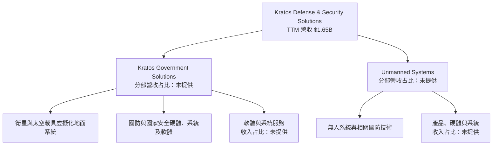
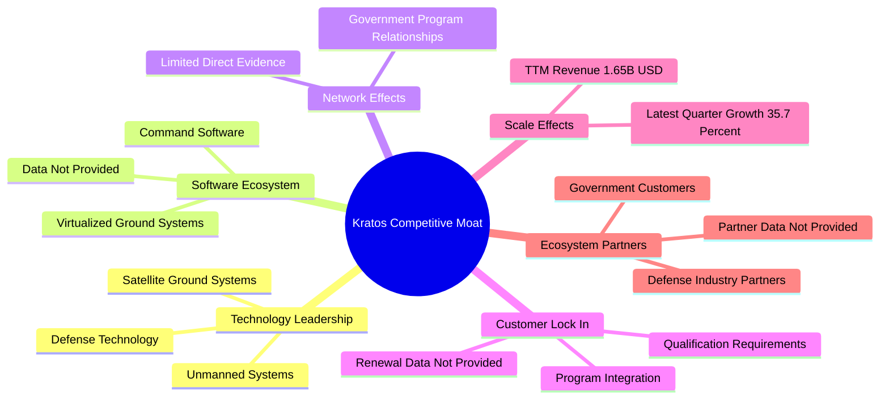
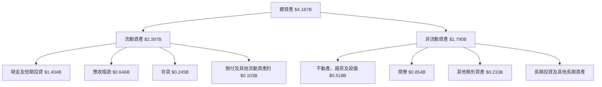
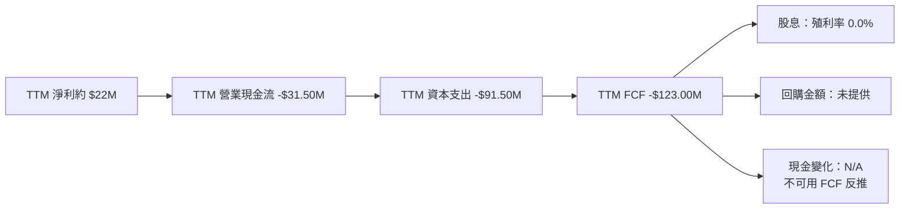
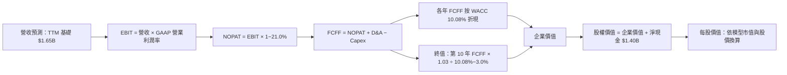
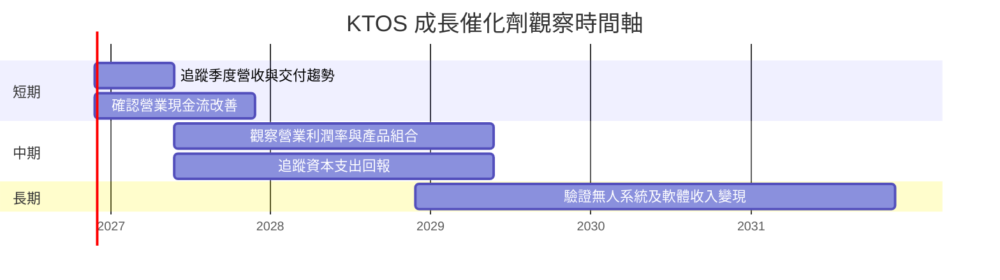
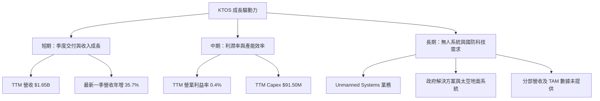
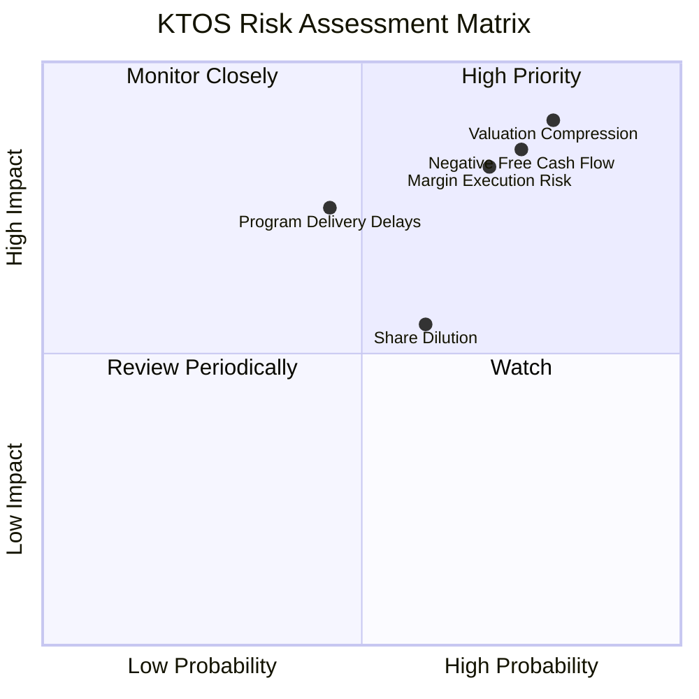
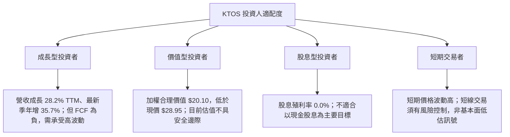

# KTOS 基本面深度分析報告
> **報告日期**：2026-11-26 ｜ **語言**：繁體中文 ｜ **數據來源**：SEC 申報資料 (XBRL)、Yahoo Finance、Finviz、StockAnalysis、Roic.ai ｜ **分析師**：CFA 級機構研究

## 目錄

| # | 章節 | 核心結論 |
|---|------|----------|
| 1 | 執行摘要 | 賣出；加權合理價值 $20.10，MOS -44.0% |
| 2 | 公司概覽與商業模式 | 國防與無人系統需求提供成長機會，但分部營收明細不足，護城河證據尚非全面 |
| 3 | 損益表深度分析 | TTM 營收 $1.65B、成長 28.2%；高成長尚未轉化成穩定營業利潤 |
| 4 | 資產負債表分析 | 現金及短期投資 $1.40B；流動性充裕，債務口徑存在來源差異 |
| 5 | 現金流量深度分析 | TTM FCF -$123.00M、FCF Yield -2.26%，投資與營運現金流仍承壓 |
| 6 | 獲利能力與資本效率 | ROIC 0.2% 遠低於 WACC 10.08%，目前未創造經濟價值 |
| 7 | 相對估值分析 | KTOS 成長快於同業，但估值倍數亦明顯較高 |
| 8 | DCF 內在價值評估 | 基準 DCF $9.93／股；加權合理價值 $20.10／股 |
| 9 | 成長催化劑 | 最新一季營收年增 35.7%；TAM 與分部營收占比資料未提供 |
| 10 | 風險矩陣 | 現金流轉負、利潤率薄弱與高估值為前三大風險 |
| 11 | 投資建議 | 現價 $28.95 高於加權合理價值；以財務轉化與估值回落作為再評估條件 |

---

## 1. 執行摘要

### 1.0 一頁式投資儀表板（Portfolio Manager 30 秒速讀）

| 項目 | 內容 |
|------|------|
| **投資論點（3 句）** | ① TTM 營收 $1.65B、年增 28.2%，最新一季年增 35.7%，成長動能明確。② TTM 營業利益率僅 0.4%、ROIC 0.2%，遠低於 10.08% WACC，營收成長尚未轉成足夠資本報酬。③ TTM FCF -$123.00M、FCF Yield -2.26%，加權合理價值 $20.10 低於 $28.95 收盤價。 |
| **綜合評分** | **4.7/10**（引用 1.1 六項平均） |
| **財務健康** | 🟡 現金及短期投資 $1.40B、流動比率 5.418；但 FCF 為負，且債務來源口徑有差異。 |
| **ROIC vs WACC** | **0.2% vs 10.08%**；目前資本報酬低於資本成本，摧毀經濟價值。 |
| **FCF 趨勢** | TTM FCF -$123.00M，仍為負；FCF Yield **-2.26%**。 |
| **估值** | Forward P/E **25.944582x** ｜ EV/EBITDA **47.744x** ｜ FCF Yield **-2.26%** |
| **DCF 內在價值（基準）** | **$9.93** ｜現價相對 DCF 溢價 **191.5%**（依折溢價定義計算） |
| **安全邊際（MOS）** | **-44.0%**＝（加權合理價值 $20.10 − 現價 $28.95）÷ 加權合理價值 $20.10；🔴 無安全邊際 |
| **預期報酬（基準情境 12M）** | DCF 基準情境 **-$19.02／股，-65.7%**；此為模型情境值，不是另行設定的 12 個月目標價。 |
| **關鍵風險（前二）** | FCF 持續為負；成長預期與估值已高於目前獲利能力所能支持的水準。 |
| **評級 + 信心度** | 🔴 **賣出** ｜信心：中（模型輸入與資料來源口徑存在限制） |

> DCF 折溢價以 DCF 基準值計算：`$28.95 ÷ $9.93 − 1 = 191.5%`。MOS 則只以 8.8 的加權合理價值為分母，兩者不可混用。

### 1.1 綜合評分卡（全報告唯一）

| 維度 | 評分（1–10） | 主要依據（引用數字與其來源章節） |
|------|--------------|----------------------------------|
| 成長性 | 8 | TTM 營收成長 28.2%，最新一季年增 35.7%（第 3 章）；但成長持續性及分部來源未能完整拆分。 |
| 獲利能力 | 2 | TTM 營業利益率 0.4%、ROIC 0.2% 對 WACC 10.08%；Piotroski F-Score 為 3/8（第 6 章）。 |
| 財務健康 | 8 | 現金及短期投資 $1.40B、流動比率 5.418、速動比率 4.632；FCF 為負構成扣分因素（第 4、5 章）。 |
| 估值 | 1 | MOS -44.0%；KTOS Forward P/E 25.944582x，高於同業中位數 18.6x（第 7、8 章）。 |
| 護城河 | 6 | 國防與無人系統定位、技術與客戶關係具有一定進入門檻；但沒有市場份額、客戶留存或合約分部數據可直接量化（第 2 章）。 |
| 管理層與資本配置 | 3 | 股權薪酬與股數增加、TTM FCF -$123.00M；現有數據未能證明成長投資已產生高於資本成本的回報（第 3、5 章）。 |
| **綜合評分** | **4.7** | 六項算術平均：`(8 + 2 + 8 + 1 + 6 + 3) ÷ 6 = 4.6667`，四捨五入至小數一位為 **4.7/10**。 |

評級由 MOS 門檻決定，綜合評分反映公司品質與估值的整體印象，不取代評級。

### 1.2 五大投資論點 + 三大核心風險

| 類型 | 項目 | 具體依據 | 信心度 |
|------|------|----------|--------|
| 🟢 **投資論點①** | 營收成長加速 | TTM 營收年增 28.2%；最新一季收入 $471.8M，年增 35.7%。這說明需求與交付量增長，但仍需營業利益率驗證成長品質。 | 🟢 高 |
| 🟢 **投資論點②** | 現金緩衝充足 | 現金及短期投資 $1.40B、流動比率 5.418；可提供營運與資本支出的融資彈性。 | 🟢 高 |
| 🟢 **投資論點③** | 毛利率優於部分大型承包商 | KTOS TTM 毛利率 23.0%，高於 LMT 11.7%，亦高於 NOC 20.0%；但成本結構與產品組合不同，不能單以毛利率推斷最終獲利。 | 🟡 中 |
| 🟢 **投資論點④** | 無人系統與國防技術需求具長期選擇權 | 公司營運涵蓋政府解決方案與無人系統；最新一季營收年增 35.7% 可作為近期需求證據，惟分部營收數據未提供。 | 🟡 中 |
| 🟢 **投資論點⑤** | 市場機構覆蓋廣 | 26 位分析師平均目標價 $73.69；該數字遠高於 DCF 及同業倍數估值，反映成長預期高，也凸顯預期落差風險。 | 🟡 中 |
| 🟡 **風險①** | 成長未轉為現金流 | TTM 營業現金流 -$31.50M、資本支出 $91.50M、FCF -$123.00M；若持續，內部融資能力受限。 | 🔴 高衝擊 |
| 🔴 **風險②** | 估值與獲利脫節 | Forward P/E 25.944582x、EV/EBITDA 47.744x；加權合理價值 $20.10 低於現價 $28.95。 | 🔴 高衝擊 |
| 🔴 **風險③** | 資本報酬低於資本成本 | ROIC 0.2% 對 WACC 10.08%，差距 -9.88 個百分點；若長期無法改善，成長可能不等於股東價值增加。 | 🔴 高衝擊 |

### 1.3 快速統計卡片

| 指標 | 公司實際值（期間） | 同業中位數 | 狀態 |
|------|--------------------|------------|------|
| 營收成長（TTM） | **28.2%** | — | 🟢 |
| 營收成長（最新一季年增） | **35.7%** | **6.7%** | 🟢 |
| 毛利率（TTM） | **23.0%** | **20.0%** | 🟢 |
| 營業利益率（TTM） | **0.4%** | — | 🔴 |
| ROIC（TTM） | **0.2%** | — | 🔴 |
| Forward P/E | **25.944582x** | **18.6x** | 🔴 |
| FCF Yield（TTM） | **-2.26%** | — | 🔴 |
| Piotroski F-Score | **3 / 8** | — | 🔴 |

同業中位數由 AVAV、LMT、NOC 已提供的 Peer multiples 計算；同業營收成長中位數為 6.7%，毛利率中位數為 20.0%。

### 1.4 投資結論

```text
╔══════════════════════════════════════════════════════════════════╗
║                    📊 投資結論摘要                               ║
╠══════════════════════════════════════════════════════════════════╣
║  評級：賣出（MOS -44.0%，符合規則 20）                           ║
║  價格（2026-11-25 收盤）：$28.95                                ║
║  DCF 內在價值（基準）：$9.93（現價溢價 191.5%）                 ║
║  安全邊際 MOS：-44.0%（＝(加權合理價值−現價)÷加權合理價值）     ║
║  加權合理價值（8.8）：$20.10                                    ║
║  DCF 情境價值：                                                  ║
║    悲觀情境：$8.22（-71.6%）                                    ║
║    基準情境：$9.93（-65.7%）                                    ║
║    樂觀情境：$13.85（-52.2%）                                   ║
║  綜合評分：4.7/10（引用 1.1）                                   ║
║  適合投資人：能承受高波動、願意追蹤成長落地情形者；不適合以    ║
║  當期現金流、低估值或股息收入為主要要求的投資人。              ║
╚══════════════════════════════════════════════════════════════════╝
```

---

## 2. 公司概覽與商業模式

### 2.1 業務結構與收入來源

公司資料指出 KTOS 透過 Kratos Government Solutions 與 Unmanned Systems 兩大部門經營，提供國防、國家安全及商業市場所需的技術、硬體、系統與軟體。最新 TTM 營收為 $1.65B，但兩部門的收入與占比未提供，故不推算分部營收比例。



業務模式同時包括專案交付、系統整合、產品與軟體；其收入可受政府合約時程、交付進度和資本投資影響。未提供服務型經常性收入占比，無法把整體收入直接視為高可預測訂閱收入。

### 2.2 市場份額

市場份額數據未提供，且新聞資料沒有提供可引用的市場份額數字，故不繪製份額圖。KTOS TTM 營收為 $1.65B、成長 28.2%，最新一季成長 35.7%，高於 AVAV、LMT、NOC 的最新一季收入成長中位數 6.7%；但這只能比較增長速度，不能替代市場份額。

### 2.3 競爭護城河分析



### 2.4 護城河強度

| 護城河項目 | 強度（強／中／弱） | 證據（引用數字或事實） | 會削弱它的情況 |
|------------|--------------------|------------------------|----------------|
| 技術與產品 | 中 | 提供無人系統、衛星地面系統及國防硬體、軟體與系統；最新一季營收年增 35.7%。 | 產品性能落後、研發成果未轉為合約或出貨。 |
| 軟體生態系統 | 中 | 公司有虛擬化地面系統及相關軟體；軟體收入占比、續約率及客戶留存數據未提供。 | 軟體未形成可觀經常性收入，或整合平台被替代。 |
| 網路效應 | 弱至中 | 政府計畫與系統整合可能形成使用經驗與合作關係；未提供網絡規模或平台使用量。 | 客戶集中、合約轉換或競標失利。 |
| 客戶鎖定 | 中 | 國防系統認證與整合可能提高更換供應商成本；合約期限及續約率未提供。 | 競標失敗、系統標準變更或客戶自製。 |
| 規模效應 | 中 | TTM 營收 $1.65B；規模擴大有機會攤薄研發與固定成本，但 TTM 營業利益率僅 0.4%。 | 收入成長仍無法帶動營業槓桿，或採購成本上升。 |
| 生態夥伴 | 弱至中 | 公司服務政府與國防市場；具體合作夥伴與供應鏈依賴數據未提供。 | 供應商短缺、合作夥伴競爭或合約架構改變。 |

1.1「護城河」評分為 **6/10**，理由是專業產品、國防整合與客戶資格可能形成進入門檻，但缺少市場份額、續約率及分部獲利數據，尚不足以證明其形成全面且可量化的超額報酬。

---

## 3. 損益表深度分析

### 3.1 年度收入成長趨勢（近 4 年）

年度收入由 2022 年 $898.30M 增至 2025 年 $1.35B。下方年度收入依資料表列示；YoY 以相鄰年度營收計算，CAGR 以 2022 至 2025 三個年度區間計算。

```text
╔══════════════════════════════════════════════════════════════════╗
║       Kratos 年度收入趨勢（FY2022–FY2025；數字：USD）           ║
╠══════════════════════════════════════════════════════════════════╣
║  FY2022  $0.8983B  █████████████░░░░░░░░░  基期                 ║
║  FY2023  $1.0370B  ███████████████░░░░░░░  YoY: +15.4% 🟢       ║
║  FY2024  $1.1360B  █████████████████░░░░░  YoY: +9.6%  🟡       ║
║  FY2025  $1.3470B  ████████████████████░░  YoY: +18.6% 🟢       ║
║                                                                  ║
║  FY2022–FY2025 三年 CAGR：((1.3470 ÷ 0.8983)^(1/3) − 1) = 14.5%║
╚══════════════════════════════════════════════════════════════════╝
```

FY2024 增長放緩至 9.6%，FY2025 回升至 18.6%；TTM 成長 28.2% 又高於 FY2025。這顯示近期需求或交付加速，但要持續創造價值，仍需看到營業利潤率及現金流同步改善。

### 3.2 季度收入趨勢分析

| 季度 | 營收 | QoQ | YoY | 備註 |
|------|------:|----:|----:|------|
| 2025 Q4 | $345.1M | -0.7% | 21.9% | QoQ 對比 2025 Q3 $347.6M；YoY 依季度收入成長資料。 |
| 2026 Q1 | $371.0M | 7.5% | 22.6% | QoQ 對比 2025 Q4；單季年增率為資料所列。 |
| 2026 Q2 | $458.8M | 23.7% | 30.5% | QoQ 對比 2026 Q1；收入上升但單季營業利益仍為 -$0.8M。 |
| 2026 Q3 | $471.8M | 2.8% | **35.7%** | 最新一季年增率；YoY 以財務數據的已核定值為準。 |

QoQ 計算例：`($471.8M ÷ $458.8M) − 1 = 2.8%`。季度收入連續上升，但 2026 Q3 營業損失 $4.0M，說明收入放量尚未確保利潤同步提升。

### 3.3 利潤率演變分析

| 利潤率指標 | FY2022 | FY2023 | FY2024 | FY2025 | 趨勢 | 評估 |
|------------|-------:|-------:|-------:|-------:|------|------|
| **毛利率** | 25.2% | 25.9% | 25.3% | 22.9% | FY2025 下滑約 2.4 個百分點 | 🟡 |
| **營業利益率** | 0.5% | 3.0% | 2.6% | 2.1% | 2023 高點後逐年回落 | 🔴 |
| **淨利率** | -4.1% | -0.9% | 1.4% | 1.6% | 由虧轉盈，但絕對水準仍薄 | 🟡 |

毛利率以年度毛利除年度營收計算，例如 FY2025 `307.9 ÷ 1,347 = 22.9%`。毛利率低於 2024，可能與產品組合、專案交付及成本結構有關；現有資料不足以將下降單獨歸因於定價或某一分部。年度營業利益由 FY2023 $31.5M 降至 FY2025 $27.7M，而收入增加至 $1.347B，顯示營業費用、投資投入或組合成本抵銷部分規模效益。

需注意來源口徑：核定 TTM 營業利益率為 **0.4%**、最新季度為 **-1.0%**；其他合併資料列示 TTM 0.7%、最新季度 0.8%。本報告涉及 TTM 與最新季判斷時採用核定數值，其他來源只用於交叉理解，不替換核定值。

### 3.4 費用結構分析

Mermaid 圓餅圖所需的完整、同口徑費用拆分未提供。雖有毛利與年度研發支出資料，但無法在同一 TTM 基礎下完整核對研發、銷售管理及其他營業費用，因此不製作費用圓餅圖。FY2025 研發支出為 $40.0M，約為當年營收的 3.0%；這項投入需由後續產品收入及利潤率改善驗證其回報。

### 3.5 季度 EPS 趨勢與盈餘品質（Quality of Earnings）

EPS 預估與實際值歷史表均未提供有效估計值（顯示為 `nan`），故**無法判斷最近四季 EPS 是否超預期或不及預期**。可見的季度 EPS 實際值為 2025 Q4 $0.03、2026 Q1 $0.07、2026 Q2 $0.02、2026 Q3 約 -$0.00；Q3 淨利為 -$0.2M，較 Q2 $4.4M 轉弱。EPS Surprise 數據缺漏，不以「beat/miss」下結論。

| 盈餘品質項目 | 數值／佔比 | 評估 |
|--------------|------------|------|
| 股權薪酬 SBC / 營收 | 估計 **3.6%**：最近四季 SBC $58.5M ÷ TTM 營收 $1,647M | 🔴 SBC 是非現金費用，但造成股東稀釋；最近四季股權薪酬依季度資料加總，非核定 TTM 項目。 |
| SBC / 營業現金流 | **-185.7%**：$58.5M ÷ -$31.50M | 🔴 OCF 為負，該比率作為比例解讀有限；其絕對值顯示 SBC 規模高於營業現金流絕對額。 |
| FCF / 淨利（現金轉換率） | **-559.1%**：-$123.00M ÷ $22M | 🔴 TTM 現金流未支持帳面淨利；營運資金及資本支出是可能因素，但資料不足以精確拆解。 |
| 一次性／非經常性損益 | N/A（未提供可核實明細） | 🟡 不將未披露項目假定為一次性收益或費用。 |
| 有效稅率異常 | N/A（缺少 TTM 稅前所得與所得稅費用） | 🟡 無法判斷淨利是否受特殊稅率影響。 |
| 資本化支出 vs 費用化 | TTM 資本支出 $91.50M；資本化支出的明細與資本化政策 N/A | 🟡 無法僅憑總 Capex 判斷是否有成本資本化過度。 |

**盈餘品質結論**：TTM 淨利約 $22M，但 FCF 為 -$123.00M、營業現金流為 -$31.50M；現金轉換率低，且近期 SBC 約為收入 3.6%。因此，單看 GAAP 淨利容易高估目前可分配給股東的經濟收益，估值應重視現金流能否轉正，而不宜只依 EPS 倍數。

---

## 4. 資產負債表分析

### 4.1 資產結構分解

最新 TTM 資產負債表資料列示總資產 $4.187B、流動資產 $2.397B。非流動資產以總資產減流動資產計算為 $1.790B；此為從同一份資產負債表的總額差額計算。



### 4.2 流動性與營運資金分析

| 指標 | 最新值 | 歷史或比較 | 評估 |
|------|-------:|-------------|------|
| 流動比率 | 5.418 | N/A（無可比的核定歷史數字） | 🟢 流動資產相對流動負債充足。 |
| 速動比率 | 4.632 | N/A（無可比的核定歷史數字） | 🟢 排除存貨後仍有較高短期償債緩衝。 |
| 現金及短期投資 | $1.40B | 一年前期末現金與短投 $329.3M（StockAnalysis） | 🟢 現金資源增加，但現金增幅不等同營運造現能力。 |

**營運資金天數**（照錄品質指標）：

| 指標 | 最新 TTM | 一年前 TTM | 變化 | 解讀 |
|------|---------:|-----------:|-----:|------|
| DSO 應收帳款天數 | 42 天 | 39 天 | +3 天 | 收款週期延長；需觀察合約收款與營收成長是否同步。 |
| DIO 存貨天數 | 70 天 | 66 天 | +4 天 | 存貨占用增加；若交付延遲，可能拖累現金流。 |
| DPO 應付帳款天數 | 32 天 | 24 天 | +8 天 | 延長付款期間有助短期現金，但不能據此斷定供應商議價力改善。 |
| CCC 現金轉換週期 | 80 天 | 81 天 | -1 天 | 整體週期略縮短；DSO、DIO 惡化被 DPO 延長部分抵銷。 |

CCC 算式與品質指標口徑一致：最新 `42 + 70 − 32 = 80 天`；一年前 `39 + 66 − 24 = 81 天`。

### 4.3 債務結構分析

核定財務數據列示總債務 **N/A**、淨現金 $1.40B。其他市場資料列示總債務 $246.0M、淨現金 $1.16B，與核定欄位口徑不同；本節遵照核定值，不自行把兩組數字混合。債務 EBITDA 倍數與利息保障倍數因核定總債務及利息費用細節缺漏，不計算。

```text
╔══════════════════════════════════════════════════════════════════╗
║                   KTOS 債務健康診斷                             ║
╠══════════════════════════════════════════════════════════════════╣
║  總債務：        N/A（核定財務數據未提供）                       ║
║  總現金+短期投資：$1.40B                                          ║
║  淨現金：        $1.40B（核定數值）                     🟢       ║
║                                                                  ║
║  Debt/EBITDA：   N/A（債務口徑缺漏）                              ║
║  Interest Coverage：N/A（利息費用與核定債務明細未提供）          ║
║  結論：流動性緩衝高，但負 FCF 使現金消耗速度成為需追蹤項目。     ║
╚══════════════════════════════════════════════════════════════════╝
```

### 4.4 股東權益趨勢

| 財年 | 股東權益 | YoY 變化 | 解讀 |
|------|---------:|---------:|------|
| 2022 | $936.3M | — | 歷史基礎。 |
| 2023 | $976.0M | +4.2% | 小幅增加。 |
| 2024 | $1.350B | +38.3% | 權益增加；具體由盈餘、融資或其他權益項目的拆分未提供。 |
| 2025 | $2.000B | +48.1% | 資產負債表擴大；不能將權益增幅直接視為內生獲利成長。 |

```text
╔══════════════════════════════════════════════════════════════════╗
║               KTOS 歷年股東權益（USD）                           ║
╠══════════════════════════════════════════════════════════════════╣
║  2022  $0.936B  █████████░░░░░░░░░░░                             ║
║  2023  $0.976B  ██████████░░░░░░░░░░                             ║
║  2024  $1.350B  ██████████████░░░░░                               ║
║  2025  $2.000B  ████████████████████                              ║
╚══════════════════════════════════════════════════════════════════╝
```

---

## 5. 現金流量深度分析

### 5.1 現金流量瀑布圖

淨利使用 TTM 約 $22M；核定營業現金流、Capex 與 FCF 為 -$31.50M、$91.50M 與 -$123.00M。股息殖利率為 0.0%；股票回購金額未提供。



### 5.2 FCF 轉換率趨勢

| 期間 | FCF | 淨利 | FCF / 淨利 | 解讀 |
|------|----:|----:|-----------:|------|
| 2022 | -$71.1M | -$36.9M | 192.7% | 分子、分母均負，正比率不代表良好現金轉換。 |
| 2023 | $12.8M | -$8.9M | -143.8% | 低淨利基數使比率失真，應看現金流金額。 |
| 2024 | -$8.5M | $16.3M | -52.1% | 盈利未轉為正 FCF。 |
| 2025 | -$137.4M | $22.0M | -624.5% | 高資本支出使 FCF 明顯轉負。 |
| TTM 至 2026-09-27 | -$123.00M | 約 $22M | 約 -559.1% | FCF 低於淨利；具體 TTM 淨利口徑需留意季度報表差異。 |

年度 FCF／淨利比率以列示年度金額直接相除；負淨利年份不宜用比率作為單一品質評價。

### 5.3 自由現金流趨勢

年度 FCF 來自現金流資料；TTM FCF 依核定「營業現金流減資本支出」口徑。年末歷史 FCF Yield 未提供，故不推算。

```text
╔══════════════════════════════════════════════════════════════════╗
║              KTOS 自由現金流：歷史與 TTM（USD）                  ║
╠══════════════════════════════════════════════════════════════════╣
║  FY2022  -$71.1M  ████████████████░░░░  負值                     ║
║  FY2023   $12.8M  ░░░░░░░░░░░░░░░░░░░░  正值                     ║
║  FY2024   -$8.5M  ██░░░░░░░░░░░░░░░░░░  負值                     ║
║  FY2025 -$137.4M  ████████████████████  負值                     ║
║  TTM    -$123.0M  ██████████████████░░  FCF Yield: -2.26%        ║
╚══════════════════════════════════════════════════════════════════╝
```

### 5.4 資本配置評估

| 資本用途 | 可用數據 | 評估 |
|----------|----------|------|
| 資本支出 | TTM $91.50M | 約占 TTM 營收 5.6%；Capex 高於營業現金流，造成 TTM FCF 為負。 |
| 股息 | 殖利率 0.0% | 無現金股息回報。 |
| 回購 | N/A | 未提供回購金額；品質指標顯示稀釋股數未維持不變。 |
| SBC | 2025 年 $35.5M；最近四季季度資料加總 $58.5M | 股權薪酬對員工留任及成長有用，但會稀釋現有股東。 |
| 留存與併購 | 分項金額 N/A | 不製作資本配置圓餅圖，以免把未提供的用途比例當作事實。 |

---

## 6. 獲利能力與資本效率

### 6.1 ROE / ROA / ROIC 趨勢

| 指標 | 最新 TTM | 歷史資料可比性 | 評估 |
|------|---------:|----------------|------|
| ROE | **0.6%**（核定品質指標） | 核定歷史序列未提供 | 🔴 股東權益報酬低。 |
| ROA | **0.2%**（市場資料） | 核定歷史序列未提供 | 🔴 資產獲利能力有限。 |
| ROIC | **0.2%**（核定） | 核定歷史序列未提供 | 🔴 明顯低於 10.08% WACC。 |

其他合併財務資料列示 ROE 0.8%、ROA 0.2%；本報告 ROE 採核定 QUALITY FIGURES 的 0.6%，不混用不同來源的期間或分母。

### 6.2 ROIC vs WACC 分析（核心價值創造判斷）

```text
╔══════════════════════════════════════════════════════════════════╗
║                ROIC vs WACC 深度分析                            ║
╠══════════════════════════════════════════════════════════════════╣
║  WACC（採用核定資本成本數值）：                                  ║
║  ├── 無風險利率（10Y 美債）：         4.85%                      ║
║  ├── 股權風險溢酬 ERP：               5.00%                      ║
║  ├── 原始 Beta（Yahoo）：             1.17                       ║
║  ├── 調整後 Beta：                    1.11                       ║
║  ├── 股權成本：4.85% + 1.11×5.00% = 10.40%                     ║
║  ├── 稅前債務成本：                   3.90%                      ║
║  ├── 稅後債務成本：3.90%×(1−21%) = 3.081%                       ║
║  ├── 股權／債務權重：                 95.7%／4.3%                ║
║  └── WACC：                           10.08%                     ║
║                                                                  ║
║  ROIC 與價值差：                                                ║
║  ├── ROIC（TTM）：                    0.2%                       ║
║  ├── WACC：                           10.08%                     ║
║  └── EVA 利差：0.2% − 10.08% =      -9.88 個百分點             ║
║                                                                  ║
║  ROIC  0.2%   ░░░░░░░░░░░░░░░░░░░░░░░░░░░░░░░░░░                ║
║  WACC 10.08%  ▓▓▓▓▓▓▓▓▓▓▓▓▓▓▓▓▓▓▓▓▓▓▓▓▓▓▓▓▓▓▓▓                ║
║                                                                  ║
║  結論：ROIC 低於 WACC 9.88 個百分點；目前尚未創造經濟價值。    ║
╚══════════════════════════════════════════════════════════════════╝
```

核定資本成本另列權重與 WACC；但債務金額及利息費用未完整提供，無法獨立從資產負債表重建其債務權重。CAPM 算式可核對：`4.85% + 1.11 × 5.00% = 10.40%`；WACC 使用核定的 10.08%，以維持與 DCF 一致。

### 6.3 杜邦三因素分解

以下數值照錄 QUALITY FIGURES；ROE 採其列示值。

| 因素 | 數值（TTM） | 解讀 |
|------|-------------|------|
| 淨利率 | 1.3% | 正淨利但利潤率低，獲利改善幅度有限。 |
| 資產週轉率 | 0.39 | 每單位資產產生的營收有限；資產擴張需帶來更多營收或利潤。 |
| 權益乘數 | 1.21 | 財務槓桿不高，ROE 並非主要靠高槓桿推升。 |
| **ROE** | **0.6%** | QUALITY FIGURES 列示：`1.3% × 0.39 × 1.21 = 0.6%`。 |

### 6.4 財務體質：Piotroski F-Score

**Piotroski F-Score：3 / 8**。有一項測試因缺少負債輸入無法判定，故分母為 8，而非 9。

| 測試 | 結果 | 解讀 |
|------|------|------|
| ROA > 0 | ✅ 通過 | 資產報酬略為正值。 |
| 營業現金流 > 0 | ❌ 未通過 | TTM OCF -$31.50M。 |
| ROA 高於一年前 | ❌ 未通過 | 未達測試要求。 |
| 營業現金流 > 淨利（應計品質） | ❌ 未通過 | 現金流未覆蓋會計盈餘。 |
| 長期負債 ÷ 總資產低於一年前 | — 無法判定 | 缺少可比較負債資料。 |
| 流動比率高於一年前 | ✅ 通過 | 短期流動性改善。 |
| 稀釋股數未增加 | ❌ 未通過 | 股數有增加，不利每股收益與所有權比例。 |
| 毛利率高於一年前 | ✅ 通過 | 品質指標測試為通過；與年度毛利率變化應留意期間口徑差異。 |
| 資產週轉率高於一年前 | ❌ 未通過 | 資產使用效率未改善。 |

分數為 3/8，主要弱項集中在現金流、應計品質、稀釋股數與資產周轉，與高營收成長但低 ROIC 的觀察一致。

---

## 7. 相對估值分析

### 7.1 同業估值比較表格

| 估值指標 | **KTOS** | **AVAV** | **LMT** | **NOC** | KTOS 評估 |
|----------|---------:|---------:|--------:|--------:|-----------|
| **Trailing P/E** | 241.2x | N/A | 21.3x | 17.5x | 🔴 KTOS 盈利基數小，P/E 可比性有限且倍數高。 |
| **Forward P/E** | 25.944582x | 20.7x | 18.0x | 18.6x | 🔴 高於同業中位數 18.6x；須依賴盈利大幅增長。 |
| **P/S Ratio** | 3.3x | 2.3x | 1.7x | 1.8x | 🔴 高於同業中位數 1.8x。 |
| **EV/EBITDA** | 47.744x | 22.4x | 15.5x | 12.7x | 🔴 顯著高於同業中位數 15.5x。 |
| **最新一季營收 YoY** | 35.7% | 5.7% | 11.3% | 6.7% | 🟢 成長快，但高增長需轉化成利潤與現金。 |
| **毛利率（TTM）** | 23.0% | 26.5% | 11.7% | 20.0% | 🟢 高於 LMT、NOC，略低於 AVAV。 |

KTOS 的成長率明顯高於同業，但 Forward P/E、P/S 與 EV/EBITDA 皆高於同業中位數。若成長放緩或利潤率改善不及預期，估值倍數存在下修風險。

### 7.2 歷史估值區間分析

```text
╔══════════════════════════════════════════════════════════════════╗
║            KTOS 自身 5 年估值位置（TTM multiples）               ║
╠══════════════════════════════════════════════════════════════════╣
║  P/E       現值 241.2x ｜中位數 380.2x｜百分位 27%               ║
║  P/S       現值   3.3x ｜中位數   3.2x｜百分位 60%               ║
║  EV/EBITDA 現值  48.8x ｜中位數  55.5x｜百分位 35%               ║
║                                                                  ║
║  P/E 歷史高端受接近零盈餘期間影響，極端值不具一般比較意義。     ║
╚══════════════════════════════════════════════════════════════════╝
```

依歷史區間資料，P/E 百分位 27%、EV/EBITDA 百分位 35%，低於自身五年中位數，但 P/S 百分位 60%、現值 3.3x 高於中位數 3.2x。這不代表絕對便宜：KTOS 當前獲利低、FCF 為負，歷史 P/E 區間亦受接近零盈餘影響。

### 7.3 情境價值（Bear / Base / Bull，照抄 DCF MODEL 的 Scenarios）

| 情境 | 第 1 年營收成長 | 期末營業利潤率 | WACC | 每股價值 | 相對現價 | 機率 | 會發生的條件 |
|------|----------------:|----------------:|-----:|---------:|---------:|-----:|--------------|
| 🔴 悲觀 | 14.1% | 1.6% | 11.08% | $8.22 | -71.6% | 25% | 成長較基準慢，利潤率只升至 1.6%，資本成本較高。 |
| 🟡 基準 | 28.2% | 1.9% | 10.08% | $9.93 | -65.7% | 50% | TTM 成長延續至預測初期，再逐步減速；利潤率緩步升至 1.9%。 |
| 🟢 樂觀 | 42.3% | 2.1% | 9.08% | $13.85 | -52.2% | 25% | 初期營收增長高於 TTM，且利潤率改善、資本成本下降。 |

以上情境均來自 DCF MODEL；情境資料未另列各自的永續成長率，故不自行填入。

### 7.4 相對估值隱含價格區間

```text
╔══════════════════════════════════════════════════════════════════╗
║            估值方法每股價值（USD；依核定估值方法）               ║
╠══════════════════════════════════════════════════════════════════╣
║  $9.93 ───── $14.32 ───── $20.71 ───── $28.95 ───── $73.69      ║
║  DCF          EV/EBITDA     Forward P/E  現價        共識目標價   ║
╚══════════════════════════════════════════════════════════════════╝
```

- 同業 Forward P/E：同業中位數 18.6x × KTOS Forward EPS 1.12，估值方法列示 **$20.71／股**。
- 同業 EV/EBITDA：同業中位數 15.5x，乘以 TTM EBITDA 並加回淨現金，估值方法列示 **$14.32／股**。
- 分析師共識：26 位分析師平均目標價 **$73.69／股**，屬市場預期參考，不是本報告自行推導的基本面價值。
- DCF 基準為 **$9.93／股**；現價 $28.95 高於以上三種基本面方法所示價值。

---

## 8. DCF 內在價值評估（Discounted Cash Flow）

### 8.0 估值推理鏈（Thinking Logic：在算之前先想清楚）

**Step 1 — 價值由哪些變數決定？**

KTOS 的估值主要由現有政府解決方案及無人系統收入基礎、收入成長能否轉為營業利潤，以及資本支出後的現金流決定。公司只提供總 TTM 營收 $1.65B，沒有分部營收占比，因此無法把兩業務的收入比重分別量化。就本模型而言，**營收成長與利潤率擴張**共同主導價值；其中終值所依賴的長期 FCFF 與折現率，對每股價值尤其敏感。

**Step 2 — 模型選擇**

| 決策點 | 本報告採用 | 理由（含數字） | 曾考慮但否決 | 否決理由 |
|--------|-----------|----------------|--------------|----------|
| 現金流定義 | FCFF | 以 WACC 10.08% 折現，再加淨現金橋接至股權價值。 | FCFE | 債務與其變化資料不完整；FCFF 較適合以企業價值為起點。 |
| 預測期 N | 10 年 | DCF MODEL 固定 10 年，收入成長從 28.2% 線性降至 3.0%。 | 5 年 | 無法照錄模型已提供的逐年預測與終值輸出。 |
| 終值方法 | Gordon Growth | 模型使用永續成長率 3.0% 與 WACC 10.08%。 | 退出倍數 | DCF MODEL 未提供退出倍數終值；本報告不另建模型補入。 |
| EBIT 基礎 | GAAP EBIT | 模型明列 GAAP EBIT。 | 非 GAAP EBIT | 可能加回 SBC，與模型輸入不一致。 |

**Step 3 — 關鍵假設四段式推導**

- **營收成長**：錨點＝TTM 對前一 TTM 成長 28.2%；調整＝模型令成長率由第 1 年 28.2% 線性降至第 10 年 3.0%，反映近期高速成長不應永久延續；**採用第 1 年 28.2%、第 10 年 3.0%**；替代值曾可採較低的起始成長，但模型未提供此一 DCF 基準，故不自行更改。
- **期末營業利潤率**：錨點＝TTM GAAP 營業利潤率 0.4%；調整＝模型假設隨規模與組合逐步改善，並以近五個財年的中位數為終點；**採用第 1 年 0.4% 至第 10 年 1.9%**；不採用更高利潤率，因歷史數字未證明公司已建立持續高利潤模式。
- **永續成長率 g**：錨點＝模型採 3.0%；調整＝維持長期低於 WACC 的成長假設；**採用 3.0%**；不採用接近 10.08% 的高 g，以免終值分母過度收窄。
- **預測期 N**：錨點＝模型設定 10 年；調整＝讓短期高成長逐步淡出至成熟期；**採用 10 年**；不擅自縮短或延長，以免改變模型所列企業價值。
- **Capex／營收**：錨點＝TTM 5.6%；調整＝模型由第 1 年 5.6% 緩降至第 10 年 5.1%，仍保留較高再投資要求；**採用模型逐年值**；不直接降至 D&A 水準，因模型採 1.1 倍 D&A 的成熟期門檻。
- **GAAP EBIT、SBC 與稀釋**：錨點＝GAAP EBIT 已將 SBC 列為費用；調整＝模型不重複扣 SBC，也不額外稀釋股數；**採用組合 (A)：GAAP EBIT、無 SBC 額外扣除、年稀釋率 0%**；否決再扣 SBC 或另加年稀釋，因會對同一成本重複計算。
- **終值方法**：錨點＝模型採 Gordon Growth；調整＝以第 10 年 FCFF 為永續期基礎；**採用 Gordon Growth**；不補建退出倍數法，因模型未提供該方法的 DCF 終值計算。
- **WACC**：錨點＝核定資本成本 WACC 10.08%；調整＝不自行替代核定 Beta、ERP 或資本結構；**採用 10.08%**；否決使用其他折現率，避免第 6.2 節及估值模型口徑分歧。
- **D&A／營收、稅率**：D&A／營收以 TTM 4.7% 固定；稅率採 21.0%。均依模型指定輸入，並非本報告另行估計。
- **營運資金**：模型未納入 Working Capital；因此不加一列 ΔWC，也不以缺漏數字補算。

**Step 4 — 最脆弱環節**

最脆弱處是當前低營業利潤率能否在收入成長下逐步擴張；若未達模型第 10 年 1.9% 的利潤率，或再投資需求高於模型假設，價值將低於 DCF 基準 $9.93。

**Step 5 — 計算路徑圖**



### 8.1 模型假設總表（Model Inputs）

| 假設項目 | 採用值 | 依據／來源 | 敏感度 |
|----------|--------|-------------|--------|
| 預測期長度 N | 10 年 | DCF MODEL 固定 10 年；成長與利潤率逐年淡化。 | 🟡 中 |
| 營收成長 | FY+1 28.2% 線性降至 FY+10 3.0% | 起點採 TTM YoY 28.2%；終點採模型假設。 | 🔴 高 |
| 營業利潤率 | 0.4% 至 1.9% | 起點為核定 TTM 0.4%；終點為模型所列近五財年中位數。 | 🔴 高 |
| 有效稅率 | 21.0% | DCF MODEL 的預設稅率。 | 🟢 低 |
| Capex／營收 | 5.6% 降至 5.1% | 起點為 TTM Capex／營收；模型按期淡化至 1.1×D&A。 | 🟡 中 |
| D&A／營收 | 4.7% | DCF MODEL 的 TTM 比率，固定使用。 | 🟢 低 |
| 營運資金變動 | 未建模 | DCF MODEL 明確註明 Working Capital is not modelled。 | 🟢 低 |
| EBIT 基礎 | GAAP | 模型使用 GAAP EBIT。 | 🟡 中 |
| SBC 處理 | 組合 (A)：不再扣 SBC | GAAP EBIT 已含 SBC 費用；股數不再額外稀釋。 | 🟡 中 |
| 年稀釋率 | 0%（模型處理） | 與 GAAP EBIT 組合相容；當期股數反映在模型的價格／市值換算中。 | 🟡 中 |
| 永續成長率 g | 3.0% | DCF MODEL 指定值；低於 WACC 10.08%。 | 🔴 高 |
| 終值方法 | Gordon Growth | DCF MODEL 指定終值公式。 | 🔴 高 |
| WACC | 10.08% | 核定 Cost of capital，見 8.2。 | 🔴 高 |

本模型採用 **(A) GAAP EBIT + 固定股數**：EBIT 已含 SBC 費用，FCFF 不另扣 SBC，亦不再以年稀釋率擴大股數，因此 SBC 影響計入一次。FCFF 定義為 `NOPAT + D&A − Capex`，不含 ΔWC，與模型一致。

### 8.2 折現率推導（WACC）

```text
╔══════════════════════════════════════════════════════════════════╗
║                    WACC 推導（折現率）                           ║
╠══════════════════════════════════════════════════════════════════╣
║  股權成本 Ke（CAPM）：                                           ║
║  ├── 無風險利率 Rf（10Y 美債）：      4.85%                     ║
║  ├── ERP：                            5.00%                     ║
║  ├── 原始 Beta（Yahoo）：             1.17                      ║
║  ├── 調整 Beta：                      1.11                      ║
║  └── Ke = 4.85% + 1.11×5.00% =      10.40%                     ║
║                                                                  ║
║  債務成本：                                                      ║
║  ├── 稅前 Kd（核定值）：               3.90%                     ║
║  ├── 稅率：                           21.0%                     ║
║  └── 稅後 Kd = 3.90%×(1−21.0%) =      3.081%                   ║
║                                                                  ║
║  資本結構權重：                                                  ║
║  ├── 股權權重 E：                     95.7%                     ║
║  ├── 債務權重 D：                      4.3%                     ║
║  └── WACC = 95.7%×10.40% + 4.3%×3.081% = 10.08%                 ║
╚══════════════════════════════════════════════════════════════════╝
```

逐步演算：

1. **Ke（CAPM）**：`4.85% + 1.11 × 5.00% = 10.40%`。
2. **稅前 Kd**：核定值 **3.90%**。利息費用與平均計息負債的分項金額未提供，故無法以利息除平均計息負債獨立重建。
3. **稅後 Kd**：`3.90% × (1 − 21.0%) = 3.081%`。
4. **權重**：核定股權／債務權重為 **95.7%／4.3%**，合計 `95.7% + 4.3% = 100.0%`。最新收盤價為 2026-11-25 的 $28.95；計息負債金額缺漏，故不另以市值反推債務金額。
5. **WACC**：`95.7% × 10.40% + 4.3% × 3.081% = 9.9528% + 0.1325% = 10.0853%`，核定採用值 **10.08%**。細項以顯示精度計算產生約 0.01 個百分點四捨五入差異；後續折現使用核定 WACC 10.08%。

Rf 的具體觀察日期未列明，ERP 為模型假設；故採用核定資本成本資料，不另加規模或國別溢酬。第 6.2 與本章均使用 WACC 10.08%。

### 8.3 逐年自由現金流預測（基準情境）

以下逐年數字照錄 DCF MODEL，單位 USD billions；不另增 ΔWC 列，因模型未建模營運資金。

| 年度 | FY+1 | FY+2 | FY+3 | FY+4 | FY+5 | FY+6 | FY+7 | FY+8 | FY+9 | FY+10 |
|------|-----:|-----:|-----:|-----:|-----:|-----:|-----:|-----:|-----:|------:|
| 營收 | 2.11 | 2.65 | 3.24 | 3.88 | 4.54 | 5.19 | 5.78 | 6.28 | 6.64 | 6.84 |
| 營收 YoY | 28.2% | 25.4% | 22.6% | 19.8% | 17.0% | 14.2% | 11.4% | 8.6% | 5.8% | 3.0% |
| 營業利潤率 | 0.4% | 0.6% | 0.7% | 0.9% | 1.1% | 1.2% | 1.4% | 1.6% | 1.7% | 1.9% |
| EBIT（GAAP） | 0.01 | 0.01 | 0.02 | 0.03 | 0.05 | 0.06 | 0.08 | 0.10 | 0.12 | 0.13 |
| − 稅（21.0%） | 0.00 | 0.00 | 0.00 | 0.01 | 0.01 | 0.01 | 0.02 | 0.02 | 0.02 | 0.03 |
| NOPAT | 0.01 | 0.01 | 0.02 | 0.03 | 0.04 | 0.05 | 0.06 | 0.08 | 0.09 | 0.10 |
| + D&A | 0.10 | 0.12 | 0.15 | 0.18 | 0.21 | 0.24 | 0.27 | 0.29 | 0.31 | 0.32 |
| − Capex | 0.12 | 0.15 | 0.18 | 0.21 | 0.24 | 0.28 | 0.31 | 0.33 | 0.34 | 0.35 |
| FCFF | -0.01 | -0.01 | -0.01 | -0.00 | 0.01 | 0.02 | 0.03 | 0.04 | 0.06 | 0.07 |
| 折現因子 | 0.908 | 0.825 | 0.750 | 0.681 | 0.619 | 0.562 | 0.510 | 0.464 | 0.421 | 0.383 |
| PV | -0.01 | -0.01 | -0.01 | -0.00 | 0.00 | 0.01 | 0.01 | 0.02 | 0.02 | 0.03 |

**逐步演算（FY+1，使用模型列示精度）**

1. **營收**：`$1.65B × (1 + 28.2%) = $2.1153B`，模型列示 **$2.11B**。
2. **EBIT**：`$2.11B × 0.4% = $0.00844B`，模型列示 **$0.01B**。
3. **稅**：`$0.00844B × 21.0% = $0.0017724B`，模型列示 **$0.00B**。
4. **NOPAT**：`$0.00844B − $0.0017724B = $0.0066676B`，模型列示 **$0.01B**。
5. **D&A**：`$2.11B × 4.7% = $0.09917B`，模型列示 **$0.10B**。
6. **Capex**：`$2.11B × 5.6% = $0.11816B`，模型列示 **$0.12B**。
7. **ΔWC**：不納入；模型明確未建模。
8. **FCFF**：依精確未四捨五入的模型值計算後，列示為 **-$0.01B**；以展示後的各項數字重算會受四捨五入影響。
9. **折現因子與 PV**：`1 ÷ (1 + 10.08%)^1 = 0.908`；`FY+1 FCFF × 0.908`，模型列示 PV **-$0.01B**。

**預測期 FCF 現值合計**：DCF MODEL 列示預測期 PV 合計 **$0.07B**。年度 PV 為兩位小數，直接加總會受四捨五入影響；原始未四捨五入金額未提供，故不能以展示值相加取代模型合計。

**合理性自檢**

- 預測 FCF CAGR：模型前段 FCFF 為負，且初期跨越零值，不適用一般正值 CAGR；歷史年度 FCF 由 FY2022 -$71.1M 到 FY2025 -$137.4M，中間有正值及負值，亦不適合直接計算穩健 CAGR。
- FY+10 FCF 利潤率：`$0.07B ÷ $6.84B = 約 1.0%`；目前 TTM FCF 利潤率 `-$0.123B ÷ $1.65B = -7.5%`。同業最佳 FCF 利潤率資料未提供，故不作排名。
- FY+1 至 FY+4 FCFF 為負，FY+5 起轉正；負值會降低預測期現值，並顯示模型假設公司須經過多年投資才能產生正 FCFF。

```text
╔══════════════════════════════════════════════════════════════════╗
║            自由現金流：歷史實際 vs 模型預測（USD B）            ║
╠══════════════════════════════════════════════════════════════════╣
║  FY2023(實)   $0.013B   正值                                     ║
║  FY2024(實)  -$0.009B   負值                                     ║
║  FY2025(實)  -$0.137B   負值                                     ║
║  FY+1 (預)   -$0.01B    FCFF                                     ║
║  FY+10(預)    $0.07B    FCFF                                     ║
╠══════════════════════════════════════════════════════════════════╣
║  歷史 FCF 波動且 TTM 為 -$0.123B；預測由負轉正，須由營運改善驗證║
╚══════════════════════════════════════════════════════════════════╝
```

### 8.4 終值計算（Terminal Value）

**適用性檢查**：`WACC 10.08% vs g 3.0% → WACC > g？✅`

| 方法 | 計算式 | 終值 TV | TV 現值 | 佔總 EV 比重 |
|------|--------|---------|---------|--------------|
| Gordon Growth | DCF MODEL 列示：`0.07 × (1 + 3.0%) ÷ (10.08% − 3.0%)` | $1.03B | $0.39B | 84.5% |
| 退出倍數法 | N/A（DCF MODEL 未提供退出倍數終值） | N/A | N/A | N/A |

模型所列 Gordon Growth 輸出為 **$1.03B**，PV 為 **$0.39B**，佔 EV **84.5%**。終值現值超過企業價值 75%，表示本估值高度依賴終值假設，短期現金流貢獻有限。因模型輸出只提供四捨五入後的 FCFF、TV 與 PV，各步驟以展示精度直接重算可能有尾差；本報告照錄模型的完整輸出，不用展示後的近似值改寫模型結果。

逐步演算（依 DCF MODEL 列示）：

1. **FY+10 FCFF**：模型列示 `$0.07B`。
2. **分子**：`$0.07B × (1 + 3.0%)`；模型終值計算使用未四捨五入 FCFF，故列示結果以模型為準。
3. **分母**：`10.08% − 3.0% = 7.08%`；模型列示 TV **$1.03B**。
4. **PV(TV)**：模型列示 `TV $1.03B × FY+10 折現因子 0.383 = $0.39B`。
5. **終值佔比**：模型列示 `PV(TV) ÷ EV = 84.5%`。

### 8.5 企業價值 → 每股內在價值（Bridge）

```text
╔══════════════════════════════════════════════════════════════════╗
║              企業價值 → 每股內在價值 橋接表                      ║
╠══════════════════════════════════════════════════════════════════╣
║  預測期 FCF 現值合計             +$0.07B                         ║
║  終值現值 PV(TV)                 +$0.39B                         ║
║  ─────────────────────────────────────────────                  ║
║  = 企業價值 EV                    $0.47B                         ║
║  + 淨現金                         +$1.40B                         ║
║  = 股權價值                        $1.87B                         ║
║  每股內在價值（模型輸出）          $9.93                          ║
║  當前股價（2026-11-25 收盤）       $28.95                         ║
║  折溢價                            +191.5%（溢價）                ║
╚══════════════════════════════════════════════════════════════════╝
```

逐步演算與口徑：

1. **EV**：模型列示預測期 PV 合計 $0.07B、PV(TV) $0.39B，EV 列示 **$0.47B**；顯示值相加有四捨五入尾差，未四捨五入原始值未提供。
2. **股權價值**：`$0.47B + $1.40B = $1.87B`（模型列示）。
3. **每股價值**：模型公式為 `股權價值 × 價格 ÷ 市值`，`$1.87B × $28.95 ÷ $5.45B = $9.93`（股數與市值按模型口徑處理；報價日期為 2026-11-25）。
4. **折溢價**：`$28.95 ÷ $9.93 − 1 = 191.5%`。
5. **本節不計算 MOS**：MOS 只在 8.8 以加權合理價值為分母計算。

DCF 模型使用的淨現金為 $1.40B；核定總債務為 N/A。股數依模型每股換算邏輯使用，不在此另行估算稀釋股數。

### 8.6 敏感性分析（WACC × 永續成長率）

以下矩陣逐格照錄 DCF MODEL。括號為依最新收盤價 $28.95 計算的相對上行／下行；矩陣基準格 $9.93。

| g（列）／WACC（欄） | 8.08% | 9.08% | **10.08%（基準）** | 11.08% | 12.08% |
|-----------|------:|------:|-------------------:|-------:|-------:|
| **2.0%** | $10.82 (-62.6%) | $10.15 (-64.9%) | $9.66 (-66.6%) | $9.28 (-68.0%) | $8.99 (-68.9%) |
| **2.5%** | $11.10 (-61.7%) | $10.34 (-64.3%) | $9.79 (-66.2%) | $9.38 (-67.6%) | $9.06 (-68.7%) |
| **3.0%（基準）** | $11.43 (-60.5%) | $10.55 (-63.6%) | **$9.93 (-65.7%)** | $9.48 (-67.3%) | $9.14 (-68.4%) |
| **3.5%** | $11.83 (-59.1%) | $10.80 (-62.7%) | $10.10 (-65.1%) | $9.60 (-66.8%) | $9.22 (-68.2%) |
| **4.0%** | $12.33 (-57.4%) | $11.11 (-61.6%) | $10.30 (-64.4%) | $9.74 (-66.4%) | $9.32 (-67.8%) |

**矩陣格複算限制**：模型未提供每個敏感度格的未四捨五入預測期現值及終值中間值；依嚴格數據口徑，不能另建一個矩陣計算替換原輸出。基準格與 DCF 基準值一致：**$9.93**。

**三情境 DCF（照錄模型情境）**

| 情境 | 營收成長假設 | 期末營業利潤率 | 永續成長 g | WACC | 每股價值 | 相對現價 | 機率 |
|------|-------------:|----------------:|------------:|-----:|---------:|---------:|-----:|
| 🔴 悲觀 | 年 1 14.1% | 1.6% | N/A（情境未列） | 11.08% | $8.22 | -71.6% | 25% |
| 🟡 基準 | 年 1 28.2% | 1.9% | N/A（情境未列） | 10.08% | $9.93 | -65.7% | 50% |
| 🟢 樂觀 | 年 1 42.3% | 2.1% | N/A（情境未列） | 9.08% | $13.85 | -52.2% | 25% |
| **機率加權** | — | — | — | — | **$10.48** | **-63.8%** | 100% |

情境模型的 FY+N 營收、FCFF、TV 等中間值未提供；依規則不自建情境模型。模型所列機率加權值可核對為：`$8.22 × 25% + $9.93 × 50% + $13.85 × 25% = $10.4825 ≈ $10.48`。8.8 仍使用基準 DCF $9.93，不使用機率加權值。

**敏感度結論**：模型矩陣顯示 g 由 2.0% 升至 3.0%，WACC 固定 10.08% 時每股價值由 $9.66 升至 $9.93，變動 **+$0.27，約 +2.8%**；WACC 由 9.08% 升至 10.08%、g 固定 3.0% 時價值由 $10.55 降至 $9.93，變動 **-$0.62，約 -5.9%**。矩陣未提供利潤率單變數敏感度，故該項不另計算。整體估值對折現率與終值假設敏感，與 8.0 所述長期 FCFF 主導估值方向一致。

### 8.7 反推 DCF（Reverse DCF：市場在預期什麼）

反推 DCF 的市場價格為 **2026-11-25 收盤 $28.95**。模型提供兩個一次放開一個變數的解；其餘變數依基準模型固定，但沒有逐項列出完整固定參數表及試算軌跡，故不虛構反推過程。

| 求解的變數（一次一個） | 其餘變數設定 | 市場隱含值（令 DCF = 現價） | 公司歷史／基準 | 判斷 |
|------------------------|--------------|------------------------------|----------------|------|
| 第 1 年營收成長率 | 其餘採基準模型 | **87.6%** | 基準 28.2%；TTM 成長 28.2% | 🔴 相較基準要求大幅加速。 |
| 固定營業利潤率 | 其餘採基準模型 | **8.7%** | 基準 0.4% 起步、1.9% 終點 | 🔴 遠高於基準路徑。 |
| 永續成長率 g | 未提供反解 | N/A | 基準 g 3.0% | N/A |
| 預測期 N | 未提供反解 | N/A | 基準 10 年 | N/A |

DCF MODEL 已給出反推結果，但沒有提供逐級試算的營收、FCFF 與每股值，也沒有提供反推固定營業利潤率的試算軌跡。依「DCF 數字一律照錄」原則，不自行疊代補造中間點。

**反推結論**：要以此 DCF 模型支持現價，必須出現高於基準甚多的收入增長（單年 87.6%）或長期固定營業利潤率 8.7%。相對 TTM 營業利益率 0.4% 及模型期末 1.9%，這些市場隱含條件偏激進，需由合約交付、毛利改善及營業費用槓桿共同驗證。

### 8.8 估值三角驗證與安全邊際

| 估值方法 | 隱含每股價值 | 上行空間（÷現價） | 權重 | 說明 |
|----------|--------------:|-------------------:|-----:|------|
| DCF（基準） | $9.93 | -65.7% | 40% | 10 年 FCFF、WACC 10.08%、永續成長 3.0%。 |
| 同業 Forward P/E | $20.71 | -28.5% | 25% | 同業中位數 18.6x × Forward EPS 1.12。 |
| 同業 EV/EBITDA | $14.32 | -50.5% | 25% | 同業中位數 15.5x × TTM EBITDA，加回淨現金。 |
| 分析師共識目標價 | $73.69 | +154.5% | 10% | 26 位分析師平均目標價，作參考。 |
| **加權合理價值** | **$20.10** | **-30.6%** | **100%** | 四項估值依「profitable」公司類型的固定權重加權。 |

逐步演算：

`$9.93 × 40% + $20.71 × 25% + $14.32 × 25% + $73.69 × 10%`
`= $3.972 + $5.1775 + $3.580 + $7.369`
`= $20.0985 ≈ $20.10`

MOS 與上行空間：

- **MOS**：`($20.10 − $28.95) ÷ $20.10 = -$8.85 ÷ $20.10 = -44.0%`。
- **上行空間**：`($20.10 − $28.95) ÷ $28.95 = -$8.85 ÷ $28.95 = -30.6%`。
- **DCF 折溢價**：`$28.95 ÷ $9.93 − 1 = 191.5%`。

```text
╔══════════════════════════════════════════════════════════════════╗
║                  估值區間與安全邊際                              ║
╠══════════════════════════════════════════════════════════════════╣
║  $8.22 ─── $20.10 ─── $28.95 ─── $73.69                         ║
║  悲觀DCF    加權合理值   現價       分析師共識目標價              ║
║                                                                  ║
║  安全邊際 MOS = ($20.10 − $28.95) ÷ $20.10 = -44.0%             ║
║  MOS 評估：🔴 無安全邊際                                         ║
║  上行空間 = ($20.10 − $28.95) ÷ $28.95 = -30.6%                 ║
║                                                                  ║
║  MOS ≥ 10% 的價格上限：$20.10 × 90% = $18.09                    ║
║  目前評級為賣出；$18.09 僅作估值重新評估門檻，不等於買入建議。   ║
╚══════════════════════════════════════════════════════════════════╝
```

> 🔎 **程式複算（Python，依本節各項自動重算）**
>
> 加權合理價值 = $9.93 × 40% + $20.71 × 25% + $14.32 × 25% + $73.69 × 10% = **$20.10**（權重合計 100%）
>
> 以價格 $28.95 計：MOS = **-44.0%**，上行空間 = **-30.6%**
>
> ✅ 與本節所寫數值一致。

### 8.9 DCF 模型的局限與失效條件

- **終值依賴度**：終值現值佔 EV **84.5%**；估值主要由第 10 年以後的現金流假設決定。
- **最脆弱假設**：營業利潤率由 0.4% 升至 1.9%，以及營收成長從 28.2% 逐步降至 3.0%。若營收增長無法延續、營業利潤率停留在低位，基準 DCF $9.93 可能仍高估現金流能力；模型沒有提供將單一利潤率下修後的新價值，故不杜撰數字。
- **DCF 適用性**：TTM FCF -$123.00M、前四年 FCF 正負波動，降低 DCF 可靠度。可用同業 P/S、EV/Sales、Forward P/E 作輔助；但同業 EV/Sales 的公司價值輸出未列在固定估值方法中，不另建價值模型。
- **風險連結**：國防專案交付遞延會衝擊營收成長；成本上升會壓低 EBIT 利潤率；高資本支出會令 FCFF 低於預期；利率上升會推高 WACC，壓低終值與每股價值。

### 8.10 複算檢核表（Audit Trail：輸出前自我驗算）

| # | 檢核項目 | 檢查方式 | 結果 |
|---|----------|----------|------|
| 1 | 所有 🔴高／🟡中敏感度輸入有推導 | 對照 8.0 Step 3 與 8.1 | ✅ |
| 2 | 每個假設有來歷 | 依據欄列出模型值或財務錨點；缺漏明示 | ✅ |
| 3 | WACC 五步與公式 | CAPM、Kd、稅後 Kd、權重及 WACC 均列示；細項金額缺漏已揭露 | 🟡 |
| 4 | Kd 分母與債務權重口徑一致 | 債務分項及平均餘額未提供，採核定 Kd 與權重，無法獨立核驗 | 🟡 |
| 5 | WACC 與第 6.2 同值 | 兩處皆為 10.08% | ✅ |
| 6 | 預測年度數等於 N | FY+1 至 FY+10，無省略 | ✅ |
| 7 | FY+1 算式可依未四捨五入值重算 | 模型未提供未四捨五入底層輸入；展示值存在尾差 | 🟡 |
| 8 | 預測期 PV 加總 | 照錄模型 $0.07B；逐年顯示值有四捨五入差異 | 🟡 |
| 9 | WACC > g | 10.08% > 3.0% | ✅ |
| 10 | 終值以 FY+N 現金流、折現 N 期 | 模型以 FY+10 為基礎並折現 10 期 | ✅ |
| 11 | 橋接 EV 至每股價值 | 按模型輸出列示；展示值有尾差，未四捨五入數值未提供 | 🟡 |
| 12 | SBC 組合相容 | GAAP EBIT、無額外扣 SBC、股數不再稀釋，符合組合 (A) | ✅ |
| 13 | 敏感度基準格等於 DCF 基準 | 基準格 $9.93，DCF 基準 $9.93 | ✅ |
| 14 | 矩陣格與有效條件 | 核定矩陣全列皆 WACC > g；照錄模型 | ✅ |
| 15 | 情境機率與加權值 | 25% + 50% + 25% = 100%；加權約 $10.48 | ✅ |
| 16 | 反推 DCF 一次放開一個變數 | 只列已提供的 87.6% 成長及 8.7% 固定利潤率；無試算軌跡 | 🟡 |
| 17 | MOS／折溢價分母正確 | MOS 用 $20.10；折溢價用 DCF $9.93 | ✅ |
| 18 | 報告完整至第 11 章 | 章節 1–11 均列出 | ✅ |
| 19 | 加權合理價值等於方法加權和 | `$3.972 + $5.1775 + $3.580 + $7.369 = $20.0985 ≈ $20.10` | ✅ |
| 20 | 評級符合 MOS 門檻 | MOS -44.0%，低於 -25%，採賣出；未作質化調整 | ✅ |

**檢核說明**：DCF 模型未提供未四捨五入的逐年 FCFF、PV 及部分債務成本底層資料，因此相關項目標示為無法獨立重建；本報告照錄核定模型輸出，未自建替代模型或改寫估值。

---

## 9. 成長催化劑

### 9.1 催化劑時間軸

未提供產品量產時間表、合約預計交付日或管理層財測日期，因此不編造確切催化日期。以下以「短、中、長期」表示觀察區間，而非預告公司事件日期。



### 9.2 TAM 市場規模分析

**N/A（TAM 數據未提供）**。公司服務國防、國家安全、太空及無人系統等市場，但沒有可引用的市場規模與年份，故不填入 TAM 金額或滲透率。KTOS TTM 營收 $1.65B、最新一季年增 35.7%，顯示近期擴張速度高於所列同業；未來空間仍須以分部收入、訂單與可交付產能驗證。

### 9.3 成長驅動力結構圖



---

## 10. 風險矩陣

### 10.1 風險評分矩陣

風險圖使用下列相對機率與衝擊座標作定性排序，並非公司披露的統計機率；數字座標是分析者風險定位，不是財務數據。



### 10.2 風險清單詳細分析

| # | 風險項目 | 發生機率 | 財務衝擊 | 風險評分 | 緩解措施 |
|---|----------|----------|----------|----------|----------|
| 1 | 🔴 **估值倍數收縮** | 高（定性評估） | 高；Forward P/E 25.944582x、EV/EBITDA 47.744x，高於同業中位數 18.6x、15.5x | 🔴 高 | 不以分析師目標價單獨作投資依據；追蹤獲利與現金流是否支持現價。 |
| 2 | 🔴 **FCF 持續為負** | 高（現況已發生） | TTM FCF -$123.00M、FCF Yield -2.26% | 🔴 高 | 追蹤 OCF、Capex 與營運資金，要求現金流改善而非僅收入成長。 |
| 3 | 🔴 **營業利潤率改善不如預期** | 中高 | TTM 營業利益率 0.4%；最新季度 -1.0%，低於模型第 10 年 1.9% 假設 | 🔴 高 | 觀察毛利率、營業費用率、專案組合及季度營業利益。 |
| 4 | 🟡 **政府專案交付或採購時程變動** | 中 | 可能令營收確認延後、庫存及應收帳款增加；DSO 42 天、DIO 70 天 | 🟡 中高 | 追蹤季度收入、DSO、DIO、合約交付及管理層指引。 |
| 5 | 🟡 **稀釋股數增加與 SBC** | 中 | F-Score 顯示稀釋股數未維持不變；最近四季 SBC 估計 $58.5M | 🟡 中 | 追蹤稀釋股數、SBC／營收比及每股 FCF，而非只看公司總營收。 |

---

## 11. 投資建議

### 11.1 最終評級與評分

依加權合理價值 $20.10、2026-11-25 收盤價 $28.95 計算，MOS 為 -44.0%，低於規則 20 的 -25% 賣出門檻，因此評級為**賣出**，未作一級質化調整。1.1 六項分數為成長性 8、獲利能力 2、財務健康 8、估值 1、護城河 6、管理層與資本配置 3，綜合評分 **4.7/10**。

### 11.2 合理價值與隱含報酬率

| 價值參考 | 每股價值 | 相對現價報酬 | 機率／權重 | 說明 |
|----------|---------:|---------------:|------------:|------|
| 加權合理價值 | **$20.10** | **-30.6%** | 權重 100% | 四種估值方法加權結果；MOS -44.0%。 |
| 🔴 悲觀 DCF | $8.22 | -71.6% | 25% | 成長較低、終點營業利潤率 1.6%、WACC 11.08%。 |
| 🟡 基準 DCF | $9.93 | -65.7% | 50% | 第 1 年營收成長 28.2%、終點利潤率 1.9%、WACC 10.08%。 |
| 🟢 樂觀 DCF | $13.85 | -52.2% | 25% | 第 1 年營收成長 42.3%、終點利潤率 2.1%、WACC 9.08%。 |
| DCF 機率加權 | $10.48 | -63.8% | 100% | 情境參考值；8.8 加權合理價值仍採基準 DCF $9.93。 |

### 11.3 買入時機與觸發因素

```text
╔══════════════════════════════════════════════════════════════════╗
║                  ✅ 估值與基本面觸發因素 Checklist               ║
╠══════════════════════════════════════════════════════════════════╣
║  目前建議：賣出；不以現價 $28.95 追買。                          ║
║                                                                  ║
║  重新評估條件：                                                  ║
║  ☐ 股價回到 $18.09 以下：對應加權合理價值 $20.10 的 MOS ≥ 10%。 ║
║  ☐ TTM FCF 改善至零以上，並非只靠減少應付或延遲付款。           ║
║  ☐ 營業利益率連續改善，且季度收入成長轉為營業利益與現金流。     ║
║                                                                  ║
║  加碼觸發條件：                                                  ║
║  ☐ FCF 轉正且連續兩季維持正值；並追蹤 SBC 與稀釋股數。          ║
║  ☐ ROIC 明顯向 WACC 10.08% 收斂，並有清楚的利潤率改善證據。     ║
║                                                                  ║
║  減碼／退出觸發條件：                                            ║
║  ☐ 營收成長下滑，同時營業利益率仍低於 0.4% TTM 水準。           ║
║  ☐ TTM FCF 持續低於 -$123.00M，現金消耗加速。                   ║
║  ☐ 稀釋股數持續增加，而每股營收、每股 FCF 未相應改善。          ║
╚══════════════════════════════════════════════════════════════════╝
```

以加權合理價值 $20.10 計，MOS ≥10% 對應的價格上限為 `20.10 × (1 − 10%) = $18.09`。這是估值重新評估門檻，不是規則 20 所判定的當前買入評級；現價仍高於合理價值。

### 11.4 投資人適配度分析



### 11.5 每季財報監控清單（Quarterly Watch List）

| 監控指標 | 目前基準 | 加碼／改善觀察條件 | 減碼／風險條件 |
|----------|----------|--------------------|----------------|
| 營收成長 | TTM 28.2%；最新一季年增 35.7% | 成長延續，且收入能轉為營業利益 | 連續兩季低於 TTM 成長趨勢且利潤率未改善 |
| 營業利益率 | TTM 0.4%；最新一季 -1.0% | 連續改善並高於目前 TTM 水準 | 持續為負，或營收增長但營業虧損擴大 |
| 毛利率 | TTM 23.0% | 維持或上升，並由產品組合與成本效率支持 | 下滑並伴隨營業利益率惡化 |
| 營業現金流 | TTM -$31.50M | 轉正並逐季維持 | 負值擴大 |
| Capex | TTM $91.50M | 投資後營收與毛利改善 | Capex 高企而 FCF 持續轉負 |
| FCF | TTM -$123.00M；Yield -2.26% | 轉正並至少連續兩季維持 | 持續低於 -$123.00M 或現金消耗加快 |
| DSO／DIO／DPO／CCC | 42／70／32／80 天 | DSO、DIO 不再上升，CCC 維持改善 | DSO、DIO 同時擴大且 FCF 惡化 |
| SBC／股數 | 最近四季 SBC 估計 $58.5M；稀釋股數測試未通過 | SBC／營收下降、每股指標改善 | 股數增加速度高於營收或每股收益成長 |
| 財測與訂單交付 | 管理層財測及訂單分部明細未提供 | 財測上修並有按期交付及現金回收支持 | 財測下修、交付延期或應收帳款大幅上升 |

### 11.6 反面論證：什麼會證明論點錯誤（What Would Change My Mind）

```text
╔══════════════════════════════════════════════════════════════════╗
║              ⚠️ 論點失效條件（Disconfirming Evidence）           ║
╠══════════════════════════════════════════════════════════════════╣
║  本報告的成長論點若遇以下情況，應重新檢視估值與部位：            ║
║  ☐ 最新一季營收年增連續兩季低於 28.2% TTM 成長，且無新訂單佐證。║
║  ☐ TTM 營業利益率低於 0.4%，或季度營業虧損持續擴大。           ║
║  ☐ TTM FCF 持續低於 -$123.00M，或現金及短期投資快速消耗。      ║
║  ☐ ROIC 持續低於 WACC 10.08%，且利潤率沒有可驗證改善路徑。     ║
║  ☐ DSO 或 DIO 顯著上升，伴隨交付延期、營收確認品質轉弱。        ║
║  ☐ 股數持續稀釋，SBC／營收無下降，且每股 FCF 無改善。           ║
╚══════════════════════════════════════════════════════════════════╝
```

> **免責聲明**：本報告為 AI 自動生成，僅供研究參考，不構成投資建議。投資有風險，入市需謹慎。

---

## 資料與來源

| 項目 | 內容 |
|------|------|
| 價格 | 28.95 USD，2026-11-25 收盤（Yahoo Finance 即時報價（該交易日已收盤）） |
| 財務報表 | SEC 10-Q filed 2026-11-05，最新季度 2026-09-27（FY2026 Q3） |
| 有回應的資料來源 | SEC 申報資料 (XBRL)、Yahoo Finance、Finviz、StockAnalysis、Roic.ai |
| 由程式計算 | TTM 數字、WACC、DCF 模型、估值方法與權重、加權合理價值、MOS、評級門檻、F-Score、杜邦分解、營運資金天數、綜合評分 |
| 撰寫模型 | openai / gpt-6-luna |

> 本區塊由產生報告的程式依實際取得的資料填寫，非模型撰寫。「由程式計算」的數字不是模型的估計；其餘判斷（評分、情境、策略）是模型的分析。
