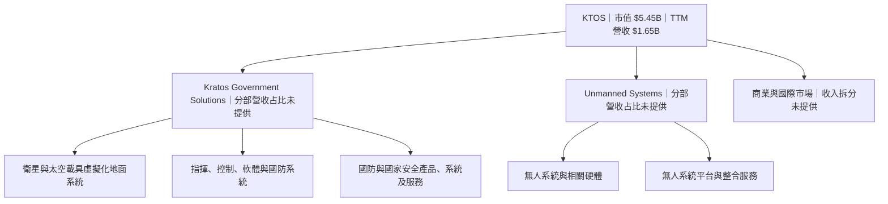
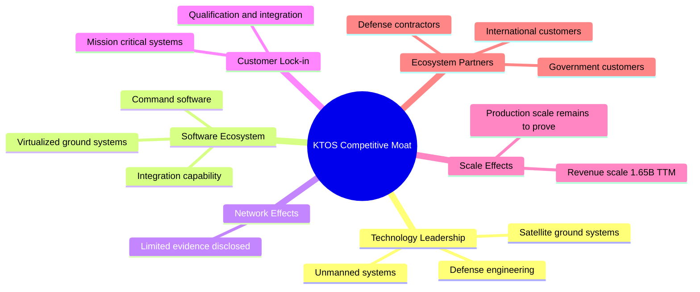
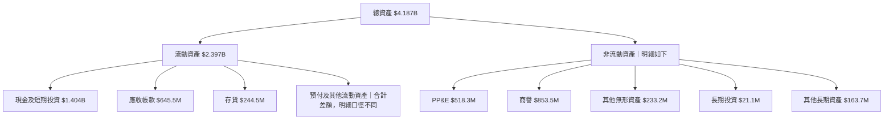
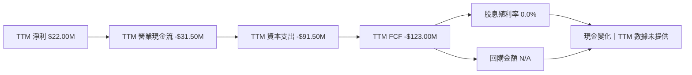
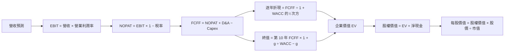
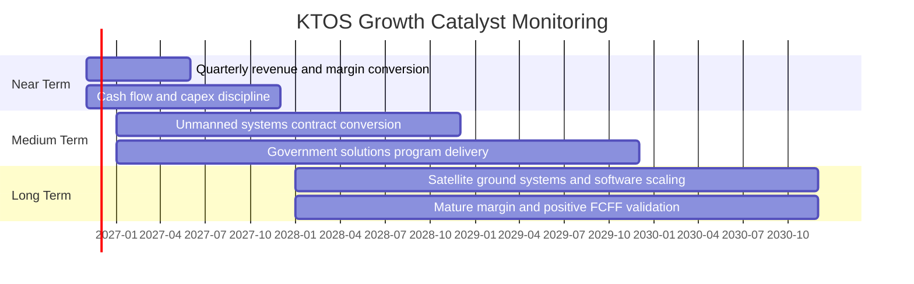
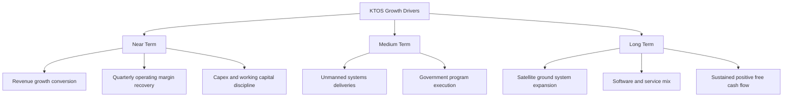
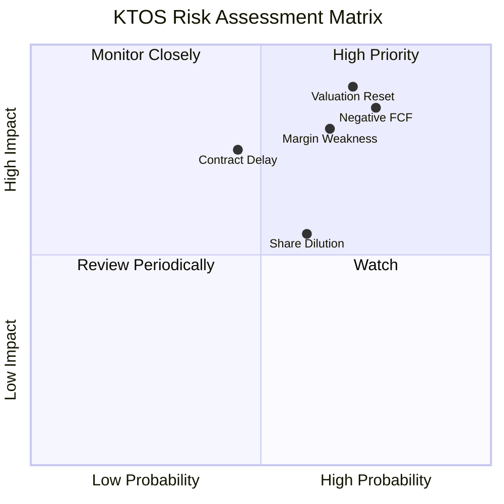
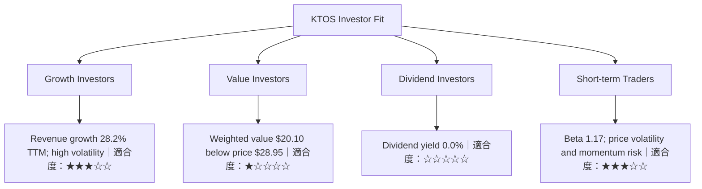

# KTOS 基本面深度分析報告
> **報告日期**：2026-11-27 ｜ **語言**：繁體中文 ｜ **數據來源**：SEC 申報資料 (XBRL)、Yahoo Finance、Finviz、StockAnalysis、Roic.ai ｜ **分析師**：CFA 級機構研究

## 目錄

| # | 章節 | 核心結論 |
|---|------|----------|
| 1 | 執行摘要 | 賣出；加權合理價值 $20.10；MOS -44.0% |
| 2 | 公司概覽與商業模式 | 無人系統與政府解決方案提供成長選擇權，但業務拆分數據不足 |
| 3 | 損益表深度分析 | TTM 營收 $1.65B、成長 28.2%；營業利益率僅 0.4% |
| 4 | 資產負債表分析 | 現金與短期投資 $1.40B；流動性充足，債務數據來源存在差異 |
| 5 | 現金流量深度分析 | TTM FCF -$123.00M，投資支出高於營業現金流 |
| 6 | 獲利能力與資本效率 | ROIC 0.2% 低於 WACC 10.08%，目前未創造足夠經濟價值 |
| 7 | 相對估值分析 | KTOS 估值倍數顯著高於三家同業，且高於同業中位數推導價值 |
| 8 | DCF 內在價值評估 | DCF 基準價值 $9.93；加權合理價值 $20.10，均低於現價 |
| 9 | 成長催化劑 | 國防需求、無人系統及衛星地面系統是潛在驅動力，量化 TAM 未提供 |
| 10 | 風險矩陣 | 現金流轉負、估值回落與利潤率低是主要風險 |
| 11 | 投資建議 | 依 MOS 為賣出；關注現金流、利潤率及訂單轉換 |

---

## 1. 執行摘要

KTOS 的最新 TTM 營收為 **$1.65B**，TTM 年增 **28.2%**，最新一季單季年增 **35.7%**；但 TTM 營業利益率只有 **0.4%**，TTM 營業現金流 **-$31.50M**、資本支出 **$91.50M**，因此 TTM FCF 為 **-$123.00M**。ROIC **0.2%** 低於 WACC **10.08%**，表示目前資本回報尚未覆蓋資本成本。依估值方法加權後合理價值 **$20.10**，相對 2026-11-25 收盤價 **$28.95** 的 MOS 為 **-44.0%**；因此依規則 20 評級為 **賣出**，不作質化上調或下調。

### 1.0 一頁式投資儀表板（Portfolio Manager 30 秒速讀）

| 項目 | 內容 |
|------|------|
| **投資論點（3 句）** | ① TTM 營收成長 **28.2%**，最新一季單季年增 **35.7%**，顯示需求與交付速度上升。② TTM 營業利益率僅 **0.4%**、FCF **-$123.00M**，成長尚未轉化為自由現金流。③ 加權合理價值 **$20.10**，低於現價 **$28.95**；估值與現金流風險使風險報酬比不利。 |
| **綜合評分** | **4.8/10**（引用 1.1 評分卡） |
| **財務健康** | 🟡 現金與短期投資 **$1.40B**、流動比率 **5.418**；但 TTM FCF **-$123.00M**，現金緩衝尚未消除獲利轉現風險。 |
| **ROIC vs WACC** | **0.2% vs 10.08%**；🟥 目前低於資本成本，未創造經濟附加價值。 |
| **FCF 趨勢** | TTM FCF 為負；FCF Yield **-2.26%**。高資本支出與負營業現金流是主因。 |
| **估值** | Forward P/E **25.9x** ｜ EV/EBITDA **47.7x**（財務摘要來源）｜ FCF Yield **-2.26%** |
| **DCF 內在價值（基準）** | **$9.93** ｜現價相對 DCF 溢價 **191.5%**（以 DCF 基準價值計） |
| **安全邊際（MOS）** | **-44.0%＝($20.10 − $28.95) ÷ $20.10**；🔴 無安全邊際 |
| **預期報酬（基準情境 12M）** | DCF 基準情境相對現價 **-65.7%**；此為模型價值差距，不是保證的一年報酬。 |
| **關鍵風險（前二）** | ① FCF 持續為負、資本支出高；② 成長未能轉化為營業利潤率與現金流。 |
| **評級 + 信心度** | 🔴 **賣出** ｜信心：中（DCF 對終值依賴高，且輸入資料存在口徑差異） |

### 1.1 綜合評分卡（全報告唯一）

| 維度 | 評分（1–10） | 主要依據（引用數字與其來源章節） |
|------|--------------|----------------------------------|
| 成長性 | 8.0 | TTM 營收年增 **28.2%**、最新一季單季年增 **35.7%**（第 3 章）；但未假設所有增速可持續。 |
| 獲利能力 | 2.5 | TTM 營業利益率 **0.4%**、ROIC **0.2%**、Piotroski **3/8**（第 3、6 章）。 |
| 財務健康 | 7.0 | 現金與短期投資 **$1.40B**、流動比率 **5.418**；惟 TTM FCF **-$123.00M**（第 4、5 章）。 |
| 估值 | 1.0 | MOS **-44.0%**；Forward P/E **25.9x** 高於同業中位數 **18.6x**（第 7、8 章）。 |
| 護城河 | 6.0 | 國防與國家安全產品、系統與軟體業務具專業門檻，但細分收入及續約數據未提供（第 2 章）。 |
| 管理層與資本配置 | 4.0 | FY2025 SBC **$35.50M**，約佔營收 **2.6%**；FY2025 FCF **-$137.40M**，未見股息分配（第 3、5 章）。 |
| **綜合評分** | **4.8** | 六項算術平均：**(8.0 + 2.5 + 7.0 + 1.0 + 6.0 + 4.0) ÷ 6 = 4.75，四捨五入為 4.8**。 |

### 1.2 五大投資論點 + 三大核心風險

| 類型 | 項目 | 具體依據 | 信心度 |
|------|------|----------|--------|
| 🟢 **投資論點①** | 成長速度提升 | TTM 營收年增 **28.2%**；最新一季營收年增 **35.7%**，高於 2025 年全年 **18.52%**。 | 🟢 高 |
| 🟢 **投資論點②** | 資產負債表有現金緩衝 | 現金與短期投資 **$1.40B**，流動比率 **5.418**，有資金支持研發與產能投資。 | 🟢 中 |
| 🟢 **投資論點③** | 無人系統與政府解決方案有策略性需求 | 公司業務涵蓋無人系統、衛星地面系統及國防相關產品；但各業務收入占比未提供，不能量化各自貢獻。 | 🟡 中 |
| 🟢 **投資論點④** | 毛利額隨規模擴大 | FY2022 至 FY2025 毛利由 **$226.0M** 增至 **$307.9M**；擴張若能配合費用控制，可能提高營業槓桿。 | 🟡 中 |
| 🟢 **投資論點⑤** | 無股息支出，資金可留用 | 股息殖利率 **0.0%**；資金用途更依賴研發、產能、併購或營運資金投資成效。 | 🟡 中 |
| 🟡 **風險①** | 成長沒有轉成現金流 | TTM OCF **-$31.50M**、Capex **$91.50M**、FCF **-$123.00M**；若持續，現金緩衝可能被消耗。 | 🔴 高衝擊 |
| 🔴 **風險②** | 估值與基本面脫節 | Forward P/E **25.9x**，同業中位數 **18.6x**；加權合理價值 **$20.10**，較現價低 **30.6%**。 | 🔴 高 |
| 🟡 **風險③** | 季度獲利波動 | 最新季度營業利益 **-$4.0M**，較上一季 **-$0.8M** 惡化；單季營業利益率依 SEC 口徑為 **-1.0%**。 | 🟡 中高 |

### 1.3 快速統計卡片

| 指標 | 公司實際值（期間） | 同業中位數 | 狀態 |
|------|--------------------|------------|------|
| 營收成長（TTM） | **28.2%** | — | 🟢 |
| 營收成長（最新一季年增） | **35.7%** | **6.7%** | 🟢 |
| 毛利率（TTM） | **23.0%** | **20.0%** | 🟢 |
| 營業利益率（TTM） | **0.4%** | — | 🔴 |
| ROIC（TTM） | **0.2%** | — | 🔴 |
| Forward P/E | **25.9x** | **18.6x** | 🔴 |
| FCF Yield（TTM） | **-2.26%** | — | 🔴 |
| Piotroski F-Score | **3 / 8** | — | 🔴 |

### 1.4 投資結論

```text
╔══════════════════════════════════════════════════════════════════╗
║                    📊 投資結論摘要                               ║
╠══════════════════════════════════════════════════════════════════╣
║  評級：🔴 賣出（MOS -44.0%，符合規則 20）                        ║
║  價格（2026-11-25 收盤）：$28.95                                 ║
║  DCF 內在價值（基準）：$9.93（現價溢價 191.5%）                  ║
║  安全邊際 MOS：-44.0%（以加權合理價值 $20.10 為分母）           ║
║  加權合理價值（8.8）：$20.10                                     ║
║  DCF 情境價值：                                                   ║
║    悲觀情境：$8.22（-71.6%）                                     ║
║    基準情境：$9.93（-65.7%）                                     ║
║    樂觀情境：$13.85（-52.2%）                                    ║
║  綜合評分：4.8/10（引用 1.1）                                    ║
║  適合投資人：能承受高波動、看重國防科技成長選擇權的投資人；      ║
║              不適合以現金流或估值安全邊際為首要條件者。          ║
╚══════════════════════════════════════════════════════════════════╝
```

---

## 2. 公司概覽與商業模式

### 2.1 業務結構與收入來源

Kratos Defense & Security Solutions, Inc.（KTOS）是美國國防與安全科技公司，提供硬體、產品、系統與軟體，並透過 **Kratos Government Solutions** 與 **Unmanned Systems** 兩個部門營運。TTM 營收為 **$1.65B**，但分部營收、占比與分部利潤資料未提供，故不將公司總營收任意分配到各部門。



TTM 營收年增 **28.2%**，而 FY2025 營收年增 **18.52%**。若增長來自交付增加與新平台採購，代表訂單轉收入速度提升；但分部收入、訂單與積壓量未提供，現階段不能確認成長來自哪個單一產品線，也不能直接推定其持續性。

### 2.2 市場份額

市場份額數據未提供，亦沒有可引用的市場份額來源與年份，因此不提供市場份額表或比例。KTOS TTM 營收 **$1.65B**，最新一季單季營收年增 **35.7%**，高於 AVAV、LMT、NOC 三家公司最新季度年增率的中位數 **6.7%**；但公司規模和業務組合不同，不能把相對成長直接等同於市場份額提升。

### 2.3 競爭護城河分析



### 2.4 護城河強度

| 護城河項目 | 強度（強／中／弱） | 證據（引用數字或事實） | 會削弱它的情況 |
|------------|--------------------|------------------------|----------------|
| 技術與系統整合 | 中 | 業務包含國防系統、無人平台及衛星地面系統；具任務關鍵型產品特徵。 | 技術替代、競爭者產品性能提升或客戶轉向自研。 |
| 軟體與系統嵌入 | 中 | 提供虛擬化地面系統與指揮控制相關軟體；軟體收入占比未提供。 | 軟體部署、維護收入不具持續性，或採購轉向標準化方案。 |
| 客戶鎖定與認證 | 中 | 國防任務系統通常需要整合及認證；公司實際續約率、客戶集中度未提供。 | 主要合約流失、延遲交付或客戶將需求集中給大型主承包商。 |
| 網路效應 | 弱 | 沒有客戶網絡、平台使用者或資料網絡效應的量化證據。 | 若客戶間不共享平台效益，網路效應難以形成。 |
| 規模效應 | 弱至中 | TTM 營收 **$1.65B**，但 TTM 營業利益率僅 **0.4%**，規模效益尚未反映於高利潤。 | 營收增長但固定成本、研發或產能成本同步上升。 |
| 生態夥伴 | 中 | 業務面向美國及國際國防與安全市場；合作夥伴收入貢獻未提供。 | 供應鏈瓶頸、合作合約終止或採購政策改變。 |

**護城河分數理由：**第 1.1 節護城河評分 **6.0/10**，反映專業技術、任務關鍵型系統與客戶整合具有一定門檻，但缺少分部經濟性、續約與軟體收入占比等數據，尚不足以支持更高評價。

---

## 3. 損益表深度分析

### 3.1 年度收入成長趨勢（近4年）

```text
╔══════════════════════════════════════════════════════════════════╗
║        Kratos Defense 年度收入趨勢（FY2022-FY2025）              ║
╠══════════════════════════════════════════════════════════════════╣
║ FY2022  $0.898B  █████████████        YoY: +10.70%               ║
║ FY2023  $1.037B  ███████████████      YoY: +15.45%               ║
║ FY2024  $1.136B  █████████████████    YoY: +9.56%                ║
║ FY2025  $1.347B  ████████████████████ YoY: +18.52%               ║
║                                                                  ║
║ FY2022–FY2025 CAGR = (1.347 ÷ 0.8983)^(1/3) − 1 = 約 14.5%      ║
╚══════════════════════════════════════════════════════════════════╝
```

FY2022 至 FY2025 營收複合年增約 **14.5%**。FY2025 成長加速至 **18.52%**，而 TTM 成長進一步升至 **28.2%**；收入擴張可能受需求、交付及併購後整合影響，但現有資料未提供有機成長與併購貢獻拆分，因此不將 TTM 加速全部視為可持續的內生增長。

### 3.2 季度收入趨勢分析

| 季度 | 營收 | QoQ 成長 | YoY 成長 | 備註 |
|------|------:|---------:|---------:|------|
| 2025 Q4 | $345.1M | **+14.0%**¹ | **+21.9%** | 對比 2025 Q3 營收 $302.6M；YoY 取 StockAnalysis。 |
| 2026 Q1 | $371.0M | **+7.5%** | **+22.6%** | 對比 2025 Q4 $345.1M；單季年增取財務數據。 |
| 2026 Q2 | $458.8M | **+23.7%** | **+30.5%** | 對比 2026 Q1 $371.0M；較快增長拉高季度收入基礎。 |
| 2026 Q3 | $471.8M | **+2.8%** | **+35.7%** | 單季年增率；QoQ 增速低於 Q2，仍須留意交付節奏。 |

¹ StockAnalysis 季表的 Q4 2025 為 **$345.1M**、Q3 2025 為 **$347.6M**，但另一年度季度表列 2025 Q4 **$345.1M**、2025 Q3 **$302.6M**；數據存在季度口徑不一致。此處 QoQ 按表列 2026 Q1 對 2025 Q4 計算，2025 Q4 QoQ 的跨表可比性有限。其他 QoQ 算式：2026 Q2 **($458.8M ÷ $371.0M − 1) = 23.7%**；2026 Q3 **($471.8M ÷ $458.8M − 1) = 2.8%**。

### 3.3 利潤率演變分析

| 利潤率指標 | FY2022 | FY2023 | FY2024 | FY2025 | 趨勢 | 評估 |
|------------|-------:|-------:|-------:|-------:|------|------|
| **毛利率** | 25.2% | 25.9% | 25.3% | 22.9% | FY2025 下滑約 2.4 個百分點 | 🟡 |
| **營業利益率** | 0.5% | 3.0% | 2.6% | 2.1% | FY2023 高點後逐年回落 | 🔴 |
| **淨利率** | -4.1% | -0.9% | 1.4% | 1.6% | 從虧損轉為低正利潤 | 🟡 |
| **EBITDA Margin** | 2.9% | 7.5% | 8.2% | 7.6% | FY2024 後回落 | 🟡 |

年度毛利率按「毛利 ÷ 營收」計算；TTM 毛利率另按所列數據為 **23.0%**。FY2025 毛利率由 FY2024 的約 **25.3%** 降至 **22.9%**，可能反映產品組合、專案執行成本或成本投入變化；現有資料未提供分部毛利與項目成本，故不能將下滑歸因於單一原因。TTM 營業利益率依 SEC 核心數據為 **0.4%**，而其他彙整資料為 **0.7%**；本報告以 SEC／VERIFIED FIGURES 的 **0.4%** 作為估值與核心比較口徑。

### 3.4 費用結構分析

**Mermaid 費用結構圖：N/A（數據未提供：缺少完整 SG&A、研發、利息及其他營業費用拆分，不能以總額反推各項占比）。**

已知 FY2025 研發費用 **$40.0M**，相當於營收 **$1.347B** 的約 **3.0%**；FY2024 研發費用 **$40.3M**，FY2023 **$38.4M**。研發支出大致穩定，營收成長快於研發費用，理論上可能帶來規模槓桿；但 FY2025 營業利益率仍只有約 **2.1%**，TTM 按核心口徑更只有 **0.4%**，顯示其他營運成本或產品組合仍限制利潤轉換。

### 3.5 季度 EPS 趨勢與盈餘品質（Quality of Earnings）

| 季度 | EPS 實際值 | EPS 預期值 | 超預期／不及預期 |
|------|-----------:|-----------:|-------------------|
| 2025 Q4 | $0.03 | N/A | N/A（EPS 預期數據缺漏） |
| 2026 Q1 | $0.07 | N/A | N/A（EPS 預期數據缺漏） |
| 2026 Q2 | $0.02 | N/A | N/A（EPS 預期數據缺漏） |
| 2026 Q3 | -$0.00 | N/A | N/A（EPS 預期數據缺漏） |

最近四季實際 EPS 約呈現「**$0.03、$0.07、$0.02、-$0.00**」的波動。EPS estimate 欄位均為缺漏，不能判斷是否超預期或不及預期；最新季度淨利 **-$0.2M**，同時營業利益 **-$4.0M**，利潤回落與營收成長並存，反映成本端及季度專案組合的重要性。

| 盈餘品質項目 | 數值／佔比 | 評估 |
|--------------|------------|------|
| 股權薪酬 SBC / 營收 | FY2025：**$35.50M ÷ $1.347B = 2.6%**；最近四季 SBC 合計 **$58.50M**，約為 TTM 營收的 **3.6%** | 🟡 SBC 是實際股東成本；持續發行會稀釋每股價值。 |
| SBC / 營業現金流 | TTM OCF 為 **-$31.50M**，故比值 **-$58.50M ÷ -$31.50M = 185.7%**；正負同時為負使比值不具一般「覆蓋率」意義 | 🔴 SBC 規模高於營業現金流絕對值，現金轉換仍弱。 |
| FCF / 淨利（現金轉換率） | TTM：**-$123.00M ÷ $22.00M = -559.1%** | 🔴 淨利沒有轉成自由現金流，主因為負 OCF 與高 Capex。 |
| 一次性／非經常性損益 | N/A（未提供可核實明細） | 不假設一次性損益美化或壓低盈餘。 |
| 有效稅率異常 | N/A（未提供 TTM 實際有效稅率拆分） | 不以 21% 模型稅率代替實際稅率分析。 |
| 資本化支出 vs 費用化 | TTM Capex **$91.50M**；資本化與費用化項目的完整明細未提供 | Capex 會先以投資現金流方式承擔，未來透過折舊影響損益；不能據此推定費用被不當資本化。 |

**盈餘品質結論：**GAAP TTM 淨利 **$22.0M** 並未轉成正 FCF，現金轉換率為 **-559.1%**；SBC 約佔 TTM 營收 **3.6%**，對每股價值有稀釋影響。當前估值不宜只以淨利或 EPS 支撐，應優先觀察 OCF、Capex 與稀釋股數趨勢。

---

## 4. 資產負債表分析

### 4.1 資產結構分解

截至 2026-09-27，StockAnalysis 列示總資產 **$4.187B**、流動資產 **$2.397B**；現金及短期投資 **$1.404B**、應收帳款 **$645.5M**、存貨 **$244.5M**。非流動資產各項包括 PP&E **$518.3M**、商譽 **$853.5M**、無形資產 **$233.2M**、長期投資 **$21.1M** 與其他長期資產 **$163.7M**。



上述部分細項與總資產的加總會受資料列分類與四捨五入影響，不將差額另行分配到未提供項目。資產中商譽與無形資產規模可觀，若收購資產未達預期可能帶來減值風險。

### 4.2 流動性與營運資金分析

| 指標 | 最新 TTM | 一年前 TTM | 變化 | 解讀 |
|------|----------|------------|------|------|
| DSO 應收帳款天數 | **42 天** | **39 天** | **+3 天** | 收款週期延長，需觀察合約驗收、政府付款節奏與應收帳款品質。 |
| DIO 存貨天數 | **70 天** | **66 天** | **+4 天** | 存貨週期增加，可能是備貨支援成長，也可能代表交付或需求預測未完全匹配。 |
| DPO 應付帳款天數 | **32 天** | **24 天** | **+8 天** | 延長付款天數有助短期資金周轉，但需留意供應商付款條件與供應鏈關係。 |
| CCC 現金轉換週期 | **80 天** | **81 天** | **-1 天** | 週期略縮短；DPO 增加抵銷 DSO、DIO 上升。 |

流動比率 **5.418**、速動比率 **4.632**，顯示短期流動性數值較高；但營運資金天數顯示應收與存貨均比一年前增加，CCC 的改善主要受 DPO 上升帶動，而非收款或庫存效率改善。

### 4.3 債務結構分析

財務數據核心區塊列示「總債務 N/A」、淨現金 **$1.40B**；其他市場／財務摘要則列示總債務 **$246.0M**、淨現金 **$1.16B**。兩者口徑不一致，以下債務方框優先採用核心數據，並明確保留差異；不推算缺失債務。

```text
╔══════════════════════════════════════════════════════════════════╗
║                   KTOS 債務健康診斷                              ║
╠══════════════════════════════════════════════════════════════════╣
║  總債務：        N/A（核心數據未提供）                            ║
║  交叉來源債務：  $246.00M（另一財務摘要口徑）                    ║
║  現金+短期投資： $1.40B                                          ║
║  淨現金：        $1.40B（核心數據原值；不以其他債務數字重算）    ║
║  流動比率：      5.418x                                          ║
║  Debt/EBITDA：   N/A（債務與 EBITDA 口徑不一致，不自行推算）     ║
║  利息保障倍數：  N/A（利息費用數據未提供）                      ║
╚══════════════════════════════════════════════════════════════════╝
```

### 4.4 股東權益趨勢

| 財年 | 股東權益 | 年變化 | 解讀 |
|------|---------:|-------:|------|
| 2022 | $936.3M | — | 基期 |
| 2023 | $976.0M | +$39.7M | 小幅增加 |
| 2024 | $1.350B | +$374.0M | 資本基礎擴大 |
| 2025 | $2.000B | +$650.0M | 明顯擴張；無法僅憑現有資料判定各項增量來源 |

權益擴大可提供吸收投資與併購的能力，但每股價值仍取決於資本回報是否高於資本成本；TTM ROIC **0.2%** 顯著低於 WACC **10.08%**，因此權益規模增加本身不等於價值創造。

---

## 5. 現金流量深度分析

### 5.1 現金流量瀑布圖



### 5.2 FCF 轉換率趨勢

| 財年 | FCF | 淨利 | FCF / 淨利 | 評估 |
|------|----:|-----:|-----------:|------|
| 2022 | -$71.1M | -$36.9M | 192.7%¹ | 分子、分母皆為負，不宜解讀為高轉換率。 |
| 2023 | $12.8M | -$8.9M | -143.8%¹ | 淨利為負，比例不具常規現金轉換意義。 |
| 2024 | -$8.5M | $16.3M | -52.1% | 有正淨利但自由現金流為負。 |
| 2025 | -$137.4M | $22.0M | -624.5% | FCF 明顯低於淨利；資本支出為 $95.3M。 |
| TTM | -$123.0M | $22.0M | -559.1% | 仍未將帳面獲利轉換為自由現金流。 |

¹ 負淨利時此比率只作算術列示，不代表通常定義下的現金轉換品質。年度 OCF 為 N/A，不能用 FCF 反推 OCF。

### 5.3 自由現金流趨勢

```text
╔══════════════════════════════════════════════════════════════════╗
║                 自由現金流：歷史實際                             ║
╠══════════════════════════════════════════════════════════════════╣
║ FY2022   -$71.1M  ◀██████████████░░░░░░░░░░░░                  ║
║ FY2023   +$12.8M  ███░░░░░░░░░░░░░░░░░░░░                      ║
║ FY2024    -$8.5M  ◀██░░░░░░░░░░░░░░░░░░░░                      ║
║ FY2025  -$137.4M  ◀██████████████████████████                  ║
║ TTM     -$123.0M  ◀███████████████████████  FCF Yield -2.26%   ║
║                                                                  ║
║ 年度 FCF Yield：未提供可一致回推的年度市值序列；不作估算。      ║
╚══════════════════════════════════════════════════════════════════╝
```

FY2025 FCF **-$137.4M**，TTM FCF **-$123.0M**，兩者均為負；TTM Capex **$91.50M**，代表公司仍在投入產能或設備，但若投入未形成可觀的交付與利潤，現金流風險會持續。

### 5.4 資本配置評估

資本配置的完整比例資料未提供，不繪製資金比例圓餅圖。已知 FY2025 Capex **$95.3M**、SBC **$35.5M**、股息殖利率 **0.0%**；FY2025 FCF 為 **-$137.4M**。年度 OCF 資料為 NaN，故不能將 FCF 拆解成 OCF 與 Capex，也不能推算回購或留存現金金額。

---

## 6. 獲利能力與資本效率

### 6.1 ROE / ROA / ROIC 趨勢

| 指標 | FY2022 | FY2023 | FY2024 | FY2025／TTM | 評估 |
|------|-------:|-------:|-------:|------------:|------|
| ROE | N/A | N/A | N/A | TTM **0.6%**（品質數據） | 回報低；其他彙整來源列 TTM **0.8%**，本報告採品質數據 **0.6%**。 |
| ROA | N/A | N/A | N/A | TTM **0.2%** | 資產獲利能力偏低。 |
| ROIC | N/A | N/A | N/A | TTM **0.2%** | 遠低於 WACC。 |
| ROIC 對 WACC | — | — | — | **0.2% vs 10.08%** | 🔴 負向經濟利差約 **-9.88 個百分點**。 |

歷年 ROIC、ROA 同一口徑資料未完整提供，不以片段歷史資料補造。行業均值未提供，故不列行業均值欄。

### 6.2 ROIC vs WACC 分析（核心價值創造判斷）

```text
╔══════════════════════════════════════════════════════════════════╗
║                ROIC vs WACC 深度分析                            ║
╠══════════════════════════════════════════════════════════════════╣
║  WACC（程式計算輸入，依規則採用原值）：10.08%                    ║
║  ├── 無風險利率（10Y 美債）：             4.85%                  ║
║  ├── 市場風險溢酬 ERP：                   5.00%                  ║
║  ├── Beta（調整後）：                     1.11                   ║
║  ├── 股權成本：                           10.40%                 ║
║  ├── 稅前債務成本：                       3.90%                  ║
║  ├── 稅率：                               21.0%                  ║
║  ├── E / D 權重：                         95.7% / 4.3%            ║
║  └── ✅ 採用 WACC：                       10.08%                 ║
║                                                                  ║
║  ROIC（TTM）：                            0.2%                   ║
║  WACC − ROIC：                            9.88 個百分點           ║
║  經濟利差 ROIC − WACC：                  -9.88 個百分點           ║
║                                                                  ║
║  ROIC  0.2%   ░░░░░░░░░░░░░░░░░░░░░░░░░░░░░  🔴                 ║
║  WACC 10.08%  ▓▓▓▓▓▓▓▓▓▓▓▓▓▓▓▓▓▓▓▓▓▓▓▓▓▓▓▓▓  ──                 ║
║                                                                  ║
║  結論：目前 ROIC 顯著低於 WACC，尚未創造足以覆蓋資本成本的價值。║
╚══════════════════════════════════════════════════════════════════╝
```

WACC 各項輸入依成本資本數據原值採用。需要注意的是，以表列 Ke **10.40%**、稅前 Kd **3.90%**、稅率 **21.0%**、E/D 權重 **95.7%/4.3%** 直接計算，得到的數值與所列 WACC **10.08%** 不完全一致；按直接代入計算為：

**10.40% × 95.7% + [3.90% × (1−21.0%)] × 4.3% = 約 9.95%**。

依嚴格規則，本報告估值仍採用來源提供的 **10.08%**，不另改寫 DCF 折現率；此口徑差異降低模型可稽核性，於第 8.10 節列示。

### 6.3 杜邦三因素分解

| 因素 | 數值（TTM） | 解讀 |
|------|-------------|------|
| 淨利率 | **1.3%** | 淨利潤率偏低，是 ROE 的主要限制。 |
| 資產週轉率 | **0.39** | 每單位資產產生的營收有限，資產擴張尚未轉化成高回報。 |
| 權益乘數 | **1.21** | 槓桿程度不高，ROE 不是靠高財務槓桿撐起。 |
| **ROE** | **0.6%** | 品質數據列示：**1.3% × 0.39 × 1.21 = 0.6%**；各項因四捨五入可能有尾差。 |

### 6.4 財務體質：Piotroski F-Score

**Piotroski F-Score：3 / 8**（有一項因資料缺失無法判定；按品質數據原值引用）。

| 測試 | 結果 | 解讀 |
|------|------|------|
| ROA > 0 | ✅ 通過 | TTM 資產報酬率為正，但僅 **0.2%**。 |
| 營業現金流 > 0 | ❌ 未通過 | TTM OCF **-$31.50M**。 |
| ROA 高於一年前 | ❌ 未通過 | 相較一年前未改善。 |
| 營業現金流 > 淨利（應計品質） | ❌ 未通過 | OCF 為負而淨利為正，現金盈餘品質弱。 |
| 長期負債 ÷ 總資產低於一年前 | — 無法判定 | 缺少可用長期負債輸入。 |
| 流動比率高於一年前 | ✅ 通過 | 流動比率相較一年前改善。 |
| 稀釋股數未增加 | ❌ 未通過 | 稀釋股數增加；與 SBC 及股東稀釋風險一致。 |
| 毛利率高於一年前 | ✅ 通過 | 品質指標顯示通過；TTM 毛利率為 **23.0%**。 |
| 資產週轉率高於一年前 | ❌ 未通過 | 資產使用效率未提升。 |

---

## 7. 相對估值分析

### 7.1 同業估值比較表格

| 估值指標 | **KTOS** | **AVAV** | **LMT** | **NOC** | KTOS 評估 |
|----------|---------:|---------:|--------:|--------:|-----------|
| **Trailing P/E** | **241.3x** | N/A | 21.3x | 17.5x | 🔴 高；KTOS 盈利基數很低，倍數對小幅盈餘變動極敏感。 |
| **Forward P/E** | **25.9x** | 20.7x | 18.0x | 18.6x | 🔴 高於同業中位數 **18.6x**。 |
| **P/S Ratio** | **3.3x** | 2.3x | 1.7x | 1.8x | 🔴 高；市場已為營收成長支付較高倍數。 |
| **EV/EBITDA** | **47.7x**¹ | 22.4x | 15.5x | 12.7x | 🔴 顯著高於同業中位數 **15.5x**。 |
| **最新季度營收年增** | **35.7%** | 5.7% | 11.3% | 6.7% | 🟢 成長較快，但需驗證利潤轉化。 |
| **毛利率（TTM）** | **23.0%** | 26.5% | 11.7% | 20.0% | 🟡 高於 LMT、NOC，低於 AVAV。 |

¹ Peer multiples 區塊列示 KTOS EV/EBITDA **48.8x**，另一彙整估值區列示 **47.744x**；表中採市場估值摘要約 **47.7x**，歷史估值分析則使用專屬歷史區塊數字。此處不將不同資料來源口徑混為同一個精確倍數。

### 7.2 歷史估值區間分析

```text
╔══════════════════════════════════════════════════════════════════╗
║                KTOS 歷史估值區間（TTM）                          ║
╠══════════════════════════════════════════════════════════════════╣
║ P/E：     中位數 380.2x｜當前 241.3x｜百分位 27%                 ║
║           區間 232.9x 至異常極端高值；極端值降低區間解讀性        ║
║ P/S：     中位數 3.2x｜當前 3.3x｜百分位 60%                     ║
║           區間 1.3x–11.6x                                        ║
║ EV/EBITDA：中位數 55.5x｜當前 48.8x｜百分位 35%                  ║
║           區間 33.8x–221.5x                                      ║
╚══════════════════════════════════════════════════════════════════╝
```

P/E 當前低於自身歷史中位數，但歷史 P/E 區間受極端異常值影響，參考價值有限；P/S **3.3x** 略高於歷史中位數 **3.2x**。EV/EBITDA **48.8x** 低於自身中位數 **55.5x**，但仍明顯高於同業 EV/EBITDA 中位數 **15.5x**，顯示「低於自身歷史中位數」不代表絕對便宜。

### 7.3 情境價值（Bear / Base / Bull，依 DCF MODEL）

| 情境 | 第 1 年營收成長 | 期末營業利潤率 | WACC | 每股價值 | 相對現價 | 機率 | 會發生的條件 |
|------|----------------:|---------------:|-----:|---------:|---------:|-----:|--------------|
| 🔴 悲觀 | **14.1%** | **1.6%** | **11.08%** | **$8.22** | **-71.6%** | **25%** | 成長回落、成本與投資需求維持高位、風險溢酬上升。 |
| 🟡 基準 | **28.2%** | **1.9%** | **10.08%** | **$9.93** | **-65.7%** | **50%** | 首年延續 TTM 成長，十年後利潤率升至近五年中位數假設。 |
| 🟢 樂觀 | **42.3%** | **2.1%** | **9.08%** | **$13.85** | **-52.2%** | **25%** | 成長高於目前 TTM、利潤率改善且資本成本下行。 |

三種 DCF 情境均低於現價，意味著單靠模型設定內的營收成長與利潤率改善，仍不足以支持目前股價。

### 7.4 相對估值隱含價格區間

```text
╔══════════════════════════════════════════════════════════════════╗
║             相對估值方法隱含每股價值與現價                       ║
╠══════════════════════════════════════════════════════════════════╣
║ DCF 基準          $9.93 ─────── 現價 $28.95                      ║
║ 同業 Forward P/E $20.71 ─────── 現價 $28.95                      ║
║ 同業 EV/EBITDA   $14.32 ─────── 現價 $28.95                      ║
║ 分析師共識       $73.69 ─────── 現價 $28.95                      ║
╚══════════════════════════════════════════════════════════════════╝
```

- **同業 Forward P/E：$20.71**，依 AVAV、LMT、NOC 同業中位數 **18.6x** 乘以 KTOS Forward EPS **$1.12**。
- **同業 EV/EBITDA：$14.32**，依同業中位數 **15.5x** 乘以 KTOS TTM EBITDA，再加回淨現金；細部未四捨五入 EBITDA 與橋接數字未提供，不自行補造。
- **分析師共識目標價：$73.69**，來自 26 位分析師平均目標價；作為加權方法之一，但與現金流模型及同業相對估值差距很大，應視為高不確定性參考。

---

## 8. DCF 內在價值評估（Discounted Cash Flow）

### 8.0 估值推理鏈（Thinking Logic）

**Step 1 — 價值驅動變數**

KTOS 價值主要由三項構成：既有政府解決方案業務、無人系統成長，以及最終營業利潤率／自由現金流轉換。分部營收占比未提供，不能量化各項占比；可確認的總體錨點是 TTM 營收 **$1.65B**、TTM 成長 **28.2%**、營業利益率 **0.4%**。估值主導變數是「營收增長能否轉化為更高 EBIT 利潤率與正 FCFF」；敏感度表顯示 WACC 與終值成長率也會明顯影響每股價值。

**Step 2 — 模型選擇**

| 決策點 | 本報告採用 | 理由（含數字） | 曾考慮但否決 | 否決理由 |
|--------|-----------|----------------|--------------|----------|
| 現金流定義 | FCFF | 與 WACC 折現並計算 EV 一致；模型明確採 FCFF | FCFE | 資本結構與債務資料存在口徑差異，FCFF 較適合企業價值橋接。 |
| 預測期 N | **10 年** | 模型提供 10 年逐年預測，並令營收增速由 **28.2%** 線性降至 **3.0%** | 5 年 | 無法容納模型設定的增長逐步衰減與終值銜接。 |
| 終值方法 | Gordon Growth | 模型提供終值成長率 **3.0%** | 退出倍數 | DCF MODEL 未提供退出倍數輸入，不自行補造。 |
| EBIT 基礎 | GAAP EBIT | TTM GAAP 營業利潤率 **0.4%**，DCF 明列 GAAP EBIT | 非 GAAP EBIT | 非 GAAP EBIT 與 SBC 調整明細未提供。 |

**Step 3 — 關鍵假設推導鏈**

- **營收增長：**錨點＝TTM 營收年增 **28.2%**、最近 FY2022–FY2025 CAGR 約 **14.5%** → 調整＝首年使用 TTM 高增速，之後線性遞減至成熟增速 → **採用第 1 年 28.2%、第 10 年 3.0%** → 曾考慮直接用多年歷史 CAGR 作首年成長，但模型採用 TTM 加速值；若以歷史 CAGR 起步，會較保守，但數據模型不允許改值。
- **期末營業利潤率：**錨點＝TTM **0.4%**，FY2021–FY2025 財年營業利潤率約 **2.1%–3.7%**（以年度營業利益／營收計）→ 調整＝模型假設規模與產品組合改善，但不假設高利潤率 → **採用第 10 年 1.9%** → 曾考慮維持目前 **0.4%**，但會忽略模型採用的五年歷史中位數收斂設定；亦不採更高利潤率，因近期 TTM 利潤率偏低。
- **永續成長率 g：**錨點＝模型設為 **3.0%**，低於 WACC **10.08%** → 調整＝採長期成熟成長而非延續高增速 → **採用 3.0%** → 不採用接近 WACC 的高 g，避免終值失控。
- **預測期 N：**錨點＝模型明列 **10 年** → 調整＝讓營收增速由 **28.2%** 衰減至 **3.0%**，使終值接近成熟期 → **採用 10 年** → 不採用更短預測期，因會過早進入終值；不擅自改變程式模型期間。
- **Capex／營收：**錨點＝TTM Capex **$91.50M**／TTM 營收 **$1.65B**，約 **5.6%** → 模型設定由 **5.6%** 降至 **5.1%** → 曾考慮直接固定 TTM **5.6%**，但模型假設成熟後投資強度回落；此假設仍有風險。
- **EBIT 基礎與 SBC：**錨點＝模型明列 GAAP EBIT，GAAP 已將 SBC 作為費用 → **採組合 (A)：GAAP EBIT + 固定股數，FCFF 不再減 SBC，股數不再額外稀釋** → 不採非 GAAP EBIT，因沒有可核對的調整後 EBIT。
- **年稀釋率：**錨點＝稀釋股數未持平，Piotroski 測試未通過 → 模型採固定股數，與組合 (A) 配套 → **模型年稀釋率設為 0%** → 若另加稀釋率會與 GAAP EBIT 中已費用化 SBC 重複計入；但固定股數可能低估真實稀釋。
- **終值方法：**錨點＝模型提供 Gordon Growth、g **3.0%** → 調整＝採穩定成長公式 → **採用 Gordon Growth** → 不採退出倍數法作主模型，因未提供可複算的終值倍數輸入。
- **WACC：**錨點＝成本資本區塊列示 **10.08%** → 調整＝不自行改動程式 WACC，雖按所列 Ke、Kd 和權重重算存在約 **0.13 個百分點**差異 → **採用 10.08%** → 不採自行重算的約 **9.95%**，避免改寫指定模型輸入。

**Step 4 — 最脆弱假設**

最脆弱環節是營收成長與低營業利潤率能否同時改善：若收入增長未轉化為現金與利潤，DCF 基準值可能高估；而基準終值現值占 EV **84.5%**，終值假設失準會對估值產生重大影響。

**Step 5 — 計算路徑圖**



### 8.1 模型假設總表（Model Inputs）

| 假設項目 | 採用值 | 依據／來源 | 敏感度 |
|----------|--------|-------------|--------|
| 預測期長度 N | **10 年** | DCF MODEL 明列；營收增速由 **28.2%** 衰減至 **3.0%** | 🟡 中 |
| 營收增長 | 第 1 年 **28.2%**，第 10 年 **3.0%**，逐年線性衰減 | TTM vs prior TTM 成長 **28.2%**；終點為模型假設 | 🔴 高 |
| 營業利潤率 | 第 1 年 **0.4%** → 第 10 年 **1.9%** | TTM 營業利益率；終點為近五年財年中位數設定 | 🔴 高 |
| 有效稅率 | **21.0%** | 模型預設值；實際 TTM 有效稅率未提供 | 🟢 低 |
| Capex／營收 | 第 1 年 **5.6%** → 第 10 年 **5.1%** | TTM Capex／營收約 **5.6%**，模型向成熟狀態遞減 | 🟡 中 |
| D&A／營收 | **4.7%** | 模型採 TTM 比率並固定 | 🟢 低 |
| 營運資金變動 | **未建模** | DCF MODEL 明確未建模 ΔWC；因此 FCFF 不含 ΔWC | 🟢 低 |
| EBIT 基礎 | GAAP EBIT | 模型使用 GAAP EBIT | 🟡 中 |
| SBC 處理 | 組合 **(A)**；不另扣 SBC | GAAP EBIT 已含 SBC 費用；模型固定股數 | 🟡 中 |
| 年稀釋率 | **0%（模型固定股數）** | 依組合 (A)；與稀釋股數增加的實際風險有落差 | 🟡 中 |
| 永續成長率 g | **3.0%** | 模型設定；低於 WACC **10.08%** | 🔴 高 |
| 終值方法 | Gordon Growth | 模型提供 TV 算式；退出倍數未提供 | 🔴 高 |
| WACC | **10.08%** | 成本資本區塊原值；第 6.2 節同值 | 🔴 高 |

**FCFF 定義：**本模型使用 **FCFF = NOPAT + D&A − Capex**，不含營運資金變動列。  
**SBC 防重複扣除：**本模型採用 **(A) GAAP EBIT + 固定股數**，故 SBC 影響已透過 GAAP 費用計入一次；FCFF 不另減 SBC，股數不作額外年稀釋。

### 8.2 折現率推導（WACC）

```text
╔══════════════════════════════════════════════════════════════════╗
║                    WACC 推導（折現率）                           ║
╠══════════════════════════════════════════════════════════════════╣
║  股權成本 Ke（CAPM）：                                           ║
║  ├── 無風險利率 Rf：                    4.85%                    ║
║  ├── 市場風險溢酬 ERP：                 5.00%                    ║
║  ├── 原始 Beta（Yahoo）：               1.17                     ║
║  ├── 調整後 Beta：                      1.11                     ║
║  ├── Beta 調整方式：                    ⅔×1.17 + ⅓×1 = 1.11     ║
║  ├── 額外規模／國別溢酬：               0.00%（未提供另加溢酬） ║
║  └── Ke = 4.85% + 1.11×5.00% = 10.40%                           ║
║                                                                  ║
║  債務成本：                                                       ║
║  ├── 稅前 Kd：                          3.90%                    ║
║  ├── 模型稅率：                         21.0%                    ║
║  └── 稅後 Kd = 3.90%×(1−21.0%) = 3.081%                         ║
║                                                                  ║
║  資本權重：E 95.7% / D 4.3%                                      ║
║  └── 採用 WACC：                       10.08%                    ║
╚══════════════════════════════════════════════════════════════════╝
```

逐步演算與口徑檢查：

1. **Ke（CAPM）**＝**4.85% + 1.11 × 5.00% + 0.00% = 10.40%**。
2. **稅前 Kd**＝成本資本區塊直接列示 **3.90%**；利息費用與平均計息負債的分母明細未提供，不能依模板反推。
3. **稅後 Kd**＝**3.90% × (1 − 21.0%) = 3.081%**。
4. **權重**＝股權 **95.7%**、債務 **4.3%**；權重合計 **95.7% + 4.3% = 100.0%**。市值與債務組成細項不足，不能獨立重算權重。
5. **重算核對**＝**10.40% × 95.7% + 3.081% × 4.3% = 9.954%**，與指定 WACC **10.08%** 不同。依規則直接採用區塊 WACC **10.08%**，不改寫模型；此處差異需視為資料內部不一致。

Rf 來源為成本資本資料，未提供可核實的具體觀察日期；本報告不自行補上日期。WACC 與第 6.2 節採用同一 **10.08%**。

### 8.3 逐年自由現金流預測（基準情境）

單位：**$B**；金額按模型表取兩位小數，折現因子三位小數。模型未建模 ΔWC，亦未另扣 SBC。

| 年度 | FY+1 | FY+2 | FY+3 | FY+4 | FY+5 | FY+6 | FY+7 | FY+8 | FY+9 | FY+10 |
|------|-----:|-----:|-----:|-----:|-----:|-----:|-----:|-----:|-----:|------:|
| 營收 | 2.11 | 2.65 | 3.24 | 3.88 | 4.54 | 5.19 | 5.78 | 6.28 | 6.64 | 6.84 |
| 營收 YoY | 28.2% | 25.4% | 22.6% | 19.8% | 17.0% | 14.2% | 11.4% | 8.6% | 5.8% | 3.0% |
| 營業利潤率 | 0.4% | 0.6% | 0.7% | 0.9% | 1.1% | 1.2% | 1.4% | 1.6% | 1.7% | 1.9% |
| EBIT | 0.01 | 0.01 | 0.02 | 0.03 | 0.05 | 0.06 | 0.08 | 0.10 | 0.12 | 0.13 |
| − 稅 | (0.00) | (0.00) | (0.00) | (0.01) | (0.01) | (0.01) | (0.02) | (0.02) | (0.02) | (0.03) |
| = NOPAT | 0.01 | 0.01 | 0.02 | 0.03 | 0.04 | 0.05 | 0.06 | 0.08 | 0.09 | 0.10 |
| + D&A | 0.10 | 0.12 | 0.15 | 0.18 | 0.21 | 0.24 | 0.27 | 0.29 | 0.31 | 0.32 |
| − Capex | (0.12) | (0.15) | (0.18) | (0.21) | (0.24) | (0.28) | (0.31) | (0.33) | (0.34) | (0.35) |
| **= FCFF** | **-0.01** | **-0.01** | **-0.01** | **-0.00** | **0.01** | **0.02** | **0.03** | **0.04** | **0.06** | **0.07** |
| 折現因子 @10.08% | 0.908 | 0.825 | 0.750 | 0.681 | 0.619 | 0.562 | 0.510 | 0.464 | 0.421 | 0.383 |
| **FCFF 現值 PV** | **-0.01** | **-0.01** | **-0.01** | **-0.00** | **0.00** | **0.01** | **0.01** | **0.02** | **0.02** | **0.03** |

模型列示預測期 PV 合計 **$0.07B**；因表格每年數字已四捨五入至 $0.01B，逐格加總與程式以未四捨五入數字所得合計可能存在尾差。按模型原值，完整十年 PV 合計為 **$0.07B**。

**FY+1 逐步演算（按模型列示值，金額四捨五入）：**

1. 營收＝**$1.65B × (1 + 28.2%) = 約 $2.11B**。
2. EBIT＝**$2.11B × 0.4% = 約 $0.01B**。
3. 稅＝**EBIT × 21.0%**，模型顯示 **$0.00B**（以 $B 兩位小數呈現）。
4. NOPAT＝模型列示 **$0.01B**。
5. D&A＝**$2.11B × 4.7% = 約 $0.10B**。
6. Capex＝**$2.11B × 5.6% = 約 $0.12B**。
7. ΔWC＝**未建模**。
8. FCFF＝模型原列 **-$0.01B**；以已四捨五入的 NOPAT、D&A、Capex 直接運算會受到未顯示小數影響，故不以圓整數替換模型值。
9. 折現因子＝**1 ÷ (1+10.08%)^1 = 0.908**；PV＝模型原列 **-$0.01B**。

**合理性自檢：**
- 預測 FCF CAGR：因前段 FCFF 為負，跨越零值計算 CAGR 不具一般意義；歷史 FCF 亦在正負間波動，不能以單一 CAGR 比較。
- FY+10 FCF 利潤率＝**$0.07B ÷ $6.84B ≈ 1.0%**；目前 TTM FCF 利潤率＝**-$123.00M ÷ $1.65B ≈ -7.5%**；同業最佳 FCF 利潤率未提供。
- FY+1 至 FY+4 FCFF 為負，會降低預測期現值；第 5 年後轉正，但第 10 年 FCFF 仍僅 **$0.07B**。

```text
╔══════════════════════════════════════════════════════════════════╗
║            自由現金流：歷史實際 vs 模型預測                      ║
╠══════════════════════════════════════════════════════════════════╣
║ FY2023(實)   +$0.013B  ██░░░░░░░░░░░░░░░░░░░                     ║
║ FY2024(實)   -$0.009B  ◀█░░░░░░░░░░░░░░░░░░░                    ║
║ FY2025(實)   -$0.137B  ◀████████████████████                    ║
║ TTM(實)      -$0.123B  ◀██████████████████                      ║
║ FY+1(預)     -$0.010B  ◀██                                       ║
║ FY+10(預)    +$0.070B  ██████████                                ║
╠══════════════════════════════════════════════════════════════════╣
║ 預測後段轉正，但 TTM FCF 為負；模型十年後 FCF 利潤率約 1.0%。   ║
╚══════════════════════════════════════════════════════════════════╝
```

### 8.4 終值計算（Terminal Value）

**適用性檢查：**WACC **10.08%** vs g **3.0%** → **WACC > g？✅**

DCF MODEL 提供 Gordon Growth 終值；退出倍數法的終值倍數、FY+10 EBITDA 等輸入未提供，因此不能另行計算退出倍數法數值。

| 方法 | 計算式 | 終值 TV | TV 現值 | 佔總 EV 比重 |
|------|--------|---------|---------|--------------|
| Gordon Growth | FCFF(FY+10) × (1+g) ÷ (WACC−g) | **$1.03B** | **$0.39B** | **84.5%** |
| 退出倍數法 | N/A（退出倍數輸入未提供） | N/A | N/A | N/A |

逐步演算（依模型列示值；中間數字有四捨五入）：

1. FY+10 FCFF：**$0.07B**。
2. 分子：**$0.07B × (1 + 3.0%) = 約 $0.0721B**。
3. 分母：**10.08% − 3.0% = 7.08%**；模型 TV 原值 **$1.03B**。以顯示到兩位小數的 FCFF 重算會有尾差，模型採用未四捨五入現金流。
4. PV(TV)：模型列示 **$1.03B × 0.383 = $0.39B**。
5. 終值占 EV：**84.5%**。因此，本估值高度依賴終值假設，短期現金流貢獻有限。

### 8.5 企業價值 → 每股內在價值（Bridge）

```text
╔══════════════════════════════════════════════════════════════════╗
║              企業價值 → 每股內在價值 橋接表                      ║
╠══════════════════════════════════════════════════════════════════╣
║  預測期 FCF 現值合計            +$0.07B                          ║
║  終值現值 PV(TV)                +$0.39B                          ║
║  ─────────────────────────────────────────────                  ║
║  = 企業價值 EV                   $0.47B（模型原列）              ║
║  + 淨現金                       +$1.40B（核心數據原值）          ║
║  = 股權價值                      $1.87B（模型原列）              ║
║  ÷ 股數橋接                      價格 ÷ 市值比率法               ║
║  ★ 每股內在價值                  $9.93                           ║
║    當前股價                      $28.95                          ║
║    折溢價（現價÷DCF價值−1）      +191.5%（溢價）                 ║
╚══════════════════════════════════════════════════════════════════╝
```

逐步橋接：

1. EV：模型原列預測期 PV **$0.07B**、終值 PV **$0.39B**，EV 原列 **$0.47B**；以已四捨五入的兩項直接相加為 **$0.46B**，相差 **$0.01B**，來自未四捨五入原值。
2. 股權價值：模型原列 **EV $0.47B + 淨現金 $1.40B = $1.87B**。
3. 每股價值：模型指定公式為 **股權價值 × 最新股價 ÷ 市值**，即 **$1.87B × $28.95 ÷ $5.45B = 約 $9.93**；顯示值沿用模型原值 **$9.93**。
4. 折溢價：**$28.95 ÷ $9.93 − 1 = +191.5%**。
5. 本節不計算 MOS；MOS 僅在 8.8 以加權合理價值為分母計算。

股數橋接採模型公式「股權價值 × 價格 ÷ 市值」，未另作年稀釋；市場資料列示流通股數 **188.27M**。現金及短期投資取核心數據 **$1.40B**；總債務在核心數據中為 N/A，因此模型使用淨現金原值 **$1.40B**。

### 8.6 敏感性分析（WACC × 永續成長率）

括號為相對現價 **$28.95** 的上行空間；此矩陣為 DCF MODEL 原列數值。

| g（列）／WACC（欄） | 8.08% | 9.08% | **10.08%（基準）** | 11.08% | 12.08% |
|-----------|------:|------:|-------------------:|-------:|-------:|
| **2.0%** | $10.82 (-62.6%) | $10.15 (-64.9%) | $9.66 (-66.6%) | $9.28 (-67.9%) | $8.99 (-68.9%) |
| **2.5%** | $11.10 (-61.7%) | $10.34 (-64.3%) | $9.79 (-66.2%) | $9.38 (-67.6%) | $9.06 (-68.7%) |
| **3.0%（基準）** | $11.43 (-60.5%) | $10.55 (-63.6%) | **$9.93 (-65.7%)** | $9.48 (-67.3%) | $9.14 (-68.4%) |
| **3.5%** | $11.83 (-59.1%) | $10.80 (-62.7%) | $10.10 (-65.1%) | $9.60 (-66.8%) | $9.22 (-68.2%) |
| **4.0%** | $12.33 (-57.4%) | $11.11 (-61.6%) | $10.30 (-64.4%) | $9.74 (-66.4%) | $9.32 (-67.8%) |

示範有效非基準格：**WACC 9.08% > g 2.5% ✅**。該格模型價值為 **$10.34**；依 DCF MODEL 敏感度輸出引用。因該矩陣格未提供逐年未四捨五入 PV 與終值底層資料，不能在不重建模型的情況下獨立逐步重算出同一格；不另造中間值。

**三情境 DCF（模型原列）**

| 情境 | 年 1 成長 | 期末營業利潤率 | g | WACC | 每股價值 | 相對現價 | 機率 |
|------|---------:|---------------:|--:|-----:|---------:|---------:|----:|
| 🔴 悲觀 | 14.1% | 1.6% | **3.0%（模型未另列；沿用基準終值設定）** | 11.08% | $8.22 | -71.6% | 25% |
| 🟡 基準 | 28.2% | 1.9% | **3.0%** | 10.08% | $9.93 | -65.7% | 50% |
| 🟢 樂觀 | 42.3% | 2.1% | **3.0%（模型未另列；沿用基準終值設定）** | 9.08% | $13.85 | -52.2% | 25% |

情境的完整逐項營收、FCFF 及終值推導沒有在模型輸出中提供，不自行補造。機率加權值照模型為 **$10.48**；但第 8.8 節依規則使用基準 DCF **$9.93**，不以機率加權值取代。

- g **3.0% → 4.0%**、WACC 固定 **10.08%**：每股價值 **$9.93 → $10.30**，增加 **$0.37／3.7%**。
- WACC **10.08% → 11.08%**、g 固定 **3.0%**：每股價值 **$9.93 → $9.48**，減少 **$0.45／4.5%**。
- 期末營業利潤率每增加 1 個百分點的價值變化：**N/A（敏感度矩陣未提供該變數單獨的數值）**。
- 結論：在已提供的敏感度格中，WACC 變化的影響略大於 g；但模型最重要的營運變數仍是收入增長能否帶來利潤率及 FCF 改善。

### 8.7 反推 DCF（Reverse DCF：市場在預期什麼）

模型只提供兩個反推結果，其他變數與迭代軌跡未提供。固定輸入依模型基準：WACC **10.08%**、稅率 **21.0%**、Capex 比率由 **5.6%** 漸降至 **5.1%**、營運資金未建模、預測期 **10 年**、固定股數口徑。

| 求解的變數（一次一個） | 其餘變數設定 | 市場隱含值（令 DCF = 現價） | 歷史／基準比較 | 判斷 |
|------------------------|--------------|------------------------------|----------------|------|
| 年 1 營收成長率 | 利潤率、g、WACC 等固定基準 | **87.6%** | 基準年 1 為 **28.2%**；歷史 FY2022–FY2025 CAGR 約 **14.5%** | 🔴 若以 DCF 反推，市場價格要求很高的短期成長。 |
| 固定營業利潤率 | 營收成長、g 等固定基準 | **8.7%** | 基準路徑 **0.4%→1.9%** | 🔴 遠高於模型基準終點。 |
| 永續成長率 g | 未提供反推結果 | 未計算 | — | N/A |
| 預測期 N | 未提供反推結果 | 未計算 | — | N/A |

反推模型顯示，若其他基準輸入不變，要以 DCF 支持現價，營收年 1 增長需達 **87.6%**，或固定營業利潤率需達 **8.7%**。逐步試算軌跡未由模型提供，因此不虛構中間試算點。此結果說明以指定 DCF 假設解釋現價存在落差。

### 8.8 估值三角驗證與安全邊際

| 估值方法 | 隱含每股價值 | 上行空間（÷現價） | 權重 | 說明 |
|----------|--------------:|-------------------:|-----:|------|
| DCF（基準） | **$9.93** | **-65.7%** | **40%** | 10 年 FCFF、WACC 10.08%、g 3.0%。 |
| 同業 Forward P/E | **$20.71** | **-28.5%** | **25%** | 同業中位數 **18.6x** × KTOS Forward EPS **$1.12**。 |
| 同業 EV/EBITDA | **$14.32** | **-50.5%** | **25%** | 同業中位數 **15.5x** × TTM EBITDA，加回淨現金。 |
| 分析師共識目標價 | **$73.69** | **+154.5%** | **10%** | 26 位分析師平均目標價；僅作低權重參考。 |
| **加權合理價值** | **$20.10** | **-30.6%** | **100%** | 依「profitable」公司類型採用既定權重。 |

逐步演算：

**加權合理價值 = $9.93 × 40% + $20.71 × 25% + $14.32 × 25% + $73.69 × 10% = $3.972 + $5.1775 + $3.580 + $7.369 = $20.0985 ≈ $20.10**。

- MOS：**($20.10 − $28.95) ÷ $20.10 = -44.0%**。
- 上行空間：**($20.10 − $28.95) ÷ $28.95 = -30.6%**。
- 折溢價（以第 8.5 節 DCF 基準價值為基準）：**$28.95 ÷ $9.93 − 1 = +191.5%**。

權重依公司類型固定，並非分析師自行調整；DCF、兩項相對估值與分析師共識均按原列保留，沒有剔除方法。

```text
╔══════════════════════════════════════════════════════════════════╗
║                  估值區間與安全邊際                              ║
╠══════════════════════════════════════════════════════════════════╣
║  悲觀DCF $8.22 ── 現價 $28.95 ── 加權合理值 $20.10 ── 基準DCF $9.93 ║
║  （各項排序非價格由低到高；數值依方法分列）                      ║
║                                                                  ║
║  安全邊際 MOS = ($20.10 − $28.95) ÷ $20.10 = -44.0%             ║
║  MOS 評估：🔴 <10% 無                                            ║
║  上行空間 = ($20.10 − $28.95) ÷ $28.95 = -30.6%                 ║
║                                                                  ║
║  買入區間參考：不高於 $18.09，對應加權合理價值的 MOS 至少 10%    ║
║  （$20.10 × (1 − 10%) = $18.09；此為估值門檻，不是模型目標價）   ║
║  合理持有區間：需待基本面與估值重新評估；目前現價高於加權價值    ║
║  減碼考慮：現價 $28.95 已高於加權合理價值 $20.10                 ║
╚══════════════════════════════════════════════════════════════════╝
```

> 🔎 **程式複算（Python，依本節各項自動重算）**
>
> 加權合理價值 = $9.93 × 40% + $20.71 × 25% + $14.32 × 25% + $73.69 × 10% = **$20.10**（權重合計 100%）
>
> 以價格 $28.95 計：MOS = **-44.0%**，上行空間 = **-30.6%**
>
> ✅ 與本節所寫數值一致。

### 8.9 DCF 模型的局限與失效條件

- **終值依賴度：**終值 PV 占 EV **84.5%**，估值主要由第 10 年後假設決定；短期預測 FCF 貢獻有限。
- **最脆弱假設：**營收增長衰減路徑與營業利潤率改善。模型第 10 年利潤率 **1.9%**，但 TTM 營業利益率僅 **0.4%**；若利潤率沒有改善，價值可能低於基準 **$9.93**，具體幅度未提供單變數敏感度，不能另造數字。
- **FCF 為負的適用性：**TTM FCF **-$123.00M**，且預測前四年 FCFF 為負，令 DCF 可靠度低於穩定獲利公司；應同時關注 EV/Sales、同業估值及分部盈利能力，而非只依單一 DCF 數值。
- **模型口徑：**未建模 ΔWC、股數固定、總債務 N/A 但使用淨現金 **$1.40B**；WACC 輸入重算約 **9.95%**，指定採用 **10.08%**。均限制模型可稽核性。
- **與第 10 章風險連結：**營收放緩會降低成長假設；Capex 維持高位會壓低 FCFF；合約延遲或成本超支會削弱利潤率；利率與風險溢酬上升則提高 WACC。

### 8.10 複算檢核表（Audit Trail）

| # | 檢核項目 | 檢查方式 | 結果 |
|---|----------|----------|------|
| 1 | 高／中敏感度輸入均有推導鏈 | 對照 8.0 Step 3 | ✅ 已逐項列示；部分被否決替代值受限於模型原值。 |
| 2 | 每個假設都有來歷 | 對照 8.1 依據欄 | ✅ 已標錨點或明示模型輸入。 |
| 3 | WACC 五步算式與重算 | 權重相加、重算 WACC | ⚠️ 權重合計 100%；依輸入重算約 **9.95%**，與指定 **10.08%** 不一致；估值仍照採 10.08%。 |
| 4 | Kd 分母與權重 D 範圍一致 | 檢查計息負債與利息費用明細 | ⚠️ 利息費用、平均計息負債及租賃負債範圍未提供，無法獨立核對。 |
| 5 | WACC 與第 6.2 節同值 | 比對 | ✅ 兩處均採 **10.08%**。 |
| 6 | 逐年數量等於 N，無省略 | 檢查年度欄 | ✅ FY+1 至 FY+10 共 10 年。 |
| 7 | FY+1 算式可複算 | 以表格四捨五入值重算 | ⚠️ 模型以未四捨五入底層值計算；顯示精度不足以逐分完全重現。 |
| 8 | 預測期 PV 加總 | 十年 PV 與模型合計 | ⚠️ 年度 PV 四捨五入後與原列合計有尾差；沿用模型原值 **$0.07B**。 |
| 9 | WACC > g | 比較 | ✅ **10.08% > 3.0%**。 |
| 10 | 終值以 FY+N 為基礎並折現 N 期 | 檢查模型假設 | ✅ 模型列示以 FY+10 及折現因子 **0.383** 計算。 |
| 11 | EV 至每股價值橋接 | 核對四捨五入數值 | ⚠️ $0.07B + $0.39B 顯示值為 $0.46B，模型 EV $0.47B，差異由未四捨五入底層值造成。 |
| 12 | SBC 組合一致 | GAAP、無扣 SBC、固定股數 | ✅ 採組合 (A)，但固定股數可能低估稀釋風險。 |
| 13 | 矩陣基準格等於 DCF 基準值 | 比對 10.08%、3.0% 格 | ✅ **$9.93**。 |
| 14 | 敏感性格符合 WACC > g | 檢查矩陣 | ✅ 全部格子均 WACC > g。 |
| 15 | 三情境機率合計 | 25% + 50% + 25% | ✅ **100%**。 |
| 16 | 反推每列只放開一個變數 | 核對輸出 | ⚠️ 提供兩個單變數解；沒有迭代軌跡與其他求解項，不自行補造。 |
| 17 | MOS 與 1.0 一致；折溢價依 DCF | 比對 | ✅ MOS **-44.0%**；DCF 折溢價 **+191.5%**。 |
| 18 | 完整輸出至第 11 章 | 檢查章節 | ✅ 本報告列至第 11 章。 |
| 19 | 加權價值等於方法加權總和 | 逐項重算 | ✅ **$20.0985 ≈ $20.10**，無事後調整。 |
| 20 | 評級符合 MOS 門檻 | MOS 對照規則 | ✅ MOS **-44.0% < -25%**，評級為賣出。 |

---

## 9. 成長催化劑

### 9.1 催化劑時間軸

下列時間為觀察框架，不代表公司已公告確切交付日期；具體合約及產品時程未提供。



短期最重要的驗證點是營收成長是否轉成營業利益與現金流；中長期則需觀察無人系統與政府解決方案的合約交付、軟體及服務收入持續性。收入與合約的分部資料未提供，不應將具體成長假設當成已實現成果。

### 9.2 TAM 市場規模分析

**N/A（TAM 數據未提供）。**KTOS TTM 營收 **$1.65B**、年增 **28.2%**，顯示公司正處於擴張階段；但沒有可引用的 TAM 金額、來源與年份，不能推算市場滲透率或市場份額。

### 9.3 成長驅動力結構圖



---

## 10. 風險矩陣

### 10.1 風險評分矩陣

機率與衝擊座標為研究判斷，不是財報披露數值；圖中以英文節點符合 Mermaid 語法要求。



### 10.2 風險清單詳細分析

| # | 風險項目 | 發生機率 | 財務衝擊 | 風險評分 | 緩解措施 |
|---|----------|----------|----------|----------|----------|
| 1 | 🔴 **負 FCF 延續** | 高（定性判斷） | TTM FCF **-$123.00M**；若延續將侵蝕 **$1.40B** 現金緩衝 | 🔴 高 | 每季追蹤 OCF、Capex、FCF；要求收入增長同步改善現金流。 |
| 2 | 🔴 **估值重估** | 中高（定性判斷） | 加權合理價值 **$20.10**；較現價 **$28.95** 低 **30.6%**，DCF 基準低 **65.7%** | 🔴 高 | 避免單以營收增速推論估值；使用現金流與同業倍數交叉檢查。 |
| 3 | 🔴 **利潤率改善不如預期** | 中高（定性判斷） | TTM 營業利益率 **0.4%**，最新一季 SEC 口徑 **-1.0%**；若低於 DCF 的第 10 年 **1.9%**，內在價值下修 | 🔴 高 | 追蹤分部毛利、營業費用率、交付成本與專案重工。 |
| 4 | 🟡 **合約與交付延遲** | 中（定性判斷） | 延遲可能推後營收認列、增加營運資金需求；積壓訂單與合約額未提供，無法量化 | 🟡 中高 | 追蹤訂單轉換、驗收、應收帳款及 DSO；目前 DSO **42 天**，較一年前增加 **3 天**。 |
| 5 | 🟡 **SBC 與股數稀釋** | 中（定性判斷） | 最近四季 SBC 約 **$58.50M**，約為 TTM 營收 **3.6%**；稀釋股數測試未通過 | 🟡 中 | 監控稀釋股數增幅，評估 SBC 占營收與每股 FCF 的變化。 |

---

## 11. 投資建議

### 11.1 最終評級與評分

依加權合理價值 **$20.10** 與最新收盤價 **$28.95** 計算，MOS 為 **-44.0%**，依規則 20 評級為 **賣出**，未作一級調整。第 1.1 節綜合評分為 **4.8/10**；六項分數為成長性 **8.0**、獲利能力 **2.5**、財務健康 **7.0**、估值 **1.0**、護城河 **6.0**、管理層與資本配置 **4.0**。

### 11.2 合理價值與隱含報酬率

| 估值項目 | 每股價值 | 機率 | 相對現價 $28.95 | 說明 |
|----------|---------:|-----:|----------------:|------|
| 加權合理價值 | **$20.10** | — | **-30.6%** | 依第 8.8 節四種方法及既定權重。 |
| 悲觀 DCF | **$8.22** | 25% | **-71.6%** | 年 1 成長 14.1%、期末利潤率 1.6%、WACC 11.08%。 |
| 基準 DCF | **$9.93** | 50% | **-65.7%** | 年 1 成長 28.2%、期末利潤率 1.9%、WACC 10.08%。 |
| 樂觀 DCF | **$13.85** | 25% | **-52.2%** | 年 1 成長 42.3%、期末利潤率 2.1%、WACC 9.08%。 |
| 機率加權 DCF（參考） | **$10.48** | 100% | **-63.8%** | DCF MODEL 原列；不替代第 8.8 節加權合理價值。 |

### 11.3 買入時機與觸發因素

```text
╔══════════════════════════════════════════════════════════════════╗
║                  ✅ 買入觸發因素 Checklist                      ║
╠══════════════════════════════════════════════════════════════════╣
║  立即建立或加碼前，建議多數條件同時符合：                        ║
║  ☐ TTM FCF 由 -$123.00M 轉正，且不是單季一次性改善               ║
║  ☐ TTM 營業利益率持續高於 0.4%，最新季度轉正                     ║
║  ☐ 營收成長能伴隨毛利率穩定，非單靠低利潤專案擴張                ║
║                                                                  ║
║  估值觸發：                                                       ║
║  ☐ 股價不高於約 $18.09，對應加權合理價值 $20.10 的 10% MOS 門檻  ║
║  ☐ 若基本面改善，重新計算合理價值後再調整該門檻                 ║
║                                                                  ║
║  減碼／重新檢視條件：                                             ║
║  ☐ 連續季度營收放緩且營業利益率維持負值                          ║
║  ☐ TTM FCF 持續低於 -$123.00M 或現金餘額明顯下降                 ║
║  ☐ 稀釋股數增幅加快，且每股盈利與每股現金流未改善                ║
╚══════════════════════════════════════════════════════════════════╝
```

### 11.4 投資人適配度分析



### 11.5 每季財報監控清單（Quarterly Watch List）

| 監控指標 | 現況基準 | 加碼／正面觸發 | 減碼／負面觸發 |
|----------|----------|---------------|---------------|
| 營收成長 | TTM **28.2%**；最新一季單季年增 **35.7%** | 單季年增維持 **≥20%**，並由多個業務共同貢獻 | 連續兩季單季年增低於 **10%** |
| 營業利益率 | TTM **0.4%**；最新一季核心口徑 **-1.0%** | 連續兩季回到正值且逐季改善 | 連續兩季低於 **-1.0%** 或營收增長但利潤率繼續下滑 |
| OCF／FCF | TTM OCF **-$31.50M**；FCF **-$123.00M** | TTM FCF 轉正，且 OCF 高於 Capex | TTM FCF 低於 **-$123.00M** 且現金餘額下滑 |
| Capex | TTM **$91.50M** | 投資增加但交付和 FCF 同步改善 | Capex 增加而收入或毛利不改善 |
| 毛利率 | TTM **23.0%** | 維持或高於 **23.0%** 且營業利益率改善 | 低於 **20.0%** 或連續兩季下降 |
| 應收帳款／DSO | DSO **42 天** | DSO 回落至 **39 天或以下** | DSO 連續增加並超過 **45 天** |
| 存貨／DIO | DIO **70 天** | DIO 回落至 **66 天或以下**，且交付增加 | DIO 超過 **75 天** 且收入增長放慢 |
| SBC／稀釋股數 | 最近四季 SBC 約 **$58.50M**；稀釋股數測試未通過 | SBC／營收下降且每股指標改善 | SBC／營收升破最近四季約 **3.6%**，或股數增幅加快 |
| 訂單與管理層財測 | 訂單、積壓量及完整財測未提供 | 合約轉收入、交付與毛利均改善 | 大型專案延遲、取消或管理層下修財測 |

以上門檻為追蹤框架，不是公司發布的指引；觸發後應結合訂單、合約與分部資料重新評估。

### 11.6 反面論證：什麼會證明論點錯誤（What Would Change My Mind）

```text
╔══════════════════════════════════════════════════════════════════╗
║              ⚠️ 論點失效條件（Disconfirming Evidence）           ║
╠══════════════════════════════════════════════════════════════════╣
║  多頭成長論點需在以下情況重新檢視：                              ║
║  ☐ 最新季度營收年增連續兩季低於 10%                              ║
║  ☐ TTM 營業利益率連續兩季低於 -1.0%                              ║
║  ☐ TTM FCF 低於 -$123.00M，或現金與短期投資低於 $1.40B 後持續下滑║
║  ☐ DSO 超過 45 天、DIO 超過 75 天，且營收增速同步放緩            ║
║  ☐ 稀釋股數持續增加，SBC／營收高於最近四季約 3.6%               ║
║  ☐ ROIC 長期低於 WACC 10.08%，且營業利潤率未向上改善             ║
║  ☐ 無人系統或政府解決方案的合約延遲／取消，且未能由其他業務補足  ║
╚══════════════════════════════════════════════════════════════════╝
```

> **免責聲明**：本報告為 AI 自動生成，僅供研究參考，不構成投資建議。投資有風險，入市需謹慎。

---

## 資料與來源

| 項目 | 內容 |
|------|------|
| 價格 | 28.95 USD，2026-11-25 收盤（Yahoo Finance 日線） |
| 財務報表 | SEC 10-Q filed 2026-11-05，最新季度 2026-09-27（FY2026 Q3） |
| 有回應的資料來源 | SEC 申報資料 (XBRL)、Yahoo Finance、Finviz、StockAnalysis、Roic.ai |
| 由程式計算 | TTM 數字、WACC、DCF 模型、估值方法與權重、加權合理價值、MOS、評級門檻、F-Score、杜邦分解、營運資金天數、綜合評分 |
| 撰寫模型 | openai / gpt-6-luna |

> 本區塊由產生報告的程式依實際取得的資料填寫，非模型撰寫。「由程式計算」的數字不是模型的估計；其餘判斷（評分、情境、策略）是模型的分析。
